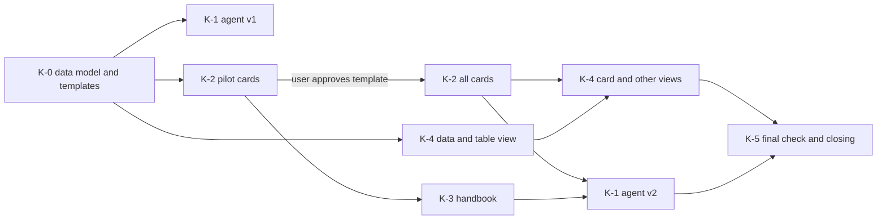

# Vaihe K: ohjelmiston tietopohja ja käsikirja – toteutussuunnitelma / Phase K: knowledge base and handbook – implementation plan

Laadittu 2026-11-26 vaiheen C sulkemisen yhteydessä; käyttäjä hyväksyi suunnitelman ja käynnisti
vaiheen K 2026-11-27 tarkennuksin (pilotin korttivalinta, vaikutusten koneluettava luokitus, K-4:n
lisävaatimukset luku 8.2a, uusi K-5 luku 8a).

**Toteutuksen tila 2026-11-27:**

| Osa | Tila | Missä |
|---|---|---|
| K-0 | **valmis**: rekisterisarakkeet `juurisyy`, `juurisyy_muut`, `ohjelmat`, `ohjelmat_peruste`, `tila`, `korjaus`; `rekisteri/tekninen-velka.csv`; vaikutusrekisteri `rekisteri/vaikutusulottuvuudet.csv` + `rekisteri/vaikutukset.csv` (luku 4.1); OP-kohtien tilarivit; `synteesi.py --tarkista` laajennettu; `tyokalut/tietopohja.py`, `tyokalut/viitteet.py`; korttipohjat, kirjoitusohje, sanaston runko | `rekisteri/README.md`, `doc/tietopohja/` |
| K-1 | **valmis**: agentti `pirila-expert`, skill `pirila-ask`, 32 kysymyksen pankki ajettu ja arvioitu | `doc/tietopohja/laatu/` |
| K-2 | **pilotti valmis tarkastettavaksi** (10 H + 2 T, Opus-tarkastettu ja korjattu); muut 217 korttia odottavat pilotin hyväksyntää | `doc/tietopohja/vikakortit/` |
| K-3, K-4, K-5 | ei aloitettu | – |

Written on 2026-11-26; approved and started by the user on 2026-11-27. K-0 and K-1 are done, the K-2
pilot awaits the user's review; K-3 to K-5 not started.

## 1. Tarkoitus ja rajaus / Purpose and scope

Vaihe K hyödyntää auditointiaineistoa ohjelmiston ymmärtämiseen ennen korjausten aloittamista.
Se tuottaa neljä asiaa: asiantuntija-agentin, jolta voi kysyä (K-1), selkokielisen vikakortiston
(K-2), toiminnallisen käsikirjan (K-3) ja paikallisen selainportaalin (K-4).

Vaihe K **ei ole** uusi auditointi eikä tuotantokoodin kehittämisvaihe:

- Tuotantokoodia, projektitiedostoja ja CI:tä ei muuteta. Vikoja ei korjata.
- Ohjelmia ei käännetä eikä ajeta. Verkkoyhteyksiä ei muodosteta. Mitään ei pushata.
- Uusia vikoja ei etsitä. Lähdekoodia luetaan vain, kun toiminnan kuvaaminen tai havainnon
  tulkinta sitä vaatii. Jos lukiessa huomataan mahdollinen uusi vika, se kirjataan ehdokkaaksi
  `seuranta.md`:hen; tunnusta ei anneta ilman erillistä tarkastusta.
- Kaikki nykyiset tunnukset (H, T, Q, JS, KK, OP) säilyvät sellaisinaan.
- Tuotokset sisältävät samoja tietoja korjaamattomista vioista kuin auditointiaineisto, joten
  niitä koskee sama säilytysrajoitus: ei julkiseen repositorioon ilman erillistä hyväksyntää
  (`korjaussuunnitelma.md` luku 9, E-3).

**Kattavuusrajoite kulkee mukana.** Auditointi ei kata koko lähdekoodia: 36 % riveistä on vain
inventoitu, yhtäkään tuotantotiedostoa ei ole katselmoitu kokonaan, ja vain yksi vika on
vahvistettu toimitetussa ohjelmassa (`auditoinnin-yhteenveto.md` luvut 3, 4 ja 10). Jokaisen
K-tuotoksen pitää näyttää tämä: agentti sanoo, kun vastaus koskee tutkimatonta aluetta, kortit
erottavat vahvistetun mahdollisesta, käsikirja merkitsee varmuuden, ja portaalissa on pysyvä
kattavuusnäkymä.

/ Phase K uses the audit material to understand the software before fixing starts. It is neither
a new audit nor development: no production code, project or CI changes, nothing built or run, no
network, no push, no defect hunting. The coverage limits of the audit must stay visible in every
output.

## 2. Periaate: yksi totuuden lähde / Principle: one source of truth

Tietopohjassa on kolme kerrosta. Alempi kerros ei koskaan korjaa ylempää.

| Kerros / Layer | Sisältö / Content | Ylläpito / Maintenance |
|---|---|---|
| 1. Rekisterit (ensisijainen tekninen lähde) / registers | `rekisteri/havainnot.md` (havainto ja näyttö), `rekisteri/riskiarvio.csv` (riskiulottuvuudet, prioriteetti, kokonaisuus), `rekisteri/korjauskokonaisuudet.csv`, `rekisteri/tiedostot.csv`, `seuranta.md` (Q), `omistajan-paatokset.md` (OP) | käsin, erän tai korjauksen yhteydessä; validaattorit |
| 2. Kirjoitetut johdannaiset / authored derivatives | vikakorttien selkokielinen teksti, käsikirjan luvut | käsin; jokainen kortti ja luku tallentaa, mihin rekisterin tilaan se perustuu, ja tarkistus merkitsee vanhentuneen |
| 3. Generoidut johdannaiset / generated derivatives | korttien tekninen tietolohko, portaalin data ja sivut, lähdeotteet | vain skriptillä; ei koskaan käsin |

Asiantuntija-agentilla ei ole omaa tietovarastoa eikä muistia: se lukee kerrokset 1–3 ja
lähdekoodin joka kerta uudelleen. Siksi se ei voi ajautua erilleen muista, kunhan se noudattaa
lähteiden etusijajärjestystä (luku 5.3).

## 3. Dokumentti- ja hakemistorakenne / Document and directory structure

Ehdotus [ehdotus]. K-tuotokset tulevat omaan hakemistoonsa `doc/tietopohja/`, jotta ne eivät
sekoitu auditoinnin teknisiin asiakirjoihin (`doc/arkkitehtuuri/`) eivätkä julkaistavaan
käyttöohjeeseen (`docs-site/`).

```
doc/tietopohja/
  README.md                      mikä tämä on, lähteet, kattavuusrajoite, ylläpito-ohje
  sanasto.md                     selkokielinen sanasto (lukko, säie, puskuri, työasema, vaihe ...)
  vikakortit/
    _malli-H.md, _malli-T.md     korttipohjat (K-0)
    H/H-001.md ... H-177.md      yksi kortti havaintoa kohden, myös kumottu H-099
    T/T-001.md ... T-052.md
  kasikirja/
    00-lukuohje.md ... 14-rajoitteet.md
    toiminnot.csv                toiminto -> havainnot (käsikirjan ja portaalin yhteinen kytkentä)
  portaali/
    index.html, app.js, tyyli.css   käsin ylläpidettävä staattinen käyttöliittymä
    data/                        GENEROITU: data.js ja lähdeotteet (ei käsin, ei versionhallintaan)
  laatu/
    kysymyspankki.md             K-1:n testikysymykset ja odotetut vastaukset
    tarkastukset/                Opus-laadunvarmistuksen raportit

doc/arkkitehtuuri/tyokalut/
  tietopohja.py                  korttien rungot ja tekninen lohko, vanhentuneiden tunnistus,
                                 portaalin datan tuotto ja ajantasaisuuden tarkistus
  viitteet.py                    lähdeviitteiden tarkistus kiinnitettyä revisiota vasten ja
                                 siirtymäraportti nykyiseen koodiin

.claude/agents/pirila-expert.md  asiantuntija-agentti (vain luku)
.claude/skills/pirila-ask/SKILL.md   skill, jolla agentilta kysytään
```

Rekistereihin lisätään K-0:ssa muutama sarake (luku 4); uutta rinnakkaista tietokantaa ei
perusteta.

## 4. K-0: valmistelu ja tietomallin täydennys / Preparation and data model

Tehdään ennen muita osia, koska kortit, portaali ja agentti tarvitsevat samat tiedot.

| # | Tehtävä / Task | Peruste / Reason |
|--:|---|---|
| 1 | `riskiarvio.csv`:hen sarake `juurisyy` (JS-1–JS-15 tai `yksittäinen`) | kytkentä on nyt vain raportin `todisteet/c13/raportit/osaB-juurisyyt.md` liitteessä; kortti ja portaali tarvitsevat sen rekisterissä |
| 2 | `riskiarvio.csv`:hen sarake `ohjelmat` (HkKisaWin, HkMaali, ViestiWin, ViestiMaali, ViestiLuenta) | suodatus ohjelman mukaan; johdetaan havaintorivistä ja `tiedostot.csv`:n projektisarakkeesta, epäselvät merkitään tarkistettaviksi |
| 3 | `riskiarvio.csv`:hen sarakkeet `tila` (avoin, korjattu, kumottu, ei korjata) ja `korjaus` (commit, testi) | korjausten etenemisen seuranta; kaikki rivit alkavat tilasta avoin, H-099 kumottu |
| 4 | T-riveille vastaava minimitieto (`rekisteri/tekninen-velka.csv`: kokonaisuus, tila) tai sarake nykyiseen rekisteriin | T-rivien kokonaisuus on nyt vain `korjauskokonaisuudet.csv`:ssä |
| 5 | `omistajan-paatokset.md`:n jokaiseen kohtaan kenttä **Tila** (avoin, päätetty pvm) | portaali näyttää päätösten tilan; päätöksiä ei merkitä tehdyiksi ilman käyttäjän hyväksyntää |
| 6 | `synteesi.py --tarkista` laajennetaan uusiin sarakkeisiin | tarkistettavuus |
| 7 | Korttipohjat, sanaston runko ja kirjoitusohje (luku 6.3) | yhtenäinen tyyli |
| 8 | Lähdeviitteiden tarkistus kiinnitettyä revisiota vasten (`viitteet.py`, luku 9.3) | viitteet eivät saa vanheta, kun koodi myöhemmin muuttuu |

Sarakkeiden lisäys muuttaa rekisterejä, joten se tehdään skriptillä, tarkistetaan ja commitoidaan
omana askeleenaan. Olemassa olevia arvoja ei muuteta.

**Valmis, kun:** tarkistus menee läpi; jokaisella avoimella H:lla on `juurisyy`, `ohjelmat` ja
`tila`; epävarmat `ohjelmat`-arvot on lueteltu.

### 4.1 Toteutettu tietomalli / Data model as implemented (2026-11-27)

Ero suunnitelmaan: käytännön vaikutukset tulivat omaan pitkämuotoiseen rekisteriinsä eivätkä
riskiarvion sarakkeiksi, jotta luokitus ei muutu kyllä/ei-valinnaksi eikä samaa tietoa kopioida.

| Tieto | Paikka | Arvot | Huomio |
|---|---|---|---|
| juurisyy, pahentavat | `riskiarvio.csv`, `tekninen-velka.csv` | JS-1–JS-15, `yksittainen` | 23 H-riviä ja T-010, T-047 `yksittainen` |
| ohjelmat | sama | viisi ohjelmaa tai `ei_tiedossa`; peruste `tiedosto` (yläraja) / `tarkistettu` | 9 H:ta ja T-038 tarkistettu pilotissa; H-006 ja 14 T-riviä `ei_tiedossa` |
| tila, korjaus | sama | `avoin`, `korjattu`, `kumottu`, `ei_korjata`; commit ja testi | kaikki avoimia, H-099 kumottu |
| T-rivin kokonaisuus | vain `korjauskokonaisuudet.csv` | – | ei kopioida |
| käytännön vaikutukset | `vaikutusulottuvuudet.csv` (16 ulottuvuutta, 3 ryhmää) + `vaikutukset.csv` (rivi = havainto × ulottuvuus) | `vahvistettu`, `mahdollinen`, `ei_perusteltu`, `ei_tiedossa`, `ei_sovellu`; puuttuva rivi = ei arvioitu | ohjelmointivirheen todennus on erikseen `riskiarvio.csv`:n `todennus`-sarakkeessa |
| OP:n tila | `omistajan-paatokset.md`, rivi "Tila / status" | `avoin / open` tai `päätetty pvm` | kaikki 18 avoimia |

Tarkistukset (`synteesi.py --tarkista`): sallitut arvot; ristiriidat riskiarvioon (tulokset,
ajanotto, tietoturva: "ei" estää vahvistettu/mahdollinen, vaikutus estää ei_perusteltu); kumotulla
vain ei_sovellu/ei_perusteltu; ilmenemisulottuvuuksissa ei ei_sovellu; lähde pakollinen.
Viitteiden kiinnitys: `viitteet.py` lukee jokaisen rivin viitteet sen revisiosta (`git show`) ja
raportoi siirtymät nykyiseen työpuuhun (1 278 viitettä, 0 virhettä; H-090:n neljä viitettä oli
kirjattu väärän tiedoston perään ja korjattiin `Hk/HkIV.cpp`:lle).

## 5. K-1: asiantuntija-agentti `pirila-expert` ja skill `pirila-ask`

### 5.1 Tavoite / Goal

Käyttäjä kysyy luonnollisella kielellä ja saa selkokielisen, lähteisiin sidotun vastauksen
kuuteen kysymystyyppiin: miten toiminto toimii, mitä asetus tarkoittaa, miten ohjelmat toimivat
yhdessä, miten ajanottolaitteita käsitellään, mitä virhetilanteissa tapahtuu ja mitä jokin
auditointihavainto tarkoittaa käytännössä.

### 5.2 Agentin määrittely / Agent definition

- Tiedosto `.claude/agents/pirila-expert.md`, samassa muodossa kuin nykyiset kuusi agenttia
  (validaattori vaatii kentät `name`, `description`, `tools`, `model`).
- **Työkalut: vain `Read`, `Grep`, `Glob`.** Ei `Bash`ia, ei muokkaus- eikä verkkotyökaluja.
  Vain luku -periaate toteutuu näin työkalutasolla, ei pelkällä ohjeella.
- Malli: Sonnet oletuksena. Vaikeissa kysymyksissä (säikeet ja lukot, replikointi, vaiheen vaihto)
  kutsuja voi pyytää Opusta.
- Ei omaa muistia eikä välimuistia.

### 5.3 Lähteet ja etusijajärjestys / Sources and precedence

| Etusija / Order | Lähde / Source | Käyttö / Use |
|--:|---|---|
| 1 | Rekisterit (`rekisteri/`), `seuranta.md`, `omistajan-paatokset.md` | havainnon tekninen sisältö, prioriteetti, tila |
| 2 | Auditoinnin raportit (`doc/arkkitehtuuri/*.md`) | mekanismit, kattavuus, rajoitteet |
| 3 | Vikakortit ja käsikirja (`doc/tietopohja/`, kun ne ovat olemassa) | selkokielinen esitys |
| 4 | Käyttöohje (`docs-site/docs/`) | käyttäjälle näkyvä toiminta, asetusten nimet |
| 5 | Lähdekoodi (`TPsource/V52/`) | tarkistus ja täydennys, kun asiakirjat eivät vastaa |

Jos lähteet ovat ristiriidassa, ylempi voittaa, ja agentti kertoo ristiriidasta vastauksessa.
Lähdekoodi on totuus ohjelman toiminnasta, mutta rekisteri on totuus siitä, mitä auditointi on
todennut; agentti erottaa nämä.

### 5.4 Vastaussäännöt / Answer rules

1. Vastaus suomeksi ja selkokielellä; tekninen termi selitetään tai siihen viitataan sanastossa.
2. Jokaisella väitteellä on lähde: asiakirja ja luku, rekisteritunnus tai `tiedosto:rivi`.
3. Varmuus näkyy: **dokumentoitu** (auditoinnissa todennettu), **luettu koodista nyt** (agentti
   luki, ei riippumatonta tarkastusta), **päätelty**, **ei tiedossa**.
4. Mitään ei keksitä. Jos vastausta ei löydy, agentti sanoo sen ja kertoo, mistä se katsoi.
5. Kun kysymys koskee aluetta, jota auditointi ei lukenut (`tiedostot.csv`, taso 1), agentti
   sanoo sen erikseen.
6. HK ja viesti sekä konsoli ja GUI pidetään erillään; agentti kertoo, mitä ohjelmaa vastaus
   koskee.
7. Vian vaikutuksista erotellaan vahvistettu ja mahdollinen. Yleisyyttä ei arvioida, ellei
   aineisto sitä kerro.
8. Agentti ei anna ohjeita vikojen hyödyntämiseen eikä ehdota koodimuutoksia; korjaustapa
   kerrotaan vain sellaisena kuin `korjaussuunnitelma.md` sen kuvaa.
9. Tunnetut sudenkuopat ovat ohjeessa: lähdetiedostojen sekalaiset merkistöt haussa
   (`merkistot.md`), makroarvojen artefakti (`todisteet/c13/osaA0/makroartefaktit.csv`),
   rivinumeroiden sidonta revisioon `f7fe553`.

Kysymystyypin mukainen hakureitti kirjataan agentin ohjeeseen:

| Kysymys / Question | Ensin / First | Sitten / Then |
|---|---|---|
| Miten toiminto toimii | käsikirja, `yleiskuva.md` | moduulin raportti, koodi |
| Mitä asetus tarkoittaa | `rekisteri/asetusavaimet.csv`, `ominaisuusvalitsimet.md` luku 6, käyttöohjeen liitteet | jäsennin `Hk/HkInit.cpp` tai `Juk/VInit.cpp` |
| Ohjelmien yhteistoiminta | `tiedonsiirto.md`, `tiedostomuodot.md` | `Tp/TpComY.cpp`, `Hk/HkCom32.cpp`, `Juk/VCom.cpp` |
| Ajanottolaitteet | `riippuvuudet.md` luku 13 | `Tp/TpLaitteet.cpp` |
| Virhetilanteet | `virheenkasittely.md`, `saikeet-ja-lukot.md` | koodi |
| Auditointihavainto | vikakortti, `havainnot.md`, `riskiarvio.csv`, `korjaussuunnitelma.md` | raportti, koodi |

### 5.5 Skill `pirila-ask`

- Tiedosto `.claude/skills/pirila-ask/SKILL.md`. Käyttö: `/pirila-ask <kysymys>`.
- Skill välittää kysymyksen agentille `pirila-expert`, pyytää vastauksen luvun 5.4 muodossa ja
  palauttaa sen käyttäjälle. Se ei tee muuta: ei muokkaa tiedostoja eikä aja komentoja.
- Skillin tarkka otsakemuoto (esimerkiksi ajo erillisessä aliagentissa ja sallitut työkalut)
  tarkistetaan toteutushetkellä Claude Coden ajantasaisesta dokumentaatiosta [tarkistettava].

### 5.6 Toteutus ja laadunvarmistus / Implementation and quality assurance

1. Kysymyspankki `doc/tietopohja/laatu/kysymyspankki.md`: noin 30 kysymystä, viisi kustakin
   kuudesta tyypistä, ja jokaiselle odotettu vastaus lähteineen. Mukana on kysymyksiä, joiden
   oikea vastaus on "ei tiedossa" tai "aluetta ei ole auditoitu".
2. Agentti ja skill kirjoitetaan (Sonnet), versio 1 toimii pelkällä auditointiaineistolla.
3. Kysymyspankki ajetaan; Opus-tarkastaja arvioi jokaisen vastauksen: oikeellisuus, lähteiden
   paikkansapitävyys, keksityn tiedon puuttuminen, HK:n ja viestin erottelu, kattavuusrajoitteen
   maininta.
4. Versio 2, kun vikakortit ja käsikirja ovat valmiit: lähdeluetteloon lisätään kerros 3.

**Valmis, kun:** agentilla ei ole kirjoittavia työkaluja; kysymyspankin vastauksissa ei ole
yhtään keksittyä väitettä eikä virheellistä viitettä; jokainen "ei tiedossa" -kysymys on
tunnistettu sellaiseksi; validaattori hyväksyy agenttimäärittelyn.

## 6. K-2: selkokielinen vikakortisto / Plain-language defect cards

### 6.1 Laajuus ja kohderyhmä / Scope and audience

229 korttia: 177 H-havaintoa (myös kumottu H-099) ja 52 T-riviä. Ensisijainen lukija on kokenut
tulospalvelun käyttäjä ja kilpailun järjestäjä, ei ohjelmoija. Kortit ovat suomeksi.

### 6.2 Kortin rakenne / Card structure

**Toteutettu rakenne (2026-11-27)** poikkeaa alla olevasta luonnoksesta: kortissa on kolme
generoitua lohkoa (yhteenveto alussa, vaikutustaulukko luvussa 6, tekniset tiedot luvussa 14) ja 12
kirjoitettua lukua käyttäjän 17 kysymyksen mukaan: 1 Lyhyesti, 2 Mitä ohjelma yrittää tehdä, 3 Mikä
menee vikaan, 4 Missä tilanteessa, 5 Mitä käyttäjä voi huomata, 7 Mitä kilpailun aikana voi tapahtua,
8 Palautuminen ja uudelleenkäynnistys, 9 Mitä käyttäjä voi tehdä, 10 Tekninen juurisyy, 11 Mitä on
todennettu (ohjelmointivirhe ja käytännön seuraus erikseen), 12 Mitä ei vielä tiedetä, 13 Miten on
tarkoitus korjata. Pohjat ja säännöt: `doc/tietopohja/vikakortit/_malli-*.md`,
`doc/tietopohja/kirjoitusohje.md`. Alla oleva taulukko on alkuperäinen luonnos.

Jokaisessa H-kortissa on kaksi osaa.

**A. Tekninen tietolohko (generoitu, ei käsin).** Rekistereistä: tunnus, erä, tila, prioriteetti,
tekninen vakavuus, saavutettavuus, todennuksen laji, ohjelmat, juurisyy (JS), korjauskokonaisuus
(KK) ja aalto, liittyvät havainnot, kysymykset (Q) ja omistajan päätökset (OP), lähdeviittaukset
revisioineen sekä tiiviste rekisteririvistä, johon teksti perustuu.

**B. Selkokielinen teksti (kirjoitettu).** Kiinteät otsikot samassa järjestyksessä:

| # | Otsikko / Heading | Sisältö / Content |
|--:|---|---|
| 1 | Mistä on kyse | vika selkokielellä, kaksi–neljä virkettä |
| 2 | Missä tilanteessa | millaisessa kilpailutilanteessa se voi ilmetä |
| 3 | Mikä sen laukaisee | laukaisuehdot täsmällisesti |
| 4 | Mitä käyttäjä voi huomata | näkyvät oireet |
| 5 | Mitä käyttäjä ei välttämättä huomaa | hiljaiset seuraukset |
| 6 | Vaikutus tuloksiin | voivatko tulokset vääristyä: vahvistettu / mahdollinen / ei |
| 7 | Vaikutus ajanottoon | voiko ajanotto pysähtyä: vahvistettu / mahdollinen / ei |
| 8 | Tietojen säilyminen | voiko tietoja kadota: vahvistettu / mahdollinen / ei |
| 9 | Mitä ohjelmia ja kokoonpanoja koskee | ohjelmat, HK tai viesti, konsoli tai GUI, asetukset |
| 10 | Normaalikäyttö vai poikkeustilanne | rekisterin saavutettavuuden mukaan |
| 11 | Voiko tilanteen välttää tai siitä palautua | vain dokumentoidut keinot; muuten "ei dokumentoitua keinoa" |
| 12 | Tekninen juurisyy | lyhyesti, viittaus JS-tunnukseen |
| 13 | Mitä on todennettu | luettu koodista, tarkastettu, toistettu kokeella, vahvistettu ohjelmassa |
| 14 | Mitä ei vielä tiedetä | avoimet kysymykset ja todentamaton osa |
| 15 | Miten vika on suunniteltu korjattavaksi | korjausperiaate `korjaussuunnitelma.md`:stä, päätöstä odottavat osat |

Kumotun H-099:n kortissa kerrotaan alkuperäinen väite, kumoamisen peruste ja se, kuka sen
kumosi. T-kortissa otsikot ovat: mistä on kyse, mitä haittaa siitä on nykyisin, mihin vikoihin se
liittyy, mitä hyötyä sen vähentämisestä olisi, miten se on suunniteltu käsiteltäväksi ja mitä ei
tiedetä.

### 6.3 Kirjoitussäännöt / Writing rules

1. **Ei keksittyjä vaikutuksia, yleisyysarvioita eikä kiertotapoja.** Jokainen väite palautuu
   rekisteririviin, riskiarvioon, raporttiin tai koodiin.
2. Kohdissa 6–8 käytetään aina yhtä kolmesta arvosta ja sen perustetta. "Vahvistettu" vain, kun
   rekisterin todennus on koe, testikehys tai toimitettu ohjelma ja se koskee juuri tätä
   seurausta; muuten "mahdollinen" ja peruste.
3. Yleisyyttä kuvaavia sanoja (usein, harvoin, todennäköisesti) ei käytetä, ellei lähde sano niin.
   Jos yleisyys riippuu käyttötavasta, kortti sanoo, mistä se riippuu.
4. Kiertotapana mainitaan vain auditoinnissa kirjattu keino, esimerkiksi väliaikaiset
   suojaussuositukset (`muistiturvallisuus.md` luku 15) tai dokumentoitu palautuminen
   uudelleenkäynnistyksellä.
5. Lyhyet virkkeet, yksi asia virkkeessä, ei ohjelmointitermejä ilman selitystä; termit
   sanastoon.
6. Korttiin ei kirjoiteta rivinumeroita eikä prioriteettia tekstinä: ne ovat generoidussa
   lohkossa, jotta ne eivät vanhene erikseen.
7. Kokoomarivien (H-126, H-127, H-142–H-144, H-156, H-157, H-170, H-176) kortti luettelee
   kohdat erikseen ja merkitsee, mitkä niistä riskiarvio on nostanut esiin.

### 6.4 Työvaiheet / Steps

| Vaihe / Step | Sisältö / Content | Tekijä / By |
|---|---|---|
| 1 Pilotti | käyttäjän valinnan (2026-11-27) mukaan H-033, H-041, H-071, H-093, H-099 (kumottu), H-109, H-129, H-145, H-159, H-171 sekä T-038 ja T-042 | Sonnet; Opus tarkastaa kaikki 12; **käyttäjä hyväksyy pohjan ja tyylin ennen jatkoa** |
| 2 Rungot | kaikkien korttien generoitu lohko | skripti |
| 3 Kirjoitus | erissä korjauskokonaisuuksittain, P1 ja P2 ensin; syötteenä rekisteririvi, riskirivi, kokonaisuuden kuvaus ja raportin kohta | Sonnet, enintään kolme rinnakkain |
| 4 Vaikeat havainnot | säikeet ja lukot, replikointi, vaiheen vaihto, muistiviat, joiden seuraus on päätelty: tulkinta ennen kirjoitusta tai sen tarkastus | Opus |
| 5 Koneellinen tarkistus | kaikki otsikot, sallitut arvot kohdissa 6–8, ei rivinumeroita tekstissä, kielletyt yleisyyssanat merkitään, lohko vastaa rekistereitä | skripti |
| 6 Riippumaton laadunvarmistus | kaikki P1- ja P2-kortit (40), muut korkean vakavuuden kortit ja satunnaisotos lopuista (vähintään 20 %); väite kerrallaan rekisteriä ja koodia vasten | Opus |
| 7 Korjauskierros ja hyväksyntä | huomiot korjataan; otos käyttäjälle | Sonnet; käyttäjä |

**Valmis, kun:** 229 korttia on olemassa ja läpäisee koneellisen tarkistuksen; Opus-tarkastuksen
huomiot on käsitelty; yhdessäkään kortissa ei ole lähteetöntä vaikutus-, yleisyys- tai
kiertotapaväitettä; H-099 on kuvattu perusteineen.

## 7. K-3: toiminnallinen käsikirja / Functional handbook

### 7.1 Tavoite ja suhde käyttöohjeeseen / Goal and relation to the user manual

Käsikirja kertoo, mitä ohjelmassa tapahtuu eri käyttötilanteissa kilpailun järjestäjän
näkökulmasta. Se ei toista käyttöohjeen (`docs-site/`) painikekohtaisia ohjeita vaan viittaa
niihin ja selittää, mitä pinnan alla tapahtuu ja missä kohdissa on tunnettuja vikoja.

### 7.2 Sisällys / Contents

| Luku / Chapter | Aihe / Topic | Pääasialliset lähteet / Main sources |
|---|---|---|
| 0 | Lukuohje, varmuusmerkinnät, kattavuusrajoite | `auditoinnin-yhteenveto.md` |
| 1 | Ohjelmat ja kokonaisuus: viisi ohjelmaa, HK ja viesti, konsoli ja GUI, työasemat | `yleiskuva.md`, `inventaario.md` |
| 2 | Kilpailun elinkaari: perustaminen, sarjat, ilmoittautumiset, arvonta ja lähtöajat, kilpailupäivä, tulokset, lopetus | `yleiskuva.md`, `gui-liiketoimintalogiikka.md`, käyttöohje |
| 3 | Tiedostot ja tallennus: mitä kirjoitetaan mihin ja milloin | `tiedostomuodot.md`, `tallenna-samanaikaisuus.md` |
| 4 | Ajanotto: kellot, lähtö, maali, aikajonot | `riippuvuudet.md` 13, `saikeet-ja-lukot.md` |
| 5 | Leimaukset: kortin luku, tarkastus, hylkäys, väliajat | `riippuvuudet.md` 13, `virheenkasittely.md` |
| 6 | Tuloslaskenta: sijoitukset, pisteet, sakot | `globaali-tila.md`, koodi |
| 7 | Viestit: joukkueet, osuudet, vaihdot, hajonta | `gui-liiketoimintalogiikka.md` 4, koodi |
| 8 | Monivaiheiset kilpailut ja vaiheen vaihto | `globaali-tila.md` 4, `saikeet-ja-lukot.md` 5 |
| 9 | Työasemien tiedonsiirto: yhteydet, päivitysten kulku, jono, katkokset | `tiedonsiirto.md` |
| 10 | Laitteet: lukijat, RFID, kellot, näyttötaulut, tulostimet | `riippuvuudet.md` 13 |
| 11 | Tulosten julkaisu: tulosteet, HTML, XML, automaattitulosteet, SQL-peili | `virheenkasittely.md`, `riippuvuudet.md` 11–12 |
| 12 | Asetukset: asetustiedosto, komentorivi, erot ohjelmien välillä | `ominaisuusvalitsimet.md` |
| 13 | Virhetilanteet ja toipuminen: mitä tapahtuu, kun levy, verkko, laite tai tietokanta pettää | `virheenkasittely.md` |
| 14 | Tunnetut rajoitteet ja mitä ei ole selvitetty | `auditoinnin-yhteenveto.md` 3 ja 10 |

### 7.3 Luvun rakenne ja säännöt / Chapter structure and rules

Jokaisessa luvussa: (1) mitä tapahtuu, vaihe vaiheelta; (2) erot HK:n ja viestin sekä konsolin ja
GUI:n välillä; (3) tunnetut viat tässä toiminnossa, linkkeinä vikakortteihin (luettelo
generoidaan tiedostosta `kasikirja/toiminnot.csv`, ei kirjoiteta käsin); (4) mihin tieto
perustuu; (5) mitä ei ole selvitetty.

- Varmuusmerkinnät [todennettu], [päätelty], [tuntematon] säilyvät.
- Kun luku vaatii tietoa alueelta, jota auditointi ei lukenut (esimerkiksi arvonta-algoritmi),
  kirjoittaja saa lukea koodin toiminnan kuvaamiseksi. Tällainen kohta merkitään "luettu
  käsikirjaa varten, ei tarkastettu", eikä siitä johdeta havaintoja.
- Käsikirja ei anna toimintaohjeita, joita aineisto ei tue.

### 7.4 Työvaiheet / Steps

1. Sisällysluettelo ja `toiminnot.csv` (toiminto → havainnot) – Sonnet; käyttäjä hyväksyy rungon.
2. Luvut 1–3 ja 12 ensin (perusta), sitten 4–11, lopuksi 13–14 – Sonnet.
3. Vaikeat luvut 4, 5, 8 ja 9: Opus tarkastaa jokaisen [päätelty]-väitteen koodista.
4. Ristiintarkistus: jokainen P1–P3-havainto on mainittu jossakin luvussa.
5. Käyttäjän luku ja palaute; korjauskierros.

**Valmis, kun:** 15 lukua on olemassa; jokainen väite on lähteistetty ja varmuus merkitty;
P1–P3-havainnot on kytketty toimintoihin; luku 14 kertoo kattavuusrajoitteen.

## 8. K-4: paikallinen auditointiportaali / Local audit portal

### 8.1 Periaatteet / Principles

- Staattinen HTML, CSS ja JavaScript; ei palvelinta, ei tietokantaa, ei ulkoisia kirjastoja eikä
  verkkoresursseja. Avataan selaimessa suoraan tiedostona.
- Data tulee olemassa olevista rekistereistä ja asiakirjoista. Portaalilla ei ole omaa
  ylläpidettävää tietoa.
- Koska selain ei lue CSV-tiedostoja paikallisesta tiedostosta turvallisuusrajoitusten vuoksi,
  skripti `tietopohja.py` muuntaa rekisterit yhdeksi generoiduksi `data/data.js`-tiedostoksi.
  Tiedosto tuotetaan aina uudelleen eikä sitä muokata käsin.
- Portaalia ei julkaista internetiin; generoitu data jätetään versionhallinnan ulkopuolelle
  [ehdotus], jolloin rekisterit pysyvät ainoana tallennettuna lähteenä.

### 8.2 Näkymät / Views

| Näkymä / View | Sisältö / Content | Lähde / Source |
|---|---|---|
| Havainnot | taulukko ja haku; suodattimet: ohjelma, prioriteetti, vakavuus, todennus, tila, erä, juurisyy, kokonaisuus ja käytännön vaikutukset (luku 8.2a) | `riskiarvio.csv`, `tekninen-velka.csv`, `vaikutukset.csv`, `havainnot.md` |
| Vikakortti | selkokielinen kortti, tekninen lohko, lähdeotteet, linkit raportteihin | kortit, rekisterit |
| Juurisyyt | JS-1–JS-15 jäsenineen ja kokonaisuuksineen | `riskiarvio.csv`, `auditoinnin-yhteenveto.md` 7 |
| Korjauskokonaisuudet | taulukko, kokonaisuuden sivu, riippuvuuskaavio aalloittain (skriptin piirtämä SVG) | `korjauskokonaisuudet.csv` |
| Eteneminen | korjattu, avoin ja päätöstä odottava aalloittain ja kokonaisuuksittain | `riskiarvio.csv` (`tila`) |
| Omistajan päätökset | OP-1–OP-18, tila ja riippuvat kokonaisuudet | `omistajan-paatokset.md` |
| Testaus ja todennus | todennuksen laji havainnoittain, testit kokonaisuuksittain, myöhemmin testiajojen tulokset | `riskiarvio.csv`, `regressiotestaussuunnitelma.md`, testien tulostiedostot |
| Kysymykset | Q1–Q112 luokkineen | `seuranta.md`, `todisteet/c13/osaA0/kysymykset.csv` |
| Kattavuus | analyysitasot hakemistoittain, tutkimattomat alueet; **pysyvä huomautus jokaisella sivulla** | `tiedostot.csv`, `auditoinnin-yhteenveto.md` 3 |
| Asiakirjat | linkit teknisiin asiakirjoihin ja käsikirjaan | hakemistot |

### 8.2a Käyttäjän tarkennukset 2026-11-27 / User refinements

Käyttäjä lisäsi portaalille seuraavat vaatimukset K-vaiheen käynnistyksessä. Ne ovat osa K-4:n
valmiusehtoa.

| # | Vaatimus / Requirement | Toteutustapa / How |
|--:|---|---|
| 1 | Vikakortin kopiointi | painike kopioi kortin Markdown-tekstin leikepöydälle (`navigator.clipboard`; jos selain estää sen paikallisesta tiedostosta, tekstialue valmiiksi valittuna) |
| 2 | Vikakortin tulostus | tulostustyylit (`@media print`): vain kortti, ei navigaatiota; generoidut lohkot mukana |
| 3 | Suodatus käytännön vaikutusten mukaan | suodatin jokaiselle `vaikutusulottuvuudet.csv`:n ulottuvuudelle; valittavissa arvot (vahvistettu, mahdollinen, ei vaikutusta perustellusti, ei tiedossa, ei sovellu, **ei arvioitu**) erikseen, ei kyllä/ei-valintaa; oletus "vahvistettu tai mahdollinen" |
| 4 | Käsikirjan ja vikakorttien linkitys | molempiin suuntiin `kasikirja/toiminnot.csv`:n kautta: luvun sivulla sen toimintojen kortit, kortilla luvut, joissa vika mainitaan |
| 5 | Valmiin pirila-ask-kysymyksen kopiointi | kortilla ja havaintorivillä painike, joka kopioi esimerkiksi `/pirila-ask Mitä H-033 tarkoittaa kilpailun järjestäjälle, ja onko se korjattu?`; portaali ei itse kutsu agenttia |
| 6 | Revisio ja ajantasaisuus näkyvissä | jokaisen sivun alatunnisteessa datan tuottoaika, työpuun commit, rekisterien tiivisteet ja viitteiden revisio; varoitus, jos `tietopohja.py`:n tarkistus havaitsee lähteiden muuttuneen tuoton jälkeen |
| 7 | Avoimet, historialliset, korjatut ja kumotut erikseen | tila-suodatin (`tila`: avoin, korjattu, kumottu, ei korjata) oletuksena "avoin"; korjatulla kortilla korjauksen commit ja testi; kumotulla kumoamisen peruste; historiallinen tieto (aiempi prioriteetti, erän alkuperäinen vakavuus) näytetään merkittynä |
| 8 | Ei ulkoisia palveluita | ei verkkoresursseja, kirjastoja, API-avaimia eikä palvelinta; tarkistus etsii lähdetiedostoista `http`-, `https`- ja `//`-alkuiset resurssiviittaukset |

Paikallinen esikatselu pilotin arviointia varten jätettiin tekemättä: kortit ovat Markdownia ja
luettavissa sellaisinaan, ja erillinen esikatselu olisi ollut K-4:n päällekkäistä työtä.

### 8.3 Lähdekoodiviittaukset / Source references

Rekisterin viite on sidottu revisioon. Skripti hakee jokaiselle viitteelle otteen (viitattu rivi
ympäristöineen) kiinnitetystä revisiosta Gitin kautta ja tallentaa sen portaalin dataan, jolloin
ote pysyy oikeana, vaikka työpuun koodi myöhemmin muuttuu. Lähdetiedostojen merkistö otetaan
`tiedostot.csv`:n sarakkeesta. Lisäksi näytetään linkki, joka avaa tiedoston nykyisestä
työpuusta muokkaimessa, ja merkintä, jos rivi on siirtynyt tai muuttunut (luku 9.3).

### 8.4 Päivittyminen / Staying up to date

- Yksi komento tuottaa portaalin datan rekistereistä.
- Skripti tallentaa dataan lähdetiedostojen tiivisteet; tarkistustila kertoo, onko portaali
  ajan tasalla, ja portaali näyttää datan tuottoajan ja revision.
- Tarkistus liitetään samaan ajoon kuin muut validaattorit, joten vanhentunut portaali näkyy
  virheenä. Automaattista Git-koukkua ei asenneta ilman käyttäjän hyväksyntää.

### 8.5 Työvaiheet / Steps

1. Datan tuotto ja tarkistus (`tietopohja.py`) – Sonnet.
2. Käyttöliittymän runko: havaintotaulukko, suodattimet, haku – Sonnet.
3. Kortti-, juurisyy-, kokonaisuus-, päätös-, testaus- ja kattavuusnäkymät – Sonnet.
4. Lähdeotteet ja riippuvuuskaavio – Sonnet.
5. Tarkastus: portaalin luvut vastaavat rekistereitä (koneellinen vertailu), jokainen suodatin
   toimii, ei verkkopyyntöjä – Opus tai käyttäjän läpikäynti.

**Valmis, kun:** portaali avautuu ilman palvelinta ja verkkoa; jokainen pyydetty toiminto on
käytettävissä; luvut täsmäävät rekistereihin; rekisterin muutos näkyy uudelleentuoton jälkeen ja
tarkistus huomaa vanhentuneen datan.

## 8a. K-5: kokonaisuuden laadunvarmistus / Overall quality assurance

Lisätty käyttäjän pyynnöstä 2026-11-27. Tehdään, kun K-1–K-4 ovat valmiit. **K-5 ei ole
tuotantokoodin auditointi**: se tarkistaa tietopohjan, ei ohjelmaa. Jos tarkistuksessa huomataan
mahdollinen uusi vika, se kirjataan ehdokkaaksi `seuranta.md`:hen.

| # | Tarkistus / Check | Menetelmä / Method | Tekijä / By |
|--:|---|---|---|
| 1 | Sisäinen johdonmukaisuus | kaikki validaattorit (`tarkista_auditointi.py`, `synteesi.py --tarkista`, `tietopohja.py tarkista`, `viitteet.py`) virheettä; kortin, käsikirjan, portaalin ja rekisterin luvut täsmäävät koneellisesti; yksikään kortti ei ole vanhentunut | skripti |
| 2 | Lähdeviittaukset | otos (vähintään 10 % korteista ja käsikirjan väitteistä, kaikki P1–P2) väite kerrallaan lähdettä vasten; viitteet kiinnitetyssä revisiossa; siirtymäraportti avoimille | Opus |
| 3 | Käytettävyys | tehtäväpohjainen läpikäynti järjestäjän näkökulmasta (esim. "mitkä viat voivat pysäyttää ajanoton viestissä", "mitä teen, jos RFID-lukija katkeaa"); portaalin suodattimet, kopiointi ja tulostus; agentin vastaukset kysymyspankkiin (versio 2) | käyttäjä; Sonnet valmistelee |
| 4 | Ylläpidettävyys | koeajo: yksi rekisteririvi muutetaan väliaikaisesti haarassa, ja tarkistetaan, että lohkot, vanhentumisilmoitus, portaalin data ja agentin vastaus seuraavat; muutos perutaan | Sonnet |
| 5 | Ajantasaisuus | portaalin data ja kortit vastaavat rekisterien nykyistä tilaa; dokumentaation tilatiedot (README, CHECKPOINT, seuranta) ajan tasalla | skripti, Sonnet |
| 6 | Kattavuusrajoite ja luottamuksellisuus | rajoite näkyy jokaisessa tuotoksessa; ei hyödyntämisohjeita; säilytysrajoitus kirjattu | Opus |
| 7 | Tunnukset | H-, T-, Q-, JS-, KK- ja OP-tunnukset ennallaan (vertailu vaiheen C sulkemiscommitiin) | skripti |

**Valmis, kun:** kaikki tarkistukset läpi tai poikkeamat käsitelty; tarkastusraportti
`doc/tietopohja/laatu/tarkastukset/`; käyttäjä hyväksyy; paikallinen sulkemiscommit.

## 9. Tietopohjan ylläpito / Maintaining the knowledge base

### 9.1 Mikä on ensisijaista / What is primary

`rekisteri/havainnot.md` pysyy ensisijaisena teknisenä tietolähteenä; `riskiarvio.csv` ja
`korjauskokonaisuudet.csv` ovat ensisijaisia prioriteetin, tilan ja kokonaisuuden osalta. Kortti,
käsikirja, portaali ja agentti ovat johdannaisia. Ristiriidassa rekisteri voittaa, ja johdannainen
korjataan.

### 9.2 Ristiriitojen esto / Preventing conflicts

| Riski / Risk | Esto / Prevention |
|---|---|
| Kortin tekstissä on eri prioriteetti tai tila kuin rekisterissä | prioriteetti, tila, kokonaisuus ja viitteet ovat vain generoidussa lohkossa; tarkistus hylkää ne tekstistä |
| Rekisteririvi muuttuu, kortin teksti jää vanhaksi | kortti tallentaa rekisteririvin tiivisteen; tarkistus listaa kortit, joiden rivi on muuttunut, kunnes kortti on katsottu ja tiiviste päivitetty |
| Käsikirjan vikaluettelo vanhenee | luettelo generoidaan `toiminnot.csv`:stä ja rekisterin tilasta |
| Portaali näyttää vanhaa dataa | data on generoitu; tarkistus vertaa lähteiden tiivisteitä |
| Agentti vastaa vanhentuneen tiedon pohjalta | agentilla ei ole omaa tietovarastoa; etusijajärjestys rekisteri ensin; ristiriita raportoidaan vastauksessa |
| Sama tieto kahdessa paikassa | uusi tieto lisätään rekisteriin, ei korttiin tai portaaliin |

### 9.3 Riviviittausten vanheneminen / Line references going stale

Kun D-vaiheessa koodi muuttuu, `tiedosto:rivi`-viitteet eivät enää osu samoihin riveihin.

1. **Viite on sidottu revisioon.** Rekisterissä on jo sarake `Rev`. Viitteiden tarkistus
   muutetaan lukemaan tiedosto kyseisestä revisiosta Gitin kautta eikä työpuusta, jolloin tarkistus
   pysyy pätevänä koodin muuttuessa.
2. **Siirtymäraportti.** `viitteet.py` vertaa jokaisen avoimen havainnon viiterivin kiinnitetyssä
   revisiossa nykyiseen tiedostoon ja kertoo: ennallaan, siirtynyt riville N tai muuttunut.
3. **Käytäntö korjauksissa.** Kun PR muuttaa tiedostoa, samassa PR:ssä ajetaan siirtymäraportti.
   Saman tiedoston avoimien havaintojen viitteet joko päivitetään uuteen revisioon (rivi ja
   `Rev` yhdessä) tai jätetään kiinnitetyiksi, jos rivi on ennallaan. Korjatun havainnon viitteet
   jäävät korjausta edeltävään revisioon historiana, ja riville lisätään korjauksen commit.
4. **Portaali ja kortit** näyttävät aina revision, josta ote on, ja merkinnän siirtymästä.

### 9.4 Työnkulku korjauksen yhteydessä / Workflow with a fix

Jokaisen D-vaiheen korjaus-PR:n tarkistuslista:

1. `havainnot.md`: riville korjauksen commit ja testin nimi; riviä ei poisteta.
2. `riskiarvio.csv`: `tila` ja `korjaus`.
3. Siirtymäraportti ja muiden avoimien havaintojen viitteet samassa tiedostossa.
4. Generointi: korttien tekninen lohko ja portaalin data.
5. Tarkistus listaa kortit ja käsikirjan kohdat, jotka pitää katsoa; kortin kohta "Miten vika on
   suunniteltu korjattavaksi" muutetaan muotoon "Miten vika korjattiin".
6. Kaikki tarkistukset läpi ennen yhdistämistä.

Uusi havainto saa ensin rekisteririvin, riskiarvion ja kokonaisuuden, vasta sitten kortin.

## 10. Agenttien työnjako / Division of work between models

| Työ / Work | Malli / Model |
|---|---|
| K-0: sarakkeiden täyttö, skriptit, pohjat | Sonnet |
| K-1: agentin ja skillin kirjoitus, kysymyspankki | Sonnet |
| K-1: vastausten arviointi | Opus |
| K-2: korttien kirjoitus | Sonnet |
| K-2: vaikeiden havaintojen tulkinta, riippumaton laadunvarmistus | Opus |
| K-3: lukujen kirjoitus | Sonnet |
| K-3: vaikeiden lukujen [päätelty]-väitteiden tarkastus | Opus |
| K-4: datan tuotto ja käyttöliittymä | Sonnet |
| K-4: lukujen ja toimintojen tarkastus | Opus tai käyttäjä |
| Suunnitelman muutokset ja hyväksynnät | käyttäjä; pääistunto voi olla Sonnet tai Opus, Fablea ei tarvita rutiinityöhön |

Enintään kolme analyysi- tai kirjoitusagenttia rinnakkain. Keinotekoisia tokenbudjetteja ei
aseteta; päällekkäistä työtä vältetään sillä, että kortit kirjoitetaan kokonaisuuksittain ja
jokainen agentti saa saman rekisteripohjan.

## 11. Järjestys ja riippuvuudet / Order and dependencies



Rinnakkain voidaan tehdä K-1:n versio 1, K-2:n pilotti ja K-4:n datan tuotto. Käyttäjän
hyväksyntäkohdat: K-0:n sarakkeet, K-2:n pilottikortit, K-3:n sisällysluettelo ja lopputarkastus.

## 12. Tuotokset ja valmiusehdot / Outputs and completion criteria

| Osa / Part | Tuotokset / Outputs | Valmiusehto / Completion criterion |
|---|---|---|
| K-0 | rekisterien uudet sarakkeet, `tietopohja.py`, `viitteet.py`, korttipohjat, sanaston runko | luku 4 |
| K-1 | `.claude/agents/pirila-expert.md`, `.claude/skills/pirila-ask/SKILL.md`, kysymyspankki, arviointiraportti | luku 5.6 |
| K-2 | 229 korttia, sanasto, tarkastusraportit | luku 6.4 |
| K-3 | 15 lukua, `toiminnot.csv` | luku 7.4 |
| K-4 | portaalin lähdetiedostot ja datan tuotto | luku 8.5 |
| K-5 | lopputarkastus ja sulkeminen (luku 8a) | kaikki tarkistukset läpi; kattavuusrajoite näkyy jokaisessa tuotoksessa; tunnukset ennallaan; ylläpito-ohje `doc/tietopohja/README.md`:ssä; paikallinen commit |

Koko vaiheen K ehdot: tuotantokoodi, projektit ja CI ennallaan; mitään ei käännetty, ajettu eikä
pushattu; rekisteri on edelleen ensisijainen lähde; yksikään johdannainen ei ole ristiriidassa
rekisterin kanssa (koneellinen tarkistus).

## 13. Avoimet valinnat käyttäjälle / Open choices for the user

Nämä eivät estä aloitusta; oletus on merkitty.

| Valinta / Choice | Oletus / Default [ehdotus] |
|---|---|
| Hakemisto K-tuotoksille | `doc/tietopohja/` |
| Generoitu portaalidata versionhallinnassa | ei; tuotetaan paikallisesti |
| Korttien kieli | suomi; teknisen lohkon kenttänimet suomeksi |
| T-rivien rekisteri | oma pieni CSV kokonaisuudelle ja tilalle |
| Käsikirjan suhde `docs-site`en | erillinen, ei julkaista; viittaa käyttöohjeeseen |
| Aloitusjärjestys | K-0, sitten K-1 v1 ja K-2:n pilotti rinnakkain |

/ Summary: phase K produces a read-only expert agent with an ask skill, 229 plain-language cards,
a 15-chapter functional handbook and a static local portal. The registers stay the single source
of truth; card text and handbook chapters are authored derivatives that record which register
state they were written against; the technical block of each card and all portal data are
generated. Line references are pinned to a revision and checked against it, with a drift report
for the current code. Sonnet writes, Opus interprets hard findings and does independent quality
assurance. Nothing here has been implemented yet.
