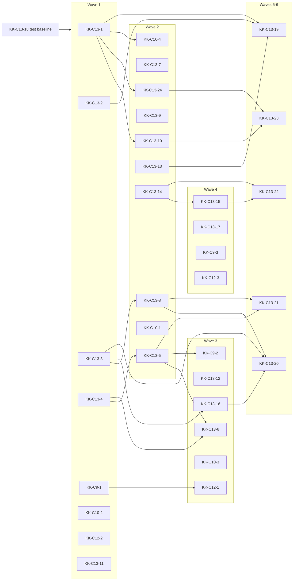

# Korjaussuunnitelma / Fix plan (C-13)

Laadittu 2026-11-26 erässä C-13 (osat D, E ja G). Analysoitu lähdekoodin revisio on `f7fe553`;
tuotantokoodi ei ole muuttunut sen jälkeen (`TPsource/`:n alle on lisätty vain C-11:n
testitiedostot). **Yhtään vikaa ei ole korjattu, eikä D-vaihetta ole
aloitettu.** Tämä asiakirja on suunnitelma, jonka pohjalta kehitystyö voidaan aloittaa ilman uutta
laajaa auditointia.

Written on 2026-11-26 in batch C-13 (parts D, E and G). **Nothing has been fixed and phase D has not
started.** This is the plan from which development can start without a new broad audit.

**Tila 2026-11-26:** käyttäjä on hyväksynyt tämän suunnitelman ja
`regressiotestaussuunnitelma.md`:n D-vaiheen lähtökohdaksi vaiheen C sulkemisen yhteydessä.
**Hyväksyntä ei ole lupa aloittaa tuotantokoodin korjaamista.** Ennen D-vaihetta tehdään luvun 9
ennakkotehtävät ja käsitellään omistajan päätökset OP-1–OP-3. Ennen korjauksia on lisäksi
suunniteltu vaihe K (ohjelmiston tietopohja, `k-vaihe-suunnitelma.md`). / Status: approved by the
user as the starting point of phase D when phase C was closed. **The approval is not permission to
start fixing production code**; the preparatory tasks of section 9 and owner decisions OP-1..OP-3
come first.

Totuuden lähteet ovat rekisterit; tämä asiakirja selittää ne eikä toista havaintojen sisältöä:

| Tieto / Data | Lähde / Source |
|---|---|
| Havainnot ja näyttö / findings and evidence | `rekisteri/havainnot.md` |
| Riskiulottuvuudet ja prioriteetti havainnoittain / risk per finding | `rekisteri/riskiarvio.csv` |
| Korjauskokonaisuudet koneluettavina / packages, machine-readable | `rekisteri/korjauskokonaisuudet.csv` |
| Kattavuus, juurisyyt, riskimalli / coverage, root causes, risk model | `auditoinnin-yhteenveto.md` |
| Testit / tests | `regressiotestaussuunnitelma.md` |
| Omistajan päätökset OP-1–OP-18 / owner decisions | `omistajan-paatokset.md` |
| Tarkistus / check | `python -I doc/arkkitehtuuri/tyokalut/synteesi.py . <out> --tarkista` |

Varmuusmerkinnät: [todennettu] = luettu rekisteristä, koodista tai skriptin tulosteesta;
[päätelty] = johdettu; [ehdotus] = suunnitelman valinta, joka voidaan muuttaa. Korjaustapojen
kuvaukset ovat periaatteita [ehdotus], eivät toteutusta. Työmääräluokat S/M/L/XL ovat suhteellisia
ja suuntaa antavia: niistä ei saa johtaa tunti- tai aikatauluarvioita.

## 1. Periaatteet / Principles

1. **Nykyinen toiminta säilyy.** Ohjelmisto on toimiva tuotantokokonaisuus. Korjaus ei saa muuttaa
   `KILP.DAT`:n tai muiden tiedostojen muotoa, laiteprotokollia, työasemien välistä protokollaa,
   asetustiedostojen tulkintaa eikä kilpailun järjestämisen työnkulkua, ellei kokonaisuuden kohdassa
   "Yhteensopivuus" erikseen niin sanota ja omistaja ole sitä hyväksynyt.
2. **Rajattu korjaus ensin, rakenteellinen ratkaisu erikseen.** P1- ja P2-havainnoille on
   rajattu korjaus (tarkistus, lukon vapautus, osoittimen nollaus), joka ei edellytä refaktorointia.
   Poikkeukset: H-029 ja H-071:n kohdepolun rajaus vaativat ensin päätöksen (OP-4, OP-5), ja
   H-025:n korjaus muuttaa viestin jonotiedoston tietuepituuden. Juurisyyn poistava ratkaisu on
   omana kokonaisuutenaan (KK-C13-19–KK-C13-23) eikä ole P1- tai P2-korjauksen edellytys;
   P3-havainnoista H-016, H-030 ja H-039 odottavat rakenteellista ratkaisua (KK-C13-23).
3. **Testi ennen korjausta.** Vika toistetaan ensin testillä (punainen), sitten korjataan (vihreä).
   Jos toisto ei onnistu automaattisesti, käsin tehtävä toisto kirjataan ennen korjausta
   (`regressiotestaussuunnitelma.md`).
4. **Yksi mekanismi, yksi PR.** PR sisältää yhden vian tai yhdessä korjattavan ryhmän, sen testin ja
   rekisterin päivityksen. Refaktorointia, muotoilua tai kuolleen koodin poistoa ei yhdistetä
   vikakorjaukseen.
5. **Molemmat haarat ja molemmat kääntäjät.** Jokainen HK-korjaus tarkistetaan viestihaarasta ja
   päinvastoin (T-034, J7-7), ja jokainen jaetun koodin muutos käännetään MSVC:llä ja bcc32:lla.
6. **Merkistösäännöt.** Tiedoston merkistöä, BOMia tai rivinvaihtoja ei muuteta; uudet kommentit
   englanniksi ASCII-merkein (`merkistot.md`).
7. **Teknologiaa ei lukita.** Kieliversio, kääntäjä, käyttöliittymätekniikka ja tietokanta ovat
   omistajan päätöksiä (OP-3, OP-17). Rajatut korjaukset kirjoitetaan nykyisillä välineillä
   (C++03-yhteensopivasti, kunnes OP-3 on päätetty).

/ Keep current behaviour and all formats; bounded fix first and architectural solution separately;
reproduce before fixing; one mechanism per PR; check both forks and both compilers; follow the
encoding rules; no technology lock-in.

## 2. Juurisyistä kokonaisuuksiin / From root causes to packages

Juurisyyt JS-1–JS-15 on kuvattu `auditoinnin-yhteenveto.md`:n luvussa 7 ja perusteltu raportissa
`todisteet/c13/raportit/osaB-juurisyyt.md`. Taulukko näyttää, missä kokonaisuuksissa kunkin
juurisyyn rajatut korjaukset ja rakenteellinen ratkaisu ovat.

| Juurisyy / Root cause | Rajatut korjaukset / Bounded fixes | Rakenteellinen ratkaisu / Structural solution |
|---|---|---|
| JS-1 ulkoista syötettä ei validoida rajalla / no validated-input boundary | KK-C13-1, KK-C13-2, KK-C13-12, KK-C13-14, KK-C13-15 | KK-C13-19; todennus KK-C10-4 |
| JS-2 lukkoparit ilman vartijaa, ei poikkeusrajaa / unscoped lock pairs | KK-C13-4, KK-C10-1 | vartijaluokka KK-C13-4:ssä; laajennus KK-C13-21 |
| JS-3 kapasiteetti ei seuraa ajonaikaista kokoa / capacity not tied to run-time size | KK-C13-11, KK-C13-13, KK-C13-24, KK-C12-2 | KK-C13-19 |
| JS-4 sivuvaikutukset globaalien lukkojen alla, `writeerror_w` / side effects under locks | KK-C13-5 | KK-C13-5 (lukitusjärjestys), KK-C9-2, KK-C13-21 |
| JS-5 koko tietue, viimeisin voittaa / whole-record last-writer-wins | KK-C13-10, KK-C13-14 | KK-C13-23 |
| JS-6 muistitila rakennetaan vain käynnistyksessä / state built only at start-up | KK-C13-3, KK-C13-16 | KK-C13-20 |
| JS-7 säikeet lipulla ja `Sleep`illä, `vaiheenvaihto` kahdessa merkityksessä / flag-and-sleep threads | KK-C13-8 | KK-C13-8 (rekisteri ja odotus), KK-C13-21 |
| JS-8 kahvoilla ja osoittimilla ei omistajaa / no ownership rule | KK-C9-1, KK-C9-3 | KK-C9-1 (`closeprfile`-rajapinta) |
| JS-9 laiteyhteydet käsin, ei elävyysvalvontaa / hand-rolled device connections | KK-C10-2, KK-C13-9 | KK-C10-2 (yhteyskerroksen selvitys) |
| JS-10 jaettu tila ja VCL ilman omistajaa / shared state and VCL without owner | KK-C13-6, KK-C13-7 | KK-C13-21 |
| JS-11 virheet ikkunoina, ei paluuarvoina; ei atomista kirjoitusta / errors as dialogs | KK-C9-2 | KK-C9-2, KK-C13-23 (tarkistussumma) |
| JS-12 kopioimalla haarautunut koodi / copy-forked code | haaratarkistus jokaisessa PR:ssä | KK-C13-22 |
| JS-13 todennuksen puute: varoitukset, testit, julkaisu / verification gap | KK-C13-18, KK-C10-3 | sama |
| JS-14 asetusten ja valitsinten ajautuminen / settings and switch drift | KK-C12-1, KK-C12-2, KK-C12-3 | KK-C12-2 (yksi avaintaulu) |
| JS-15 kaksi kääntäjää ilman siirrettävyys- ja merkistökäytäntöä / two toolchains | KK-C13-17 | OP-15, OP-17 |

## 3. Korjauskokonaisuudet / Fix packages

### 3.1 Tunnukset ja niiden pysyvyys / Identifiers and their permanence

Kokonaisuuksia on 34. Kymmenen aiemmin muodostettua tunnusta (KK-C9-1–3, KK-C10-1–4, KK-C12-1–3)
säilyvät. Uudet 24 ovat KK-C13-1–KK-C13-24. Tunnukset ovat pysyviä: kokonaisuutta ei numeroida
uudelleen, vaikka sen jäsenet muuttuisivat; muutos kirjataan rekisteriin. Jokainen avoin H (176) ja
T (51) kuuluu täsmälleen yhteen ensisijaiseen kokonaisuuteen; toissijaiset kytkökset ovat
`riskiarvio.csv`:n sarakkeessa `kk_muut`. Ulkopuolelle jäävät perustellusti T-010 (korjattu
commitissa `c273b9f`) ja H-099 (kumottu).

Aiempien kokonaisuuksien jäsenyyttä on tarkennettu näin [ehdotus]; perusteena on sama koodikohta
tai sama korjaus (`todisteet/c13/raportit/osaB-juurisyyt.md` luku 6):

| Muutos / Change | Peruste / Reason |
|---|---|
| H-150: KK-C9-3 → KK-C9-1 (toissijaisena KK-C9-3, KK-C12-1) | sama HK:n `autofile`-funktio kuin H-151; korjataan samassa sarjassa |
| H-155: KK-C9-3 → KK-C13-9 | sama `openportTCP`:n virhepolku kuin H-027 |
| H-158: KK-C9-1 → KK-C12-1 (toissijaisena KK-C9-1) | viestin XML-tiedoston puuttuva sisältö kuten H-172; sama päätös (OP-9) ja sama testi |
| H-153: KK-C9-2 → KK-C13-5 (toissijaisena KK-C9-2) | korjaus on `writeerror_w`-apufunktiossa (yhdessä H-009, H-019) |
| H-134: rivin merkintä KK-C9-2 → KK-C13-3 | C-12:n sulkemisen päätös: korjataan H-129:n kanssa |
| H-014, H-043, H-100 lisätty KK-C10-1:een | `riippuvuudet.md` 19.4 nimeää ne kokonaisuuden riippuvuuksiksi |
| H-108, H-138, H-168 lisätty KK-C10-2:een | sama, sekä kaksoiskortin tunnistus (Q86) |
| H-154 lisätty KK-C9-1:een; H-044, H-053, H-054 KK-C9-2:een; H-063, T-020 KK-C9-3:een | sama mekanismi kuin kokonaisuuden juurisyy |
| H-052, T-014, T-017, T-024 lisätty KK-C12-2:een; H-020 ja 12 T:tä KK-C12-3:een | asetus- ja valitsinhygienia |
| H-029 lisätty KK-C10-4:ään; T-006, T-047 KK-C10-3:een | `riippuvuudet.md` 19.4 ja 19.5 |
| KK-C12-1: H-149 ja H-150 vain toissijaisina | ensisijainen korjaus on `PRFILE`- ja `autofile`-polussa |

Riippumattoman juurisyyanalyysin ehdotuksista jätettiin toteuttamatta kolme [ehdotus]: KK-C12-1:tä
ei pureta (H-158 ja H-172 koskevat samaa puuttuvaa tulostetta ja samaa päätöstä), H-167 ja H-168
pysyvät KK-C10-2:ssa (aiempi päätös; kytkökset `kk_muut`-sarakkeessa), eikä T-008:aa ja H-081:tä
siirretä haarojen lähentämiseen (konsolin ja GUI:n ero on eri akseli kuin HK:n ja viestin ero).

/ 34 packages: the ten earlier identifiers are kept, 24 new ones are KK-C13-1..24. Identifiers are
permanent. Every open H and T has exactly one primary package. The table lists how earlier
memberships were refined and why; three change requests of the root-cause review were not adopted.

### 3.2 Yhteenveto / Overview

Sarakkeet: **P** = kokonaisuuden korkein havaintoprioriteetti; **Aalto** = toteutusjärjestyksen
aalto, jossa ensimmäinen PR-sarja alkaa (luku 4); **Yht.** = vaikutus tiedosto- (T), laite- (L) tai
protokollayhteensopivuuteen (P): – ei vaikutusta, v = varmistettava testillä, **K** = kyllä,
vaatii päätöksen tai siirtymäohjeen.

| Tunnus / Id | Kokonaisuus / Package | P | Tyyppi / Type | Aalto / Wave | H | T | Työ / Size | Riski / Risk | Yht. T/L/P |
|---|---|---|---|--:|--:|--:|---|---|---|
| KK-C13-18 | Testaus-, CI- ja varoitusperusta / test, CI and warning baseline | (edellytys) | testausinfra | 0 | 1 | 1 | M | matala | –/–/– |
| KK-C13-1 | Työasemaprotokollan vastaanoton rajatarkistukset / receive-side bounds checks | P1 | välitön | 1 | 6 | 0 | M | matala | –/–/v |
| KK-C13-2 | Laitesyötteen jäsentimien rajat ja silmukat / device input parsers | P2 | välitön | 1 | 5 | 0 | M | matala | –/v/– |
| KK-C13-3 | Vaiheen vaihdon ja käynnistyksen tila (HK) / stage change and start-up state | P2 | välitön | 1 | 12 | 0 | M | keskitaso | v/–/– |
| KK-C13-4 | Lukkojen vapautus paluu- ja poikkeuspoluilla / lock release on all paths | P2 | välitön | 1 | 10 | 1 | M | keskitaso | –/–/– |
| KK-C9-1 | `PRFILE`-osoittimien elinkaari ja `autofile`-polku / PRFILE lifecycle and autofile | P2 | välitön | 1 | 5 | 1 | M | keskitaso | v/–/v |
| KK-C10-2 | Laiteyhteyksien hallinta / device connection management | P2 | välitön | 1 | 8 | 1 | L | keskitaso | –/v/– |
| KK-C12-2 | Asetusten hallinta / settings management | P2 | välitön | 1 | 5 | 4 | M | matala | **K**/v/– |
| KK-C13-11 | Tietueen kokorajat / record size limits | P3 | pieni, itsenäinen | 1 | 3 | 0 | S | matala | **K** (H-046)/–/– |
| KK-C13-5 | Lukitusjärjestys ja estävät kutsut lukon alla / lock order, blocking calls under locks | P2 | juurisyy | 2 | 7 | 2 | L | korkea | –/–/– |
| KK-C13-7 | VCL-käyttö työsäikeistä / VCL from worker threads | P2 | välitön | 2 | 4 | 1 | M | keskitaso | –/–/– |
| KK-C13-8 | Säikeiden elinkaari, `vaiheenvaihto`-lippu, lopetus / thread lifecycle, stage flag, shutdown | P2 | juurisyy | 2 | 8 | 1 | L | korkea | –/v/– |
| KK-C13-9 | Tiedonsiirron yhteydet (soketit) / data link sockets | P2 | välitön | 2 | 5 | 0 | M | keskitaso | –/–/v |
| KK-C13-10 | Vastaanotetun tietueen soveltaminen (HK `tark_kilp`) / applying a received record | P2 | välitön | 2 | 3 | 0 | M | keskitaso | –/–/v |
| KK-C13-13 | Kiinteät puskurit muotoilussa ja tulostuksessa / fixed buffers in formatting and printing | P2 | pieni, itsenäinen | 2 | 11 | 0 | M | matala | v/v/– |
| KK-C13-14 | GUI: dataa korruptoivat toiminnot / GUI actions that corrupt data | P2 | välitön | 2 | 9 | 2 | L | keskitaso | –/–/– |
| KK-C13-24 | Lähetysjonon asettelu (`COMFILE.DAT`) / send queue layout | P2 | välitön | 2 | 5 | 0 | M | keskitaso | **K**/–/**K** |
| KK-C10-1 | SQL-integraatio / SQL integration | P2 | välitön | 2 | 8 | 0 | L | keskitaso | v/–/– |
| KK-C10-4 | Ulkoisten yhteyksien turvallisuus / security of external connections | P2 | arkkitehtuuri | 2 | 1 | 1 | L | korkea | v/v/**K** |
| KK-C13-6 | Tallennuksen ja jaetun tilan synkronointi / synchronisation of shared state | P3 | juurisyy | 3 | 8 | 0 | L | korkea | –/–/– |
| KK-C13-12 | Paikallisten tiedostojen ja tuonnin jäsentimet / local file and import parsers | P4 | pieni, itsenäinen | 3 | 9 | 0 | M | matala | v/–/– |
| KK-C13-16 | Johdettujen rakenteiden eheys / integrity of derived structures | P3 | pieni, itsenäinen | 3 | 6 | 0 | M | keskitaso | –/–/– |
| KK-C9-2 | Tallennusvirheiden välitys, kuittaus ja palautus / write-error propagation, acknowledgement, recovery | P3 | juurisyy | 3 | 9 | 2 | L | korkea | v/v/– |
| KK-C10-3 | Jakelu ja ulkoiset riippuvuudet / deployment and external dependencies | P3 | testausinfra | 3 | 1 | 6 | M | matala | –/–/– |
| KK-C12-1 | Viestin XML-julkaisutiedostot / relay XML publication files | P3 | pieni, itsenäinen | 3 | 2 | 0 | S | matala | v/–/– |
| KK-C13-15 | GUI: syöterajat ja pienet logiikkaviat / GUI input bounds and small logic defects | P4 | pieni, itsenäinen | 4 | 14 | 0 | L | matala | –/–/– |
| KK-C13-17 | Merkistöt ja kääntäjäriippuvuudet / encodings and compiler dependence | P5 | pieni, itsenäinen | 4 | 4 | 5 | M | keskitaso | v/–/v |
| KK-C9-3 | Resurssien tarkistukset / resource checks | P4 | pieni, itsenäinen | 4 | 1 | 1 | S | matala | –/–/– |
| KK-C12-3 | Valitsinhygienia ja kuollut koodi / switch hygiene and dead code | P5 | pieni, itsenäinen | 4 | 2 | 13 | L | keskitaso | –/–/– |
| KK-C13-19 | Yhteiset turvalliset apukerrokset / shared safe helper layers | (P3) | juurisyy | 5 | 0 | 2 | L | keskitaso | –/–/– |
| KK-C13-20 | Vaihetilan ja johdettujen rakenteiden keskitetty hallinta / central stage state and derived structures | (P3) | arkkitehtuuri | 5 | 0 | 2 | XL | korkea | v/–/– |
| KK-C13-23 | Replikoinnin ja tiedostomuotojen versiointi / versioning of replication and file formats | P3 | arkkitehtuuri | 5 | 4 | 1 | XL | korkea | **K**/–/**K** |
| KK-C13-21 | Ytimen ja käyttöliittymän erottaminen, globaali tila / core–GUI separation, global state | (P4) | arkkitehtuuri | 6 | 0 | 3 | XL | korkea | –/–/– |
| KK-C13-22 | HK- ja viestihaarojen lähentäminen / HK–relay fork convergence | (P4) | arkkitehtuuri | 6 | 0 | 1 | XL | korkea | –/–/– |

Prioriteettijakauma kokonaisuuksittain on rekisterin sarakkeessa `prioriteettijakauma`.
Sulkeissa oleva prioriteetti on pelkkiä T-rivejä sisältävän kokonaisuuden suunnittelupainoarvo.

### 3.3 Kokonaisuuksien kuvaukset / Package descriptions

Jokaisessa kuvauksessa on samat kentät. "Testit" viittaa `regressiotestaussuunnitelma.md`:n
lukuun 4, jossa testit ovat kokonaisuuksittain. Haaran nimi on ehdotus; PR-jako kertoo
suositellun järjestyksen kokonaisuuden sisällä.

#### KK-C13-18 Testaus-, CI- ja varoitusperusta / Test, CI and warning baseline

- **Tavoite ja juurisyy.** JS-13: testejä ei ajeta automaattisesti, varoitustaso on matala eikä
  julkaisupakettia todenneta. Tavoite on, että jokainen korjaus voidaan todentaa toistettavalla
  ajolla ennen ja jälkeen.
- **Havainnot.** H-006, T-021; Q35, Q36, Q39, Q40, Q48, Q103.
- **Lähestymistapa.** Sarja a (aalto 0, paikallinen): C-11:n testikehys (`TpCoreHk`, `TpCoreJuk`,
  ajuri) työhaaran pohjaksi; ajuriin regressiotila, jossa korjatun vian testi muuttuu odotetusta
  epäonnistumisesta läpäisyksi ilman virhekoodia; C-6:n, C-8:n ja C-9:n eristetyt koeohjelmat
  siirretään `Tests/core`-hakemistoon manifestin alle; `Tests/run.sh` korjataan tai poistetaan
  (OP-2). Sarja b (aalto 3): testien ajo CI:ssä, työkaluversion riippumattomuus (Q35), varoitusten
  perustaso ja uusien varoitusten esto (T-021), `/analyze`-ajo erillisenä työnä.
- **Riippuvuudet.** Ei riipu muista. Kaikki muut kokonaisuudet riippuvat sarjasta a.
- **Työmäärä ja muutosriski.** M; matala (ei tuotantokoodia).
- **Yhteensopivuus.** Ei vaikutusta.
- **Testit.** Ajurin omat testit (46) ja kehyksen nykyinen tulos PASS 23, XFAIL 24 toistuvat
  [todennettu tallennetusta ajosta 2026-11-24; ei ajettu C-13:ssa].
- **Hyväksymiskriteerit.** (1) Yksi komento kääntää ja ajaa testit paikallisesti ja tuottaa
  koneluettavan tuloksen. (2) Koeohjelmien 12 havaintoa (H-090, H-091, H-093, H-094, H-128, H-129,
  H-145–H-147, H-149–H-151) ovat manifestissa. (3) Regressiotila on dokumentoitu. Sarja b: (4) CI
  ajaa `TpTest`in ja ydintestit jokaisesta PR:stä.
- **Haara ja PR-jako.** `testit/regressioperusta`: PR 1 ajurin regressiotila, PR 2 koeohjelmien
  siirto, PR 3 `run.sh`; sarja b omana PR-sarjanaan (CI-muutos vaatii OP-1:n ja OP-2:n).
- **Palautettavuus.** Ei vaikuta tuotantokoodiin.
- **Omistajan päätökset.** OP-1 (julkaisu ja push), OP-2 (testikäytäntö).

/ Local regression baseline first (wave 0): harness as the base, a regression mode in the runner,
probes moved under the manifest, `run.sh` fixed or dropped; CI integration and warning baseline as a
second series. Prerequisite of every other package.

#### KK-C13-1 Työasemaprotokollan vastaanoton rajatarkistukset / Receive-side bounds checks

- **Tavoite ja juurisyy.** JS-1: verkosta tulevan paketin pituus-, luokka- ja indeksikenttiä
  käytetään tarkistamatta. Tavoite: väärennetty tai virheellinen paketti hylätään ilman
  muistikirjoitusta, tiedostokirjoitusta tai vastaanoton pysähtymistä.
- **Havainnot.** H-071 (P1), H-072 (P1), H-032 (P1), H-061 (P1, vaikutus tuntematon, Q43), H-033
  (P1; nostettu riippumattoman tarkastuksen perusteella: KILPPVT-paketin vaiheindeksi indeksoi
  kekotaulukkoa `pv[]` tarkistamatta, `Hk/HkCom32.cpp:274-279`), H-026 (P2); toissijaisina H-060,
  H-073, H-025. Juurisyy T-022 on KK-C13-19:ssä.
- **Lähestymistapa.** Vastaanottajan puolen tarkistukset: pakettiluokan indeksi ja pituus ennen
  taulukkokäyttöä (H-032, H-061), `EXTRA`-paketin indeksit taulukon rajoihin (H-072; kaikki
  `d1`-tapaukset käydään läpi samalla), vaiheindeksin rajaus (H-033), FILESEND:n sisäinen pituus
  luokan pituuteen (H-071), tuntematon luokka ohitetaan ja kuitataan kuten HK tekee (H-026).
  Sanomamuoto ei muutu. Samassa yhteydessä käydään staattisesti läpi ytimen 56 lukematonta
  kokonaislukujäsennysehdokasta (J7-3:n ydinosa: `Hk/` 32, `Juk/` 23, `Tp/` 1), koska ne ovat
  samaa vikaluokkaa kuin P1-havainnot; löydökset kirjataan rekisteriin uusina riveinä.
- **Riippuvuudet.** KK-C13-18 (sarja a). Ei riipu todennuspäätöksestä (KK-C10-4, OP-4).
- **Työmäärä ja muutosriski.** M; matala (tarkistukset hylkäävät vain arvoja, joita ohjelma ei nyt
  voi käsitellä oikein).
- **Yhteensopivuus.** Tiedostot ja laitteet: ei. Protokolla: muoto ei muutu; korjattu ja
  korjaamaton ohjelma toimivat yhdessä. Varmistettava [päätelty, `todisteet/c13/raportit/osaD-yhteensopivuuskysymykset.md`]:
  viestin EMITVA-paketin suurin laillinen koko mahtuu rajaan (H-032); tuntematonta luokkaa ei saa
  jättää kuittaamatta, koska UDP-lähettäjä toistaa lähetystä rajatta (H-026). FILESEND on
  dokumentoitu ominaisuus (`LÄHTIEDOSTOT`); pituuden tarkistus ei riko sitä, mutta kohdepolun
  rajaus rikkoisi `/K`-valitsimen ja ylähakemistoon lähetyksen, joten se tehdään vasta päätöksen
  OP-5 jälkeen omana PR:nään. H-033: vastapuolen päivitys, jossa on enemmän vaiheita kuin
  vastaanottajalla, hylätään (nyt kirjoitus taulukon ohi); vastaanottaja ei voisi tallentaa sitä.
- **Testit.** Uudet kehystestit H-071:lle, H-072:lle, H-061:lle ja H-033:lle (nyt ei toistavaa
  testiä; H-033 ASan-kokoonpanossa); H-032:n ja H-026:n nykyiset testit; kahden prosessin
  loopback-testi, kun kerros on olemassa.
- **Hyväksymiskriteerit.** (1) Jokaiselle kuudelle havainnolle on testi, joka epäonnistuu ennen
  korjausta ja läpäisee sen jälkeen, myös ASan-kokoonpanossa. (2) Lailliset paketit kaikista
  luokista käsitellään kuten ennen (kontrollitestit). (3) Korjaus on sekä HK:n että viestin
  vastaanottopolussa. (4) Hylätty paketti kirjataan lokiin eikä pysäytä vastaanottoa.
- **Haara ja PR-jako.** `korjaus/kk-c13-1-vastaanoton-rajatarkistukset`: PR 1 H-032 + H-061 +
  H-026 (sama vastaanottokohta), PR 2 H-072, PR 3 H-033, PR 4 H-071 pituus, PR 5 H-071 polun
  rajaus (OP-5).
- **Palautettavuus.** PR kerrallaan; ei pysyviä tiedostomuutoksia.
- **Omistajan päätökset.** OP-5.

/ Receiver-side checks only, wire format unchanged, fixed and unfixed programs interoperate. H-071's
path restriction would break a documented feature and waits for OP-5. H-061 stays P1 until Q43 is
answered. H-033 was raised to P1 after the independent review (unchecked wire stage index into a
heap array).

#### KK-C13-2 Laitesyötteen jäsentimien rajat ja silmukat / Device input parsers

- **Tavoite ja juurisyy.** JS-1 laitteilta tulevassa syötteessä: indeksit ja pituudet otetaan
  sanomasta. Tavoite: virheellinen sanoma ei kirjoita muistiin eikä pysäytä lukijasäiettä.
- **Havainnot.** H-055 (P2), H-070 (P2), H-056 (P2), H-060 (P2), H-008 (P2); Q44, Q45, Q49–Q51,
  Q56.
- **Lähestymistapa.** emiTag-sanoman `P`-kentän indeksin rajaus (H-055), FEIG-kehyksen pituuden
  rajaus puskuriin (H-070), ARES-, Sirit- ja emiTag-lukusilmukoiden eteneminen myös kehyksettömällä
  syötteellä (H-056), ampumapaikan indeksin rajaus (H-060) ja `tall_sak`in lukon vapautus
  virheellisellä sanomalla (H-008). H-060 ja H-008 ovat samoissa kutsupaikoissa ja korjataan yhdessä
  PR:ssä; siksi H-008 on tässä kokonaisuudessa eikä KK-C13-4:ssä.
- **Riippuvuudet.** KK-C13-18.
- **Työmäärä ja muutosriski.** M; matala.
- **Yhteensopivuus.** Laitekehykset ennallaan. Varmistettava: lähettääkö ampumalaite paikan "00"
  [tuntematon]; ARES-kehyksen NUL-tavut (Q44).
- **Testit.** Kehystestit syötepolulla (H-008:lle nykyinen testi; muille ei vielä toistavaa
  testiä); laitetesti tai tallennettu laiteliikenne, jos saatavilla (OP-13).
- **Hyväksymiskriteerit.** (1) Punainen–vihreä-testi jokaiselle viidelle. (2) Tallennettu tai
  synteettinen kelvollinen laitesanoma käsitellään kuten ennen. (3) Lukijasäie jatkaa virheellisen
  sanoman jälkeen.
- **Haara ja PR-jako.** `korjaus/kk-c13-2-laitejasentimet`: yksi PR laitetta kohden.
- **Palautettavuus.** PR kerrallaan.
- **Omistajan päätökset.** OP-13 (laitteiden ja laitedokumentaation saatavuus).

/ Bounds for emiTag, FEIG and shooting-lane indices and progress guarantees for the reader loops;
device frames unchanged.

#### KK-C13-3 Vaiheen vaihdon ja käynnistyksen tila (HK) / Stage change and start-up state

- **Tavoite ja juurisyy.** JS-6: muistissa oleva tila rakennetaan oikein vain käynnistyksessä;
  vaiheen vaihto nollaa osan tapauskohtaisesti. Tavoite: vaiheen vaihdon jälkeen hakemistot,
  tiedostokahvat ja ratatiedot vastaavat tuoretta käynnistystä.
- **Havainnot.** H-129 (P2), H-128 (P2), H-102, H-013, H-134, H-105, H-174, H-141, H-131, H-132,
  H-133, H-143; Q67, Q78, Q79, Q80, Q110. Juurisyyt T-038 ja T-039 ovat KK-C13-20:ssa.
- **Lähestymistapa.** Sarja a (numerohakemisto): `idindex`in rivimäärä ja paikka nollataan samassa
  kohdassa ja saman lukon alla kuin puskuri (H-129, H-102) ja poistohaara tehdään saavutettavaksi
  (H-128). H-128:lla on toinenkin puoli, jolle korjaustapa määritellään testin yhteydessä: numeron
  lasku vapaaseen numeroon jättää kilpailijan hakemistosta, koska lisäys ohitetaan. H-013
  (`teejarj`in silmukkamuuttuja) on **oma PR:nsä eikä kuulu ensimmäiseen erään**: korjattu silmukka
  alkaisi tallentaa jokaisen pistelaskennassa olevan tietueen uudelleen jokaisessa vaiheen
  vaihdossa, mikä lähettää tietueet muille työasemille ja voi avata ilmoituksia. Nykyisin silmukka
  ei käytännössä toimi, joten korjaus muuttaa verkkoliikennettä ja työnkulkua; vaikutus on
  selvitettävä ensin [tarkastajan huomio, koodi luettu]. Sarja b: jäsennysvirheen jälkeen
  vapautettuun rata- tai emit-muistiin ei kosketa (H-134), kahva nollataan sulkemisen jälkeen
  (H-105), jäsennysvirhe erotetaan puuttuvasta tiedostosta (H-174), erälähdöt nollataan (H-141).
  Sarja c: aikajonotiedostojen nimeäminen ja `aloitus`in uudelleenajo (H-131–H-133) vasta
  päätöksen OP-6 jälkeen. Sarja d: kokoomarivi H-143 kohta kerrallaan.
- **Riippuvuudet.** KK-C13-18.
- **Työmäärä ja muutosriski.** M; keskitaso (vaiheen vaihto on harvoin ajettu polku, jota käytetään
  kilpailun aikana).
- **Yhteensopivuus.** `KILP.DAT`:n muoto ei muutu; uudelleenrakennus kirjoittaa muuttuneet
  tietueet nykyisessä muodossa [päätelty]. Aikajonotiedostojen nimiä ei muuteta sarjoissa a ja b.
- **Testit.** C-8:n koeohjelmat H-128a, H-128b ja H-129 siirrettyinä; uusi testi itse
  kekoylivuodolle (noin 1 500 tietuetta, ASan); H-102:lle testi, jossa haku ajetaan hallitulla
  säikeellä nollauksen aikana; H-013:lle testi, joka laskee tallennukset ja lähetykset vaiheen
  vaihdossa; H-134 rikotulla `RADAT<n>.XML`:llä (Q110); GUI-hyväksymistesti monivaiheisella
  kilpailulla.
- **Hyväksymiskriteerit.** (1) H-129: vaiheen vaihdon jälkeen hakemiston rivimäärä on sama kuin
  tuoreessa käynnistyksessä samalla aineistolla. (2) H-128: poisto ja numeronvaihto poistavat
  vanhan rivin. (3) H-134: jäsennysvirheen jälkeen ohjelma jatkaa määritellyssä tilassa (ei
  vapautetun muistin käyttöä, ASan puhdas). (4) Yksivaiheisen kilpailun toiminta muuttuu vain
  H-128:n korjaamalla tavalla: poistettu tai numeroltaan muutettu kilpailija ei enää katkaise
  numerojärjestyksen läpikäyntejä.
- **Haara ja PR-jako.** `korjaus/kk-c13-3-vaiheen-vaihto`: sarja a (H-129 + H-128 + H-102) ensin,
  H-013 omana PR:nään selvityksen jälkeen, sarjat b–d omina PR:inään.
- **Palautettavuus.** Sarjat a ja b PR kerrallaan; sarja c vaatii siirtymäohjeen, jos tiedostonimet
  muuttuvat.
- **Omistajan päätökset.** OP-6.

/ Bib index first (H-129, H-128, H-102 in one series; H-013 separately, because the corrected loop
would re-save and broadcast records at every stage change), then the error branch and handles;
file naming and re-runnable start-up only after OP-6. KILP.DAT format unchanged.

#### KK-C13-4 Lukkojen vapautus paluu- ja poikkeuspoluilla / Lock release on all paths

- **Tavoite ja juurisyy.** JS-2: `EnterCriticalSection`/`LeaveCriticalSection` kirjoitetaan
  pareina käsin, eikä ytimessä ole yhtään `try`-lohkoa; aikainen paluu tai poikkeus jättää lukon
  päälle. Tavoite: lukko vapautuu jokaisella polulla.
- **Havainnot.** H-024, H-040, H-087, H-090, H-110 (kaikki P2), H-012, H-088, H-089, H-115,
  H-125; T-036; Q15, Q41, Q65. Samaa mekanismia oleva H-008 on KK-C13-2:ssa (sama kutsupaikka
  kuin H-060).
- **Lähestymistapa.** Sarja a: puuttuvat vapautukset korkean vakavuuden kohtiin. Suositus
  [ehdotus]: pieni lukkovartija (olio, jonka purkaja vapauttaa lukon), joka toimii molemmilla
  kääntäjillä C++03:lla ja otetaan käyttöön vain korjattavissa funktioissa; vaihtoehto on
  eksplisiittinen vapautus jokaisella paluupolulla. Sarja b: lomakkeiden käsittelijät, joissa
  VCL-poikkeus voi ohittaa vapautuksen (H-115, H-125, T-036).
- **Riippuvuudet.** KK-C13-18. H-087:n korjaus tekee viestin lukkiutumissyklit H-092 ja H-103
  saavutettaviksi [päätelty], joten H-087 korjataan vasta, kun ne on arvioitu tai korjattu
  (KK-C13-5).
- **Työmäärä ja muutosriski.** M; keskitaso (lukon vapautuminen aiemmin jumittuneella polulla voi
  paljastaa suojaamattoman jatkopolun).
- **Yhteensopivuus.** Ei vaikutusta.
- **Testit.** Nykyiset kehystestit H-024, H-040; siirretty koeohjelma H-090; H-087 ja H-110
  vain GUI-testillä (ViestiWin).
- **Hyväksymiskriteerit.** (1) Jokaisen korjatun funktion jokaiselta paluupolulta lukon
  rekursiolaskuri palaa lähtöarvoon (testi lukee lukon tilan). (2) H-087 ja H-110: GUI-testissä
  työsäikeet jatkavat toiminnon jälkeen. (3) Vartija kääntyy ja toimii MSVC:llä ja bcc32:lla.
- **Haara ja PR-jako.** `korjaus/kk-c13-4-lukkojen-vapautus`: PR 1 vartija ja H-090, PR 2
  viestin H-024 + H-040, PR 3 H-110, PR 4 H-087 (KK-C13-5:n arvion jälkeen, eli käytännössä
  aallossa 2; rekisterin `riippuu_osat`), PR 5 muut. H-040 korjataan ensin erikseen; saman
  `addfrec`-funktion H-148 (KK-C9-2) ja H-047 (KK-C13-6) korjataan myöhemmin yhdessä.
- **Palautettavuus.** PR kerrallaan.
- **Omistajan päätökset.** OP-3 (kieliversio vaikuttaa vain vartijan toteutustapaan).

/ Release on every path; a small C++03 lock guard used only in the fixed functions is recommended.
Fixing H-087 may expose the H-092/H-103 cycles, so it follows the KK-C13-5 assessment.

#### KK-C9-1 `PRFILE`-osoittimien elinkaari ja `autofile`-polku / PRFILE lifecycle and autofile

- **Tavoite ja juurisyy.** JS-8, T-042: `closeprfile` saa osoittimen arvona eikä voi nollata
  kutsujan kenttää, ja sama osoitin kopioidaan rakenteiden välillä. Tavoite: suljettua
  `PRFILE`-rakennetta ei käytetä eikä vapauteta toista kertaa, eikä toistuva `autofile` vuoda
  virtoja.
- **Havainnot.** H-149 (P2, MSVC:n viestikonsoli kaatuu ensimmäiseen automaattiseen
  HTML-tulosteeseen tavallisessa kokoonpanossa), H-151 (P2), H-150 (P2), H-152, H-154; T-042;
  toissijaisena H-158; Q91, Q93, Q95.
- **Lähestymistapa.** Rajattu: osoitin nollataan jokaisessa sulkevassa kutsupaikassa ja
  kaksoispoisto poistetaan (H-149, H-151), silmukassa luotu listatiedosto vapautetaan joka
  kierroksella (H-150), kopioitu osoitin päivitetään (H-152). Rakenteellinen: `closeprfile`
  nollaa kutsujan osoittimen (rajapinnan muutos kaikissa kutsupaikoissa).
- **Riippuvuudet.** KK-C13-18.
- **Työmäärä ja muutosriski.** M; keskitaso (julkaisutiedostojen polku on käytössä jatkuvasti).
- **Yhteensopivuus.** Julkaistavien HTML- ja XML-tiedostojen sisältö ei saa muuttua. FILETCP-lähetys
  ennallaan (Q93).
- **Testit.** C-9:n koeohjelmat H-149 a–d, H-150, H-151 siirrettyinä; ViestiWinin ja HkKisaWinin
  GUI-testi (bcc32:n muistinhallinta reagoi eri tavoin, Q91, Q95).
- **Hyväksymiskriteerit.** (1) ASan-tapaukset eivät enää havaitse virhettä. (2) Tuotettu tiedosto
  on tavu tavulta sama kuin ennen korjausta samalla aineistolla niillä poluilla, jotka toimivat
  nyt (HK, ja viestin listatila ilman TCP-yhteyttä); nyt kaatuvalle viestin yhden tiedoston
  polulle vertailukohta on saman aineiston tuloste listatilassa ja käsin tarkistettu sisältö.
  (3) Avoimien virtojen määrä ei kasva toistuvissa kierroksissa.
- **Haara ja PR-jako.** `korjaus/kk-c9-1-prfile-elinkaari`: PR 1 H-149, PR 2 H-151 + H-150, PR 3
  H-152 + H-154, PR 4 `closeprfile`-rajapinta.
- **Palautettavuus.** PR kerrallaan.
- **Omistajan päätökset.** Ei.

/ Null the pointer at every closing site, remove the double free and the per-cycle leak; the
interface change of `closeprfile` is a later PR. Output files must stay byte-identical.

#### KK-C10-2 Laiteyhteyksien hallinta / Device connection management

- **Tavoite ja juurisyy.** JS-9, T-048: jokainen lukija avaa, yrittää uudelleen ja valvoo
  yhteyttään omalla koodillaan; elävyyttä ei valvota. Tavoite: lukija toipuu katkoksesta tai
  ilmoittaa siitä.
- **Havainnot.** H-159 (P2, käänteinen paluuarvotesti lopettaa RFID-luennan uudelleenyhteyden
  jälkeen), H-164 (P2), H-166, H-167, H-108, H-138, H-168, H-170; T-048; Q81, Q96, Q99.
- **Lähestymistapa.** Sarja a: H-159:n ehto ja kadonneen sarjaportin uudelleenavaus tai ilmoitus
  (H-164). Sarja b: HTTP-tilan ja aikakatkaisujen käsittely (H-166), yhteiset staattiset muuttujat
  (H-108, H-138), kokoomarivi H-170 kohdittain (N-11 kuuluu H-164:n kanssa). Sarja c (selvitys, ei
  päätös): yhteinen laiteyhteyksien kerros. H-168 (kaksoiskortin vertailu) korjataan vasta, kun
  lukijan kuittauksen merkitys on selvitetty (Q86, Q100).
- **Riippuvuudet.** KK-C13-18. Jäsennyksen muistiturvallisuus on erikseen KK-C13-2:ssa.
- **Työmäärä ja muutosriski.** L; keskitaso.
- **Yhteensopivuus.** Laiteprotokollat ennallaan; uudelleenyhteyden ajoitus muuttuu, joten
  laitetesti tarvitaan.
- **Testit.** TCP-tynkälukija paikallisesti (Q96); laitetestit Sirit/Zebra, sarjaportti, emiTag.
- **Hyväksymiskriteerit.** (1) H-159: uudelleenyhteyden jälkeen lukijasäie jatkaa (tynkätesti).
  (2) H-164: irrotettu portti avataan uudelleen tai käyttäjä saa ilmoituksen. (3) Laitetesti
  vähintään yhdellä oikealla lukijalla ennen julkaisua.
- **Haara ja PR-jako.** `korjaus/kk-c10-2-laiteyhteydet`: PR 1 H-159, PR 2 H-164 (+ H-170 N-11),
  loput sarjoittain.
- **Palautettavuus.** PR kerrallaan.
- **Omistajan päätökset.** OP-13.

/ H-159 is a one-condition fix and goes first; the common connection layer is a study item.

#### KK-C12-2 Asetusten hallinta / Settings management

- **Tavoite ja juurisyy.** JS-3 ja JS-14: asetusjäsentimet kopioivat kiinteisiin puskureihin, ja
  neljä jäsennintä ja kaksi editoria ovat ajautuneet erilleen.
- **Havainnot.** H-171 (P2), H-173, H-036, H-052, H-176; T-051, T-014, T-017, T-024; Q25, Q107,
  Q112.
- **Lähestymistapa.** Sarja a: ViestiWinin `cfgfilename` samaan kokoon kuin HK:ssa (201 merkkiä,
  kopio 120) (H-171) sekä asetuspuskurien ja indeksien rajat (H-036, H-052). Samassa PR:ssä
  korjataan C-13:n tarkastuksessa löytynyt H-052:n laajennus: asetustiedoston nimi muotoillaan
  virheilmoitukseen 80 merkin puskuriin rajaamattomalla `swprintf`illä (`Juk/VInit.cpp:433-445`,
  `Hk/HkInit.cpp:331-343`), joten pitkä polku ja puuttuva tiedosto ylittävät sen [koodi luettu;
  laukeaminen päätelty]. Sarja b: editorien ja
  jäsentimien avaimet yhdenmukaisiksi niin, että vanhat avaimet kelpaavat edelleen (H-173, H-176,
  T-051) päätöksen OP-11 jälkeen.
- **Riippuvuudet.** KK-C13-18.
- **Työmäärä ja muutosriski.** M; matala (sarja a).
- **Yhteensopivuus.** H-171: nimeä vain luetaan ja näytetään, sitä ei kirjoiteta tiedostoon eikä
  lähetetä [todennettu selvityksessä]. Sarja b muuttaisi asetustiedostojen tulkintaa: vain
  päätöksellä ja vanhat avaimet hyväksyen.
- **Testit.** H-171: käännösaikainen kokotarkistus ja ViestiWinin GUI-avaus pitkällä polulla
  (Q107); jäsentimien yksikkötestit avain kerrallaan.
- **Hyväksymiskriteerit.** (1) H-171: kopioitava pituus ei ylitä puskuria (staattinen tarkistus),
  ja sarjaporttien oletusasetus säilyy kilpailun avauksen jälkeen. (2) Nykyiset asetustiedostot
  luetaan samoin kuin ennen (vertailu `rekisteri/asetusavaimet.csv`:n avaimilla).
- **Haara ja PR-jako.** `korjaus/kk-c12-2-asetukset`: PR 1 H-171, PR 2 H-036 + H-052, sarja b
  erikseen.
- **Palautettavuus.** PR kerrallaan.
- **Omistajan päätökset.** OP-11, OP-12.

/ H-171 is a buffer-size fix with no format effect; key harmonisation only after OP-11 and only in
a backward-compatible way.

#### KK-C13-11 Tietueen kokorajat / Record size limits

- **Tavoite ja juurisyy.** JS-3: puskurin koko on käännösaikainen vakio, tietueen koko
  ajonaikainen.
- **Havainnot.** H-041 (P3; ainoa toimitetussa ohjelmassa vahvistettu vika), H-042 (P3), H-046;
  Q26, Q29, Q31, Q34, Q37.
- **Lähestymistapa.** H-041: viisi pinopuskuria mitoitetaan suurimman tietueen mukaan tai tietue
  varataan keosta; `KILPBUFSIZE` ei ole tietuepituus, tiedostosiirtymä eikä pakettipituus.
  Valinta pinon ja keon välillä tehdään toteutuksessa: selvitysten arviot pinon riittävyydestä
  työsäikeissä eroavat (säikeet käynnistetään 20–40 kt:n pinoarvolla; onko se varaus vai vain
  alkusitoumus, on [päätelty], eikä bcc32:n käytöstä ole mitattu), joten kekovaraus on varmempi,
  ellei pinon riittävyyttä mitata. Vaihtoehto, jossa liian suuri kokoonpano hylätään
  käynnistyksessä, muuttaisi nykyistä toimintaa ja on omistajan päätös (OP-12); oletuskorjaus ei
  sitä tarvitse.
  H-042: XML:stä luettavat määrät rajataan käännösaikaisiin rajoihin. H-046: vasta kun viennin
  käyttötapa tiedetään (Q29).
- **Riippuvuudet.** KK-C13-18.
- **Työmäärä ja muutosriski.** S; matala.
- **Yhteensopivuus.** H-041 ja H-042: ei vaikutusta. H-046: vientitiedoston sisältö muuttuisi,
  joten päätös tarvitaan.
- **Testit.** Nykyiset kehystestit H-041 (rajapari 220/221) ja H-042; lukupolun testi (Q37).
- **Hyväksymiskriteerit.** (1) Tietue arvoilla `n_pv` 5 ja `valuku` 250 kirjoitetaan ja luetaan
  ilman ylivuotoa (ASan). (2) Olemassa oleva `KILP.DAT` luetaan tavu tavulta samoin.
- **Haara ja PR-jako.** `korjaus/kk-c13-11-tietueen-kokorajat`: PR 1 H-041, PR 2 H-042, PR 3 H-046
  päätöksen jälkeen.
- **Palautettavuus.** PR kerrallaan.
- **Omistajan päätökset.** OP-14 (Q29).

/ H-041 is small, has ready tests and no format effect, so it is in wave 1 although it is P3.

#### KK-C13-5 Lukitusjärjestys ja estävät kutsut lukon alla / Lock order and blocking calls under locks

- **Tavoite ja juurisyy.** JS-4: tulostus, lokitus, soketit ja virheikkunat ajetaan globaalien
  lukkojen sisällä; `writeerror_w` odottaa pääsäiettä synkronisesti.
- **Havainnot.** H-091 (P2), H-093 (P2), H-009, H-092, H-103, H-019, H-153; T-031, T-032;
  toissijaisina H-167 ja H-116; Q14, Q66, Q89.
- **Lähestymistapa.** Rajattu: lokitus ei ota soketin lukkoa lokilukon alla eikä lähetysvirhe
  lokita rekursiivisesti (H-093); sivutuloste siirretään `tallenna`n lukon ulkopuolelle (H-091);
  `writeerror_w` ei tarjoa ohjelman lopetusta työsäikeelle, joka pitää lukkoa, ja saa kutsukohtaisen
  puskurin (H-153, H-019). Rakenteellinen: dokumentoitu lukitusjärjestys ja virheilmoitukset
  lukkojen vapauttamisen jälkeen (T-031, T-032).
- **Riippuvuudet.** KK-C13-18, KK-C13-4.
- **Työmäärä ja muutosriski.** L; korkea (lukitusjärjestyksen muutos voi siirtää lukkiutumisen
  toiseen kohtaan).
- **Yhteensopivuus.** Ei vaikutusta.
- **Testit.** Siirretyt koeohjelmat H-091 ja H-093; H-009 käsin GUI:ssa; H-092 ja H-103 GUI-ajolla.
- **Hyväksymiskriteerit.** (1) H-093: lähetysvirhe ei aiheuta rekursiota (testi). (2) H-091:
  kahden säikeen testissä ei lukkiutumista jatkuvalla sivutulosteella. (3) Lukitusjärjestys on
  kirjattu `saikeet-ja-lukot.md`:hen ja korjatut polut noudattavat sitä.
- **Haara ja PR-jako.** `korjaus/kk-c13-5-lukitusjarjestys`: PR 1 H-093, PR 2 H-091, PR 3
  `writeerror_w` (H-153, H-019, H-009), PR 4 H-092 + H-103. PR 3 muuttaa samaa
  `errorMsgHandler`-käsittelijää kuin KK-C13-14:n H-116: ne tehdään peräkkäin samassa sarjassa,
  H-116 ensin, ei rinnakkain. Saako työsäikeen virheilmoitus ylipäätään tarjota ohjelman
  lopetusta, on päätös (OP-9).
- **Palautettavuus.** PR kerrallaan; GUI-ajo ennen julkaisua.
- **Omistajan päätökset.** OP-9 (vain PR 3).

/ Bounded fixes per cycle first (H-093, H-091, `writeerror_w`), a documented lock order later.

#### KK-C13-7 VCL-käyttö työsäikeistä / VCL from worker threads

- **Tavoite ja juurisyy.** JS-10: työsäikeet käyttävät lomakkeita ja VCL-olioita suoraan.
- **Havainnot.** H-107 (P2), H-018, H-106, H-101; T-033; Q88.
- **Lähestymistapa.** Rajattu: lomakeosoittimen tarkistus ennen käyttöä (H-107). Sen jälkeen
  työsäikeiden suorat VCL-kirjoitukset siirretään pääsäikeelle viestillä kohta kerrallaan.
- **Riippuvuudet.** KK-C13-18.
- **Työmäärä ja muutosriski.** M; keskitaso. Vain GUI-ohjelmat.
- **Yhteensopivuus.** Ei vaikutusta.
- **Testit.** GUI-testi (ei automaattista kehystä bcc32:lle); H-107 asetuksella ja lukijalla.
- **Hyväksymiskriteerit.** (1) H-107: ensimmäinen luenta ei kaada ohjelmaa, kun lomaketta ei ole
  avattu. (2) Korjatuissa kohdissa VCL-olioihin kirjoitetaan vain pääsäikeestä.
- **Haara ja PR-jako.** `korjaus/kk-c13-7-vcl-tyosaikeet`: PR 1 H-107, sitten kohta kerrallaan.
- **Palautettavuus.** PR kerrallaan.
- **Omistajan päätökset.** Ei.

#### KK-C13-8 Säikeiden elinkaari, `vaiheenvaihto`-lippu ja lopetus / Thread lifecycle, stage flag and shutdown

- **Tavoite ja juurisyy.** JS-7, T-030: säikeitä ei odoteta eikä niiden kahvoja käytetä; lippu
  `vaiheenvaihto` tarkoittaa osalle säikeistä taukoa ja osalle poistumista.
- **Havainnot.** H-031 (P2), H-094, H-097, H-038, H-095, H-096, H-098, H-104, H-157; T-030;
  toissijaisina H-014, H-136, H-105; Q67, Q68, Q70, Q71, Q73.
- **Lähestymistapa.** Rajattu: evätty vaiheen vaihto palauttaa lipun (H-031). Sen jälkeen yksi
  päätös kaikille säikeille: tauko vai poistuminen ja uudelleenkäynnistys (H-097, H-014, H-094
  riippuvat toisistaan). Lippu on silmukan poistumisehto ainakin näissä seitsemässä kohdassa
  [todennettu koodista, tarkastajan luettelo]: `cbHk/TulosUnit.cpp:1893`, `cbHk/UnitEmit.cpp:838`,
  `cbHk/UnitMySQL.cpp:654`, `cbHk/UnitSakkoKierr.cpp:258`, `cbTp/UnitEmitSQL.cpp:62`,
  `cbTp/UnitNaytaTulos.cpp:100` ja `Hk/HkIV.cpp:796`; luettelo täydennetään ennen PR 2:ta, ja
  jokaisesta kirjataan, käynnistetäänkö säie uudelleen vaihdon jälkeen. Rakenteellinen:
  säierekisteri ja hallittu lopetus odottaen.
- **Riippuvuudet.** KK-C13-18, KK-C13-3 (sama vaiheen vaihdon polku).
- **Työmäärä ja muutosriski.** L; korkea.
- **Yhteensopivuus.** Lukijasäikeiden tauko ja jatko vaiheen vaihdossa on varmistettava laitteilla.
- **Testit.** Nykyinen kehystesti H-031; siirretty koeohjelma H-094; GUI-testi vaiheen vaihdolla.
- **Hyväksymiskriteerit.** (1) H-031: evätyn vaihdon jälkeen taustakäsittely jatkuu. (2) Vaiheen
  vaihdon jälkeen samat säikeet ovat käynnissä kuin ennen sitä. (3) Lopetus ei käytä vapautettuja
  rakenteita (ASan).
- **Haara ja PR-jako.** `korjaus/kk-c13-8-saikeiden-elinkaari`: PR 1 H-031; PR 2 lipun merkitys
  (H-097, H-094 ja KK-C10-1:n H-014 yhdessä); loput erikseen.
- **Palautettavuus.** H-031 yksinään; lipun merkityksen muutos yhtenä sarjana.
- **Omistajan päätökset.** OP-6.

#### KK-C13-9 Tiedonsiirron yhteydet (soketit) / Data link sockets

- **Tavoite ja juurisyy.** JS-9 työasemayhteyksissä: yhteyden avaus, korvaus ja sulku on koodattu
  tapauskohtaisesti.
- **Havainnot.** H-027 (P2), H-028 (P2), H-037, H-096, H-155; Q20.
- **Lähestymistapa.** TCP-asiakas yrittää uudelleen (H-027), uusi yhteys ei korvaa elävää
  sulkematta ja lukusäikeitä on yksi yhteyttä kohden (H-028), virhepolku sulkee soketin (H-155).
- **Riippuvuudet.** KK-C13-18.
- **Työmäärä ja muutosriski.** M; keskitaso.
- **Yhteensopivuus.** Sanomat ennallaan; sekaversiot toimivat.
- **Testit.** Nykyinen kehystesti H-027; kahden prosessin loopback-kerros (C-11:n jatkotehtävä).
- **Hyväksymiskriteerit.** (1) Yhteys palautuu vastapuolen uudelleenkäynnistyksen jälkeen ilman
  ohjelman uudelleenkäynnistystä. (2) Toinen yhteydenotto ei katkaise ensimmäistä eikä jätä lukkoa.
- **Haara ja PR-jako.** `korjaus/kk-c13-9-tiedonsiirron-yhteydet`: PR 1 H-027 + H-155, PR 2 H-028,
  PR 3 H-037 + H-096.
- **Palautettavuus.** PR kerrallaan.
- **Omistajan päätökset.** Ei.

#### KK-C13-10 Vastaanotetun tietueen soveltaminen (HK `tark_kilp`) / Applying a received record

- **Tavoite ja juurisyy.** JS-5: vastaanotettu tietue korvaa paikallisen kokonaan; HK lukee
  tietueen ennen lukkoa eikä tarkista, että se koskee samaa kilpailijaa ja vaihetta.
- **Havainnot.** H-007, H-022, H-023 (kaikki P2); toissijaisina H-033 (sama funktio, korjataan
  KK-C13-1:ssä) ja H-017; Q16, Q21.
- **Lähestymistapa.** Tietue luetaan lukon sisällä kuten viestissä (H-007); kilpailijanumero
  tarkistetaan ennen vaihetietojen soveltamista (H-022); paketin vaiheindeksi otetaan huomioon
  (H-023). Mihin vaiheeseen `VAIN_TULOST` kuuluu soveltaa ja hylätäänkö vai yhdistetäänkö
  ristiriitainen päivitys, on käytöskysymys (OP-4); oletuskorjaus hylkää ja kirjaa lokiin.
- **Riippuvuudet.** KK-C13-18, KK-C13-1 (sama vastaanottopolku).
- **Työmäärä ja muutosriski.** M; keskitaso.
- **Yhteensopivuus.** Sanomamuoto ei muutu. Käytös muuttuu: ristiriitainen päivitys hylätään,
  kun se ennen kirjoitettiin väärään paikkaan; hylkäyksen pitää näkyä käyttäjälle tai lokissa.
- **Testit.** Nykyiset kehystestit H-007, H-022, H-023; loopback-testi kahdella asemalla.
- **Hyväksymiskriteerit.** (1) Kolme testiä punaisesta vihreäksi. (2) Yhden aseman ja kahden
  aseman normaali päivitys toimii kuten ennen.
- **Haara ja PR-jako.** `korjaus/kk-c13-10-tietueen-soveltaminen`: PR 1 H-007, PR 2 H-022, PR 3
  H-023.
- **Palautettavuus.** PR kerrallaan.
- **Omistajan päätökset.** OP-4 (hylkäys vai yhdistäminen ja hylkäyksen näkyvyys; oletuskorjaus ei
  odota päätöstä).

#### KK-C13-13 Kiinteät puskurit muotoilussa ja tulostuksessa / Fixed buffers in formatting and printing

- **Tavoite ja juurisyy.** JS-3: rajaamaton `swprintf` ja kiinteät rivipuskurit.
- **Havainnot.** H-073 (P2), H-001, H-059, H-062, H-064, H-076 (P3), H-003, H-067, H-068, H-075,
  H-077; Q38, Q39, Q46, Q52–Q54.
- **Lähestymistapa.** Puskurin koko ja kirjoitettava pituus sovitetaan kohta kerrallaan; lokirivi
  säilytetään kokonaisena suurentamalla puskuria (H-073); H-001:n `memset` oikeaan kokoon.
- **Riippuvuudet.** KK-C13-18.
- **Työmäärä ja muutosriski.** M; matala.
- **Yhteensopivuus.** Tulosteiden ja lokirivien sisältö ei muutu (vertailutesti); C-Power-kehys
  ennallaan (H-077).
- **Testit.** Nykyiset kehystestit H-001; uudet testit H-073:lle ja H-059:lle; muut tulostepoluilla.
- **Hyväksymiskriteerit.** (1) Punainen–vihreä-testi P2- ja P3-havainnoille. (2) Tuloste on sama
  kuin ennen samalla aineistolla.
- **Haara ja PR-jako.** `korjaus/kk-c13-13-muotoilupuskurit`: PR 1 H-073, PR 2 H-001, sitten kohta
  kerrallaan.
- **Palautettavuus.** PR kerrallaan.
- **Omistajan päätökset.** Ei.

#### KK-C13-14 GUI: dataa korruptoivat toiminnot / GUI actions that corrupt data

- **Tavoite ja juurisyy.** JS-1 (lomakkeen arvoa käytetään indeksinä tarkistamatta), JS-5 ja
  JS-12.
- **Havainnot.** H-109 (P2), H-111 (P2), H-116 (P2, laajennettu C-13:ssa), H-112, H-113, H-114,
  H-117, H-121, H-017; T-035, T-037; Q76.
- **Lähestymistapa.** Poisto vain valitulle ja kelvolliselle tietueelle (H-109); puuttuva
  `else` ajanoton paneelissa (H-111, yhdessä H-117:n ja H-121:n kanssa); valintaikkunan sulkeminen
  X:llä ei saa tarkoittaa painiketta 2 (H-116: emit-lomakkeiden tuhoava valinta ja virheikkunan
  "Poistu ohjelmasta"); pudotusvalikon `ItemIndex` −1 tarkistetaan (T-037).
  Korjausten rajaus [ehdotus]: H-109:ssä hylätään vain virheellinen valinta (ei valittua
  tietuetta); saako tuloksen saaneen kilpailijan poistaa, on erillinen päätös (OP-9). H-116:ssa X
  tarkoittaa samaa kuin vaaraton valinta; mitä sen kuuluu tarkoittaa, vahvistetaan (OP-9). H-111
  ja H-117: hylätäänkö virheellinen piste ilmoituksella vai rajataanko se, on päätös (OP-9);
  puuttuva `else` korjataan joka tapauksessa.
- **Riippuvuudet.** KK-C13-18. H-116:n PR tehdään ennen KK-C13-5:n PR 3:a (sama käsittelijä);
  H-139 ja H-140 (KK-C13-16) ovat samassa poistopolussa kuin H-109.
- **Työmäärä ja muutosriski.** L; keskitaso. Jokainen korjaus tarkistetaan vastinhaarasta.
- **Yhteensopivuus.** Ei vaikutusta.
- **Testit.** Käsin tehtävät GUI-testit (J7-4); ydinlogiikan osat kehystesteinä, jos erotettavissa.
  H-116:n toisto GUI:ssa tehdään jo ensimmäisen erän valmisteluissa (luku 7.2), koska se ratkaisee,
  onko havainto P2 vai P3.
- **Hyväksymiskriteerit.** (1) Dokumentoitu GUI-testiaskel toistaa vian ennen korjausta ja
  läpäisee sen jälkeen molemmissa ohjelmissa. (2) H-116: virheikkunan sulkeminen X:llä ei sulje
  ohjelmaa.
- **Haara ja PR-jako.** `korjaus/kk-c13-14-gui-datakorruptio`: PR 1 H-109, PR 2 H-116, PR 3 H-111
  + H-117 + H-121, loput lomake kerrallaan.
- **Palautettavuus.** PR kerrallaan.
- **Omistajan päätökset.** OP-9 (käytöksen vahvistus; oletuskorjaukset eivät odota), OP-14
  (L-rivien muokkauksen yleisyys vaikuttaa vain järjestykseen).

#### KK-C13-24 Lähetysjonon asettelu (`COMFILE.DAT`) / Send queue layout

- **Tavoite ja juurisyy.** JS-3: viestin `combufsize` lasketaan ilman 14 tavun otsaketta, ja jonon
  lukijat käyttävät eri askelta.
- **Havainnot.** H-025 (P2), H-021, H-048, H-050, H-035; toissijaisena H-044; Q23, Q42, Q90.
- **Lähestymistapa.** Tietuepituus kattaa otsakkeen (H-025); lukijat käyttävät samaa askelta
  (H-048); katselin ei muuta globaalia arvoa (H-050).
- **Riippuvuudet.** KK-C13-18, KK-C13-1.
- **Työmäärä ja muutosriski.** M; keskitaso.
- **Yhteensopivuus.** **Kyllä.** `combufsize` on `COMFILE.DAT`:n tietuepituus: korjauksen jälkeen
  vanha jonotiedosto todetaan yhteensopimattomaksi ja ohjelma tarjoaa poistoa tai keskeytystä, eli
  lähettämättömät päivitykset on lähetettävä uudelleen. Päivitys on siksi tehtävä kilpailujen
  välissä. FILESEND-luokan pituus (`combufsize` − 14) on jäädytettävä nykyarvoon, muuten korjattu
  ja korjaamaton viestiohjelma eivät siirrä tiedostoja keskenään [todennettu ja päätelty
  selvityksessä].
- **Testit.** Nykyinen kehystesti H-025; vanhan jonotiedoston avaus korjatulla ohjelmalla;
  loopback korjatun ja korjaamattoman välillä.
- **Hyväksymiskriteerit.** (1) Suurin paketti säilyy jonossa ehjänä. (2) Vanha `COMFILE.DAT`
  tunnistetaan ja käyttäjä saa selkeän ilmoituksen. (3) Tiedostonsiirto korjatun ja korjaamattoman
  ohjelman välillä toimii.
- **Haara ja PR-jako.** `korjaus/kk-c13-24-lahetysjono`: PR 1 H-025 + H-048 + H-050 yhdessä, PR 2
  H-021, PR 3 H-035.
- **Palautettavuus.** Paluu vanhaan versioon vaatii jonotiedoston poiston; ohje julkaisutietoihin.
- **Omistajan päätökset.** OP-4.

/ The only wave-2 fix that changes a file layout: the queue file record length changes, so the
upgrade must happen between competitions and the FILESEND class length must be frozen.

#### KK-C10-1 SQL-integraatio / SQL integration

- **Tavoite ja juurisyy.** JS-2 ja JS-7: valinnaisen MySQL-peilin virhe lopettaa ohjelman tai
  jättää lukon; kirjoitussäie ei jatka vaiheen vaihdon jälkeen.
- **Havainnot.** H-160 (P2), H-014, H-161, H-162, H-163, H-169, H-043, H-100; Q97, Q104–Q106,
  Q109.
- **Lähestymistapa.** `riippuvuudet.md` 19.4: poikkeukset siepataan kirjoitussäikeessä ja
  viennissä, lukko vapautetaan, peili merkitään epäsynkroniseksi ja ohjelma jatkaa (H-160, H-162,
  H-163); lauseet parametrisoidaan (H-161); tuonti ei saa tuhota paikallista tietoa (H-169,
  päätöksen jälkeen).
- **Riippuvuudet.** KK-C13-18. Myöhemmät PR:t (rekisterin `riippuu_osat`): H-014 yhdessä
  KK-C13-8:n lippupäätöksen kanssa; H-163:n testaus julkaisupaketista edellyttää KK-C10-3:n
  (H-165), mutta korjaus itse voidaan testata kehitysympäristössä aiemmin. PR-järjestys: H-160 ja
  H-162 ensin, koska ne estävät ohjelman päättymisen ja lukon jäämisen; H-161 heti perään, koska
  se poistaa H-160:n yleisimmän laukaisijan; H-169 molempien jälkeen. Tarkoitettu SQL-skeema
  (H-161) ja tuonnin merkitys (H-169) ovat päätöksiä (OP-7).
- **Työmäärä ja muutosriski.** L; keskitaso. Vain GUI-ohjelmat, vain SQL käytössä.
- **Yhteensopivuus.** SQL-skeema ennallaan. `SQLjonoVarm.dat`:n käsittely muuttuu (H-043).
- **Testit.** Paikallinen MySQL (Q97, C-11:n avoin H-014-käsitesti).
- **Hyväksymiskriteerit.** (1) Palvelimen katko tai virheellinen lause ei lopeta ohjelmaa eikä
  pysäytä tallennusta `KILP.DAT`:iin. (2) Peilin tila näkyy käyttäjälle.
- **Haara ja PR-jako.** `korjaus/kk-c10-1-sql-integraatio`: PR 1 H-160 + H-162, PR 2 H-161, PR 3
  H-163, PR 4 H-014 + H-100 + H-043, PR 5 H-169 (OP-7).
- **Palautettavuus.** PR kerrallaan.
- **Omistajan päätökset.** OP-7.

#### KK-C10-4 Ulkoisten yhteyksien turvallisuus / Security of external connections

- **Tavoite ja juurisyy.** T-043, H-029: työasemaprotokollassa ei ole todennusta, ja ulkoiset
  yhteydet ovat suojaamattomia. Tämä on suunnittelukokonaisuus; rajatarkistukset (KK-C13-1) eivät
  riipu siitä.
- **Havainnot.** H-029 (P2); T-043; toissijaisina H-161, H-166, H-071; Q99, Q105.
- **Lähestymistapa.** Ensin päätös (OP-4): rajataanko UDP-vastapuolen osoitteen vaihtuminen
  asetuksella, ja halutaanko todennus tai eheystarkistus. Väliaikaiset suojaussuositukset
  (`muistiturvallisuus.md` luku 15) ovat voimassa siihen asti.
- **Riippuvuudet.** KK-C13-1.
- **Työmäärä ja muutosriski.** L; korkea.
- **Yhteensopivuus.** **Kyllä**, jos protokollaan lisätään todennus; osoitteen vaihdon rajaus voi
  estää nykyisen käyttötavan.
- **Testit.** Verkkotestit eristetyssä verkossa.
- **Hyväksymiskriteerit.** Määritellään päätöksen jälkeen; vähintään: oletusasetuksilla nykyinen
  käytös säilyy.
- **Haara ja PR-jako.** `korjaus/kk-c10-4-yhteyksien-turvallisuus`.
- **Palautettavuus.** Asetuksella ohjattava.
- **Omistajan päätökset.** OP-4, OP-13.

#### KK-C13-6 Tallennuksen ja jaetun tilan synkronointi / Synchronisation of shared state

- **Tavoite ja juurisyy.** JS-10: muokattavilla rakenteilla ei ole omaa lukkoa, ja noin 35
  `tallenna`-kutsua tehdään lukitsematta.
- **Havainnot.** H-010, H-011, H-045, H-047, H-051, H-136, H-137, H-144; Q69, Q81.
- **Lähestymistapa.** Kutsupaikat käydään läpi ryhmittäin; lukko lisätään vain dokumentoidun
  lukitusjärjestyksen mukaan. H-047 korjataan yhdessä H-148:n kanssa (viestin `addfrec`,
  KK-C9-2); saman funktion H-040 on korjattu jo aallossa 1.
- **Riippuvuudet.** KK-C13-4, KK-C13-5 (lukitusjärjestys ensin).
- **Työmäärä ja muutosriski.** L; korkea (uudet lukot voivat tuoda lukkiutumisia).
- **Yhteensopivuus.** Ei vaikutusta.
- **Testit.** Kehystestit hallituilla säikeillä; rasitustesti kahdella asemalla.
- **Hyväksymiskriteerit.** Jokainen lisätty lukko on lukitusjärjestyksessä; kilpailutilanteen
  toistava testi ei enää tuota eroa.
- **Haara ja PR-jako.** `korjaus/kk-c13-6-jaettu-tila`, ryhmä kerrallaan.
- **Palautettavuus.** PR kerrallaan.
- **Omistajan päätökset.** Ei.

#### KK-C13-12 Paikallisten tiedostojen ja tuonnin jäsentimet / Local file and import parsers

- **Tavoite ja juurisyy.** JS-1 paikallisissa tiedostoissa.
- **Havainnot.** H-002, H-049, H-057, H-058, H-065, H-074, H-078, H-079, H-086; Q47, Q55, Q59, Q64.
- **Lähestymistapa.** Rajat ja virhepaluut lukija kerrallaan; `TextFl::Open`in kolme vikaa (H-078,
  H-079, H-086) yhdessä.
- **Riippuvuudet.** KK-C13-18.
- **Työmäärä ja muutosriski.** M; matala.
- **Yhteensopivuus.** Kelvolliset tiedostot luetaan ennallaan. H-086 muuttaa sakkokierroslokin
  säilymistä (loki ei enää tyhjene); varmistettava, ettei mikään nojaa nykyiseen käytökseen.
- **Testit.** Nykyinen kehystesti H-002; C-5:n koeohjelma H-079:lle sovitettuna; uudet
  tiedostotestit.
- **Hyväksymiskriteerit.** Virheellinen tiedosto tuottaa virheilmoituksen eikä muistivirhettä;
  kelvollisen tiedoston lukutulos on sama kuin ennen.
- **Haara ja PR-jako.** `korjaus/kk-c13-12-tiedostojasentimet`, lukija kerrallaan.
- **Palautettavuus.** PR kerrallaan.
- **Omistajan päätökset.** OP-14 (Q47).

#### KK-C13-16 Johdettujen rakenteiden eheys / Integrity of derived structures

- **Tavoite ja juurisyy.** JS-6, T-039: laskurit ja hakemistot ylläpidetään käsin pareittain.
- **Havainnot.** H-130, H-140 (P3), H-135, H-139, H-066, H-142; Q82.
- **Lähestymistapa.** Kukin epäsymmetria korjataan kohdassaan; H-140 ja H-139 yhdessä poistopolun
  H-109 kanssa (KK-C13-14).
- **Riippuvuudet.** KK-C13-3 (numerohakemisto ensin).
- **Työmäärä ja muutosriski.** M; keskitaso.
- **Yhteensopivuus.** Ei vaikutusta; rakenteet ovat muistissa.
- **Testit.** Kehystestit: rakenne tapahtumasarjan jälkeen verrataan tuoreeseen käynnistykseen.
  Ennen julkaisua: käsin tehtävä ajo, jossa poistetaan kilpailija, vaihdetaan sarjaa ja numeroa ja
  tarkistetaan lukumäärät, sijoitukset ja numerojärjestyksen tulosteet.
- **Hyväksymiskriteerit.** Tapahtumasarjan (lisäys, poisto, sarjan vaihto, numeron vaihto) jälkeen
  johdetut rakenteet vastaavat uudelleenrakennettuja. Lasketaanko `nvak`iin tila P ja kuuluuko
  sarja nimihakemiston avaimeen (H-139, H-142), vahvistetaan ennen korjausta (OP-9).
- **Haara ja PR-jako.** `korjaus/kk-c13-16-johdetut-rakenteet`.
- **Palautettavuus.** PR kerrallaan.
- **Omistajan päätökset.** Ei.

#### KK-C9-2 Tallennusvirheiden välitys, kuittaus ja palautus / Write-error propagation, acknowledgement and recovery

- **Tavoite ja juurisyy.** JS-11, T-040, T-041: virheet ilmoitetaan ikkunoina eikä paluuarvoina, ja
  tiedostoja ei kirjoiteta atomisesti. Kokonaiskuva: `virheenkasittely.md` 12.7.
- **Havainnot.** H-145, H-146, H-147 (P3), H-015, H-044, H-148, H-053, H-054, H-156; T-040, T-041;
  toissijaisina H-153, H-134, H-168; Q86, Q87, Q94, Q100.
- **Lähestymistapa.** Kirjoitusvirhe palautetaan kutsujalle; kortti kuitataan lukijalle vasta
  onnistuneen tallennuksen jälkeen (H-145); epäonnistunut rivi yritetään uudelleen (H-146);
  julkaisutiedostot kirjoitetaan väliaikaistiedoston kautta.
- **Riippuvuudet.** KK-C13-18, KK-C13-5 (`writeerror_w`).
- **Työmäärä ja muutosriski.** L; korkea (kuittausjärjestyksen muutos vaikuttaa laitteisiin).
- **Yhteensopivuus.** Tiedostomuodot ennallaan. Lukijan kuittauksen ajoitus muuttuu: laitetesti
  (Q86, Q100).
- **Testit.** C-9:n koeohjelmat H-145, H-146, H-147 siirrettyinä; virheinjektio; laitetesti.
- **Hyväksymiskriteerit.** (1) Injektoitu kirjoitusvirhe näkyy kutsujalle. (2) Korttia ei kuitata,
  jos sitä ei tallennettu. (3) Julkaisutiedosto ei ole koskaan puolivalmis lukijan näkökulmasta.
- **Haara ja PR-jako.** `korjaus/kk-c9-2-tallennusvirheet`, polku kerrallaan.
- **Palautettavuus.** PR kerrallaan; kuittausmuutos laitetestin jälkeen.
- **Omistajan päätökset.** OP-13.

#### KK-C10-3 Jakelu ja ulkoiset riippuvuudet / Deployment and external dependencies

- **Tavoite ja juurisyy.** JS-13: julkaisupakettia ei todenneta. Sisältö: `riippuvuudet.md` 19.4.
- **Havainnot.** H-165; T-005, T-006, T-044, T-046, T-047, T-049; Q24, Q98, Q101, Q102.
- **Lähestymistapa.** Julkaisu-ZIP:n käynnistystesti puhtaalla koneella; SQL-ominaisuuden
  tiedostojen jakelu vasta lisenssiselvityksen jälkeen; tarpeettomat paketit pois.
- **Riippuvuudet.** KK-C13-18.
- **Työmäärä ja muutosriski.** M; matala.
- **Yhteensopivuus.** Ei vaikutusta ohjelmiin.
- **Testit.** Julkaisupaketin testi (Q98).
- **Hyväksymiskriteerit.** Jokainen ohjelma käynnistyy julkaisupaketista puhtaalla koneella; SQL:n
  puuttuvat tiedostot on joko mukana tai dokumentoitu.
- **Haara ja PR-jako.** `julkaisu/kk-c10-3-jakelu`.
- **Palautettavuus.** Julkaisupaketti on versioitu.
- **Omistajan päätökset.** OP-7, OP-8, OP-18.

#### KK-C12-1 Viestin XML-julkaisutiedostot / Relay XML publication files

- **Tavoite ja juurisyy.** JS-14: viestin XML-tulosteen sisältö puuttuu (kommentoitu kutsu,
  määrittelemätön valitsin).
- **Havainnot.** H-158, H-172; toissijaisina H-149, H-150, H-176; Q108.
- **Lähestymistapa.** Ensin päätös, mitä tiedoston kuuluu sisältää (OP-9); sitten sisältö
  palautetaan ja varmistetaan vertailutiedostolla.
- **Riippuvuudet.** KK-C9-1 (sama `autofile`-funktio).
- **Työmäärä ja muutosriski.** S; matala.
- **Yhteensopivuus.** Tiedostoon tulee sisältöä, jota siinä ei nyt ole; vastaanottavat järjestelmät
  huomioitava.
- **Testit.** Tiedoston sisällön testi (Q108).
- **Hyväksymiskriteerit.** Tuotettu XML on skeeman mukainen ja sisältää tulokset.
- **Haara ja PR-jako.** `korjaus/kk-c12-1-viestin-xml`.
- **Palautettavuus.** PR kerrallaan.
- **Omistajan päätökset.** OP-9.

#### KK-C13-15 GUI: syöterajat ja pienet logiikkaviat / GUI input bounds and small logic defects

- **Tavoite ja juurisyy.** JS-1 ja JS-12 lomakkeissa; matalan prioriteetin viat.
- **Havainnot.** H-069, H-082–H-085, H-118–H-120, H-122–H-124, H-126, H-127, H-175; Q63, Q75.
- **Lähestymistapa.** Kolme sarjaa: (a) numerointi ja arvonta (H-069, H-085, H-118, H-122–H-124),
  (b) kenttien rajat (H-082–H-084), (c) kuntosuunnistustiloista riippuvat (H-119, H-120, H-175)
  päätöksen OP-9 jälkeen. Kokoomarivit H-126 ja H-127 puretaan kohdiksi ennen korjausta; H-127:n
  kohta N-22 (mahdollinen hiljainen tulosvirhe) puretaan ja arvioidaan jo vaiheessa 1. Yhden
  agentin tulokset H-122–H-124, H-126 ja H-127 tarkastetaan riippumattomasti ennen korjausta
  (C-7:n jatkotyö J7-5).
- **Riippuvuudet.** KK-C13-14 (yhteiset korjausmallit).
- **Työmäärä ja muutosriski.** L; matala.
- **Yhteensopivuus.** Ei vaikutusta.
- **Testit.** Käsin tehtävät GUI-testit.
- **Hyväksymiskriteerit.** Virheellinen syöte hylätään ilmoituksella molemmissa haaroissa.
- **Haara ja PR-jako.** `korjaus/kk-c13-15-gui-syoterajat`, lomake kerrallaan.
- **Palautettavuus.** PR kerrallaan.
- **Omistajan päätökset.** OP-9 (Q75).

#### KK-C13-17 Merkistöt ja kääntäjäriippuvuudet / Encodings and compiler dependence

- **Tavoite ja juurisyy.** JS-15.
- **Havainnot.** H-004, H-005, H-080, H-081; T-004, T-016, T-023, T-025, T-027; Q33, Q57, Q60, Q62.
- **Lähestymistapa.** Rikkinäiset tekstit palautetaan alkuperäisistä (H-004); UTF-8-tekstien
  käsittely päätöksen OP-15 mukaan; pragma- ja pakkaushygienia (T-016, T-023) objektivertailulla.
- **Riippuvuudet.** KK-C13-18.
- **Työmäärä ja muutosriski.** M; keskitaso (merkistömuutos voi rikkoa käyttöliittymän tekstit,
  kuten kevään 2026 kommentointikierros osoitti).
- **Yhteensopivuus.** Lähdetiedostojen merkistöä ei muuteta ilman päätöstä. T-025: versiotunniste
  520/521 on varmistettava ennen muutosta.
- **Testit.** Objektivertailu (`tyokalut/vertaa_omf.py`, MSVC `/Brepro`); merkkijonojen tavuvertailu.
- **Hyväksymiskriteerit.** Muutos, jonka ei pidä vaikuttaa koodiin, tuottaa samat objektit;
  käyttöliittymän tekstit oikein molemmilla kääntäjillä.
- **Haara ja PR-jako.** `korjaus/kk-c13-17-merkistot-kaantajat`.
- **Palautettavuus.** PR kerrallaan.
- **Omistajan päätökset.** OP-15, OP-9 (Q60).

#### KK-C9-3 Resurssien tarkistukset / Resource checks

- **Tavoite ja juurisyy.** JS-8: varausten ja avausten tuloksia ei tarkisteta (T-020).
- **Havainnot.** H-063; T-020; toissijaisina H-150, H-155.
- **Lähestymistapa.** `fclose` vain avatulle tiedostolle; varaustulosten tarkistus. MSVC:n
  virheellisen parametrin käsittelijää ei lisätä ennen kuin H-059, H-078 ja H-105 on korjattu,
  koska se muuttaa niiden käytöstä ja testien odotuksia [päätelty].
- **Riippuvuudet.** KK-C13-18; käsittelijän lisäys vasta kokonaisuuksien KK-C13-13 (H-059),
  KK-C13-12 (H-078) ja KK-C13-3 (H-105) jälkeen (rekisterin `riippuu_osat`).
- **Työmäärä ja muutosriski.** S; matala.
- **Yhteensopivuus.** Ei vaikutusta.
- **Testit.** Kehystesti puuttuvalla tiedostolla.
- **Hyväksymiskriteerit.** Puuttuva `HAJONNAT.LST` ei päätä ohjelmaa.
- **Haara ja PR-jako.** `korjaus/kk-c9-3-resurssit`.
- **Palautettavuus.** PR kerrallaan.
- **Omistajan päätökset.** Ei.

#### KK-C12-3 Valitsinhygienia ja kuollut koodi / Switch hygiene and dead code

- **Tavoite ja juurisyy.** JS-14: 107 koskaan määrittelemätöntä makroa ja noin 7 400 riviä
  kuolleissa haaroissa (T-050).
- **Havainnot.** H-177, H-020; T-007–T-009, T-011–T-013, T-015, T-018, T-028, T-029, T-045, T-050,
  T-052; Q10–Q12, Q28, Q111.
- **Lähestymistapa.** **Mitään ei poisteta ilman päätöstä OP-10.** Kirjoitusvirhe `#ifdef CONSOLE`
  (T-028) korjataan rajattuna vikana ilman päätöstä. Poistot omina commiteinaan ja objektivertailulla
  todennettuina.
- **Riippuvuudet.** KK-C13-18.
- **Työmäärä ja muutosriski.** L; keskitaso.
- **Yhteensopivuus.** Ei vaikutusta, jos objektit pysyvät samoina.
- **Testit.** Objektivertailu; käännös kaikilla toimitettavilla kokoonpanoilla.
- **Hyväksymiskriteerit.** Poisto ei muuta yhdenkään toimitettavan kokoonpanon objekteja.
- **Haara ja PR-jako.** `siivous/kk-c12-3-valitsinhygienia`, valitsin kerrallaan.
- **Palautettavuus.** Commit kerrallaan.
- **Omistajan päätökset.** OP-9, OP-10.

#### KK-C13-19 Yhteiset turvalliset apukerrokset / Shared safe helper layers

- **Tavoite ja juurisyy.** JS-1 ja JS-3 rakenteellisesti (T-022, T-026): rajatut kopio- ja
  muotoilufunktiot sekä syötekenttien lukijat, joita uudet ja korjatut kohdat käyttävät.
- **Lähestymistapa.** Otetaan käyttöön moduuli kerrallaan; ei massamuunnosta. Huomioi bcc32:n ja
  MSVC:n `swprintf`-erot (T-026).
- **Riippuvuudet.** KK-C13-1, KK-C13-2, KK-C13-13 (rajatut korjaukset ensin; kokemus niistä
  määrittää rajapinnan).
- **Työmäärä ja muutosriski.** L; keskitaso. **Yhteensopivuus.** Ei vaikutusta.
- **Testit ja hyväksymiskriteerit.** Apufunktioiden yksikkötestit molemmilla kääntäjillä (vaatii
  bcc32-testitavan, `regressiotestaussuunnitelma.md` luku 5).
- **Haara.** `rakenne/kk-c13-19-apukerrokset`. **Omistajan päätökset.** OP-3.

#### KK-C13-20 Vaihetilan ja johdettujen rakenteiden keskitetty hallinta / Central stage state and derived structures

- **Tavoite ja juurisyy.** JS-6 rakenteellisesti (T-038, T-039): yksi nollaus- ja
  uudelleenrakennuspolku, jota sekä käynnistys että vaiheen vaihto käyttävät, ja
  invarianttitarkistus johdetuille rakenteille.
- **Riippuvuudet.** KK-C13-3, KK-C13-16, KK-C13-8; kattavat vaiheen vaihdon regressiotestit.
- **Työmäärä ja muutosriski.** XL; korkea. **Yhteensopivuus.** Tiedostomuodot ennallaan;
  tiedostonimien käsittely vaiheittain suunniteltava.
- **Haara.** `rakenne/kk-c13-20-vaihetila`. **Omistajan päätökset.** OP-6.

#### KK-C13-23 Replikoinnin ja tiedostomuotojen versiointi / Versioning of replication and file formats

- **Tavoite ja juurisyy.** JS-5 rakenteellisesti (H-016, H-030, H-034, H-039, T-019): sanomissa ja
  tiedostoissa ei ole versiota, alkuperää eikä tarkistussummaa.
- **Lähestymistapa.** Vain päätöksen OP-4 jälkeen, ja vain niin, että vanhat tiedostot luetaan ja
  sekaversiot joko toimivat tai tunnistetaan hallitusti. Rajattuja korjauksia (KK-C13-10) ei saa
  rakentaa tämän varaan.
- **Riippuvuudet.** KK-C13-10, KK-C13-24, KK-C13-1.
- **Työmäärä ja muutosriski.** XL; korkea. **Yhteensopivuus.** **Kyllä**, tiedostot ja protokolla.
- **Haara.** `rakenne/kk-c13-23-versiointi`. **Omistajan päätökset.** OP-4.

#### KK-C13-21 Ytimen ja käyttöliittymän erottaminen, globaali tila / Core–GUI separation and global state

- **Tavoite ja juurisyy.** T-001–T-003: ydin riippuu GUI-otsikoista, moduulit toisistaan kehässä,
  ja noin 850 `extern`-globaalia. Tavoite on parantaa testattavuutta askel kerrallaan, ei
  uudelleenkirjoitus.
- **Riippuvuudet.** KK-C13-18 (testit CI:ssä), KK-C13-5, KK-C13-8.
- **Työmäärä ja muutosriski.** XL; korkea. **Yhteensopivuus.** Ei tavoitteena muuttaa.
- **Haara.** `rakenne/kk-c13-21-ydin-ja-gui`. **Omistajan päätökset.** OP-17.

#### KK-C13-22 HK- ja viestihaarojen lähentäminen / HK–relay fork convergence

- **Tavoite ja juurisyy.** JS-12, T-034: HK- ja viestikoodi ovat kopioimalla erkaantuneet sekä
  lomakkeissa että ytimessä.
- **Lähestymistapa.** Ensin vertailu yksikkö kerrallaan ja päätös ohjeellisesta haarasta (Q77,
  OP-16); yhteistä koodia vain siellä, missä käytös on todistetusti sama.
- **Riippuvuudet.** KK-C13-14, KK-C13-15, KK-C13-18.
- **Työmäärä ja muutosriski.** XL; korkea. **Yhteensopivuus.** HK- ja viestitiedostot pysyvät
  erillisinä muotoina.
- **Haara.** `rakenne/kk-c13-22-haarojen-lahentaminen`. **Omistajan päätökset.** OP-16.

## 4. Riippuvuudet ja toteutusjärjestys / Dependencies and order

### 4.1 Riippuvuusmalli / Dependency model

Riippuvuus tarkoittaa: kokonaisuuden ensimmäistä PR-sarjaa ei aloiteta ennen kuin edeltäjän
ensimmäinen sarja on yhdistetty. Malli on rekisterin sarakkeessa `riippuu`. Skripti
`tyokalut/synteesi.py --tarkista` varmistaa, ettei mallissa ole syklejä ja ettei mikään
kokonaisuus ole aikaisemmassa aallossa kuin edeltäjänsä [todennettu: tarkistus läpi 2026-11-26].

Myöhempien PR-sarjojen riippuvuudet ovat sarakkeessa `riippuu_osat` muodossa `osa:kokonaisuus`
(lisätty riippumattoman tarkastuksen perusteella, jotta ne eivät ole vain tekstissä). Niitä ei
lasketa syklitarkistukseen, koska kokonaisuuden A myöhempi sarja voi odottaa kokonaisuutta B,
jonka ensimmäinen sarja odottaa A:n ensimmäistä sarjaa:

| Osa / Part | Odottaa / Waits for | Syy / Reason |
|---|---|---|
| KK-C13-4 PR 4 (H-087) | KK-C13-5 | lukon vapautus tekee syklit H-092 ja H-103 saavutettaviksi; H-087 on käytännössä aallossa 2 |
| KK-C13-14 PR 2 (H-116) ja KK-C13-5 PR 3 | toisensa, H-116 ensin | sama `errorMsgHandler` |
| KK-C10-1 PR 3 (H-163) | KK-C10-3 | julkaisupaketista testaaminen vaatii SQL-tiedostot (H-165) |
| KK-C10-1 PR 4 (H-014) | KK-C13-8 | `vaiheenvaihto`-lipun merkitys päätetään kerran |
| KK-C9-3: virheellisen parametrin käsittelijä | KK-C13-13, KK-C13-12, KK-C13-3 | käsittelijä muuttaa H-059:n, H-078:n ja H-105:n käytöstä |
| KK-C13-6: H-047 | KK-C9-2 | sama `addfrec` kuin H-148 |
| KK-C13-16: H-139, H-140 | KK-C13-14 | sama poistopolku kuin H-109 |

Kaaviossa näkyvät vain kokonaisuuksien väliset riippuvuudet; jokainen kokonaisuus riippuu lisäksi
KK-C13-18:n sarjasta a.

### 4.2 Aallot / Waves

| Aalto / Wave | Sisältö / Content | Luonne / Nature |
|--:|---|---|
| 0 | KK-C13-18 sarja a | testausinfrastruktuuri: paikallinen regressioajo |
| 1 | KK-C13-1, KK-C13-2, KK-C13-3 (sarjat a ja b ilman H-013:a), KK-C13-4 (sarja a ilman H-087:ää), KK-C9-1, KK-C10-2 (sarja a), KK-C12-2 (sarja a), KK-C13-11 (H-041) | välittömät: P1, C-4:n kiireelliset, deterministiset kaatumiset ja lukon jäämiset, toimitetussa ohjelmassa vahvistettu H-041 |
| 2 | KK-C13-5, KK-C13-7, KK-C13-8, KK-C13-9, KK-C13-10, KK-C13-13, KK-C13-14, KK-C13-24, KK-C10-1, KK-C10-4 (H-029 päätöksen OP-4 jälkeen); KK-C13-4 PR 4 (H-087); KK-C13-3:n H-013 | muut P2-havainnot; osa vaatii GUI-, SQL- tai verkkotestin tai päätöksen |
| 3 | KK-C13-6, KK-C13-12, KK-C13-16, KK-C9-2, KK-C10-3, KK-C12-1; KK-C13-18 sarja b; KK-C12-2 sarja b; KK-C10-1 PR 3–5 | P3: virheenkäsittely, eheys, julkaisun todennus, CI |
| 4 | KK-C13-15, KK-C13-17, KK-C9-3, KK-C12-3 | P4–P5 ja hygienia |
| 5 | KK-C13-19, KK-C13-20, KK-C13-23 | juurisyyn poistavat ratkaisut |
| 6 | KK-C13-21, KK-C13-22 | laajat arkkitehtuurimuutokset |

Aallon sisällä järjestys on [ehdotus]: ensin C-4:n kiireelliset ja P1, sitten deterministiset tai
toistuvat ennen ajoituksesta riippuvia, kokeella toistetut ennen pääteltyjä ja laajasti käytetyt
kokoonpanot ennen kapeita (`todisteet/c13/raportit/osaC-riskiarvio.md` luku 2). P2:n 35 rivistä
14 edellyttää tiettyä asetusta (`riskiarvio.csv`, saavutettavuus "asetus" tai "verkko_asetus");
ne tulevat tason sisällä oletusasetuksin tai tavallisessa käytössä laukeavien jälkeen.

### 4.3 Luokittelu / Classification

| Luokka / Class | Kokonaisuudet / Packages |
|---|---|
| Välittömät vakavien vikojen korjaukset / immediate severe fixes | KK-C13-1, KK-C13-2, KK-C13-3, KK-C13-4, KK-C9-1, KK-C10-2, KK-C12-2 (aalto 1); KK-C13-7, KK-C13-9, KK-C13-10, KK-C13-14, KK-C13-24, KK-C10-1 (aalto 2) |
| Pienet, itsenäisesti toteutettavat / small and independent | KK-C13-11, KK-C13-12, KK-C13-13, KK-C13-15, KK-C13-16, KK-C13-17, KK-C9-3, KK-C12-1, KK-C12-3 |
| Testausinfrastruktuuria edellyttävät / need test infrastructure first | kaikki tarvitsevat KK-C13-18:n sarjan a; kahden prosessin loopback-kerrosta tarvitsevat KK-C13-9, KK-C13-10, KK-C13-24; bcc32-testitapaa KK-C13-19; GUI-testikäytäntöä KK-C13-7, KK-C13-14, KK-C13-15; MySQL-ympäristöä KK-C10-1; laitteita KK-C10-2, KK-C9-2 |
| Yhteistä juurisyytä korjaavat / root-cause packages | KK-C13-5, KK-C13-6, KK-C13-8, KK-C9-2, KK-C13-19 |
| Laajemmat arkkitehtuurimuutokset / larger architecture changes | KK-C13-20, KK-C13-21, KK-C13-22, KK-C13-23, KK-C10-4 |
| Omistajan päätöstä edellyttävät osat / parts needing an owner decision | KK-C13-1 PR 4 (OP-5); KK-C13-3 sarja c ja KK-C13-8 PR 2 (OP-6); KK-C13-24 ja KK-C10-4 (OP-4); KK-C10-1 PR 5 (OP-7); KK-C12-1 (OP-9); KK-C12-2 sarja b (OP-11); KK-C12-3 (OP-10); KK-C13-11 PR 3 (Q29); KK-C13-15 sarja c (OP-9); KK-C13-17 (OP-15); KK-C13-22 (OP-16); KK-C13-23 (OP-4) |

### 4.4 Rinnakkain toteutettavat / Safe to do in parallel

Kokonaisuudet voidaan tehdä rinnakkain, kun ne eivät muuta samoja funktioita. Rekisterin sarake
`rinnakkain` nimeää turvalliset parit [päätelty tiedostoista ja funktioista, ei käännöskokeesta].

- Aalto 1: KK-C13-1 (vastaanottopolku), KK-C13-2 (laitejäsentimet), KK-C13-3 (vaiheen vaihto),
  KK-C9-1 (`autofile`), KK-C12-2 (asetukset) ja KK-C13-11 (tietuepuskurit) koskevat eri
  funktioita ja voivat edetä rinnakkain. KK-C13-4 koskee monia tiedostoja: sen PR:t kannattaa
  yhdistää ennen saman tiedoston muita PR:iä tai niiden jälkeen, ei samaan aikaan.
- Ei rinnakkain: KK-C13-4 ja KK-C13-5 (samat lukot); KK-C13-3 ja KK-C13-8 (sama vaiheen vaihdon
  polku); KK-C13-1 ja KK-C13-10 (sama vastaanottofunktio); KK-C9-1 ja KK-C12-1 (sama
  `autofile`-funktio); KK-C13-14:n H-109 ja KK-C13-16:n H-139, H-140 (sama poistopolku);
  KK-C13-14:n H-116 ja KK-C13-5:n PR 3 (sama `errorMsgHandler`). H-008 ja H-060 jakavat
  kutsupaikat, ja ne on siksi sijoitettu samaan kokonaisuuteen (KK-C13-2) ja samaan PR:ään.

### 4.5 Järjestykseen vaikuttavat kytkökset / Interactions that affect the order

Lähde: `todisteet/c13/raportit/osaB-juurisyyt.md` luku 4.2; kaikki [päätelty], ellei toisin sanota.

1. H-087:n korjaus vapauttaa viestin `print`-lukon, jolloin lukkiutumissyklit H-092 ja H-103
   tulevat saavutettaviksi. H-087 korjataan siksi yhdessä niiden arvion kanssa.
2. `vaiheenvaihto`-lipun merkityksen muutos (poistumisesta tauoksi) vaikuttaa H-094:ään: tauolla
   oleva säie ei enää vapauta puskuria, mutta tuottaja ei saa kirjoittaa vaihdon aikana. Päätös
   tehdään kerran kaikille säikeille (KK-C13-8 PR 2, yhdessä H-014:n ja H-097:n kanssa).
3. H-160 korjataan ensin (se estää ohjelman päättymisen myös palvelinkatkossa) ja H-161 heti sen
   jälkeen (se poistaa H-160:n yleisimmän laukaisijan); H-169 molempien jälkeen. H-165 ennen
   H-163:n todentamista julkaisupaketista.
4. Rajatut tarkistukset (KK-C13-10) tehdään ennen protokollan versiointia (KK-C13-23), eikä niiden
   varaan rakenneta uutta kaksoiskappale- tai uudelleenlähetyslogiikkaa.
5. Todennuspäätös (H-029) ei saa viivästyttää rajatarkistuksia H-071, H-072 ja H-032
   [todennettu: `muistiturvallisuus.md` luku 15].
6. Testit CI:ssä (KK-C13-18 sarja b) ennen arkkitehtuurikokonaisuuksia KK-C13-20–22.
7. MSVC:n virheellisen parametrin käsittelijä (T-020) lisätään vasta H-059:n, H-063:n, H-078:n ja
   H-105:n korjausten jälkeen.
8. H-129:n korjaus poistaa samalla H-128:n vanhentuneet rivit vaiheen vaihdossa, mutta H-128 jää
   voimaan poistoissa ja numeronvaihdoissa; molemmat korjataan samassa sarjassa.
9. H-013:n korjaus käynnistää silmukan, joka ei nyt käytännössä toimi: se tallentaa ja lähettää
   tietueita jokaisessa vaiheen vaihdossa. Siksi se on oma PR:nsä selvityksen jälkeen.
10. `main`-haaran ulkopuolella on yhdistämättömiä ominaisuushaaroja, jotka muuttavat tuotantokoodia
    revision `f7fe553` jälkeen: paikallisten etähaaraviitteiden mukaan ainakin neljä marraskuussa
    2026 päivättyä haaraa (`origin/88-...`, `90-...`, `92-...`, `95-...`), jotka koskevat mm.
    emiTag-luentaa; vanhempien haarojen tilaa ei selvitetty, eikä verkosta haettu C-13:ssa
    [tarkastajan huomio, haarat todennettu paikallisesti]. Jos niitä yhdistetään ennen korjauksia,
    rekisterin rivinumerot ja osa mekanismeista on tarkistettava uudelleen (luku 7.2).

## 5. Yhteensopivuus / Compatibility

Lähtökohta on, ettei mikään muutu. Poikkeukset ovat tässä; kaikki muut kokonaisuudet eivät muuta
tiedostoja, laiteprotokollia eivätkä työasemaprotokollaa.

| Kohde / Subject | Muutos / Change | Kokonaisuus / Package | Hallinta / Handling |
|---|---|---|---|
| `COMFILE.DAT` (viesti) | tietuepituus kasvaa | KK-C13-24 | päivitys kilpailujen välissä; vanha jono tunnistetaan; OP-4 |
| FILESEND-luokan pituus | jäädytetään nykyarvoon | KK-C13-24 | testi korjatun ja korjaamattoman välillä |
| FILESEND-kohdepolku | rajaus rikkoisi `/K`:n | KK-C13-1 PR 4 | vastaanottajan asetus; OP-5 |
| Vastaanotetun päivityksen hylkäys | hiljainen väärä kirjoitus muuttuu hylkäykseksi | KK-C13-1, KK-C13-10 | loki ja ilmoitus; ei muotomuutosta |
| `SQLjonoVarm.dat` | käsittely muuttuu | KK-C10-1 | vanha tiedosto hylätään hallitusti |
| Viestin vientitiedosto | sisältö korjautuisi | KK-C13-11 PR 3 | päätös käyttötavasta (Q29) |
| Viestin XML-tiedostot | sisältöä lisää | KK-C12-1 | OP-9 |
| Asetusavaimet ja yksiköt | tulkinta voisi muuttua | KK-C12-2 sarja b | vain taaksepäin yhteensopivasti; OP-11 |
| Lukijan kuittauksen ajoitus | kuittaus tallennuksen jälkeen | KK-C9-2 | laitetesti; OP-13 |
| `KILP.DAT`, jonot, sanomat | versio, tarkistussumma | KK-C13-23 | vain päätöksellä OP-4; lukuyhteensopivuus vanhaan |
| Työasemaprotokollan todennus | uusi kenttä tai kättely | KK-C10-4 | vain päätöksellä OP-4 |

HK- ja viestiohjelmat eivät lue toistensa tiedostoja eivätkä liikennöi keskenään
(`tiedostomuodot.md`); korjaukset eivät muuta tätä. Levylle ja verkkoon kirjoitettavat rakenteet
ovat MSVC:llä ja bcc32:lla samat (`kaantajaerot.md`); jokainen niihin koskeva muutos mitataan
uudelleen molemmilla kääntäjillä.

## 6. D-vaiheen kehittämissuunnitelma / Development plan for phase D

Viisi vaihetta. Vaiheet 1 ja 2 ovat suunnitelma; vaiheet 3 ja 4 ovat suunta, joka tarkennetaan
vaiheiden 1–2 kokemusten perusteella; vaihe 5 on **vaihtoehtojen luettelo, ei päätös**.

### 6.1 Vaihe 1: stabilointi / Stage 1: stabilisation

- **Sisältö.** Aallot 0–2: testiperusta ja P1- ja P2-havainnot rajatuin korjauksin
  (40 havaintoa 17 kokonaisuudessa) sekä H-041. Lisäksi ytimen 56 jäsennysehdokkaan staattinen
  läpikäynti (KK-C13-1) ja kokoomarivien vakavimpien kohtien purku (luku 8).
- **Tulos.** Tunnetut verkosta, laitteelta tai tavallisessa käytössä laukeavat kaatumiset,
  jäätymiset ja hiljaiset tulosvirheet on korjattu ilman muoto- tai työnkulkumuutoksia. Poikkeukset:
  KK-C13-24:n jonotiedosto (H-025) sekä H-029 ja H-071:n polun rajaus, jotka korjataan vasta
  päätösten OP-4 ja OP-5 jälkeen ja jotka jäävät siihen asti väliaikaisten suojaussuositusten
  varaan.
- **Valmis, kun.** Jokaisella korjatulla P1- ja P2-havainnolla on testi tai dokumentoitu käsin
  tehtävä hyväksymistesti, joka läpäisee; päätöstä odottavat on lueteltu julkaisutiedoissa;
  julkaisu on testattu `regressiotestaussuunnitelma.md`:n luvun 6 mukaan.
- **Ei kuulu.** Refaktorointi, kuolleen koodin poisto, protokolla- tai tiedostomuutokset.

### 6.2 Vaihe 2: testattavuus ja julkaisuvarmuus / Stage 2: testability and release assurance

- **Sisältö.** KK-C13-18 sarja b (testit CI:ssä, varoitusten perustaso), KK-C10-3 (julkaisupaketin
  todennus), kahden prosessin loopback-kerros, bcc32-testitapa, GUI-testien käsikirjoitukset,
  laite- ja SQL-testiympäristö; aallon 3 kokonaisuudet (KK-C9-2, KK-C13-6, KK-C13-12,
  KK-C13-16, KK-C12-1).
- **Tulos.** Jokainen PR ajaa testit automaattisesti; julkaisu todennetaan puhtaalla koneella;
  C-12:n testimatriisin T1–T18 rivit on ajettu ainakin kerran.
- **Valmis, kun.** CI estää tunnetun vian paluun; julkaisun tarkistuslista on käytössä.

### 6.3 Vaihe 3: teknisen velan hallittu vähentäminen / Stage 3: controlled reduction of technical debt

- **Sisältö.** Aalto 4 (KK-C13-15, KK-C13-17, KK-C9-3, KK-C12-3) ja KK-C13-19. Lisäksi C-vaiheen
  tutkimatta jääneet alueet omina rajattuina tarkastuksinaan: C-7:n jatkotyöjono J7-1–J7-3
  (arvonta-algoritmi, 41 muuta kirjoittavaa lomaketta, lomakkeiden 96 jäsennysehdokasta; ytimen 56
  ehdokasta käydään läpi jo vaiheessa 1) ja C-8:n 153 luokittelematonta funktion staattista
  muuttujaa. J7-5 (yhden agentin tulosten riippumaton tarkastus) tehdään ennen KK-C13-15:n
  korjauksia.
- **Tulos.** Matalan prioriteetin viat korjattu; kuollut koodi poistettu päätösten mukaan; uusi
  koodi käyttää yhteisiä rajattuja apufunktioita.
- **Edellytys.** Vaiheen 2 testit; omistajan päätökset OP-9, OP-10, OP-15.

### 6.4 Vaihe 4: arkkitehtuurin refaktorointi / Stage 4: architectural refactoring

- **Sisältö.** KK-C13-20 (vaihetila ja johdetut rakenteet), KK-C13-23 (versiointi), KK-C13-21
  (ydin ja GUI, globaali tila), KK-C13-22 (haarojen lähentäminen), KK-C10-4:n rakenteellinen osa
  (todennus ja salaus; H-029:n asetuksella ohjattu rajaus on aallossa 2), säierekisteri ja lukitusjärjestys koko ohjelmassa (KK-C13-5:n ja KK-C13-8:n
  rakenteelliset osat), laiteyhteyksien yhteinen kerros (KK-C10-2 sarja c).
- **Periaate.** Pienin askelin, jokainen askel testien suojaamana ja toimivana julkaisuna;
  ei rinnakkaista uudelleenkirjoitusta. Jokainen kokonaisuus alkaa suunnitteludokumentilla ja
  omistajan päätöksellä.
- **Edellytys.** Vaiheet 1–2 valmiit; OP-4, OP-6, OP-16.

### 6.5 Vaihe 5: pitkän aikavälin modernisointi / Stage 5: long-term modernisation (vaihtoehtoja / options)

Mitään näistä ei ole päätetty, eikä tämä suunnitelma edellytä niistä yhtäkään. Ne on koottu, jotta
omistaja voi päättää, mitä selvitetään (OP-17). Lähde: `riippuvuudet.md` luku 15,
`kaantajaerot.md`.

| Aihe / Topic | Nykytila / Today | Vaihtoehtoja / Options | Mitä vaihto edellyttäisi / What a change would need |
|---|---|---|---|
| GUI-kääntäjä / GUI compiler | klassinen `bcc32`, 32-bit, SDK-rajoitus | pysyä; C++Builderin Clang-kääntäjä; 64-bit | RTL- ja käytöserojen uudelleenmittaus (C-5), rakenteiden asettelun mittaus, ajonaikaisten pakettien uudelleenkeräys |
| Kielistandardi / language standard | C++03 tuotannossa | sallia C++11 tai uudempi (Q9, OP-3) | molempien kääntäjien tuki; vartijat ja älykkäät osoittimet helpottuisivat |
| Käyttöliittymä / UI | VCL, kaksi erillistä ohjelmaa | pysyä VCL:ssä; ytimen irrotus mahdollistaa muut | KK-C13-21 ensin |
| Selainkomponentti / browser component | `TWebBrowser` (IE-moottori) | `TEdgeBrowser` + WebView2 | ajonaikainen ympäristö jokaiselle koneelle, lomakkeiden muutos (T-046) |
| Tietokanta / database | `KILP.DAT` ensisijainen; MySQL-peili dbExpressillä | pysyä; FireDAC; peilin poisto tai korvaus | kolme lomaketta ja DFM:t; OP-7 |
| Verkko / network | IPv4, ei todennusta | IPv6, todennus, salaus | protokollamuutos (KK-C13-23, KK-C10-4) |
| Tiedostomuodot / file formats | ei tunnistetta, versiota tai tarkistussummaa | versioitu muoto, tarkistustyökalu | KK-C13-23; lukuyhteensopivuus |
| Konsoliohjelmat / console programs | MSVC, TUI | pysyä; yhteinen ydin GUI:n kanssa | KK-C13-21, KK-C13-22 |

## 7. D-vaiheen ensimmäinen toteutuserä / First implementation batch of phase D

Ehdotus [ehdotus]; toteutusta ei ole aloitettu.

### 7.1 Sisältö ja perustelut / Content and rationale

| # | Kokonaisuus ja PR / Package and PR | Havainnot / Findings | Miksi ensin / Why first |
|--:|---|---|---|
| 1 | KK-C13-18 sarja a | H-006 | edellytys: ilman regressiotilaa korjattu vika näkyy testiajossa virheenä |
| 2 | KK-C13-1 PR 1–4 | H-032, H-061, H-026, H-072, H-033, H-071 (pituus) | kaikki P1-havainnot; yksi väärennetty paketti oletusasetuksilla; ei muotomuutosta |
| 3 | KK-C13-2 | H-055, H-070, H-056, H-060, H-008 | C-4:n kiireelliset laiteviat; H-008 samassa PR:ssä kuin H-060 |
| 4 | KK-C13-3 sarja a | H-129, H-128, H-102 | kekoylivuoto vaiheen vaihdossa; koeohjelma valmiina; sama hakemisto |
| 5 | KK-C9-1 PR 1–2 | H-149, H-151, H-150 | viestikonsoli kaatuu ensimmäiseen automaattiseen HTML-tulosteeseen; ASan-testit valmiina |
| 6 | KK-C13-11 PR 1 | H-041 | ainoa toimitetussa ohjelmassa vahvistettu; testit valmiina; ei vaikutusta muotoihin |
| 7 | KK-C12-2 PR 1 | H-171 | staattisen muistin ylikirjoitus jokaisessa ViestiWinin kilpailun avauksessa; puskurin koon muutos |
| 8 | KK-C13-4 PR 1–3 | H-090, H-024, H-040, H-110 | lukko jää päälle yhdestä sanomasta tai painalluksesta; kolmelle testi valmiina |
| 9 | KK-C10-2 PR 1 | H-159 | yhden ehdon korjaus; RFID-luenta loppuu uudelleenyhteyden jälkeen |

Yhteensä 25 havaintoa: kaikki viisi P1:tä, 17 P2:ta, niiden kanssa samassa sarjassa korjattava
H-102, H-041 (P3) ja edellytyksenä H-006. Erän ulkopuolelle jäävät 18 P2:ta kuuluvat aaltoon 2,
koska ne vaativat GUI-, SQL- tai verkkotestin, yhteensopivuusmenettelyn tai päätöksen.
Valintaperusteet: (1) korkein riski ensin; (2) korjaus on rajattu eikä muuta tiedostoja,
protokollaa tai työnkulkua; (3) vika on toistettavissa MSVC-testikehyksessä tai testi on
kirjoitettavissa samaan kehykseen; (4) omistajan päätöstä ei tarvita korjauksen sisältöön.
GUI:ta vaativat H-110 ja H-171 ovat mukana, koska korjaus on mekaaninen, mutta ne hyväksytään
käsin tehtävällä GUI-testillä.

### 7.2 Ennakkovalmistelut / Preparations

1. Omistajan hyväksyntä tälle suunnitelmalle ja päätökset OP-1 (julkaisu ja push), OP-2
   (testikäytäntö) ja OP-3 (kieliversio; oletus C++03).
2. Työhaara tuotantokoodin korjauksille `main`ista; testikehys haaralta
   `testit/vikojen-todentaminen` sen pohjaksi.
3. KK-C13-18 sarja a valmiiksi ennen ensimmäistä korjaus-PR:ää.
4. Lähtötason tallennus puhtaasta työpuusta: kaikkien viiden ohjelman käännös molemmilla
   kääntäjillä, testiajon tulos (PASS 23, XFAIL 24 odotettu; tallennettu ajo 2026-11-24 tehtiin
   puusta, jossa testitiedostot olivat vielä commitoimatta) ja toimitettavien objektien tiivisteet
   vertailua varten.
5. Kokoomarivien purku niiltä osin kuin ne koskevat erää: ei tarvetta (erässä ei ole kokoomarivejä).
6. Pohjan tarkistus: `main` haetaan ja selvitetään, yhdistetäänkö avoimia ominaisuushaaroja ennen
   korjauksia (OP-18). Jos tuotantokoodi on muuttunut revisiosta `f7fe553`, erän havaintojen
   rivinumerot ja mekanismit tarkistetaan uudelleen ennen ensimmäistä PR:ää.
7. Erän vaatimat testivälineet, joita aalto 0 ei muuten tuota: TCP-tynkälukija H-159:lle
   (apuna `Tests/fixtures/TpNet.cpp`) ja käsin tehtävien GUI-testien käsikirjoitukset H-110:lle
   ja H-171:lle.
8. H-116:n toisto GUI:ssa (virheikkunan sulkeminen X:llä): yksi käsin tehtävä ajo, joka ratkaisee,
   onko H-116 P2 vai P3 ja nouseeko se erään.

### 7.3 Testausvaatimukset / Test requirements

- Jokaiselle havainnolle testi, joka epäonnistuu ennen korjausta ja läpäisee sen jälkeen;
  nykyinen testi kelpaa havainnoille H-008, H-024, H-026, H-032, H-040, H-041; siirretty koeohjelma
  havainnoille H-090, H-128, H-129, H-149, H-150, H-151; uusi testi havainnoille H-033, H-055,
  H-056, H-060, H-061, H-070, H-071, H-072, H-102, H-159; käsin tehtävä GUI-testi havainnoille
  H-110 ja H-171.
- Kontrollitestit (19) ja `TpTest` (46) ennallaan.
- ASan-kokoonpano muistivirheille.
- Molempien kääntäjien käännös ja kaikkien viiden ohjelman käynnistys.
- Ennen julkaisua: `regressiotestaussuunnitelma.md` luku 6.

### 7.4 Haara- ja PR-rakenne / Branch and PR structure

Yksi haara kokonaisuutta kohden (nimet luvussa 3.3), yksi PR mekanismia kohden, yhteensä noin 20
PR:ää. Jokaisessa PR:ssä: testi, korjaus, rekisterin päivitys (`havainnot.md`:n todennussarake ja
tila) ja maininta vastinhaaran tarkistuksesta. PR:t yhdistetään `main`iin vasta omistajan
katselmoinnin jälkeen. Push- ja PR-rajoitus on voimassa, kunnes OP-1 on päätetty.

### 7.5 Hyväksymiskriteerit / Acceptance criteria

1. Erän jokaisen havainnon testi on vihreä ja kontrollit ennallaan.
2. Toimitettavien ohjelmien käännös onnistuu molemmilla kääntäjillä ilman uusia varoituksia
   muutetuissa tiedostoissa.
3. Olemassa oleva `KILP.DAT`, `COMFILE.DAT` ja asetustiedostot luetaan kuten ennen; korjattu ja
   korjaamaton ohjelma liikennöivät keskenään (loopback-testi tai käsin kahdella koneella).
4. Julkaistavat HTML-tiedostot ovat samat kuin ennen samalla aineistolla.
5. Käsin tehtävä hyväksymisajo: yksi HK-kilpailu ja yksi viestikilpailu synteettisellä aineistolla
   alusta loppuun, HK:ssa vaiheen vaihto. Ajo tehdään GUI-ohjelmilla (HkKisaWin, ViestiWin) ja
   konsoliohjelmilla (HkMaali, ViestiMaali), koska automaattiset testit kattavat vain
   MSVC-konsolikäännökset.
6. Rekisterit on päivitetty ja validaattori menee läpi.

### 7.6 Mitä ei vielä tehdä / What must not be done yet

- Ei refaktorointia, uudelleenmuotoilua, kommentointikierrosta eikä kuolleen koodin poistoa.
- Ei tiedosto- tai protokollamuutoksia: H-025 (KK-C13-24), FILESEND-polun rajaus (OP-5),
  versiointi ja todennus odottavat päätöksiä.
- Ei H-087:n korjausta ennen H-092:n ja H-103:n arviota.
- Ei H-013:n korjausta ennen kuin sen vaikutus tallennuksiin ja verkkoliikenteeseen on selvitetty.
- Ei `vaiheenvaihto`-lipun merkityksen muutosta (H-014, H-094, H-097) ennen yhtä yhteistä päätöstä.
- Ei SQL-, GUI-logiikka- tai laiteyhteyksien laajempia korjauksia ennen kuin niiden testiympäristö
  on olemassa (aalto 2).
- Ei kääntäjän, kieliversion tai projektiasetusten muutoksia; ei MSVC:n virheellisen parametrin
  käsittelijää.
- Ei CI-muutoksia ennen päätöksiä OP-1 ja OP-2.

/ The first batch: test baseline, the four P1 findings, the urgent device defects, the stage-change
bib index, the relay autofile crash, H-041, H-171, five lock leaks and H-159 - 25 findings (all
five P1 and 17 P2), all bounded, none changing a file or wire format. H-013 is excluded: its fix
would change network behaviour. Listed above: preparations, test requirements, the
branch and PR structure, acceptance criteria and what must not be done yet.

## 8. Kokoomarivit ja rekisterin ylläpito D-vaiheessa / Roll-up rows and register maintenance

- **Kokoomarivit.** Rivit H-126, H-127, H-142–H-144, H-156, H-157, H-170 ja H-176 sisältävät
  useita pieniä kohtia. Ennen kuin kokonaisuus, johon rivi kuuluu, aloitetaan, rivi puretaan
  kohdiksi ja kullekin annetaan oma tunnus. Riskiarviossa on merkitty kohdat, jotka ansaitsevat
  riviä korkeamman prioriteetin: H-170 N-11 (kuuluu H-164:n kanssa, P2) ja N-13, H-156 N-B9,
  H-176:n ViestiLuennan lukija-avain, H-143 N-B6 ja N-B8 sekä H-127 N-22 (`riskiarvio.csv`,
  sarake `huomio`). C-13 ei antanut uusia tunnuksia.
- **C-13:ssa kirjatut laajennukset.** Uusia tunnuksia ei annettu; kaksi löytöä kirjattiin
  olemassa olevien rivien laajennuksiksi, koska mekanismi on sama: H-116 (virheikkunan sulkeminen
  X:llä lopettaa ohjelman) ja H-052 (asetustiedoston nimi 80 merkin puskuriin). Molemmat on luettu
  koodista mutta ei ajettu.
- **Korjauksen kirjaus.** Kun havainto korjataan, `havainnot.md`:n riville lisätään korjauksen
  commit ja testin nimi; riviä ei poisteta. `riskiarvio.csv`:n ja `korjauskokonaisuudet.csv`:n
  muutokset tarkistetaan skriptillä.
- **Uusi havainto D-vaiheessa.** Uusi H- tai T-tunnus rekisteriin, riskiarvio ja kokonaisuus
  samassa muutoksessa.
- **Vahvistamatta jäänyt oletus.** Jos testi osoittaa, ettei päätelty vika laukea, rivi merkitään
  kumotuksi perusteluineen (kuten H-099), ei poisteta.

/ Roll-up rows are split into items with their own identifiers before their package starts; fixes
are recorded on the register rows, nothing is deleted.

## 9. D-vaiheen ennakkotehtävät / Preparatory tasks before phase D

Kirjattu vaiheen C sulkemisessa 2026-11-26 käyttäjän päätöksellä. Tehtävät tehdään ennen
ensimmäistä korjaus-PR:ää; ne täydentävät luvun 7.2 valmisteluja. **Yhtäkään ei ole aloitettu.**

| Tunnus / Id | Tehtävä / Task | Tila / State |
|---|---|---|
| E-1 | Aikaisempien havaintojen rajattu riskiseulonta / bounded risk screening of earlier findings | suunniteltu, ei aloitettu |
| E-2 | Git-haarojen `origin/88`, `origin/90`, `origin/92` ja `origin/95` täsmäytys / reconciliation of four branches | kirjattu, ei aloitettu |
| E-3 | Auditointiaineiston säilytys ja yksityinen varmuuskopio / retention and private backup | rajoitus voimassa; varmuuskopio tekemättä |
| E-4 | Omistajan päätökset OP-1, OP-2 ja OP-3 / owner decisions | avoinna |

### 9.1 E-1: aikaisempien havaintojen rajattu riskiseulonta

**Miksi.** H-033 oli erässä C-2 vakavuudeltaan matala, ja C-13:n riskiarvio jätti sen ensin
P4:ään; riippumaton tarkastus osoitti koodista, että se on verkosta oletusasetuksin laukeava
kekokirjoitus (P1). Erien C-1–C-3 havainnot on kirjattu ennen kuin riskiulottuvuudet ja
prioriteettiasteikko olivat käytössä, ja niiden vakavuus on voinut jäädä tarkistamatta samalla
tavalla. Muita rivejä ei käyty C-13:ssa uudelleen läpi.

**Tämä ei ole uusi syväauditointi.** Seulonta lukee vain kunkin havainnon viittaamat rivit ja
niiden lähimmän kutsujan, vastaa viiteen kysymykseen ja joko vahvistaa prioriteetin tai ehdottaa
muutosta. Uusia vikoja ei etsitä; jos lukiessa näkyy muu vika, se kirjataan ehdokkaaksi.

**Seulottavat rivit** (62; laskettu `rekisteri/riskiarvio.csv`:stä 2026-11-26):

| Ryhmä / Group | Peruste / Criterion | Rivit / Rows |
|---|---|---|
| A (40) | kierroksen 1 ja erien C-1–C-3 havainnot, joiden prioriteetti on P3–P5 | H-001–H-006, H-009–H-021, H-030, H-034–H-039, H-041–H-054 |
| B (22) | muiden erien havainnot, joissa riskiulottuvuus ja prioriteetti näyttävät eri suuntiin: ulkoinen syöte (verkko tai laite) ja P3–P5; suora vaikutus tuloksiin ja P4–P5; tiedot eivät palautettavissa ja P3–P5; normaalikäytössä pysäyttävä ja P3–P5 | H-066, H-069, H-080, H-082, H-086, H-088, H-092, H-094, H-101, H-102, H-118–H-120, H-122–H-124, H-127, H-135, H-136, H-148, H-168, H-170 |

Ryhmässä A samoja merkkejä kantavat rivit (H-016, H-017, H-030, H-039, H-044, H-048, H-054)
käydään ensin.

**Viisi kysymystä jokaisesta rivistä:**

1. Onko ulkoinen syöte (verkko, laite, tiedosto) saavutettavissa viitattuun kohtaan, ja millä
   asetuksilla?
2. Kirjoittaako tai lukeeko kohta muistia rajojen ulkopuolelta?
3. Voiko seurauksena olla tulosten hiljainen vääristyminen?
4. Voiko tietoja kadota ilman jälkeä?
5. Toistuuko vakava toimintahäiriö normaalissa käytössä?

**Menettely.** Opus-tarkastaja (vaativa tulkinta), enintään kolme agenttia rinnakkain, rivit
tiedostoittain ryhmiteltyinä. Jokaisesta rivistä kirjataan vastaukset, luetut rivit ja arvio:
prioriteetti ennallaan, muutosehdotus perusteluineen tai "ei ratkea lukemalla" (siirtyy
testaussuunnitelmaan). Pääistunto arvioi muutosehdotukset ennen rekisterin päivitystä, kuten
C-13:ssa. Tulos kirjataan `riskiarvio.csv`:hen (sarakkeet `muutos`, `peruste`, `huomio`), ja
muutokset viedään kokonaisuuksiin ja ensimmäiseen toteutuserään.

**Valmis, kun:** jokaisella 62 rivillä on kirjattu seulontatulos; muuttuneet prioriteetit on
viety rekisteriin ja tähän suunnitelmaan; tarkistukset menevät läpi. Mitään ei käännetä eikä
ajeta.

### 9.2 E-2: Git-haarojen täsmäytys

Paikallisten etähaaraviitteiden mukaan neljä marraskuussa 2026 päivättyä haaraa sisältää
committeja, jotka eivät ole `main`issa ja jotka muuttavat tuotantokoodia analysoidun revision
`f7fe553` jälkeen [todennettu tiedostoluettelot paikallisista viitteistä 2026-11-26; haarojen
sisältöä ei ole luettu, eikä verkosta ole haettu]:

| Haara / Branch | Päivätty / Dated | Committeja / Commits | Muutetut tuotantotiedostot / Production files changed | Koskee kokonaisuuksia / Touches packages |
|---|---|--:|---|---|
| `origin/88-...` (emiTag-aseman koodin asetus käynnistyksessä) | 2026-11-20 | 4 | `Hk/HkInit.cpp`, `Juk/VInit.cpp`, `Tp/TpLaitteet.cpp`, `cbTp/UnitEmiTag.cpp`, `cbTp/cbTpApu.cpp`, `include/TpLaitteet.h` | KK-C12-2 (H-171, H-052), KK-C13-2, KK-C10-2, KK-C13-5 ja KK-C13-14 (`cbTp/cbTpApu.cpp`: H-116, H-153) |
| `origin/90-...` (päivävaiheen valinta tiedostoon siirrossa) | 2026-11-16 | 3 | Hk/HkExportPv.h (uusi tiedosto haarassa), `cbHk/UnitExport.cpp` ja sen lomaketiedostot | KK-C13-11 (H-041:n puskuri `cbHk/UnitExport.cpp`:ssä), KK-C13-3 (H-128:n läpikäynti) |
| `origin/92-...` (yhdistys henkilötietokantaan) | 2026-11-16 | 7 | `Hk/HkDef.h`, Hk/HkHenkKopio.h (uusi tiedosto haarassa), `cbHk/HkWinDef.h`, `cbHk/HkWinParam.cpp`, `cbHk/UnitIlm2.cpp`, `cbHk/UnitTKanta.cpp` ja muita | tietuemäärittelyt (`Hk/HkDef.h`): KK-C13-11, KK-C13-15 |
| `origin/95-...` (emiTag: toisen kortin luku) | 2026-11-20 | 2 | `Hk/HkDeclare.h`, `Hk/HkEmit.cpp`, `Hk/HkGlobals.cpp`, `Hk/HkIV.cpp`, `Juk/VDeclare.h`, `Juk/VEmit.cpp`, `Juk/VGlobals.cpp` ja muita | emit-polku: KK-C9-2 (H-145), KK-C10-2 (H-168), KK-C13-8 (H-094), KK-C13-2 |

Selvitettävä ennen korjausten aloittamista:

1. Mitä muutoksia kukin haara sisältää (muutos kerrallaan, ei vain tiedostoluettelo).
2. Ovatko ne korjanneet tai muuttaneet jonkin auditointihavainnon kohdan.
3. Vaikuttavatko ne suunniteltuihin korjauskokonaisuuksiin: rivinumerot, mekanismit ja se,
   syntyykö uusia samojen juurisyiden kohtia.
4. Mikä on oikea lähtökohta D-vaiheen kehitykselle: `main` sellaisenaan, `main` haarojen
   yhdistämisen jälkeen vai muu (OP-18).

**Haaroja ei yhdistetä eikä verkosta haeta mitään ennen erillistä päätöstä.** Muiden, vanhempien
etähaarojen tila (yhdistetty vai ei) kuuluu samaan selvitykseen. Jos lähtökohta muuttuu,
rekisterin viitteet tarkistetaan uudelleen (`k-vaihe-suunnitelma.md` luku 9.3).

### 9.3 E-3: auditointiaineiston säilytys

- Auditointiaineisto (`doc/arkkitehtuuri/`, testikoodi ja myöhemmin `doc/tietopohja/`) sisältää
  yksityiskohtaisia tietoja korjaamattomista tietoturvavioista, muun muassa verkosta
  oletusasetuksin laukeavista muistivioista.
- **Auditointihaaraa (`testit/vikojen-todentaminen`, `arkkitehtuuri-selvitys`) ei saa pushata
  julkiseen repositorioon ilman käyttäjän erillistä hyväksyntää** [käyttäjän ohje 2026-11-26].
  Paikalliset estosäännöt ovat voimassa. Tämä on voimassa oleva rajoitus; se ei ratkaise
  päätöstä OP-1 (milloin ja miten aineisto julkaistaan).
- **Yksityinen varmuuskopio tarvitaan.** Aineisto on nyt vain yhdessä paikallisessa työpuussa
  (36 paikallista committia, joita ei ole missään muualla). Varmuuskopiota ei ole tehty.
  Vaihtoehtoja käyttäjän päätettäväksi: Git-niputus (`git bundle`) salatulle ulkoiselle levylle
  tai yksityiseen pilvitallennukseen, tai yksityinen etärepositorio, johon on pääsy vain
  ylläpitäjillä. Julkista repositoriota tai sen haarukkaa ei käytetä.

### 9.4 E-4: omistajan päätökset ennen D-vaihetta

OP-1 (julkaisu, push ja suojausohjeet), OP-2 (testi- ja CI-käytäntö) ja OP-3 (C++-standardi)
käsitellään ennen D-vaiheen aloittamista (`omistajan-paatokset.md`). Kaikki 18 päätöskohtaa ovat
avoinna; yhtäkään ei ole merkitty tehdyksi.

/ Recorded at the closing of phase C: a bounded risk screening of 62 earlier or inconsistent rows
(five questions per row, cited lines only, not a new deep audit), reconciliation of four unmerged
branches that touch fix sites (no merge, no fetch yet), retention of the audit material (no push
of the audit branch to a public repository without separate approval; a private backup is needed
and has not been made) and owner decisions OP-1..OP-3. None of these has been started.
