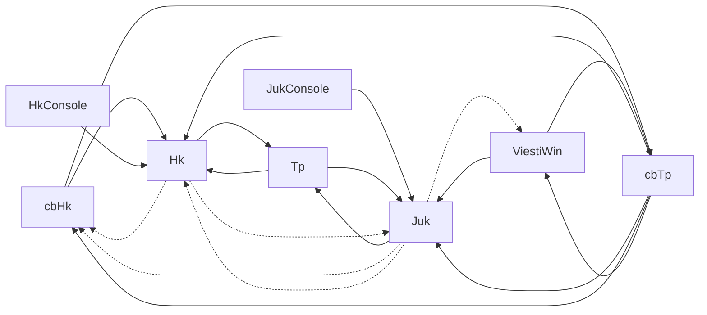

# Riippuvuudet / Dependencies

Polut ovat suhteessa hakemistoon `TPsource/V52/`.
Paths are relative to `TPsource/V52/`.

## Käännösaikaiset riippuvuudet hakemistojen välillä / Build-time dependencies between directories

Luvut kertovat, montako `#include`-riviä hakemistosta viittaa toiseen. Mukana
ovat vain repon omat otsikot; järjestelmä- ja VCL-otsikot on jätetty pois.
Samannimiset otsikot ratkaistiin samasta hakemistosta, sitten `include/`-hakemistosta.
[todennettu: `tyokalut/inventaario.py`, kenttä `dir_edges`]

The numbers tell how many `#include` lines in one directory refer to another.
Only the repository's own headers are counted; system and VCL headers are left
out. Same-named headers were resolved from the same directory first, then from
`include/`. [verified: `tyokalut/inventaario.py`, field `dir_edges`]

| Mistä / From | Mihin / To (määrä / count) |
|---|---|
| `Hk` | `include` 40, `cbHk` 7, `Tp` 2, `cbTp` 1, `Juk` 1 |
| `Juk` | `include` 41, `ViestiWin` 6, `cbTp` 3, `cbHk` 2, `Tp` 1, `Hk` 1 |
| `Tp` | `include` 23, `Hk` 7, `Juk` 6 |
| `HkConsole` | `include` 11, `Hk` 9 |
| `JukConsole` | `include` 20, `Juk` 8 |
| `cbHk` | `Hk` 72, `cbTp` 43, `include` 16, `Tp` 1 |
| `ViestiWin` | `Juk` 60, `cbTp` 29, `include` 9, `Tp` 1 |
| `cbTp` | `Hk` 20, `Juk` 17, `cbHk` 14, `include` 13, `ViestiWin` 10 |
| `com` | `include` 3 |
| `dbboxm` | `include` 36 |
| `tputilv2` | `include` 155 |
| `Tests` | `include` 1, `Tp` 1, `Hk` 1, `Juk` 1 |

Katkoviivat ovat "väärään suuntaan" meneviä riippuvuuksia: ytimestä GUI:hin ja
kilpailutyypistä toiseen. Kehät `Hk ↔ Tp`, `Juk ↔ Tp` ja `cbTp ↔ cbHk/ViestiWin`
tarkoittavat, että mitään näistä ei voi kääntää erikseen. [todennettu: include-rivit;
päätelty: seuraus erilliskäännökselle]

Dashed lines are dependencies "in the wrong direction": from the core to the GUI
and from one competition type to the other. The cycles `Hk ↔ Tp`, `Juk ↔ Tp` and
`cbTp ↔ cbHk/ViestiWin` mean that none of these can be built separately.
[verified: include lines; inferred: consequence for separate builds]

## Kirjastot ja linkitys / Libraries and linking

| Ohjelma / Program | Omat kirjastot / Own libraries | Ulkoiset / External |
|---|---|---|
| HkMaali, JukMaali, JukLuenta | `tputilv2.lib`, `dbboxm.lib` (`TPexe/lib/V52/VS/...`) | `ws2_32.lib`, `winhttp.lib`, `commode.obj`; JukMaali myös / also `odbc32.lib`, `odbccp32.lib` |
| HkKisaWin, ViestiWin | `Tputil-XE.lib`, `DBboxm-XE.lib` (`TPexe/Lib/V521/release_build/`) | VCL-ajonaikaiset paketit / runtime packages (`rtl`, `vcl`, `dbrtl`, `dbexpress`, `DbxCommonDriver`, `DBXMySQLDriver`, `IndyCore`, `IndyProtocols`, `IndySystem` …), `winhttp.lib`, `import32.lib`, `cp32mti.lib` |

Havaintoja / Observations:

- JukLuenta linkittää myös vanhaan hakemistoon `vc10/lib/...` (`VS/V/JukLuenta520.vcxproj`). [todennettu]
- GUI-projektit listaavat Indy-paketit, mutta koodissa ei ole yhtään `TId*`-komponenttia. Riippuvuus on todennäköisesti turha. [todennettu: haku `TId[A-Z]` .cpp/.h/.dfm; päätelty: turha]
- JukMaali linkittää ODBC-kirjastot, mutta koodissa ei ole ODBC-kutsuja. [todennettu: haku `odbc|SQLConnect(`]
- GUI-ohjelmat käyttävät ajonaikaisia paketteja (`UsePackages`, `DynamicRTL`), joten BPL/DLL-tiedostot on toimitettava mukana (`RADStudio10/collect-gui-runtime.ps1`).

- JukLuenta also links against the old `vc10/lib/...` directory (`VS/V/JukLuenta520.vcxproj`). [verified]
- The GUI projects list the Indy packages, but the code has no `TId*` components. The dependency is probably unnecessary. [verified: search `TId[A-Z]` in .cpp/.h/.dfm; inferred: unnecessary]
- JukMaali links the ODBC libraries, but the code has no ODBC calls. [verified: search `odbc|SQLConnect(`]
- The GUI programs use runtime packages (`UsePackages`, `DynamicRTL`), so BPL/DLL files must ship with them (`RADStudio10/collect-gui-runtime.ps1`).

## Kolmannen osapuolen koodi repossa / Third-party code in the repository

| Tiedosto / File | Mikä / What | Lisenssi / License |
|---|---|---|
| `Tests/doctest.h` | doctest-yksikkötestikirjasto / unit test framework | `Tests/doctest-LICENSE.txt` (MIT) |
| `Tp/mtrand.cpp`, `Tp/mtrand.h` | Mersenne Twister MT19937 (Matsumoto & Nishimura, C++-portti / port J. Bedaux) | BSD-tyyppinen / BSD-style (`Tp/mtrand.h`); `mtrand.cpp`:n otsikossa GPL-teksti / GPL header in `mtrand.cpp` |

## Ajonaikaiset riippuvuudet / Runtime dependencies

### Tiedostot / Files

Koodissa esiintyvät tiedostonimet (merkkijonoliteraalit), yleisimmät ensin.
Tiedostomuotoja ei ole vielä dokumentoitu tarkemmin. [todennettu: nimet;
tuntematon: muodot ja kirjoittajat]

File names appearing in the code (string literals), most frequent first. The
formats are not documented in detail yet. [verified: names; unknown: formats and
writers]

| Tiedosto / File | Rooli / Role [päätelty / inferred] |
|---|---|
| `laskenta.cfg`, `ilmoitt.cfg`, `Init.cfg`, `peruscfg.cfg`, `vaihevalinta.cfg` | Konfiguraatio / configuration |
| `KilpSrj.xml` | Kilpailun ja sarjojen määritys / competition and class definitions |
| `KILP.DAT` | Kilpailijatietueet (dbboxm) / competitor records |
| `radat.xml`, `radat1.xml` | Radat (rastit, ratavariaatiot) / courses |
| `ikkunat.xml` | GUI-ikkunoiden asettelu / GUI window layout |
| `ajat.txt`, `yhtjonot.txt` | Ajanoton ja yhteysjonojen tallenteet / timing and connection queue records |
| `seurat.csv`, `sarjat.csv`, `henkilot.csv`, `Seuraluettelo.*` | Tuonti ja vienti / import and export |
| `*.LST` (`LAINAEMIT.LST`, `PIIRIT.LST`, `SIJAPISTEET.LST`, `SARJAYHD.LST` …) | Luettelot ja taulukot / lists and tables |
| `tulokset.xml` | Tulosvienti / result export |
| `SQLjonoVarm.dat` | SQL-kirjoitusjonon varmistus / SQL write queue backup |
| `DATA_ERR.TXT`, `ArvDebug.txt`, `profdata.txt` | Virhe- ja vianetsintäloki / error and debug logs |
| `POSTSCRI.INI` | PostScript-tulostus / PostScript printing |
| `dbxkilp.ini` | dbExpress-yhteysasetukset / dbExpress connection settings |

### Verkko ja laitteet / Network and devices

- Yhteystyypit / connection types: `include/wincom.h:28-36` (RS-232, UDP, UDP-virta / stream, TCP, TCP-palvelin / server, TCP-XML, loki / log, tuonti / import)
- UDP/TCP-toteutus / implementation: `com/WinUDP.cpp`, `com/winCom.cpp`, `Tp/TpComY.cpp`
- HTTP: WinHTTP (`com/gethttp.cpp`)
- MySQL: dbExpress (`cbHk/UnitMySQL.*`, `ViestiWin/UnitMySQL.*`, `cbTp/UnitEmitSQL.*`)
- Selain / browser: `TWebBrowser`/`TEdgeBrowser` (`cbTp/UnitBrowser.*`, `cbTp/UnitHtmlEdit.*`)
- Laitteet / devices: `LID_*`, `include/TpLaitteet.h:17-47`; sarjaportit ja TCP / serial ports and TCP (`Tp/TpLaitteet.cpp`), RFID (`Tp/SiritReader.cpp`, `Tp/ZebraReader.cpp`)

## Kehitysympäristö / Development environment

| Työkalu / Tool | Versio / Version | Huom / Notes |
|---|---|---|
| Visual Studio Build Tools | 18 (2026), MSVC 14.52, toolset `v145` | Projekteissa `v145`; CI pakottaa `v143` (VS 2022) / projects use `v145`; CI forces `v143` |
| C++Builder Community Edition | 13 (Studio 37.0), klassinen `bcc32` / classic `bcc32` | Komentorivikäännös vain `bds.exe -b` kautta / command-line builds only via `bds.exe -b` (`RADStudio10/build-gui.ps1`) |
| Windows SDK | 10.0.26100.4188 | C++Builder 13 ei tunnista uudempaa .9457-versiota / does not recognise the newer .9457 |
| Python | 3.13 | Vain dokumentaation työkaluihin / only for documentation tools |

Kielistandardi: CLAUDE.md sanoo C++03. Tuotantokoodi ei käytä `<atomic>`- tai
`<mutex>`-otsikoita (vain `Tests/doctest.h`), mutta doctest vaatii vähintään
C++11:n, joten testit käännetään uudemmalla tasolla. Ovatko C++11-piirteet
sallittuja tuotantokoodissa, on päätettävä erikseen, koska klassinen `bcc32`
tukee vain osaa niistä. [todennettu: otsikot; tuntematon: linjaus]

Language standard: CLAUDE.md says C++03. Production code does not use `<atomic>`
or `<mutex>` (only `Tests/doctest.h` does), but doctest needs at least C++11, so
the tests are built at a newer level. Whether C++11 features are allowed in
production code is a separate decision, since the classic `bcc32` supports only
some of them. [verified: headers; unknown: policy]
