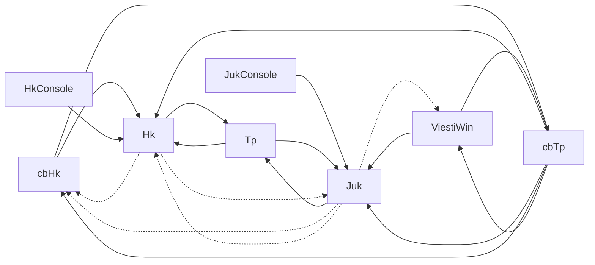

# Riippuvuudet / Dependencies

Polut ovat suhteessa hakemistoon `TPsource/V52/`.
Paths are relative to `TPsource/V52/`.

Kierroksen 1 luvut ovat numeroimattomia; erän C-10 laajennus alkaa luvusta 7 ja korjasi
kierroksen 1 tekstiä (merkitty "C-10"). / Round-1 sections are unnumbered; the C-10 extension
starts at section 7 and corrected round-1 text (marked "C-10").

## Käännösaikaiset riippuvuudet hakemistojen välillä / Build-time dependencies between directories

Luvut kertovat, montako `#include`-riviä hakemistosta viittaa toiseen. Mukana
ovat vain repon omat otsikot; järjestelmä- ja VCL-otsikot on jätetty pois.
Samannimiset otsikot ratkaistiin samasta hakemistosta, sitten `include/`-hakemistosta.
[todennettu: `tyokalut/inventaario.py`, kenttä `dir_edges`]

The numbers tell how many `#include` lines in one directory refer to another.
Only the repository's own headers are counted; system and VCL headers are left
out. Same-named headers were resolved from the same directory first, then from
`include/`. [verified: `tyokalut/inventaario.py`, field `dir_edges`]

| Mistä / From | Mihin / To (määrä / count) |
|---|---|
| `Hk` | `include` 40, `cbHk` 7, `Tp` 2, `cbTp` 1, `Juk` 1 |
| `Juk` | `include` 41, `ViestiWin` 6, `cbTp` 3, `cbHk` 2, `Tp` 1, `Hk` 1 |
| `Tp` | `include` 23, `Hk` 7, `Juk` 6 |
| `HkConsole` | `include` 11, `Hk` 9 |
| `JukConsole` | `include` 20, `Juk` 8 |
| `cbHk` | `Hk` 72, `cbTp` 43, `include` 16, `Tp` 1 |
| `ViestiWin` | `Juk` 60, `cbTp` 29, `include` 9, `Tp` 1 |
| `cbTp` | `Hk` 20, `Juk` 17, `cbHk` 14, `include` 13, `ViestiWin` 10 |
| `com` | `include` 3 |
| `dbboxm` | `include` 36 |
| `tputilv2` | `include` 155 |
| `Tests` | `include` 1, `Tp` 1, `Hk` 1, `Juk` 1 |

Katkoviivat ovat "väärään suuntaan" meneviä riippuvuuksia: ytimestä GUI:hin ja
kilpailutyypistä toiseen. Kehät `Hk ↔ Tp`, `Juk ↔ Tp` ja `cbTp ↔ cbHk/ViestiWin`
tarkoittavat, että mitään näistä ei voi kääntää erikseen. [todennettu: include-rivit;
päätelty: seuraus erilliskäännökselle]

Dashed lines are dependencies "in the wrong direction": from the core to the GUI
and from one competition type to the other. The cycles `Hk ↔ Tp`, `Juk ↔ Tp` and
`cbTp ↔ cbHk/ViestiWin` mean that none of these can be built separately.
[verified: include lines; inferred: consequence for separate builds]

## Kirjastot ja linkitys / Libraries and linking

Korjattu erässä C-10 (luku 9). / Corrected in batch C-10 (section 9).

| Ohjelma / Program (projekti / project) | Omat kirjastot / Own libraries | Ulkoiset / External |
|---|---|---|
| HkMaali (`HkMaali`), ViestiMaali (`JukMaali520`), ViestiLuenta (`JukLuenta520`) | `tputilv2.lib`, `dbboxm.lib` (`TPexe/lib/V52/VS/...`) | `ws2_32.lib`, `commode.obj`; `winhttp.lib` HkMaali ja ViestiMaali (ei ViestiLuenta) / not ViestiLuenta; `odbc32.lib`, `odbccp32.lib` ViestiMaali ja ViestiLuenta (käyttämättä / unused) |
| HkKisaWin, ViestiWin | `Tputil-XE.lib`, `DBboxm-XE.lib` (`TPexe/Lib/V521/release_build/`) | VCL-ajonaikaiset paketit / runtime packages (luku / section 14), `winhttp.lib`, `import32.lib`, `cp32mti.lib` |

Havaintoja / Observations:

- ViestiLuenta linkittää vanhaan hakemistoon `vc10/lib/...` vain kokoonpanoissa `Debug250` ja `Release150os` (`VS/V/JukLuenta520.vcxproj:120`, `:162`); toimitettava `Release` ei. [todennettu, C-10]
- Koodissa ei ole yhtään `TId*`-komponenttia, mutta molemmat GUI-ohjelmat tuovat ajossa `IndySystem370.bpl`:n (T-005, T-044). [todennettu: haku ja tuontitaulut, C-10]
- ViestiMaali ja ViestiLuenta linkittävät ODBC-kirjastot, mutta koodissa ei ole ODBC-kutsuja eikä ohjelmissa ODBC-tuontia. [todennettu, C-10]
- GUI-ohjelmat käyttävät ajonaikaisia paketteja (`UsePackages`, `DynamicRTL`), joten BPL/DLL-tiedostot on toimitettava mukana (`RADStudio10/collect-gui-runtime.ps1`, luku 14).

- ViestiLuenta links the old `vc10/lib/...` only in `Debug250` and `Release150os`; the shipped `Release` does not. [verified, C-10]
- The code has no `TId*` components, yet both GUI programs import `IndySystem370.bpl` at run time (T-005, T-044). [verified, C-10]
- ViestiMaali and ViestiLuenta link the ODBC libraries, but there are no ODBC calls and no ODBC imports. [verified, C-10]
- The GUI programs use runtime packages, so BPL/DLL files must ship with them (section 14).

## Kolmannen osapuolen koodi repossa / Third-party code in the repository

Täydennetty erässä C-10 (T-047). / Completed in batch C-10 (T-047).

| Tiedosto / File | Mikä / What | Lisenssi / License | Tuotteissa / In products |
|---|---|---|---|
| `Tests/doctest.h` | doctest 2.4.11 (`Tests/doctest.h:49-51`) | `Tests/doctest-LICENSE.txt` (MIT) | TpTest |
| `Tp/mtrand.h`, `Tp/mtrand.cpp` | Mersenne Twister MT19937 (Matsumoto & Nishimura, C++-portti / port J. Bedaux 2003) | BSD-tyyppinen / BSD-style (`Tp/mtrand.h:1-30`); `Tp/mtrand.cpp:1-14` on projektin oma GPL-otsikko / is the project's own GPL header | HkKisaWin, ViestiWin |
| `include/bkeybrd.h`, `bscreens.h`, `bstrings.h`, `butil.h`; 12 tiedostoa / files `tputilv2/` (esim. / e.g. `tputilv2/STPCVT.cpp`) | Blaise Computing Inc. "Version 6.00 (C)Copyright 1983-1989" (`include/bkeybrd.h:5`) | ei lisenssitekstiä / no licence text (T-047) | kaikki kirjastojen kautta / all, via the libraries |
| `include/Console.h`, `include/size.h`, `tputilv2/consolesize.cpp` | Microsoft Source Code Samples 1993–1997 (`include/Console.h:2-9`) | "All rights reserved", ei lisenssiä / no licence (T-047) | konsoliohjelmat ja kirjastot / console programs and libraries |

## Ajonaikaiset riippuvuudet / Runtime dependencies

### Tiedostot / Files

Koodissa esiintyvät tiedostonimet (merkkijonoliteraalit), yleisimmät ensin.
Muodot: `tiedostomuodot.md` (C-3). [todennettu: nimet]

File names appearing in the code (string literals), most frequent first. Formats:
`tiedostomuodot.md` (C-3). [verified: names]

| Tiedosto / File | Rooli / Role [päätelty / inferred] |
|---|---|
| `laskenta.cfg`, `ilmoitt.cfg`, `Init.cfg`, `peruscfg.cfg`, `vaihevalinta.cfg` | Konfiguraatio / configuration |
| `KilpSrj.xml` | Kilpailun ja sarjojen määritys / competition and class definitions |
| `KILP.DAT` | Kilpailijatietueet (dbboxm) / competitor records |
| `radat.xml`, `radat1.xml` | Radat (rastit, ratavariaatiot) / courses |
| `ikkunat.xml` | GUI-ikkunoiden asettelu / GUI window layout |
| `ajat.txt`, `yhtjonot.txt` | Ajanoton ja yhteysjonojen tallenteet / timing and connection queue records |
| `seurat.csv`, `sarjat.csv`, `henkilot.csv`, `Seuraluettelo.*` | Tuonti ja vienti / import and export |
| `*.LST` (`LAINAEMIT.LST`, `PIIRIT.LST`, `SIJAPISTEET.LST`, `SARJAYHD.LST` …) | Luettelot ja taulukot / lists and tables |
| `tulokset.xml` | Tulosvienti / result export |
| `SQLjonoVarm.dat` | SQL-kirjoitusjonon varmistus / SQL write queue backup |
| `kilpsql.txt`, `vkilpsql.txt` | SQL-taulujen luontilauseet (luku 11) / SQL table definitions (section 11) |
| `DATA_ERR.TXT`, `ArvDebug.txt`, `profdata.txt`, `cmderrors.txt` | Virhe- ja vianetsintäloki / error and debug logs |
| `POSTSCRI.INI` | PostScript-tulostus / PostScript printing |
| `dbxkilp.ini` | Vain kommentoidussa koodissa; ei käytössä (C-10) / only in commented-out code; unused (C-10) |
| `HkKisa.chm`, `ViestiWin.chm` | Ohjetiedostot; eivät ole repossa eivätkä julkaisussa (H-165) / help files; not in the repo or the release |

### Verkko ja laitteet / Network and devices

- Yhteystyypit / connection types: `include/wincom.h:28-36`
- UDP/TCP-toteutus / implementation: `com/WinUDP.cpp`, `com/winCom.cpp`, `Tp/TpComY.cpp`
- HTTP: WinHTTP (`com/gethttp.cpp`), vain `EMITHTTP` (ei ViestiLuennassa) / only with `EMITHTTP`, not in ViestiLuenta (luku / section 12)
- MySQL: dbExpress (`cbHk/UnitMySQL.*`, `ViestiWin/UnitMySQL.*`, `cbTp/UnitEmitSQL.*`), vain GUI / GUI only (luku / section 11)
- Selain / browser: vain `TWebBrowser` (IE/MSHTML) (`cbTp/UnitBrowser.*`, `cbTp/UnitHtmlEdit.*`); `TEdgeBrowser`ia ei käytetä (korjattu C-10) / `TEdgeBrowser` is not used (corrected in C-10)
- Laitteet / devices: `LID_*`, `include/TpLaitteet.h:17-47`; `Tp/TpLaitteet.cpp`, `Tp/SiritReader.cpp`, `Tp/ZebraReader.cpp` (luku / section 13)

## Kehitysympäristö / Development environment

| Työkalu / Tool | Versio / Version | Huom / Notes |
|---|---|---|
| Visual Studio Build Tools | 18 (2026), MSVC 14.52.37025, toolset `v145` | Projekteissa `v145`; CI pakottaa `v143` (VS 2022); `HkMaali.vcxproj`:n `ReleaseVA200` ja `Demo` vaativat `v120_xp`:n (ei asennettu, ei CI:ssä) / projects use `v145`; CI forces `v143`; two HkMaali configurations need `v120_xp` |
| C++Builder Community Edition | 13.1 (Studio 37.0, tiedostoversio / file version 37.0.60542.8024), klassinen `bcc32` 7.80 / classic `bcc32` 7.80 | Komentorivikäännös vain `bds.exe -b` kautta / command-line builds only via `bds.exe -b` |
| Windows SDK | 10.0.26100.4188 (CLAUDE.md); asennettu kansio / installed folder `10.0.26100.0` | Win32-`bcc32` käyttää Studion omia otsikoita ja `psdk`-kirjastoja; SDK-rajoitus tulee IDE:n alustamäärityksestä [todennettu: lokit; tuntematon: syy] / Win32 `bcc32` uses Studio's bundled headers and `psdk` libraries; the SDK limit comes from the IDE platform set-up |
| Python | 3.13 | Vain dokumentaation työkaluihin / only for documentation tools |

Kielistandardi: CLAUDE.md sanoo C++03. Tuotantokoodi ei käytä `<atomic>`- tai
`<mutex>`-otsikoita (vain `Tests/doctest.h`), mutta doctest vaatii vähintään
C++11:n, joten testit käännetään uudemmalla tasolla. Ovatko C++11-piirteet
sallittuja tuotantokoodissa, on päätettävä erikseen, koska klassinen `bcc32`
tukee vain osaa niistä. [todennettu: otsikot; tuntematon: linjaus]

Language standard: CLAUDE.md says C++03. Production code does not use `<atomic>`
or `<mutex>` (only `Tests/doctest.h` does), but doctest needs at least C++11, so
the tests are built at a newer level. Whether C++11 features are allowed in
production code is a separate decision, since the classic `bcc32` supports only
some of them. [verified: headers; unknown: policy]

## 7. C-10: yhteenveto / C-10: summary

Erä C-10 (vaihe 1, 2026-11-26) kartoitti ulkoiset riippuvuudet tuotteittain staattisesti:
mitään ei käännetty eikä ajettu, eikä yhteyksiä muodostettu. Tärkeimmät tulokset:

- **Konsoliohjelmat** (HkMaali, ViestiMaali, ViestiLuenta) ovat lähes omavaraisia: staattinen
  MSVC-ajonaikainen kirjasto (`/MT`), ulkoisina vain Windowsin DLL:t (Winsock, WinHTTP kahdessa,
  GDI ja taustatulostus). Ei tietokantaa, ei selainta. Tarkennus: tämä koskee tuontitaulun DLL:iä;
  käyttöjärjestelmän palvelut, ajurit, asetus- ja kilpailutiedostot luvussa 19.6.
- **GUI-ohjelmat** (HkKisaWin, ViestiWin) tarvitsevat 11 C++Builder 13 -ajonaikaistiedostoa
  (9 BPL:ää, `borlndmm.dll`, `cc32370mt.dll`) sekä valinnaisesti MySQL-ajurin (`dbxmys.dll`),
  MySQL-asiakaskirjaston (`libmysql.dll`, versio tuntematon), IE/MSHTML-selainmoottorin ja HTML
  Helpin. Julkaisu-ZIP:stä puuttuvat MySQL-tiedostot, taulujen luontitiedostot ja ohjeet (H-165).
- **Tietokanta** on valinnainen rinnakkainen peili; `KILP.DAT` on ensisijainen. Q5 ratkaistu
  (luku 11). SQL-polussa vakavin löydös: yksikin SQL-virhe kirjoitussäikeessä lopettaa koko
  ohjelman (H-160); päivityslauseet ovat osin virheellisiä (H-161).
- **HTTP** on vain emiTag-väliaikojen nouto Emitin palvelimelta selväkielisellä HTTP:llä
  kovakoodattuun oletusosoitteeseen (H-166, T-043). Selain on `TWebBrowser` (IE-moottori);
  `TEdgeBrowser`ia ei käytetä.
- **Laitteet**: 27 laitetunnusta, joista noin kolmannes kuollutta koodia. Vakavin löydös:
  Sirit/Zebra-RFID-lukijan uudelleenyhteys lopettaa lukijasäikeen (H-159, korkea). Kadonnutta
  sarjaporttia ei avata uudelleen eikä siitä ilmoiteta (H-164). Q86 kavennettu.
- **Q91 ja Q92** ratkaistu staattisesti RTL-lähteistä (luku 14); Q91:n ajokoe on yhä avoin.

Batch C-10 (step 1) mapped the external dependencies per product statically: nothing built, run
or connected. Console programs are nearly self-contained (static CRT, Windows DLLs only). The GUI
programs need 11 C++Builder 13 runtime files plus, optionally, the MySQL driver and client
library, the IE engine and HTML Help; the release ZIP lacks the MySQL files, schema files and help
(H-165). The database is an optional parallel mirror (Q5 resolved, section 11); one SQL error in
the writer thread ends the program (H-160). HTTP is only the emiTag split fetch over plain HTTP
(H-166, T-043); the browser is `TWebBrowser`, not `TEdgeBrowser`. Devices: the Sirit/Zebra
reconnect ends the reader thread (H-159, high); a vanished serial port is never reopened (H-164).
Q91 and Q92 answered statically from the RTL sources.

## 8. Menetelmä, todennus ja kattavuus / Method, verification and coverage

| Osa / Part | Tekijä / By | Tuotos / Output |
|---|---|---|
| A, skripti / script | pääistunto / main session | `tyokalut/riippuvuudet.py`; raakatulos / raw output `todisteet/c10/osaA/` (3 779 merkkiä / markers, 161 lomaketta / forms) |
| A, luokittelu / classification | `build-dependency-analyst`, Sonnet | `todisteet/c10/raportit/osaA-luokittelu.md` |
| B tietokanta / database | `architecture-analyst`, Sonnet | `osaB-tietokanta.md` |
| C HTTP ja selain / HTTP and browser | `defect-concurrency-auditor`, Sonnet | `osaC-http-selain.md` |
| D laitteet / devices | `architecture-analyst`, Sonnet | `osaD-laitteet.md` |
| E paketit ja jakelu / packages and deployment | `build-dependency-analyst`, Sonnet | `osaE-paketit-jakelu.md`, PE-jäsennin / parser `todisteet/c10/osaE/` |
| F riippumaton tarkastus / independent review | `independent-verifier`, Opus | `osaF-tarkastus.md` (K1–K15, E1–E3) |
| G dokumentointi / documentation | pääistunto / main session | tämä luku, rekisterit / this chapter, registers |

B, C ja D ajettiin rinnakkain; E käynnistyi C:n vapauttamalle paikalle ja A:n luokittelu B:n
jälkeen, joten samanaikaisia agentteja oli enintään kolme. Skriptin luotettavuus varmistettiin
ennen agenttikäyttöä C-9:n kokemuksen perusteella (`todisteet/c10/osaA/README.md`): käännösyksiköt
täsmäävät C-5:n tallentamiin käännöksiin kaikissa 9 projektissa, MSVC-määritykset komentoriveihin,
ja tarkistuksessa korjattiin viisi skriptin virhettä (include-vartijat, `#include`-ehdot,
otsikkoryhmät, `.cpp`-tiedoston omat makrot, ehdolliset oletusmakrot). Agenttien tokenit: A 185 942,
B 169 255, C 122 096, D 280 945, E 230 964, F 208 904, yhteensä noin 1,20 milj.

B, C and D ran in parallel; E took C's slot and A's classification B's, so at most three agents
ran at once. The script was validated before agent use (unit lists match the C-5 recorded builds
in all 9 projects; five script defects fixed). Agent tokens about 1.20 M in total.

Näytön lajit / kinds of evidence: lähdekoodi ja projektitiedostot (kaikki osat); asennetun
C++Builder 13:n RTL- ja dbExpress-lähteet sekä versiotiedot (B, E, F); 2026-11-24 paikallisesti
käännettyjen ohjelmien PE-tuontitaulut ja käännöslokit (A, E, F; voivat poiketa nykyisestä
lähteestä, `TPsource/` ei ole muuttunut sen jälkeen). Mitään ei ajettu.
/ Source and project files; the installed C++Builder 13 RTL and dbExpress sources and version
resources; PE import tables and build logs of the 2026-11-24 local builds. Nothing was run.

Kattavuus / coverage: kaikki viisi tuotetta ja neljä kirjastoprojektia; kaikki riippuvuusmerkit
luokiteltu luokittain; laitetunnukset 27/27; tietokanta-, HTTP- ja selainkoodi luettu kokonaan;
ajonaikainen pakettijoukko johdettu tuontitauluista. Ei kattanut: laitteiden todellista käytöstä,
palvelinten (Emit, MySQL) käytöstä, haavoittuvuustietokantoja (rajattu myöhemmäksi), GUI:n
käynnistystä puhtaalla koneella. / All five products and four library projects; all marker
categories classified; 27/27 device ids; database, HTTP and browser code read in full. Not
covered: real device and server behaviour, vulnerability databases (deferred), clean-machine runs.

## 9. Tuotekohtainen inventaario / Per-product inventory

Y = käytössä / used; Y* = vain kun ominaisuus on asetettu / only when the feature is configured;
– = ei tuotteessa / not in the product. Pakollinen = ohjelma ei käynnisty ilman / mandatory = the
program does not start without it. Lähde / source: `todisteet/c10/raportit/osaA-luokittelu.md`,
`osaE-paketit-jakelu.md`.

| Riippuvuus / Dependency | Laji / Kind | HkMaali | ViestiMaali | ViestiLuenta | HkKisaWin | ViestiWin | Pakollisuus / Need |
|---|---|---|---|---|---|---|---|
| `tputilv2.lib`, `dbboxm.lib` | käännös, staattinen / build, static | Y | Y | Y | – | – | pakollinen / mandatory |
| `Tputil-XE.lib`, `DBboxm-XE.lib` | käännös, staattinen / build, static | – | – | – | Y | Y | pakollinen / mandatory |
| MSVC CRT (`/MT`), `commode.obj` | käännös, staattinen / build, static | Y | Y | Y | – | – | ei ajonaikaista tiedostoa / no runtime file |
| `kernel32`, `user32`, `gdi32`, `winspool.drv` | ajo, käyttöjärjestelmä / run, OS | Y | Y | Y | Y | Y | pakollinen / mandatory |
| `ws2_32` (Winsock 2, IPv4) | ajo, KJ / run, OS | Y | Y | Y | Y | Y | DLL pakollinen; yhteydet asetuksista / DLL mandatory; sockets per config |
| `winhttp` | ajo, KJ / run, OS | Y* | Y* | – | Y* | Y* | DLL pakollinen; nouto vain `ETGPRS` / DLL mandatory; fetch only with `ETGPRS` |
| `advapi32` (rekisteri / registry), `shell32` (kansionvalinta / folder picker), `oleaut32` | ajo, KJ / run, OS | – | – | – | Y | Y | pakollinen / mandatory |
| `odbc32`, `odbccp32` | käännös / build | (oletuslista / default list) | Y | Y | – | – | ei tuontia, turha / not imported, unneeded (T-005) |
| C++Builder 13 BPL:t ja RTL (`rtl370`, `vcl370`, `dbrtl370`, `dbexpress370`, `DbxCommonDriver370`, `DBXMySQLDriver370`, `vclie370`, `vcledge370`, `IndySystem370`, `borlndmm.dll`, `cc32370mt.dll`) | ajo, toimitettava / run, shipped | – | – | – | Y | Y | pakollinen (staattinen tuonti) / mandatory (static import) |
| `dbxmys.dll` + 32-bit `libmysql.dll` | ajo, dynaaminen lataus / run, dynamic load | – | – | – | Y* | Y* | valinnainen: MySQL / optional (H-165) |
| IE/MSHTML (`TWebBrowser`) | ajo, KJ:n ActiveX / run, OS ActiveX | – | – | – | Y | Y | selainlomakkeet / browser forms |
| HTML Help (`hhctrl.ocx`) + `.chm` | ajo / run | – | – | – | Y* | Y* | valinnainen: ohje / optional: help (`.chm` puuttuu / missing) |
| Sarjaportit / serial ports (`\\.\COMn`) | ajo, laite / run, device | Y* | Y* | Y* | Y* | Y* | laiteasetuksista / per device config (luku / section 13) |
| emiTag-palvelin / server `195.159.103.189:1379` | ajo, verkko / run, network | Y* | Y* | – | Y* | Y* | `EMITHTTP` + `ETGPRS` |
| MySQL-palvelin / server | ajo, verkko / run, network | – | – | – | Y* | Y* | `SQLSTART`, valikko / menu |
| emiTag-SQL (`tags`, SSH-tunneli / tunnel) | ajo, verkko / run, network | – | – | – | Y* | Y* | `ETSQL` |
| `HKLM\...\Internet Explorer\Version`, `HKCU\...\FEATURE_BROWSER_EMULATION\<exe>` | ajo, rekisteri / run, registry | – | – | – | Y | Y | luetaan ja kirjoitetaan joka käynnistyksessä, ei poisteta / read and written at every start, never removed |
| `system()` / `_wsystem()` automaattikomento / auto command | ajo, `cmd.exe` | Y* | Y* | Y* | Y* | Y* | `AUTOFILE` + asetus / setting |
| UDP/TCP-palvelimet `INADDR_ANY` / servers | ajo, verkko / run, network | Y* | Y* | Y* | Y* | Y* | asetuksista / per config (T-043) |

Ohjelmien versiot: `Hk/BuildNo.h:17-18` (`5.21`, build `5.22.002/2026-07-31`), GUI-tiedostoversiot
5.21.0.2 (HkKisaWin) ja 5.21.0.1 (ViestiWin); konsoliohjelmissa ei versioresurssia. Kaikki viisi
ohjelmaa ovat 32-bittisiä, PE:n käyttöjärjestelmäversio 6.0 (Vista); `_WIN32_WINNT`ia ei määritellä,
joten otsikot käyttävät Windows 10:n arvoa. / Program versions as listed; all five are 32-bit with
PE OS version 6.0; `_WIN32_WINNT` is not defined, so the headers use the Windows 10 value.

## 10. Ulkoisia riippuvuuksia kytkevät valitsimet / Switches that enable external dependencies

Vain riippuvuuksia kytkevät valitsimet; koko valitsininventaario on uuden erän C-12 tehtävä (Q2,
T-008). Arvot: `todisteet/c10/osaA/makrot.csv` (proj = projektitiedosto, hdr = otsikko). / Only
switches that enable a dependency; the full inventory is new batch C-12.

| Valitsin / Switch | Kytkee / Enables | HkMaali | ViestiMaali | ViestiLuenta | HkKisaWin | ViestiWin |
|---|---|---|---|---|---|---|
| `EMITHTTP` | WinHTTP-nouto, `ETHOST`/`ETGPRS`/`ETSQL` | proj | proj | – | proj | proj |
| `TCPSIIRTO` | TCP-tiedostonsiirto ja TCP-koodi / TCP file send and TCP code | proj | proj | proj | proj | proj (+ `com/WinUDP.cpp:21-23` itse / itself) |
| `TCPLUKIJA` | TCP/UDP-lukijayhteydet / reader connections | proj | proj | proj | proj | proj |
| `LAJUNEN` | Sirit, Zebra, FEIG, IMPINJ, VALOT | proj | proj | – | proj | proj |
| `GAZ` | GAZ-tulostaulu / board | proj | proj | – | – | proj |
| `ALGETAULU` | tulostaulu / scoreboard | – | proj | – | – | proj |
| `SAKKOCOM` | sakkolaite / penalty device | proj | – | – | hdr (`Hk/HkDef.h:124-126`) | – |
| `AUTOFILE` | automaattitulosteet ja `system()`-komento / auto output and command | proj | proj | proj | **hdr** (`Hk/HkDef.h:53-55`) | proj |
| `VALUKIJA` | väliaikalukija / intermediate reader | proj | proj | – | proj | proj |
| `EMITAG` | ei mitään: yksikään `#if` ei testaa sitä / nothing: no `#if` tests it | – | proj | – | – | proj |
| `SQLDATA`, `EI_OLE`, `SPORTIDENT`, `MAKI`, `TUTKA`, `SWIM2000`, `SIIMPORT` | kuollut koodi / dead code (T-049) | – | – | – | – | – |

Valitsimen poistaminen projektista ei aina poista riippuvuutta (T-045). / Removing a define from a
project does not always drop the dependency (T-045).

## 11. Tietokanta ja Q5 / Database and Q5

**Rooli.** MySQL on valinnainen rinnakkainen peili, jota on vain GUI-ohjelmissa. `kirjSQLrivi`
kirjoittaa muistissa olevasta tietueesta (`cbHk/UnitMySQL.cpp:455`); `KILP.DAT` ja muistitaulukko
ovat ensisijaiset. SQL:stä luetaan takaisin vain käyttäjän käynnistämässä tuonnissa (valinta 6,
`lue_SQL`, `cbHk/UnitImport.cpp:1066-1088`), joka tekee SQL:stä tuhoavasti ensisijaisen (H-169),
sekä päivityksen vertailussa (`readSQLrivi`). Konsoliohjelmissa ei ole toimivaa SQL-koodia
(`HkConsole/HkCons0.cpp:141-143` tyhjä, `Juk/vdat.cpp:38-60` `SQLDATA` kuollut). Erillinen
`cbTp/UnitEmitSQL.cpp` lukee emiTag-palvelimen `tags`-taulua (vain luku, SSH-tunneli).

**Role.** MySQL is an optional parallel mirror, GUI only, written from memory; `KILP.DAT` stays
the master. SQL is read back only by the user-triggered import (H-169) and the update diff. The
console programs have no live SQL code. `UnitEmitSQL` reads the emiTag server's `tags` table.

**Q5: taulut / tables.** Koodissa ei ole `CREATE`-lauseita; rakenne on tiedostoissa
`cbHk/kilpsql.txt` (HK: `osanotot` (kilpailu, tietue), `osottopv` (kilpailu, tietue, vaihe),
`tulos` (kilpailu, tietue, vaihe, piste)) ja `ViestiWin/vkilpsql.txt` (viesti / relay:
`vosanotot`, `osuudet` (kilpailu, tietue, osuus), `vtulos`), InnoDB, `latin1`. Kenttävastaavuudet:
`todisteet/c10/raportit/osaB-tietokanta.md` luku 2. Käyttöön otetaan asetuksilla `SQLHOST`,
`SQLDATABASE`, `SQLUSER`, `SQLPASSWORD`, `SQLSTART`, `SQLTALLENNUS` (`Hk/HkInit.cpp:713-755`,
`Juk/VInit.cpp:802-845`) tai valikosta "Tiedostot/MySQL"; jatkuva kirjoitus valintaruudusta
"Jatkuva tiedonsiirto". / No CREATE statements in code; schema in the two `.txt` files; enabled by
the `SQL*` keys or the menu.

**Yhteys / connection.** `TSQLConnection` → `DBXMySQLDriver370.bpl` (staattinen / static) →
`dbxmys.dll` (`LoadLibrary`) → `LIBMYSQL.dll` (asiakaskirjasto / client library). Parametrit
rakennetaan koodissa joka avauksella (`cbHk/UnitMySQL.cpp:117-129`): ei `dbxkilp.ini`-tiedostoa,
ei porttia (`sqlparam.port` ohitetaan), ei merkistöä, ei aikakatkaisua, ei TLS:ää. Tunnukset ovat
selväkielisinä asetustiedostossa ja komentorivillä, oletussalasana dokumentoitu (T-043).
/ Parameters rebuilt in code on every open; no port, charset, timeout or TLS; plain-text
credentials (T-043).

**Virheet ja synkronointi / errors and synchronisation.** SQL-kutsujen ympärillä ei ole
poikkeuskäsittelyä. Kirjoitussäikeessä yksikin virhe (palvelinkatkos, heittomerkki nimessä,
H-161:n lause) lopettaa ohjelman (H-160); pääsäikeen viennissä lukko jää päälle (H-162);
käynnistyksessä `SQLSTART`-virhe ohittaa loput alustuksesta (H-163). Jono ja varmistustiedosto:
H-014, H-043, H-100 (C-1, C-3, C-6). / No exception handling around SQL calls: one error in the
writer thread ends the program (H-160); export keeps the lock (H-162); start-up skips the rest of
initialisation (H-163). Queue and backup file: H-014, H-043, H-100.

## 12. HTTP ja selain / HTTP and browser

**HTTP.** Ainoa HTTP-asiakas on `com/gethttp.cpp` (WinHTTP, `GET`). Käyttö: emiTag-väliaikojen
nouto (`ETGPRS`) Emitin palvelimelta polusta `/emitphp/get_stream.php`, oletuspalvelin
`195.159.103.189:1379` (`Hk/HkGlobals.cpp:624-625`, `Juk/VGlobals.cpp:506`), muutettavissa
`ETHOST`-asetuksella. Kutsujat `Hk/HkIV.cpp:3540` ja `Juk/VIv.cpp:2397` omissa säikeissään.
Ei TLS:ää (`secure=0`), ei tunnistusta, ei asetettuja aikakatkaisuja (WinHTTP:n oletukset), ei
HTTP-tilan tarkistusta; järjestelmän WinHTTP-välityspalvelinasetus. Virheet: H-166, H-167, T-043.
/ The only HTTP client polls emiTag splits over plain HTTP from a hard-coded default server; no
TLS, authentication, timeouts set or status check (H-166, H-167, T-043).

**Selain / browser.** `TWebBrowser` (`cbTp/UnitBrowser.dfm`, `cbTp/UnitHtmlEdit.dfm`) näyttää
ohjelman tuottamia paikallisia HTML-tiedostoja ja käyttäjän antamia osoitteita
(`cbTp/UnitBrowser.cpp:51`, `cbHk/UnitKilpailijaOnline.cpp:1443`). Moottori on IE/MSHTML
(`SelectedEngine` oletus IEOnly); ohjelma kirjoittaa joka käynnistyksessä
`FEATURE_BROWSER_EMULATION`-arvon (`cbTp/cbTpApu.cpp:579-636`). `TEdgeBrowser`ia tai WebView2:ta
ei käytetä, mutta `SHDocVw.hpp` vetää `vcledge370.bpl`:n käynnistysriippuvuudeksi (T-044, T-046).
/ `TWebBrowser` shows generated local HTML and user-given URLs; IE engine; emulation key written at
every start; no Edge/WebView2 use, but `vcledge370.bpl` is a start-up dependency.

## 13. Laitteet ja protokollat / Devices and protocols

Laiteluettelo, kuljetus, kehystys ja kuittaus laitteittain: `todisteet/c10/raportit/osaD-laitteet.md`
luvut 1–2. Tiivistelmä / summary:

| Laiteperhe / Family | Kuljetus / Transport | Tarkiste / Check | Kuittaus / ACK | Tuotteet / Products |
|---|---|---|---|---|
| Emit-kello ja RTR / Emit clock, RTR (`LID_RTR`, `RTR2`, `EMITKELLO`) | sarja / serial 1200–4800 | RTR2 summa / sum; muut kenttätarkistus / others field check | `?\r` / `+\r` (Q86) | HK, viesti (ei ViestiLuenta / not ViestiLuenta) |
| Emit-lukija / reader (`LUKIJA`) | sarja, TCP, UDP | kaksi summaa / two checksums | ei; kaksoiskappaleiden suodatus / no; duplicate filter | kaikki / all |
| Emit MTR | sarja / serial 9600 | summa / checksum | vetoprotokolla `/GB` / pull | kaikki / all |
| emiTag (ECB1/ETS1/ECU1) | sarja / serial; HTTP/SQL palvelimen kautta / via server | ei / none | ei / none | kaikki; HTTP `EMITHTTP` |
| ALGE S3/S4/Comet/Timy/TDC/ASC, ARES, RADIOEMIT | sarja / serial | ei (ARES rakenne) / none | ei / none | HK; viestissä osa / relay partly |
| Sirit (FX9500), Zebra FX9600 (LLRP), FEIG, IMPINJ | TCP (FEIG sarja / serial) | FEIG CRC-16; muut ei / others none | Zebra KEEPALIVE | `LAJUNEN` (ei ViestiLuenta) |
| Tulostaulut / boards (GAZ, ALGETAULU, C-Power, RTNM), valot / lights, AIKA_COM | sarja, UDP, TCP | C-Power summa / sum | – | valitsimittain / per switch |

Sarjaportit avataan `\\.\COMn`, ilman kättelyä, RTS/DTR päällä; USB-laitteiden luettelointia ei
ole. TCP-lukijoiden avaus yrittää uudelleen, mutta katkennutta yhteyttä ei valvota (T-048).
Vakavimmat: H-159 (RFID-uudelleenyhteys lopettaa luennan, korkea), H-164 (kadonnut sarjaportti).
Laiteohjelmistoon sidotut oletukset (kiinteät kehyskoot 19–462 tavua, `MAXNLEIMA=50`, Siritin
tekstisiirtymät, LLRP v1): `osaD-laitteet.md` luku 5.

Serial ports open as `\\.\COMn` without handshake; no USB enumeration. Broken TCP links are not
monitored (T-048). Worst: H-159 (high) and H-164. Firmware-bound assumptions: report section 5.

**Q86 (staattisesti / statically).** Emit-kello saa kuittauksen `+\r`, kun `tall_emit` palauttaa 0:
myös hylätylle kaksoiskappaleelle ja H-145:n epäonnistuneelle tallennukselle; `?\r` pyytää uudelleen
enintään 200 ms välein. Kaksoiskappaletarkistus vertaa aikoja itseensä (H-168). Laitteen käytöstä
ilman kuittausta, kuittauksen myöhästyessä tai `-`-vastauksen merkitystä ei voi ratkaista ilman
laitteen dokumentaatiota. / ACK is sent when `tall_emit` returns 0, also for dropped duplicates and
H-145 failures; device behaviour without ACK needs the device documentation.

## 14. Ajonaikaiset paketit ja jakelu / Runtime packages and deployment

**GUI.** Toimitettava kokoonpano: `DynamicRTL`, `UsePackages`, `UsingDelphiRTL`; linkitysrivin
paketit ovat täsmälleen `LinkPackageImports` (`HkKisaWin.cbproj:265`, `ViestiWin.cbproj:302`).
`collect-gui-runtime.ps1` kerää 11 moduulia staattisista tuonneista; kaikki ovat Embarcaderon
jaettavia (`Redist/win32.redistlist`). Puuttuu: dynaamisesti ladattu `dbxmys.dll`, kolmannen
osapuolen `libmysql.dll`, `kilpsql.txt`/`vkilpsql.txt`, `.chm` (H-165). Paketoitua ohjelmaa ei ajeta
CI:ssä (T-044). Linkitetyt mutta tuomatta jäävät paketit (`dsnap`, `bcbie`, `IndyCore`,
`IndyProtocols`, `vclx`) ja vanhat `PackageImports`-listat eivät vaikuta ajoon (T-044).

**GUI.** Shipped configuration with dynamic RTL and packages; the collector gathers 11 modules from
static imports; missing: `dbxmys.dll`, `libmysql.dll`, schema files, help (H-165); the packaged
program is never run in CI (T-044).

**Muistinhallinta (Q91, staattisesti).** GUI-ohjelmissa C++:n `malloc`/`free`/`new`/`delete` ja VCL
käyttävät samaa `borlndmm.dll`:ää (FastMM) RTL:n kekoohjauksen kautta (C++Builder-lähteet
`hrdir_b.c`, `crtlvcl.cpp`, `getmem.inc`). Vapautetun pienen lohkon toinen vapautus palauttaa −1,
ja paluuarvo ohitetaan, joten H-149:n kaksoisvapautus on ViestiWinissä hiljainen, jos lohkoa ei ole
välissä varattu uudelleen; muuten se vapauttaa elävän lohkon (hiljainen korruptio). Toimitetun
binäärin käytös on ajokokeen asia. / C and VCL allocations share `borlndmm.dll`; H-149's second free
is silent unless the block was reused in between (then silent corruption); a run is still needed.

**Q92.** bcc32-RTL:n `_wfopen_s` välittää `_O_SECURE`n; `__open.c` asettaa kirjoitukselle
jakotilan 0 (yksinoikeus) ja lukemiselle `FILE_SHARE_READ`. `tputilv2/TextFileClass.cpp:305` avaa
siis kirjoitusvirran yksinoikeudella kuten MSVC:ssä. / Write streams open exclusively, as in MSVC.

**Konsoliohjelmat / console programs.** `/MT`, ei VC++-uudelleenjakopakettia; tuonnit vain Windowsin
DLL:istä (luku 9). / Static CRT; only Windows DLLs.

**T-005 tarkennettu / refined.** ODBC-kirjastot (ViestiMaali, ViestiLuenta) voi poistaa
turvallisesti staattisen näytön perusteella. `IndyCore`/`IndyProtocols` todennäköisesti myös.
`IndySystem370.bpl` tuodaan ajossa (yksikköalustukset), joten sen poisto vaatii linkityskokeen
(Q102). / ODBC removal is safe; Indy core/protocols very likely; `IndySystem` needs a link trial.

## 15. Versiot ja modernisointiriskit / Versions and modernisation risks

Versio kirjataan vain, jos lähde on näytettävissä; ikä ei ole haavoittuvuus. Ajantasainen
haavoittuvuustarkastus ulkoisia tietokantoja vasten on rajattu myöhemmäksi. / A version is stated
only with its source; age is not a vulnerability; an external vulnerability check is deferred.

| Riippuvuus / Dependency | Versio / Version | Miten tunnistettu / How identified | Käyttäjät / Used by | Välttämätön? / Needed? | Sitoo / Binds to | Päivitys tai korvaus edellyttää / Upgrade or replacement requires | Vaikutus laitteisiin ja tiedostoihin / Effect on devices and files |
|---|---|---|---|---|---|---|---|
| C++Builder 13.1 RTL, VCL, BPL:t | 37.0.60542.8024 | tiedostoversiot / version resources; `ProjectVersion` 20.1 | GUI | kyllä / yes | Studio 37.0 -polut (`build-gui.ps1`, `collect-gui-runtime.ps1`), rekisteriavain `BDS\37.0\dbExpress`, BPL-pääte 370, itseisännöity CI-ajokone / self-hosted runner | uusi Studio → uusi pääte, uudelleenkeräys; Clang-kääntäjä → eri RTL-DLL:t ja `kaantajaerot.md`:n erot; staattinen linkitys muuttaa muistinhallinnan / new suffix, re-collect; Clang changes RTL and behaviour; static link changes the memory manager | binäärirakenteet samat kääntäjästä riippumatta (C-5), mutta `-a`/`-K`/`time_t`-erot on mitattava uudelleen / on-disk layouts measured equal (C-5), re-measure after a change |
| klassinen `bcc32` | 7.80.9351.38661 | `bcc32.exe` versio / version | GUI | kyllä / yes | 32-bit; Windows SDK -rajoitus (CLAUDE.md) | ks. edellinen / see above | – |
| MSVC | 14.52 (`v145`); CI `v143` | PE, vcxproj, työnkulut / workflows | konsoli / console | kyllä / yes | VS 2026 paikallisesti, VS 2022 CI:ssä / locally, in CI | `windows-latest`-kuvan `v143` tarkistettava (Q103) / check | – |
| Windows SDK | 10.0.26100.x | CLAUDE.md, kansio / folder | molemmat / both | kyllä / yes | ≤ 10.0.26100.6584 C++Builderille | SDK-päivitys voi rikkoa GUI-käännöksen / an SDK update can break the GUI build | – |
| dbExpress MySQL -ajuri / driver | 37.0.60542.8024 "MySQL 5.x.xx driver" | `dbxmys.dll` versiotieto / version resource | GUI, valinnainen / optional | ei / no | MySQL 5.x -asiakasrajapinta / client API | FireDAC (`FireDACMySQLDriver370.bpl` asennettu / installed) → kolme lomaketta ja DFM:t uusiksi / three forms and DFMs rewritten | SQL-skeema `latin1`, ei vaikutusta `KILP.DAT`:iin / none on KILP.DAT |
| MySQL-asiakaskirjasto / client `libmysql.dll` | tuntematon / unknown | ei repossa eikä Studiossa / not in repo or Studio | GUI, valinnainen | ei / no | 32-bit | käyttäjä hankkii; dokumentoitava (H-165) / user-supplied; document | – |
| MySQL-palvelin / server | käyttöohje: 5.1, toimii 5.5 / manual: 5.1, works with 5.5 | `docs-site/docs/hkkisawin/hkluku12.md` | GUI | ei / no | `int(11)`, `latin1`, oletus-SQL-tila / default SQL mode | uudempi palvelin: tiukka SQL-tila, merkistö, tunnistusliitännäinen testattava / newer server: strict mode, charset, auth plugin to test | – |
| WinHTTP | käyttöjärjestelmä / OS | – | 4 tuotetta / products | vain emiTag-HTTP / only emiTag HTTP | Windows | TLS seuraa käyttöjärjestelmää; HTTPS vaatii asetuksen ja palvelimen tuen / TLS follows the OS; HTTPS needs a setting and server support | – |
| IE/MSHTML (`TWebBrowser`) | käyttöjärjestelmä / OS | `SHDocVw.hpp` | GUI | selainlomakkeet / browser forms | vanhentuva Windows-komponentti / legacy component | `TEdgeBrowser` + WebView2-ajonaikaisympäristö jokaiselle koneelle, lomakkeiden ja tapahtumien muutos / WebView2 runtime on each machine, form and event changes (T-046) | – |
| Winsock 2 (IPv4) | käyttöjärjestelmä / OS | `WSAStartup(2,...)` | kaikki / all | kyllä / yes | IPv4, vanhentuneet funktiot / deprecated functions | `getaddrinfo`, IPv6 (T-046) | työasemaprotokolla ennallaan / workstation protocol unchanged |
| Emit, emiTag, ALGE, ARES, Sirit, Zebra, FEIG, IMPINJ -laitteet / devices | ei koodissa (vain LLRP v1) / not in code (only LLRP v1) | käyttöohje ja koodin kiinteät kehykset / manual and fixed frames | valitsimittain / per switch | laitteittain / per device | kiinteät kehyskoot, `MAXNLEIMA=50`, Siritin tekstisiirtymät / fixed frames, offsets | laiteohjelmiston muutos rikkoo jäsennyksen; uusi laitemalli = uusi luokka (FX9500 → FX9600) / firmware change breaks parsing; new model = new class | `MAXNLEIMA` sitoo emit-tiedoston tietuekoon (C-3) / binds the emit file record size |
| doctest, Mersenne Twister, Blaise, Microsoft-esimerkit / samples | 2.4.11; –; 6.00; – | tiedosto-otsikot / file headers | ks. luku / see section "Kolmannen osapuolen koodi" | – | – | Blaise- ja MS-koodin ehdot selvitettävä (T-047) / terms to clarify | – |
| GitHub Actions | `checkout@v4`, `setup-msbuild@v2`, `upload/download-artifact@v7`, `setup-python@v5`, `upload-pages-artifact@v3`, `deploy-pages@v4`; `mkdocs>=1.6` kiinnittämättä / unpinned | työnkulut / workflows | CI | – | tunnisteet, ei SHA / tags, not SHA | `@v7`:n olemassaolo tarkistamatta (ei verkkoa) / unchecked (Q103) | – |

## 16. Havainnot ja riippumaton tarkastus / Findings and independent review

Uudet havainnot (täydet tiedot `rekisteri/havainnot.md`) / new findings:

| ID | Lyhyesti / In short | Vakavuus / Severity | Tuotteet / Products |
|---|---|---|---|
| H-159 | Sirit/Zebra-uudelleenyhteys lopettaa lukijasäikeen / reconnect ends the reader thread | korkea / high | HkMaali, ViestiMaali, HkKisaWin, ViestiWin |
| H-160 | SQL-virhe kirjoitussäikeessä lopettaa ohjelman / SQL error ends the program | korkea SQL:n kanssa / high with SQL | HkKisaWin, ViestiWin |
| H-161 | Virheelliset ja suojaamattomat SQL-lauseet / malformed, unescaped SQL | keskitaso / medium | HkKisaWin, ViestiWin |
| H-162 | Vienti jättää `tall_CriticalSection`in päälle / export keeps the lock | keskitaso / medium | HkKisaWin, ViestiWin |
| H-163 | `SQLSTART`-virhe ohittaa alustuksen; viestin NULL-`FormMySQL` / start-up skipped | keskitaso / medium | HkKisaWin, ViestiWin |
| H-164 | Kadonnutta sarjaporttia ei avata uudelleen eikä ilmoiteta / vanished serial port | keskitaso / medium | kaikki / all |
| H-165 | Julkaisu-ZIP:stä puuttuvat MySQL-tiedostot, skeemat, ohjeet / release ZIP gaps | keskitaso / medium | GUI |
| H-166 | emiTag-HTTP: ei tilaa, lohkojen ohitus ja liitos, pysähtyminen / HTTP fetch defects | keskitaso / medium | 4 |
| H-167 | Sulkeminen jumittuu HTTP-säikeeseen / shutdown hang | matala / low | GUI |
| H-168 | Kaksoiskappaletarkistus vertaa ajat itseensä / duplicate check self-compare | matala / low | kaikki / all |
| H-169 | `lue_SQL` korvaa paikalliset tietueet tuhoavasti / destructive SQL import | keskitaso / medium | HkKisaWin, ViestiWin |
| H-170 | Pienet viat, kokoomarivi / small defects roll-up | matala / low | – |
| T-043 | Suojaamattomat yhteydet, selväkieliset tunnukset / unprotected links, credentials | keskitaso / medium | – |
| T-044 | Jakelua ei todenneta; vanhentuneet paketit ja polut / deployment unverified, stale lists | matala–keskitaso | – |
| T-045 | Valitsimia projektitiedostojen ulkopuolella / switches outside project files | matala / low | – |
| T-046 | Vanhentuviin alustan osiin sidotut riippuvuudet / legacy platform bindings | keskitaso / medium | – |
| T-047 | Kolmannen osapuolen koodin ehdot / third-party code terms | keskitaso / medium | – |
| T-048 | Laitteiden elävyyttä ei valvota / no device liveness | keskitaso / medium | – |
| T-049 | Kuollut riippuvuuskoodi / dead dependency code | matala / low | – |

Riippumaton tarkastus (Opus, `todisteet/c10/raportit/osaF-tarkastus.md`): 15 väitettä, 11
vahvistettu ja 4 osittain. Muutokset agenttien esityksiin: K6:n seuraus korjattiin (ohjelma
päättyy, ei vain peilaus pysähdy) → H-160 korkea SQL-käytössä; K2 alennettiin keskitasoksi (kortit
luettavissa uudelleen); K3 ja K4 matalia; K9 matala (tiedostot jo suljettu); N-9 kumottu HK:n
osalta; MTR:n `pkg_alku` ei tuo uutta H-145:een; tarkastaja löysi E1 (H-162), E2 (H-163) ja E3
(H-170). Pääistunto todensi koodista H-159:n, H-161:n ja H-162:n mekanismit. Korjausjärjestys:
H-159 P2 (laitesyötteen pysähtyminen kilpailun aikana), H-160–H-163 ja H-165 yhdessä
korjauskokonaisuutena KK-C10-1 (SQL-polku ja jakelu), H-164 ja T-048 kokonaisuutena KK-C10-2
(laitteiden valvonta), muut P3–P4; lopullinen järjestys erässä C-13. **Korvattu luvulla 19.3–19.4
(sulkeminen) / superseded by 19.3–19.4.**

Independent review: 15 claims, 11 confirmed, 4 partly. K6 consequence corrected (the program
ends) → H-160 high when SQL is used; K2 lowered to medium; N-9 refuted for HK; reviewer found
E1–E3. Proposed priority: H-159 P2; fix package KK-C10-1 (SQL path and deployment: H-160..H-163,
H-165) and KK-C10-2 (device liveness: H-164, T-048); final order in C-13.

## 17. Avoimet kysymykset / Open questions

Ratkaistu / resolved: **Q5** (luku 11), **Q92** (luku 14, staattisesti RTL-lähteestä / statically
from the RTL source). Osittain / partly: **Q86** (luku 13: koodin puoli ratkaistu, laitteen käytös
avoin / code side answered, device behaviour open), **Q91** (luku 14: muistinhallinta selvitetty,
ajokoe avoin / memory manager identified, run open). T-005 tarkennettu (luku 14).

| ID | Kysymys / Question | Ratkaisutapa / How to resolve |
|---|---|---|
| Q96 | Päättyykö Sirit/Zebra-lukijasäie uudelleenyhteyden jälkeen (H-159)? / Does the reader thread end after a reconnect? | ajokoe TCP-tynkää vasten / run against a TCP stub |
| Q97 | Lopettaako SQL-virhe kirjoitussäikeessä ohjelman, ja jääkö `tall_CriticalSection` päälle viennissä (H-160, H-162)? / Does an SQL error end the program; does export keep the lock? | eristetty koe ilman tuotantopalvelinta / isolated test |
| Q98 | Käynnistyvätkö GUI-ohjelmat julkaisu-ZIP:stä puhtaalla koneella, ja mikä SQL-yhteydestä puuttuu (H-163, H-165)? / Clean-machine start from the release ZIP | puhdas virtuaalikone / clean VM |
| Q99 | `get_stream.php`:n vastausmuoto ja palvelimen `195.159.103.189:1379` omistaja ja ylläpito (H-166) / server format and owner | Emit / omistaja / owner |
| Q100 | Emit-kellon ja -lukijan käytös ilman kuittausta, myöhästyneellä kuittauksella ja `-`-vastauksella; onko 462 tavun kehyksessä tarkistussummaa (Q86) / Emit clock behaviour | laitedokumentaatio / device documentation |
| Q101 | Blaise Computing- ja Microsoft-esimerkkikoodin käyttöehdot (T-047) / terms of Blaise and Microsoft code | omistajan päätös / owner decision |
| Q102 | Voiko `IndySystem`-paketin poistaa linkityksestä, ja mitä `Idwinsock2`-alustus tekee käynnistyksessä? / Can IndySystem be removed? | linkityskoe / link trial |
| Q103 | Tarjoaako `windows-latest` yhä `v143`:n, ja ovatko `upload/download-artifact@v7` olemassa? / CI image and action versions | verkkotarkistus erikseen / separate online check |
| Q104 | Eroaako viestin `vert0` SQL-kierroksen jälkeen aina (H-161:n toistuvuus)? / relay `vert0` after an SQL round trip | ajokoe / run |

## 18. Rajaukset ja C-10:n jatko / Limits and continuation of C-10

Vaihe 1 oli staattinen: mitään ei käännetty, ajettu, yhdistetty eikä päivitetty, eikä
tuotantokoodia, projektiasetuksia tai CI:tä muutettu. Laitteiden, palvelinten ja puhtaan koneen
käytös on päätelty koodista (Q96–Q100). Haavoittuvuustietokantoihin perustuva tarkastus on rajattu
myöhemmäksi. Vaiheen valmiusehdot täyttyivät: jokaisen tuotteen ulkoiset riippuvuudet on
luetteloitu versioineen ja kiinnityskohtineen (luvut 9, 15), puuttumisen tai vian seuraus kuvattu
(luvut 11–14), Q5 ratkaistu, merkittävät väitteet tarkastettu riippumattomasti ja validaattori
menee läpi. Vaihe 2 (eristetyt ajokokeet Q96–Q98 ja Q102) on tarpeen vain, jos H-159:n, H-160:n ja
H-165:n vakavuus halutaan vahvistaa ajossa ennen korjausta; korjaukset voi suunnitella myös
staattisen näytön varassa.

Step 1 was static; nothing built, run, connected or updated, and no production code, project
settings or CI changed. The step's completion criteria are met. A step 2 (isolated runs Q96–Q98,
Q102) is needed only to confirm H-159, H-160 and H-165 at run time before fixing.

## 19. Sulkeminen / Closure (2026-11-26)

Käyttäjä hyväksyi C-10:n sulkemisen ilman toista työerää ("Hyväksyn C-10:n sulkemisen ilman toista
työerää"). Luvut 16–18 jäävät ennalleen historiana. Tämä luku viimeistelee prioriteetit ja
korjauskokonaisuudet ja korvaa luvun 16 alustavan korjausjärjestyksen. Uusia analyysejä tai
koeohjelmia ei tehty; sulkemisen tarkistukset ovat olemassa olevan aineiston ja koodin lukemista. /
The user approved closing C-10 without a second step. Sections 16–18 stay as history; this section
finalises priorities and fix packages and supersedes the provisional order in section 16. No new
analysis or probes; the closing checks only read existing material and code.

### 19.1 Kattavuus suhteessa rajaukseen / Coverage against the scope

| Osa / Part | Rajaus (`suunnitelma.md`) / Scope | Toteutus / Done | Puutteet / Gaps |
|---|---|---|---|
| A | Tuotekohtainen inventaario, versiot, lisenssit, valitsimet / per-product inventory | luvut 8–10, 15; `todisteet/c10/osaA/`; skripti tarkistettu C-5:tä vasten / script validated against C-5 | `MAKI`, `HIIHTO`, `EMITFILE` (ViestiLuenta) tuntemattomia; 31 tiedostoa ei käännetä / unknown macros; 31 unbuilt files |
| B | Tietokanta, Q5 / database | luku 11; Q5 ratkaistu / resolved | palvelinkäytös ajamatta / server behaviour not run (Q97) |
| C | HTTP ja selain / HTTP and browser | luku 12 | palvelimen vastausmuoto tuntematon / server format unknown (Q99) |
| D | Laitteet, Q86 / devices | luku 13; 27/27 `LID_*` | laitteiden käytös dokumentaation varassa / device behaviour needs documentation (Q100) |
| E | Paketit ja jakelu, Q91, Q92, T-005 / packages, deployment | luku 14; Q92 ratkaistu, Q91 osittain / partly | puhdas kone ajamatta / clean machine not run (Q98); PE luettu 2026-11-24:n käännöksistä / PE read from the 2026-11-24 builds |
| F | Riippumaton tarkastus / independent review | luku 16; K1–K15, E1–E3 (Opus) | H-170:n rivit vain osittain tarkastettu / roll-up items only partly reviewed |
| G | Dokumentointi / documentation | luvut 7–19, rekisterit / registers, `todisteet/c10/` | – |

Suunnitelman valmiusehdot täyttyvät (luku 18). Rajauksen ulkopuolelle jätettiin tarkoituksella
haavoittuvuustietokannat, ajokokeet, kääntäminen ja verkkotarkistukset (Q103). / The plan's completion
criteria are met; vulnerability databases, runs, builds and online checks were left out on purpose.

### 19.2 Todentamisen rajat / Limits of verification

C-10:ssä ei ajettu mitään. Rekisterin rivit H-159–H-170 ja T-043–T-049 on merkitty
"ei ajonaikaista todennusta / not verified at run time", ja niiden ajonaikainen vaikutus on
[päätelty]. Mekanismit, jotka pääistunto tai tarkastaja luki koodista (H-159, H-160, H-161, H-162,
H-163, H-169), ovat [todennettu] vain koodipolun osalta. Ajossa vahvistettavat: H-159 (Q96), H-160
ja H-162 (Q97), H-163 ja H-165 (Q98), H-161:n toistuvuus (Q104) ja H-169:n leviäminen (Q106).
H-160:n RTL-käytös on luettu C++Builderin RTL-lähteistä, ei ajettu. / Nothing was run in C-10; every
new H and T entry is marked not verified at run time; mechanisms read from code are verified only as
code paths.

### 19.3 Korjausprioriteetit / Fix priorities [päätelty / inferred]

Periaate on sama kuin C-4:ssä ja C-9:ssä:

- **P1:** laukeaa verkosta oletusasetuksilla.
- **P2:** voi pysäyttää ajanoton tai tulospalvelun tai korruptoida tietoja kilpailun aikana
  tavallisella käytöllä tai yleisellä asetuksella.
- **P3:** keskitason vaikutus tai harvinaisempi edellytys.
- **P4:** matala vaikutus.
- **P5:** kokoomarivit ja kosmeettiset viat.

Vakavuuksia ei muutettu. / Same principle as C-4 and C-9; no severity changed.

| ID | P | Perustelu / Rationale |
|---|---|---|
| H-159 | **P2** | Sirit/Zebra-lukijan ensimmäinen yhteyskatko kilpailun aikana lopettaa luennan, kunnes ohjelma käynnistetään uudelleen; koskee neljää tuotetta (käyttäjän esitys vahvistettu) / the first link drop ends reading until restart; user's proposal confirmed |
| H-160 | **P2** (muutettu / changed P3 → P2) | Kun SQL-peilaus on käytössä, ohjelman lopettaa palvelinkatko, heittomerkki nimessä tai H-161:n viestin `vosanotot`-lause (syntaksivirhe aina, kun otsikko eroaa, Q104). Vakavuus ennallaan: korkea vain SQL-peilauksen kanssa. Ei P1, koska vika ei laukea verkosta oletusasetuksilla. Aiempi P3 perustui siihen, että SQL on valinnainen. Käyttäjän esitys P2 hyväksytään, koska käytössä ollessaan vika lopettaa koko tulospalvelun eikä vain valinnaista peiliä / when the mirror is on, an outage, an apostrophe or H-161 ends the whole program |
| H-162 | P3 (kärkeen / first) | Vienti (valinta 3) kilpailun aikana ja SQL-virhe pysäyttävät hiljaa tietoja tallentavat työsäikeet, vaikka käyttöliittymä näyttää toimivan; edellytys on harvinainen ja käyttäjän käynnistämä / silent stall of saving threads; rare, operator-started |
| H-169 | P3 | Tuhoava mutta käyttäjän käynnistämä; edellytykset ja palautettavuus luvussa 19.3.2 / destructive but operator-started; see 19.3.2 |
| H-164 | P3 | Laitesyöte katkeaa hiljaa. Uudelleenkäynnistys palauttaa luennan ja Emit-kortit voi lukea uudelleen, mutta muiden sarjalaitteiden ajat voivat jäädä saamatta / silent feed loss; recoverable for Emit cards |
| H-166 | P3 | Väärä väliaika on mahdollinen (lohkojen liitos), ja nouto voi pysähtyä pysyvästi; vain `ETGPRS`-asetuksella / possible wrong split; only with `ETGPRS` |
| H-163 | P3 | Laukeaa käynnistyksessä ja on yleensä havaittavissa ennen kilpailua; H-165 tekee siitä todennäköisen julkaisu-ZIP:stä asennettaessa (DLL:t puuttuvat) / at start-up, usually visible before the event; H-165 makes it likely |
| H-161 | P3 | Toiminnallinen vaikutus luvussa 19.3.1; korjataan samassa kokonaisuudessa kuin H-160 / fixed with H-160 |
| H-165 | P3 | MySQL ja ohjeet eivät toimi julkaisusta sellaisenaan; ei tietovaikutusta ja korjaus on halpa, mutta puute laukaisee H-163:n / no data effect, cheap fix, triggers H-163 |
| H-167 | P4 | Sulkeminen jumittuu, mutta tiedostot on jo suljettu / shutdown hang after files are closed |
| H-168 | P4 | Aito toinen luenta samoin rastikoodein hylätään hiljaa; harvinainen / genuine re-read dropped; rare |
| H-170 | P5 | Kokoomarivi; sen kohdat jaetaan luvun 19.4 korjauskokonaisuuksiin / roll-up, items go to the packages |

C-10:n P2-havainnoista H-159 menee ennen H-160:tä, koska H-159 koskee kaikkia RFID-asennuksia ja
H-160 vain SQL-asennuksia. Lopullinen sijoitus muiden erien P2-havaintojen joukkoon tehdään
C-13:ssa. / H-159 before H-160; placement among other batches' P2 items in C-13.

#### 19.3.1 H-161: toiminnallinen vaikutus ja injektio erikseen / functional effect and injection separately

- **Toiminnallinen vaikutus [todennettu koodista / from code]:** lauseet ovat virheellisiä myös
  tavallisella datalla, joten vika ei edellytä vihamielistä syötettä:
  - viestin `vosanotot`-UPDATE päättyy pilkkuun ennen `WHERE`:ä;
  - joukkueen nimi kirjoitetaan int-sarakkeeseen;
  - `osuudet` kirjoittaa `badge=` `lisno`n sijaan;
  - merkkikentät ovat ilman lainausmerkkejä;
  - HK:n lause viittaa olemattomaan sarakkeeseen `salisarja`.

  Seurauksena joko H-160 lopettaa ohjelman, tai peili jää vanhentuneeksi tai vääräksi. Peilin
  varassa toimivat käyttäjät, kuten tulosnäytöt ja H-169:n tuonti, saavat väärää tietoa.
  Toistuvuus on [päätelty] (Q104).
- **Mahdollinen SQL-injektio [päätelty, ei todennettu / inferred, not verified]:** merkkijonot
  liitetään lauseeseen ilman suojausta, joten heittomerkki rikkoo lauseen; tämä mekanismi on
  todennettu. Varsinainen injektio edellyttäisi, että hyökkääjä hallitsee kentän sisältöä. Kentät
  tulevat kolmesta lähteestä:
  - operaattorin syötteestä;
  - tuontitiedostoista (CSV/XML);
  - muiden työasemien sanomista, joiden lähettäjää ei todenneta (T-043, C-2).

  Tuntemattomia ovat [tuntematon]: näiden reittien saavutettavuus SQL-lauseeseen asti, lauseen
  pituusrajat, MySQL-käyttäjän oikeudet ja se, salliiko ajuri useita lauseita. Injektiota ei siksi
  väitetä vahvistetuksi; kysymys Q105. / Malformed statements fail with ordinary data (verified);
  injection is only inferred: origin and reachability of the input, privileges and multi-statement
  support are unknown (Q105).

#### 19.3.2 H-169: paikallisten tietojen eheys / integrity of local data

- **Mitä tapahtuu [todennettu / verified]:**
  - `lue_SQL` (`cbHk/UnitImport.cpp:1064-1088`) käy läpi tietuenumerot 1–9 998.
  - Jokainen paikallinen tietue, jolle SQL:ssä ei ole riviä, korvataan poistetulla tietueella
    (`kilpstatus=0xffff`).
  - Muut tietueet korvataan pelkillä peilatuilla kentillä, joten peilaamattomat tiedot
    nollautuvat (`kilp.nollaa()` ja `readSQLrivi`, `cbHk/UnitMySQL.cpp:255-259`).
  - Kirjoitus menee suoraan `KILP.DAT`:iin (`datf2`, `Hk/HkGlobals.cpp:121`,
    `kilp.tallenna(i, 0, 0, 0, 0)`).
  - Valinta 6 kysyy vain yhteyden. Erillistä vahvistusta tai varmuuskopiota ei tehdä, ja
    lomakkeen ainoa varoitus koskee hitautta (`cbHk/UnitImport.dfm:224-231`).
- **Edellytykset:** käyttäjä valitsee tuonnin valinnan 6, ja SQL-yhteys on auki. Tuonti tuhoaa
  tietoja, kun jokin seuraavista pätee:
  - SQL-taulu on vajaa tai vanhentunut; tämä on todennäköistä H-160:n tai H-161:n jälkeen tai kun
    kilpailijoita on yli 9 998;
  - taulun `kilpailu` tai `tietue` ei vastaa paikallista numerointia.

  Jos kysely epäonnistuu kesken, `Open()` heittää poikkeuksen pääsäikeessä [päätelty], ja jo
  korvatut tietueet jäävät korvatuiksi.
- **Palautettavuus:** ohjelma ei tee palautuspistettä. Tiedot saa takaisin vain ulkoisesta
  kopiosta, kuten operaattorin varmuuskopiosta, toiselta työasemalta tai alkuperäisestä
  tuontitiedostosta. [tuntematon]: leviävätkö korvaukset `tallenna`n kautta muille työasemille,
  jolloin vahinko monistuisi (Q106).
- **Korjauksen lähtökohta:** tuonti uuteen tiedostoon tai varmuuskopio ja vahvistus ennen
  korvaamista, eikä poistoja pelkän puuttuvan SQL-rivin perusteella.

/ Destructive overwrite of live KILP.DAT without confirmation or backup; becomes destructive when the
SQL table is incomplete; recovery only from external copies; propagation unknown (Q106).

### 19.4 Korjauskokonaisuudet C-13:a varten / Fix packages for C-13 [ehdotus / proposal]

Kokonaisuudet korvaavat luvun 16 alustavat KK-C10-1:n ja KK-C10-2:n; sisältö jaettiin uudelleen
käyttäjän esityksen mukaan. / These replace the provisional KK-C10-1/-2 of section 16.

**KK-C10-1 SQL-integraatio / SQL integration:** H-160, H-161, H-162, H-163, H-169; lisäksi H-170:n
kohdat D9 ja D10 ja T-043:n tunnukset.

- Arkkitehtuurinen lähtökohta: `KILP.DAT` on ensisijainen tietolähde ja MySQL valinnainen
  rinnakkainen peili (luku 11). Valinnaisen integraation epäonnistuminen ei saa lopettaa
  tulospalvelua eikä pysäyttää tallennusta.
- Poikkeukset siepataan kirjoitussäikeessä ja viennissä, lukko vapautetaan kaikilla poluilla,
  peili merkitään epäsynkroniseksi, ja käynnistys jatkuu ilman SQL:ää.
- Lauseet parametrisoidaan; tämä korjaa H-161:n toiminnallisen vian ja sulkee Q105:n riskin.
- Tuonti ei saa tehdä peilistä tuhoavasti master-tietoa.
- Riippuvuudet: H-014 (C-1), H-043 (`SQLjonoVarm.dat`, C-3), H-100 (jonon lukitus, C-6).

/ Optional mirror failure must not stop the service; parameterised statements; import must not make
the mirror destructively authoritative.

**KK-C10-2 Laiteyhteyksien hallinta / device connection management:** H-159, H-164 ja T-048, joka
vastaa laitteiden elävyyden valvontaa [todennettu, `rekisteri/havainnot.md`]. Lisäksi H-166 ja
H-167, koska emiTag-HTTP on ajanottosyöte samaan tapaan kuin lukija, sekä H-170:n laitekohdat N-5,
N-7, N-8, N-11, N-13 ja N-15.

- **Aiemmat havainnot, jotka koskevat säikeiden elinkaarta, yhteyskatkoja ja palautumista:**
  - H-027: TCP-asiakas ei yhdistä uudelleen;
  - H-034: matkalla ollut paketti sovelletaan kahdesti;
  - H-056: ARES-silmukka pysäyttää syötteen;
  - H-108: `openSirit`in staattinen `acn`;
  - H-138: jaettu `static count`;
  - H-155: pistokevuoto lukijan uusintasilmukassa;
  - H-145: kuittaus ennen tallennusta;
  - H-090 ja H-107: lukijasäikeen lukitus ja GUI-koukut.
- Jäsennyksen muistiturvallisuus (H-055, H-070) pysyy erikseen C-4:n P2-jonossa, vaikka koodi on
  samoissa tiedostoissa.
- **Selvityskohde, ei päätös:** korjaussuunnittelussa selvitetään yhteinen laiteyhteyksien
  hallintakerros. Se kattaisi avauksen, uudelleenyhteyden oikealla paluuarvolla, elävyyden
  valvonnan, tilan ilmaisun käyttäjälle ja säikeen hallitun lopetuksen.

/ Device lifecycle, reconnect, liveness and status reporting; a common device connection layer is to
be studied in C-13, not decided.

**KK-C10-3 Jakelu ja ulkoiset riippuvuudet / deployment and external dependencies:** H-165, T-005,
T-044, T-046 (elinkaari / life cycle), T-049 (kuolleen koodin rajaus / dead code), Q98, Q102, Q103.
Sisältö:

1. Dynaamisesti ladattavat `dbxmys.dll` ja 32-bittinen `libmysql.dll`: kerääjä ohittaa ne, koska
   ne eivät ole staattisia tuonteja. Lisenssi ja jakeluoikeus selvitetään ennen kuin ne otetaan
   mukaan.
2. SQL-taulujen luontitiedostot `kilpsql.txt` ja `vkilpsql.txt`.
3. Ohjetiedostot `.chm`, joita ei ole repossa.
4. Tarpeettomat ajonaikaiset paketit `IndySystem370` ja `vcledge370` sekä vanhentuneet paketti- ja
   polkulistat (T-044).
5. Julkaistavan ZIP-paketin todennus puhtaassa ympäristössä (Q98) ja käynnistystesti CI:hin.

/ Dynamic-load DLLs, schema files, help files, unneeded packages, clean-environment verification of
the release ZIP.

**KK-C10-4 Ulkoisten yhteyksien turvallisuus / security of external connections:**

- T-043:
  - emiTag-HTTP selväkielisenä kovakoodattuun osoitteeseen ilman tunnistusta;
  - MySQL ilman TLS-asetusta;
  - tunnukset selväkielisinä asetustiedostossa ja komentorivillä, salasana näkyvissä lomakkeella,
    dokumentoitu oletussalasana;
  - UDP/TCP-palvelimet `INADDR_ANY`:ssä ilman suodatusta;
  - salaamattomat laitelinkit.
- H-166: HTTP-tilaa ei tarkisteta.
- H-161:n injektioriski (Q105, ei vahvistettu).
- Aiemmista eristä: työasemaprotokollan todentamaton verkkosyöte (C-2) sekä verkosta laukeavat
  P1-viat H-071 ja H-072, jotka pysyvät omassa jonossaan.

Uusia verkkotestejä ei tehty. / Plain-text links and credentials, no TLS, unfiltered listeners; no
network tests made.

### 19.5 Lisenssit ja lähdekoodin alkuperä / Licences and provenance (omistajan päätös / owner decision **OM-C10-1**)

Tämä on erillinen kokonaisuus, joka edellyttää omistajan päätöstä (Q101, T-047). Tiedostoja ei
poistettu eikä merkintöjä muutettu. Alla on vain se, mikä aineistosta näkyy; oikeudellisia
johtopäätöksiä ei tehdä. / A separate owner-decision item; files and notices untouched; facts only,
no legal conclusions.

| Ryhmä / Group | Tiedostot / Files | Merkintä tiedostossa / Notice in the file | Tuotteissa / In products |
|---|---|---|---|
| Blaise Computing Inc. | `include/bkeybrd.h`, `include/bscreens.h`, `include/bstrings.h`, `include/butil.h`; `tputilv2/STPCVT.cpp`, `STPEXPAN.cpp`, `STPJUST.cpp`, `STPTABFY.cpp`, `STPXLATE.cpp`, `STSCHIND.cpp`, `scclrmsg.cpp`, `sccurset.cpp`, `sccurst.cpp`, `scpclr.cpp`, `scwrite.cpp`, `scbox.cpp` (16) | "Version 6.00 (C)Copyright Blaise Computing Inc." vuosiluvuin / with years 1983–1989 (`include/bkeybrd.h:5`, `tputilv2/STPCVT.cpp:46`, `tputilv2/scwrite.cpp:26`); ei lisenssitekstiä eikä GPL-otsikkoa / no licence text or GPL header | 11 tiedostoa käännetään kirjastoihin `tputilv2` ja `Tputil-XE`, `scbox.cpp` ei käänny. Linkittyvätkö objektit kuhunkin EXE:en, on [tuntematon], koska staattisesta kirjastosta linkitetään vain viitatut / compiled into the libraries; whether linked into each exe is unknown |
| Microsoft Source Code Samples | `include/Console.h`, `include/size.h` (1993), `tputilv2/consolesize.cpp` (1993–1997) | "Copyright (C) 1993[-1997] Microsoft Corporation. All rights reserved. This source code is only intended as a supplement to Microsoft Development Tools and/or WinHelp documentation." (`include/Console.h:2-9`, `tputilv2/consolesize.cpp:4-7`); ei GPL-otsikkoa / no GPL header | `consolesize.cpp` vain MSVC-kirjastossa `tputilv2`, `Console.h` `tputilv2/initcon.cpp`:n kautta / only in the MSVC library |

**Alkuperästä tiedetään:**

- Tiedostot ovat olleet repossa ensimmäisestä commitista `50db2f8` (2016-10-15, "2015-07-18
  version…") alkaen.
- Projektin README:n mukaan "Pekan perhe julkaisi lähdekoodin … GPLv3-lisenssin alaiseksi"
  (`README.md:8-9`).
- Blaise-tiedostot ovat ilmeisesti 1980-luvun kaupallisen C-kirjaston muokattua lähdekoodia ja
  Microsoftin tiedostot kehitystyökalujen esimerkkikoodia [päätelty].

**Epäselvää:**

- Oliko alkuperäisellä tekijällä oikeus jakaa tiedostot edelleen?
- Kattaako perheen GPLv3-julkaisu kolmannen osapuolen osat?
- Mitkä olivat alkuperäiset käyttöehdot (Blaise-kirjaston ostajan lisenssi, Microsoftin
  esimerkkikoodin ehdot)?
- Koskeeko asia myös julkaistuja binäärejä?

Ratkaisuvaihtoehdot ovat omistajan päätettäviä. Niitä ovat esimerkiksi selvityspyyntö
oikeudenhaltijoilta, korvaaminen omalla toteutuksella tai merkintä README:hen. / Known: present since
the first commit; the README states the family released the code under GPLv3. Unclear: redistribution
rights, whether the GPLv3 release covers third-party parts, the original terms, and whether binaries
are affected; the options are the owner's.

### 19.6 Tuoteinventaarion täsmäytys / Product inventory reconciliation

**Tuotteet / products [todennettu / verified]:** alkuperäinen inventaario (`inventaario.md`,
"Projektit") listaa 11 projektia:

- 5 ohjelmaa: HkMaali, ViestiMaali/JukMaali, ViestiLuenta/JukLuenta, HkKisaWin ja ViestiWin;
- 4 kirjastoa: `tputilv2`, `dbboxm`, `Tputil-XE` ja `DBboxm-XE`;
- `TpTest` ja `LibTest`.

Julkaisu-ZIP sisältää täsmälleen viisi ohjelmaa (`.github/workflows/release.yml:121-147`). C-10:n
"viisi tuotetta ja neljä kirjastoprojektia" vastaa siis inventaariota. Muut EXE-tiedostot on rajattu
pois seuraavin perustein:

| Ohjelma / Program | Syy / Reason |
|---|---|
| `TpTest.exe`, `TpCoreHk.exe`, `TpCoreJuk.exe` (`VS/Tests/`) | testikehyksiä, eivät ole julkaisussa eivätkä CI:ssä; `TpCore*` lisättiin C-11:ssä (`79d9957`) alkuperäisen inventaarion jälkeen / test harnesses, not shipped; added after the inventory |
| `LibTest` (`tputilv2/LibTest.cbproj`) | vanha testiohjelma, ei missään käännöksessä (`Libs.groupproj`, `build-gui.ps1`, CI) / old, never built |
| `main`-funktiot `tputilv2/ctrlhndl.cpp`, `esnimet.cpp`, `vaihdanm.cpp`, `esnimet-2.cpp`; `Tp/mttest.cpp`, `dbboxm/Boxtest.cpp`, `dbboxm/BOXTEST_F.cpp` | eivät ole erillisiä EXE:jä, vaan ovat kirjastossa tai ilman projektia / not separate exes |
| `TPexe/`-binäärit / binaries | paikallisia käännöksiä versionhallinnan ulkopuolella; vain PE-luennan lähde / local builds, untracked |

**Konsoliohjelmien `/MT`-johtopäätöksen tarkennus / refinement of the `/MT` conclusion:** staattinen
CRT tarkoittaa vain, ettei VC++-ajonaikaispakettia tai CRT-DLL:ää tarvita. Luvun 7 lausuma "ulkoisina
vain Windowsin DLL:t" koskee pelkkiä tuontitaulun DLL:iä; ohjelman toiminta tarvitsee lisäksi muuta:

| Laji / Kind | Konsoliohjelmien tarpeet / Needs of the console programs | Tila / Status |
|---|---|---|
| Käyttöjärjestelmän kirjastot / OS libraries | `kernel32`, `user32`, `gdi32`, `winspool.drv`, `ws2_32`; `winhttp` HkMaalissa ja ViestiMaalissa; ei viivästettyjä tuonteja eikä `LoadLibrary`-kutsuja lähteissä / no delay imports, no `LoadLibrary` | [todennettu] PE (2026-11-24) ja `grep` |
| Käyttöjärjestelmän palvelut / OS services | konsoli-isäntä (näyttöpuskurirajapinta, T-046; Windows Terminal -käytös avoin), taustatulostus ja tulostinajurit (GDI/PostScript), `cmd.exe` `system()`-automaattikomennolle | [todennettu] kutsut; [tuntematon] Windows Terminal |
| Ohjelmistoriippuvuudet ja ajurit / software and drivers | ei kolmannen osapuolen DLL:iä; USB-sarjasovittimien ajurit (laitevalmistajan); käyttäjän omat ohjelmat automaattikomennossa (esim. `rsync`/`ssh`, käyttöohjeen liite A10); ulkoiset palvelimet ja muut työasemat asetuksista | [päätelty] |
| Asetustiedostot / configuration | `laskenta.cfg` ja muut `.cfg`-tiedostot, komentoriviparametrit, `POSTSCRI.INI` | nimet [todennettu]; mitkä ovat pakollisia → C-12 / which are mandatory → C-12 |
| Kilpailun tiedostot / competition data | `KILP.DAT`, `KilpSrj.xml`, `radat.xml`, `*.LST`, emit- ja `ajat`-tiedostot (C-3) | muodot `tiedostomuodot.md`; käynnistyksen edellytykset → C-12 |

Luvun 9 taulukon merkintä "ei ajonaikaista tiedostoa" tarkoittaa siis vain CRT:tä. / The "no runtime
file" entry refers to the CRT only; console programs also need OS services, drivers, optional user
tools, configuration and competition files; which of these are mandatory goes to C-12.

### 19.7 Jatkotyöjono / Follow-up queue

- **Avoimiksi jäävät:**
  - Q96–Q104 (luku 17);
  - uudet Q105 (H-161:n injektion saavutettavuus) ja Q106 (H-169:n korvausten leviäminen muille
    työasemille ja palautus);
  - Q86 ja Q91, jotka ratkesivat vain osittain;
  - Q101 omistajalle (OM-C10-1);
  - haavoittuvuustietokantojen tarkastus erikseen.
- **C-12:een siirtyvät** valitsimiin liittyvät syötteet: T-045, `todisteet/c10/osaA/makrot.csv`
  sekä tuntemattomat makrot `MAKI`, `HIIHTO` ja `EMITFILE`.
- **C-13:een siirtyvät** korjauskokonaisuudet KK-C10-1–4.

/ Open: Q96–Q104, new Q105, Q106; Q86, Q91 partly; Q101 to the owner; switch inputs go to C-12; fix
packages KK-C10-1..4 to C-13.
