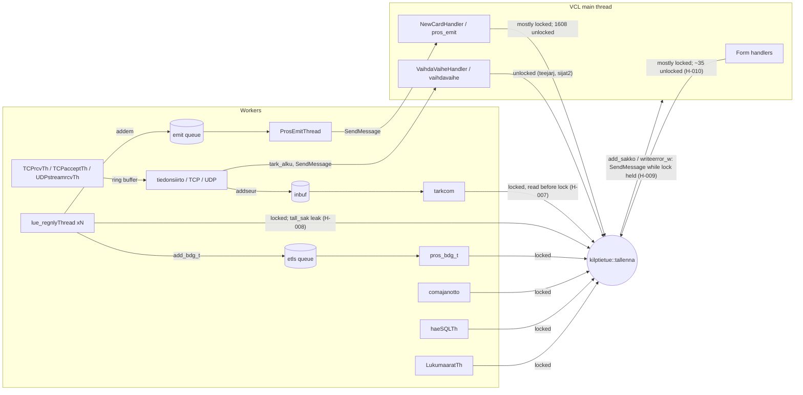

# `kilptietue::tallenna()` ja samanaikaisuus / `kilptietue::tallenna()` and concurrency

Syväauditoinnin erä 1. Revisio `f7fe553`. Polut suhteessa `TPsource/V52/`.
Koskee HK-ohjelmia (HkKisaWin, HkMaali); viestin erot lopussa. Mitään ei ajettu:
kaikki on staattista analyysia, ja jokainen keskeinen väite on käyty läpi
riippumattomasti (`independent-verifier`). Havaintojen numerot: `rekisteri/havainnot.md`.

Deep audit batch 1. Revision `f7fe553`. Paths relative to `TPsource/V52/`. Covers
the HK programs (HkKisaWin, HkMaali); relay differences at the end. Nothing was
run: this is static analysis, and every key claim was reviewed independently
(`independent-verifier`). Finding numbers: `rekisteri/havainnot.md`.

## Johtopäätös / Conclusion

HK:n `tallenna()` ei lukitse itse (`Hk/HkDat.cpp:941` ja `:1383` kommentoitu).
Lukitus on kutsujien vastuulla, ja sopimus pitää vain osittain. Koodi
mahdollistaa seuraavat ongelmat; mikään niistä ei ole vielä havaittu ajossa:

1. **Menetetty päivitys tiedonsiirrossa (H-007).** Vastaanottosäie lukee tietueen
   ennen lukkoa, ja välissä tehty paikallinen muutos kumoutuu ja välittyy muille
   työasemille. [todennettu: mekanismi; päätelty: ikkuna on lyhyt]
2. **Lukko jää päälle (H-008).** Ampumasakon käsittely palaa lukkoa vapauttamatta.
   Yksi virheellinen laitesanoma tai ampumaton sarja riittää. Sen jälkeen muut
   säikeet, myös käyttöliittymä, jäävät odottamaan pysyvästi.
   [todennettu: koodi; päätelty: jumiutuminen]
3. **Lukkiutumisvaara (H-009).** Työsäie pitää lukkoa ja odottaa pääsäiettä
   (`SendMessage`), samalla kun pääsäie voi odottaa samaa lukkoa. [päätelty]
4. **Lukitsemattomia kutsuja (H-010).** Noin 35 kutsupaikkaa ei lukitse, ja
   `tallenna()` muokkaa rakenteita, joilla ei ole omaa lukkoa (järjestys- ja
   nimihakemisto, emit-taulukot). Päällekkäisyys lukitun työsäikeen kanssa on
   mahdollinen. [todennettu: lukkotila; päätelty: toteutuva kilpa]

Ei ongelmaa: tietue ei voi tallentua puoliksi. `GETREC` ja `PUTREC` kopioivat
koko tietueen `kilpdat_CriticalSection`-lukon alla (`Hk/HkDat.cpp:597-624`), joten
riski on menetetty päivitys, ei rikkinäinen tietue. Viestin `tallenna()` lukitsee
itse. Yksikään testi ei kata näitä polkuja.

HK `tallenna()` does not lock by itself (`Hk/HkDat.cpp:941` and `:1383` commented
out). Locking is the callers' responsibility, and that contract holds only
partly. The code makes the following possible; none has been observed at run
time yet:

1. **Lost update in communications (H-007).** The receive thread reads the record
   before taking the lock; a local change made in between is reverted and
   forwarded to other workstations. [verified: mechanism; inferred: the window is short]
2. **Lock left held (H-008).** Shooting-penalty handling returns without releasing
   the lock. One bad device message, or a class without shooting, is enough.
   Afterwards other threads, including the UI, wait forever.
   [verified: code; inferred: the hang]
3. **Deadlock risk (H-009).** A worker holds the lock and waits for the main
   thread (`SendMessage`) while the main thread can be waiting for the same lock.
   [inferred]
4. **Unlocked calls (H-010).** About 35 call sites do not lock, and `tallenna()`
   modifies structures without a lock of their own (sort and name index, emit
   tables). Overlap with a locked worker is possible. [verified: lock state;
   inferred: an actual race]

Not a problem: a record cannot be half-saved. `GETREC` and `PUTREC` copy the whole
record under `kilpdat_CriticalSection` (`Hk/HkDat.cpp:597-624`), so the risk is a
lost update, not a corrupt record. The relay `tallenna()` locks by itself. No test
covers these paths.

## Säikeet, jotka kutsuvat `tallenna()`-funktiota / Threads that call `tallenna()`

Koodi ei käytä `Synchronize`-, `TThread`-, `PostMessage`- eikä `TTimer`-mekanismeja.
Työ siirtyy pääsäikeeseen vain estävällä `SendMessage`-kutsulla. [todennettu,
tarkastettu]

The code uses no `Synchronize`, `TThread`, `PostMessage` or `TTimer`. Work moves
to the main thread only through blocking `SendMessage`. [verified, reviewed]

| Säie / Thread | Ohjelma / Program | Polku / Path | Lukko / Lock | Näyttö / Evidence |
|---|---|---|---|---|
| VCL-pääsäie / main thread | HkKisaWin | ~40 lomakekäsittelijää / form handlers; `NewCardHandler` → `pros_emit`; `Paivita_Aikanaytto` → `naytaRivi`; `VaihdaVaiheHandler` → `vaihdavaihe` | enimmäkseen / mostly `tall_CS`; ~35 ilman / without | `cbHk/UnitEmit.cpp:936`, `cbHk/UnitAjanotto.cpp:263`, `cbHk/WinHk.cpp:2233` |
| `tarkcom` (ainoa `inbuf`-kuluttaja / only `inbuf` consumer) | molemmat / both | `tark_kilp`, `tark_extra` → `tall_ec`, `tulkKurvinen` → `tall_sak` | `tall_CS` (luku ennen lukkoa / read before lock) | `Tp/TpComY.cpp:2414-2416`; `Hk/HkCom32.cpp:260`, `:326-332`, `:647` |
| `lue_regnlyThread` (yksi per lukija / one per reader) | molemmat | `tall_regnly`, `tall_ampsakko` → `tall_sak`, `tulk_emiTag` → `tall_etulos` | `tall_CS` | `Tp/TpLaitteet.cpp:1670`, `:1747`; `Hk/HkIV.cpp:2362`; `Hk/HkSak.cpp:89` |
| `pros_bdg_t` | molemmat | `tall_bdg_t` → `tall_etulos` | `tall_CS` | `Hk/HkIV.cpp:717-719`, `:790-831` |
| `comajanotto` | molemmat | `tee_aika` | `tall_CS` | `Tp/TpLaitteet.cpp:2428`; `Hk/HkIV.cpp:3786-3788` |
| `LukumaaratTh` | HkKisaWin | `etHaku` → `tulk_emiTag`; `autotulostus`/`autofile` → `tulostasarja` → `sijat2` | `tall_CS` (myös `sijat2`, `Hk/HkTulostus.cpp:5850`–`:6419`) | `cbHk/WinHk.cpp:1846`, `:1867` |
| `haeSQLTh` | HkKisaWin | `readSQLrivi` → `tall_etulos` | `tall_CS` | `cbTp/UnitEmitSQL.cpp:282-294` |
| konsolin pääsilmukka / console main loop | HkMaali | `korjaa`, `laskenta`, `ajanotto`, `leimat` → `pros_emit` | enimmäkseen / mostly `tall_CS` | `HkConsole/HkCons2.cpp`, `Hk/HkEmit.cpp:3867` |
| `taustaThr` | HkMaali | `autotulostus` → `tulostasarja` → `sijat2` (lukittu / locked), `etHaku` | `tall_CS` | `Hk/HkInit.cpp:3703-3709` |
| `tiedonsiirto`, `tiedonsiirtoTCP` | HkMaali | `tark_alku` → `pyyda_vaihdavaihe` → `vaihdavaihe` → `teejarj` (suoraan, ei pääsäikeeseen / directly) | ei / none | `HkConsole/HkCons0.cpp:869-871`; `Hk/HkIx.cpp:1838` |

Ei kutsu / does not call: `kirjSQLTh`, `TCPacceptTh`, `TCPrcvTh`, `UDPstreamrcvTh`,
`luepakettiUDP`, `tiedonsiirtoUDP` (täyttävät jonoja / fill queues), `ProsEmitThread`
(`SendMessage` → pääsäie / main thread), `gazTh`, `sendtcpfile`, `SendCopyThread`,
`DisplTimerThread`, `ScrollThread`, `PaivThread`, `HaeAvoimetTh`, `vahaku`.
`kirjSQLTh`, `SendCopyThread`, `vahaku` ja `gazTh` jäljitettiin vain yhdeltä agentilta. [päätelty]

UDP-säikeet käynnistyvät: `UDPYHTEYS` määritellään suoraan lähdetiedostoissa
(`Tp/TpComY.cpp:44`, `Hk/HkCom32.cpp:38`). [todennettu, tarkastettu]
The UDP threads do start: `UDPYHTEYS` is defined in the source files.

## Kutsupaikat / Call sites

HK:ssa on 145 kutsupaikkaa, joista noin 110 pitää `tall_CriticalSection`-lukkoa.
Lukitsemattomat (tarkastettu, ellei toisin mainita):

HK has 145 call sites, about 110 of which hold `tall_CriticalSection`. Unlocked
ones (reviewed unless stated otherwise):

| Paikka / Location | Säie / Thread | Huom / Note |
|---|---|---|
| `cbHk/UnitEmit.cpp:619`, `:3001`, `:3449`, `:3483` | pää / main | `:3483` kirjoittaa pitkään pidetyn kopion / writes a long-held copy |
| `cbHk/UnitAikaSiirto.cpp:243`, `:256` | pää | tiedostossa ei lukkoja / no locks in file |
| `Hk/HkIV.cpp:1608` | pää (`pros_emit`, GUI-haara / branch) | |
| `Hk/HkEmit.cpp:6237` (`laskeEm_VA`) | pää | kutsutaan lukon vapautuksen jälkeen / called after Leave (`Hk/HkIV.cpp:1855`) |
| `Hk/HkIx.cpp:1838` (`teejarj`), `:1896` (`sijat2`) | pää; konsolissa tiedonsiirtosäie / console: comms thread | käynnistys ja vaiheen vaihto / startup and stage change |
| `Hk/HkTulostus.cpp:8766` (`list()` → `sijat2`) | pää | |
| `Hk/HkTulostus.cpp:2572` (`meri3pisteet`) | pää | vain / only `idindex_CS` |
| `Hk/HkInit.cpp:2849`, `Hk/HkDat.cpp:1423`, `cbHk/HkArv2.cpp` (6), `cbHk/LoppuKilpUnit.cpp:1187`, `cbHk/UnitTapahtSiirrot.cpp:78`, `:92`, `cbHk/UnitYhdistetty.cpp:95`, `:120`, `cbHk/UnitEmitKoodit.cpp:146`, `cbHk/UnitAjanotto.cpp:986`, `cbHk/UnitPistelasku.cpp:260`, `cbHk/UnitImport.cpp:1079` | pää | yhden agentin tulos, ei tarkastettu erikseen / one agent's result, not separately reviewed |
| `Hk/HkTls.cpp:1618`, `:1645`, `HkConsole/HkCons0.cpp:575`, `:635`, `:748`, `:764` | konsoli / console | |

Täysi luettelo on analyysiagentin raportissa; se kannattaa tuottaa skriptillä
uudelleen ennen korjauksia. [päätelty]
The full list was in the analysis agent's report; regenerate it with a script
before any fix. [inferred]

## Mitä `tallenna()` muokkaa / What `tallenna()` modifies

| Rakenne / Structure | Lukko / Lock | Koko luku–muutos–kirjoitus? / Whole RMW? | Näyttö / Evidence |
|---|---|---|---|
| `kilparr[d]`, `KILP.DAT` | `kilpdat_CS` per kutsu / per call | ei / no (GETREC `:964`, PUTREC `:1211`) | `Hk/HkDat.cpp:597-624` |
| Järjestys / sort `jarjarr`, laskurit / counters `nilm`, `ntulos` | ei / none | ei | `Hk/HkIx.cpp:800-1512` |
| Nimihakemisto / name index `nameindex` | ei | ei | `tputilv2/dbindex.cpp:51-106` |
| Numerohakemisto / bib index `posarr` | `idindex_CS` per kutsu | ei | `Hk/HkIx.cpp:164-230` |
| Emit-kytkennät / links `bdg_kno`, `emitjarr` | ei | ei | `Hk/HkEmit.cpp:971-1154` |
| Emit-tiedosto / file (`putem(...,1)`) | **ei** (H-011) | ei | `Hk/HkDat.cpp:1114`, `:1146`, `:1169`; `Hk/HkEmit.cpp:1600-1623` |
| Lähtöjono / send queue (`laheta`) | `outb_CS` | per kutsu | `Hk/HkCom32.cpp:182-236` |
| SQL-jono / queue (`kirjKilpSQL`) | `kilpdat_CS` (tuottaja / producer) | – | `cbHk/UnitMySQL.cpp:730-753` |
| Globaalit / globals `pfl`, `innpfl`, `prior[]`, `tlsmuutos` | ei | – | `Hk/HkDat.cpp:1019-1020`, `:1314-1344` |

`tcomfl` tallennetaan ja palautetaan, mutta sitä ei lueta missään, joten se ei ole
ongelma. [todennettu]
`tcomfl` is saved and restored but never read, so it is not a problem. [verified]

## Löydökset / Findings

| ID | Löydös / Finding | Vakavuus / Severity | Tarkastus / Review |
|---|---|---|---|
| H-007 | `tark_kilp` lukee tietueen ennen lukkoa → paikallinen muutos kumoutuu ja leviää / reads before lock → local change reverted and propagated (`Hk/HkCom32.cpp:260`, `:326-332`). KILPPVT- ja VAIN_TULOST-paketit kumoavat myös asiaan liittymättömiä kenttiä / also revert unrelated fields | korkea / high | VAHVISTETTU |
| H-008 | `tall_sak` palaa `-3` lukkoa vapauttamatta (`Hk/HkSak.cpp:89`, `:99`). Laukeaa laitesanoman virheellisestä paikasta (`buf[5]` tarkistamatta) tai oletusasetuksella sarjassa, jossa `lsak == 0`. Myös tiedonsiirrosta (`Hk/HkCom32.cpp:647`) | korkea / high | VAHVISTETTU (laajempi kuin väitetty / wider than claimed) |
| H-009 | Lukkoa pidetään `SendMessage`-kutsun ajan: `add_sakko` (`Hk/HkDat.cpp:1250-1251` → `cbHk/UnitASakot.cpp:269-273`) ja `writeerror_w` (`cbTp/cbTpApu.cpp:467-490`, kutsut `Hk/HkDat.cpp:944`, `:1061`, `:1077`, `:1377`) → lukkiutuminen tai lukko varattuna, kunnes käyttäjä vastaa / deadlock, or lock held until the user answers | korkea / high | VAHVISTETTU (mekanismi / mechanism) |
| H-010 | ~35 lukitsematonta kutsupaikkaa + lukottomat rakenteet / unlocked call sites + unlocked structures | keskitaso / medium | OSITTAIN (`LukumaaratTh` → `sijat2` kumottu / refuted) |
| H-011 | `putem(...,1)` ilman `emit_CS`:ää / without `emit_CS` | keskitaso | VAHVISTETTU |
| H-012 | `vaihdakilp` palaa lukkoa vapauttamatta / returns without Leave (`Hk/HkEmit.cpp:3390`, `:3405`, vain konsoli / console only) | keskitaso | VAHVISTETTU |
| H-013 | `teejarj`: `for (d = 1; i < nrec; i++)` tallentaa tietueen 1 toistuvasti ja muut ei lainkaan / saves record 1 repeatedly, others never (`Hk/HkIx.cpp:1834`) | keskitaso | VAHVISTETTU |
| H-017 | Lomakkeet pitävät tietueen kopiota pitkään ja kirjoittavat sen kokonaan → välissä tulleet muutokset katoavat (esim. `cbHk/UnitEmit.cpp:3483`; `cbHk/UnitKilpailijatiedot.cpp:613-618` tarkistaa lukon ulkopuolella) / forms keep long-held copies and write them whole | keskitaso | tarkastajan uusi havainto, ei tarkastettu erikseen / reviewer's new finding |
| H-018 | VCL-käsittely työsäikeistä / VCL access from workers (`cbHk/WinHk.cpp:1623-1625`, `cbHk/UnitMySQL.cpp:655`, `:721-722`) | keskitaso | VAHVISTETTU (esiintyy / occurs) |
| H-019 | `writeerror_w` jakaa globaalin puskurin ilman lukkoa / shares a global buffer without a lock (`cbTp/cbTpApu.cpp:470-489`) | matala / low | tarkastajan havainto / reviewer's finding |
| H-020 | `add_sakko` määritelty kahdesti samaan ohjelmaan / defined twice in one program (`cbHk/UnitASakot.cpp:269`, `cbHk/UnitASuunn.cpp:289`) | matala | EI TODENNETTAVISSA ilman linkkerikarttaa / without a linker map |

## Tallennus, SQL ja replikointi / Persistence, SQL and replication

| ID | Löydös / Finding | Vakavuus / Severity | Tarkastus / Review |
|---|---|---|---|
| H-014 | MySQL-kirjoitus pysähtyy hiljaa vaiheen vaihdon jälkeen (`inkirjSQLThread` jää todeksi); epäonnistuneet kirjoitukset pudotetaan; poistot eivät mene SQL:ään; ei poikkeuskäsittelyä; täysi jono ylikirjoittaa vanhimman / SQL writing silently stops after a stage change; failed writes dropped; deletes never sent; no exception handling; full queue overwrites oldest (`cbHk/UnitMySQL.cpp:637`, `:651-654`, `:699-701`, `:748-751`; `Hk/HkInit.cpp:3740`) | korkea SQL-käyttäjille / high for SQL users | VAHVISTETTU |
| H-015 | `KILP.DAT`-kirjoitusvirhe ohitetaan: muisti päivittyy, levy ei; virheikkuna näytetään `kilpdat_CS`-lukko varattuna / write error ignored; memory updated, disk not; dialog shown with lock held (`dbboxm/dbbox1.cpp:64-100`; `tputilv2/perr.cpp:51-58`; `Hk/HkDat.cpp:586-590`) | keskitaso | VAHVISTETTU |
| H-016 | Replikoinnissa ei versiota eikä aikaleimaa: samanaikaiset muutokset kahdella koneella → koneet eriytyvät; KILPPVT- ja VAIN_TULOST-paketit sovelletaan tietuenumeron mukaan tarkistamatta kilpailijanumeroa / no version or timestamp; concurrent edits diverge; packets applied by record number without bib check (`Hk/HkDef.h:1235-1280`; `Hk/HkCom32.cpp:270-331`, `:830-841`) | keskitaso | VAHVISTETTU |
| H-021 | Muistipuskuritilassa (`COMFILE=0`) täysi lähtöjono pudottaa paketin / in memory-queue mode a full send queue drops the packet (`Tp/TpComY.cpp:520-527`) | matala–keskitaso | VAHVISTETTU |

Lähtöjono on muuten kunnossa: kaikki tuottajat pitävät `outb_CS`:ää, jono on
yhteyskohtaisesti FIFO, ja `laheta` lukee tietueen uudelleen jonoon laitettaessa,
joten vertainen saa aina uusimman tilan. Tämä pätee vain, kun jono ei vuoda yli.
[todennettu, tarkastettu]

The send queue is otherwise sound: every producer holds `outb_CS`, the queue is
FIFO per connection, and `laheta` re-reads the record at enqueue time, so a peer
always gets the latest state. This holds only as long as the queue does not
overflow. [verified, reviewed]

## Viesti / Relay

Viestin `tallenna` on vapaa funktio (`Juk/vdat.cpp:470`), joka ottaa
`tall_CriticalSection`-lukon itse (`:496`) ja vapauttaa sen (`:850`). Välillä ei
ole `return`-lauseita, ja `addtall` lukitsee samoin (`Juk/vdat.cpp:867-904`).
Viestin `putem` saa arvon 0, eli se lukitsee `emit_CS`:n. HK:n ongelmat H-007,
H-010 ja H-011 eivät siksi koske viestiä samassa muodossa. Viestin
vastaanottopolkua ei ole jäljitetty. [todennettu: lukitus; tuntematon: vastaanotto]

Relay `tallenna` is a free function (`Juk/vdat.cpp:470`) that takes
`tall_CriticalSection` itself (`:496`) and releases it (`:850`) with no `return`
in between, and `addtall` locks the same way. Relay `putem` gets 0, so it locks
`emit_CS`. HK issues H-007, H-010 and H-011 therefore do not apply to relay in
the same form. The relay receive path has not been traced. [verified: locking;
unknown: receive path]

## Testit / Tests

Yksikkötestit (`VS/Tests/TpTest.vcxproj`, 46 testitapausta) kattavat vain
`Hk/HkEnnTav.cpp`, `Juk/VRinnakkaisOsuus.cpp`, `tputilv2/aikatowst_s.cpp` ja
`tputilv2/putint_r.cpp`. Mikään testi ei kutsu funktioita `tallenna`, `PUTREC`,
`laheta`, `buflah`, `putrec` eikä käytä säikeitä. [todennettu, tarkastettu]

Unit tests cover only the four files listed above. No test calls `tallenna`,
`PUTREC`, `laheta`, `buflah` or `putrec`, or uses threads. [verified, reviewed]

## Miten todennetaan ajossa / How to verify at run time

1. Lisää debug-versioon `tallenna()`:n alkuun tarkistus
   `tall_CriticalSection.OwningThread == GetCurrentThreadId()` ja kirjaa
   rikkomukset lokiin; aja kahden työaseman testikilpailu. (H-007, H-010)
2. Syötä Kurvinen-sanoma, jossa paikka on sarjan sakkopaikkojen ulkopuolella, tai
   ampumasanoma ampumattomalle sarjalle; tallenna sitten lomakkeelta. (H-008)
3. Avaa sakkolomake, lähetä lukijasta sakkoja ja tallenna samaan aikaan
   lomakkeelta; ota pinodumppi jumiutuessa. (H-009)
4. MySQL käytössä: vaihda vaihetta ja tallenna kilpailija; katso, päivittyykö
   tietokanta. (H-014)

1. Add to a debug build, at the start of `tallenna()`, a check
   `tall_CriticalSection.OwningThread == GetCurrentThreadId()` and log
   violations; run a two-workstation test competition. (H-007, H-010)
2. Feed a Kurvinen message with a position outside the class's penalty slots, or
   a shooting message for a class without shooting; then save from a form. (H-008)
3. Open the penalty form, send penalties from a reader and save from a form at the
   same time; take a stack dump on hang. (H-009)
4. With MySQL: change stage, save a competitor, check whether the database
   updates. (H-014)

## Avoimet kysymykset / Open questions

- Linkitetäänkö `cbHk/UnitASakot.cpp` vai `cbHk/UnitASuunn.cpp` `add_sakko`? (linkkerikartta / linker map)
- Ylikirjoittaako `unpack0` kaikki kentät (ratkaisee, voiko KILPT-paketti kumota paikallisia kenttiä)? / Does `unpack0` overwrite every field?
- Kutsuuko `tulostasarja` lukon aikana (`Hk/HkTulostus.cpp:5850`–`:6419`) jotain, joka tekee `SendMessage`-kutsun? / Does it call anything that does `SendMessage` while holding the lock?
- Voiko `tallenna()`:n kutsupolulla syntyä VCL-poikkeus, joka jättäisi lukon päälle? / Can a VCL exception leave the lock held?
- Viestin vastaanottopolku ja sen lukitus / relay receive path and its locking
- Ovatko `kirjSQLTh`-, `SendCopyThread`-, `vahaku`- ja `gazTh`-säikeiden polut täysin `tallenna()`-vapaita? / Are these thread paths fully free of `tallenna()`?
