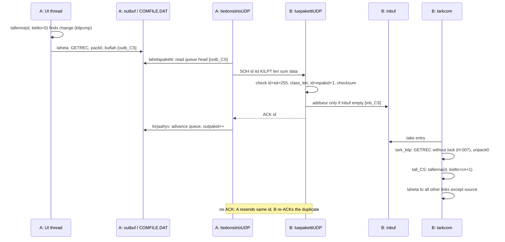

# Työasemien tiedonsiirto / Workstation communication

Syväauditoinnin erä C-2. Revisio `f7fe553`. Polut suhteessa `TPsource/V52/`.
Staattinen analyysi: mitään ei ajettu. Jokainen merkittävä väite on käyty läpi
riippumattomasti (`independent-verifier`); "VAHVISTETTU" tarkoittaa riippumatonta
lähdetarkastusta, ei ajonaikaista todennusta. Havaintonumerot:
`rekisteri/havainnot.md`. Aiempi erä: `tallenna-samanaikaisuus.md`.

Deep audit batch C-2. Revision `f7fe553`. Paths relative to `TPsource/V52/`.
Static analysis: nothing was run. Every significant claim was reviewed
independently (`independent-verifier`); "VAHVISTETTU" (confirmed) means an
independent source review, not runtime verification. Finding numbers:
`rekisteri/havainnot.md`. Previous batch: `tallenna-samanaikaisuus.md`.

## Johtopäätös / Conclusion

Työasemat replikoivat **tilaa, eivät operaatioita**: jokainen muutos lähetetään
koko tietueena (tai vaiheena tai yhtenä kenttänä), ja viimeksi saapunut voittaa.
Sanomissa ei ole versiota, aikaleimaa eikä alkuperäaseman tunnusta. Ainoa
järjestysnumero on 8-bittinen, yhteyskohtainen kuittausnumero, joka nollautuu
jokaisessa (uudelleen)yhteydessä. Järjestelmä ei koskaan korjaa eriytymistä
jälkikäteen; ainoa korjauskeino on käsin kopioitava `KILP.DAT`.
[todennettu, tarkastettu]

Yhden yhteyden sisällä toimitus on luotettava: pysähdy-ja-odota, FIFO, kaksoiskappaleet
tunnistetaan. Ongelmat syntyvät rajapinnoissa: samanaikaiset muutokset eri koneilla,
yhteyskatkot, uudelleenkäynnistykset, eri tietuenumerot ja konfiguraatioerot.

Stations replicate **state, not operations**: every change is sent as a whole
record (or stage, or one field), and the last arrival wins. Messages carry no
version, timestamp or origin station. The only sequence number is an 8-bit
per-link acknowledgement number that resets on every (re)connect. The system
never repairs divergence afterwards; the only remedy is copying `KILP.DAT` by
hand. [verified, reviewed]

Within one connection, delivery is reliable: stop-and-wait, FIFO, duplicates
detected. Problems arise at the edges: concurrent changes on different stations,
link outages, restarts, differing record numbers and configuration differences.

## Kuljetus ja yhteystyypit / Transport and connection types

Jokainen yhteys (`cn` < `maxyhteys`) on kahden aseman välinen. Sama kehysmuoto
kulkee kaikissa tyypeissä. [todennettu, tarkastettu]

Each connection (`cn` < `maxyhteys`) is point-to-point. The same frame format
runs over every type. [verified, reviewed]

| Tyyppi / Type (`include/wincom.h:28-36`) | Avaus / Open | Säikeet / Threads | Huom / Notes |
|---|---|---|---|
| `comtpRS` (0) | `opencomRS` `Tp/TpComY.cpp:671` → `com/winCom.cpp:108` | `tiedonsiirto` (molemmat suunnat / both directions) | tiukka vuorottelu: seuraava paketti vasta vastapuolen NAKin jälkeen / strict ping-pong |
| `comtpUDP` (1) | `opencomUDP` `Tp/TpComY.cpp:882` → `com/WinUDP.cpp:249` | `luepakettiUDP` (vastaanotto / receive), `tiedonsiirtoUDP` (lähetys / send) | palvelin- ja asiakassoketti; kuori `STX|port|kone` / server and client socket; envelope |
| `comtpUDPSTREAM` (5) | `openportUDP` + `UDPstreamrcvTh` | | laitteet ja tulostaulut, ei asemien välillä / devices and scoreboards [päätelty] |
| `comtpTCP` (2), `comtpTCPSRV` (6) | `opencomTCP` `Tp/TpComY.cpp:1173` → `com/WinUDP.cpp:705` | `tiedonsiirtoTCP`, `TCPrcvTh`, `TCPacceptTh` | H-027, H-028 |
| `comtpTCPXML` (10), `comtpTCPSRVXML` (22) | kuten TCP / as TCP | | vain lähtevä XML ulkoiselle palvelulle / outgoing XML only (`Hk/HkCom32.cpp:972`) |
| `comtpTCPLOKI` (14) | `openTCPloki` `Tp/TpComY.cpp:2238` | – | lokirivit TCP:llä / log lines over TCP |
| `comtpTCPIMPORT` (18) | vain `SIIMPORT` / only | – | kuollutta koodia, ei edes linkittyisi / dead code, would not link (T-012) |

Yhteydet määritellään konfiguraatiossa (`Hk/HkInit.cpp:1074-1260`): `YHTEYSy=`/`COMy=`
(UDP, BRO, TCP[X/S/L], COMn), `PORTBASE`, `MAXYHTEYS`, `KONE`, `VÄLITÄy=EI`,
`COMFILE`, `HYVKAIKKI`, `NAKVIIVE`, `UDPVIIVEET`, `TCPVIIVEET`. Vertaisia ei
etsitä verkosta; osoitteet ovat staattisia, paitsi UDP `AUTO`, jossa osoite
opitaan saapuvista paketeista.

Connections are configured in the config file (keys above). Peers are not
discovered; addresses are static, except UDP `AUTO`, where the address is learned
from incoming datagrams.

## Kehys ja kuittaus / Frame and acknowledgement

Kehys verkossa / frame on the wire (`Tp/TpComY.cpp:1513`, rakenne / struct
`Hk/HkDef.h:1235-1313`, `#pragma pack(push,1)`):

```
SOH | id | 255-id | pkgclass | len (UINT16) | checksum (UINT16) | data[len]
```

`combufrec`-rakenteen kuusi ensimmäistä tavua (`lahetetty`, `portti`) ovat vain
paikallisia. Tarkistussumma on 16-bittisten sanojen summa (`chksum`,
`Tp/TpComY.cpp:613-627`). Vastaanottaja hyväksyy paketin vain, jos
`len == class_len[pkgclass]` (`Tp/TpComY.cpp:750`, `:760`, `:1001`), joten kaikilla
asemilla on oltava samat kenttäpituudet. UDP ohittaa tarkistuksen luokille, joiden
pituus on 0 (H-032).

The first six bytes of `combufrec` are local only. The checksum is a 16-bit word
sum. A packet is accepted only if `len == class_len[pkgclass]`, so all stations
need identical field lengths. UDP skips the check for classes of length 0 (H-032).

**Kuittaus / acknowledgement:** yksi kuittaamaton paketti yhteyttä kohden.
Vastaanottaja pitää viimeisen hyväksytyn numeron (`inpakid`): seuraava hyväksytään
ja kuitataan, edellisen toisto kuitataan uudelleen soveltamatta
(`Tp/TpComY.cpp:766-773`; UDP myös −1/−2, `:1015-1023`). Lähettäjä siirtyy
seuraavaan vasta kuittauksen jälkeen (`kirjaahyv`, `:1575-1612`). NAK toimii myös
tyhjäkäynnin kyselynä. **Muut kuin RS-yhteydet lisäävät saapuvan paketin jonoon
vain, kun `inbuf` on tyhjä** (`Tp/TpComY.cpp:649-650`): koko ohjelmassa on
korkeintaan yksi käsittelemätön saapuva paketti. [todennettu, tarkastettu]

One unacknowledged packet per link. Duplicates of the last id are re-acknowledged
without being applied. The sender advances only after an ACK. NAK doubles as the
idle poll. **Non-RS links enqueue an incoming packet only when `inbuf` is empty**:
at most one unprocessed inbound packet in the whole program. [verified, reviewed]



## Kättely ja lopetus / Handshake and shutdown

Jokainen yhteyden avaus tai uudelleenavaus alkaa `ALKUT`-paketilla
(`alkusanoma`, `Hk/HkCom32.cpp:811-819`): tunnus, konetunnus, vaihe (HK:
`k_pv+1`, viesti: 0), `nrec` ja liput. Vastaanottaja nollaa järjestysnumeron.
`tark_alku` (`Hk/HkCom32.cpp:821-870`) ajetaan vastaanottosäikeessä:

- eri vaihe ilman vaihdon lippua → lähetys estetään (`com_keskeytt`)
- eri tietuemäärä (`nrec`) → vain varoitus; `return` on kommentoitu pois (`:841`)
- vaihdon lippu → `pyyda_vaihdavaihe`; jos vaihto evätään, yhteys hyväksytään silti (H-023)

HK- ja viestiasema eivät voi olla yhteydessä keskenään (viesti hylkää vaiheen ≠ 0,
`Juk/VCom.cpp:842-891`). Ohjelmaversio ei kulje paketeissa (`VERSIOKDI` HK 5.21,
viesti 5.20, vain tiedostoissa). [todennettu, tarkastettu]

Every (re)connect begins with an `ALKUT` packet. The receiver resets the sequence
number. `tark_alku` runs on the receive thread: a different stage without the
change flag blocks sending; a different record count only warns; with the change
flag, a refused change still accepts the link (H-023). HK and relay stations
cannot interconnect. The program version is not in packets. [verified, reviewed]

Lopetus (`closecom`, `Tp/TpComY.cpp:1902-1930`) perustuu viiveisiin
(1,5 s + 1 s + 1 s), ei säikeiden odottamiseen. Hyvästelypakettia ei ole.
Levyjonon kuittaamattomat paketit säilyvät `COMFILE.DAT`:ssa; muistijonon katoavat.
Seuraavassa käynnistyksessä käyttäjältä kysytään, säilytetäänkö ne; "Ei" hävittää
ne pysyvästi (H-038, ei tarkastettu).

Shutdown relies on fixed sleeps, not joins. There is no goodbye packet.
Unacknowledged disk-queue packets survive in `COMFILE.DAT`; memory-queue packets
are lost. At the next start the user is asked whether to keep them; "No" loses
them permanently (H-038, not reviewed).

## Sarjallistaminen / Serialisation

HK:n kentät sarjallistetaan taulukoiden avulla (`va_fields`, `pv_fields`,
`kilp_fields`, `Hk/HkDat.cpp:44-103`); samat funktiot tuottavat `KILP.DAT`:n
levymuodon. [todennettu, tarkastettu]

| Paketti / Packet | Sisältö / Content | Rakennetaan / Built |
|---|---|---|
| `KILPT` | `kilptietue::pack0`: kaikki perustiedot, ei vaiheita / all base fields, no stages | `Hk/HkCom32.cpp:197-202` |
| `KILPPVT` | aktiivinen vaihe: `kilppvtp::pack0` (kaikki paitsi väliajat); muu vaihe: koko `pack` väliaikoineen / active stage without splits; other stage with splits | `:203-217` |
| `VAIN_TULOST` | yksi aika tai `keskhyl`, `asakot`, `tasoitus` / one time or one field | `:218-233` |

**Q13 ratkaistu / resolved:** `kilptietue::unpack0` (`Hk/HkDat.cpp:432-483`)
ylikirjoittaa kaikki perustiedot paitsi ne, joiden kenttäkoko on konfiguroitu
nollaksi; vaiheisiin (`pv[]`) se ei koske. HK:ssa ei ole paikallisia
perustietokenttiä, eli KILPT korvaa nimet, seuran, sarjan, numeron ja tilan
lähettäjän arvoilla. [todennettu, tarkastettu: OSITTAIN – alkuperäinen väite
koski vain tekstikenttiä]

**Q13 resolved:** `unpack0` overwrites every base field except those configured
with size 0; it never touches stages. HK has no local-only base fields, so KILPT
replaces names, club, class, bib and status with the sender's values.

Viesti: KILPT kopioi perustietueen raakana (`memcpy`, `Juk/VCom.cpp:582`);
osuuspäivitys (`OSUUST`) soveltaa vain muutosmaskin kentät (`:606-679`).
Relay: KILPT copies the base record raw; leg updates apply only masked fields.

## Reititys ja välitys / Routing and forwarding

`tarkcom` (`Hk/HkCom32.cpp:875-964`) jakaa paketit luokan mukaan. Varsinaista
reititystä ei ole: vastaanotettu muutos tallennetaan `kielto = cn+1`, ja
`tallenna` → `laheta` lähettää sen kaikille muille yhteyksille paitsi lähteelle ja
`VÄLITÄy=EI`-merkityille (`Hk/HkCom32.cpp:186-189`). Ketjut ja tähdet toimivat;
silmukassa (mesh) vanha tila voi saapua toista reittiä (H-039, ei tarkastettu).

`tarkcom` dispatches by class. There is no routing table: a received change is
saved with `kielto = cn+1` and forwarded to every other link except the source
and those marked `VÄLITÄy=EI`. Chains and stars work; in a mesh an old state can
arrive by another route (H-039, not reviewed).

**Kumottu / refuted:** väite, että pakotettu (`pakota`) paketti kiertäisi HK-renkaassa
loputtomasti, ei pidä: `laheta` vaatii aina `kilpcmp`:n löytämän todellisen muutoksen
(`Hk/HkDat.cpp:809-886`, `:1284-1309`). Viestissä `tark_ylahto` välittää myös
muuttumattoman tiedon, kun `katkkierto` ei ole päällä (`Juk/VCom.cpp:335`); ei
tarkastettu pidemmälle (Q22).
The claim that a forced packet circulates forever in an HK ring is refuted.

## Jonot ja levypuskuri / Queues and disk buffer

| Tila / Mode | Oletus / Default | Täyttyminen / When full | Uudelleenkäynnistys / Restart |
|---|---|---|---|
| Levyjono `COMFILE.DAT` (`levypusk=1`) | HK ja viesti; viestissä ei voi kytkeä pois (`Juk/VInit.cpp:1218`) | kasvaa rajatta / grows without limit | kuittaamattomat säilyvät; käyttäjältä kysytään / unacked kept; user asked |
| Muistijono (`COMFILE=EI`, vain HK) | `OUTBUFL = 50` (`Hk/HkDef.h:144`) | paketti pudotetaan (H-021); varoitus jo 25 ja 38 jonossa olevan kohdalla → dialogi lukkojen ollessa varattuina (H-021, H-009) | katoaa / lost |

Levyjono tallentaa paketin tavut sellaisinaan jonoon laitettaessa
(`Tp/TpComY.cpp:509`) ja lähettää tallennetun kopion (`:1467-1470`). Siksi
uudelleenlähetystyökalu (`merk_uusinta`, `:1111-1167`; GUI `cbTp/UnitUusinta.cpp:82-92`)
lähettää vanhoja, jo kuitattuja tilannekuvia, jotka kumoavat vastaanottajan
uudemmat muutokset (H-030). Uudelleenkäynnistyksessä lähetetään vain
kuittaamaton loppuosa alkuperäisessä järjestyksessä (tarkastaja kumosi
väitteen kuitattujen uudelleenlähetyksestä). [todennettu, tarkastettu]

The disk queue stores packet bytes at enqueue time and sends the stored copy.
Therefore the resend tool replays old, already acknowledged snapshots that revert
the receiver's newer changes (H-030). A restart sends only the unacknowledged tail
in original order (the reviewer refuted the claim that acknowledged packets are
replayed). [verified, reviewed]

## HK ja viesti / HK and relay

| Ominaisuus / Aspect | HK (`Hk/HkCom32.cpp`) | Viesti / Relay (`Juk/VCom.cpp`) |
|---|---|---|
| Vastaanoton lukitus / receive locking | luku ennen lukkoa / read before lock (H-007) | lukko ennen lukua; `tallenna` lukitsee itse / lock before read; no H-007 (**Q16 ratkaistu / resolved**) |
| Kilpailijanumeron tarkistus / bib check | vain KILPT / only KILPT (H-022) | OSUUST, TARKT, VAIN_TULOST (`:619`, `:692`, `:735`) |
| Osuus/vaihe-päivitys / leg/stage update | koko vaihe / whole stage | muutosmaski / change mask |
| Tuntematon pakettiluokka / unknown class | ohitetaan / skipped | **koko vastaanotto pysähtyy / all receiving stops** (H-026) |
| `combufsize` | `max(class_len)+14` | `max(class_len)`, otsake puuttuu / header missing (H-025) |
| Lukko jää päälle vastaanotossa / lock left held on receive | `tall_sak` (H-008) | `tark_trk` (H-024) |
| Silmukan katkaisu / loop cut | ei tarvita / not needed | `KATKKIERTO`; konfiguraation indeksi tarkistamatta / config index unchecked (H-036) |
| Muistijono / memory queue | valittavissa / optional | ei / no |

## Käännös ja yhteensopivuus / Build and compatibility

- Tiedonsiirron käännösyksiköt ohjelmittain ja valitsimet: `TCPSIIRTO`, `TCPLUKIJA`,
  `KONETUNN` kaikissa; `SERVER` vain konsoliversioissa (uudelleenlähetys- ja
  valikkotoiminnot); `UDPYHTEYS` määritelty lähdekoodissa; `SIIMPORT` ei missään.
  `Tp/TpComY32.cpp` on vanhempi versio ilman kättelyä ja tiedostonsiirtoa (T-011).
  [todennettu]
- MSVC- ja bcc32-asemat tuottavat todennäköisesti tavulleen samat paketit:
  `#pragma pack(push,1)`, samat kokonaislukutyypit, `wchar_t` 2 tavua, `char`
  etumerkitön (`/J`; bcc32:ssa `#pragma option -K` `include/tputil.h:28`).
  Tarkistussumma riippuu `char`-tyypin etumerkistä parittomilla pituuksilla
  (`AIKAT`, 45 tavua). Toimiiko `-K` kesken käännösyksikön klassisessa bcc32:ssa,
  on avoin (Q17). [päätelty, tarkastettu OSITTAIN]
- Yhteensopivuuden rikkoo konfiguraatio, ei kääntäjä: HK:n KILPT/KILPPVT-pituudet
  tulevat ajonaikaisista kenttäpituuksista, viestin käännösaikaisista vakioista
  (`MAXOSUUSLUKU`, `VAIKALUKU`; ViestiWinin konfiguraatiot eroavat). Eri tavalla
  käännetyt tai konfiguroidut asemat hylkäävät toistensa paketit hiljaa.
  [todennettu, tarkastettu]

- Communication units per program and switches are as above; `SERVER` only in
  console builds; `UDPYHTEYS` defined in source; `SIIMPORT` nowhere.
  `Tp/TpComY32.cpp` is an older version (T-011).
- MSVC and bcc32 stations probably produce byte-identical packets. The checksum
  depends on `char` signedness for odd lengths (`AIKAT`, 45 bytes); whether
  bcc32 honours `-K` mid-unit is open (Q17). [inferred, reviewed partly]
- Compatibility is broken by configuration, not the compiler: differently built or
  configured stations silently reject each other's packets. [verified, reviewed]

## Löydökset / Findings

| ID | Löydös / Finding | Vakavuus / Severity | Tarkastus / Review |
|---|---|---|---|
| H-007 | Vastaanotto lukee ennen lukkoa; ikkuna = kilpailevan lukon pitoaika (myös dialogit), ei muutama käsky. Viestiä ei koske / Read before lock; window = competing lock hold time; relay unaffected | korkea / high | VAHVISTETTU (laajennus / extension) |
| H-016 | Ei versiota: yhteyskatkon aikana samaan pakettiluokkaan tehdyt muutokset päätyvät ristiin (A saa B:n arvon, B A:n) / No version: crossing edits during an outage end swapped | keskitaso; korkea epävakaalla verkolla / high with unstable links | VAHVISTETTU (laajennus) |
| H-021 | Muistijono: pudotus täyttyessä; varoitusdialogi jo 25/38 kohdalla lukkojen ollessa varattuina → lukkiutumisehdokas / Memory queue: drop when full; warning dialog at 25/38 with locks held → deadlock candidate | keskitaso | OSITTAIN (laukaisin laajempi / wider trigger) |
| H-022 | Samanaikaiset lisäykset saavat saman tietuenumeron; KILPPVT/VAIN_TULOST sovelletaan väärään kilpailijaan, koska HK ei tarkista numeroa / Concurrent adds get the same record number; stage data applied to the wrong competitor | korkea | VAHVISTETTU |
| H-023 | `VAIN_TULOST` sovelletaan vastaanottajan omaan vaiheeseen; yhteys hyväksytään, vaikka vaiheen vaihto evätään / applied to receiver's own stage; link accepted when stage change refused | korkea monivaiheisissa / high in multi-stage | VAHVISTETTU |
| H-024 | Viesti: `tark_trk` palaa lukkoa vapauttamatta (kuuluttajatila) / relay `tark_trk` returns holding `tall_CS` (`Juk/VCom.cpp:690`, `:701`) | korkea | VAHVISTETTU |
| H-025 | Viesti: `combufsize` ilman 14 tavun otsaketta → muistijonon ylivuoto ja suurimman paketin loppu korruptoituu ennen tarkistussummaa / relay `combufsize` missing header → overrun and corrupted packet tail (`Juk/VCom.cpp:1228-1240`, `Tp/TpComY.cpp:509`, `:529-530`, `:2409`) | korkea | VAHVISTETTU (pahempi / worse) |
| H-026 | Viesti: tuntematon pakettiluokka pysäyttää koko vastaanoton pysyvästi; HK:n SEURAT UDP:llä riittää / relay: unknown class stops all receiving permanently (`Juk/VCom.cpp:971-974`) | korkea | VAHVISTETTU |
| H-027 | TCP-asiakas ei yritä yhteyttä uudelleen (operaattorien sidontajärjestys); palvelimen avausvirhe ohitetaan vanhentuneella kahvalla; TCPXML-uudelleenyhteys voi kaatua null-osoittimeen / TCP client never retries; server open errors ignored; possible null deref (`Tp/TpComY.cpp:1179`, `:1219-1220`, `:1290-1292`; `com/WinUDP.cpp:736`, `:812-817`, `:847`) | korkea | VAHVISTETTU (lisähavainnoin / with additions) |
| H-028 | TCP-palvelin: uusi yhteys korvaa vanhan sulkematta, kaksi lukusäiettä samaan puskuriin, `break` lukko varattuna / second accept replaces socket, two reader threads, `break` holding `tcpip_CS` (`com/WinUDP.cpp:656-667`) | keskitaso | VAHVISTETTU (pahempi) |
| H-029 | UDP: mikä tahansa datagrammi ohjaa yhteyden kohdeosoitteen ja -portin / any datagram redirects the destination address and port (`com/WinUDP.cpp:1115-1121`, `:1161-1162`) | keskitaso (turvallisuus / security) | VAHVISTETTU (laajempi) |
| H-030 | Uudelleenlähetystyökalu lähettää vanhoja kuitattuja tilannekuvia → kumoaa uudemmat muutokset / resend tool replays old snapshots → reverts newer changes | keskitaso | OSITTAIN |
| H-031 | Konsoli: evätty vaiheen vaihto jättää `vaiheenvaihto`-lipun päälle → myöhemmät vaihdot estyvät ja emit- ja taustakäsittely pysähtyy / console: refused stage change leaves the flag set → later changes blocked, emit and background processing stop (`Hk/HkIx.cpp:1868-1875`) | korkea (HkMaali) | VAHVISTETTU (pahempi) |
| H-032 | UDP ohittaa pituustarkistuksen luokille, joiden `class_len` on 0, ja lukee `class_len`-taulukkoa rajojen yli; viestissä kasan ylivuoto mahdollinen / UDP skips length check for length-0 classes; OOB read of `class_len`; heap overflow plausible in relay (`Tp/TpComY.cpp:1001`, `:654`, `:2399`) | keskitaso | OSITTAIN (HK:ssa ei ylivuotoa / no overflow in HK) |
| H-033 | `tark_kilp` käyttää verkosta tullutta vaiheindeksiä tarkistamatta / uses the wire stage index unchecked (`Hk/HkCom32.cpp:274-279`) | matala | VAHVISTETTU |
| H-034 | Yhteyskatkon tai uudelleenkäynnistyksen aikana matkalla ollut paketti sovelletaan kahdesti; EMITT-kaksoiskappaleiden esto nollautuu / in-flight packet applied twice after reconnect/restart | matala | OSITTAIN |
| H-035 | Ennen ajastinta saapuvien AIKAT-pakettien puskuri on 6 tavua väärässä kohdassa; polku käytännössä kuollut / pre-timer AIKAT buffer misaligned; path practically dead (`Hk/HkCom32.cpp:407-427`) | matala | OSITTAIN |
| H-036 | Viesti: `KATKKIER`-konfiguraation indeksi tarkistamatta → kirjoitus taulukon ulkopuolelle / config index unchecked → out-of-bounds write (`Juk/VInit.cpp:1139`) | matala | VAHVISTETTU |
| H-037 | `tcpkaynnistys` indeksoidaan kirjoittaessa ja luettaessa eri tavalla / indexed off by one (`com/WinUDP.cpp:845`, `:884`; `Tp/TpComY.cpp:1297-1301`) | matala | VAHVISTETTU (vaikutus pieni / low impact) |
| H-038 | Lopetus ilman säikeiden odotusta; "Ei" uudelleenkäynnistyksessä hävittää lähettämättömät / no joins at shutdown; "No" at restart loses unsent data (`Tp/TpComY.cpp:1902-1930`, `:2331-2358`) | keskitaso (tietojen menetys / data loss) | ei tarkastettu / not reviewed |
| H-039 | Silmukkatopologiassa vanha tila voi saapua toista reittiä / in a mesh an old state can arrive by another route | keskitaso | ei tarkastettu |

Kumotut väitteet / refuted claims: pakotetun paketin kierto HK-renkaassa;
WinUDP:n taulukkokoon ylitys (indeksit ovat WinUDP:n omia); "uudelleenkäynnistys
lähettää kuitatut uudelleen"; "pkgclass on etumerkillinen".
Refuted: forced-packet loop in HK rings; WinUDP array overflow; restart replaying
acknowledged packets; signed pkgclass.

## Testattavuus / Testability

Testit vaativat kaksi tai useampia asemia samassa koneessa tai lähiverkossa ja
testikilpailun tiedot (`docs-site/docs/asentaminen/esimerkkiaineisto.md`). Ei
oikeita kilpailutietoja eikä tuotantojärjestelmiä. Determinististä toistoa varten
ehdotetaan **testikoukkua**: debug-käännöksen valitsin, joka lisää viiveen tai
pysäytyksen nimettyyn kohtaan (esim. `Hk/HkCom32.cpp:262`→`:326`), sekä lokiin
säikeen tunnus ja `tall_CriticalSection.OwningThread`.

Tests need two or more stations on one machine or a LAN, and test competition
data. No real competition data or production systems. For deterministic
reproduction a **test hook** is proposed: a debug-build switch that inserts a
delay or stop at a named point, plus logging of thread id and lock owner.

| ID | Skenaario / Scenario | Odotettu / Expected | Vika näkyy / Failure | Automaattinen regressiotesti / Automated regression |
|---|---|---|---|---|
| H-007 | Asemat A–B–C ketjussa. Testikoukku pysäyttää B:n `tarkcom`in kohtien `:262` ja `:326` välissä. B:llä muutetaan kilpailijan X seura, A lähettää X:n maaliajan. | Kaikilla sama seura ja aika | B ja C: vanha seura; A: uusi | Kahden prosessin testi koukulla; vertaa `KILP.DAT`-tietueita |
| H-008, H-024 | HK: Kurvinen-sanoma, jonka paikka on sakkopaikkojen ulkopuolella. Viesti: kuuluttajatila, osuus K, vertainen lähettää 'I'. Sen jälkeen tallennus lomakkeelta. | Tallennus onnistuu | GUI jumiutuu; `OwningThread` = vastaanottosäie | Yksikkötesti `tall_sak`/`tark_trk`:lle, joka tarkistaa lukon vapautuksen kaikilla poluilla |
| H-022 | Kaksi asemaa samasta `KILP.DAT`:sta, yhteys poikki, kumpikin lisää eri kilpailijan, yhteys palautetaan, A muuttaa uuden kilpailijansa emit-koodia. | Molemmat kilpailijat molemmilla | Virheilmoitus; B:n kilpailija saa A:n emit-koodin | Kahden prosessin testi; deterministinen |
| H-023 | Kaksivaiheinen kilpailu. A:lla lähettämätön jono kolmanteen asemaan, vaihe vaihdetaan B:llä (A evää), B kirjaa maaliajan. | Aika oikeaan vaiheeseen tai yhteys estetään | Aika A:n vaiheeseen 1 | Deterministinen kahden prosessin testi |
| H-025 | ViestiMaali muistijonossa, suurin pakettiluokka toistuvasti, kunnes rengas kiertää; PageHeap tai ASan. Lisäksi käynnistyksessä tulostetaan `combufsize` ja `14+class_len[i]`. | Ei ylivuotoa; pakettien loppu ehjä | Kasavirhe tai vastaanottajalla väärä loppuosa | Käynnistystarkistus `static_assert`/ajonaikainen; yksikkötesti `buflah`-kopion pituudelle |
| H-026 | Yksi UDP-datagrammi luokalla 7 ja kelvollisella id:llä ja tarkistussummalla ViestiWiniin, sitten tavallinen paketti. | Tuntematon ohitetaan, seuraava sovelletaan | Mitään ei enää sovelleta | Yksikkötesti `tarkcom`-jakelulle tuntemattomalla luokalla |
| H-027 | HkMaali TCP-asiakkaana, palvelin alhaalla, palvelin käynnistetään. Toisto TCPXML:llä. | Yhteys muodostuu | Ei koskaan yhdistä; TCPXML voi kaatua | Prosessitesti paikallisella portilla; deterministinen |
| H-031 | HkMaali: viesti jonoon alhaalla olevalle vertaiselle, vaiheen vaihto (evätään), jono tyhjennetään, vaihto uudelleen. | Toinen vaihto onnistuu | Mitään ei tapahdu; emit-käsittely pysähtynyt | Yksikkötesti `vaihdavaihe`-paluupoluille |
| H-016 | Kaksi asemaa, levyjono, yhteys poikki. A muuttaa X:n emit-koodin, B merkitsee X:n keskeyttäneeksi. Yhteys palautetaan. | Molemmat muutokset molemmilla | A: keskeytys vanhalla koodilla; B: uusi koodi ilman keskeytystä | Kahden prosessin testi; dokumentoi suunnittelurajoitteen |

Kaikki testit ovat deterministisiä, paitsi H-007, joka vaatii testikoukun. Ilman
koukkua se on ajoitusriippuvainen.
All tests are deterministic except H-007, which needs the test hook; without it
it is timing-dependent.

## Avoimet kysymykset / Open questions

| # | Kysymys / Question |
|---|---|
| Q17 | Noudattaako klassinen bcc32 `#pragma option -K` -direktiiviä kesken käännösyksikön (HkKisaWinissa ei projektiasetusta)? Testi: käännösaikainen tarkistus `(char)-1 > 0` / Does bcc32 honour `-K` mid-unit? |
| Q18 | `sizeof(combufrec)` ja suurin `class_len` kussakin käännöksessä (ratkaisee H-025:n ja H-032:n laajuuden) / per build |
| Q19 | Sovelletaanko AIKAT-kaksoiskappale kahdesti (`tall_rivi`, `Hk/HkAjat.cpp:161-266`)? / Is a duplicate AIKAT applied twice? |
| Q20 | Sallivatko TCP-virtayhteydet useamman kuittaamattoman paketin (`kirjaahyvStream`, `Tp/TpComY.cpp:1318`, `:1359`)? / More than one unacked packet on TCP? |
| Q21 | Asettuvatko ristikkäiset samanaikaiset muutokset 3–5 aseman renkaassa? / Do conflicting edits settle in a ring? |
| Q22 | Kiertääkö viestin `tark_ylahto` muuttumatonta tietoa renkaassa, kun `katkkierto` ei ole päällä? / Does relay `tark_ylahto` circulate unchanged data? |
| Q23 | Odottaako `Kysy(..., wait=0)` käyttäjää vai sulkeutuuko itsestään (H-021:n pysyvyys)? / Does it wait for the user? |
| Q24 | Mistä bcc32 saa `ws2_32`:n ja `winhttp.lib`:n (`cbHk/winhttp.lib` puuttuu repossa)? / Where do bcc32 builds get these libraries? |
| Q25 | MONITORI-portti: koodi 14770 (`Tp/TpComY.cpp:84`), käyttöohje 14900 (`docs-site/docs/hkkisawin/hkliite1.md:78`) / port mismatch (T-014) |
