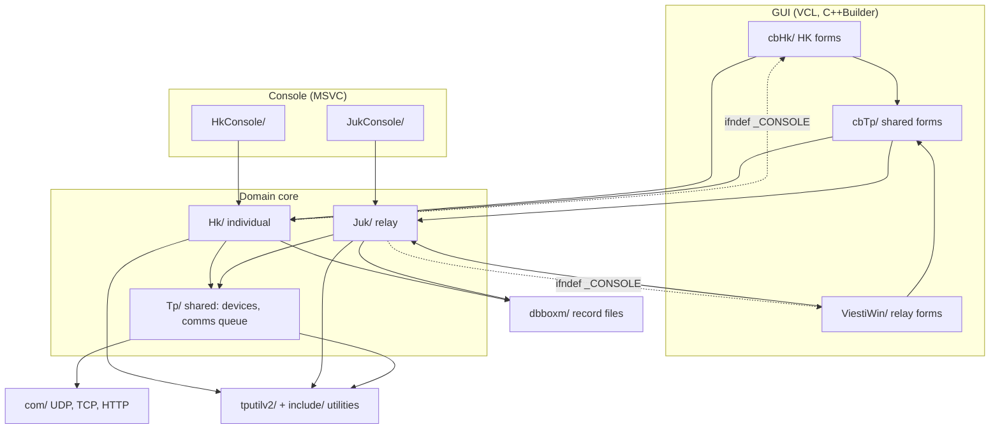
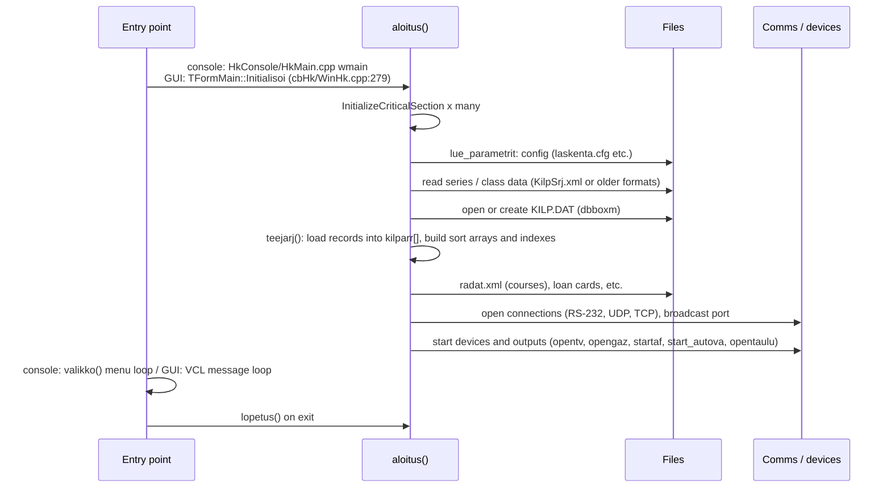
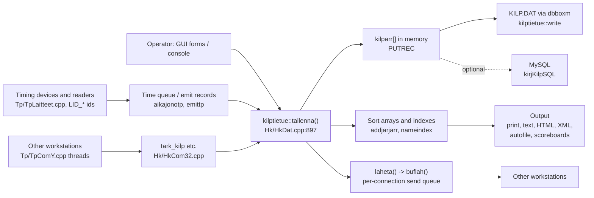

# Yleiskuva / Overview

Polut ovat suhteessa hakemistoon `TPsource/V52/`, ellei toisin mainita.
Paths are relative to `TPsource/V52/` unless stated otherwise.

## Järjestelmä lyhyesti / The system in brief

Ohjelmisto on tulospalvelujärjestelmä suunnistukseen, hiihtoon, ampumahiihtoon ja
viestikilpailuihin. Se ottaa vastaan aikoja ja leimoja ajanottolaitteilta ja
emit/RFID-lukijoilta, pitää kilpailijatiedot muistissa ja levyllä, laskee tulokset
ja sijoitukset, jakaa tiedot verkon yli muille työasemille ja tuottaa tulosteita
(paperi, teksti, HTML, XML, tulostaulut).

Koodissa on kaksi kilpailutyyppiä, jotka käännetään erikseen:

- **HK** (henkilökilpailu): `Hk/` ydin, `cbHk/` GUI, `HkConsole/` konsoli
- **Viesti** (viesti- ja joukkuekilpailu): `Juk/` ydin, `ViestiWin/` GUI, `JukConsole/` konsoli

Molemmat käyttävät yhteistä koodia (`Tp/`, `cbTp/`, `com/`) sekä kirjastoja
`tputilv2/` (apufunktiot) ja `dbboxm/` (tietokanta).

The software is a results service system for orienteering, skiing, biathlon and
relays. It receives times and punches from timing devices and emit/RFID readers,
keeps competitor data in memory and on disk, computes results and placings,
distributes data over the network to other workstations and produces output
(paper, text, HTML, XML, scoreboards).

The code has two competition types that are built separately:

- **HK** (individual competition): core `Hk/`, GUI `cbHk/`, console `HkConsole/`
- **Relay** (relay and team competition): core `Juk/`, GUI `ViestiWin/`, console `JukConsole/`

Both use shared code (`Tp/`, `cbTp/`, `com/`) and the libraries `tputilv2/`
(utilities) and `dbboxm/` (database).

## Ohjelmat / Programs

| Ohjelma / Program | Tyyppi / Kind | Kääntäjä / Compiler | Projekti / Project |
|---|---|---|---|
| HkKisaWin.exe | HK, VCL GUI | C++Builder 13, klassinen `bcc32` | `RADStudio10/HkKisaWin.cbproj` |
| ViestiWin.exe | Viesti, VCL GUI | C++Builder 13, klassinen `bcc32` | `RADStudio10/ViestiWin.cbproj` |
| HkMaali.exe | HK, konsoli / console | MSVC | `VS/Hk/HkMaali/HkMaali.vcxproj` → `TPexe/Hk/V521/` |
| ViestiMaali.exe | Viesti, konsoli / console | MSVC | `VS/V/JukMaali520.vcxproj` → `TPexe/Juk/V52/` |
| ViestiLuenta.exe | Viesti, konsoli, `LUENTA` (lukuasema / reading station) [päätelty] | MSVC | `VS/V/JukLuenta520.vcxproj` → `TPexe/Juk/V52/` |
| TpTest.exe | yksikkötestit / unit tests (doctest) | MSVC | `VS/Tests/TpTest.vcxproj` |

GUI-ohjelmat menevät hakemistoihin `TPexe/Hk/V521/` ja `TPexe/Juk/V521/`.
Molemmat viestin konsoliohjelmat käännetään ratkaisusta `VS/V/JukMaali520.sln`.
CLAUDE.md:n polku `TPexe\V\JukMaali.exe` ei vastaa nykytilaa.
[todennettu] Projektitiedostoista ja paikallisesta käännöksestä 2026-11-24.

The GUI programs go to `TPexe/Hk/V521/` and `TPexe/Juk/V521/`. Both relay
console programs are built from the solution `VS/V/JukMaali520.sln`. The path
`TPexe\V\JukMaali.exe` in CLAUDE.md does not match the current state.
[verified] From project files and a local build on 2026-11-24.

## Kerrosrakenne / Layering

Kerrokset eivät ole puhtaita. Ytimen otsikko `Hk/HkDeclare.h:23-28` ottaa mukaan
GUI-otsikot `WinTp.h` ja `HkWinDef.h`, kun `_CONSOLE` ei ole määritelty, ja
vastaavasti `Juk/VDeclare.h:26-27`. Ydin siis riippuu GUI-kerroksesta (katkoviivat).
Lisäksi `cbTp/` (yhteiset lomakkeet) käännetään kumpaankin GUI-ohjelmaan ja
riippuu kummastakin ytimestä. [todennettu: include-rivit; kartoituksen include-kaavio]

The layers are not clean. The core header `Hk/HkDeclare.h:23-28` pulls in the GUI
headers `WinTp.h` and `HkWinDef.h` when `_CONSOLE` is not defined, and likewise
`Juk/VDeclare.h:26-27`. The core therefore depends on the GUI layer (dashed lines).
`cbTp/` (shared forms) is compiled into both GUI programs and depends on both
cores. [verified: include lines; inventory include graph]

## Yhteinen koodi käännetään kahdesti / Shared code is compiled twice

`Tp/`-hakemiston koodi ei ole kirjasto. Se käännetään erikseen kumpaankin ohjelmaan,
ja kilpailutyyppi valitaan esikääntäjällä: jos `MAXOSUUSLUKU` on määritelty, mukaan
tulee viestin `VDeclare.h`, muuten HK:n `HkDeclare.h` (`Tp/TpLaitteet.cpp:38-42`).
Samoilla nimillä on siis kaksi eri tietorakennetta, esimerkiksi `kilptietue`
(`Hk/HkDef.h:496` ja `Juk/VDef.h:734`). Sama pätee `cbTp/`-lomakkeisiin.

The code in `Tp/` is not a library. It is compiled separately into each program,
and the competition type is chosen by the preprocessor: if `MAXOSUUSLUKU` is
defined, the relay `VDeclare.h` is included, otherwise HK's `HkDeclare.h`
(`Tp/TpLaitteet.cpp:38-42`). The same names therefore refer to two different data
structures, for example `kilptietue` (`Hk/HkDef.h:496` and `Juk/VDef.h:734`). The
same applies to the `cbTp/` forms.

Ominaisuudet valitaan esikääntäjän määrittelyillä (`EMIT`, `LAJUNEN`, `MAALI`,
`TCPSIIRTO`, `GAZ`, `AUTOFILE` jne.), ja eri projekteissa on eri joukko. Konsoli-
ja GUI-versio samasta kilpailutyypistä eivät siksi sisällä täsmälleen samoja
toimintoja. Luettelo projekteittain: `inventaario.md`.

Features are selected by preprocessor defines (`EMIT`, `LAJUNEN`, `MAALI`,
`TCPSIIRTO`, `GAZ`, `AUTOFILE` and others), and each project has a different set.
The console and GUI versions of the same competition type therefore do not contain
exactly the same features. List per project: `inventaario.md`.

## Käynnistys / Startup

Sekä konsoli että GUI kutsuvat samaa ytimen funktiota `aloitus()`
(`Hk/HkInit.cpp:3079`, viestissä `Juk/VInit.cpp:2538`). Konsolissa järjestys on
`wmain` → `aloitus` → `valikko` → `talljarj` → `lopetus`
(`HkConsole/HkMain.cpp:178-233`). GUI:ssa `_tWinMain` (`RADStudio10/HkKisaWin.cpp:131`)
luo lomakkeet, ja päälomake kutsuu `aloitus`-funktiota, kun käyttäjä avaa kilpailun.
Muuttuja `ToimintaTila` kertoo tilan: 0 = kilpailua ei avattu, 1 = esivalmistelu,
2 = tulospalvelu (`Hk/HkGlobals.cpp:189-191`). [todennettu: kutsujärjestys luettu
koodista; ei ajettu debuggerissa]

Both the console and the GUI call the same core function `aloitus()`
(`Hk/HkInit.cpp:3079`, relay `Juk/VInit.cpp:2538`). In the console the order is
`wmain` → `aloitus` → `valikko` → `talljarj` → `lopetus`
(`HkConsole/HkMain.cpp:178-233`). In the GUI `_tWinMain`
(`RADStudio10/HkKisaWin.cpp:131`) creates the forms, and the main form calls
`aloitus` when the user opens a competition. The variable `ToimintaTila` holds the
mode: 0 = no competition open, 1 = preparation, 2 = results service
(`Hk/HkGlobals.cpp:189-191`). [verified: call order read from code; not run in a
debugger]

## Päävirta: tieto sisään, tulos ulos / Main flow: data in, results out

Kaikki kilpailijatietojen muutokset kulkevat funktion `kilptietue::tallenna()`
kautta (`Hk/HkDat.cpp:897`). Se vertaa uutta tietuetta vanhaan (`kilpcmp`), päivittää
järjestys- ja hakurakenteet, käsittelee emit-korttien kytkennät, tallentaa tietueen
muistiin ja levylle (`PUTREC`, `Hk/HkDat.cpp:609`) ja lähettää muutoksen muille
työasemille (`laheta`, `Hk/HkCom32.cpp:167`). Lähetys ei tapahdu heti: sanoma
lisätään jokaisen yhteyden lähtöjonoon (`buflah`, `Tp/TpComY.cpp:476`), ja erilliset
säikeet lähettävät jonot. [todennettu: funktiot luettu; säikeiden ajoitusta ei
tarkistettu]

All changes to competitor data go through `kilptietue::tallenna()`
(`Hk/HkDat.cpp:897`). It compares the new record with the old one (`kilpcmp`),
updates sort and search structures, handles emit card links, stores the record in
memory and on disk (`PUTREC`, `Hk/HkDat.cpp:609`) and sends the change to other
workstations (`laheta`, `Hk/HkCom32.cpp:167`). Sending is not immediate: the
message is added to each connection's outgoing queue (`buflah`,
`Tp/TpComY.cpp:476`) and separate threads send the queues. [verified: functions
read; thread timing not checked]

Viestin vastaava virta on rakenteeltaan sama (`Juk/vdat.cpp`, `Juk/VCom.cpp:351`),
mutta tietueessa on osuuskohtaiset tiedot (`osrec`, `Juk/VDef.h:662`). [päätelty]

The relay flow has the same structure (`Juk/vdat.cpp`, `Juk/VCom.cpp:351`), but
the record holds per-leg data (`osrec`, `Juk/VDef.h:662`). [inferred]

## Tallennus / Persistence

Kaikki kilpailijat pidetään muistissa taulukossa `kilparr`
(`Hk/HkGlobals.cpp:201`). Levyllä ne ovat tiedostossa `KILP.DAT`, joka on
`dbboxm`-kirjaston kiinteämittaisten tietueiden tiedosto
(`include/boxr.h:60-72`: `getrec`, `putrec`, `addrec`). Tietue pakataan tavuiksi
(`pack`/`unpack`), joten levymuoto riippuu luokan kentistä ja niiden järjestyksestä.
Lisäksi tietueet voidaan kirjoittaa MySQL-tietokantaan (`kilptietue::write`,
`mihin == 1` → `kirjKilpSQL`, `Hk/HkDat.cpp:581-595`); GUI käyttää dbExpress-ajuria
(`cbHk/UnitMySQL.*`). SQL-taulujen rakennetta ei ole vielä selvitetty. [tuntematon]

All competitors are kept in memory in the array `kilparr`
(`Hk/HkGlobals.cpp:201`). On disk they are in `KILP.DAT`, a fixed-length record
file of the `dbboxm` library (`include/boxr.h:60-72`: `getrec`, `putrec`,
`addrec`). A record is packed to bytes (`pack`/`unpack`), so the disk format
depends on the class fields and their order. Records can also be written to a
MySQL database (`kilptietue::write`, `mihin == 1` → `kirjKilpSQL`,
`Hk/HkDat.cpp:581-595`); the GUI uses the dbExpress driver (`cbHk/UnitMySQL.*`).
The SQL table layout has not been examined yet. [unknown]

## Tiedonsiirto / Communications

Työasemat vaihtavat tietoja yhteyksillä, joiden tyyppi on määritelty tiedostossa
`include/wincom.h:28-36`: sarjaportti (`comtpRS`), UDP, UDP-virta, TCP-asiakas ja
-palvelin, TCP-XML sekä erikoistyypit lokille ja tuonnille. Sanomat ovat
`combufrec`-paketteja, joiden luokka kertoo sisällön (`Hk/HkCom32.cpp:46-56`):
`KILPT` (koko kilpailija), `KILPPVT` (yhden vaiheen tiedot), `VAIN_TULOST` (yksi
aika), `AIKAT` (ajanottoaika), `EMITT` (emit-kortti), `SEURAT`, `FILESEND`,
`EMITVA`, `EXTRA`. Lisäksi tulokset voidaan lähettää UDP-yleislähetyksenä
(`broadcasttulos`, `Hk/HkCom32.cpp:143`). Sanomien tavutason muotoa ei ole vielä
dokumentoitu. [todennettu: tyypit ja luokat; tuntematon: tavumuoto]

Workstations exchange data over connections whose types are defined in
`include/wincom.h:28-36`: serial port (`comtpRS`), UDP, UDP stream, TCP client and
server, TCP-XML and special types for logging and import. Messages are
`combufrec` packets whose class tells the content (`Hk/HkCom32.cpp:46-56`):
`KILPT` (whole competitor), `KILPPVT` (one stage), `VAIN_TULOST` (a single time),
`AIKAT` (timing time), `EMITT` (emit card), `SEURAT`, `FILESEND`, `EMITVA`,
`EXTRA`. Results can also be sent as UDP broadcasts (`broadcasttulos`,
`Hk/HkCom32.cpp:143`). The byte-level message format is not documented yet.
[verified: types and classes; unknown: byte format]

## Laitteet / Devices

Laitteet tunnistetaan numeroilla `LID_*` (`include/TpLaitteet.h:17-47`): mm. ALGE,
Comet, TIMY, TDC, Emit-kello ja -lukija, MTR, emiTag, SportIdent, Sirit, Feig,
Impinj, Zebra FX9600 ja Kurvinen. Laiteliitännät ovat tiedostossa
`Tp/TpLaitteet.cpp` ja RFID-lukijat omissa luokissaan (`Tp/SiritReader.cpp`,
`Tp/ZebraReader.cpp`, rajapinta `include/IRfidReader.h`). Zebra-parametrit on
kuvattu tiedostossa `doc/fx9600-parametrit.md`.

Devices are identified by `LID_*` numbers (`include/TpLaitteet.h:17-47`), among
them ALGE, Comet, TIMY, TDC, Emit clock and reader, MTR, emiTag, SportIdent, Sirit,
Feig, Impinj, Zebra FX9600 and Kurvinen. Device interfaces are in
`Tp/TpLaitteet.cpp`, and RFID readers have their own classes
(`Tp/SiritReader.cpp`, `Tp/ZebraReader.cpp`, interface `include/IRfidReader.h`).
Zebra parameters are described in `doc/fx9600-parametrit.md`.

## Tulosteet / Output

| Kanava / Channel | Paikka / Location |
|---|---|
| Tulostus ja tekstitulosteet / Printing and text output | `Hk/HkTulostus.cpp`, `Juk/VTulostus.cpp`; muotoilu / formatting `Hk/HkMuotoilu.cpp`, `Juk/VMuotoilu.cpp` (`tulosmuottp`) |
| GDI-tulostin / GDI printer | `tputilv2/` (`PRFILE`, `initgdiprinter`) |
| XML ja IOF 3.0 | `Hk/HkXml.cpp`, `Hk/HkXml_IOF30.cpp`, `Hk/HkXmlTulokset.cpp`, `Juk/VXml.cpp`, `Juk/VXml_IOF30.cpp` |
| Automaattiset tiedostot (autofile) / Automatic files | `startaf`, `Hk/HkTulostus.cpp:6979` |
| Tulostaulut / Scoreboards (TV, GAZ, taulu) | `Hk/HkTV.cpp` [ks. orvot / see orphans], `opengaz` `Hk/HkIV.cpp:3130`, `opentaulu` `Hk/HkTulostus.cpp:4026` |
| HTTP (WinHTTP) | `com/gethttp.cpp`, GUI `GetHttpForm` (`cbHk/WinHk.cpp:1168`) |
| MySQL | `cbHk/UnitMySQL.*`, `ViestiWin/UnitMySQL.*`, `cbTp/UnitEmitSQL.*` |

## Tärkeimmät havainnot / Key findings

1. **Ydin riippuu GUI:sta.** Ytimen otsikot ottavat mukaan GUI-otsikot, joten
   ytimen ja käyttöliittymän rajaa ei ole käännöstasolla. Testattavuus ja
   erillinen kääntäminen kärsivät.
2. **Yhteinen koodi käännetään kahdesti eri tyypeillä.** `Tp/` ja `cbTp/` toimivat
   eri tietorakenteilla eri ohjelmissa. Muutos niihin pitää tarkistaa molemmissa.
3. **Paljon jaettua muuttuvaa tilaa ja säikeitä.** `HkDeclare.h`:ssa on noin 450
   `extern`-määrittelyä, ja ohjelmassa on kymmeniä säikeitä, joita suojaavat
   nimetyt `CRITICAL_SECTION`it (`tietorakenteet-ja-tila.md`).
4. **Levymuoto on muistirakenne.** `KILP.DAT` muuttuu, jos tietueen kenttiä
   muutetaan. Vanhojen tiedostojen yhteensopivuus on varmistettava erikseen.
5. **Merkistöt vaikuttavat ohjelman teksteihin.** UTF-8-tiedosto ilman BOMia
   kääntyy MSVC:llä väärin mutta C++Builderilla oikein (`merkistot.md`).

1. **The core depends on the GUI.** Core headers pull in GUI headers, so there is
   no compile-level boundary between the core and the UI. Testability and
   separate builds suffer.
2. **Shared code is compiled twice with different types.** `Tp/` and `cbTp/`
   operate on different data structures in different programs. A change there
   must be checked in both.
3. **Much shared mutable state and many threads.** `HkDeclare.h` has about 450
   `extern` declarations, and the program runs dozens of threads protected by
   named `CRITICAL_SECTION`s (`tietorakenteet-ja-tila.md`).
4. **The disk format is the in-memory structure.** `KILP.DAT` changes if record
   fields change. Compatibility with old files must be checked separately.
5. **Encodings affect program text.** A UTF-8 file without BOM compiles wrongly
   with MSVC but correctly with C++Builder (`merkistot.md`).
