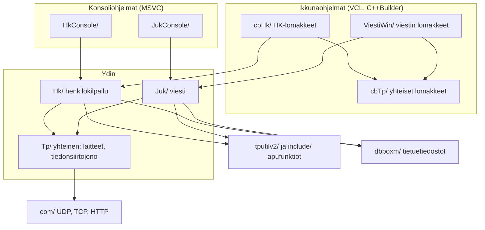

# 01 Ohjelmat ja kokonaisuus

<!-- malli: Käsikirjan lukupohja (K-3). Ohje: doc/tietopohja/laatu/k3-kirjoittajan-ohje.md.
Luvun 5 vikaluettelo generoidaan tiedostosta kasikirja/toiminnot.csv komennolla
python -I doc/arkkitehtuuri/tyokalut/tietopohja.py . kasikirja; sitä ei kirjoiteta käsin. -->

> **Tila:** alustava K-3-aineisto, ei riippumattomasti tarkastettu. Lähderevisio: tuotantokoodi
> `f7fe553` (ennallaan, `doc/arkkitehtuuri/CHECKPOINT.md`). Varmuusmerkinnät: [todennettu],
> [päätelty], [tuntematon]; "luettu käsikirjaa varten" = luettu koodista K-vaiheessa, ei tarkastettu.

Luku kertoo, mitä ohjelmia suitessa on, miten ne eroavat toisistaan ja miten ne liittyvät toisiinsa:
viisi toimitettavaa ohjelmaa, kaksi kilpailutyyppiä (HK ja viesti), kaksi käyttöliittymätapaa
(konsoli ja ikkuna), kaksi kääntäjää ja työasemien yhteistyö. Lukuun 00 on koottu merkintöjen
selitykset. Yksittäisten toimintojen kuvaukset ovat luvuissa 02-11, asetukset luvussa 12 ja virhetilanteet
luvussa 13. Polut ovat suhteessa hakemistoon `TPsource/V52/`, ellei polku ala `doc/`, `docs-site/` tai
`.github/`. Lyhenteet: **HKM** = HkMaali (HK, konsoli, MSVC), **HKW** = HkKisaWin (HK, ikkuna,
C++Builder bcc32), **VM** = ViestiMaali, **VL** = ViestiLuenta (viesti, konsoli, MSVC), **VW** = ViestiWin
(viesti, ikkuna, bcc32).

## 1. Mitä tapahtuu

### 1.1 Viisi ohjelmaa

Toimitettavia ohjelmia on viisi. Ne rakennetaan samasta lähdekoodipuusta, mutta eri projekteilla.

| Ohjelma | Kilpailutyyppi | Käyttöliittymä | Kääntäjä | Projekti | Tulos |
|---|---|---|---|---|---|
| **HkKisaWin** (HKW) | HK (henkilökilpailu) | Windows-ikkunat (VCL) | C++Builder, klassinen `bcc32` | `RADStudio10/HkKisaWin.cbproj` | `TPexe/Hk/V521/HkKisaWin.exe` |
| **HkMaali** (HKM) | HK | konsoli (tekstitila) | MSVC | `VS/Hk/HkMaali/HkMaali.vcxproj` | `TPexe/Hk/V521/HkMaali.exe` |
| **ViestiWin** (VW) | viesti | Windows-ikkunat (VCL) | C++Builder, `bcc32` | `RADStudio10/ViestiWin.cbproj` | `TPexe/Juk/V521/ViestiWin.exe` |
| **ViestiMaali** (VM) | viesti | konsoli | MSVC | `VS/V/JukMaali520.vcxproj` | `TPexe/Juk/V52/ViestiMaali.exe` |
| **ViestiLuenta** (VL) | viesti | konsoli | MSVC | `VS/V/JukLuenta520.vcxproj` | `TPexe/Juk/V52/ViestiLuenta.exe` |

[todennettu: `doc/arkkitehtuuri/yleiskuva.md` "Ohjelmat"; `inventaario.md` "Projektit"; tulospolut ja
paketointi `.github/workflows/release.yml`, jossa kaikki viisi ohjelmaa kerätään yhteen ZIP-pakettiin;
GUI-ohjelmien tulospolku `RADStudio10/HkKisaWin.cbproj` ja `ViestiWin.cbproj` (`FinalOutputDir`) luettu
käsikirjaa varten, ei tarkastettu.] ViestiMaali ja ViestiLuenta rakennetaan kahdesta projektista, jotka
ovat samassa ratkaisussa `VS/V/JukMaali520.sln`. `CLAUDE.md`:n polku `TPexe\V\JukMaali.exe` ei vastaa
nykytilaa [AA: `yleiskuva.md`].

Lisäksi on testiohjelma `TpTest.exe` (`VS/Tests/TpTest.vcxproj`, doctest-yksikkötestit) sekä auditoinnin
testikehykset `VS/Tests/TpCoreHk.vcxproj` ja `TpCoreJuk.vcxproj`. Ne eivät ole toimitettavia ohjelmia
[todennettu: `inventaario.md` "Projektit"]. Käsikirja ei kuvaa niitä.

**Mihin kukin ohjelma on tarkoitettu.** Käyttöohje antaa seuraavan kuvan [KO: `asentaminen/ohjelmat.md`,
`hkkisawin/hkkisahelp.md`, `viestiwin/hkkisahelp.md`]:

- HkKisaWin kattaa kaikki tulospalveluun kuuluvat toiminnot; kilpailu voidaan muodostaa vain sillä.
  HkMaali on rajoitetumpi komentoikkunaohjelma, jonka luotettavuutta on pyritty maksimoimaan välttämällä
  monimutkaisia käyttöliittymäkirjastoja. Ohjelmat toimivat yhdessä, ja kukin tehtävä voidaan hoitaa
  siihen sopivammalla ohjelmalla.
- ViestiWin ja ViestiMaali ovat samassa suhteessa viestikilpailussa.
- Tämä on käyttöohjeen kuvaus ohjelmien tarkoituksesta; sitä, onko HKM tai VM käytännössä
  toimintavarmempi, ei ole mitattu auditoinnissa [tuntematon].

**ViestiLuenta.** Koodin kokoonpano on viestin konsoliohjelma, jossa on valitsin `LUENTA`; sen nimestä
päätellen se on kortinluku- eli lukuasemaohjelma [päätelty: `yleiskuva.md`, `valitsimet.csv`
`PP:LUENTA`]. Käyttöohjeen mukaan ViestiLuenta **ei enää sisälly versioon 5.20**, koska ViestiWin hoitaa sen
tehtävät paremmin [KO: `viestiwin/hkkisahelp.md`], mutta samassa käyttöohjeessa se mainitaan ohjelmana,
joka voi olla avattuna ohjelmainstanssina [KO: `viestiwin/1.2_kayton_aloittaminen_ja_toimintatilat.md`], ja
julkaisutyönkulku rakentaa ja paketoi ViestiLuennan nykyisin (`.github/workflows/release.yml`). Ristiriita on
kirjattu lukuun 14. VL on myös supistettu käännös, jonka rajausta ei ole dokumentoitu (T-052).

### 1.2 Kaksi kilpailutyyppiä: HK ja viesti

Koodissa on kaksi kilpailutyyppiä, jotka käännetään erikseen [todennettu: `yleiskuva.md` "Järjestelmä
lyhyesti"]:

| | HK (henkilökilpailu) | Viesti (viesti- ja joukkuekilpailu) |
|---|---|---|
| Ydin | `Hk/` | `Juk/` |
| Ikkuna-ohjelman lomakkeet | `cbHk/` | `ViestiWin/` |
| Konsoliohjelman käyttöliittymä | `HkConsole/` | `JukConsole/` |
| Kilpailijatietue | `kilptietue` (`Hk/HkDef.h`) | `kilptietue` (`Juk/VDef.h`), jossa on osuuskohtaiset tiedot (`osrec`) |
| Kilpailun osat | **vaiheet** (monivaiheinen kilpailu, luku 08) | **osuudet** (joukkueen juoksijat, luku 07); viestissä ei ole vaiheita |
| Laji | suunnistus, hiihto, ampumahiihto ja muut (`Discipline`) | viesti, partio, rogaining (`Subtype`) |

Samalla nimellä on kaksi eri rakennetta. Esimerkiksi `kilptietue` on määritelty kahteen kertaan
(`Hk/HkDef.h:496` ja `Juk/VDef.h:734`), ja `Tp/`-hakemiston koodi valitsee tyypin esikääntäjällä: jos
`MAXOSUUSLUKU` on määritelty, mukaan tulee viestin `VDeclare.h`, muuten HK:n `HkDeclare.h`
(`Tp/TpLaitteet.cpp:38-42`) [AA: `yleiskuva.md` "Yhteinen koodi käännetään kahdesti"]. Seuraus: jaettu koodi
(`Tp/`, `cbTp/`) on käännetty kummankin ohjelmaryhmän omilla tietorakenteilla, ja muutos siihen pitää
tarkistaa molemmissa. Tiedostoformaatit ja sanomat ovat siksi myös eri (luvut 03 ja 09).

HK:n ja viestin lomakkeet (emit, ajanotto, arvonta, kilpailijatiedot) ovat kopioimalla erkaantuneita
haaroja, ja joitakin korjauksia on tehty vain toiselle puolelle. Kumpi haara on uudempi, ei ole
selvitetty [AA: `gui-liiketoimintalogiikka.md` luku 4, T-034, Q77].

### 1.3 Kaksi käyttöliittymätapaa: konsoli ja ikkuna

Sama kilpailutyyppi käännetään sekä konsoli- että ikkunaohjelmaksi samasta lähteestä. Konsoliohjelmissa on
valitsin `_CONSOLE` (HKM, VM, VL), ikkunaohjelmissa ei (HKW, VW) [todennettu: `valitsimet.csv`
`PP:_CONSOLE`; `ominaisuusvalitsimet.md` 3.1]. Valitsin on ehtona 252 kohdassa; se erottaa HK:ssa
3 494 ja viestissä 4 942 riviä [AA: `ominaisuusvalitsimet.md` 3.1].

| Piirre | Konsoli (HKM, VM, VL) | Ikkuna (HKW, VW) |
|---|---|---|
| Käyttö | valikko ja näppäimet tekstitilassa | lomakkeet ja valikot |
| Tila käynnistyksessä | tulospalvelutila aina (`ToimintaTila` = 2); ei esivalmistelutilaa | päälomake kysyy: esivalmistelu (1) tai tulospalvelu (2) |
| Asetukset | tiedostosta ja **komentoriviltä** | tiedostosta; avaukset `Init.cfg`:stä, ei komentorivin avaimia (VW: vain `INIT=`) |
| Asetuseditori | ei | kyllä (HKW ja VW) |
| Ikkunoiden asettelu | ei | `ikkunat.xml` |
| Virheilmoitus | ruudun alariville tai konsoliikkuna | modaali ikkuna |
| SQL-peili | ei | kyllä |

[todennettu: `ominaisuusvalitsimet.md` luvut 6.1 ja 7; `yleiskuva.md` "Käynnistys"; ch 02 kohta 1.1;
ch 13 kohta 2.] Tarkemmat erot ovat kunkin luvun kohdassa 2.

**Käynnistys.** Sekä konsoli että ikkuna kutsuvat samaa ytimen funktiota `aloitus()` (`Hk/HkInit.cpp:3079`,
viestissä `Juk/VInit.cpp:2538`). Konsolissa järjestys on `wmain` (`HkConsole/HkMain.cpp:178`,
`JukConsole/laskenta.cpp:97`), `aloitus`, valikko, tallennus, lopetus. Ikkunaohjelmissa `_tWinMain`
(`RADStudio10/HkKisaWin.cpp:131`) luo lomakkeet, ja päälomake kutsuu `aloitus`-funktiota, kun käyttäjä avaa
kilpailun [todennettu: `yleiskuva.md` "Käynnistys"; tiedostojen luku ja kilpailun avaaminen luku 02].

### 1.4 Kerrokset: mistä ohjelma koostuu

[todennettu: `yleiskuva.md` "Kerrosrakenne".] Kerrokset eivät ole puhtaita: ytimen otsikot (`Hk/HkDeclare.h:23-28`,
`Juk/VDeclare.h:26-27`) ottavat ikkunaohjelmassa mukaan GUI-otsikot, joten ydin riippuu käyttöliittymästä
käännöstasolla [AA: `yleiskuva.md`]. Kirjastot `tputilv2/` (apufunktiot: tekstitiedostot, ajan muunnos, HTML ja
XML, tulostus) ja `dbboxm/` (kiinteämittaisten tietueiden tiedostot, esimerkiksi `KILP.DAT`) rakennetaan
erikseen kummallakin kääntäjällä ja linkitetään ohjelmiin [AA: `inventaario.md`, `riippuvuudet.md`].

### 1.5 Kokoonpano: ohjelman ominaisuudet määräytyvät käännöksessä

Ohjelman ominaisuudet eivät määräydy vain asetuksista vaan myös **käännösvalitsimista**
(esikääntäjän `#define`-määrityksistä), jotka kuuluvat projektiin. Siksi samasta lähteestä rakennetut
ohjelmat sisältävät eri toiminnot [todennettu: `ominaisuusvalitsimet.md` luku 3; `valitsimet.csv`].

Alla on keskeisten ominaisuusvalitsinten tila viidessä toimitettavassa ohjelmassa. Merkintä `x` = valitsin
on määritelty, `-` = ei; luku = arvo. Taulukko perustuu rekisteriin `rekisteri/valitsimet.csv` ja on tarkistettu
projektitiedostoista (`VS/Hk/HkMaali/HkMaali.vcxproj`, `VS/V/JukMaali520.vcxproj`, `VS/V/JukLuenta520.vcxproj`,
`RADStudio10/HkKisaWin.cbproj`, `ViestiWin.cbproj`; Release-kokoonpanot luettu käsikirjaa varten).

| Ominaisuus | Valitsin | HKM | VM | VL | HKW | VW |
|---|---|---|---|---|---|---|
| Emit-kortit | `EMIT`, `MAALI` | x | x | x | x | x |
| TCP-siirto ja automaattitulostus | `TCPSIIRTO`, `AUTOFILE` (HK:ssa `AUTOFILE` seuraa `TCPSIIRTO`:sta) | x | x | x | x | x |
| TCP-lukija | `TCPLUKIJA` | x | x | x | x | x |
| RFID (Sirit, Zebra, UHF) | `LAJUNEN` | x | x | - | x | x |
| emiTag HTTP | `EMITHTTP` | x | x | - | x | x |
| Väliaikalukija | `VALUKIJA`, `AUTOVA` | x | x | - | x | x |
| Emit-testisyöte (`EMIT_IN.DAT`) | `EMITFILE` | x | x | - | x | - |
| Sarjaporttitaulu | `GAZ` | x | x | - | - | x |
| ALGE-tulostaulu | `ALGETAULU` | - | x | - | - | x |
| Emit-esitarkastus | `ESITARK` | - | x | - | - | - |
| Partio, rogaining | `PARTIO` | - | x | x | - | x |
| Joukkuetulokset (HK) | `JOUKKUETUL` | - | - | - | x | - |
| Lukijan raakatavut tiedostoon | `DBGFILE` | - | x | x | x | - |
| Viestin tiedonsiirron profilointi | `PROFILOI` | - | x | x | - | x |
| Lukijakanavien enimmäismäärä | `NREGNLY` | 32 | 8 | 8 | 32 | 32 (otsikon oletus) |
| Viestin osuuksia | `MAXOSUUSLUKU` | - | 30 | 30 | - | 30 |

[todennettu: `valitsimet.csv`; `ominaisuusvalitsimet.md` luku 9; Release-kokoonpanojen määritykset
projektitiedostoista, luettu käsikirjaa varten.] Taulukon huomioita:

- **`GAZ`**: rekisterin merkityskenttä sanoo "konsoli-HK:n sarjaporttitaulu; viestissä ei käyttäjää", mutta
  valitsin on määritelty VM:n ja VW:n projekteissa ja VW:ssä on oma yksikkö `ViestiWin/UnitGAZ.cpp`. Ristiriitaa
  ei ole ratkaistu [tuntematon] (luku 14, K-3-huomiot).
- **`NREGNLY`**: VW:n projekti ei aseta arvoa, joten sen otsikkotiedoston oletus 32 on voimassa; viestin
  konsoliohjelmissa arvo on 8 (T-024, luku 12).
- **`DBGFILE`** puuttuu HKM:n Release-kokoonpanosta ja VW:stä mutta on VM:ssä, VL:ssä ja HKW:ssä; HKM:n Debug-
  kokoonpanossa se on (T-051).
- **VL** (`LUENTA`) on supistettu käännös ilman `LAJUNEN`, `EMITHTTP`, `VALUKIJA`/`AUTOVA`, `ALGETAULU`,
  `ESITARK`, `EMITFILE` ja `ENNAKOI` (T-052). `LUENTA` sulkee pois myös `TESTIAJAT`-valitsimen.
- **`MAALI`** on päällä kaikissa toimitetuissa ohjelmissa. `MAKI` ja `HIIHTO` eivät ole käytössä missään.
- **Kuollut koodi.** Rekisterin mukaan 107 makroa ei määritellä missään, ja noin 7 400 riviä on kuolleissa
  tai saavuttamattomissa haaroissa (esimerkiksi `EI_OLE`, `MAKI`, `AMPUSUUNN`) (T-050). Käsikirja ei kuvaa
  kuollutta koodia toimitetun ohjelman ominaisuutena. Esimerkki: HKM:n konsolin seuratulokset on käännetty
  pois, koska valitsin `SEURATUL` on määritelty vain toisessa käännösyksikössä (H-177), ja viestin konsolin
  XML-valinta tuottaa lähes tyhjän tiedoston (H-172).

**Toimittamattomat kokoonpanot.** Projekteissa on kokoonpanoja, jotka eivät kuulu julkaistuun pakettiin:
HKM:n DebugV200 ja ReleaseVA200 (HKW:ssa 200Debug ja 200Release), VM:n Debug250 ja Release150os sekä VW:n
Debug Build, Debug150os ja Release150os. Niissä tietue- ja sanomakoot (`VALUKU=200`, viestin 250 osuutta,
25 sarjaa, 8 väliaikaa) poikkeavat toimitetusta; VL:n samannimisissä kokoonpanoissa on toimitetut koot
(T-051, T-017). Lisäksi on `Demo`-kokoonpanoja, joissa `DEMO` rajaa kilpailijamäärän. Julkaisu rakentaa vain `Release`-kokoonpanon (HKW:n oletus
`Release`, VW:n oletus `Release Build`) [todennettu: `.github/workflows/release.yml`, `build-gui.ps1`
(oletuskokoonpano); kokoonpanonimet projektitiedostoista]. Mikä `150os`-kokoonpano on toimitettu käyttäjille,
ei ole varmistettu (luku 07, kohta 7).

### 1.6 Kaksi kääntäjää

Konsoliohjelmat käännetään Microsoftin kääntäjällä (MSVC, projektitoolset `v145`; julkaisutyönkulku ja CI
ohittavat sen arvolla `v143`), ikkunaohjelmat Embarcaderon C++Builderin klassisella `bcc32`-kääntäjällä
(`UsePackages` ja `DynamicRTL`, joten tarvitaan BPL- ja DLL-tiedostot ohjelman rinnalle)
[todennettu: `.github/workflows/build.yml`, `release.yml`; `HkKisaWin.cbproj` (`DynamicRTL`, `UsePackages`)].
Kirjastot `tputilv2` ja `dbboxm` käännetään kummallakin kääntäjällä erikseen.

Auditoinnin kääntäjävertailun (`kaantajaerot.md`) johtopäätös on, että kääntäjien erot **eivät muuta levylle
tai verkkoon kirjoitettavia rakenteita**: kenttien siirtymät ovat samat MSVC:llä ja bcc32:lla, eikä yhdessäkään
raakana kirjoitettavassa rakenteessa ole `time_t`-, `long double`-, enum-, `bool`- tai bittikenttäjäsentä
[todennettu: `kaantajaerot.md` 1 ja 4.1; rajaus: vain konsolikäännösten tyypit käytiin läpi jäsen kerrallaan,
vain GUI:ssa olevia tyyppejä ei käyty läpi näin]. Merkittävät erot ovat **ajonaikaisia**:

| Asia | MSVC (konsoli) | bcc32 (HKW, VW) | Seuraus |
|---|---|---|---|
| `char` | etumerkitön (`/J`) | etumerkillinen `tputil.h`:n alkuun asti | `char`-etumerkistä riippuvat kohdat (esim. `utrlate['Ä']`) voivat toimia eri tavoin (T-023) |
| `time_t` | 64 bittiä | 32 bittiä | GUI:ssa vuoden 2038 jälkeinen päivämäärä tallentuu nollana (H-080) |
| Merkistö | BOMiton UTF-8 luetaan ANSI-koodisivuna | sama | 34 käännettyä ei-ASCII-merkkijonoa on väärin kaikissa viidessä ohjelmassa; BOM korjaisi molemmat (H-005); kuusi merkkijonoa väärin millä tahansa kääntäjällä (H-004); riippuu käännöskoneen koodisivusta (T-027) |
| UTF-16BE-tiedosto | konsoliohjelma päättyy (`TextFl`, tila `ccs=UTF-16BE`) | hyväksyy | H-078: HKM, VM ja VL päättyvät, kun tiedosto alkaa UTF-16BE-tavujärjestysmerkillä |
| Pino `TextFl::Open` | `/GS` päättää ohjelman | ylikirjoittaa tallennetun kehyksen osoittimen | H-079: pinon ylivuoto 1-2 merkkiä, kun tunnettu UTF-16-tiedosto avataan uudelleen |
| Versiotunniste | `VersioInt()` = 521 | 520 | HK:n konsoli ja GUI kirjoittavat eri versiotunnisteen; yksikään lukija ei vertaa sitä (T-025) |
| Kuntosuunnistustila (`KUNTOSUUNN`) | HKM | HKW:ssa `_BORLAND_`-lohko vaihtaa emit-koodin | kortinvaihto vain GUI:ssa (H-081); onko ero tarkoituksellinen, on omistajan päätös (Q60, OP-9) |
| Ajonaikainen kirjasto | MSVC-CRT | bcc32-RTL | `swprintf`, `_wtoi`, `iswalnum('ä')` ym. eroavat (T-026) |
| Rakenteiden tasaus | 8 | `tputil.h` vaihtaa tasauksen 1:een eikä palauta | sama tyyppi voi olla eri kokoinen eri yksiköissä; piilevä, ei aktiivinen (T-023) |

[todennettu: `kaantajaerot.md` luvut 1, 3 ja 4; `rekisteri/havainnot.md` rivit H-004, H-005, H-078-H-081, T-023,
T-025-T-027.] GUI-käännösten (bcc32, VCL) ajonaikaista käytöstä ei ole mitattu: vain rakennekoko- ja
offset-kokeet, pragma-tilan jäljitys ja objektitiedostojen vertailu on tehty (luku 14).

### 1.7 Työasemat: ohjelmat toimivat yhdessä verkossa

Kilpailussa on tyypillisesti usea tietokone, ja ohjelmat vaihtavat tietoja keskenään. Käyttöohje kuvaa
kansallisen suunnistuskilpailun tehtävät niin, että tarvitaan vähintään kolme konetta: leimantarkastuksen kone,
itkumuurin ja muiden muutosten kirjauskone sekä kuuluttajan kone. Yksi kone toimii yleensä "palvelimena",
johon muut ovat yhteydessä. HkMaali voi toimia tiedonsiirron solmukoneena samalla, kun toisella koneella
(tai samalla koneella toisessa kansiossa) on HkKisaWin [KO: `suunnistuskilpailu/tietokoneiden_tehtavat.md`,
`viestiwin/1.2_kayton_aloittaminen_ja_toimintatilat.md`]. Tämä on käyttöohjeen suositus eikä auditoinnissa
todettu kokoonpano; usean aseman toimintaa kilpailukäytössä ei ole ajettu (luku 09, kohta 7).

Käsikirjan kannalta olennaista:

- **Työasema** on yksi tietokone, jossa ohjelma on käynnissä. Samalla koneella voi olla useita
  **ohjelmainstansseja**, kukin omassa kilpailukansiossaan [KO: viestiwin 1.2].
- **Kilpailu on kansio.** Ohjelmat lukevat ja kirjoittavat tiedostoja nykyhakemistoon (`KILP.DAT`, asetustiedostot,
  `COMFILE.DAT`, aikajonot ym.). Ohjelmissa ei ole lukko- eikä lipputiedostoja eikä tarkistusta yhdestä
  instanssista kansiota kohti [todennettu: `todisteet/c12/raportit/osaC-muut-kytkimet.md` luku 1, grep]. Tiedostojen
  sisältö on luvussa 03.
- **Yhteydet** määritellään asetustiedostossa (`YHTEYSn`, `COMn`, `UDP`, `TCP` ym., luku 12) ja niiden tyypit on
  luetteloitu `include/wincom.h`:ssa: sarjaportti, UDP, UDP-virta, TCP-asiakas ja -palvelin, TCP-XML sekä lokille
  ja tuonnille omat tyypit [todennettu: `yleiskuva.md` "Tiedonsiirto"]. Sanomien kulku, jonot ja kuittaukset ovat
  luvussa 09.
- **Kaikki muutokset kulkevat samaa polkua:** kun kilpailijatiedon muutos tallennetaan (`kilptietue::tallenna`,
  `Hk/HkDat.cpp:897`), se päivittää muistin ja levyn ja lähtee jokaisen yhteyden lähtöjonoon [AA: `yleiskuva.md`
  "Päävirta"]. Lähetys, jonoon lisäys, vastaanotto ja kuittaus ovat eri asioita (luku 09).
- **HK ja viesti eivät vaihda kilpailijatietoa keskenään**, koska sanomat perustuvat kummankin omaan
  tietuerakenteeseen [päätelty: ks. kohta 1.2; yhteensopivuutta HK:n ja viestin välillä ei ole selvitetty].
- **Laitteet.** Lukijat, kellot, taulut ja tulostimet liitetään työasemiin luvun 10 mukaisesti.

### 1.8 Ohjelmien jakamat osat ja mitä ei jaeta

| Jaettu | Ei jaettu |
|---|---|
| `Tp/` (laiteliitännät, tiedonsiirtojono), `com/` (UDP, TCP, HTTP), `tputilv2/`, `dbboxm/`, `cbTp/` (yhteiset lomakkeet) | `Hk/` ja `Juk/` (ydin), `cbHk/` ja `ViestiWin/` (lomakkeet), `HkConsole/` ja `JukConsole/` |
| Käyttöohjeen rakenne ja asetustiedoston perussyntaksi | Asetusten merkitys osassa avaimia (esim. `AIKAKORJAUSn`, `TARKNO`, `JONOT`, `ALGE`), asetuseditorit ja avainjoukot (luku 12) |
| Kielenä suomi: kaikki kuvaukset ja ilmoitukset | Konsolin ja ikkunan virheilmoitukset (luku 13) |

## 2. Erot ohjelmien välillä

Tämä luku on ohjelmien erojen yleiskatsaus. Luku kokoaa erot taulukoksi; yksityiskohdat ovat toimintoluvuissa.

| Kohta | HKM | HKW | VM | VL | VW |
|---|---|---|---|---|---|
| Kilpailutyyppi | HK | HK | viesti | viesti | viesti |
| Käyttöliittymä | konsoli | ikkuna | konsoli | konsoli | ikkuna |
| Kääntäjä | MSVC | bcc32 | MSVC | MSVC | bcc32 |
| Toimintatilat | vain tulospalvelu | esivalmistelu ja tulospalvelu | vain tulospalvelu | vain tulospalvelu | esivalmistelu ja tulospalvelu |
| `KILP.DAT` puuttuu käynnistyksessä | luo tyhjän ja ilmoittaa | luo tyhjän ja ilmoittaa | sulkeutuu | sulkeutuu | kysyy |
| Asetukset komentoriviltä | kyllä | ei | kyllä | kyllä | vain `INIT=` |
| Asetuseditori | ei | kyllä | ei | ei | kyllä |
| Vaiheet (monivaiheinen kilpailu) | kyllä | kyllä | ei | ei | ei |
| Arvonta | ei | kyllä | ei | ei | ei |
| RFID (`LAJUNEN`) | kyllä | kyllä | kyllä | ei | kyllä |
| SQL-peili | ei (avain jäsentyy, vaikutus tuntematon) | kyllä | ei | ei | kyllä |
| Esitarkastusruutu (`ESITARK`) | ei | ei | kyllä | ei | ei |
| Joukkuetulokset (`JOUKKUETUL`) | ei | kyllä | ei | ei | ei |
| Lukijakanavia (`NREGNLY`) | 32 | 32 | 8 | 8 | 32 |

[todennettu: luku 02 kohta 2, luku 12, `valitsimet.csv`, `ominaisuusvalitsimet.md` luvut 5, 6.1 ja 9. HKM:n SQL-avaimen
vaikutus ja VM:n ja VL:n tarkka rooli useissa toiminnoissa: [tuntematon].]

**Viesti: konsolin ja ikkunan toiminnallinen ero.** `ESITARK`-esitarkastusruudulle ei ole GUI-vastinetta, ja
`DBGFILE` ja `EMITFILE` puuttuvat VW:stä, mutta ovat HKW:ssa. Ominaisuuksien ero on osin tarkoituksellinen ja osin
ajautumista; rekisteri luokittelee ne tarkoituksellisiksi tai ajautumiseksi (T-008, T-051) [AA:
`ominaisuusvalitsimet.md` luku 5].

## 3. Asetukset ja käännösvalitsimet

Asetukset ja valitsimet on kuvattu kohdissa 1.5 (valitsimet) ja luvussa 12 (asetukset). Tämän luvun kannalta
olennaiset:

| Asetus tai valitsin | Ohjelmat | Vaikutus | Lähde |
|---|---|---|---|
| `_CONSOLE` | HKM, VM, VL | konsoli vs. ikkuna: käyttöliittymä, tilat, virheilmoitus | `include/tputil.h:474`; `valitsimet.csv` |
| `LUENTA` | VL | pelkkä kortinluku; poistaa ajanotto- ja tulostuskoodia (4 144 riviä) | `valitsimet.csv` `PP:LUENTA`; T-052 |
| `MAALI` | kaikki | maali- ja ajanottotila, pakotettu päälle | `Hk/HkDef.h:112`, `Juk/VDef.h:75` |
| `MAXOSUUSLUKU`, `MAXSARJALUKU`, `VAIKALUKU`, `HAJONTA` | VW, VM, VL | viestin koko: toimitettu 30 osuutta, 250 sarjaa, 12 väliaikaa | projektitiedostot; T-051 |
| `VALUKU=200`, `N_PV=2` | HKM, HKW (toimittamattomat) | HK:n väliaikapisteiden määrä; vaikuttaa tietue- ja sanomakokoon | projektitiedostot; T-051 |
| `NREGNLY` | HKM, HKW, VM, VL, VW | lukijakanavien enimmäismäärä | T-024 |
| `DEMO` | ei toimitetuissa | enintään 30 (HK) tai 20 (viesti) kilpailijaa | `Hk/HkIx.cpp:1581`; `Juk/VIx.cpp:1077` |

## 4. Vaihtoehtoiset polut ja virhetilanteet

- **Rakentaminen.** Konsoliohjelmat rakennetaan komennolla `MSBuild.exe <sln> /p:Configuration=Release
  /p:Platform=Win32`; tutkimus- ja kirjastoratkaisu `VS/Libs/tputilv2.sln` pitää rakentaa ensin. Ikkunaohjelmat
  rakennetaan komentosarjalla `RADStudio10/build-gui.ps1`. Rakennus ei ole osa käsikirjan aihetta; kuvaus on
  `CLAUDE.md`:ssä ja `doc/arkkitehtuuri/riippuvuudet.md`:ssä.
- **Ajonaikaiset kirjastot.** HKW ja VW linkittyvät C++Builderin ajonaikaisiin pakettikirjastoihin
  (`UsePackages`, `DynamicRTL`), joten BPL- ja DLL-tiedostojen on oltava ohjelman rinnalla; julkaisuun ne kerätään
  komentosarjalla `collect-gui-runtime.ps1` [todennettu: `.github/workflows/release.yml`]. Puuttuvien kirjastojen
  vaikutusta käynnistykseen puhtaalla koneella ei ole ajettu (Q98, luku 11).
- **Virheellinen kokoonpano.** Jos ohjelma rakennetaan toimittamattomalla kokoonpanolla, tietue- ja sanomakoot
  voivat poiketa; sekaversioiden yhteensopivuutta ei tunnisteta tiedostoista (OP-4, OP-12).
- **Vanhat tiedostot.** Tiedostoissa ei ole tunnistetta eikä versiota, eikä vanhaa muotoa tunnisteta
  automaattisesti [AA: `yleiskuva.md` "Tärkeimmät havainnot" 4]; ks. luku 03.

## 5. Tunnetut viat tässä toiminnossa

<!-- generoitu:viat alku (tietopohja.py lohkot; älä muokkaa käsin) -->
| Toiminto | Havainto | Tila | Prioriteetti | Kuvaus |
|---|---|---|---|---|
| Ohjelmakokoonpanot ja käännösvalitsimet (viisi ohjelmaa) | [T-008](../vikakortit/T/T-008.md) | avoin | - | Konsoli- ja GUI-ohjelmat käännetään eri ominaisuusvalitsimilla, eikä mikään valvo erojen ajautumista |
| Ohjelmakokoonpanot ja käännösvalitsimet (viisi ohjelmaa) | [T-017](../vikakortit/T/T-017.md) | avoin | - | ViestiLuennan projektin neljällä kokoonpanolla on samat koot, vaikka kokoonpanojen nimet lupaavat muuta |
| Ohjelmakokoonpanot ja käännösvalitsimet (viisi ohjelmaa) | [T-045](../vikakortit/T/T-045.md) | avoin | - | Ominaisuusvalitsimia määritellään myös projektitiedostojen ulkopuolella, joten valitsimen poisto projektista ei poista riippuvuutta |
| Ohjelmakokoonpanot ja käännösvalitsimet (viisi ohjelmaa) | [T-050](../vikakortit/T/T-050.md) | avoin | - | Valitsinten hygienia: 107 koskaan määrittelemätöntä makroa ja noin 7 400 riviä kuolleissa haaroissa |
| Ohjelmakokoonpanot ja käännösvalitsimet (viisi ohjelmaa) | [T-051](../vikakortit/T/T-051.md) | avoin | - | Ohjelmien kokoonpanot ja asetusten lukijat ovat ajautuneet erilleen, eikä mikään valvo eroja |
| Ohjelmakokoonpanot ja käännösvalitsimet (viisi ohjelmaa) | [T-052](../vikakortit/T/T-052.md) | avoin | - | ViestiLuenta on supistettu käännös ilman RFID-tukea ja muita ominaisuuksia, eikä rajausta ole dokumentoitu |
| Konsolin ja GUI:n toiminnallinen ero (valitsimella pois jäävä tai vain toisessa käännöksessä oleva koodi) | [H-081](../vikakortit/H/H-081.md) | avoin | P5 | Kuntosuunnistustilassa HkKisaWin vaihtaa luetun kortin koodin seuraavaan vapaaseen, HkMaali ei |
| Konsolin ja GUI:n toiminnallinen ero (valitsimella pois jäävä tai vain toisessa käännöksessä oleva koodi) | [H-172](../vikakortit/H/H-172.md) | avoin | P3 | Viestin konsoliohjelman tulostusvalikon X)ML-valinta kirjoittaa tiedoston ilman XML-kehystä, joten tiedosto on lähes tyhjä |
| Konsolin ja GUI:n toiminnallinen ero (valitsimella pois jäävä tai vain toisessa käännöksessä oleva koodi) | [H-177](../vikakortit/H/H-177.md) | avoin | P5 | HkMaalin konsolin seuratulosnäkymä (noin 325 riviä koodia) on käännetty pois eikä edes kääntyisi takaisin päälle kytkettynä |
| Konsolin ja GUI:n toiminnallinen ero (valitsimella pois jäävä tai vain toisessa käännöksessä oleva koodi) | [T-028](../vikakortit/T/T-028.md) | avoin | - | Kirjoitusvirhe valitsimen nimessä saa HkMaalin näyttämään ikkunaohjelman ohjeen, joka viittaa konsolilta puuttuvaan lomakkeeseen |
| Kääntäjäerot MSVC ja bcc32 (merkistö, time_t, tasaus, ajonaikainen kirjasto) | [H-004](../vikakortit/H/H-004.md) | avoin | P5 | Aikarivin vahvistuskehotteessa ja "aikataulukko täysi" -ilmoituksessa ä ja Ä näkyvät korvausmerkkinä |
| Kääntäjäerot MSVC ja bcc32 (merkistö, time_t, tasaus, ajonaikainen kirjasto) | [H-005](../vikakortit/H/H-005.md) | avoin | P5 | Ohjelmien ilmoitus-, valikko- ja lokitekstien ä ja ö näkyvät väärin (esim. "riitä") |
| Kääntäjäerot MSVC ja bcc32 (merkistö, time_t, tasaus, ajonaikainen kirjasto) | [H-078](../vikakortit/H/H-078.md) | avoin | P4 | Tekstitiedosto, joka alkaa UTF-16 big endian -merkillä (FE FF), päättää konsoliohjelman heti tiedoston avauksessa |
| Kääntäjäerot MSVC ja bcc32 (merkistö, time_t, tasaus, ajonaikainen kirjasto) | [H-079](../vikakortit/H/H-079.md) | avoin | P4 | Sakkokierroslokitiedosto (SakkoKierr.txt), joka on tallennettu UTF-16-muotoon, kaataa ohjelman, kun sakkokierrosten seurannan ikkuna avataan |
| Kääntäjäerot MSVC ja bcc32 (merkistö, time_t, tasaus, ajonaikainen kirjasto) | [H-080](../vikakortit/H/H-080.md) | avoin | P5 | Ikkunaohjelmissa vuoden 2038 jälkeinen päivämäärä tallentuu aikatietueeseen nollana (1.1.1970) |
| Kääntäjäerot MSVC ja bcc32 (merkistö, time_t, tasaus, ajonaikainen kirjasto) | [T-023](../vikakortit/T/T-023.md) | avoin | - | Sama tyyppi käännetään ikkunaohjelmissa eri yksiköissä eri kokoisena ja eri kohtiin sijoitettuna |
| Kääntäjäerot MSVC ja bcc32 (merkistö, time_t, tasaus, ajonaikainen kirjasto) | [T-025](../vikakortit/T/T-025.md) | avoin | - | HK:n konsoli- ja ikkunaohjelma kirjoittavat eri versiotunnisteen (521 ja 520) |
| Kääntäjäerot MSVC ja bcc32 (merkistö, time_t, tasaus, ajonaikainen kirjasto) | [T-026](../vikakortit/T/T-026.md) | avoin | - | Kaksi kääntäjää käsittelee samat C-kirjaston funktiot eri tavoin: osa teksti- ja lukumuunnoksista toimii GUI-ohjelmissa eri tavalla kuin konsoliohjelmissa |
| Kääntäjäerot MSVC ja bcc32 (merkistö, time_t, tasaus, ajonaikainen kirjasto) | [T-027](../vikakortit/T/T-027.md) | avoin | - | Ohjelmien tekstien merkistö riippuu käännöskoneen koodisivusta |

Generoitu tiedostosta `kasikirja/toiminnot.csv` ja rekistereistä (tila, prioriteetti); älä muokkaa käsin.
<!-- generoitu:viat loppu -->

## 6. Mihin tieto perustuu

- Asiakirjat: `doc/arkkitehtuuri/yleiskuva.md` (ohjelmat, kerrokset, käynnistys, päävirta), `inventaario.md`
  (projektit, valitsimet, käynnistyskohdat), `kaantajaerot.md` (luvut 1, 3, 4), `ominaisuusvalitsimet.md` (luvut 1, 3, 5, 9),
  `riippuvuudet.md`, `todisteet/c12/raportit/osaC-muut-kytkimet.md`; luvut 02, 03, 09, 12, 13 (käsikirja).
- Rekisteri: `rekisteri/valitsimet.csv`, `rekisteri/havainnot.md` (H-004, H-005, H-078-H-081, H-172, H-177, T-008, T-017,
  T-023-T-028, T-045, T-050-T-052), `riskiarvio.csv`, `tekninen-velka.csv` (`ohjelmat`-sarake).
- Käyttöohje (vain ohjelmien tarkoitus ja työasemien tehtävät): `docs-site/docs/asentaminen/ohjelmat.md`,
  `hkkisawin/hkkisahelp.md`, `viestiwin/hkkisahelp.md`, `viestiwin/1.2_kayton_aloittaminen_ja_toimintatilat.md`,
  `suunnistuskilpailu/tietokoneiden_tehtavat.md`.
- Projektitiedostot ja työnkulut (luettu käsikirjaa varten, ei tarkastettu): `TPsource/V52/VS/Hk/HkMaali/HkMaali.vcxproj`
  (Release: rivit 44-49, 146-165), `VS/V/JukMaali520.vcxproj` (Release), `VS/V/JukLuenta520.vcxproj` (Release),
  `RADStudio10/HkKisaWin.cbproj` (`Base`, `Base_Win32`, `Cfg_2_Win32`), `RADStudio10/ViestiWin.cbproj` (`Base`, `Base_Win32`, `Cfg_2`,
  `Cfg_2_Win32`), `.github/workflows/build.yml`, `release.yml`, `RADStudio10/build-gui.ps1`.
- Vikakortit: `vikakortit/T/T-024.md`, `T-051.md` luettu tätä lukua varten.
- Todentamisen taso: valitsimet, projektien määritykset ja kääntäjäerot on mitattu tai luettu staattisesti; mitään
  ohjelmaa ei ajettu tätä lukua varten. bcc32-GUI-käännöksiä ei ole ajettu auditoinnissa.

## 7. Mitä ei ole selvitetty

- **ViestiLuennan asema.** Käyttöohje sanoo, ettei VL kuulu versioon 5.20, mutta julkaisu paketoi sen; onko VL
  tarkoitettu käyttöön vai jäänne, on omistajan kysymys (OP-12, OP-9 / Q111).
- **`GAZ`-valitsimen merkitys viestissä** (kohta 1.5): rekisteri ja VW:n koodi ovat ristiriidassa.
- **Kuolleiden valitsinten tarkoitus.** Koskaan määrittelemättömien makrojen merkitys on osin nimeen perustuva arvaus
  [päätelty, `ominaisuusvalitsimet.md` 3.4]; poisto on omistajan päätös (OP-10, Q111).
- **bcc32-GUI-ohjelmien ajonaikainen käytös** (muistinhallinta, RTL, VCL) on mittaamatta.
- **HKM:n SQL-avainten vaikutus** ja **VM:n ja VL:n toiminnot** monessa kohdassa jäivät lukematta (luvut 02, 06, 07).
- **HK:n ja viestin työasemien yhteistoiminta** (voivatko ne olla samassa verkossa): ei selvitetty.
- **Mikä `150os`-kokoonpano on toimitettu**, ei ole varmistettu (T-051).
- Ehdokkaat (ei tarkastettu): ei uusia havaintoja. Haettu `havainnot.md`:stä ja `seuranta.md`:n KE-taulukosta:
  ei tähän lukuun liittyviä uusia kohtia; T-024, T-051 ja T-052 ovat rekisterissä.
