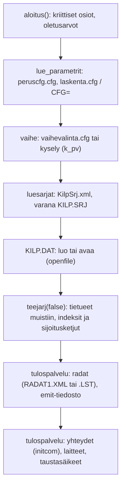

# 02 Kilpailun elinkaari: perustaminen, avaaminen, kilpailijat, sarjat, radat ja lähtöajat

<!-- malli: Käsikirjan lukupohja (K-3). Ohje: doc/tietopohja/laatu/k3-kirjoittajan-ohje.md.
Luvun 5 vikaluettelo generoidaan tiedostosta kasikirja/toiminnot.csv komennolla
python -I doc/arkkitehtuuri/tyokalut/tietopohja.py . kasikirja; sitä ei kirjoiteta käsin. -->

> **Tila:** alustava K-3-aineisto, ei riippumattomasti tarkastettu. Lähderevisio: tuotantokoodi
> `f7fe553` (ennallaan, `doc/arkkitehtuuri/CHECKPOINT.md`). Varmuusmerkinnät: [todennettu],
> [päätelty], [tuntematon]; "luettu käsikirjaa varten" = luettu koodista K-vaiheessa, ei tarkastettu.

Lyhenteet: **HKM** = HkMaali (HK, konsoli, MSVC), **HKW** = HkKisaWin (HK, GUI, bcc32), **VM** =
ViestiMaali, **VL** = ViestiLuenta (viesti, konsoli), **VW** = ViestiWin (viesti, GUI). Polut ovat
suhteessa hakemistoon `TPsource/V52/`, ellei polku ala `doc/` tai `docs-site/`. Merkintä
**[AA: asiakirja]** tarkoittaa tietoa, joka on jo auditointiaineistossa; **[KO: luku]** tarkoittaa
käyttöohjetta (`docs-site/docs/`), jota on käytetty vain käyttäjälle näkyvän toiminnan ja
asetusten nimien lähteenä.

Luku kuvaa, miten kilpailu syntyy ja elää ennen kuin ensimmäinen kortti tai maaliaika tulee:
kilpailun perustaminen, avaaminen, sarjat, kilpailijat ja joukkueet, radat, numerointi, arvonta ja
lähtöajat sekä vaiheen vaihto. Kortin luenta on luvussa 05 (leimaukset), tuloksen laskenta ja
muuttaminen luvussa 06.

## 1. Mitä tapahtuu

### 1.1 Kolme tilaa: ei avattu, esivalmistelu, tulospalvelu

Ohjelman kaikki toiminnot riippuvat globaalista muuttujasta `ToimintaTila`: 0 = kilpailua ei
avattu, 1 = esivalmistelu (ilmoittautumiset, arvonta, numerointi), 2 = tulospalvelu (kilpailupäivä:
laitteet, tiedonsiirto, tulokset) [todennettu: `Hk/HkGlobals.cpp:189-191`, kommentti]. Tila on
tärkeä, koska sama funktio toimii eri tavalla eri tiloissa: esimerkiksi `kilptietue::tallenna`
tekee tulospalvelutilassa tuloskaavat, sijoitusindeksien päivityksen ja tiedonsiirron, mutta
esivalmistelutilassa vain laskurit [todennettu: `Hk/HkDat.cpp:923-935`, `:981-986`].

Tila määräytyy eri tavoin eri ohjelmissa [todennettu: lähde kussakin kohdassa]:

| Ohjelma | Tilan valinta |
|---|---|
| HKW | Päälomakkeella on kaksi avaustoimintoa. Kumpikin kysyy asetustiedoston (`.cfg`) ja asettaa tilan 2 (tulospalvelu) tai tilan 1 (esivalmistelu) ennen kuin ohjelman käynnistysrutiini `Initialisoi` kutsuu ytimen `aloitus`-funktiota (`cbHk/WinHk.cpp:1198`, `:1258`). Tila 0 on käynnistyksen jälkeinen perustila (`cbHk/WinHk.cpp:280`). |
| VW | Samoin kaksi avausta (`ViestiWin/UnitMain.cpp:1402`, `:1425`); sulkeminen asettaa tilan 0 (`:1526`). |
| HKM | Tila on aina 2: globaalin alkuarvo on konsolikäännöksessä 2 eikä mikään konsolikoodi muuta sitä (`Hk/HkGlobals.cpp:189`). Konsoliohjelmalla ei ole esivalmistelutilaa. [päätelty: `ToimintaTila`-sijoituksia ei löytynyt `HkConsole/`-hakemistosta] |
| VM, VL | Tila on aina 2 (`Juk/VGlobals.cpp:37`). Jos `KILP.DAT` puuttuu, konsoli ilmoittaa ja sulkeutuu (`Juk/VInit.cpp:2735-2745`, `#else`-haara). |

### 1.2 Kilpailun perustaminen

Käyttäjän näkökulmasta kilpailu perustetaan HKW:n tai VW:n päälomakkeen valinnalla
*Kilpailun luominen ja perusominaisuudet* [KO: hkkisawin 2.1, viestiwin 2.1]. Siellä valitaan
kilpailun kansio (olemassa oleva tai uusi) ja kerrotaan kilpailun perusominaisuudet ja sarjat.
Ohjelma:

- luo kansioon tyhjät asetustiedostot `ilmoitt.cfg` ja `laskenta.cfg`, jos niitä ei ole;
- tallentaa perustiedot ja sarjat tiedostoon `KilpSrj.xml`; perustietoja ei voi tallentaa ilman
  vähintään yhtä sarjaa;
- sallii pohjaksi aiemman kilpailun `KilpSrj.xml`:n lukemisen, jolloin sarjojen määrittelytyö
  vähenee;
- ehdottaa tallennettaessa viimeiseksi sarjaksi vakanttisarjaa nimellä *VAKANTIT*, ellei sellaista
  ole. Vakanttisarjaa tarvitaan käytännössä jokaisessa Emit-kilpailussa, koska tunnistamattomien
  korttien tietueet sijoitetaan sinne (luku 05) [KO: hkkisawin 2.1].

Kilpailijatiedosto `KILP.DAT` syntyy vasta, kun ohjelma käynnistetään esivalmisteluun [KO:
hkkisawin 2.1]. Koodissa tämä tapahtuu `aloitus`-funktiossa: jos tiedostoa ei löydy, HK:n ydin
ilmoittaa "Tiedostoa KILP.DAT ei ole. Luodaan uusi tiedosto." ja luo tyhjän tiedoston (`makefile`
`kilpparam.kilprecsize`-tietuekoolla) [todennettu: `Hk/HkInit.cpp:3478-3482`]. Tämä koskee sekä
HKW:tä että HKM:ää, joten väärästä kansiosta käynnistetty HKM luo tyhjän kilpailun
**ilman erillistä vahvistuskysymystä** (ilmoitus näytetään) [todennettu koodista; seurausta ei
ajettu]. Viestin ohjelmissa GUI kysyy luodaanko uusi tyhjä tiedosto ilmoittautumistilassa ja
asettaa tilan 1 vastauksella kyllä; konsoli ei luo tiedostoa vaan sulkeutuu (`Juk/VInit.cpp:2735-2745`)
[todennettu].

Tietueen koko riippuu vaiheiden, osuuksien ja väliaikapisteiden enimmäismääristä
[AA: `tiedostomuodot.md` "KILP.DAT: HK-tietue", "Mitatut koot"]. Siksi käyttöohje neuvoo pitämään
ehdotetut enimmäismäärät (2 vaihetta, 10 väliaikapistettä) ja toteaa, ettei rakennetta
vaikuttavia valintoja voi muuttaa, kun `KILP.DAT` on olemassa; muutos vaatii tiedoston poistamisen
[KO: hkkisawin 2.1]. Aktiivisten vaiheiden määrää voi muuttaa enimmäismäärän rajoissa, koska se ei
muuta tiedostorakennetta [KO: hkkisawin 2.1].

Perustamisvaiheessa tehdään myös valinnat, jotka ohjaavat myöhempää laskentaa [KO: hkkisawin 2.1]:
laji ja lajitäsmennys (vaikuttaa oletuksiin: ajanottotarkkuus, tunnistin, sakkoyksikkö,
lähtöportti, seuratieto), aikojen tallennus-, sijoitus-, tulostus- ja väliaikatarkkuus sekä
takaa-ajon lähtöaikapyöristys, kilpailun tunnuskoodi (MySQL ja tulostiedostojen oletusnimet) sekä
se, voivatko sarja ja rintanumero vaihtua vaiheesta toiseen.

### 1.3 Kilpailun avaaminen: käynnistysketju

Sekä GUI että konsoli kutsuvat samaa ytimen funktiota `aloitus()` (`Hk/HkInit.cpp:3079`, viestissä
`Juk/VInit.cpp:2538`) [AA: `yleiskuva.md` "Käynnistys"]. HK:n ketju tässä luvussa kiinnostavilta
osiltaan (rivit `Hk/HkInit.cpp`, luettu käsikirjaa varten, ei tarkastettu):

1. **Asetukset.** `lue_parametrit` lukee asetustiedostot ja komentorivin [AA: `tiedostomuodot.md`
   "Konfiguraatio"]. Asetustiedoston rivit katkaistaan 77 merkkiin hiljaa, kommentti alkaa
   puolipisteellä ja tuntematon avain antaa varoituksen [AA: sama kohta].
2. **Vaihe.** Tulospalvelutilassa `k_pv` asetetaan aluksi -1, ja jos `vaihe=v`-asetus on annettu,
   vaihe luetaan tiedostosta `vaihevalinta.cfg`; muuten ohjelma kysyy vaiheen
   (`Hk/HkInit.cpp:3164-3190`) [luettu käsikirjaa varten; asetus [KO: hkkisawin 10.5]].
3. **Sarjat.** `luesarjat()` lukee `KilpSrj.xml`:n (`lueEventXml`); jos luku ei onnistu, se lukee
   vanhan tekstimuotoisen `KILP.SRJ`:n. Jos kumpaakaan ei saada, käynnistys keskeytyy ilmoitukseen
   "Sarjatietojen lukeminen ei onnistunut" (`Hk/HkSrj.cpp:66-83`, `Hk/HkInit.cpp:3252-3255`)
   [todennettu: koodi; [AA: H-174] kuvaa virhetilanteen]. Viestin vastine on
   `Juk/vSarjat.cpp:315-318` [AA: H-174].
4. **KILP.DAT.** Tiedosto avataan; väärän kokoinen tai epäjohdonmukainen otsake estää avauksen,
   eikä korjaustyökalua ole [AA: `tiedostomuodot.md` "KILP.DAT: tiedostokerros"].
5. **Muistirakenteet.** `teejarj(false)` lukee kaikki tietueet muistiin ja rakentaa johdetut
   rakenteet (numerohakemisto, nimihakemisto, sijoitusketjut, laskurit) [AA: `globaali-tila.md`
   4.1, 5]. Mitään niistä ei kirjoiteta levylle, vaan ne rakennetaan joka käynnistyksessä uudelleen
   [AA: sama].
6. **Radat ja Emit.** Vain tulospalvelutilassa ja kun Emit-käsittely on päällä: radat luetaan
   `RADAT1.XML`:stä (HK) tai `radat.xml`:stä (viesti), ja jos XML-tiedostoa ei ole, tekstimuotoisesta
   `RADAT*.LST`:stä; sen jälkeen luetaan emit-tiedosto (`Hk/HkInit.cpp:3593-3612`, `Juk/VInit.cpp:2869-2873`,
   `Hk/HkGlobals.cpp:130-131`, `Juk/VGlobals.cpp:114`) [luettu käsikirjaa varten].
7. **Yhteydet ja laitteet.** Vasta tämän jälkeen avataan sarja- ja verkkoyhteydet sekä laitteet
   (`initcom`, `Hk/HkInit.cpp:3659`) [AA: `yleiskuva.md` "Käynnistys"; luku 05 ja tiedonsiirtoa
   käsittelevät luvut].

Kilpailua ei voi sulkea ja avata uudelleen käynnissä olevassa HK-prosessissa: `suljekilpailu` on
kuollutta koodia ja `aloitus` ei ole turvallisesti uudelleen ajettava [AA: `globaali-tila.md` 4.3].
Kilpailun vaihtaminen tarkoittaa siis ohjelman uudelleenkäynnistystä.

### 1.4 Sarjat

**Mitä sarja on.** Sarja on kilpailijoiden ryhmä, jolla on yhteiset säännöt: nimi (korkeintaan
10 merkkiä), pitkä nimi, osallistumisvaiheet, numeroalku, lähtöaika-asetukset, väliaikapisteet,
sakot, matka ja vaiheen luonne [KO: hkkisawin 2.2.1]. Koodissa sarja on `sarjatietue`
(`Hk/HkDef.h:687-724`), jonka kentät ovat pääosin vaihekohtaisia taulukoita (`[N_PV]`):

| Kenttä (HK) | Merkitys käyttäjälle |
|---|---|
| `enspv`, `viimpv` | Ensimmäinen ja viimeinen vaihe, johon sarja osallistuu |
| `luonne[v]` | Vaiheen luonne: itsenäinen, jatko aiempaan, takaa-ajo; negatiivinen arvo tarkoittaa, ettei sarja osallistu vaiheeseen (`kilptietue::tark` palauttaa silloin tilan P, `Hk/HkTls.cpp:1198`). Kentän kommentti mainitsee arvon 9 "ohitetaan"; koodin ja kommentin yhteensovitusta ei ole selvitetty. |
| `sarjaalku`, `bibalku[v]` | Perusnumeron ja vaihekohtaisen rintanumeron alku |
| `enslahto[v]`, `ensjlahto[v]`, `lahtovali[v]`, `pari[v]` | Ensimmäinen lähtöaika, jälki-ilmoittautuneiden ensimmäinen lähtö, lähtöväli sekunteina (nolla = yhteislähtö), samanaikaisten lähtijöiden määrä |
| `valuku[v]`, `npist[v]`, `va_*` | Väliaikapisteiden määrä ja määritykset |
| `lsak[v]`, `tsak[v]`, `rrtas` | Sakkojen määrä ja yksikkö; rastireittisarjan tunnus |
| `vakanttisarja`, `piilotatulos` | Vakanttisarja; tulosten piilotus |
| `lno`, `portti`, `mno` | Lähtö, lähtöportti, maali |

Käyttäjä muokkaa sarjoja valinnassa *Valmistelu / Sarjatiedot*: taulukossa muutetaan arvoja,
sarjakohtaisessa ikkunassa lisätään ja poistetaan sarjoja ja muutetaan niiden järjestystä [KO:
hkkisawin 2.2, 2.2.1]. Sarjojen järjestys määrää useiden luettelojen järjestyksen, ja lisäys tai
siirto hidastuu, kun osanottajia on jo paljon [KO: hkkisawin 2.2]. Lähtöväli on merkittävä
nollasta eroavaksi, ellei kyse ole yhteislähdöstä, koska muuten lähtöjärjestyksessä ei saa
tulosteita [KO: hkkisawin 2.2.1].

**Sarjayhdistelmät ja alisarjat.** Tuloksia voi laatia useiden sarjojen yhdistelmille
tiedostolla `SARJAYHD.LST` (rivi: yhdistelmän nimi ja sarjat; sana `KAIKKI` kattaa kaikki sarjat);
alisarjat (sukupuoli- ja ikäluokkatunnus) vaikuttavat vain tulosluetteloihin ja seurantaan [KO:
hkkisawin 2.3]. Yhdistelmät ovat sarjataulukon `sarjaluku`-rajan jälkeisiä lisäsarjoja (`Sarjat[sarjaluku+n]`),
joille on omat sijoitusketjunsa [AA: `globaali-tila.md` 5; `Hk/HkTls.cpp:530-545`].

**Sarjan vaihtuminen kilpailijalla.** Jos kilpailu on perustettu niin, että sarja voi vaihtua
vaiheesta toiseen (`kilpparam.sarjavaihtelee`, esimerkiksi hiihdon sprintissä), kilpailijalla on
sarja kussakin vaiheessa (`pv[v].sarja`) ja `kilptietue::Sarja()` palauttaa aktiivisen vaiheen
sarjan tulospalvelutilassa; muuten kaikilla vaiheilla on sama sarja (`Hk/HkTls.cpp:482-528`)
[todennettu]. Sama koskee rintanumeroa (`kilpparam.bibvaihtelee`, `kilptietue::id`,
`setId`) [todennettu: `Hk/HkTls.cpp:433-473`].

**Sarjatietojen jakelu verkossa.** Sarjatiedot kopioidaan normaalisti käsin jokaiselle koneelle.
Jos tiedostonsiirto on otettu käyttöön, tallennus voi siirtää tiedostot muille koneille, mutta
siirretyt tiedot tulevat käyttöön vasta kun tiedot luetaan uudelleen (käynnistys, vaiheen vaihto tai
valinta *Lue sarjat ja muut tiedot uudelleen*), ja nämä toiminnot käynnistyvät koko verkossa vain,
jos millään koneella ei ole lähetysjonossa odottavia sanomia [KO: hkkisawin 2.2.5]. HKW:n valinta
*Lue sarjat ja muut tiedot uudelleen* ei ole erillinen luku: se kutsuu vaiheen vaihdon funktiota
nykyisellä vaiheella ja lähettää vaihtopyynnön muille asemille (`cbHk/WinHk.cpp:2060-2061`, `:2121`;
kohta 1.9), joten vaiheen vaihdon viat (H-129) koskevat myös yksivaiheista kilpailua (KE-21)
[luettu koodista, ei ajettu; päätelty `seuranta.md` KE-21:stä].

**Viesti.** Viestissä sarja määrittelee osuuksien määrän, rinnakkaisosuudet, osuuksien
yhteislähtöajat ja lähtövälin; sarjatiedot ovat samassa `KilpSrj.xml`-muodossa (`Juk/vSarjat.cpp`)
ja `Sarjat` alustetaan käynnistyksessä [AA: `globaali-tila.md` 4.1]. Sarjan osuuksien enimmäismäärä
on käännösaikainen (`MAXOSUUSLUKU`, toimitetuissa ohjelmissa 30) [AA: `rekisteri/valitsimet.csv`,
`tiedostomuodot.md` "Kääntäjävalitsimet"].

### 1.5 Kilpailijat (HK) ja joukkueet (viesti)

**Tietue.** HK:ssa yksi `kilptietue` sisältää kilpailijan perustiedot (numero, nimi, seura, sarja,
emit-koodit, pisteet) ja vaihekohtaisen osan `pv[v]` (rintanumero, sarja, lähtöaika, tarkastusmerkintä,
sakot, väliaikataulukko `va[]`); viestissä tietue on joukkue, jonka osuuskohtaiset tiedot ovat
`osrec`-taulukossa `ostiet[]` (`Hk/HkDef.h:440-611`, `Juk/VDef.h:662-734`) [todennettu: otsikot].
Tietueet ovat muistissa taulukossa `kilparr` ja levyllä `KILP.DAT`:ssä, ja kilpailijaan viitataan
joko tietuenumerolla (paikka tiedostossa, paikallinen jokaisella koneella) tai kilpailunumerolla
(1..9999, `MAXKILPNO`) [AA: `tiedostomuodot.md`; `Hk/HkDef.h:28`].

**Lisääminen.** Käyttäjä lisää osanottajia lomakkeella *Osanottajat / Ilmoittautumisten syöttö*
[KO: hkkisawin 3.1], lukemalla ilmoittautumiset tiedostosta (esimerkiksi IRMA, Kilmo) [KO:
hkkisawin 3.2, ei luettu tarkemmin] tai tuomalla tietoja vanhasta ohjelmaversiosta [KO: hkkisawin
2.4]. Valittavana on henkilötietokanta (CSV: tunnus, nimi, seura, sarja ...), IRMA- tai Hiihtoliiton
tiedostomuoto sekä seuraluettelo [KO: hkkisawin 3.1]. Yksittäisen tietueen lisäys HK:ssa
(`kilptietue::addtall`, `Hk/HkDat.cpp:674-739`) [todennettu, luettu käsikirjaa varten]:

1. Jos tietueita on jo `maxrec`, lisäys evätään ilmoituksella "Yritys lisätä liikaa kilpailijoita"
   (`n_lisaa`, oletus 1000, vaikuttaa `maxrec`-rajaan; asetus `LISÄÄ=`) [`Hk/HkGlobals.cpp:394`,
   `Hk/HkInit.cpp:1312`; `maxrec`:n laskenta luettu vain osittain].
2. Sarja ja numerot tasataan: jos sarja ei vaihtele, aktiivisen vaiheen sarja kopioidaan kaikille
   vaiheille; jos numero on rajojen ulkopuolella, haetaan seuraava vapaa (`haeSeurVapaaKno`).
3. `addfrec` pakkaa tietueen, lisää sen tiedostoon `addrec`illä `kilpdat_CriticalSection`in
   alla ja kirjoittaa muistitaulukkoon (`PUTREC`) (`Hk/HkDat.cpp:626-637`).
4. Päivitetään numerohakemisto (`setpos`), nimihakemisto (`addix`), sijoitusketjut (`addjarjarr`)
   ja Emit-koodin linkki (`addbadge`).
5. Jos tiedonsiirto on käytössä, tietue ja vaihekohtaiset osat lähetetään (`laheta`) kaikkiin
   yhteyksiin paitsi siihen, josta tieto tuli (`kielto`). Lähetys on jonoon laitto, ei perillemeno
   [AA: `tiedonsiirto.md`].

Funktio ei palauta tietoa onnistumisesta: puute `nrec >= maxrec` jää vain ilmoitukseksi, ja
tiedostoon kirjoittamisen virhe käsitellään modaali-ikkunalla, jonka jälkeen ohjelma jatkaa
[AA: `virheenkasittely.md`; H-015].

**Vakantit.** Vakantti on ennalta luotu tyhjä paikanpitäjätietue (tila V, vakanttisarja), jonka
tiedot täytetään myöhemmin. Käyttöohje pitää vakanttien muokkaamista parhaana tapana lisätä
osanottajia tulospalvelutilassa usean koneen verkossa, koska muokkaus ei vaadi uuden tietueen
lisäystä ja numerot ovat jo sovittu [KO: hkkisawin 3.1]. Vakantteja luodaan valinnalla *Lisää
vakantteja*, ja asetukset `VAKANTTILUKU=`, `VAKANTTIALKU=` ja `LISÄVAKANTTIALKU=` ohjaavat niiden
määrää ja numeroalkua (`Hk/HkInit.cpp:818-850`) [luettu käsikirjaa varten]. Jos `VAKANTTILUKU` on
suurempi kuin `LISÄÄ`, käynnistys keskeytyy (`Hk/HkInit.cpp:3202-3205`) [todennettu]. Emit-kortti,
jonka koodia ei tunneta, ottaa seuraavan vapaan vakantin tai luo uuden tietueen vakanttisarjaan
(`Hk/HkIV.cpp:1577-1622`) [luettu käsikirjaa varten; luku 05].

**Muokkaaminen.** Yksittäisen kilpailijan tiedot muokataan lomakkeella *Kilpailijatiedot* (HKW) tai
joukkueen tiedot lomakkeella *Joukkuetiedot* (VW). Lomake työskentelee tietueen kopiolla ja kirjoittaa
sen takaisin `tallenna`-kutsulla vasta kun käyttäjä tallentaa; HKW tarkistaa ennen tallennusta, onko
tietue muuttunut muualla, mutta tarkistus tehdään lukon ulkopuolella (VW:ssä sisällä) [AA:
`gui-liiketoimintalogiikka.md` 3.7, 3.8, 4; H-017]. Konsolissa lomake on `kilptietue::inputkilp`
(`HkConsole/HkKilp.cpp:884`), jota kutsutaan konsolin tietojen syötöstä (`HkConsole/HkCons2.cpp:498`,
`:907`) [luettu käsikirjaa varten, ei tarkastettu].

**Poistaminen.** Poisto (`deltall`, `Hk/HkDat.cpp:741-771`) irrottaa Emit-linkit
(`rembadge`), poistaa tietueen sijoitusketjuista (`remjarjarr`), nollaa numerohakemiston rivin
(`setpos(numero, 0)`), poistaa nimihakemiston rivin (`delix`), vapauttaa tietueen (`delfrec`:
tietue lisätään tiedoston vapaiden listaan) ja lähettää poiston muille koneille [todennettu: koodi;
[AA: `globaali-tila.md` 5] kuvaa johdetut rakenteet]. Poistoa ei tarkisteta GUI:ssa: lomakkeen
valikkokohta on käytössä myös silloin, kun kilpailijaa ei ole valittu [AA: H-109].

**Viesti.** Joukkueen lisäys on `addfrec` (`Juk/vdat.cpp:178-192`); viestin `tallenna` tarkistaa
tietueen `kilpTarkasta`-funktiolla (virheellinen sarja → 0, virheellinen numero tulospalvelutilassa →
seuraava vapaa, virheellinen tarkastusmerkintä → '-') (`Juk/vdat.cpp:285-309`) [todennettu: koodi].
Tämä hiljainen korjaus selittää, miksi sarjan puuttuva valinta päätyy joukkueen siirtymiseen sarjaan 0
[AA: H-114].

### 1.6 Radat

Rata on rastikoodien jono sekä lähtöennakko- ja maaliajanmääritys; radat sidotaan sarjoihin nimen
perusteella (radan nimi on yleensä sarjan nimi) tai kilpailijakohtaisella radalla (hajonta)
[KO: hkkisawin 13.2]. Rataa muokataan kaavakkeella; muutokset eivät vaikuta tulospalveluun, ennen kuin
ne on kirjoitettu tiedostoon ja erikseen otettu käyttöön painikkeella *Ota muutetut tiedot käyttöön*
tai leimantarkastuksen valinnalla *Tiedostot / Lue ratatiedot uudelleen*; toisella koneella
tallennettu ratatiedosto kopioidaan koneen työkansioon, tai se lähtee verkossa muille koneille, jos
tiedostonsiirto on käytössä [KO: hkkisawin 13.7, 13.9]. Ratamääritysten sisältö ja käyttö kortin
tarkastuksessa kuuluvat lukuun 05; tässä luvussa riittää, että radat luetaan käynnistyksessä ja
vaiheen vaihdossa (kohta 1.9).

### 1.7 Numerointi

Rintanumeroiden antaminen on valinnassa *Valmistelu / Arvonta ja numerointi* (HKW) tai *Valmistelu /
Numerointi* (VW) [KO: hkkisawin 4.1, viestiwin 4.1]. Jokaisella kilpailijalla on koko kilpailulle
yhteinen perusnumero ja kullekin vaiheelle rintanumero; ne ovat samat, ellei kilpailun perustiedoissa
ole valittu vaihtelevaa rintanumeroa [KO: hkkisawin 4.1].

HKW:n numerointi [KO: hkkisawin 4.3; luettu käsikirjaa varten: `cbHk/UnitArvonta.cpp`]:

- numerointitapoja on kahdeksan (tallennusjärjestys, valitun vaiheen lähtöjärjestys, rankijärjestys,
  satunnainen ja muita) [AA: `gui-liiketoimintalogiikka.md` 3.5];
- numerointi voi koskea yhtä vaihetta tai kaikkia (silloin myös perusnumeroa); hiihdon sprintissä
  muille vaiheille voi antaa numeron korotettuna vakiolla (oletus 2000);
- numerointi voi koskea kaikkia tai vain numerottomia (haetaan vapaita numeroita sarjan alkunumerosta);
- ohjelma ei numeroi, jos sarjatietojen perusteella numeroalueet menisivät päällekkäin; painike
  *Etsi numeroalueiden päällekkäisyydet* tarkastaa tämän etukäteen, mutta tarkastus ei kata
  päällekkäisyyksiä, jotka ovat vain muiden sarjojen välisiä [KO: hkkisawin 4.3].

HK:n numeroiden siirto ja `SprLisa` eivät tarkista rajoja tai päällekkäisyyttä [AA: H-124].

VW:n numerointi on suppeampi: aakkos-, tallennus-, satunnais- ja rankijärjestys sekä siirto;
satunnaisnumerointi sekoittaa numerot Mersenne twisterillä ja tarkistaa vapaan numeron
(`varmista_vapaa`), mitä HK:ssa ei ole [AA: `gui-liiketoimintalogiikka.md` 3.6]. Rankijärjestys käyttää
osuuspisteitä (esimerkiksi FIS-pisteet kentässä *Osuuspisteet-3*) [KO: viestiwin 4.1.2]. Rankinumerointi
katkaisee 1000 joukkueeseen sarjaa kohden ilman ilmoitusta [AA: H-122].

Numeron vaihtuessa `tallenna` siirtää numerohakemiston rivin ja Emit-linkit uudelle numerolle
(`Hk/HkDat.cpp:1152-1181`) [todennettu: koodi]. HK:n numerohakemisto ei kuitenkaan poista vanhaa
riviä, mikä katkaisee numerojärjestyksessä etenevät läpikäynnit (vienti, arvonnan läpikäynti,
sakkokierroslista, radan tunnistus) [AA: H-128; `globaali-tila.md` 5, 7].

### 1.8 Arvonta ja lähtöajat

**HKW: arvonta.** Arvonta (`cbHk/HkArv2.cpp`, käännetään vain HKW:hen [todennettu: tiedosto on
`RADStudio10/HkKisaWin.cbproj`:ssa, ei HKM:n eikä viestin projekteissa]) tekee kolme asiaa: jakaa
osanottajat alisarjoihin (esimerkiksi karsintasarjoihin), arpoo lähtöajat ja antaa numerot [KO:
hkkisawin hkluku4]. Käyttöohjeen mukaan [KO: hkkisawin 4.2.3, 4.5]:

- arvonta suunnistuksen säännöin estää saman seuran kilpailijoiden päätymisen peräkkäin, jos se on
  mahdollista; seura tunnistetaan täydestä nimestä tai lyhenteestä; seura voidaan myös jättää
  huomiotta;
- lähtöajat voi antaa ilman arvontaa numeroiden tai rankin mukaan nousevaan tai laskevaan
  järjestykseen;
- arvonta voidaan uusia osalle sarjaa; sarja voidaan jakaa useaan sarjaan satunnaisesti, seurojen
  mukaan, rankin mukaan tasavahvoiksi tai rankin mukaan parhaat ensin;
- kaksivaiheisessa kilpailussa toisen päivän lähtöajat voidaan määrätä riippumattomasti, käännetyssä,
  käännetyssä ja sekoitetussa tai puolitetussa järjestyksessä; useamman kuin kahden vaiheen arvonta
  jakaa lähtöpaikat tasaisesti;
- kaksi- tai useampivaiheisessa kilpailussa poissaolevaksi merkityt voi jättää ilman lähtöaikaa;
- arvonta on käytettävissä esivalmistelussa sekä käynnissä olevassa monivaiheisessa kilpailussa
  myöhempien vaiheiden arvontaan [KO: hkkisawin hkluku4].

Koodin rakenne [luettu käsikirjaa varten, ei tarkastettu; `cbHk/HkArv2.cpp` on `tiedostot.csv`:ssä
tasolla 1]:

- satunnaisluvut tuottaa `MTRand_int32` (Mersenne twister) (`:127`, `:699`);
- yhteislähtösarjassa (lähtöväli 0) ohjelma kysyy, arvotaanko samalla kaikkien vaiheiden numerot, ja
  asettaa lähtöajaksi sarjan ensimmäisen lähtöajan (`arvovaihe`, `:740-780`, `arvonumerot`
  `:696-738`);
- muussa tapauksessa lähtöaika on `enslahto + lähtöväli × ((järjestysnumero + alkusiirto − 2) / pari)`,
  jolloin `pari` samanaikaista lähtijää saa saman ajan (`arvosarja`, `:356-396`); poissaolevaksi
  merkitty (tila P) saa lähtöajaksi `TMAALI0` (ei aikaa), ellei arvonnan parametri `sailpo` ole
  päällä (käyttöohjeessa valinta, annetaanko lähtöajat kaikille vai jätetäänkö poissaolevaksi
  merkityt ilman lähtöaikaa [KO: hkkisawin 4.2.3]);
- esivalmistelutilassa tietue kirjoitetaan suoraan (`PUTREC(d, 1)`), tulospalvelutilassa `tallenna`n
  kautta, jolloin muutokset lähtevät myös verkkoon (`:393-397`, `:733-737`).

HKW:n arvonta ei hae `idindex`-hakemistoa vaan sarjaindeksiä, mutta `SeurPos`-läpikäynti numeron
mukaan on mukana arvonnan lomakkeessa; sen käyttö vanhentuneen numerohakemiston kanssa on
auditoinnissa kirjattu avoimeksi (Q79) [AA: `globaali-tila.md` 9; H-128].

**HKM: ei arvontaa.** HKM:ssä ei ole arvontatoimintoa. Konsolin asetusvalikon kohta *S)arjat* sallii
sarjakohtaisen lähtöaikojen siirron (`L`), numeroiden muutoksen (`N`), tietojen kopioinnin (`K`) ja
ohjetiedostolla ajon (`O`): rivit "sarja siirto" tai `MUUTA sarja siirto` (`HkConsole/HkCons0.cpp:905-1130`)
[luettu käsikirjaa varten]. Lähtöaikojen kohdassa `L` ohjelma kysyy ensin, laaditaanko takaa-ajokisa, ja siinä tapauksessa kutsuu `takaa_ajolahdot`-funktiota (`HkCons0.cpp:1065-1071`, `MERI5` päällä HK:ssa; luku 06). Lähtöajan siirto lisää siirron `tlahto`-kenttään ja korjaa jo olemassa
olevan lähtö- ja tulosajan (`HkCons0.cpp:1088-1108`): jos kilpailijalla on tulos, siirto pienentää
tulosta samalla määrällä. Numeron siirto hyväksytään vain, jos uusi numero on rajoissa ja vapaa
(`getpos(k) <= 0`).

**HKW ja VW: siirrot.** Valinta *Valmistelu / Aikojen, numeroiden ja vaiheen siirrot* siirtää valittujen
sarjojen arvottuja lähtöaikoja vakiomäärällä tai asettaa yhteislähdön ajan, siirtää lähtöportin
tuottamia toteutuneita aikoja tai tuloksia, ja kopioi sarjan yhden vaiheen tiedot toiseen vaiheeseen
[KO: hkkisawin 4.6]. Jos kilpailijalla on jo tulos, käyttäjä valitsee, vaikuttaako siirto tulokseen
[KO: hkkisawin 4.6]. HKW:n lähtöaikojen asetus sarjan parametreista jakaa `pari`-arvolla
tarkistamatta nollaa [AA: H-125].

**VW: numerointi ja osuuksien lähtöajat.** Viestissä lähtöaika annetaan yleensä sarjalle eikä joukkueelle.
Valinta *Valmistelu / Numerointi* laskee lähtöajat joukkueen numerosta: sarjan alkunumeron joukkue
saa osuudelle määritellyn yhteislähtöajan, ja jokainen seuraava numero saa lähtövälin verran
myöhemmän ajan; osuudelle, jolle ei ole merkitty yhteislähtöaikaa, ei anneta lähtöaikaa paitsi
partiosuunnistuksessa [KO: viestiwin 4.1]. Käsin lähtöaikoja voi muokata ja lukea tiedostosta ilman
rajoituksia [KO: viestiwin 4.1]. Koodin vastine on `BtnLahtoajatClick` (`ViestiWin/UnitArvonta.cpp:523`)
[AA: `gui-liiketoimintalogiikka.md` 3.6]. Viestin kilpailijalla on lisäksi osuuskohtainen yhteislähtö
(`ostiet[].ylahto`), jonka perusteella `kilptietue::Lahto` laskee osuuden lähtöajan: edellisen osuuden
tuloksesta, yhteislähdöstä tai rinnakkaisosuuksien maalijärjestyksestä (`Juk/vkilp.cpp:329-409`)
[luettu käsikirjaa varten; lähtöaika vaikuttaa tulokseen, ks. luku 06].

**VM, VL: lähtöajat.** Konsoliohjelmien lähtöaikojen asetustoiminnoista ei ole kirjattu
tietoa tähän lukuun [tuntematon].

### 1.9 Vaiheen vaihto (vain HK)

Monivaiheisessa HK-kilpailussa ohjelma voi vaihtaa vaihetta ilman uudelleenkäynnistystä.
HKW:ssa valinta on päävalikon kohdassa *Tiedosto*, HKM:ssä *Asetukset*-valikon näppäin `W`
(`HkConsole/HkCons0.cpp:924-929`) [KO: hkkisawin 10.5]. Vaiheen vaihto lähettää sanoman muille
koneille, jotka vaihtavat vaihetta, ja edellyttää, ettei millään koneella ole lähetysjonossa
odottavia sanomia; vaihetta ei pidä vaihtaa, kun jollain koneella muokataan tietoja [KO: hkkisawin 10.5].
Pyynnön lähetys riippuu vaihtavan aseman omasta, koko ohjelman levyjonoasetuksesta (`levypusk`,
`Hk/HkGlobals.cpp:363`), ei vastaanottajan yhteyden jonotyypistä: vain jos `levypusk` on päällä,
`vaihdavaihe` merkitsee avoimet yhteydet aloituspaketin ja vaihtopyynnön lähetettäviksi
(`lah_alku`, `lah_vaihto`; lähdeyhteydelle vain aloituspaketti, `Hk/HkIx.cpp:1974-1981`). Jos
vaihtavalla asemalla on `COMFILE=EI` (muistijono), pyyntöä tai aloituspakettia ei lähde millekään
yhteydelle [luettu koodista, riippumattomasti tarkastettu 2026-11-27 (`laatu/tarkastukset/k5/kasikirja.md`
08-4, 08-5); ei ajettu].
Käyttöohje neuvoo antamaan asetuksen `vaihe=v` ja huolehtimaan, että `vaihevalinta.cfg` osoittaa
oikeaan vaiheeseen, koska uudelleenkäynnistys väärään vaiheeseen aiheuttaa lieviä ongelmia [KO:
hkkisawin 10.5].

Koodissa `vaihdavaihe` (`Hk/HkIx.cpp:1855-2005`) kirjoittaa `vaihevalinta.cfg`:n, tyhjentää
vaihekohtaiset laskurit ja hakemistot, lukee sarja-, rata- ja emit-tiedot uudelleen ja rakentaa
johdetut rakenteet (`teejarj(true)`) [AA: `globaali-tila.md` 4.2]. Säie- ja lukkopuoli: C-6 [AA:
`saikeet-ja-lukot.md`]. Vaiheen vaihdossa **vanhaksi jäävät** [AA: `globaali-tila.md` 4.2]:

- aikajonotiedoston nimipohja `aikaflname` (H-131);
- `kilpparam.maxvaluku`, `lsakmax`, sarjojen `mno`/`lsak`-rajaukset, `maaliajat`, korostusrajat,
  `eralahto`/`era_akt` (H-141, H-143); H-141:n kaksoiskorttien eston laskurivirhe on myös viestissä
  (`Juk/VEmit.cpp:1475-1503`, `on_emit`: `nemitvar` ei nollaudu, kun taulu vapautetaan), ja siellä
  laukaisijoita ovat radan uudelleenluku ja emit-analyysin uusinta, koska viestissä ei ole vaiheen
  vaihtoa (KE-20) [luettu koodista, ei ajettu];
- numerohakemiston rivimäärä: `teejarj(true)` nollaa hakemiston sisällön mutta ei `idindex->nrec`iä
  (H-129).

Vaihdon aikana puuttuva `RADAT<n>.XML` poistaa Emit-tarkastuksen käytöstä vaiheen ajaksi ilman
tekstivaraa (H-134) [AA: sama]. Vaiheen vaihdon käynnistys verkkopyynnöstä ohittaa vahvistuskyselyn
(KE-2 alla). Viestissä ei ole vaiheen vaihtoa [AA: `globaali-tila.md` 4.2].

### 1.10 Lopetus

Ohjelman lopetus kutsuu `lopetus()`-funktiota, joka sulkee yhteydet, aikajonot, emit-tiedoston ja
`KILP.DAT`:n; muistia ei vapauteta, ja pysyvyys perustuu siihen, että jokainen tietueen muutos on jo
kirjoitettu `PUTREC(d, 1)`:llä [AA: `globaali-tila.md` 4.3]. Lopetus ei odota säikeitä (H-038), ja
poikkeuspolut, joissa `inLopetus` on jo asetettu, tekevät `lopetus()`-kutsusta tyhjän (H-104) [AA:
`rekisteri/havainnot.md`].

## 2. Erot ohjelmien välillä

| Kohta | HKW | HKM | VW | VM / VL |
|---|---|---|---|---|
| Esivalmistelutila (1) | kyllä | ei | kyllä | ei |
| Kilpailun perustamislomake (`KilpSrj.xml`, `*.cfg`) | kyllä [KO: 2.1] | ei [päätelty: ei lomakkeita; asetustiedostot ja `KilpSrj.xml` muokataan käsin tai HKW:llä] | kyllä [KO: viestiwin 2.1] | ei [päätelty] |
| `KILP.DAT` puuttuu käynnistyksessä | luo tyhjän, ilmoittaa | luo tyhjän, ilmoittaa | kysyy, luoko tyhjän | sulkeutuu |
| Sarjatietojen muokkaus | lomake *Sarjatiedot* | ei; konsolissa vain siirrot (`S`) | lomake *Sarjatiedot* | ei [päätelty] |
| Kilpailijan ja joukkueen muokkaus | lomake | konsolin lomake (`inputkilp`) | lomake *Joukkuetiedot* | [tuntematon] |
| Arvonta (arvonta, jako alisarjoihin) | kyllä (`HkArv2.cpp`) | ei | ei (`arvo(int)` vain esitelty) | ei |
| Numerointi | 8 tapaa, päällekkäisyystarkistus | numeron siirto sarjalle | 4 tapaa + siirto, `varmista_vapaa` | [tuntematon] |
| Lähtöaikojen asetus | arvonta, siirrot lomake | sarjasiirto (`L`) | numerointi + osuuksien lähtöajat | [tuntematon] |
| Vaiheen vaihto | kyllä | kyllä (`W`) | ei (viestissä ei vaiheita) | ei |
| Radat luetaan käynnistyksessä | `RADAT1.XML` / `.LST` | sama | `radat.xml` / `.LST` | `radat.xml` / `.LST` |
| Osuudet | – | – | joukkueen osuudet (`ostiet[]`) | sama |

VM:n ja VL:n erot: VL on sisäänluentaohjelma (`LUENTA`), eikä sen kokoonpano sisällä kaikkia
laiteasetuksia (esimerkiksi `LAJUNEN`-RFID-lukijat puuttuvat) [AA: `rekisteri/valitsimet.csv`]. Muut
erot tämän luvun toiminnoissa [tuntematon].

Kopioiduista lomakkeista: HK- ja viestilomakkeet (emit, ajanotto, arvonta, kilpailijatiedot) ovat
kopioimalla erkaantuneita haaroja, ja korjauksia on tehty vain toiselle puolelle; kumpi haara on
uudempi, ei ole selvitetty [AA: `gui-liiketoimintalogiikka.md` 4, T-034, Q77].

## 3. Asetukset ja käännösvalitsimet

| Asetus tai valitsin | Ohjelmat | Vaikutus | Lähde |
|---|---|---|---|
| `_CONSOLE` | HKM, VM, VL | Konsolikäännös; GUI-käännöksessä sitä ei ole. Määrää mm. `ToimintaTila`n alkuarvon (HK: 2 vs 0) ja sen, että esivalmistelutilaa ei ole | `Hk/HkGlobals.cpp:188-192`; `valitsimet.csv` `PP:_CONSOLE` (partly-dead) |
| `vaihe=v`, `vaihevalinta.cfg` | HKW, HKM | Vaiheen valinta käynnistyksessä ja sen muistaminen | [KO: hkkisawin 10.5]; `Hk/HkInit.cpp:289-320` |
| `CFG=` | HKW, HKM | Asetustiedoston nimi (oletus `peruscfg.cfg`, sitten `LASKENTA.CFG`) | `rekisteri/asetusavaimet.csv`; [AA: `tiedostomuodot.md`] |
| `LISÄÄ=n` (`n_lisaa`, oletus 1000) | HKW, HKM | Laajennusvara: montako kilpailijaa voi lisätä käynnistyksen jälkeen | `Hk/HkGlobals.cpp:394`; `Hk/HkInit.cpp:1312` |
| `VAKANTTILUKU=`, `VAKANTTIALKU=`, `LISÄVAKANTTIALKU=` | HKW, HKM | Vakanttien määrä ja numeroalkua | `Hk/HkInit.cpp:818-850`; `asetusavaimet.csv` |
| `POISSAMUKAAN` | HKW, HKM | Poissaolevat otetaan mukaan laskureihin ja sijoituksiin (`kilpparam.poissamukaan`) | `Hk/HkInit.cpp:855-858`; `Hk/HkIx.cpp:829-833` |
| `XMLSARJA=` | HKW, HKM | Sarjatietojen XML-tiedoston nimi | `asetusavaimet.csv` (ehto `TCPSIIRTO`) |
| `MAXOSUUSLUKU` | VW, VM, VL | Osuuksien enimmäismäärä (toimitetuissa 30) | `valitsimet.csv`, `tiedostomuodot.md` |
| `EMIT`, `AUTOVA` ym. | kaikki | Emit-käsittely; ratojen luku käynnistyksessä riippuu `emitfl`:stä | `valitsimet.csv`; `Hk/HkInit.cpp:3593-3612` |
| `EI_OLE`, `AMPUSUUNN`, `DEMO` | ei toimitetussa | Kuollut koodi; ei kuvata tässä. `DEMO` rajaa kilpailijamäärän 30:een (HK) tai 20:een (viesti) vain ei-toimitetussa kokoonpanossa | `valitsimet.csv` (dead) |

Käännösvalitsimien tila on tarkistettu `rekisteri/valitsimet.csv`:stä HkMaali-, viestin ja
GUI-projektien osalta; HkArv2.cpp:n kuuluminen vain HKW:hen on tarkistettu projektitiedostoista
(`RADStudio10/HkKisaWin.cbproj` sisältää sen, `VS/Hk/HkMaali/*.vcxproj` ja `VS/V/*.vcxproj` eivät).

## 4. Vaihtoehtoiset polut ja virhetilanteet

| Tilanne | Mitä tapahtuu | Lähde |
|---|---|---|
| `KilpSrj.xml` puuttuu tai on virheellinen | Ohjelma lukee vanhan `KILP.SRJ`:n; jäsennysvirheestä ilmoitetaan, mutta paluu vanhoihin tietoihin on hiljainen. Jos kumpaakaan ei ole, käynnistys keskeytyy | [AA: H-174]; `Hk/HkSrj.cpp:72-83` |
| `KILP.DAT` otsake ja koko eivät täsmää | Avaus hylätään ("otsikkoalue virheellinen") eikä korjausta ole; tämä toimii myös epäsuorana tietuekoon tarkistuksena | [AA: `tiedostomuodot.md`] |
| `KILP.DAT` kirjoitusvirhe tallennuksessa | Virheilmoitus modaali-ikkunalla, ohjelma jatkaa ja tieto lähetetään silti muille koneille; levy täynnä `addrec`issä voi estää seuraavan käynnistyksen | [AA: H-015; `virheenkasittely.md`] |
| Tietueita on jo `maxrec` | Lisäys evätään ilmoituksella; seurausta kutsujalle ei palauteta | `Hk/HkDat.cpp:681-684` [todennettu] |
| Vapaita numeroita ei ole | `haeseurvapaa` ilmoittaa "Ei vapaita kilpailijanumeroita, lisäys mahdotonta" | `Hk/HkDat.cpp:773-782` [todennettu] |
| Kaksi asemaa lisää tietueen yhtä aikaa | Molemmat saavat saman tietuenumeron; vaihetiedot voivat kohdistua väärälle kilpailijalle | [AA: H-022] |
| Poisto ilman valittua kilpailijaa | HK kirjoittaa taulukon alapuolelle ja menettää vapaiden listan; kaksoispoisto linkittää tietueen itseensä | [AA: H-109; `gui-liiketoimintalogiikka.md` 5.1] |
| Poistetun tai uudelleennumeroidun kilpailijan jäännösrivi hakemistossa | Numerojärjestyksessä etenevät toiminnot pysähtyvät ja jättävät loput pois ilman ilmoitusta | [AA: H-128] |
| Poistetun tietueen paikka otetaan uudelleen käyttöön | Uusi kilpailija perii vanhan Emit-linkin ja näyttää jo luetulta | [AA: H-140] |
| Sarjavalikon valinta tyhjä (`ItemIndex -1`) | Viestissä joukkue siirtyy sarjaan 0; HK:ssa voi kaatua | [AA: H-114] |
| Vaiheen vaihto monivaiheisessa kilpailussa | Numerohakemiston laskuri ei nollaudu; kekoylivuoto mahdollinen noin 1 500 kilpailijasta alkaen; vaiheen vaihtopyyntö verkosta ei kysy vahvistusta | [AA: H-129; KE-2, KE-21] |
| Vaiheen vaihto evätään konsolissa | `vaiheenvaihto`-lippu jää päälle, myöhemmät vaihdot ja emit-käsittely estyvät | [AA: H-031] |
| Vaiheen vaihto ja verkko | `VAIN_TULOST` sovelletaan vastaanottajan omaan vaiheeseen | [AA: H-023] |
| Arvonta: jako sarjoihin, kohdesarja jo täydempi | Alustamaton tai negatiivinen taulukkoindeksi; virheellisen sarjan nimi välirivillä antaa alustamattoman sarjaindeksin | [AA: H-085] |
| Viestin "Lähtöajat" | Jokainen ohitettu tietue jättää `tall`-lukon pääsäikeelle; työsäikeet pysähtyvät ohjelman loppuun | [AA: H-110] |
| Viestin numerointi keskeytyy | Jo numeroidut jäävät tallennetuiksi, ja "Toiminto toteutettu" näytetään silti | [AA: H-123] |
| HK:n lähtöaikojen asetus `pari = 0` | Nollalla jako lukon sisällä; mahdollinen TakaaAjo-lomakkeesta, CSV-tuonnista tai vanhasta tekstitiedostosta | [AA: H-125] |

Kysymys "onnistuiko kirjoitus": `addtall`, `deltall` ja `tallenna` eivät palauta onnistumistietoa.
Kutsun ja onnistumisen ero on kirjattu: `PUTREC`-kutsu ei takaa levylle kirjoitusta, ja lähetys
tarkoittaa jonoon laittoa, ei perillemenoa [AA: `virheenkasittely.md`; `tiedonsiirto.md`;
sanasto "Kirjoituskutsu ja onnistunut tallennus"].

## 5. Tunnetut viat tässä toiminnossa

<!-- generoitu:viat alku (tietopohja.py lohkot; älä muokkaa käsin) -->
| Toiminto | Havainto | Tila | Prioriteetti | Kuvaus |
|---|---|---|---|---|
| Sarjatietojen luku käynnistyksessä (HK: KilpSrj.xml, KILP.SRJ) | [H-174](../vikakortit/H/H-174.md) | avoin | P3 | Virheellinen sarja-XML korvautuu hiljaa vanhalla sarjatiedostolla |
| Sarjatietojen luku ja sarjayhdistelmät (viesti) | [H-174](../vikakortit/H/H-174.md) | avoin | P3 | Virheellinen sarja-XML korvautuu hiljaa vanhalla sarjatiedostolla |
| Sarjatietojen luku ja sarjayhdistelmät (viesti) | [H-042](../vikakortit/H/H-042.md) | avoin | P3 | Viestikilpailun XML-tiedoston osuus- ja väliaikamääriä ei rajata, joten tietuepuskuri voi ylittyä |
| Sarjatietojen luku ja sarjayhdistelmät (viesti) | [H-065](../vikakortit/H/H-065.md) | avoin | P4 | Sarjayhdistelmätiedoston (SARJAYHD.LST) sana KAIKKI jättää sarjan indeksin asettamatta ja viestiohjelma kopioi tietoja väärästä paikasta |
| Sarjatietojen luku ja sarjayhdistelmät (viesti) | [H-002](../vikakortit/H/H-002.md) | avoin | P4 | Vanhan muodon sarjatiedosto (KILP.SRJ) saa viestiohjelman kirjoittamaan tekstiä väärään muistipaikkaan |
| Asetustiedostojen luku käynnistyksessä | [H-052](../vikakortit/H/H-052.md) | avoin | P4 | Asetusten luku kirjoittaa liian pitkillä arvoilla kiinteisiin puskureihin, ja puuttuvan asetustiedoston ilmoitus ylittää pinopuskurin pitkällä tiedostonimellä |
| Asetustiedoston nimen kopiointi käynnistyksessä (ViestiWin) | [H-171](../vikakortit/H/H-171.md) | avoin | P2 | ViestiWin kirjoittaa joka kilpailun avauksessa 158 tavua asetustiedoston nimen puskurin ohi viereiseen muistiin |
| Käynnistysketju ja uudelleenajo (aloitus, HK) | [H-132](../vikakortit/H/H-132.md) | avoin | P4 | Yksivaiheisessa kilpailussa ohjelma poistaa ajanottotiedoston nimestä yhden merkin, myös käyttäjän antamasta nimestä |
| Käynnistysketju ja uudelleenajo (aloitus, HK) | [H-133](../vikakortit/H/H-133.md) | avoin | P4 | HK-ohjelman käynnistysta ei voi ajaa turvallisesti uudelleen samassa ohjelmassa |
| KILP.DAT:n luonti, avaus ja tietueen koko (HK) | [H-041](../vikakortit/H/H-041.md) | avoin | P3 | Suuri kilpailukokoonpano ylittää tietueen pinopuskurin: HkMaali kaatui kilpailijaa lisättäessä, kun väliaikapisteitä oli 221 |
| KILP.DAT:n luonti, avaus ja tietueen koko (HK) | [H-015](../vikakortit/H/H-015.md) | avoin | P3 | Jos kilpailijatiedoston KILP.DAT kirjoitus levylle epäonnistuu, ohjelma jatkaa muistissa olevilla tiedoilla ja levylle jää vanha tieto |
| KILP.DAT:n kirjoitus joukkueen lisäyksessä (viesti: addfrec) | [H-040](../vikakortit/H/H-040.md) | avoin | P2 | Viestissä joukkueen lisäys jättää tiedostolukon päälle, ja toisen säikeen lisäys tai poisto voi jumiuttaa ohjelman |
| KILP.DAT:n kirjoitus joukkueen lisäyksessä (viesti: addfrec) | [H-148](../vikakortit/H/H-148.md) | avoin | P4 | Viestissä uuden joukkueen lisäys voi levyn täyttyessä jättää joukkueen pois muistista ja tehdä KILP.DAT:sta käyttökelvottoman istunnon ajaksi |
| KILP.DAT:n kirjoitus joukkueen lisäyksessä (viesti: addfrec) | [H-015](../vikakortit/H/H-015.md) | avoin | P3 | Jos kilpailijatiedoston KILP.DAT kirjoitus levylle epäonnistuu, ohjelma jatkaa muistissa olevilla tiedoilla ja levylle jää vanha tieto |
| Kilpailijan lisäys (HK: addtall) | [H-022](../vikakortit/H/H-022.md) | avoin | P2 | Kahden aseman samanaikaiset lisäykset voivat saada saman tietuenumeron, ja vaihetieto tallentuu väärälle kilpailijalle ilman numeron tarkistusta (HK) |
| Kilpailijan lisäys (HK: addtall) | [H-016](../vikakortit/H/H-016.md) | avoin | P3 | Yhteyskatkon aikana kahdella asemalla tehdyt muutokset samaan tietoon voivat vaihtua ristiin, eikä ohjelma huomaa sitä |
| Kilpailijan lisäys (HK: addtall) | [H-142](../vikakortit/H/H-142.md) | avoin | P5 | Nimihakemisto, sijoitusketjut ja laskurit voivat jäädä vääriksi sarjan tai numeron muutoksen jälkeen (kokoomarivi) |
| Kilpailijan ja joukkueen muokkaus lomakkeella | [H-017](../vikakortit/H/H-017.md) | avoin | P3 | Emit-muutokset-ikkuna voi kirjoittaa kilpailijan vanhan tietueen takaisin ja kumota välissä tulleet muutokset |
| Kilpailijan ja joukkueen muokkaus lomakkeella | [H-114](../vikakortit/H/H-114.md) | avoin | P3 | Sarjavalikkoon kirjoitettu teksti siirtää joukkueen hiljaa sarjaan 0 (ViestiWin) tai sotkee muistia (HkKisaWin) |
| Kilpailijan ja joukkueen muokkaus lomakkeella | [H-115](../vikakortit/H/H-115.md) | avoin | P3 | HkKisaWin: kilpailijalomakkeen selaus voi jättää kilpailijatietojen lukon päälle monipäiväisessä kilpailussa |
| Kilpailijan ja joukkueen muokkaus lomakkeella | [H-113](../vikakortit/H/H-113.md) | avoin | P3 | Muokattavien valikoiden "Ei valittu" ja kirjoitettu teksti sekä siirtyneet osuusnimiöt kohdistavat toiminnon väärään osuuteen tai väärään paikkaan muistissa |
| Kilpailijan ja joukkueen muokkaus lomakkeella | [H-127](../vikakortit/H/H-127.md) | avoin | P5 | HkKisaWinin ja ViestiWinin pienet logiikkavikoja: "Ei badgea" ilman vakanttia, hidas sarjan selaus, väärin päin annetut argumentit tuloksen tyhjennyksessä ja muita (kokoomarivi) |
| Kilpailijan ja joukkueen poisto | [H-109](../vikakortit/H/H-109.md) | avoin | P2 | "Poista kilpailija" ilman valittua kilpailijaa voi vioittaa tietueiden listan ja sekoittaa myöhemmin lisättyjä kilpailijoita |
| Kilpailijan ja joukkueen poisto | [H-140](../vikakortit/H/H-140.md) | avoin | P3 | Poistetun kilpailijan emit-linkki voi periytyä uudelle kilpailijalle, joka näyttää jo luetulta |
| Numerohakemisto ja numeron vaihto (HK) | [H-128](../vikakortit/H/H-128.md) | avoin | P2 | Poistettu tai uudelleennumeroitu kilpailija voi jäädä ilman ilmoitusta pois numerojärjestyksessä tehtävistä listoista ja viennistä |
| Tietojen tuonti ja siirto vanhasta ohjelmaversiosta | [H-049](../vikakortit/H/H-049.md) | avoin | P4 | Vanhan KILP.DAT-tiedoston tuonti voi ylikirjoittaa muistia, jos tuontilomakkeen luvut eivät vastaa tiedostoa |
| Tietojen tuonti ja siirto vanhasta ohjelmaversiosta | [H-169](../vikakortit/H/H-169.md) | avoin | P3 | SQL-tuonti voi korvata ohjelman omia kilpailijatietoja poistetuilla tai vajailla tiedoilla |
| Tietojen tuonti ja siirto vanhasta ohjelmaversiosta | [H-047](../vikakortit/H/H-047.md) | avoin | P3 | Sarjanumeroiden siirto, tuonti ja joukkueen lisäys kirjoittavat kilpailijatiedostoon tai sulkevat sen ilman lukkoa, kun muu säie kirjoittaa samaan tiedostoon |
| Tuonnin laina-korttiehto ja numerointitapa (ViestiWin) | [H-069](../vikakortit/H/H-069.md) | avoin | P4 | ViestiWinissä kolmea arvoa ei koskaan aseteta, joten numeroinnin tapa, tuonnin lainakorttiehto ja ajanottoruudukon osuuskoodin tulkinta voivat perustua satunnaiseen arvoon |
| Radat: luku käynnistyksessä ja käyttöönotto | [H-058](../vikakortit/H/H-058.md) | avoin | P4 | Käsin tehty rata-tiedosto (RADAT.LST) voi ylittää ratataulukon; viestissä myös yli 50 rastin rata kirjoittaa rajan yli |
| Numerointi (HK) | [H-124](../vikakortit/H/H-124.md) | avoin | P4 | HkKisaWinin numeroiden siirto ja sprinttilisä eivät tarkista numeroiden rajoja tai päällekkäisyyttä eivätkä pyydä vahvistusta |
| Numerointi (HK) | [H-113](../vikakortit/H/H-113.md) | avoin | P3 | Muokattavien valikoiden "Ei valittu" ja kirjoitettu teksti sekä siirtyneet osuusnimiöt kohdistavat toiminnon väärään osuuteen tai väärään paikkaan muistissa |
| Numerointi (HK) | [H-128](../vikakortit/H/H-128.md) | avoin | P2 | Poistettu tai uudelleennumeroitu kilpailija voi jäädä ilman ilmoitusta pois numerojärjestyksessä tehtävistä listoista ja viennistä |
| Numerointi (viesti) | [H-123](../vikakortit/H/H-123.md) | avoin | P4 | ViestiWinin numerointi voi keskeytyä kesken jättäen osan joukkueista numeroiduiksi, ja ohjelma ilmoittaa silti toiminnon onnistuneen |
| Numerointi (viesti) | [H-122](../vikakortit/H/H-122.md) | avoin | P4 | ViestiWinin rankiin perustuva numerointi jättää yli 1000 joukkueen sarjan loput joukkueet numeroimatta ilman ilmoitusta |
| Numerointi (viesti) | [H-118](../vikakortit/H/H-118.md) | avoin | P4 | ViestiWinin "Numeroiden muuttaminen" valmisteluvaiheessa etsii seuraavaa joukkuetta joukkueen numerosta, joten osa joukkueista ohitetaan tai siirretään kahdesti |
| Numerointi (viesti) | [H-113](../vikakortit/H/H-113.md) | avoin | P3 | Muokattavien valikoiden "Ei valittu" ja kirjoitettu teksti sekä siirtyneet osuusnimiöt kohdistavat toiminnon väärään osuuteen tai väärään paikkaan muistissa |
| Numerointi (viesti) | [H-069](../vikakortit/H/H-069.md) | avoin | P4 | ViestiWinissä kolmea arvoa ei koskaan aseteta, joten numeroinnin tapa, tuonnin lainakorttiehto ja ajanottoruudukon osuuskoodin tulkinta voivat perustua satunnaiseen arvoon |
| Arvonta ja jako sarjoihin (HK) | [H-085](../vikakortit/H/H-085.md) | avoin | P4 | HkKisaWinin sarjojen jakaminen voi kirjoittaa muistiin taulukon alun edelle laskennallisesta luvusta, ja yli 20 kohdesarjaa ylivuotaa ohjelman taulukot |
| Arvonta ja jako sarjoihin (HK) | [H-128](../vikakortit/H/H-128.md) | avoin | P2 | Poistettu tai uudelleennumeroitu kilpailija voi jäädä ilman ilmoitusta pois numerojärjestyksessä tehtävistä listoista ja viennistä |
| Arvonta ja jako sarjoihin (HK) | [H-139](../vikakortit/H/H-139.md) | avoin | P4 | HK:n vakanttilaskuri ja yhteissummat voivat jäädä vääriksi (arvonta, sarjaluettelot, yhteenvedot) |
| Lähtöaikojen asetus (HK) | [H-125](../vikakortit/H/H-125.md) | avoin | P4 | HkKisaWin: lähtöaikojen asetus jakaa nollalla, jos sarjan lähtöryhmän koko on nolla, ja jättää kilpailijatietojen lukon päälle |
| Lähtöaikojen asetus ja osuuksien lähtöajat (viesti) | [H-110](../vikakortit/H/H-110.md) | avoin | P2 | ViestiWin: Lähtöajat-painike jättää kilpailijatietojen lukon päälle, ja vastaanotto- ja lukijasäikeet pysähtyvät ohjelman loppuun asti |
| Joukkueen sarjanvaihto (viesti) | [H-130](../vikakortit/H/H-130.md) | avoin | P3 | Viestissä sarjaa vaihdettaessa joukkuemäärät jäävät vääriksi uudelleenkäynnistykseen asti |
| Joukkueen sarjanvaihto (viesti) | [H-142](../vikakortit/H/H-142.md) | avoin | P5 | Nimihakemisto, sijoitusketjut ja laskurit voivat jäädä vääriksi sarjan tai numeron muutoksen jälkeen (kokoomarivi) |
| Vaiheen vaihto (HK) | [H-129](../vikakortit/H/H-129.md) | avoin | P2 | Vaiheen vaihto suurella kilpailulla voi vioittaa HK-ohjelman muistia |
| Vaiheen vaihto (HK) | [H-131](../vikakortit/H/H-131.md) | avoin | P3 | Vaiheen vaihdon jälkeen avattu aikajono voi tallentaa ajat edellisen vaiheen tiedostoon |
| Vaiheen vaihto (HK) | [H-134](../vikakortit/H/H-134.md) | avoin | P3 | Jos uuden vaiheen rata-XML puuttuu tai on virheellinen, vaiheen vaihto poistaa emit-tarkastuksen käytöstä tai käyttää vapautettua ratamuistia |
| Vaiheen vaihto (HK) | [H-141](../vikakortit/H/H-141.md) | avoin | P4 | Vaiheen vaihto säilyttää edellisen vaiheen erälähdön ja kaksoiskorttien eston laskurin |
| Vaiheen vaihto (HK) | [H-143](../vikakortit/H/H-143.md) | avoin | P5 | Vaiheen vaihdon ja käynnistyksen pienet tilavirheet (kokoomarivi): kahdeksan kohtaa, joissa vanha vaihe tai asetus jää voimaan |
| Vaiheen vaihto (HK) | [H-102](../vikakortit/H/H-102.md) | avoin | P4 | Vaiheen vaihto tyhjentää numerohakemiston samalla, kun toinen työ hakee siitä kilpailijaa |
| Vaiheen vaihto (HK) | [H-023](../vikakortit/H/H-023.md) | avoin | P2 | Monivaiheisessa kilpailussa tulos voi tallentua vastaanottajan omaan vaiheeseen, ja yhteys hyväksytään, vaikka vaiheen vaihto evätään (HK) |
| Vaiheen vaihto (HK) | [H-031](../vikakortit/H/H-031.md) | avoin | P2 | HkMaalissa evätty vaiheen vaihto jättää ohjelman tilaan, jossa myöhemmät vaihdot eivät tee mitään ja taustakäsittely voi pysähtyä |
| Vaiheen vaihto (HK) | [H-014](../vikakortit/H/H-014.md) | avoin | P3 | Vaiheen vaihdon jälkeen SQL-peili lakkaa päivittymästä, eikä ohjelma ilmoita siitä |
| Kilpailun sulkeminen ja ohjelman lopetus | [H-038](../vikakortit/H/H-038.md) | avoin | P3 | Ohjelman lopetus ei odota taustasäikeitä: KILP.DAT voidaan sulkea kirjoittajan alta, ja COMFILE-kysymykseen vastaus Ei hävittää lähettämättömät tiedot |
| Kilpailun sulkeminen ja ohjelman lopetus | [H-104](../vikakortit/H/H-104.md) | avoin | P3 | Virhetilanteessa tai ESC-painalluksella asetettu lopetusmerkki estää ohjelman varsinaisen lopetuksen |

Generoitu tiedostosta `kasikirja/toiminnot.csv` ja rekistereistä (tila, prioriteetti); älä muokkaa käsin.
<!-- generoitu:viat loppu -->

## 6. Mihin tieto perustuu

**Asiakirjat luettu** (kaikki kokonaan, ellei toisin mainittu): `doc/arkkitehtuuri/yleiskuva.md`;
`doc/arkkitehtuuri/gui-liiketoimintalogiikka.md` (C-7: lomakeyksiköt, luvut 3, 4, 5, 9–11);
`doc/arkkitehtuuri/globaali-tila.md` (C-8: elinkaari, vaiheen vaihto, johdetut rakenteet);
`doc/arkkitehtuuri/tiedostomuodot.md` (luvut "Tiedostot", "KILP.DAT: tiedostokerros", "Muut
tiedostot", "Eheys ja vikatilanteet"; tietuekokotaulukot ja löydökset vain otsikkotasolla);
`doc/arkkitehtuuri/rekisteri/havainnot.md`, `riskiarvio.csv`, `valitsimet.csv`, `asetusavaimet.csv`,
`tiedostot.csv` (hakuja); `doc/arkkitehtuuri/seuranta.md` (KE-taulukko);
`doc/tietopohja/sanasto.md`; vikakortti H-128 ja H-117 (soveltuvuuden tarkistus), muut kortit
rekisteririvien kautta.

**Käyttöohje** (`docs-site/docs/`, vain käyttäjälle näkyvä toiminta ja asetusten nimet): hkkisawin
2.1, 2.2, 2.2.1, 2.2.5, 2.3, 3.1, 4.1, 4.2.3, 4.3, 4.5, 4.6, 10.5, 13.2, 13.7, 13.9, hkluku4;
viestiwin 2.1, 4.1. Eivät luettu kokonaan: hkkisawin 3.2 (ilmoittautumisten lukeminen tiedostosta),
2.4 (siirto vanhasta ohjelmaversiosta), 2.6, 4.4, 13.1, 13.3–13.6, 13.8, 13.10; viestiwin muut kohdat.

**Koodi luettu uutena** (merkintä "luettu käsikirjaa varten, ei tarkastettu"):
`Hk/HkInit.cpp:3079-3612` (aloitus, harvoin muut kohdat), `Hk/HkSrj.cpp:62-110`,
`Hk/HkDat.cpp:620-790`, `Hk/HkDat.cpp:897-1300` (`tallenna`), `Hk/HkTls.cpp:482-640` (sarja- ja
numeroaksessorit), `Hk/HkDef.h:440-724`, `Hk/HkGlobals.cpp:120-135`, `:184-192`, `:394`;
`cbHk/HkArv2.cpp:100-135`, `:340-420`, `:690-830` (arvonta, taso 1); `HkConsole/HkCons0.cpp:905-1130`;
`cbHk/WinHk.cpp:1190-1262`; `Juk/vkilp.cpp:320-410`; `Juk/vdat.cpp:285-309`, `:497-525`;
`Juk/VInit.cpp:2735-2745`. Käännösvalitsimet: `rekisteri/valitsimet.csv`,
`VS/Hk/HkMaali/HkMaali.vcxproj`, `RADStudio10/HkKisaWin.cbproj` (HkArv2.cpp mukana vain
jälkimmäisessä).

**Rekisteririvit** havaintoihin kytketty: ks. luku 5 ja toimintokytkentä `toiminnot_KB.csv`. Kortit:
`doc/tietopohja/vikakortit/H/H-128.md` (soveltuvuus: vain HK) ja `H-117.md`.

## 7. Mitä ei ole selvitetty

### 7.1 Avoimet kysymykset (Q ja KE)

- **Q75** `kuntosuunnmoodi`-arvojen, `esiluenta`n ja `kuntoLahto`n merkitys (kuntosuunnistustilat,
  vaikuttavat kilpailijan numeron antoon) [AA: `gui-liiketoimintalogiikka.md` 10].
- **Q76** Päivittääkö viestin ydin joukkuetietueen, kun ajanoton paneelista tallennetaan vain jonorivi
  [AA: sama].
- **Q77** Kumpi HK/viesti-haara on uudempi kussakin yksipuolisessa korjauksessa [AA: sama].
- **Q78** Mikä `n_lisaa` asennuksissa on käytössä ja vaihdetaanko vaihetta käynnissä olevassa
  prosessissa vai käynnistetäänkö uudelleen (vaikuttaa H-129:n todennäköisyyteen) [AA:
  `globaali-tila.md` 9].
- **Q79** `SeurPos`-läpikäynti välittää tietuepaikan `getpos`ille, joka odottaa numeroa
  (`cbHk/UnitArvonta.cpp:221-223` vs `:421`) [AA: sama].
- **Q80** Kaatuuko saman kilpailun uusintayritys `KILP.DAT`:n jakorikkomukseen (GUI-koe) [AA: sama].
- **KE-2** Verkosta tuleva vaiheen vaihtopyyntö käynnistää vaihdon ilman vahvistusta ja toistettuna
  voi kasvattaa hakemiston laskuria (`Hk/HkCom32.cpp:843-848`) [päätelty; `seuranta.md` KE-2].
- **KE-20** H-141:n kaksoiskorttien eston laskurivirhe on myös viestissä (`Juk/VEmit.cpp:1475-1503`);
  laukaisijoina radan uudelleenluku ja emit-analyysin uusinta [luettu koodista; `seuranta.md` KE-20].
- **KE-21** HKW:n valikko *Lue sarjat ja muut tiedot uudelleen* ajaa vaiheen vaihdon nykyisellä
  vaiheella ja lähettää pyynnön muille, joten H-129 koskee myös yksivaiheista kilpailua
  (`cbHk/WinHk.cpp`) [luettu koodista; `seuranta.md` KE-21].
- **KE-5** HK:n `deltall` jatkaa nollatulla tietueella, kun `GETREC` antaa virheilmoituksen
  tietuenumerolla -1 [luettu koodista; `seuranta.md` KE-5].
- **KE-7** `initindex` ei nollaa `idindex->nrec`iä (H-129:n täydennys) [päätelty; `seuranta.md` KE-7].

### 7.2 Tutkimatta tai osittain luettu

- Arvonta-algoritmi (`cbHk/HkArv2.cpp`, 1 274 riviä) on auditoimaton (taso 1); tässä luvussa on vain
  rakenteen ja yksittäisten kohtien lukua. Kaksoisnumerot, uudelleenarvonta ja jo lähteneet:
  C-7:n jatkotyö J7-1 [AA: `gui-liiketoimintalogiikka.md` 13].
- Sarjatiedon lomakkeet (`cbHk/UnitSarjatiedot.cpp`, `ViestiWin/UnitSarjatiedot.cpp`) ja
  kilpailun perustamislomake: taso 1, käyttöohjeen kuvaus on ainoa lähde.
- Ilmoittautumisten luku tiedostosta (IRMA, Kilmo, CSV) ja vanhan muodon tuonti: tuonnin
  tietoturva- ja eheysviat kirjattu (H-049, H-169, H-047), mutta toimintaa ei ole kuvattu tässä
  luvussa askel askeleelta.
- Viestin konsoliohjelmien (VM, VL) kilpailijoiden ja lähtöaikojen käsittely, numerointi ja sarjat:
  [tuntematon].
- Ratamääritysten sisältö ja tarkastus: luku 05.
- Kilpailun perustamislomakkeen kaikki asetukset ja niiden vaikutus tiedostoon `laskenta.cfg`
  eivät ole selvillä.
- Viestin sarjatietojen XML-luvun yksityiskohdat (`Juk/vSarjat.cpp`) luettu vain virhepolun osalta
  (H-174).

### 7.3 Ehdokkaat (ei tarkastettu)

Kirjoittaja ei ole tehnyt uusia havaintoja. Yksi huomio, joka ei ole vika vaan käyttäytyminen, jonka
käyttäjän pitää tietää: HKM luo tyhjän `KILP.DAT`:n kilpailukansioon automaattisesti, jos tiedostoa
ei löydy (`Hk/HkInit.cpp:3478-3482`); väärästä kansiosta käynnistetty ohjelma ei siis pysähdy
virheeseen. Ei tarkastettu, onko ilmoitus konsolissa näkyvillä riittävän kauan; ei kirjattu
havainnoksi.
