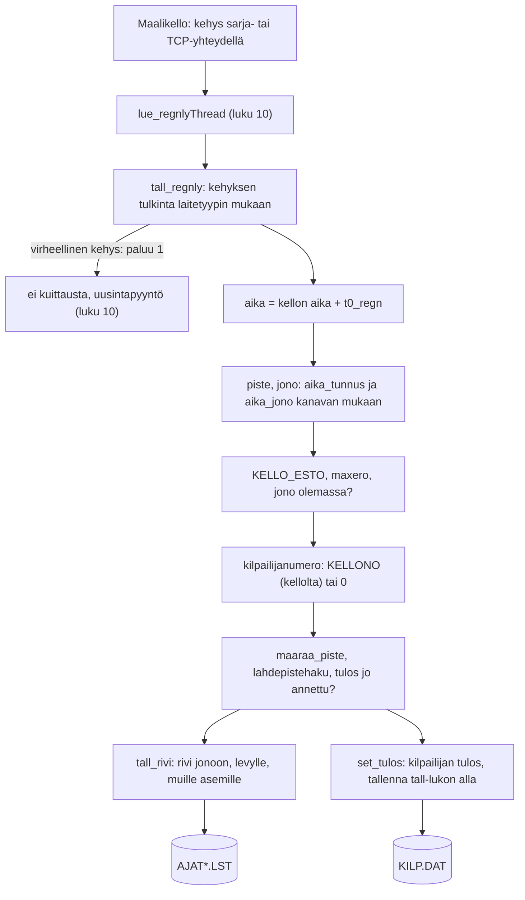

# 04 Ajanotto: kellot, lähtö, maali, väliajat ja aikajonot

<!-- malli: Käsikirjan lukupohja (K-3). Ohje: doc/tietopohja/laatu/k3-kirjoittajan-ohje.md.
Luvun 5 vikaluettelo generoidaan tiedostosta kasikirja/toiminnot.csv komennolla
python -I doc/arkkitehtuuri/tyokalut/tietopohja.py . kasikirja; sitä ei kirjoiteta käsin. -->

> **Tila:** alustava K-3-aineisto, ei riippumattomasti tarkastettu. Lähderevisio: tuotantokoodi
> `f7fe553` (ennallaan, `doc/arkkitehtuuri/CHECKPOINT.md`). Varmuusmerkinnät: [todennettu],
> [päätelty], [tuntematon]; "luettu käsikirjaa varten" = luettu koodista K-vaiheessa, ei tarkastettu.

Luku kuvaa, miten ohjelma ottaa vastaan ja tallentaa ajat: lähtöajat, maaliajat ja väliajat.
Emit-kortin luenta ja leimantarkastus ovat luvussa 05, laitteiden yhteydet (sarjaportti, TCP,
laitteiden protokollat) luvussa 10. Polut ovat suhteessa hakemistoon `TPsource/V52/`.
Lyhenteet: HKM = HkMaali, HKW = HkKisaWin, VM = ViestiMaali, VW = ViestiWin, VL = ViestiLuenta.

## 1. Mitä tapahtuu

### 1.1 Peruskäsitteet

- **Aika** tallennetaan yksikössä 1/10 000 s (`AIKAJAK`, `Tp/TpDef.h:87`). Viimeinen desimaali ei
  käyttöohjeen mukaan sisällä todellista ajanottotietoa; sen avulla samalla millisekunnilla otetut
  ajat pysyvät keskenään järjestyksessä [AA: käyttöohje `hkkisawin/5.1_maalikellon_kaytto.md`;
  koodi: `tall_rivi` kasvattaa aikaa yhdellä, kunnes se poikkeaa jonon aiemmista, `Hk/HkAjat.cpp`
  kohta "varmista, että aika poikkeaa" [luettu käsikirjaa varten, ei tarkastettu]].
- **Ajanottojono** (`aikajono[ino]`, tiedosto `AJAT*.LST`) on aikajärjestyksessä oleva luettelo
  kaikista otetuista ajoista. Yksi rivi (`aikatp`) sisältää ajan (`t`) ja päivän (`date`),
  kilpailijanumeron (`kno`, 0 = ei vielä kohdistettu), pisteen (`piste`), tunnisteen (`badge`),
  lukijan kanavan (`kanava`), jonon (`jono`) ja tilan (`status`); HK:ssa lisäksi tapahtuman
  (`tapahtuma`), viestissä osuuden ja lähteen (`Hk/HkDef.h:937-947`; viestin kentät luettu
  `Juk/VIv.cpp` käytöstä) [luettu käsikirjaa varten, ei tarkastettu].
  Jonoja on HK:ssa enintään 4 (`MAXJONO`, `Hk/HkDef.h:74`) ja viestissä enintään 24
  (`Juk/VDef.h:36`) [todennettu: koodi]. Käyttöohje sanoo todellisen määrän näkyvän
  valikossa *Help/Tiedot*.
- **Piste** kertoo, mihin kilpailijan tulokseen aika kuuluu: `-1` (kirjain `L`) lähtö, `0` (`M`)
  maali tai viestissä vaihto, `1...` väliaikapiste, `-2` (`A`) = ohjelma päättelee pisteen
  automaattisesti [AA: käyttöohje `5.3`, `5.7`; koodi `piste = -2` `Hk/HkIV.cpp:1986`].
- **Kilpailijan tulos** on eri asia kuin jonon rivi. Jonon rivi on lähde, kilpailijatietueen
  tulos (`set_tulos`, viestissä `setMaali`) on sen perusteella laskettu tieto. Ne tallennetaan
  eri kutsuilla: ensin rivi (`tall_rivi`), sitten kilpailija (`tallenna`) [luettu käsikirjaa
  varten, ei tarkastettu: `Hk/HkIV.cpp:2998-3030`].

### 1.2 Mistä ajat tulevat

| Lähde | Miten aika syntyy | Funktio, jonon rivi |
|---|---|---|
| Maalikello (ALGE Timy, S3, S4, Comet, ASC, TDC, ARES, Emit RTR1 ja RTR2) | kello lähettää ajan sarja- tai TCP-yhteydellä; ohjelma lisää kellon ja tietokoneen kellon erotuksen (`t0_regn`, `AIKAERO`) | `lue_regnlyThread` → `tall_regnly` (`Hk/HkIV.cpp:1984`, viesti `Juk/VIv.cpp:1762`) → `tall_rivi` |
| Tietokoneen kello, näppäin | käyttäjä painaa ajanottonäppäintä (esimerkiksi F12) | `tee_aika` (`Hk/HkIV.cpp:3725`, viesti `Juk/VIv.cpp:2547`) tai GUI:n `lisaa_aika` (`Hk/HkAjat.cpp:298`) |
| Tietokoneen kello, CTS-signaali | sarjaportin CTS-nousureuna (valokenno, lähtöportti) | `comajanotto` (`Tp/TpLaitteet.cpp:2405`) → `tee_aika(1)` |
| Tunnistinlukija (Emit-lukija, emiTag, RFID) | tunnisteen luku antaa ajaksi tietokoneen kellon tai lukijan oman ajan | `tall_etulos` (`Hk/HkIV.cpp:597`) → `tall_rivi` |
| Emit-kortti, maali | kortin tai Emit-kellon maaliaika | `pros_emit` (luku 05) → `tall_rivi` |
| Toinen työasema | AIKAT-paketti | `tark_aika` (`Hk/HkCom32.cpp:400`) → `tall_rivi` |
| Väliaikapaketti | emiTag-palvelin tai SendECodes-ohjelma (`YHTEYSAJAT`) | `tall_ec` (`Hk/HkIV.cpp:3410`) |
| Käsin syöttö | käyttäjä kirjoittaa ajan tai muokkaa riviä | GUI `TFormAjanotto`, konsolin `ajanotto()` |

[AA: `doc/arkkitehtuuri/saikeet-ja-lukot.md` luku 3 (`comajanotto`); `riippumaton: osaD-laitteet.md`
luvut 1-2 (laitteet); funktiot ja rivit luettu käsikirjaa varten, ei tarkastettu.]

### 1.3 Mitä `tall_rivi` tekee

`tall_rivi` on ainoa funktio, joka kirjoittaa ajanottojonoon (`Hk/HkAjat.cpp:114`, viestissä
`Juk/vajat.cpp:103`) [luettu käsikirjaa varten, ei tarkastettu]. Kaikki edellä olevat lähteet
päätyvät sen kautta jonoon.

1. Jos jonoa ei ole alustettu (`mxtime == 0`), funktio palaa virhekoodilla 1.
2. Funktio ottaa `ajat`-lukon (jollei kutsuja jo pidä sitä).
3. **Korvaus tai poisto.** Jos kutsuja antaa vanhan rivin (`vtm`), funktio etsii jonosta rivin,
   jolla on sama aika, kilpailijanumero ja piste (tai piste `A`), ja poistaa sen. Jos riviä ei
   löydy eikä kutsu tule toiselta työasemalta, tallennus peruutetaan viestillä "Tallennus ei onnistu".
4. **Lisäys.** Uusi rivi sijoitetaan aikajärjestykseen. Jos jonossa on jo rivi, jolla on sama aika
   ja sama kilpailijanumero ja tunniste, uutta riviä ei lisätä (tulkitaan aiemman tiedon toistoksi).
   Jos aika on sama mutta muu tieto poikkeaa, aikaa kasvatetaan yhdellä (1/10 000 s), kunnes se on
   yksilöllinen. Jos jono on täynnä (`rwtime >= mxtime`), ilmoitus on "AIKATAULUKKO TÄYSI" eikä
   rivi tallennu.
5. `writeajat` kirjoittaa muuttuneet rivit levylle (`AJAT*.LST`). Kirjoitusvirhe tuottaa ilmoituksen,
   mutta kutsuja ei saa tietoa siitä (H-146; ks. kohta 4).
6. Jos jono muuttui, funktio päivittää näkyvät rivit (`haeAktAjat`), ajanottonäytön ja lähettää
   muutoksen muille asemille (`laheta_aika`, kohta 1.8).

`tall_rivi`n paluuarvoa ei tarkisteta GUI:n ajanottokaavakkeella (H-117), ja `tall_regnly` tallentaa kilpailijan tuloksen rivin lisäyksestä
riippumatta [luettu käsikirjaa varten, ei tarkastettu].

### 1.4 Maalikellon aika (HK) ja sen kulku

Aikajono täyttyy `tall_regnly`ssa, kun maalikello lähettää kehyksen. Alla HK:n järjestys
(`Hk/HkIV.cpp:1984-3060`) [luettu käsikirjaa varten, ei tarkastettu, ellei toisin mainita].

1. **Kehyksen tulkinta.** Jokaisella laitetyypillä on oma jäsennys (Timy, ALGE S3 ja S4, Comet,
   ASC, ARES, RTR1, RTR2, RADIOEMIT, Sirit, Zebra, Impinj, FEIG). Virheellisestä kehyksestä
   funktio palaa arvolla 1 [todennettu: osaD luku 2 "Generic"; laitteiden kehykset ja kuittaukset
   luvussa 10].
2. **Aika.** Kellon antamaan aikaan lisätään `t0_regn[r_no]` (kellon poikkeama tietokoneen
   kellosta; asetus `AIKAERO` ja kellokohtaiset siirtymät). Päivän vaihtuminen: osaD A12
   [päätelty]: päivän siirtymä on käsin asetettava, laitteen uudelleenkäynnistystä ei havaita.
3. **Piste ja jono.** Kellon kanava (esimerkiksi Timyn `d` = 0...8 tai RTR2:n tulo) kuvautuu
   pisteeksi ja jonoksi taulukoilla `aika_tunnus[r_no][kanava]` ja `aika_jono[r_no][kanava]`.
   Taulukot täytetään asetuksilla `PISTEET=` ja `JONOT=` tai ajanottokaavakkeen
   määrittelyillä (kohta 3). `PISTEET=MMMLM1` tarkoittaa, että kolme ensimmäistä kanavaa ovat
   "muut ajanottotavat" (`M`), kanava 4 antaa lähtöajan (`L`), kanava 5 maalin (`M`) ja kanava 6
   ensimmäisen väliajan [AA: käyttöohje `5.1`].
4. **Jono.** Jonon numero on `jono`, jos useampi jono on käytössä (`maxjono > 0`); muuten lähtöajat
   (`piste = -1`) menevät jonoon 1, jos `lajatfl` on päällä, ja muut jonoon 0. Jos jonoa ei ole
   käynnistetty, ilmoitus on "AJANOTTOA EI KÄYNNISTETTY, MUTTA YRITETÄÄN KÄYTTÄÄ" eikä aikaa
   tallenneta; sama koskee täyttä jonoa.
5. **Suodatus.** `KELLO_ESTO`: jos samalta lukijalta ja samaan jonoon tulee aika asetuksen
   mukaisessa ikkunassa edellisen jälkeen, kehys kuitataan ja ohitetaan. RTR-perheen kellolla
   `maxero` (kellon ja tietokoneen kellon suurin sallittu ero): ensimmäinen kehys, jonka ero ylittää
   rajan, hylätään (paluu 1) ja kello pyytää uudelleen; seuraava hyväksytään. Kelloero ilmoitetaan
   kehyksellä `G`.
6. **Kilpailijanumero.** Jos kello lähettää numeron ja asetus `KELLONO` (tai `REGNLYNO`,
   `COMETNO`, `TIMYNO`, `ASCNO`) on päällä, `kno` otetaan kehyksestä. RFID-lukijoilla
   (Sirit, Zebra, FEIG, Impinj) `kno` haetaan tunnisteesta (`bdg2kno`). Muuten `kno` on 0 ja jono
   saa rivin ilman kilpailijaa; kohdistus tehdään käsin (kohta 1.6) tai tunnisteesta (kohta 1.5).
7. **Pisteen päättely.** Jos piste on `-2`, `maaraa_piste` (`Hk/HkApu.cpp:314`) päättelee sen
   kilpailijan jo kirjatuista väliajoista, asetuksista `VAVUOROT`, `SAMAPISTE` ja
   sarjan väliaikapisteiden aikarajoista (kohta 1.7). Asetus `lahdepistehaku`
   (`LÄHDEPISTEET`) valitsee pisteen lähdekoodin perusteella (kohta 1.7).
8. **Tulos jo annettu.** Jos kilpailijalla on jo aika samalle pisteelle, uutta tulosta ei kirjoiteta,
   ellei sitä salli `UUSINAIKA` (aika korvataan, kun uusi aika on enintään asetetun sekuntimäärän
   päässä aiemmasta) tai `ESTÄYLIM` (kohta 4). Ilmoitus on "TULOS JO ANNETTU". Ajan
   rivi tallennetaan jonoon silti.
9. **Tallennus.** `tall_rivi` kirjoittaa rivin jonoon (kohta 1.3). Sen jälkeen, jos tulos
   muuttui (`tall_fl`), `kilp.tallenna` kirjoittaa kilpailijan `tall`-lukon alla ja lähettää
   muutoksen muille asemille. Järjestys on siis rivi ensin, kilpailija toiseksi.

Viestin `tall_regnly` (`Juk/VIv.cpp:1762-2230`) noudattaa samaa pääajatusta mutta määrää lisäksi
osuuden (kohta 1.9).

**Maalikellon tilakehykset (HK).** Timy-kehykset tunnuksilla `c`, `h`/`H`, `k`/`K` ja `e`/`E`:
`c` poistaa kilpailijattoman rivin (ajan peruutus), muut asettavat kilpailijalle tarkastusmerkinnän
H, K tai E, kun `KELLONO`-tyyppinen numerointi on käytössä (`Hk/HkIV.cpp:2348-2370`) [luettu
käsikirjaa varten, ei tarkastettu; merkkien alkuperä laitteessa on aineistosta tuntematon].

### 1.5 Tunnistimeen perustuva ajanotto

Kun aika otetaan Emit-lukijan, emiTagin tai RFID-lukijan luennasta, `tall_etulos`
(`Hk/HkIV.cpp:597`) tekee seuraavaa [luettu käsikirjaa varten, ei tarkastettu; asetusten merkitys
käyttöohjeesta `5.2`, `5.3`]:

1. Aika on tietokoneen kello luentahetkellä (neljä ensimmäistä tulokanavaa) tai lukijan oma
   luentahetki (SjBox-yhteyden vaihtoehdot 5 ja 6: koodi ja luentahetki sekä lähdekoodi).
2. Piste päätellään `AIKALUKIJAx=VAINz`-asetuksella (kiinteä piste tai `A` = ensimmäinen
   väliaika ilman aikaa) tai tiedoston `lahdepisteet1.lst` rivien perusteella
   (`haelahdepiste`, `Hk/HkIV.cpp:335`). Tiedoston rivi on `sarja piste koodit`, ja
   lähdekoodi 1...9999 vie ajan määrättyyn pisteeseen; sama koodi voi esiintyä usealla
   pisteellä, jolloin ensimmäinen vapaa piste valitaan [AA: käyttöohje `5.3.1`].
3. Pisteeksi voi tulla `-1` (lähtö, kirjain `L`) vain, kun asetus `PAKOTALAIKA` on annettu tai
   hiihtolähtö on käytössä. `PAKOTALAIKA`: ensimmäinen lähtöajaksi tunnistettu luku hyväksytään
   aina; myöhemmät vain `PAKOTALAIKARAJA`-sekuntien rajoissa (`pakotalaika_hyvaksy`,
   `Hk/HkIV.cpp:589`).
4. Aika tallennetaan kilpailijalle vain, jos kilpailijan lähtöaika on olemassa ja pisteelle ei ole
   vielä aikaa (tai `UUSINAIKA` sallii korvauksen). Aika tallennetaan jonoon joka tapauksessa.
5. Jos asetus `ESTÄNEG` on päällä ja aika on lähtöajasta negatiivinen tai yli 20 tuntia, aika
   hylätään kokonaan (`return` ilman jonoriviä).

`TUNNJONO`: kun asetus on annettu, tunnistinjono toimii vain kilpailijan tunnistamiseen
(esimerkiksi valokennon ottaman ajan kohdistamiseen), ja aika kohdistetaan kilpailijalle jonosta
(`tunn_hae_aika`, `tunn_hae_kno`; `Hk/HkIV.cpp:470-545`) [AA: käyttöohje `hkliite1.md:148`].
Tässä tilassa `tall_regnly` ottaa `ajat`-lukon ehdollisesti ja saattaa jättää sen vapauttamatta
(H-090, ks. kohta 4).

### 1.6 Käsin syöttö ja korjaus

**GUI (HKW, VW).** Ajanottokaavake (`TFormAjanotto`) näyttää kaksi taulukkoa: ylempi selattava ja
muokattava, alempi uusimmat ajat. Käyttäjä voi (käyttöohje `hkkisawin/5.6`, `viestiwin/5.1`)
[AA: käyttöohje; toiminta luettu käsikirjaa varten, ei tarkastettu]:

- ottaa ajan näppäimellä, jonka valitsee valikosta (esimerkiksi F12 tai §): aika on tietokoneen
  kello (`lisaa_aika`);
- kirjoittaa kilpailijanumeron, osuuden ja pisteen riville: numerot voi syöttää ennakkoon ja
  ohjelma poimii ne järjestyksessä seuraaville ajoille (`IkkParam.SyottoTila`; vain, kun piste
  on kiinteä);
- muokata riviä (aika, päivä, numero, piste) ja tallentaa painikkeella *Tallenna muutos*:
  `tall_rivi` korvaa rivin ja kilpailijan tulos päivitetään (`BtnTall2Click`,
  `cbHk/UnitAjanotto.cpp:620-690`); vanhan kilpailijan tulos tyhjennetään, jos aika vastaa
  vanhan rivin aikaa;
- poistaa rivin (`poista_aika`, `tall_rivi` ilman uutta riviä);
- F11: uusi rivi, jonka aika on aktiivisen rivin yläpuolella olevan ajan kanssa sama
  (käyttöohje).

**Konsoli (HKM, VM).** Ajanottonäyttö `ajanotto()` (`HkConsole/HkCons2.cpp:1502`) käyttää
samoja `tall_rivi`-kutsuja; kilpailijanumero syötetään rivin kohdalla, `S` antaa koko sarjalle
lähtöajan (`asetaSrjLahto`), `R` erälle (`asetaEraLahto`), `T` tallentaa riville erikoisnumeron 10000 ja pisteen 0 (merkitystä ei ole
dokumentoitu aineistossa) [luettu käsikirjaa varten, ei tarkastettu].

**Tunnetut GUI-viat.** H-111 (puuttuva `else` muuttaa A- ja L-rivit maalirivyksi, kun ne tallennetaan
paneelin *Tallenna muutos* -painikkeella), H-117 (piste yli sarjan väliaikapisteiden tyhjentää
vanhan tuloksen), H-121 (ViestiWinin Ctrl+Enter-pakotus ei toimi) ja H-102 (`getpos` ilman lukkoa
vaiheen vaihdossa) koskevat tätä kohtaa; ne luetellaan luvun 5 generoidussa luettelossa.

### 1.7 Lähtöaika, väliaikapisteet ja pisteen päättely

**Lähtöaika (HK).** Kilpailijan lähtöaika (`tlahto`) on arvonnasta tai käsin annettu suunniteltu
aika. Maalikellon tai tunnistimen antama lähtöaika (`piste -1`) ei korvaa sitä, ellei jokin
seuraavista ole voimassa: hiihtolähtö (`hiihtolahto`), `PAKOTALAIKA` tai erälähtö [luettu
käsikirjaa varten, ei tarkastettu]:

- **Hiihtolähtö.** `lahtija` etsii kilpailijan, jonka suunniteltu lähtöaika on lähtöikkunan
  (`tunn_raja`, asetus `LÄHTÖIKKUNA=x` sekunteina; käyttöohjeen mukaan oletus 3 s molempiin
  suuntiin) sisällä (`Hk/HkIV.cpp:154`, `Hk/HkInit.cpp:1924`); aika tallennetaan hänelle
  lähtöajaksi. Jos ikkunaan osuu useampi kilpailija, ensimmäinen valitaan [päätelty: silmukka
  palauttaa ensimmäisen osuman].
- **Erälähtö ja lähtöryhmä.** Asetus `LÄHTÖRYHMÄ=n` ja erän numero (konsolissa Ctrl-E, GUI:ssa
  valikko): yksi lähtösignaali kirjataan kaikille erän osanottajille. Rivit saavat peräkkäiset
  ajat (aika + 1/10 000 s jokaiselle) (`Hk/HkIV.cpp:2986-2999`). Ratakohtaiseen ajanottoon
  (uinti) tarkoitettu tapa kuvataan käyttöohjeessa `5.7`.
- **Sarjalle tai erälle käsin:** `S` ja `R` ajanottonäytöllä (kohta 1.6).

**Väliaikapisteen päättely.** Kun aika kuuluu kilpailijalle mutta pistettä ei tiedetä
(`piste = -2`), sen valitsee `maaraa_piste` (`Hk/HkApu.cpp:314`) [luettu käsikirjaa varten, ei
tarkastettu; asetukset käyttöohjeesta `5.3.2`]:

- `VAVUOROT` (tai `AIKALUKIJA=VAINA`): ensimmäinen piste, jolle ei vielä ole aikaa, ja viimeisenä
  maali. `VAINVÄLIAJAT` kieltää maalin; `VAVUOROT=sama/ala/ylä` rajaa pisteiden alueen.
- `SAMAPISTE` / `VAVUOROT`-arvo `sama` (oletus 10 s): jos edellisestä saman kilpailijan ajasta on
  kulunut tätä vähemmän, uusi aika kohdistetaan samalle pisteelle (vuorotteleva leimaus).
- Sarjan väliaikapisteiden aikarajat (`va_raja`, `tul_raja`): vertailu edellisestä pisteestä
  kuluneeseen aikaan. `VAINALARAJAT` ja `VAINALARAJAT=EI` vaihtavat vertailun suunnan.
  Muissa lajeissa kuin suunnistuksessa ohjelma voi jättää pisteitä väliin, kun kuluneen ajan
  alaraja ylittyy [AA: käyttöohje `5.3.2`].
- Hiihtolähdössä aika voidaan tulkita lähtöajaksi, kun tulos on lyhyempi kuin ensimmäisen
  väliaikapisteen aikaraja (`hiihtolahto`).

**Lähdepistetiedostot.** `lahdepisteet1.lst` (vaiheessa n `lahdepisteet<n>.lst`) liittää lähdekoodin
pisteeseen: rivi `sarja piste koodit`, `piste` = numero, `M` tai `0` = maali, `L` tai `-1` = lähtö.
`lahdejonot.lst` on samanrakenteinen mutta pisteen sijasta jonon numero. Tiedoston luku:
`luelahdepisteet` (viestissä `Juk/VIv.cpp:159`), `luelahdejonot`. HK:ssa laskenta- ja
täyttökierros eroavat, kun sarjan `valuku` on enintään 2 (H-074) [AA: käyttöohje `5.3.1`,
H-074; luettu käsikirjaa varten].

### 1.8 Aikajonojen välitys muille työasemille

Muutos jonoon lähetetään muille asemille AIKAT-paketilla (`laheta_aika`, `Hk/HkCom32.cpp:356`;
paketin luokka `AIKAT`, paketissa pakotuslippu sekä kaksi `aikatp`-tietuetta)
[luettu käsikirjaa varten, ei tarkastettu; luokka mainitaan `yleiskuva.md`:ssä]. Paketti
sisältää vanhan rivin (`daika`) ja uuden rivin (`iaika`), joten vastaanottaja voi korvata rivin.

- Paketti lähtee vain yhteydelle, jolle on annettu asetus **`LÄHAIKAy`** (tai `LÄHAIKAy=V`, jolloin
  yhteydelle lähtee **vain** AIKAT-paketteja: `com_ajat == 2`). `y` on yhteyden numero kuten
  `YHTEYSy`-asetuksessa. Lähettäjä ei lähetä pakettia takaisin yhteydelle, josta muutos tuli
  (`kielto`); kun muutos tuli toiselta yhteydeltä, paketti ei mene myöskään yhteyksille, joilla
  `estavalitys` on päällä (`Hk/HkCom32.cpp:371-372`).
- **Vastaanotto:** `tark_aika` (`Hk/HkCom32.cpp:400`) ottaa paketin vastaan, jos yhteydellä on
  `com_ajat`. Se ohjaa rivin jonoon `ino` paketin jononumeron (`jono`-kenttä) mukaan ja kutsuu
  `tall_rivi`ä. Vastaanotto kirjoittaa **vain jonon rivin**; kilpailijan tulos tulee erikseen
  KILPPVT- tai VAIN_TULOST-paketilla, jos lähettäjän asema lähetti ne (luku 05, aineisto G2)
  [luettu käsikirjaa varten, ei tarkastettu; päätelty, ettei `tark_aika` muuta kilpailijaa].
- Ennen kuin ajastin (`timerfl`) on käynnistynyt, vastaanotettavat AIKAT-paketit ovat jonossa
  (enintään 30); jonon puskurin siirtymä on väärä (H-035), mutta polku on päätelty
  tavoittamattomaksi toimitetuissa HK-ohjelmissa (riskiarvion saavutettavuus: ei toimitetussa).
- **`YHTEYSAJAT` (tai `VA-AJAT`):** ottaa käyttöön yhteyden kautta saapuvat väliaikapaketit
  (`tall_ec`). `LÄHECODEy` välittää ne eteenpäin yhteydelle [AA: käyttöohje `hkliite1.md:151-152`].
- Lähetys, jonoon laitto, kuittaus ja vastaanottajan käsittely ovat eri asioita (luku 05,
  aineisto luku 8.2). Aikajonon muutoksen kuittaus tarkoittaa vain, että paketti on vastaanottajan
  muistissa.

Viesti käyttää samaa ajatusta (`Juk/VCom.cpp:487` `tall_rivi(ino, &ia, &da, ...)`;
lähdeyhteyden esto jää pois, kun `com_ajat == 3` [päätelty koodista]). ViestiWinin
ajanottolomakkeen pakotettu uudelleenlähetys (Ctrl+Enter) ei toimi (H-121).

### 1.9 Viestin erityispiirteet

Viestissä aika kuuluu **osuudelle**, ja `tall_regnly` päättelee osuuden ja pisteen
(`Juk/VIv.cpp:1762-2230`; apufunktiot `haeseurosuus`, `haeseurpiste`, `haejoustoosuus`)
[luettu käsikirjaa varten, ei tarkastettu; asetukset käyttöohjeesta `viestiwin/5.4`-`5.5`]:

- **Osuus.** Asetukset `OSUUSOLETUS=` ja `OSUUSRAJA=` (`ol_osuus`, `os_raja`; `Juk/VInit.cpp:1359-1376`) kiinnittävät osuuden tai rajaavat valinnan. Muuten ohjelma valitsee
  joukkueen ensimmäisen osuuden, jolta puuttuu maaliaika (ei keskeyttäneeltä tai hylätyltä
  osuudelta, `stschind(Tark, "KH")`). Jos tunniste (`badge`) on osuuden koodi, osuus valitaan sen
  mukaan. Kun kaikki osuudet ovat valmiita, viimeinen osuus vaihdetaan ("TULOKSET JO ANNETTU,
  VIIMEINEN VAIHDETAAN").
- **Joustoviesti** (`JOUSTOVIESTI`): osuuden valinta tunnisteesta; jos edellinen aika poikkeaa
  alle `ylimraja + 1 s`, aika kuuluu edelliselle osuudelle, muuten ensimmäiselle ilman aikaa
  olevalle osuudelle, ja tunnisteen kautta haetaan juoksijan nimi (`haejoustoosuus`,
  `Juk/VIv.cpp:1733-1760`).
- **Piste.** Jos pistettä ei ole annettu, `haeseurpiste` valitsee ensimmäisen väliajan, jolle
  ei ole aikaa, ja kun väliajat ovat täynnä, vaihdon/maalin. Asetus `VUOROMAALI` kieltää maalin
  automaattivalinnassa; `SAMAPISTE` on sama kuin HK:n vastaava (oletus 10 s).
- **Varoitukset.** "OSUUS ON JO MERKITTY EI LÄHTENEEKSI" ja "POIKKEAVAN HYVÄ OSUUSAIKA"
  (osuusaika alle sarjan `varkynnys`-rajan tai yli 20 tuntia) ilmoitetaan, mutta aika tallennetaan.
- **Lähtöaika.** Yhteis- ja erälähdöt (`5.5`) kirjataan lähtöajoiksi jonoon (piste `L`);
  `LÄHTÖRYHMÄ=n` lisää n peräkkäistä riviä samalla signaalilla. Yhteislähtöjen automaattinen
  merkintä (`Tulospalvelu / Yhteislähdöt`) ja vaihdon sulkemisaika ovat tulosten laskentaa
  ja kuuluvat muihin lukuihin.
- **Ajanottolomake ja jonot.** Viestin ajanottokaavake (`ViestiWin/UnitAjanotto.cpp`) kirjoittaa
  paneelin kautta tallennettaessa pelkän jonorivin; päivittääkö viestin ydin joukkuetietueen,
  on avoin (Q76).

### 1.10 Aikajonojen vertailu

Kaavake *Aikajonojen vertailu* (HK `cbHk/UnitAikavert.cpp`, konsoli `AIKAVERT`/`VERTRAJAT=`,
viestissä käyttöohje `5.6`) näyttää kaksi jonoa rinnakkain ja merkitsee poikkeamat värillä. Se on
tarkoitettu ensisijaisen ajanoton ja vara-ajanoton vertailuun [AA: käyttöohje `hkkisawin/5.8`].
Kaavakkeella voi poistaa ja lisätä rivejä; lisätyn rivin jatkokäsittely tehdään tavallisella
ajanottokaavakkeella. Vertailun sisäistä logiikkaa ei ole luettu.

### 1.11 Käyttö lähtökellona

Tilannenäyttö, jossa valitaan *Lähtö* ja *Seuraa lähtöjä*, näyttää lähtijät ja antaa äänimerkit
[AA: käyttöohje `hkkisawin/5.9`]. Tämä ei kirjoita ajanottojonoon; ominaisuuden toteutusta ei ole
luettu.

## 2. Erot ohjelmien välillä

| Asia | HKM | HKW | VM | VW | VL |
|---|---|---|---|---|---|
| Tyyppi | konsoli | GUI | konsoli | GUI | konsoli (supistettu käännös, `LUENTA`) |
| Aikajonojen määrä (`MAXJONO`) | 4 | 4 | 24 | 24 | 24 [päätelty: `Juk/VDef.h`] |
| Ajanottokaavake | konsolin `ajanotto()` | `TFormAjanotto` | konsolin ajanottonäyttö (`JukConsole`) | `TFormAjanotto` | ei |
| `tall_regnly` (kellojen vastaanotto) | kyllä | kyllä | kyllä | kyllä | `#if !defined(LUENTA)`: runko käännetty pois [luettu: `Juk/VIv.cpp:1764`] |
| Maalikellotuki | Timy, ALGE S3, S4, Comet, ASC, TDC, ARES, RTR1, RTR2, RADIOEMIT | sama | ALGE, ALGE4, Comet, Timy, RTR (ei ARES, ASC, TDC, RADIOEMIT) | sama kuin VM | ei (ks. kohta 3) |
| `AIKA_COM` (CTS-pulssi) | kyllä | kyllä | kyllä | kyllä | ei (`NOCOM_AIKA`) |
| Tunnistinajanotto (`tall_etulos`) | kyllä (`EMITLEIMAT`) | kyllä | kyllä (`Juk/VIv.cpp:539`) | kyllä | ei |
| Osuus | ei | ei | kyllä | kyllä | - |
| `PAKOTALAIKA`, `LÄHTÖIKKUNA`, hiihtolähtö | kyllä | kyllä | ei (viestin vastine `LÄHTÖRYHMÄ`, `PISTE`) | ei | - |
| Aikajonon tiedosto | `AJAT*.LST`, otsake `AJAT_V<n>`, tietue 22 tavua | sama | sama otsake, tietue 24 tavua | sama | - |
| `TUNNJONO`, `UUSINAIKA`, `ESTÄYLIM`, `ESTÄNEG` | kyllä | kyllä | `UUSINAIKA`, `ESTÄNEG`, `ESTÄYLIM` kyllä | kyllä | - |
| `ENNAKOI` (ennakkonumerot konsolissa) | kyllä | ei (GUI:ssa oma ennakkosyöttö) | kyllä | ei | ei |
| Aikojen vertailu | `AIKAVERT`, konsoli | GUI-lomake | ei (`AIKAVERT` vain HKM) | GUI-lomake (käyttöohje `5.6`) | - |

[Perusta: osaD luku 3 ja `valitsimet.csv` (`ENNAKOI`, `AIKAVERT`, `TESTIAJAT`); relay-asetusten
tunnistus `asetusavaimet.csv`; tiedostomuodot `tiedostomuodot.md` "AJAT-jono"; muut rivit luettu
käsikirjaa varten.] Käännösvalitsimien yhteenveto kohdassa 3. VM:n ja VW:n vastaavuus on
päätelty yhteisestä lähdekoodista (`Juk/`), jolloin GUI-lomakkeet (`ViestiWin/UnitAjanotto.cpp`)
ovat HK:n kopioiden erkaantuneita haaroja (T-034) [AA: T-034].

Jonon tiedoston koko on yksi syy, miksi HK:n ja viestin AJAT-tiedostot eivät ole keskenään
vaihdettavissa: HK:n tietue on 22 tavua ja viestin 24 tavua (`tiedostomuodot.md`).

## 3. Asetukset ja käännösvalitsimet

Asetusten nimet käyttöohjeesta (`hkkisawin/hkliite1.md`, `hkkisawin/5.x`, `viestiwin/5.x`); avainten
jäsentimet: `rekisteri/asetusavaimet.csv`. Ohjelmat: HK = HKM ja HKW, viesti = VM, VW ja VL
(jäsennin `Juk/VInit.cpp` on yhteinen; VL:n osalta ks. T-052).

| Asetus | Ohjelmat | Vaikutus | Lähde |
|---|---|---|---|
| `TIMYx=n`, `ALGE=n`, `ALGE4=n`, `COMET=n`, `ASC=n`, `ARES`, `REGNLYx=n/...` | HK; viestissä ALGE, ALGE4, COMET, TIMY, REGNLY | kellon tyyppi ja portti (luku 10) | `Hk/HkInit.cpp:1625-1850`, `Juk/VInit.cpp:1514-1625` [AA: osaD luku 1] |
| `KELLOBAUD=` | kaikki paitsi VL | maalikellon siirtonopeus | [AA: asetusavaimet.csv; osaD luku 6] |
| `PISTEET=`, `PISTE=` | HK; viestissä `PISTEET=` ja `PISTE=` | kanavien tai oletuspisteen käyttötarkoitus (`M`, `L`, `A`, numero; `/kaikki`, `/vain`) | [AA: käyttöohje `5.1`, `5.7`] |
| `JONOT=` | HK ja viesti | kanavien jonot | [AA: käyttöohje `5.1`] |
| `AIKALUKIJAx=VAINz` / `LÄHDEz`, `LÄHDEPISTEET`, `LÄHDEJONOT` | HK ja viesti | tunnistinlukijan ajan piste ja jono | [AA: käyttöohje `5.2`, `5.3`] |
| `VAVUOROT[=sama/ala/ylä]`, `VAINVÄLIAJAT`, `VAINALARAJAT[=EI]` | HK; viestissä `SAMAPISTE`, `VUOROMAALI` | pisteen päättely | [AA: käyttöohje `5.3.2`] |
| `UUSINAIKA[=n]` | HK ja viesti | uusi aika korvaa aiemman, oletus 120 s | [AA: käyttöohje `5.3.2`] |
| `ESTÄNEG`, `ESTÄYLIM`, `YLIMRAJA` | HK ja viesti | negatiivisen tai haamuajan ja kilpailijan toisen ajan esto; `ESTÄYLIM`: ajanottorivin tallennus estetään, kun kilpailijalla jo tulos | `Hk/HkIV.cpp:2870-2935` [luettu] ja käyttöohje `hkliite1.md:144` |
| `KELLO_ESTO=`, `AIKA_ESTO=`, `AIKA_COM=` | HK ja viesti; `AIKA_COM`/`AIKA_ESTO` ei VL | kaksoisaikojen esto; CTS-pulssi tietokoneen kellosta | [AA: osaD luku 1 "AIKA_COM"] |
| `AIKAERO`, `AIKAKORJAUSy=` | HK ja viesti | kellon siirtymä, jonokohtainen korjaus (`aikakorjaus`) | [AA: käyttöohje `hkliite1.md:130`; luettu `Hk/HkIV.cpp:3743`] |
| `PAKOTALAIKA`, `PAKOTALAIKARAJA=n`, `LÄHTÖIKKUNA=x` | HK | lähtöajan kirjaus tunnistimesta | [AA: käyttöohje `5.1`, `hkliite1.md:125-126`] |
| `LÄHTÖRYHMÄ=n` | HK ja viesti | erän osanottajamäärä | [AA: käyttöohje `5.7`] |
| `TUNNJONO[=y]`, `TUNNRAJAT=` | HK | tunnistinjono vain kilpailijan tunnistukseen | [AA: käyttöohje `hkliite1.md:148`] |
| `EMITAJAT[=n]` | HK ja viesti | kortilla määrätyt ajat jonoon n | [AA: käyttöohje `hkliite1.md:207`] |
| `AJAT=nimi`, `LÄHAIKAy[=V]`, `YHTEYSAJAT` / `VA-AJAT`, `LÄHECODEy` | HK ja viesti | jonotiedoston nimi; aikojen siirto yhteydelle | `Hk/HkInit.cpp:1301`, `:1501-1510` [luettu] |
| `JOUSTOVIESTI`, `VUOROMAALI`, `SAMAPISTE` | viesti | osuuden ja pisteen päättely | [AA: käyttöohje `viestiwin/5.4`] |
| `ENNAKOI` (käännösvalitsin) | HKM ja VM | ennakkonumeroiden syöttö konsolin ajanottonäytöllä | `valitsimet.csv` |

Käännösvalitsimet (projektien määritykset tarkistettu 2026-11-27 `VS/Hk/HkMaali/HkMaali.vcxproj`,
`VS/V/JukMaali520.vcxproj`, `VS/V/JukLuenta520.vcxproj`, `RADStudio10/HkKisaWin.cbproj`,
`RADStudio10/ViestiWin.cbproj`):

| Valitsin | Ohjelmat | Vaikutus ajanotossa |
|---|---|---|
| `MAALI` | kaikki (pakotettu; VW:ssä `BCC_Defines`) | ajanoton ja maalin koodi (`tall_regnly`, `tall_rivi`) mukana |
| `EMITLEIMAT` | kaikki (johdettu) | `tall_etulos`, `tall_elahto` (`#ifdef EMITLEIMAT`, `Hk/HkIV.cpp`) |
| `AUTOVA` | HKM, VM, HKW, VW | automaattiset väliajat (`tall_ec`, `Hk/HkIV.cpp:3373-3500`) |
| `VALUKIJA` | HKM, VM, HKW, VW | väliaikalukijan välitys; viestissä sisältää `AUTOVA` |
| `ENNAKOI` | HKM, VM | ennakkonumerot konsolin ajanottonäytöllä |
| `AIKAVERT` | HKM | konsolin aikavertailuruutu |
| `TESTIAJAT` | VM | Ctrl-T testiaikojen lähetys |
| `LUENTA` | VL | `tall_regnly` ja sen kutsuma ajanotto käännetään pois (`Juk/VIv.cpp:1764`); `NOCOM_AIKA` |
| `_CONSOLE` | HKM, VM, VL | konsolin ajanottonäyttö; GUI:ssa lomakkeet |
| `COMETNO` | ei missään [AA: `valitsimet.csv`] | kuollut: `tall_rivi`n lokirivin haara |
| `SWIM2000`, `TUTKA`, `SIIMPORT`, `EBA` | ei missään | kuolleet haarat `tall_regnly`ssa [AA: `valitsimet.csv`; osaD luku 1] |

`MILLISEKAJAT` pakotetaan päälle HK:ssa (`ominaisuusvalitsimet.md` luku 3; HKW:n projektissa
`Defines`-kentässä) [AA].

## 4. Vaihtoehtoiset polut ja virhetilanteet

| Tilanne | Mitä tapahtuu | Ohjelmat | Lähde |
|---|---|---|---|
| Ajanottojonoa ei ole alustettu | ilmoitus "AJANOTTOA EI KÄYNNISTETTY, MUTTA YRITETÄÄN KÄYTTÄÄ"; aika ei tallennu; kello kuittaa tai ei kuittaa laitetyypin mukaan (luku 10) | kaikki | [luettu] `Hk/HkIV.cpp:2777-2781`, `:3747-3749` |
| Jono täynnä | ilmoitus "AIKATAULUKKO TÄYSI"; `tall_rivi` palauttaa 1; `tee_aika` nollaa näppäinjonon | kaikki | [luettu] `Hk/HkAjat.cpp:233-236`, `Hk/HkIV.cpp:3754-3760` |
| Tallennus jonoon epäonnistuu levyllä | ilmoitus; kutsuja ei saa tietoa; epäonnistunut rivi jää tyhjäksi riviksi tiedostoon (alin mahdollinen aika) ja korjautuu vain, kun rivi tai aiempi rivi muuttuu tai vaihe vaihtuu (`fp1`) | HKM, HKW, VM, VW | [AA: H-146; `virheenkasittely.md` 12.3] |
| Jonotiedoston viimeinen tietue kirjoitetaan uudelleen | viestissä `mxtime-1` tietuetta: täydessä jonossa viimeinen katoaa; virhepolut sulkevat väärän kahvan | VM, VW (vika viestissä; HK:n vastaava `Hk/HkIV.cpp:4023`, `:4113`) | [AA: H-054] |
| Vaiheen vaihto | jonon nimipohja jää vanhaan vaiheeseen, kun jono luodaan vasta `inittimer`illä (ajanottolomake, emiTag, taulu); yksivaiheisessa kilpailussa nimestä poistuu 5. merkki | HKM, HKW | [AA: H-131, H-132] |
| Lopetus | `suljeajat` poistaa jonot ilman `ajat`-lukkoa, kun `tarkcom` voi vielä kutsua `tall_rivi`ä | HKM, HKW (kapea ikkuna viestissä) | [AA: H-095] |
| `TUNNJONO` ja `tall_regnly` | lukijasäie voi jättää `ajat`-lukon pysyvästi: käsiajanotto, vastaanotto ja vaiheen vaihto estyvät. Eristetyssä kokeessa neljä paluupolkua (`KELLO_ESTO`, kelloero, ei jonoa, täysi jono) ja kellon `G`-kehys jättävät lukon | HKM, HKW | [AA: H-090; `saikeet-ja-lukot.md`] |
| Tallennus paneelin *Tallenna muutos* -painikkeella | puuttuva `else`: A- ja L-rivit muuttuvat maalirivyksi; HK tyhjentää L-rivin lähtöajan ja kirjoittaa lähtökellon ajan maaliajaksi; viestissä vain jonoon | HKW (HK: L-rivit), VW (vain jono) | [AA: H-111] |
| Piste yli sarjan väliaikapisteiden | HK tyhjentää vanhan pisteen tuloksen mutta ei kirjoita uutta | HKW (viesti suojaa) | [AA: H-117] |
| Pakotettu uudelleenlähetys ViestiWinissä | `pakLah` menee `kielto`-paikkaan: pakotus ei toimi ja ensimmäinen yhteys ohitetaan | VW | [AA: H-121] |
| Kellon aika tulee ennen kuin ajastin on käynnistynyt | AIKAT-paketit puskuroidaan; puskurin siirtymä on väärä; polun on päätelty olevan tavoittamaton | HKM, HKW | [AA: H-035] |
| CTS-pulssi (`AIKA_COM`) ja vaiheen vaihto | `comajanotto` → `tee_aika` → `getpos` ilman `tall`-lukkoa; vaiheen vaihdon aikana väärä tai puuttuva kilpailija | HKM, HKW | [AA: H-102] |
| `AIKACOM=` (editorin kirjoittama avain) | jäsennin tuntee vain `AIKA_COM=`; asetus ei tule voimaan | HKW | [AA: H-173] |
| Vaihe vaihtuu kesken lukijasyötön | lukijan tunnistejono (`bdg_t`) voi menettää rivin; jonon vapautus ilman lukkoa | HKM, HKW | [AA: H-094, H-136] |
| Kello ja tietokone eri aikaa (RTR) | kehys `G` ilmoittaa eron; ensimmäinen ylitys hylätään | HK, viesti (RTR) | [luettu] `Hk/HkIV.cpp:2775`, `:3058` |
| Päivän vaihtuminen | `t0_regn` asetetaan käsin; laitteen uudelleenkäynnistystä ei havaita | kaikki | [AA: osaD A12; päätelty] |

**Kellon kuittaus ja jonoon tallennus.** Kellon kuittaus (`+`) kertoo, että `tall_regnly` palasi
arvolla 0. Se ei kerro, että aika on tallennettu jonoon tai kilpailijalle: aika voidaan hylätä
ilmoituksella (jono täynnä, ei alustettu), `KELLO_ESTO` ohittaa kehyksen paluuarvolla 0, ja
`tall_rivi`n kirjoitusvirhe ei välity [päätelty luetuista paluuarvoista; AA: osaD luku 4, H-146].

## 5. Tunnetut viat tässä toiminnossa

<!-- generoitu:viat alku (tietopohja.py lohkot; älä muokkaa käsin) -->
| Toiminto | Havainto | Tila | Prioriteetti | Kuvaus |
|---|---|---|---|---|
| Ajanottojonon rivin tallennus ja korvaus (tall_rivi, AJAT-tiedosto) | [H-146](../vikakortit/H/H-146.md) | avoin | P3 | Jos aikajonon (AJAT) rivin kirjoitus levylle epäonnistuu, rivi merkitään silti kirjoitetuksi ja levylle jää tyhjä aukko |
| Ajanottojonon rivin tallennus ja korvaus (tall_rivi, AJAT-tiedosto) | [H-054](../vikakortit/H/H-054.md) | avoin | P4 | Viestin aikajonon uudelleenkirjoitus jättää täydestä jonosta viimeisen rivin pois, ja lukuvirheessä suljetaan väärä kahva |
| Ajanottojonon rivin tallennus ja korvaus (tall_rivi, AJAT-tiedosto) | [H-156](../vikakortit/H/H-156.md) | avoin | P5 | Pysyvän tiedon kirjoituksen pienet virhepolut: osa kirjoitusvirheistä jää huomaamatta tai ohjelma ilmoittaa onnistumisesta epäonnistuneen kirjoituksen jälkeen |
| Ajanottojonon rivin tallennus ja korvaus (tall_rivi, AJAT-tiedosto) | [H-095](../vikakortit/H/H-095.md) | avoin | P4 | Lopetuksessa ajanottojonot poistetaan, vaikka vastaanottosäie voi vielä käyttää niitä |
| Ajanottojonon rivin tallennus ja korvaus (tall_rivi, AJAT-tiedosto) | [H-131](../vikakortit/H/H-131.md) | avoin | P3 | Vaiheen vaihdon jälkeen avattu aikajono voi tallentaa ajat edellisen vaiheen tiedostoon |
| Ajanottojonon rivin tallennus ja korvaus (tall_rivi, AJAT-tiedosto) | [H-132](../vikakortit/H/H-132.md) | avoin | P4 | Yksivaiheisessa kilpailussa ohjelma poistaa ajanottotiedoston nimestä yhden merkin, myös käyttäjän antamasta nimestä |
| Maalikellon ajanotto (kellosanoma, tall_regnly) | [H-090](../vikakortit/H/H-090.md) | avoin | P2 | HK: kellosanoman käsittely jättää aikajonon lukon päälle asetuksella TUNNJONO, ja käsin kirjattavat ajat ja vaiheen vaihto estyvät |
| Ajanotto tietokoneen kellosta ja CTS-pulssista (tee_aika, comajanotto, AIKA_COM) | [H-102](../vikakortit/H/H-102.md) | avoin | P4 | Vaiheen vaihto tyhjentää numerohakemiston samalla, kun toinen työ hakee siitä kilpailijaa |
| Ajanotto tietokoneen kellosta ja CTS-pulssista (tee_aika, comajanotto, AIKA_COM) | [H-173](../vikakortit/H/H-173.md) | avoin | P3 | Asetuseditorit tallentavat avaimia, joita ohjelma ei tunne, ja aikalähteen asetus AIKA_COM katoaa tallennettaessa editorilla |
| Ajanotto tietokoneen kellosta ja CTS-pulssista (tee_aika, comajanotto, AIKA_COM) | [H-170](../vikakortit/H/H-170.md) | avoin | P5 | Kokoomarivi: laitteiden, HTTP:n, selaimen ja SQL-sarakkeiden pienet viat (15 erillistä kohtaa) |
| Tunnistinajanotto (tall_etulos, tall_ec, emiTag-väliajat) | [H-166](../vikakortit/H/H-166.md) | avoin | P3 | emiTag-väliaikojen nouto verkosta voi liittää kaksi sanomaa yhdeksi riviksi, pysähtyä lyhyeen riviin tai jäsentää virhesivun tietona |
| Tunnistinajanotto (tall_etulos, tall_ec, emiTag-väliajat) | [H-097](../vikakortit/H/H-097.md) | avoin | P3 | HkKisaWinissa vaiheen vaihdon jälkeen jatkuva SQL-emit-haku, tulosten vieritys ja avointen haku jäävät pois käytöstä |
| Väliaikapisteen päättely (maaraa_piste, lähdepistetiedostot) | [H-074](../vikakortit/H/H-074.md) | avoin | P4 | Lähdepiste- ja lähdejonotiedostot (LAHDEPISTEET, LAHDEJONOT, BOXOHJE) voivat ylittää taulukon tai jättää viestiohjelman silmukkaan |
| Ajanottolomake ja käsin syöttö (aikojen muokkaus, ennakkonumerot) | [H-111](../vikakortit/H/H-111.md) | avoin | P2 | Ajanoton "Tallenna muutos" muuttaa lähtö- tai automaattipisteen rivin maaliriviksi ja voi kirjoittaa lähtökellon ajan kilpailijan maaliajaksi |
| Ajanottolomake ja käsin syöttö (aikojen muokkaus, ennakkonumerot) | [H-117](../vikakortit/H/H-117.md) | avoin | P3 | HkKisaWinin ajanotossa sarjan rajan ylittävä piste tyhjentää kilpailijan vanhan tuloksen eikä tallenna uutta |
| Ajanottolomake ja käsin syöttö (aikojen muokkaus, ennakkonumerot) | [H-121](../vikakortit/H/H-121.md) | avoin | P4 | ViestiWinin ajanotossa Ctrl+Enter ei pakota aikarivin uudelleenlähetystä muille työasemille ja ohittaa ensimmäisen yhteyden |
| Ajanottolomake ja käsin syöttö (aikojen muokkaus, ennakkonumerot) | [H-080](../vikakortit/H/H-080.md) | avoin | P5 | Ikkunaohjelmissa vuoden 2038 jälkeinen päivämäärä tallentuu aikatietueeseen nollana (1.1.1970) |
| Ajanottolomake ja käsin syöttö (aikojen muokkaus, ennakkonumerot) | [H-068](../vikakortit/H/H-068.md) | avoin | P5 | HkMaalin aikajonon tulostus kirjoittaa alustamattoman osoittimen osoittamaan paikkaan, kun jonon ensimmäisellä rivillä ei ole aikaa |
| Ajanottolomake ja käsin syöttö (aikojen muokkaus, ennakkonumerot) | [T-034](../vikakortit/T/T-034.md) | avoin | - | HK- ja viestilomakkeet ovat kopioimalla erkaantuneet, ja korjaus voi jäädä toiselle puolelle |
| Lähtöajan kirjaus (hiihtolähtö, PAKOTALAIKA, erä- ja sarjalähtö) | [H-072](../vikakortit/H/H-072.md) | avoin | P1 | Verkosta tuleva ohjaussanoma voi kirjoittaa ohjelman muistiin taulukon ulkopuolelle ja välittää arvon muille asemille |
| Lähtöajan kirjaus (hiihtolähtö, PAKOTALAIKA, erä- ja sarjalähtö) | [H-141](../vikakortit/H/H-141.md) | avoin | P4 | Vaiheen vaihto säilyttää edellisen vaiheen erälähdön ja kaksoiskorttien eston laskurin |
| Aikajonojen välitys työasemien välillä (AIKAT, LÄHAIKA) | [H-035](../vikakortit/H/H-035.md) | avoin | P5 | Ajanottosanomat, jotka saapuvat ennen ajastimen käynnistymistä, tallentuvat väliaikaispuskuriin väärään kohtaan (polku rekisterin mukaan käytännössä kuollut) |
| Aikajonojen välitys työasemien välillä (AIKAT, LÄHAIKA) | [H-121](../vikakortit/H/H-121.md) | avoin | P4 | ViestiWinin ajanotossa Ctrl+Enter ei pakota aikarivin uudelleenlähetystä muille työasemille ja ohittaa ensimmäisen yhteyden |
| Aikajonojen välitys työasemien välillä (AIKAT, LÄHAIKA) | [H-095](../vikakortit/H/H-095.md) | avoin | P4 | Lopetuksessa ajanottojonot poistetaan, vaikka vastaanottosäie voi vielä käyttää niitä |

Generoitu tiedostosta `kasikirja/toiminnot.csv` ja rekistereistä (tila, prioriteetti); älä muokkaa käsin.
<!-- generoitu:viat loppu -->

## 6. Mihin tieto perustuu

- Asiakirjat: `doc/arkkitehtuuri/saikeet-ja-lukot.md` (`comajanotto`, `tarkcom`, `ajat`-lukko),
  `tiedostomuodot.md` (AJAT-jono), `virheenkasittely.md` luvut 4, 12.3 (AJAT), `tiedonsiirto.md`
  (pakettiluokat, reititys), `gui-liiketoimintalogiikka.md` (ajanottolomake, H-111, H-117, H-121),
  `globaali-tila.md` (vaiheen vaihto, H-131, H-132), `riippuvuudet.md` luku 13 ja
  `todisteet/c10/raportit/osaD-laitteet.md` (kellot, `AIKA_COM`, Q86), `ominaisuusvalitsimet.md`,
  `rekisteri/valitsimet.csv`, `rekisteri/asetusavaimet.csv`, `rekisteri/havainnot.md`,
  `rekisteri/riskiarvio.csv` (ohjelmat ja saavutettavuus).
- Käyttöohje (nimet ja asetusten tarkoitus): `docs-site/docs/hkkisawin/5.1`-`5.9`,
  `hkliite1.md` (avainlista), `viestiwin/5.1`-`5.9` (sivu `5.3_osuuden_m_r_ytyminen_ajanotossa.md` puuttuu alkuperäisestä dokumentaatiosta).
- Koodi [luettu käsikirjaa varten, ei tarkastettu]: `Hk/HkAjat.cpp:39-382` (`tall_rivi`,
  `lisaa_aika`, `writeaika`, `writeajat`); `Hk/HkIV.cpp:154-182`, `:335-372`, `:470-740`
  (`tall_etulos`, tunnistinjono), `:1984-3060` (`tall_regnly`), `:3373-3500` (`tall_ec`),
  `:3725-3800` (`tee_aika`), `:3969-4075` (`initajat`); `Hk/HkApu.cpp:314-410`
  (`maaraa_piste`); `Hk/HkCom32.cpp:350-455` (`laheta_aika`, `tark_aika`);
  `Hk/HkInit.cpp:1301-1310`, `:1498-1510`, `:1625-1640`; `Juk/VIv.cpp:1709-1760`, `:1762-2230`,
  `:2547-2575`; `Juk/VCom.cpp:487`; `cbHk/UnitAjanotto.cpp:215-300`, `:600-700`;
  `HkConsole/HkCons2.cpp:1502-1700`; `Tp/TpLaitteet.cpp:2405-2431`.
- Toimintokytkentä: `kasikirja/toiminnot.csv`.

## 7. Mitä ei ole selvitetty

- Maalikellon todellinen käytös (kuittaus, uudelleenlähetys, kellon ja tietokoneen kellon ero):
  Q86, Q100, OP-13; ei ratkaistavissa ilman laitetta tai tallennettua liikennettä.
- Päivän vaihtuminen ja laitteen uudelleenkäynnistys: koodi lisää `t0_regn`:n (osaD A12), mutta
  käytäntöä ei ole selvitetty.
- Käytetäänkö AJAT-rivejä tulosten uudelleenrakentamiseen (Q94). Kilpailijan tulokset ovat
  `KILP.DAT`:ssa erillisen polun kautta; jonon rivin menetys koskee jonoa ja sen kohdistamatonta
  aikaa [päätelty, `virheenkasittely.md` 12.3].
- Päivittääkö viestin ydin joukkuetietueen, kun ajanottopaneelista tallennetaan vain jonorivi (Q76).
- Ovatko VM ja VW identtiset ajanottokoodiltaan (`Juk/VIv.cpp` ja `Juk/vajat.cpp` ovat yhteisiä,
  GUI-lomakkeet erilliset): lomakkeen sisäinen toiminta on luettu vain HK:n osalta.
- `tall_ec` (väliaikapaketit), `vahaku` ja emiTag-palvelinhaku: vain pääpiirteet luettu.
  Palvelin- ja SQL-puolen ajanotto (H-166, H-097) on vaihtoehtoinen polku, ei selvitetty tässä.
- Aikajonojen vertailu, lähtökello, `KUULDEMO`/`TAULU`-näytöt: sisältöä ei ole luettu.
- `COMETNO`-, `MAKI`- ja muita kuolleita haaroja ei kuvata toimitettujen ohjelmien ominaisuuksina.
- Aikajonojen kokonaiskoko (`maxntime`) ja sen asetus: ei selvitetty.
- Ajanottoa koskevia tunnettuja vikoja, joita ei ole kytketty (`toiminnot.csv`): ks. luvun 5 luettelo;
  puuttuvat kytkennät on listattu loppuraportissa.
