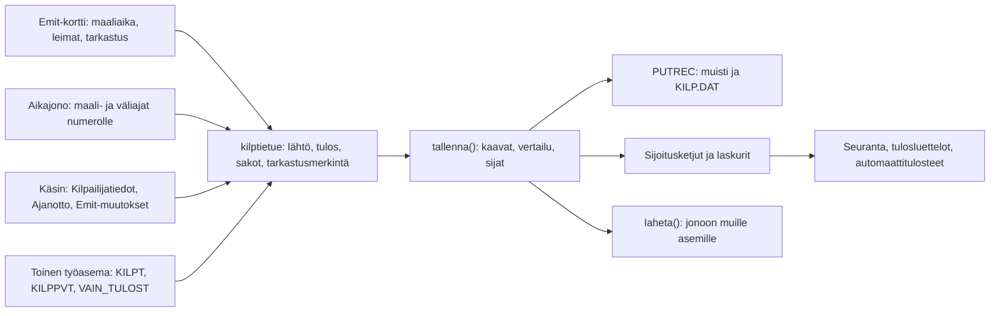

# 06 Tuloslaskenta, tulostila ja tulosten muuttaminen

<!-- malli: Käsikirjan lukupohja (K-3). Ohje: doc/tietopohja/laatu/k3-kirjoittajan-ohje.md.
Luvun 5 vikaluettelo generoidaan tiedostosta kasikirja/toiminnot.csv komennolla
python -I doc/arkkitehtuuri/tyokalut/tietopohja.py . kasikirja; sitä ei kirjoiteta käsin. -->

> **Tila:** alustava K-3-aineisto, ei riippumattomasti tarkastettu. Lähderevisio: tuotantokoodi
> `f7fe553` (ennallaan, `doc/arkkitehtuuri/CHECKPOINT.md`). Varmuusmerkinnät: [todennettu],
> [päätelty], [tuntematon]; "luettu käsikirjaa varten" = luettu koodista K-vaiheessa, ei tarkastettu.

Lyhenteet: **HKM** = HkMaali (HK, konsoli, MSVC), **HKW** = HkKisaWin (HK, GUI, bcc32), **VM** =
ViestiMaali, **VL** = ViestiLuenta (viesti, konsoli), **VW** = ViestiWin (viesti, GUI). Polut ovat
suhteessa hakemistoon `TPsource/V52/`, ellei polku ala `doc/` tai `docs-site/`. **[AA: asiakirja]**
= tieto on jo auditointiaineistossa (`doc/arkkitehtuuri/`); **[KO: luku]** = käyttöohje
(`docs-site/docs/`), käytetty vain käyttäjälle näkyvän toiminnan ja asetusten nimien lähteenä.

Luku kuvaa, miten kilpailijan aika ja tulos lasketaan, mitä tulostilan eli tarkastusmerkinnän
arvot (hyväksytty, hylätty, keskeyttänyt ...) tarkoittavat, miten sijoitukset ja pisteet syntyvät ja
miten tulosta voi muuttaa jälkikäteen. Aikojen ja leimojen saaminen ohjelmaan on lukujen
leimaukset (05) ja ajanotto asia; tässä luvussa ne mainitaan vain siltä osin kuin ne kirjoittavat
tulokseen.

## 1. Mitä tapahtuu

### 1.1 Kokonaiskuva

Tuloksen kirjoittavat neljä lähdettä (kortin käsittely, aikajono, käsinmuutos, toinen työasema).
Kaikki kulkevat saman tietueen kautta, ja HK:ssa jokainen muutos päätyy funktioon
`kilptietue::tallenna` [AA: `yleiskuva.md` "Päävirta"]. Viestissä on sama rakenne
(`Juk/vdat.cpp`, `Juk/VIx.cpp`) [päätelty: [AA: `yleiskuva.md`]; tämän luvun koodiluku koskee
pääosin HK:ta].

### 1.2 Mitä tulokseksi tallennetaan (HK)

Sisäinen aikayksikkö on millisekunti: `SEK` = 1000, `MINUUTTI` = 60 000, `TUNTI` = 3 600 000
(`Tp/TpDef.h:78-88`) [todennettu]. Käyttöohje toteaa saman sakkojen osalta [KO: viestiwin 5.9].
Arvo `TMAALI0` = −24 tuntia tarkoittaa "ei aikaa" (`Tp/TpDef.h:88`). Kellonajat normalisoidaan
välille −12..+12 h (`NORMKELLO`) ja tulokset välille 0..24 h (`NORMTULOS`) (`Tp/TpDef.h:101-103`).

Yhden kilpailijan yhden vaiheen tulokset ovat taulukossa `pv[v].va[]` (`Hk/HkDef.h:402-415`;
`va[i].vatulos`, `.vasija`, `.vakoodi`) [todennettu]:

| Taulukon alkio | `piste` | Sisältö |
|---|---|---|
| `va[0]` | −1 | Toteutunut lähtöaika (lähtöportti tai merkitty lähtö), kellonaika |
| `va[1]` | 0 | **Loppuaika** (tulos), kulunut aika |
| `va[2] …` | 1 … | Väliajat, kulunut aika |

Lisäksi vaiheen tiedoissa ovat arvottu lähtöaika `tlahto`, tarkastusmerkintä `keskhyl`, sakot
(`asakot`, `sakko`, `tasoitus`), vaiheen pisteet `pvpisteet[]` ja yhteistuloksen sijoitus `ysija`;
kilpailijalla itsellään on `pisteet[3]` (`Hk/HkDef.h:440-549`) [todennettu: otsikko]. Se, mitä
tallennetaan, on **kulunut aika sakkoineen** eikä maaliajan kellonaika: `set_tulos(piste, kellonaika)`
muuntaa kellonajan tulokseksi funktiolla `tulos1` ja kirjoittaa sen `tall_tulos`illa
(`Hk/HkTls.cpp:829-859`); käänteisesti `maali(piste)` palauttaa maalin kellonajan
(`tulos + lähtö − sakko`, `Hk/HkTls.cpp:1158-1189`) [todennettu].

Tallennuspaikka on sama riippumatta lähteestä, joten kortista, aikajonosta ja käsin syötetystä
ajasta tulee samanlainen tulos; yksi poikkeus on, ettei tulosta kirjoiteta, jos piste on sarjan
väliaikapisteiden ulkopuolella (`tall_tulos` ohittaa kirjoituksen, `Hk/HkTls.cpp:849-850`) [todennettu;
ks. H-117].

### 1.3 Ajasta tulokseen

**Perusyhtälö (HK, `kilptietue::tulos1`, `Hk/HkTls.cpp:737-799`)** [todennettu, luettu käsikirjaa
varten]:

> tulos(piste) = maalin kellonaika − lähtöaika + sakko(piste), normalisoituna välille 0..24 h

- *Lähtöaika* on `TLahto(vaihe, tot=true)`: jos vaiheen `hiihtolahto` on päällä, se on toteutunut
  lähtöaika `va[0]`:sta, muuten arvottu `tlahto` (`Hk/HkTls.cpp:1016-1036`). Jos lähtöaika puuttuu
  (`TMAALI0`), tulos on 0, eli tulosta ei synny (`:773-774`).
- *Sakko* tulee funktiosta `p_sakko(piste)` (kohta 1.6) ja lisätään tulokseen jo tallennettaessa.
- *Pyöristys*: `pyoristatls(aika, indeksi)` pyöristää kellonajan vaihekohtaisen taulukon
  `pvparam[v].pyor[]` mukaan, alaspäin tai lähimpään, jos `pyorlahimpaan` (tai ampumahiihdossa
  indeksi 4) on päällä (`Hk/HkTls.cpp:642-651`). Käyttäjä asettaa tarkkuudet kilpailun
  perustiedoissa: tallennus-, sijoitus-, tulostus- ja väliaikatarkkuus sekä takaa-ajon
  lähtöaikapyöristys [KO: hkkisawin 2.1]. Sijoituksen määräävä pyöristys on indeksi 2
  (`addjarjarr`, `haesija`: `pyoristatls(tl, 2)`) [todennettu]; muiden indeksien täsmällistä
  vastaavuutta käyttöohjeen valintoihin ei ole selvitetty [päätelty].
- Kokonaisaika yli vuorokauden kierrätetään `NORMTULOS`illa, ellei lajitäsmennys ole `D`
  (`tm != 12*TUNTI && alalaji != 'D'`, `Hk/HkTls.cpp:796-797`) [todennettu].
- `EBA`-haara (`tulos1`:n alku) ei ole käännöksessä (`valitsimet.csv`: `PP:EBA` ei tuotteissa) eikä sitä
  kuvata tässä.

**Väliajat ja lasketut ajat.** Väliaika on samanlainen tulos pisteelle 1 … `valuku`. Lisäksi sarjalle
voi määritellä laskentakaavoja (`kaavatp`), joilla väliaikapisteeseen lasketaan arvo kahden muun
pisteen erotuksena: `(ylä − ala − nollataso) × kerroin / jakaja`, rajattuna alarajaan ja yläarajaan
(`kaavatulos`, `Hk/HkTls.cpp:373-391`); `ala < 0` tarkoittaa lähtöä [todennettu]. Käyttäjälle tämä on
"lasketut ajat, nettoajat" ja niiden `K`-merkintä väliaikapisteen taulukossa [KO: hkkisawin 5.4].
Kaavat ajetaan jokaisessa tulospalvelutilan `tallenna`-kutsussa ennen vertailua (`tuloskaavat`,
`Hk/HkDat.cpp:923-926`), mutta vain jos kilpailija on
"hyväksytty" (`hyv()`); muuten laskettu arvo on 0 (`Hk/HkTls.cpp:405-407`) [todennettu]. Rastiväliajoista
laskettavat tulokset (online-aikojen laskenta) ovat leimantarkastuksen toiminto [KO: hkkisawin 6.14,
numeroitu otsikon mukaan 6.15] ja kuuluvat lukuun 05.

**Monivaiheinen yhteistulos.** Monivaiheisessa kilpailussa `ytulos` laskee yhteistuloksen
vaiheiden tuloksista sarjan asetuksen `yhttlslaji` mukaan (`Hk/HkTls.cpp:1444-1492`) [todennettu];
vaihtoehdot käyttäjälle [KO: hkkisawin 10.1]:

| Asetus (`yhttlslaji`) | Laskenta |
|---|---|
| `S` (oletus, `Hk/HkInit.cpp:3170`) | Vaiheiden aikojen summa; sarjan on oltava kaikissa vaiheissa sama |
| `L` | Aika sarjan ensimmäisestä lähtöajasta; takaa-ajoon |
| `P` | Paras eri vaiheiden tuloksista |
| `V` | Summa, sarja saa vaihtua vaiheesta toiseen (rinnakkaiset erät) |

Vaihe voi olla *itsenäinen*, *jatko* tai *takaa-ajo* (`luonne`); takaa-ajovaiheen lähtöaika lasketaan
edellisen vaiheen yhteistuloksesta (`takaa_ajolahdot`, `Hk/HkTls.cpp:1585-1651`, vain
konsolikäännöksessä [`#ifdef _CONSOLE`]) [luettu käsikirjaa varten]. Vaiheen paino yhteistuloksessa
voidaan asettaa kertoimilla `tlskerroin`/`tlsjakaja` (`Hk/HkTls.cpp:1469`, `:1487`). Yhteistulos on 0,
jos jokin vaihe on hylätty tai puuttuu (`y_hyv`, `Hk/HkTls.cpp:1213-1228`) [todennettu]. Pisteytulos
(`pisteytulos()`) on oma haara, jossa yhteistulos on vaiheiden pisteiden summa (`ypistetulos`) [päätelty:
funktio luettu vain otsikon osalta].

**Viesti.** Viestissä tulos on osuus- ja joukkuekohtainen (`Juk/vkilp.cpp:577-710`) [todennettu,
luettu käsikirjaa varten]:

- *Osuuden tulos* `Tulos(osuus, va)`: perustilanteessa maali − sarjan lähtöaika + sakkoaika
  kumulatiivisesti; yhteislähdössä tai partiossa osuuden `ylahto`:sta; muulloin edellisen osuuden
  tulos + (osuuden maali − edellisen osuuden maali tai oma lähtö). Tulos on 0, ellei osuus ole
  hyväksytty (`Hyv(osuus)`) tai asetus `SÄILHYL` ole päällä (`kilpparam.sailhyl`; oletus
  [päätelty] pois) (`:610-668`).
- *Osuusaika* `osTulos`: osuuden maali − osuuden lähtö + osuuden sakot (`:671-710`).
- *Lähtöaika* `Lahto(osuus)` lasketaan edellisen osuuden tuloksesta, yhteislähdöstä tai
  rinnakkaisosuuksien maalista (`:329-409`); `SKMKV`-haara ei ole käännöksessä (`valitsimet.csv`).
- *Sakot* `SakkoAika(osuus)`: ampumahiihdon sakkorenkaat ja ohilaukaukset ajaksi (`amptsak`) + osuuden
  oma `sakko` (`:717-730`).
- *Rinnakkaisosuudet* (`nosuus > 1`): osuuden tulos syntyy ryhmän tuloksesta funktiolla `tTulos`;
  ryhmän tulos riippuu siitä, ratkaiseeko ensimmäinen maaliin tulija (`ekaMaaliRatkaisee`) (`:411-575`)
  [luettu käsikirjaa varten, vain rakenne].

### 1.4 Tulostila: tarkastusmerkintä

Kilpailijan tulostila on yksi merkki: tarkastusmerkintä `keskhyl` (HK: `pv[v].keskhyl`, viesti:
`ostiet[os].keskhyl`). Arvoja saa asettaa vain tunnetuista merkeistä: HK:ssa `-TIHKOEVPXMB`
(`set_tark`, `Hk/HkTls.cpp:1100-1109`), viestissä `-TIKHEP` (`kilpTarkasta`, `Juk/vdat.cpp:302`;
muut arvot korvataan hiljaa merkillä `-`) [todennettu]. Käyttäjälle näkyvät sanat tulevat funktiosta
`tarkstr` (`Hk/HkTulostus.cpp:484-548`):

| Merkki | Näkyy (suomi / englanti) | Tarkoitus | Mukana tuloksessa? (HK) |
|---|---|---|---|
| `-` | Avoin / Open | Ei tarkastusmerkintää: kilpailija on mukana, tulosta ei ole vielä vahvistettu | kyllä, jos aika on (`hyv_pv`) |
| `T` | Tark. / OK | Tarkastettu, suoritus hyväksytty | kyllä |
| `I` | Hyl.es. / Recheck | Hylkäysesitys: ohjelma tai käyttäjä on havainnut virheen, päätös on vielä tekemättä | kyllä, kuten avoin |
| `O` | Ohit. / Skip | Ohitettu | ei; lasketaan keskeyttäneisiin |
| `K` | Kesk. / DNF (rastireittisarjassa Puuttuu) | Keskeyttänyt | ei |
| `H` | Hyl. / DQ (rastireittisarjassa Virhe) | Hylätty | ei |
| `M` | Virhe / Missing | Virhe (leimavirhe tai vastaava) [päätelty: nimi viittaa puuttuvaan leimaan] | ei; lasketaan hylättyihin |
| `X` | Ei aikaa / Exclude | Ei aikaa | ei; lasketaan keskeyttäneisiin, lajitellaan ensimmäiseksi |
| `E`, `V`, `B` | Ei läht. / DNS | Ei lähtenyt (E), vakantti (V), havaittu mutta merkitty ei-lähteneeksi (B) | ei; `B` kuten `-`, jos `HYVHAVAITUT` on päällä |
| `P` | Poissa / Absent | Poissa; ei mukana sijoituksissa | ei |

Hyväksytylle voi `tarkstr` näyttää tarkastusmerkinnän sijasta myös jatkoonpääsymerkin (`qual`, kirjaimet Q-Z), kun laji ei ole `S` eikä `B` (`Hk/HkTulostus.cpp:503-506`) [luettu käsikirjaa varten].

Lähteet: koodissa `hyv_pv` = `-`, `I`, `T` (ja `B`, jos `kilpparam.hyvHavaittu`) (`Hk/HkTls.cpp:1208-1211`);
`lasna` = ei `P`, `E`, `V` eikä `B` (`hyvHavaittu`-asetuksella) (`:1235-1238`); `tark()` palauttaa
`P`, jos sarjan vaiheen `luonne` on negatiivinen (`:1194-1201`) [todennettu]. Merkkien
suomennokset ovat `tarkstr`:ssa; `M`:n alkuperäinen tarkoitus on [päätelty].

Tästä seuraa käyttäjälle tärkeä asia: **tarkastamaton (`-`) tai hylkäysesityksen (`I`) saanut
kilpailija, jolla on aika, on tuloksessa ja sijoituksissa kuin hyväksytty** [todennettu: `hyv_pv`,
`addjarjarr` jonoon 0 `tulos_pv(.., true, ..) != 0`-ehdolla, `Hk/HkIx.cpp:919-937`]. Tarkastamattomien ja
tarkastusmerkittömien kilpailijoiden seurantaan on omat tulosluettelovalinnat: *Tarkastamattomat* =
aika mutta ei tarkastusmerkintää, *Avoimet*, *Metsässä olevat* [KO: viestiwin 7.3]. Asetus `VAADITARK`
muuttaa tilanteen: sarja katsotaan valmiiksi vasta, kun kaikilla on tarkastusmerkintä ja
hyväksytyillä tulos (HK: `vaaditarkastus`, `n_tarkastamatta`, `Hk/HkDat.cpp:653-667`, `:965-967`)
[KO: hkkisawin hkliite1; todennettu: koodi].

**Miten merkintä syntyy.**

- *Kortin luennasta.* `tark_badge` (HK) asettaa merkinnän `T`, jos `tarkista` ei löydä virheitä, ja `I`,
  jos löytää (`Hk/HkEmit.cpp:2262-2300`); sama tapahtuu Emit-lomakkeen tallennuksessa
  (`cbHk/UnitEmit.cpp:2655-2680`) ja uudelleenlaskennassa (`:3395-3440`). `H` (hylätty), `K` ja `O`
  asettaa käyttäjä valinnalla *Tarkastus* [KO: hkkisawin 6.1]; ohjelma ei hylkää itse, vaan esittää
  hylkäystä (`I`) ja jättää päätöksen käyttäjälle [todennettu: koodissa ei ole automaattista `H`-asetusta
  näissä poluissa; hylkäysesitysten käsittelylomake tallentaa päätökset, kohta 1.8].
- *Lähtö luetaan kortilta.* Jos kilpailijan merkintä oli `E` tai `V` ja kortin nollaus havaitaan,
  merkintä muuttuu `-`:ksi (`Hk/HkIV.cpp:565-580`, `:700-716`) [luettu käsikirjaa varten]. Samoin
  `HYVHAVAITUT`-asetuksella `E` muuttuu `B`:ksi, kun ei-lähteneeksi merkitylle luetaan aika alle
  12 h (`Hk/HkIV.cpp:690-691`) [luettu käsikirjaa varten].
- *Tuntematon kortti.* Tietue luodaan vakanttisarjaan tilalla `V`/`-` (luku 05 ja 02).
- *Käsin*: kaavakkeet *Kilpailijatiedot*, *Osanottajat*, *Emit-tiedot*, *Tarkastus- ja seurantakoodit*
  (viesti: osuuskohtainen) [KO: viestiwin 7.2, 7.3].

**Viesti.** Viestin joukkueen tila johdetaan osuuksien merkinnöistä: `Tark(-1)` palauttaa ensimmäisen
osuuden merkinnän, jos osuus 0 ei ole hyväksytty; muuten `K`, jos viimeinen osuus ei ole hyväksytty
(`H`, jos jokin osuus on `H`); muuten `T`, jos kaikki osuudet ovat `T`, ja `-`, jos jokin ei ole
(`Juk/vkilp.cpp:1095-1145`) [todennettu, luettu käsikirjaa varten]. Merkki `S` tarkoittaa, että osuus
on suljettu aiemman osuuden vuoksi (`Sulj`). Joukkue on hyväksytty (`Hyv`), kun jokaisella sen
osuudella (ensimmäisen maaliin tulijan sääntö huomioiden) on merkintä `T`, `I` tai `-`
(`Juk/vkilp.cpp:1456-1473`) [todennettu]. Ei-lähteneet merkitään viestissä osuuskohtaisesti, jotta
jo metsässä olevia voidaan seurata, vaikka aiempi osuus hylätään [KO: viestiwin 7.2].

### 1.5 Sijoitukset

**Rakenne.** Sijat eivät ole tietueen kenttiä, joita ylläpidettäisiin erikseen, vaan ne saadaan
muistissa pidettävistä linkitetyistä listoista (`jalku`, `jrjseur`, `jarjtulos`) [todennettu: `Hk/HkIx.cpp:751-799`,
kommentti]. Jokaisella sarjalla (ja sarjayhdistelmällä) on osajonot:

| Jono | Sisältö |
|---|---|
| 0 | Hyväksytty tulos (ei-nolla `tulos_pv(.., true, ..)`) |
| 1 | Keskeyttäneet (`K`, `O`, `X`) |
| 2 | Hylätyt (`H`, `M`) |
| 3 | Ei-lähteneet (`E`, `V`, `P` ja `B` ilman `HYVHAVAITUT`) |
| 4 | Muut eli avoimet (ei aikaa, ei hylkäystä) |
| 5 … `valuku`+4 | Väliajat pisteittäin |
| `valuku`+5 … | Yhteistulokset (yhteistulos, aiempi yhteistulos, päivän tulos jne.) |

**Järjestys.** Hyväksyttyjen jonossa avain on tulos (pyöristettynä sijoitustarkkuuteen) ja toissijaisesti
lähtöajan järjestys; muissa jonoissa avain perustuu nimeen (`X` saa nimeen etuliitteen `AA`) tai lähtöaikaan
(avoimet) (`addjarjarr`, `Hk/HkIx.cpp:919-996`) [todennettu]. Tasatuloksella lista järjestyy lähtöajan
mukaan, mutta **sija on sama**: sijaluku lasketaan haulla `haesija`, joka vertaa vain tulosta
(`tl[1] = 0`) ja palauttaa ensimmäisen paikan, jossa tulos ei ole huonompi (`Hk/HkIx.cpp:1459-1479`)
[todennettu]. Tulosteessa jaettu sija merkitään `=`-merkillä, kun sija on sama kuin edellisellä
(`Hk/HkTulostus.cpp:1907`) [todennettu]. Poissaolevia (`P`) ei oteta sijoituksiin, ellei `POISSAMUKAAN` ole
päällä tai sarjalla ole yhteispisteitä (`Hk/HkIx.cpp:829-833`) [todennettu].

**Päivitys.** Kun tietue tallennetaan tulospalvelutilassa, `tallenna` toimii näin
(`Hk/HkDat.cpp:897-1300`) [todennettu, luettu käsikirjaa varten]:

1. `tuloskaavat` laskee kaava- ja pistetulokset (kohta 1.7).
2. `kilpcmp` vertaa uutta tietuetta tallennettuun ja kertoo, mikä muuttui (perustiedot, päivän ajat,
   tarkastusmerkintä, sakot, sarja tai aiemman päivän tulos).
3. Jos aika, sakko tai tarkastusmerkintä muuttui, vanhat rivit poistetaan sijoitusketjuista
   (`remjarjarr`).
4. Muuttuneille pisteille lasketaan uusi sija (`haesija`).
5. Tietue kirjoitetaan muistiin ja levylle (`PUTREC(d, 1)`).
6. Uudet rivit lisätään sijoitusketjuihin (`addjarjarr`) ja laskurit päivittyvät.
7. Muutokset lähetetään tiedonsiirtoon (`laheta`), vain muuttuneet osat erikseen: perustiedot,
   vaiheen tiedot, tarkastus- ja sakkotiedot, yksittäiset ajat.

Esivalmistelutilassa kaavat, sijat ja tiedonsiirto jäävät pois (`Hk/HkDat.cpp:981-986`). Sijoitus on siis
tietueen *tallennuksen* seuraus, ei jatkuvasti laskettu arvo: käyttöohje toteaa, että kilpailijatiedoissa
tehty muutos vaikuttaa sijoitukseen ja yhteistulokseen vasta tallennuksessa [KO: hkkisawin hkluku7].
Kaikki johdetut rakenteet ovat vain muistissa ja rakennetaan käynnistyksessä uudelleen levyllä olevista
tietueista (`uusijarj`, `teejarj`), joten uudelleenkäynnistys korjaa useimmat laskuri- ja ketjuvirheet
[AA: `globaali-tila.md` 5].

**Viesti.** Viestillä on vastaavat funktiot (`intsija`, `addjarjarr`, `remjarjarr`, `haesija`:
`Juk/VIx.cpp:611-1033`) osuus- ja joukkuekohtaisilla sijoilla (`ossija`, `Sija`, `osSija`)
[päätelty: [AA: `yleiskuva.md`]; funktioiden sisältöä ei ole luettu]. Tulosteissa osuussijat lasketaan
funktiolla `ossijat` (`Juk/VTulostus.cpp:929`) [AA: H-076].

### 1.6 Sakot ja tasoitukset

HK:ssa sakko on kolmen osan summa (`p_sakko`, `sakko_pv`, `Hk/HkTls.cpp:665-732`) [todennettu]:

- *Lukumääräsakot* `asakot[]`: kullekin sakkopaikalle merkki `0`..`9` (tai suurempi, jos
  `maxasakko`); lukumäärä kerrotaan sarjan sakkoyksiköllä `tsak` (sekunteina) ja `SEK`:llä;
- *Aikasakko* `sakko`: millisekunteina suoraan kirjattu;
- *Tasoitus* `tasoitus`: sekunteina; positiivinen lisää tulosta.

`p_sakko(piste)` laskee vain ne lukumääräsakot, jotka kuuluvat pisteeseen asti (`va_sakot[piste]`),
joten väliaika sisältää vain sitä edeltäneet sakot [todennettu: `:684-690`]. Ampumahiihdossa
(`kilplaji == 'B'`) sakot lasketaan ampumapaikoittain funktiolla `as_sakko` ja sarjan
`asuunnsakot`-arvoilla (`:674-683`, `:1654-1673`); sotilasmonitaistelussa (`'P'`) tulos on vertailupisteen
ja sakon erotus (`:693-696`) [luettu käsikirjaa varten; ei kuvata tarkemmin].

**Käyttäjälle** [KO: hkkisawin 6.7, viestiwin 5.9]: sakkojen suuruus annetaan sarjatiedoissa kentässä
*Yhden virheen sakko* (rastireittisarjoissa oletus 600 s), ja sakkoja syötetään lukumääränä joko
Emit-luennan kentässä *Sakkoja (RR)*, kilpailijatietojen sarakkeessa *Sakko* tai laitteen kautta
(`SAKKO_COM`, `SAKKO_YHT`, `SAKKO_LAJI=` -asetukset, vain jos käännöksessä on `SAKKOCOM`:
`HkMaali` ja `HkKisaWin` määrittelevät sen) [`rekisteri/asetusavaimet.csv`]. Ohjelma tallentaa
sakon sekunteina ja lukumäärä näytetään, jos yhden sakon suuruus on määritelty normaalisti.
Sarjan kentän *Sak/Tas-yks.* arvon muuttaminen ei vaihda aiemmin kirjattujen sakkojen vaikutusta
tuloksiin, vaan vain näytettävän lukumäärän [KO: viestiwin 5.9].

**Sakon muutos muuttaa tulosta samalla.** `tall_asakot` ja `tall_sakko` laskevat vanhan ja uuden sakon erotuksen
ja lisäävät sen jo tallennettuun tulokseen ja väliaikoihin: `uusi tulos = vanha tulos + uusi sakko − vanha
sakko` (`Hk/HkTls.cpp:965-1014`) [todennettu]. Tulosta ei siis lasketa alusta, vaan sitä korjataan. Jos
tulos on 0 (ei aikaa), sakon muutos ei tee mitään, ja ensimmäinen tulos tulee vasta, kun aika kirjataan,
jolloin sakko lisätään `tulos1`ssä [päätelty].

**Viestissä** sakot ovat osuuskohtaiset: ampumahiihdon lukumääräsakot `ampsakot[]` (`ASakkoLkm`),
aikasakko `sakko` ja ampumahiihdon sakkoaika `amptsak` sarjassa (`Juk/vkilp.cpp:717-752`) [todennettu].
Sakkokierroslomake (`UnitSakkoKierr`) kirjaa sakkokierrokset joukkueen osuudelle; osuusnumeroa ei rajata
[AA: H-082].

### 1.7 Pisteet

Pisteitä on kolmea eri laatua [todennettu, luettu käsikirjaa varten: `Hk/HkTls.cpp:373-431`,
`:1675-1879`; [KO: hkkisawin 2.2, 11.2]]:

1. **Väliaikapisteen kaavat** (`kaavatp`): tulos tai erotus kertoimin, kuvattu kohdassa 1.3. Tulos
   tallennetaan väliaikapisteeseen tai vaiheen pistekenttään `pvpisteet[]` (`va > VALUKU` → `pvpisteet`).
2. **Kilpailijan pisteet** (`pistekaavatp`, funktio `Pisteet`): sijoituksesta tai ajasta lasketaan pisteet
   vaihekohtaisella kaavalla. Jos `laji & 1`, sijaluku kuvataan pisteiksi aluetaulukolla
   (`a[i]..y[i]` → `p[i] + (sija − a[i])·d[i]`); lisäksi `plaji` 1–5 laskee pisteitä voittajan ajan
   (`karki`) ja kilpailijan ajan suhteesta: (1) `karki·vpist/tulos`, (2) `vpist·(1 − (tulos − karki)/karki·kerr/jak)`,
   (3) `vpist − (tulos − karki)/karki·kerr/jak`, (4) `vpist − (tulos − karki)·kerr/jak`, (5) logaritminen.
   Optiot määräävät pyöristyksen ja nollarajan (`optiot & 3`, `optiot & 4`). Pisteet lasketaan vain
   hyväksytylle (`hyv()`) ja vaiheelle, jolla `pistekaava.vaiheon` on päällä; lähtökohtana on sarjan voittajan aika
   `pkarki[sarja][0]` (`Hk/HkTls.cpp:418-426`).
3. **Yhteispisteet** (`LaskeKilpYhtPisteet`): vaiheiden pisteiden summa, jossa otetaan mukaan vain
   `yhtpistvaihelkm` parasta vaihetta, ja edellytyksenä on vähimmäisosallistumis- ja
   hyväksymismäärä (`yhtpistosottomin`, `yhtpisthyvmin`) (`:1813-1879`).

Käyttäjä määrittelee kaavat valinnoissa *Lisätoiminnot / Pisteiden laskenta* ja *Tuloskaava*
[KO: hkkisawin 2.2]. Joukkuepisteet lasketaan tuloksia laadittaessa (ei tietueeseen): joko vakiokokoisille
joukkueille sarjan tai yhdistelmäsarjan sisällä, tai seuralle usean sarjan parhaista sijoituksista pisteinä
`n − sija + 1` (tiedostot `pistesrj.lst`, `sijapisteet.lst`; lisäpiste voittajalle valinnalla) [KO: hkkisawin 11.2].
`JOUKKUEPISTEET` on pakotettu päälle HK:n tuotteissa (`valitsimet.csv` `PP:JOUKKUEPISTEET`) [todennettu].
Pisteiden laskentalomake (`cbHk/UnitPistelasku.cpp`) on auditoimaton (taso 1); sitä ei kuvata tässä.

### 1.8 Tulosten muuttaminen ja korjaaminen jälkikäteen

Kaikki alla olevat polut päätyvät samaan `tallenna`-kutsuun (HK) ja siten samaan sijoitusten ja
tiedonsiirron päivitykseen. Eroavaisuus on siinä, *mitä* ne muuttavat.

| Polku | Ohjelma | Mitä muuttaa | Huomio |
|---|---|---|---|
| Kilpailijatiedot (kaavake) | HKW, VW (joukkuetiedot), HKM (konsolin lomake) | Lähtöaika, maaliaika, sakko, tulos, tarkastusmerkintä, sarja, numero | Muutos vaikuttaa maaliaikaan tai tulokseen vastaavasti; sijat ja yhteistulos lasketaan vasta tallennuksessa; tallennus tarkistaa, onko tietue muuttunut muualla (HKW: lukon ulkopuolella) [KO: hkkisawin hkluku7; AA: H-017] |
| Osanottajataulukko (F9) | HKW | Lähtö- ja maaliaika taulukossa; solun tyhjennys poistaa ajan | Aika kirjoitetaan muodossa `45.30`, `1:02:30` [KO: hkkisawin hkluku7] |
| Ajanottolomake | HKW, VW | Aikajonon rivin numero, piste ja aika; rivin poisto; tallennus siirtää ajan kilpailijan tulokseen (`setMaali` viestissä) | Katso H-111, H-117, H-121 [AA: `gui-liiketoimintalogiikka.md` 3.3, 3.4] |
| Emit-tiedot ja Emit-muutokset | HKW, VW | Kortin siirto toiselle kilpailijalle, kahden kilpailijan leimojen vaihto ristiin, luentahetken muutos, kortin aikojen puolitus, leimojen muutos, kortin ohitus | Muutokset jäävät voimaan vasta painikkeella *Tallenna muutokset*; luentahetken muutos vaikuttaa väliaikoihin [KO: hkkisawin 6.6, 6.1] |
| *Laske tulos* / uudelleenlaskenta | HKW | Tulos lasketaan uudelleen kortin tiedoista | HKW: `Laskeuudelleen1Click` (`cbHk/UnitEmit.cpp:3449`) [AA: `gui-liiketoimintalogiikka.md` 3.1]; uudelleenlaskenta asettaa merkinnän `T` tai `I` (`:3395-3440`) |
| Tarkastusmerkintä | HKW, VW (*Tarkastus- ja seurantakoodit*) | Merkintä `T`, `I`, `H`, `K`, `O`, `E` jne. | Viestissä osuuskohtainen; ensimmäisen osuuden merkintä voidaan kopioida automaattisesti [KO: viestiwin 7.2] |
| Hylkäysesitysten käsittely | HKW, VW | Esityksen perustiedot, päätökset ja kilpailijan kanta | Tallentuu kilpailijatietoihin ja XML-tiedostoon; kilpailijatietojen tekstikentässä on tilaa HK:ssa 17 ja viestissä 9 merkkiä [KO: hkkisawin 6.16, viestiwin 6.12] |
| Sakkojen syöttö | HKW, HKM, VW | Sakkojen lukumäärä, aikasakko | Sakon muutos korjaa tallennettua tulosta erotuksella (kohta 1.6) |
| Aikojen siirrot | HKW, VW | Lähtöaikojen, toteutuneiden lähtöaikojen tai tulosten kasvatus tai pienennys valitulla määrällä | Käyttäjä valitsee, vaikuttaako lähtöajan siirto jo olemassa olevaan tulokseen [KO: hkkisawin 4.6]; HKM: sarjakohtainen siirto `S/L` pienentää tulosta samalla määrällä kuin lähtöaikaa kasvattaa (`HkConsole/HkCons0.cpp:1088-1108`) |
| Aikajonon aikakorjaus | HKW, HKM | Jonon kaikkien aikojen vakiokorjaus | Parametri `AIKAKORJAUSy=xx` [KO: hkkisawin hkliite1]; ytimessä `aikajono[]->aikakorjaus`, joka lisätään myös kortin maaliaikaan (`Hk/HkIV.cpp:1748-1753`) [luettu käsikirjaa varten] |
| Toiselta työasemalta tuleva muutos | kaikki | Koko tietue (`KILPT`), vaihe (`KILPPVT`), yksi aika (`VAIN_TULOST`) | Viimeksi saapunut voittaa; ei versiota eikä yhdistämistä [AA: H-016; `tiedonsiirto.md`] |

**Mitä jälkikäteinen muutos tekee tietueelle.** Muutos korvaa tallennetun arvon ja kirjataan `tallenna`:n
`kilpcmp`-vertailussa muutokseksi; se lisää muutoksen tapahtumanäyttöön (`addtapahtuma`, HKW) ja
lähettää muuttuneet osat muille asemille [todennettu: `Hk/HkDat.cpp:1245-1300`]. Alkuperäistä arvoa ei
säilytetä: tietueella ei ole muutoshistoriaa eikä versiotietoa [AA: H-016; `tallenna-samanaikaisuus.md`].
Kaksi poikkeusta: emit-tietue säilyttää kortin alkuperäiset leimat, ja vain tietueen kopiona työskentelevät
lomakkeet voivat vielä peruuttaa muutoksen ennen tallennusta (*Peruuta muutokset*) [KO: hkkisawin hkluku7;
6.6].

**Kaksi käyttäjän valintaa, jotka muuttavat tuloksen luonnetta.** Hylkäysesitys (`I`) ei poista tulosta;
vasta hylkäys (`H`) poistaa kilpailijan hyväksytyistä (kohta 1.5). Ja `HYVHAVAITUT`-asetuksella
ei-lähteneeksi (`E`) merkitty, jolle luetaan aika, saa merkinnän `B` ja pysyy tuloksessa (kohta 1.4).

## 2. Erot ohjelmien välillä

| Kohta | HKW | HKM | VW | VM / VL |
|---|---|---|---|---|
| Tuloksen laskenta (`tulos1`, `p_aika`, `ytulos`) | sama ydin (`Hk/HkTls.cpp`) | sama | oma ydin `Juk/vkilp.cpp` (osuus- ja joukkuetulos) | sama kuin VW |
| Tarkastusmerkinnän sallitut merkit | `-TIHKOEVPXMB` | sama | `-TIKHEP` (muut → `-`) | sama kuin VW |
| Monivaiheinen yhteistulos | kyllä | kyllä | ei (viestissä ei vaiheita) | ei |
| Pisteet ja kaavat | kyllä (`kaavatp`, `pistekaavatp`, joukkuepisteet) | kyllä | [tuntematon] viestin pistelasku | [tuntematon] |
| Tulosten muuttaminen kaavakkeilla | Kilpailijatiedot, Osanottajat, Ajanotto, Emit-muutokset | konsolin lomakkeet ja asetusvalikon kohta *S)arjat* (siirrot) | Joukkuetiedot, Joukkueet, Ajanotto, Emit-muutokset | konsolin toiminnot [tuntematon] |
| Takaa-ajon lähtöaikojen laskenta | lomake (TakaaAjo) | asetusvalikon *S)arjat / L)* kysyy "Laaditaanko takaa-ajokisa" ja kutsuu `takaa_ajolahdot`-funktiota (`HkConsole/HkCons0.cpp:1065-1071`; `MERI5` päällä HK:ssa) | ei | ei |
| `SÄILHYL` | – | – | kyllä | kyllä |
| `HYVHAVAITUT`, `POISSAMUKAAN`, `VAADITARK` (HK) | kyllä | kyllä | `VAADITARK` kyllä (`UnitCfg`), muut [tuntematon] | [tuntematon] |
| Tuloksen laskenta sakoista (ampumahiihto) | `'B'` kyllä | kyllä | `amptsak`, `ampsakot` | sama kuin VW |
| Sakkojen syöttö laitteesta (`SAKKOCOM`) | kyllä (valitsimen kautta) | kyllä | ei [päätelty: `valitsimet.csv`] | ei |

Eroja HK:n ja viestin lomakkeiden välillä, jotka vaikuttavat tuloksen muuttamiseen: HK:n ajanotto suojaa
sarjan rajan ylittävää pistettä huonommin kuin viesti (H-117), viestin ajanoton `tall_rivi`-kutsusta puuttuu
argumentti (H-121), ja A/L-rivien jäsennysvika on molemmissa (H-111). Viestin ajanoton paneelin tallennus päivittää
vain jonon, ei joukkuetietuetta (Q76, auki) [AA: `gui-liiketoimintalogiikka.md` 3.4, 4].

## 3. Asetukset ja käännösvalitsimet

| Asetus tai valitsin | Ohjelmat | Vaikutus | Lähde |
|---|---|---|---|
| `HYVHAVAITUT` | HKW, HKM | `hyvHavaittu`: `B` (havaittu) lasketaan hyväksytyksi eikä poissaolevaksi; `E` muuttuu `B`:ksi, kun aika luetaan | `Hk/HkInit.cpp:859-861`; `Hk/HkTls.cpp:1210`, `:1237`; `Hk/HkIV.cpp:690` |
| `POISSAMUKAAN` | HKW, HKM | Poissaolevat (`P`) otetaan mukaan laskureihin ja sijoituksiin | `Hk/HkInit.cpp:855-858`; `Hk/HkIx.cpp:829-833` |
| `VAADITARK` | HKW, HKM, VW | Sarja valmis vasta, kun kaikilla on tarkastusmerkintä ja hyväksytyillä tulos | `Hk/HkInit.cpp:901`; `rekisteri/asetusavaimet.csv`; [KO: hkkisawin hkliite1] |
| `SÄILHYL=` | VW, VM, VL | Osuuden tulos säilytetään, vaikka osuus ei ole hyväksytty (`kilpparam.sailhyl`) | `Juk/VInit.cpp:977-979`; `Juk/vkilp.cpp:431`, `:611`, `:687`, `:699` |
| `yhttlslaji` (S/L/P/V, sarjan asetus) | HKW, HKM | Monivaiheisen yhteistuloksen laskentatapa | `Hk/HkTls.cpp:1444-1492`; [KO: hkkisawin 10.1] |
| Pyöristysasetukset (`pyor[]`, `pyorlahimpaan`) | HKW, HKM, VW, VM, VL | Tallennus-, sijoitus-, tulostus- ja väliaikatarkkuus | `Hk/HkTls.cpp:642-651`; `Juk/vkilp.cpp:320-327`; [KO: hkkisawin 2.1] |
| `AIKAKORJAUSy=xx` | HKW, HKM | Jonon aikakorjaus | [KO: hkkisawin hkliite1]; `Hk/HkInit.cpp:1461` |
| `SAKKOCOM`, `SAKKO_COM`, `SAKKO_YHT`, `SAKKO_LAJI=` | HKW, HKM | Sakkotietojen vastaanotto laitteelta | `valitsimet.csv`, `asetusavaimet.csv` (ehto `SAKKOCOM`) |
| `JOUKKUEPISTEET` | HKW, HKM, VW | Joukkuepisteiden laskenta tulosteissa (pakotettu päälle) | `valitsimet.csv` `PP:JOUKKUEPISTEET` |
| `EBA`, `SKMKV`, `MAKI`, `AMPUSUUNN` | ei toimitetuissa | Kuollut koodi; ei kuvata. `EBA`-haara `tulos1`:ssä, `SKMKV`-haara `Lahto`:ssa ja `MAKI`-lisäosa tietueessa eivät ole käännöksessä | `valitsimet.csv` (dead tai `-` kaikilla tuotteilla) |
| `_CONSOLE` | HKM, VM, VL | `takaa_ajolahdot` on vain konsolikäännöksessä; GUI:ssa vastaava on lomake | `Hk/HkTls.cpp:1584-1652` |

Käännösvalitsimien tila on tarkistettu `rekisteri/valitsimet.csv`:stä. Tulosten laskentakoodi
(`Hk/HkTls.cpp`, `Juk/vkilp.cpp`) on käännettävissä samoina kaikkiin tuotteisiin muiden kuin yllä lueteltujen
valitsimien osalta [päätelty: tiedoston `#if`-ehtoja ei käyty läpi kokonaan].

## 4. Vaihtoehtoiset polut ja virhetilanteet

| Tilanne | Mitä tapahtuu | Lähde |
|---|---|---|
| Lähtöaika puuttuu (`TMAALI0`) | `tulos1` palauttaa 0: tulosta ei synny. Kortin luennassa puuttuvaksi todettu lähtöaika asetetaan arvoon 0 (12.00.00) ja ilmoitetaan | `Hk/HkTls.cpp:773-774`; `Hk/HkIV.cpp:1730-1736` [luettu käsikirjaa varten] |
| Maaliaika puuttuu | `maali()` palauttaa `TMAALI0`; tilanteessa ei ole tulosta; `vaadiaika`-asetuksella ilmoitetaan "Kilpailijalla ei aikaa" | `Hk/HkTls.cpp:1180-1181`; `Hk/HkIV.cpp:1862-1863` |
| Piste sarjan väliaikapisteiden ulkopuolella (HK-ajanotto) | Vanha tulos tyhjennetään eikä uutta kirjoiteta; viesti suojaa rajan | [AA: H-117] |
| Ajanottolomakkeen A/L-rivin tallennus | Rivi muuttuu maaliriviksi; HK kirjoittaa lähtöajan maaliajaksi (kun L-rivejä on) | [AA: H-111] |
| Viestin ajanoton `tall_rivi`: `pakLah` menee `kielto`-paikkaan | Pakotettu uudelleenlähetys ei pakota | [AA: H-121] |
| HK `tall_tulos(k_pv, 0)` argumentit väärin päin (kokoomarivi) | Lomakekohtainen pieni logiikkavirhe | [AA: H-127] |
| Emit-lomakkeen *Muutokset*-dialogi on auki, kun toinen asema muuttaa tietuetta | Dialogin pitämä kopio korvaa väliin tulleen muutoksen kokonaisena | [AA: H-017] |
| Emit-dialogin sulkeminen X:llä | Palautuu painikkeena 2, joka useassa emit-dialogissa on tuhoava (siirto menettäen leimat, muutosten hylkäys, kortin uudelleenkäyttö) | [AA: H-116] |
| Käsin kirjoitettu väärä numero kortille | HKW kopioi paikanpitäjän tilan, tuloksen ja lähtöajan olemassa olevalle kilpailijalle ilman kysymystä (kuntosuunnistus); paikanpitäjä jää omistamaan kortin tiloissa 0 ja 1 | [AA: H-119, H-120] |
| Sakkoindeksi verkosta tai laitteelta ylittää rajan | `tall_ampsakko` kirjoittaa taulukon ulkopuolelle; `tall_sak` jättää `tall`-lukon ja palaa, kun `lsak == 0` | [AA: H-060, H-008] |
| `add_sakko` pitää lukkoa SendMessage-kutsun ajan | Lukkiutumisvaara tapahtumanäytön päivityksessä | [AA: H-009] |
| Viestin sakkokierroslomakkeen osuusnumero rajaamaton | Kirjoitus tietueen viereiseen kenttään tai pinoon | [AA: H-082] |
| Sakkokierroslokin avaus | `TextFl::Open` tyhjentää lokin joka kerta (tila `"a"` käsitellään `"wb"`-tilana) | [AA: H-086] |
| Viestin `ossijat`-lista ylittää puskurin | Kasaylivuoto, kun laskuri on liian pieni tai `monios`-tilassa `nt` ei nollaudu osuuksittain | [AA: H-076; `globaali-tila.md` 5] |
| Sijoitusten läpikäynti numerojärjestyksessä | Jäännösrivi numerohakemistossa pysäyttää läpikäynnin ja jättää kilpailijat pois | [AA: H-128] |
| Vaiheen vaihto | Numerohakemiston laskuri ei nollaudu (H-129); viestin sarjanvaihto ei päivitä joukkuemääriä (H-130); HK:n laskurit `nvak`/`nyilmt`/`nytulost` poikkeavat (H-139) | [AA: `globaali-tila.md` 5, 7] |
| `KILP.DAT`-kirjoitusvirhe tulosta tallennettaessa | Ilmoitus, ohjelma jatkaa, tulos lähtee silti muille asemille | [AA: H-015; `virheenkasittely.md`] |
| Tulos- ja automaattitiedoston kirjoitusvirhe | Ei havaita (vertailu `WEOF`:iin ei toimi) | [AA: H-147] |
| Aikajonon tiedostokirjoitus epäonnistuu | Rivi merkitään kirjoitetuksi eikä sitä yritetä uudelleen | [AA: H-146] |
| Tietue muuttuu verkossa kahdella asemalla | Viimeksi saapunut voittaa; vastaanottajan paikallinen muutos voi kumoutua (`tark_kilp` lukee ennen lukkoa); `VAIN_TULOST` sovelletaan vastaanottajan omaan vaiheeseen ja `KILPPVT`/`VAIN_TULOST` voi kohdistua väärälle kilpailijalle | [AA: H-016, H-007, H-023, H-022] |
| Poistettu kilpailija | Tietue siirtyy vapaiden listalle; uusi kilpailija voi periä vanhan emit-linkin; poistoa ei tarkisteta | [AA: H-109, H-140] |

Kutsun ja onnistumisen ero: `tallenna` ei palauta onnistumistietoa; `PUTREC` kutsuttuna ei tarkoita levylle
kirjoitusta; `laheta` lisää sanoman jonoon eikä lähetä sitä [AA: `virheenkasittely.md`; `tiedonsiirto.md`].
Sijoitus voi siis näkyä oikein yhdellä työasemalla ja väärin toisella, vaikka kumpikin ohjelma ei ilmoita
virheestä.

## 5. Tunnetut viat tässä toiminnossa

<!-- generoitu:viat alku (tietopohja.py lohkot; älä muokkaa käsin) -->
| Toiminto | Havainto | Tila | Prioriteetti | Kuvaus |
|---|---|---|---|---|
| Kilpailijan tallennus (tallenna) ja sen lukitus | [H-010](../vikakortit/H/H-010.md) | avoin | P3 | Noin 35 kohtaa tallentaa kilpailijan tiedot ilman lukkoa, ja tallennus muuttaa rakenteita, joilla ei ole omaa lukkoa (HK) |
| Kilpailijan tallennus (tallenna) ja sen lukitus | [H-015](../vikakortit/H/H-015.md) | avoin | P3 | Jos kilpailijatiedoston KILP.DAT kirjoitus levylle epäonnistuu, ohjelma jatkaa muistissa olevilla tiedoilla ja levylle jää vanha tieto |
| Tarkastusmerkinnän asettaminen kortista ja käsin | [H-116](../vikakortit/H/H-116.md) | avoin | P2 | Valinta- tai virheikkunan sulkeminen X-painikkeella tulkitaan painikkeeksi 2: emit-lomakkeissa tuhoava valinta, virheikkunassa ohjelman lopetus |
| Tarkastusmerkinnän asettaminen kortista ja käsin | [H-119](../vikakortit/H/H-119.md) | avoin | P4 | HkKisaWinin emit-lomakkeessa väärin kirjoitettu numero kopioi paikanpitäjän tiedot olemassa olevalle kilpailijalle ilman kysymystä |
| Tarkastusmerkinnän asettaminen kortista ja käsin | [H-120](../vikakortit/H/H-120.md) | avoin | P4 | HkKisaWinissä kortin paikanpitäjätietue jää omistamaan kortin, kun numero kirjoitetaan käsin, ja oikea kilpailija tallentuu ilman korttia |
| Tarkastusmerkinnän asettaminen kortista ja käsin | [H-112](../vikakortit/H/H-112.md) | avoin | P3 | ViestiWinin "Vaihda kilpailijoiden leimaukset ristiin" voi korvata joukkueen kortin numeron roskatiedolla, jos joukkueen numero tai osuus puuttuu |
| Tarkastusmerkinnän asettaminen kortista ja käsin | [H-113](../vikakortit/H/H-113.md) | avoin | P3 | Muokattavien valikoiden "Ei valittu" ja kirjoitettu teksti sekä siirtyneet osuusnimiöt kohdistavat toiminnon väärään osuuteen tai väärään paikkaan muistissa |
| Sijoitusten laskenta ja ylläpito (HK: addjarjarr, haesija) | [H-128](../vikakortit/H/H-128.md) | avoin | P2 | Poistettu tai uudelleennumeroitu kilpailija voi jäädä ilman ilmoitusta pois numerojärjestyksessä tehtävistä listoista ja viennistä |
| Sijoitusten laskenta ja ylläpito (HK: addjarjarr, haesija) | [H-129](../vikakortit/H/H-129.md) | avoin | P2 | Vaiheen vaihto suurella kilpailulla voi vioittaa HK-ohjelman muistia |
| Sijoitusten laskenta ja ylläpito (HK: addjarjarr, haesija) | [H-139](../vikakortit/H/H-139.md) | avoin | P4 | HK:n vakanttilaskuri ja yhteissummat voivat jäädä vääriksi (arvonta, sarjaluettelot, yhteenvedot) |
| Sijoitusten laskenta ja ylläpito (HK: addjarjarr, haesija) | [H-142](../vikakortit/H/H-142.md) | avoin | P5 | Nimihakemisto, sijoitusketjut ja laskurit voivat jäädä vääriksi sarjan tai numeron muutoksen jälkeen (kokoomarivi) |
| Sijoitukset ja osuussijat (viesti) | [H-076](../vikakortit/H/H-076.md) | avoin | P3 | Viestin osuussijoitusten laskenta ylittää varaamansa muistin XML-tulosteessa, kun joukkueilla on väliaikoja |
| Sijoitukset ja osuussijat (viesti) | [H-130](../vikakortit/H/H-130.md) | avoin | P3 | Viestissä sarjaa vaihdettaessa joukkuemäärät jäävät vääriksi uudelleenkäynnistykseen asti |
| Sijoitukset ja osuussijat (viesti) | [H-142](../vikakortit/H/H-142.md) | avoin | P5 | Nimihakemisto, sijoitusketjut ja laskurit voivat jäädä vääriksi sarjan tai numeron muutoksen jälkeen (kokoomarivi) |
| Sakkojen kirjaus ja vaikutus tulokseen (HK) | [H-008](../vikakortit/H/H-008.md) | avoin | P2 | Virheellinen ampumasakkosanoma voi jättää tallennuksen lukon päälle, jolloin tallennukset eivät etene |
| Sakkojen kirjaus ja vaikutus tulokseen (HK) | [H-060](../vikakortit/H/H-060.md) | avoin | P2 | Ampumapaikan numero ampumasanomassa voi nollata ohjelman muistia taulukon ulkopuolelta |
| Sakkojen kirjaus ja vaikutus tulokseen (HK) | [H-009](../vikakortit/H/H-009.md) | avoin | P3 | HkKisaWin voi jäädä odottamaan itseään, kun työsäie pyytää käyttöliittymältä jotain kilpailijatietojen lukko hallussaan |
| Sakkokierroslomake | [H-086](../vikakortit/H/H-086.md) | avoin | P5 | Sakkokierrosten seurannan ikkunan avaus tyhjentää lokitiedoston SakkoKierr.txt, ja aiemmat merkinnät katoavat tiedostosta |
| Sakkokierroslomake | [H-082](../vikakortit/H/H-082.md) | avoin | P4 | ViestiWinin sakkokierroslomakkeessa tyhjä tai liian suuri osuusnumero kirjoittaa joukkueen tietueeseen tai sen ohi, ja virheellinen tietue tallennetaan ja lähetetään |
| Tulosten muuttaminen ajanottolomakkeella | [H-111](../vikakortit/H/H-111.md) | avoin | P2 | Ajanoton "Tallenna muutos" muuttaa lähtö- tai automaattipisteen rivin maaliriviksi ja voi kirjoittaa lähtökellon ajan kilpailijan maaliajaksi |
| Tulosten muuttaminen ajanottolomakkeella | [H-117](../vikakortit/H/H-117.md) | avoin | P3 | HkKisaWinin ajanotossa sarjan rajan ylittävä piste tyhjentää kilpailijan vanhan tuloksen eikä tallenna uutta |
| Tulosten muuttaminen ajanottolomakkeella | [H-121](../vikakortit/H/H-121.md) | avoin | P4 | ViestiWinin ajanotossa Ctrl+Enter ei pakota aikarivin uudelleenlähetystä muille työasemille ja ohittaa ensimmäisen yhteyden |
| Tulosten muuttaminen ajanottolomakkeella | [H-127](../vikakortit/H/H-127.md) | avoin | P5 | HkKisaWinin ja ViestiWinin pienet logiikkavikoja: "Ei badgea" ilman vakanttia, hidas sarjan selaus, väärin päin annetut argumentit tuloksen tyhjennyksessä ja muita (kokoomarivi) |
| Tulosten korjaus Emit-muutokset-lomakkeella | [H-017](../vikakortit/H/H-017.md) | avoin | P3 | Emit-muutokset-ikkuna voi kirjoittaa kilpailijan vanhan tietueen takaisin ja kumota välissä tulleet muutokset |
| Tulosten korjaus Emit-muutokset-lomakkeella | [H-116](../vikakortit/H/H-116.md) | avoin | P2 | Valinta- tai virheikkunan sulkeminen X-painikkeella tulkitaan painikkeeksi 2: emit-lomakkeissa tuhoava valinta, virheikkunassa ohjelman lopetus |
| Tulosten korjaus Emit-muutokset-lomakkeella | [H-119](../vikakortit/H/H-119.md) | avoin | P4 | HkKisaWinin emit-lomakkeessa väärin kirjoitettu numero kopioi paikanpitäjän tiedot olemassa olevalle kilpailijalle ilman kysymystä |
| Tulosten korjaus Emit-muutokset-lomakkeella | [H-120](../vikakortit/H/H-120.md) | avoin | P4 | HkKisaWinissä kortin paikanpitäjätietue jää omistamaan kortin, kun numero kirjoitetaan käsin, ja oikea kilpailija tallentuu ilman korttia |
| Tulosten korjaus Emit-muutokset-lomakkeella | [H-112](../vikakortit/H/H-112.md) | avoin | P3 | ViestiWinin "Vaihda kilpailijoiden leimaukset ristiin" voi korvata joukkueen kortin numeron roskatiedolla, jos joukkueen numero tai osuus puuttuu |
| Tulosten muuttaminen kilpailijatiedot-kaavakkeella | [H-017](../vikakortit/H/H-017.md) | avoin | P3 | Emit-muutokset-ikkuna voi kirjoittaa kilpailijan vanhan tietueen takaisin ja kumota välissä tulleet muutokset |
| Tulosten muuttaminen kilpailijatiedot-kaavakkeella | [H-114](../vikakortit/H/H-114.md) | avoin | P3 | Sarjavalikkoon kirjoitettu teksti siirtää joukkueen hiljaa sarjaan 0 (ViestiWin) tai sotkee muistia (HkKisaWin) |
| Tulosten muuttaminen kilpailijatiedot-kaavakkeella | [H-115](../vikakortit/H/H-115.md) | avoin | P3 | HkKisaWin: kilpailijalomakkeen selaus voi jättää kilpailijatietojen lukon päälle monipäiväisessä kilpailussa |
| Tuloksen vastaanotto toiselta työasemalta (KILPT, KILPPVT, VAIN_TULOST) | [H-016](../vikakortit/H/H-016.md) | avoin | P3 | Yhteyskatkon aikana kahdella asemalla tehdyt muutokset samaan tietoon voivat vaihtua ristiin, eikä ohjelma huomaa sitä |
| Tuloksen vastaanotto toiselta työasemalta (KILPT, KILPPVT, VAIN_TULOST) | [H-007](../vikakortit/H/H-007.md) | avoin | P2 | Toiselta asemalta tullut päivitys voi kumota samaan aikaan paikallisesti tehdyn muutoksen ja levittää vanhan tiedon muille asemille (HK) |
| Tuloksen vastaanotto toiselta työasemalta (KILPT, KILPPVT, VAIN_TULOST) | [H-022](../vikakortit/H/H-022.md) | avoin | P2 | Kahden aseman samanaikaiset lisäykset voivat saada saman tietuenumeron, ja vaihetieto tallentuu väärälle kilpailijalle ilman numeron tarkistusta (HK) |
| Tuloksen vastaanotto toiselta työasemalta (KILPT, KILPPVT, VAIN_TULOST) | [H-023](../vikakortit/H/H-023.md) | avoin | P2 | Monivaiheisessa kilpailussa tulos voi tallentua vastaanottajan omaan vaiheeseen, ja yhteys hyväksytään, vaikka vaiheen vaihto evätään (HK) |

Generoitu tiedostosta `kasikirja/toiminnot.csv` ja rekistereistä (tila, prioriteetti); älä muokkaa käsin.
<!-- generoitu:viat loppu -->

## 6. Mihin tieto perustuu

**Asiakirjat luettu** (kokonaan, ellei toisin mainittu): `doc/arkkitehtuuri/globaali-tila.md` (C-8:
elinkaari, johdetut rakenteet, laskurit, vaiheen vaihto); `doc/arkkitehtuuri/gui-liiketoimintalogiikka.md`
(C-7: ajanotto-, emit-, kilpailijatietolomakkeet, luvut 3, 4, 5); `doc/arkkitehtuuri/yleiskuva.md`;
`doc/arkkitehtuuri/rekisteri/havainnot.md`, `riskiarvio.csv`, `valitsimet.csv`, `asetusavaimet.csv`,
`tiedostot.csv` (hakuja); `doc/arkkitehtuuri/seuranta.md` (KE-taulukko); `doc/tietopohja/sanasto.md`;
vikakortit H-128 ja H-117 (soveltuvuus), muut rekisteririvien kautta.

**Käyttöohje** (`docs-site/docs/`): hkkisawin 2.1, 2.2, 5.4, 5.6, 5.9, 6.1, 6.6, 6.7, 6.14, 6.16, 10.1,
11.2, hkluku7, hkliite1 (rivit 90-135); viestiwin 5.9, 6.11, 6.12, 7.2, 7.3. Ei luettu: 5.5 (kierroskilpailu,
vain alku), 9.x (tulosteet), 10.2-10.5 (sprintti, takaa-ajo, karsinta), 14 (ampumahiihto), luku 11 (pisteet;
runkotiedosto on tyhjä, 11.2 luettu).

**Koodi luettu uutena** (merkintä "luettu käsikirjaa varten, ei tarkastettu"): `Hk/HkTls.cpp:150-1880`
(`tulos1`, `p_aika`, `p_sakko`, `tall_asakot`, `TLahto`, `tark`, `hyv_pv`, `y_hyv`, `lasna`,
`tulos_pv`, `ytulos`, `ytark`, `tuloskaavat`, `kaavatulos`, `Pisteet`, `LaskeKilpYhtPisteet`);
`Hk/HkIx.cpp:700-1050`, `:1459-1552` (`intsija`, `addjarjarr`, `haesija`, `uusijarj`);
`Hk/HkDat.cpp:620-790`, `:897-1300` (`tallenna`); `Hk/HkTulostus.cpp:474-550` (`tarkstr`);
`Hk/HkEmit.cpp:2262-2305` (`tark_badge`); `Hk/HkIV.cpp:565-580`, `:690-716`, `:1550-1870` (`pros_emit`
osia), `:3725-3790` (`tee_aika`); `Hk/HkAjat.cpp:100-290` (`tall_rivi`); `cbHk/UnitEmit.cpp:2655-2685`,
`:3395-3445`; `HkConsole/HkCons0.cpp:905-1130`; `Juk/vkilp.cpp:320-1473` (valitut funktiot);
`Juk/vdat.cpp:285-309`; `Tp/TpDef.h:72-110`. Käännösvalitsimet: `rekisteri/valitsimet.csv`.

**Rekisteririvit**: ks. luku 5 ja toimintokytkentä `toiminnot_KB.csv`.

## 7. Mitä ei ole selvitetty

### 7.1 Avoimet kysymykset (Q ja KE)

- **Q75** `kuntosuunnmoodi`-arvojen merkitys; vaikuttaa H-119:n ja H-120:n soveltuvuuteen [AA:
  `gui-liiketoimintalogiikka.md` 10].
- **Q76** Päivittääkö viestin ydin joukkuetietueen, kun ajanoton paneelista tallennetaan vain jonorivi
  [AA: sama].
- **Q82** Mihin `tmaali` kirjoitetaan [AA: `globaali-tila.md` 9].
- **KE-9** `cbHk/UnitPistelasku.cpp`: ehdossa `!yhdsarjat[srj-sarjaluku, kilp.Sarja()]` pilkkuoperaattori
  tekee lausekkeesta osoittimen, joten ehto on aina epätosi ja yhdistelmäsarjoihin ei ilmeisesti valikoidu
  ketään [päätelty; tiedosto auditoimaton; `seuranta.md` KE-9]. Koskee pisteiden laskentaa yhdistelmäsarjalle.
- **KE-5** HK:n `deltall` poistopolku -1-tietueella (vaikuttaa poiston jälkeisiin tuloslaskureihin) [`seuranta.md`].

### 7.2 Tutkimatta tai osittain luettu

- Viestin sijoitusfunktioiden (`Juk/VIx.cpp:611-1062`) sisältö ja viestin pistelasku: luettu vain nimet
  [tuntematon].
- Viestin rinnakkaisosuuksien tulos (`tTulos`, `ekaMaaliTulos`, `Juk/VRinnakkaisOsuus.cpp`): vain rakenne.
- Ajan kohdistaminen kilpailijaan aikajonosta (`tee_aika`, `writeajat`, `comajanotto`): ajanottoon kuuluva;
  tässä luettu vain `tall_rivi`n ja `tee_aika`n rakenne.
- Pyöristysindeksien (`pyor[0..5]`) täsmällinen vastaavuus käyttöohjeen tarkkuusvalintoihin: sijoituksen
  indeksi on 2, muita ei ole todennettu [päätelty].
- Merkin `M` alkuperäinen merkitys ja `ytark`n (yhteistuloksen tila) täydellinen sääntö.
- Sotilasmonitaistelun, ampumahiihdon ja merenkulkulajien (`kilplaji` `P`, `N`, `B`, `H`/`S`) erityiset
  laskentapolut: luettu vain näkyvin osin (`as_sakko`, `meriytulos`); ei kuvata.
- Konsoliohjelmien (HKM, VM, VL) tulosten muuttamistoiminnot lukuun ottamatta HKM:n sarjasiirtoa: [tuntematon].
- Tuloksen kulku aikajonosta tulokseen viestissä (`ProsEmitMaali`, `tall_rivi`).
- Tulosten julkaisu ja tulostus (tulosluettelot, HTML, XML): muu luku.

### 7.3 Ehdokkaat (ei tarkastettu)

Kirjoittaja ei ole tehnyt uusia havaintoja auditointirekisteriin, mutta kaksi kohtaa jäi ihmetyttämään
(haettu `havainnot.md`:stä ja `seuranta.md`:n KE-taulukosta, ei löytynyt):

1. `kilptietue::tarkstr` (`Hk/HkTulostus.cpp:484`) kutsuu `memset(st, 0, sizeof(st))`, jossa `st` on
   osoitinparametri, joten tyhjennys kattaa vain osoittimen koon (4 tavua 32-bittisessä käännöksessä);
   `wcsncpy` täyttää kohdepuskurin `len`:n mukaan, mutta jos teksti on pidempi kuin `len`, päättävä nolla
   jää kirjoittamatta (vanha puskurin sisältö jää hännäksi). Suomenkielinen teksti "Ei aikaa" on 8 merkkiä,
   oletuksena `len` on 8. Ei tarkastettu, miten kutsujat esialustavat puskurin.
2. `hyv_pv` laskee tarkastamattoman (`-`) ja hylkäysesityksen (`I`) saaneen hyväksytyksi (kohta 1.4), joten
   tulosluettelo, joka rajautuu hyväksyttyihin, sisältää myös ne, joille tarkastusmerkintää ei ole annettu.
   Tämä on tarkoitettu käytös (käyttöohje antaa erilliset *Tarkastamattomat*-listat ja `VAADITARK`-asetuksen),
   mutta kilpailupäivän ohjeistuksessa se kannattaa ottaa huomioon; ei vika.
