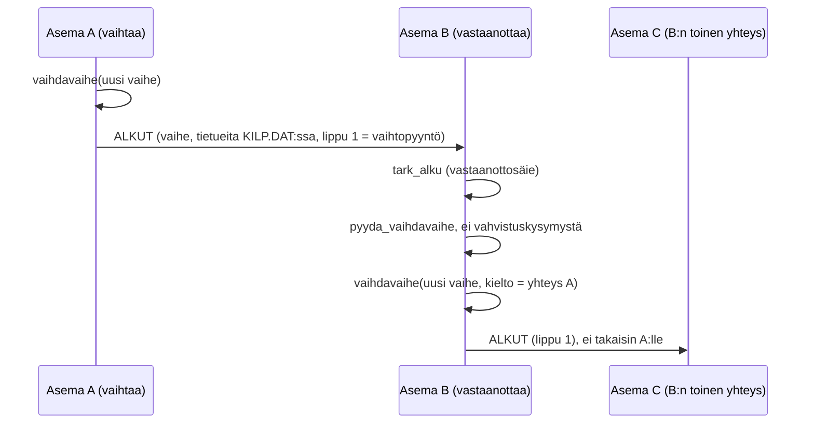

# 08 Monivaiheiset kilpailut ja vaiheen vaihto

<!-- malli: Käsikirjan lukupohja (K-3). Ohje: doc/tietopohja/laatu/k3-kirjoittajan-ohje.md.
Luvun 5 vikaluettelo generoidaan tiedostosta kasikirja/toiminnot.csv komennolla
python -I doc/arkkitehtuuri/tyokalut/tietopohja.py . kasikirja; sitä ei kirjoiteta käsin. -->

> **Tila:** alustava K-3-aineisto, ei riippumattomasti tarkastettu. Lähderevisio: tuotantokoodi
> `f7fe553` (ennallaan, `doc/arkkitehtuuri/CHECKPOINT.md`). Varmuusmerkinnät: [todennettu],
> [päätelty], [tuntematon]; "luettu käsikirjaa varten" = luettu koodista K-vaiheessa, ei tarkastettu.

Luku kuvaa, miten HK-ohjelmat (HkKisaWin, HkMaali) käsittelevät monivaiheista kilpailua ja mitä
tapahtuu, kun vaihetta vaihdetaan kesken ajon ilman ohjelman uudelleenkäynnistystä. **Vaiheen
vaihto on vain HK:ssa.** Viestiohjelmissa (ViestiWin, ViestiMaali, ViestiLuenta) ei ole vaihetta
eikä vaiheen vaihtoa (kohta 2). Kilpailun perustaminen ja sarjatiedot ovat luvussa 02, tiedostot
luvussa 03, tiedonsiirron yleinen toiminta luvussa 09. Polut ovat suhteessa hakemistoon
`TPsource/V52/`. Lyhenteet: HKM = HkMaali (konsoli), HKW = HkKisaWin (GUI), VM = ViestiMaali,
VW = ViestiWin, VL = ViestiLuenta. Lähdemerkinnät: [AA: ...] = auditointiaineisto, [KO: ...] =
käyttöohje, [luettu käsikirjaa varten, ei tarkastettu] = koodi luettu tätä lukua varten.

## 1. Mitä tapahtuu

### 1.1 Mitä vaihe on

Monivaiheinen kilpailu on esimerkiksi usean päivän kilpailu tai kilpailu, jossa on karsinta ja
finaali. Käyttöohje mainitsee vaiheen vaihdon helpottavan erityisesti hiihdon sprint-kisan
tulospalvelua [KO: hkkisawin 10.5]. Rakenne on seuraava:

- **Yksi kilpailutiedosto.** `KILP.DAT` sisältää kilpailijan perustiedot ja jokaiselle vaiheelle oman
  lohkon (vaihekohtaiset ajat, tila, sakot, väliajat). Tietueen koko on perustiedot + vaiheiden
  lukumäärä × vaiheen lohko; vaiheiden ja väliaikojen lukumäärä luetaan sarjatiedostosta tai XML:stä
  ajon aikana [AA: `tiedostomuodot.md` "KILP.DAT: HK-tietue"] [todennettu].
- **Aktiivinen vaihe** on globaali muuttuja `k_pv` (alkaa nollasta; näytöllä vaihe 1 = `k_pv` 0).
  Vaiheiden määrä on `kilpparam.n_pv_akt`. Käännösaikainen yläraja `N_PV` on oletuksena 5
  (`Hk/HkDef.h:46`); HkKisaWinin kokoonpanossa `200VA` se on 2 (`RADStudio10/HkKisaWin.cbproj`
  rivit 299 ja 306). Onko `200VA` toimitettu kokoonpano, ei ole varmistettu (T-051)
  [luettu käsikirjaa varten, ei tarkastettu].
- **Yksi vaihe kerrallaan ohjelmaa kohti.** Jokaisella työasemalla on oma `k_pv`. Verkossa olevien
  asemien on oltava samassa vaiheessa, muuten tiedonsiirto ei toimi normaalisti (kohta 1.6).
- **Vaihekohtaisia tiedostoja** ovat ajanottojono (`AJAT1.LST`, lähtöportilla `LAJAT1.LST`),
  emit-tiedosto (`EMIT1.DAT`), lähetysjonon levypuskuri (`COMFILE1.DAT`), lokitiedosto (`LOKI1.`) ja
  ratatiedosto `RADAT<n>.XML`. Tiedostonimen vaihenumero asetetaan käynnistyksessä merkki
  kerrallaan: monivaiheisessa kilpailussa nimestä korvataan numero `1` vaiheen numerolla, yksivaiheisessa
  kilpailussa siitä poistetaan merkki (`Hk/HkInit.cpp:3356-3376`, H-132)
  [luettu käsikirjaa varten, ei tarkastettu].

### 1.2 Mihin vaiheeseen ohjelma käynnistyy

- Asetus `VAIHE=n` (vanhalta nimeltään `PÄIVÄ=n`) kiinnittää aloitusvaiheen (`Hk/HkInit.cpp:703-711`)
  [luettu käsikirjaa varten, ei tarkastettu].
- Asetus `VAIHE=V` kytkee vaihevalintatiedoston: ohjelma lukee käynnistyksessä tiedoston
  `vaihevalinta.cfg` (rivi `VAIHE=n`) ja kirjoittaa sen uudelleen jokaisen vaiheen vaihdon jälkeen
  (`Hk/HkInit.cpp:289-325`, `:3188-3192`; `Hk/HkIx.cpp:1997-1998`) [todennettu: koodi]. Jos
  tiedostoa ei ole, ohjelma käynnistyy vaiheeseen 1 [KO: hkkisawin 10.5].
- Käyttöohje neuvoo antamaan kilpailussa, jossa vaihetta vaihdetaan kesken kisan, asetuksen
  `vaihe=v` ja varmistamaan, ettei hakemistossa ole vanhaa `vaihevalinta.cfg`-tiedostoa tai että
  se osoittaa ensimmäiseksi käynnistettävään vaiheeseen. Jos ohjelma käynnistetään väärään
  vaiheeseen, seuraus on käyttöohjeen mukaan lievä: tiedonsiirto ei käynnisty ja vastaanottavalle
  koneelle tulee huomautus, ja tilanne palautuu, kun kone siirretään muun verkon vaiheeseen. Virhe
  voi jäädä joksikin aikaa huomaamatta [KO: hkkisawin 10.5].
- Jos `vaihevalinta.cfg` sisältää arvon 0, ohjelma kysyy käynnistyksessä vaihetta
  ("Vahvista kilpailupäivä (tai vaihe) tai vaihda antamalla numero", `Hk/HkInit.cpp:3314-3322`).
  Muulloin kysymystä ei esitetä [luettu käsikirjaa varten, ei tarkastettu]. Jos annettu vaihe on
  suurempi kuin vaiheiden määrä, ohjelma käyttää viimeistä vaihetta (`Hk/HkInit.cpp:3381-3382`).

### 1.3 Vaiheen vaihto käyttäjän näkökulmasta

| Ohjelma | Miten vaihto tehdään | Huomattavaa |
|---|---|---|
| HKW | Päävalikon *Tiedosto* → *Vaiheen vaihto*. Valinta näkyy vain tulospalvelutilassa ja vain, kun vaiheita on yli yksi (`cbHk/WinHk.cpp:307-311`). Ohjelma kysyy uuden vaiheen numeron. | Ohjelma sulkee avoimet lomakkeet (osanottajat, maastossa, tuloste, sprinthiihto, emit, ajanotot), ajaa vaihdon ja palauttaa ikkunat vain, jos aloitusasettelu (`alkulayout`) on annettu (`haeIkkunat`, `cbHk/WinHk.cpp:388-392`); muuten lomakkeet avataan käyttäjän pyynnöstä. Otsikko, valikkojen näkyvyys ja numerointikytkimet päivittyvät. |
| HKM | *Asetukset* → näppäin `W` → vaiheen numero (1–5) (`HkConsole/HkCons0.cpp:933-939`). | Näytölle tulee teksti "VAIHEEN VAIHTO" ja vaihdon päätyttyä "Käynnistys vaiheeseen n valmis". |
| HKW | *Tiedosto* → *Lue sarjat ja muut tiedot uudelleen*. | Sama toiminto samalla vaiheella: ks. kohta 1.5. |

[luettu käsikirjaa varten, ei tarkastettu: `cbHk/WinHk.cpp:2049-2146`; `HkConsole/HkCons0.cpp:933-939`;
käyttöohje: hkkisawin 10.5]

Käyttöohjeen mukaan vaihdon edellytyksenä on, ettei yhdessäkään avoimessa tiedonsiirtojonossa ole
lähtemättömiä sanomia, joten ylimääräiset jonot on suljettava ensin. Vaihto kannattaa tehdä verkon
palvelimella, ja vaihetta ei pidä vaihtaa, kun jollakin koneella muokataan tietoja [KO: hkkisawin
10.5]. Koodi tarkistaa lähtemättömät sanomat (`lahettamatta(cn)`) ja kieltäytyy vaihdosta
virheilmoituksella; muokkaamisen tarkistusta koodissa ei ole luettu [luettu käsikirjaa varten, ei
tarkastettu].

### 1.4 Mitä `vaihdavaihe` tekee

Vaihdon tekee funktio `vaihdavaihe(vaihe, kielto)` (`Hk/HkIx.cpp:1855-2005`), joka on käännetty sekä
HkMaaliin että HkKisaWiniin [todennettu: `HkIx.cpp` on molempien projektien lähdelistassa]. Vaihe
vaiheelta [AA: `globaali-tila.md` 4.2; `saikeet-ja-lukot.md` 5, tarkastettu] ja koodi:

1. **Esitarkistus ja lippu.** Konsoliversio (`_CONSOLE`) palaa heti, jos vaihto on jo käynnissä
   (`vaiheenvaihto`), ja kieltäytyy, jos jollakin avoimella yhteydellä on lähtemättömiä sanomia
   (`:1862-1876`). GUI tekee nämä tarkistukset jo kutsuvassa käsittelijässä, ennen kuin lippu
   asetetaan. Konsolissa lippu asetetaan ennen tarkistusta, joten evätty vaihto jättää sen päälle
   (H-031, kohta 4).
2. **Tiedonsiirto tauolle.** Avoimien yhteyksien lista (`comopen`) kopioidaan ja nollataan
   lukkojen ottamisen *ennen*; tiedonsiirtosäikeet tyhjäkäyvät seuraavalla kierroksellaan
   (`:1886-1887`).
3. **Tiedostonimet.** Lähetysjonon (`obfilename[7]`) ja avoinna olevien aikajonojen tiedostonimen
   vaihenumero vaihdetaan uuteen (`:1888-1894`). Nimipohjaa, josta uudet aikajonot luodaan
   (`aikaflname`), ei päivitetä (H-131).
4. **Lukot.** Ohjelma ottaa lukot `tall` → `ajat` → `emit` (`:1897-1899`) ja vapauttaa ne lopussa
   (`:1984-1986`).
5. **Sulkeminen.** Aikajonot suljetaan (`suljeajat`); jos emit on käytössä, emit-muisti vapautetaan
   ja emit-tiedosto suljetaan (`:1900-1912`).
6. **Laskurit.** Sarjakohtaiset ilmoittautuneiden, tulosten, hylättyjen, keskeyttäneiden,
   ei-lähteneiden ja vakanttien laskurit nollataan (`:1913-1930`); `k_pv` ja `arv_pv` asetetaan
   uudeksi vaiheeksi (`:1931-1932`). Kokonaislaskurit `nyilmt` ja `nytulost` jäävät nollaamatta
   (H-139).
7. **Uudelleenluku.** `luesarjat()` lukee sarjatiedot (sarjat, päiväparametrit, kilpailuparametrit
   XML:stä) ja `teejarj(true)` rakentaa sijoitusketjut ja numerohakemiston tietueista uudelleen
   (`:1934-1935`). Samalla `teejarj` päivittää pistelaskentaan kuuluvat kilpailijat silmukassa, jossa
   on silmukkamuuttujavirhe (H-013).
8. **Emit ja radat.** Jos emit-tarkastus on käytössä (`emitfl > 0`) eikä olla esitarkastus- tai
   esiluentatilassa, ohjelma lukee radat tiedostosta `RADAT<n>.XML`; jos luku ei onnistu, ohjelma
   ilmoittaa virheestä ja **poistaa emit-tarkastuksen käytöstä** (`emitfl = 0`) eikä yritä
   tekstimuotoisia rata- ja leimaustiedostoja, joihin käynnistys palaisi (H-134). Onnistuessa
   emit-tiedosto `EMIT<n>.DAT` avataan ja luetaan; lukuvirhe poistaa emit-tarkastuksen samoin
   (`:1936-1951`).
9. **Ajanotto.** Aikajonot alustetaan uudelleen (`initajat`) niille jonoille, joilla ajanotto on
   käytössä (`:1958-1972`).
10. **Yhteydet.** Jokaiselle aiemmin avoimelle yhteydelle, joka käyttää levyjonoa (`levypusk`),
    asetetaan merkintä "lähetä aloituspaketti vaihtopyyntölipulla" (`lah_alku`, `lah_vaihto`), paitsi
    yhteydelle, jolta pyyntö tuli (`kielto`) (`:1974-1982`). Avoimet yhteydet palautetaan
    (`:1983`). Vaihekohtaista lähetysjonoa (`opencomfile(1)`) ei avata ensimmäiselle levyjonoyhteydelle;
    mitä tämä tarkoittaa yhden yhteyden asemassa, on avoin (Q68).
11. **Lopetus.** Lukot vapautetaan, konsolin näyttö palautetaan ja lippu nollataan; `vaihevalinta.cfg`
    kirjoitetaan, jos `VAIHE=V` on annettu; GUI palauttaa aloitusasettelun ikkunat, jos se on annettu (`haeIkkunat`) (`:1987-2004`).

GUI:n käsittelijä ympäröi tämän vielä seuraavilla toimilla (`cbHk/WinHk.cpp:2080-2144`): lippu
`vaiheenvaihto` asetetaan, `LukumaaratTh` pysäytetään (`lkmThreadOn = 0`) ja emit-säie pysäytetään
(`ProsEmitOn = false`), 500 ms odotetaan, lomakkeet suljetaan ja poistetaan, ja vaihdon jälkeen
`LukumaaratTh` ja emit-säie (`ProsEmitThread`) käynnistetään uudelleen. Ne säikeet, jotka poistuvat
`vaiheenvaihto`-lipun vuoksi eikä niitä käynnistetä uudelleen, ovat `ScrollThread`, `HaeAvoimetTh`,
`haeSQLTh` ja `kirjSQLTh` (H-097, H-014) [AA: `saikeet-ja-lukot.md` 5]. Lukijasäie
`lue_regnlyThread` ja CTS-ajanotto `comajanotto` **eivät pysähdy** vaihdon ajaksi (H-094, H-102).

### 1.5 Mitä vaihto nollaa ja mitä ei

Taulukko perustuu C-8:n vaihe 1:n nollaustaulukkoon [AA: `globaali-tila.md` 4.2; täysi taulukko
`todisteet/c8/osaB-elinkaari.md` luku B2]. "Vanha" tarkoittaa, että arvo jää edellisen vaiheen
tai edellisen lukukerran mukaiseksi.

| Kohde | Mitä vaihdossa tapahtuu | Seuraus ja havainto |
|---|---|---|
| Vaihenumerot `k_pv`, `arv_pv`, lähetysjonon ja avoimien aikajonojen nimen numero | asetetaan | – |
| Aikajonon nimipohja `aikaflname` | **vanha** | vaiheen vaihdon jälkeen avattu jono (ajanottolomake, emiTag, taulu) saa edellisen vaiheen tiedostonimen (H-131) |
| Sarjakohtaiset laskurit (`nilm*`, `ntulos*`, `nhyl*`, `nkesk*`, `neil*`, `nvak*`, `nesit*`) | nollataan ja lasketaan uudelleen | – |
| Kokonaislaskurit `nyilmt`, `nytulost` | **vanha** | summat kasvavat (H-139) |
| Sijoitusketjut, emit-linkit (`jalku`, `jarjtulos`, `jrjseur`, `bdg_kno`, `emitjarr`) | nollataan tai varataan uudelleen | `emitjarr[1]` vain kun kaksi emit-koodia (`kaksibadge == 2`) |
| Numerohakemisto `idindex` | puskurin sisältö nollataan, **rivilaskuri `nrec` ei** | uudet rivit lisätään vanhojen perään; suurella kilpailulla ylivuoto (H-129) |
| Nimihakemisto `nameindex` | ennallaan, kelvollinen | – |
| Sarjat, päiväparametrit, kilpailuparametrit (XML) | luetaan uudelleen, vain lisäävästi | väliaikojen määrä (`valuku`) ei pienene |
| `kilpparam.maxvaluku`, `lsakmax` | **vanha** | (H-143, N-B6) |
| Sarjojen `mno`- ja `lsak`-rajaukset | **menetetään** uudelleenluvussa | pahin tapaus: käsin muokatun XML:n arvo voi viedä kirjoituksen taulukon ulkopuolelle (H-143, N-B7) |
| `maaliajat[]` | **vanha** | (H-143, N-B5) |
| Erälähdön tila `eralahto[]`, `era_akt` | **vanha** | edellisen vaiheen erälähtö voi jäädä voimaan (H-141) |
| Rata- ja emit-muisti | vapautetaan ja luetaan uudelleen | puuttuva tai virheellinen `RADAT<n>.XML` (H-134) |
| `emithead`, `emithead2`, `emitptr` | luetaan uudelleen | esitarkastus- ja esiluentatilassa uudelleenavaus ohitetaan ja emit-kahva voi jäädä suljetuksi (H-105) |
| Emit-kaksoiskappaleiden eston taulu `on_emit::emitvaraus` | taulu vapautetaan, **laskuri `nemitvar` ei** | esto lakkaa toimimasta noin kolmannessa vaiheen vaihdossa (H-141) |
| Aikajonojen sisältö | luetaan uudelleen | ei, jos jono on olemassa mutta ajanotto pois päältä [päätelty] |
| Korostusrajat `korRaja`, `vipLaji` (GUI) | **vanha** | (H-143, N-B10) |
| Lähtöpistetiedosto (`luelahdepisteet`) | luetaan vain kerran | vaihekohtaista tiedostoa ei lueta uudelleen (H-143, N-B9) |
| Asetustiedostot (`peruscfg.cfg`, `LASKENTA.CFG`) | **ei lueta** | asetusmuutokset tulevat voimaan vasta uudelleenkäynnistyksessä [luettu käsikirjaa varten, ei tarkastettu: `vaihdavaihe` ei kutsu parametrien lukua] |
| `KILP.DAT` ja kilpailijataulukko | ei suljeta, ei varata uudelleen | – |
| Pysyvä tila | vain `vaihevalinta.cfg` (`VAIHE=V`) | – |

Muiden vaihekohtaisten arvojen luetteloa ei ole: vaihdossa kohteet nollataan yksitellen niissä
kohdissa, joissa ne on muistettu, eikä keskitettyä nollauspolkua tai luetteloa vaiheesta riippuvista
muuttujista ole (T-038). Uusi vaiheesta riippuva muuttuja jää siksi helposti vanhaksi.

### 1.6 Vaihtopyyntö toiselta työasemalta

Vaihto leviää verkossa niin, että vaihdon tehnyt asema lähettää seuraavalla aloituspaketilla
(ALKUT) pyynnön naapureilleen. Käyttöohje sanoo tämän: "Tästä toimenpiteestä lähtee sanoma verkkoon,
mikä johtaa vaiheen vaihtumiseen verkon kaikilla koneilla" [KO: hkkisawin 10.5].

Vaiheet koodissa [luettu käsikirjaa varten, ei tarkastettu; AA: `saikeet-ja-lukot.md` 5]:

1. **Lähettäjä.** `vaihdavaihe` asettaa jokaiselle aiemmin avoimelle, levyjonoa käyttävälle
   yhteydelle merkinnän `lah_alku = 1` ja `lah_vaihto = 1`, paitsi yhteydelle, jolta pyyntö tuli
   (`Hk/HkIx.cpp:1974-1982`). Lähetyssäie muodostaa aloituspaketin funktiolla `alkusanoma`
   (`Hk/HkCom32.cpp:811-819`): paketti sisältää vaiheen numeron (`k_pv + 1`), `KILP.DAT`:n
   tietuemäärän ja liput; bitti 1 merkitsee vaihtopyyntöä. Yhteyksillä, jotka eivät käytä levyjonoa
   (`COMFILE=EI`, muistijono), merkintää ei aseteta, joten pyyntöä ei koodin mukaan lähetetä
   [päätelty koodista].
2. **Vastaanottaja.** `tark_alku` (`Hk/HkCom32.cpp:821-866`) ajetaan vastaanottosäikeessä. Jos
   lähettäjän `KILP.DAT`:n tietuemäärä poikkeaa omasta, ohjelma vain varoittaa. Jos lipun bitti 1
   on päällä ja joko yli 5 sekuntia on kulunut edellisestä pyynnöstä tai lähettäjän vaihe poikkeaa
   omasta, ohjelma kutsuu `pyyda_vaihdavaihe(vaihe − 1, yhteys)`. Vahvistuskysymystä ei ole.
3. **GUI.** `pyyda_vaihdavaihe` lähettää synkronisen `SendMessage`-viestin pääikkunalle
   (`cbHk/WinHk.cpp:2231-2235`); vastaanottosäie odottaa, kunnes pääsäie on käsitellyt viestin.
   Käsittelijä `VaihdaVaiheHandler` (`:2149-2229`) ohittaa pyynnön, jos vaihto on jo käynnissä, kieltäytyy
   lähtemättömien sanomien vuoksi virheilmoituksella ja ohittaa vaiheen numeron, joka ei ole
   välillä 0…`n_pv_akt − 1`. Muuten se tekee saman kuin valikkotoiminto. Ilmoitus on
   "Vaiheen vaihto tai uusintakäynnistys. Odota muutama sekunti."
4. **Konsoli.** `pyyda_vaihdavaihe` kutsuu `vaihdavaihe`a suoraan vastaanottosäikeestä
   (`HkConsole/HkCons0.cpp:869-871`).
5. **Eteenpäin.** Vastaanottajan oma `vaihdavaihe` asettaa lipun kaikille muille yhteyksille kuin
   sille, jolta pyyntö tuli (`kielto`), joten pyyntö etenee ketjussa tai tähdessä. Silmukassa
   (mesh) 5 sekunnin raja on ainoa pysäytys [päätelty koodista].

Jos asemat ovat eri vaiheissa eikä lippua ole, lähetys estyy: vastaanottaja varoittaa "Eri vaiheessa
oleva kone pyytää yhteyttä" ja palauttaa estävän arvon [AA: `tiedonsiirto.md`; luettu käsikirjaa
varten, ei tarkastettu]. Kun vaihto evätään vastaanottajassa, yhteys silti hyväksytään, ja saapuva
`VAIN_TULOST` sovelletaan vastaanottajan omaan vaiheeseen (H-023). Vaihtopyynnön vahvistamattomuus ja
sen toiston vaikutus numerohakemistoon on ehdokas KE-2 (kohta 7).

### 1.7 "Lue sarjat ja muut tiedot uudelleen" on sama toiminto

HKW:n valikkokohta *Lue sarjat ja muut tiedot uudelleen* on kytketty samaan käsittelijään kuin
*Vaiheen vaihto* (`cbHk/WinHk.dfm:656-664`). Käsittelijä tunnistaa kutsujan ja käyttää silloin
nykyistä vaihetta (`vaihe = k_pv + 1`, ei vaiheen kysymistä; `cbHk/WinHk.cpp:2060-2063`), joten se
ajaa koko `vaihdavaihe`n samalla vaiheella ja lähettää pyynnön myös muille asemille
[todennettu: koodi; luettu käsikirjaa varten, ei tarkastettu]. Valikkokohdan *Vaiheen vaihto* näkyvyys
rajataan monivaiheisiin kilpailuihin, uudelleenluvun ei [todennettu: `WinHk.dfm`, `WinHk.cpp:307-311`].
Käyttöohje kuvaa molemmat valinnat yhdessä sarjatietojen jakelun yhteydessä: ne johtavat
vastaavien toimintojen käynnistymiseen koko verkossa, kun yhdelläkään koneella ei ole lähettämistä
odottavia sanomia, ja siirretyt sarjatiedot tulevat käyttöön vasta näissä [KO: hkkisawin 2.2.5]. Tämän seurauksena kohdan
1.5 vanhaksi jäävät tiedot ja H-129 koskevat myös uudelleenlukua, ei vain vaiheen vaihtoa
[päätelty]; ks. ehdokas kohdassa 7.

### 1.8 Uudelleenkäynnistys ja vaiheen vaihto: mikä eroaa

Vaihtoehto vaiheen vaihdolle on sulkea ohjelma ja käynnistää se uuteen vaiheeseen
(`VAIHE=n` tai `vaihevalinta.cfg`). Omistajan päätös OP-6 on avoin siinä, onko vaiheen vaihto
käynnissä olevassa prosessissa tuettu käyttötapa vai ohjeistetaanko uudelleenkäynnistys
[AA: `omistajan-paatokset.md` OP-6].

| Asia | Vaiheen vaihto (`vaihdavaihe`) | Uudelleenkäynnistys (`aloitus`) |
|---|---|---|
| Asetustiedostot | ei luetakaan uudelleen | luetaan ja tulkitaan alusta |
| `KILP.DAT` | ei suljeta eikä avata | avataan, tietueet luetaan muistiin |
| Muistitaulukot ja johdetut rakenteet | nollataan osin; osa jää vanhaksi (kohta 1.5) | rakennetaan tuoreeltaan (`teejarj(false)`) |
| Numerohakemisto | sisältö nollataan, rivilaskuri ei (H-129) | rakennetaan tyhjästä |
| Sarja- ja ratatiedot | luetaan uudelleen; ratojen luvussa vain XML-polku (H-134) | XML ja tarvittaessa tekstimuotoinen vara |
| Tiedonsiirtoyhteydet | pysyvät auki, tauko `comopen`-kopion ajan; aloituspaketti lähtee | avataan alusta; verkon vaihe-erot tulevat näkyviin |
| Laite- ja kellosäikeet | jatkavat (lukija, CTS); osa GUI-säikeistä poistuu (H-097, H-014) | käynnistetään kaikki |
| Vaihekohtaiset tiedostonimet | vaihenumero vaihdetaan osittain (H-131) | koko nimi muodostetaan (yksivaiheisessa poistetaan merkki, H-132) |
| Tallentamaton tila | muistissa oleva tila säilyy | menetetään; pysyvyys perustuu siihen, että jokainen tietueen muutos on jo kirjoitettu (`globaali-tila.md` 4.3) |
| Virheen korjautuminen | johdetut virheet jäävät voimaan; uudelleenkäynnistys korjaa useimmat laskuri- ja ketjuvirheet | tuore rakennus |

[AA: `globaali-tila.md` 4.2, 4.3, 5; `saikeet-ja-lukot.md` 5; luettu käsikirjaa varten, ei tarkastettu:
`Hk/HkInit.cpp:3079-3716`]

Uudelleenkäynnistyksellä on oma rajoitteensa: `aloitus` ei ole suunniteltu ajettavaksi toista kertaa
samassa prosessissa (H-133). Tarkastaja kavensi tämän: saman kilpailun uusintayritys kaatuu jo
`KILP.DAT`:n avaukseen, joten seuraus vaatii aiemman, varhaisen virheen tai eri kilpailun valinnan
[AA: `globaali-tila.md` 4.3]. Uudelleenkäynnistys tarkoittaa tässä aina uutta ohjelman
käynnistystä, ei toista `aloitus`-kutsua samassa prosessissa.

## 2. Erot ohjelmien välillä

| Asia | HKM | HKW | VM, VW, VL |
|---|---|---|---|
| Vaiheen vaihto | kyllä (`W`) | kyllä (valikko) | **ei** |
| Vaiheen vaihdon suoritus | `vaihdavaihe` suoraan kutsujan säikeessä | käsittelijä sulkee lomakkeet ja käynnistää säikeet uudelleen | – |
| Evätty vaihto | `vaiheenvaihto`-lippu jää päälle (H-031) | tarkistus ennen lippua | – |
| Etäpyynnön suoritus | vastaanottosäikeessä | `SendMessage`lla pääsäikeessä | – |
| Säikeet vaihdon jälkeen | ei GUI-säikeitä | `ScrollThread`, `HaeAvoimetTh`, `haeSQLTh`, `kirjSQLTh` poistuvat | – |
| Emit-lomakkeet | – | `FormEmit` poistetaan ja nollataan (H-107) | – |

**Viesti.** Viestin ydin (`Juk/VGlobals.cpp`, `Juk/VDeclare.h`, `Juk/VDef.h`) ei määrittele vaihetta
`k_pv` eikä funktiota `vaihdavaihe` [todennettu: haku]. Viestin aloituspaketti lähettää vaiheeksi
aina 0 ja hylkää HK:n pyynnön viestillä "Henkilökohtainsen kilpailun ohjelma pyytää yhteyttä"
(`Juk/VCom.cpp:842-865`), joten HK- ja viestiasemat eivät voi keskustella keskenään
[todennettu; AA: `tiedonsiirto.md`]. Viestin `k_pv`-viittaukset `Juk/VTulostus.cpp`:ssä ovat
kommentoiduissa tai valitsimien `JOUKKUEPISTEET` (ei viestissä käytössä), `TAULU_2` tai `JOUKKUETUL`
(kuollut viestissä) taakse jäävissä lohkoissa [päätelty: `rekisteri/valitsimet.csv`]. Viestissä
monta "osaa" kilpailusta tarkoittaa osuuksia ja sarjakohtaisia yhteislähtöjä (luku 07).

## 3. Asetukset ja käännösvalitsimet

| Avain tai valitsin | Ohjelmat | Vaikutus | Lähde |
|---|---|---|---|
| `VAIHE=n`, `PÄIVÄ=n` | HKM, HKW | aloitusvaihe | `Hk/HkInit.cpp:703-711` [luettu käsikirjaa varten, ei tarkastettu] |
| `VAIHE=V` | HKM, HKW | käytä `vaihevalinta.cfg`-tiedostoa: luku käynnistyksessä, kirjoitus vaihdon jälkeen | `Hk/HkInit.cpp:289-325`, `Hk/HkIx.cpp:1997` [todennettu: koodi]; [KO: hkkisawin 10.5] |
| `vaihevalinta.cfg` | HKM, HKW | pysyvä vaihetieto | sama |
| `COMFILE=EI` (muistijono) | HKM, HKW | vaihtopyyntölippua ei aseteta muistijonoyhteyksille [päätelty] | `Hk/HkIx.cpp:1974-1982`; [AA: `tiedonsiirto.md` "Jonot ja levypuskuri"] |
| `n_lisaa` (oletus 1000) | HKM, HKW | numerohakemiston mitoitus; H-129:n raja riippuu siitä | [AA: H-129, Q78] |
| `estaemittoisto` (oletus 1) | HKM, HKW | emit-kaksoiskappaleiden esto; vaiheen vaihto ei nollaa sen laskuria (H-141) | [AA: H-141] |
| `AJAT=`, `LAJAT=` | HKM, HKW | ajanottotiedoston nimi; yksivaiheisessa kilpailussa nimestä poistetaan viides merkki (H-132) | [AA: H-132] |
| `_CONSOLE` | HKM (päällä), HKW (pois) | ratkaisee `vaihdavaihe`n esitarkistuksen ja näytön käsittelyn (`Hk/HkIx.cpp:1862-1996`) | `rekisteri/valitsimet.csv`, [todennettu: koodi] |
| `N_PV` (oletus 5; `200VA`-kokoonpano 2) | HKM, HKW | vaiheiden enimmäismäärä käännöksessä | `Hk/HkDef.h:46`; `HkKisaWin.cbproj` |
| `EMITLEIMAT` ja `MAALI` | HKM, HKW | emit-tiedostonimen vaihenumeron käsittely käynnistyksessä (`Hk/HkInit.cpp:3370-3376`) | [luettu käsikirjaa varten, ei tarkastettu]; `valitsimet.csv`: `EMITLEIMAT` sama kaikissa tuotteissa |

## 4. Vaihtoehtoiset polut ja virhetilanteet

| Tilanne | Mitä tapahtuu | Ohjelmat | Lähde |
|---|---|---|---|
| Avoimella yhteydellä on lähtemättömiä sanomia | vaihto evätään virheilmoituksella; GUI:ssa lippua ei aseteta, konsolissa se jää päälle ja estää myöhemmät vaihdot sekä emit- ja taustakäsittelyn | GUI, HKM | [AA: H-031]; `Hk/HkIx.cpp:1868-1876`; `cbHk/WinHk.cpp:2054-2059` |
| Valittu nykyinen vaihe valikosta *Vaiheen vaihto* | "Valittu nykyinen vaihe. Toimenpide peruutettu"; *Lue uudelleen* sen sijaan ajetaan | HKW | `cbHk/WinHk.cpp:2064-2070` [luettu käsikirjaa varten, ei tarkastettu] |
| Vaihto on jo käynnissä | "Vaihto jo käynnissä" (valikko); etäpyyntö ohitetaan ilman ilmoitusta | HKW | `cbHk/WinHk.cpp:2073-2076`, `:2154-2155` |
| Vaihtopyyntö asemalta, jonka `KILP.DAT` on eri pituinen | varoitus, vaihto jatkuu | HKM, HKW | `Hk/HkCom32.cpp:829-840` |
| Rata-XML puuttuu | virheilmoitus ja emit-tarkastus pois vaiheen ajaksi, ei tekstivarapolkua | HKM, HKW | [AA: H-134] |
| Rata-XML ei jäsenny | virhe käsitellään kuin onnistuminen ja käsitellään vapautettua ratamuistia; ajoa ei ole (Q110) | HKM, HKW | [AA: H-134] |
| Emit-tiedoston luku epäonnistuu | "Leimaustietotiedoston lukeminen ei onnistunut" ja `emitfl = 0` | HKM, HKW | `Hk/HkIx.cpp:1943-1946` [todennettu: koodi] |
| Esitarkastus- tai esiluentatila | emit-tiedoston uudelleenavaus ohitetaan, kahva voi jäädä suljetuksi | HKM, HKW | [AA: H-105] |
| Lukija lähettää kortin vaihdon aikana | lukijasäie ei pysähdy; merkki voi hävitä tai jono käyttää vapautettua muistia | HKM, HKW | [AA: H-094] |
| CTS-ajanotto (`AIKA_COM`) vaihdon aikana | `getpos` ilman `tall`-lukkoa; väärä tai puuttuva kilpailija | HKM, HKW | [AA: H-102] |
| Asemat eri vaiheissa | lähetys estyy, varoitus; saapuva tulos voi tallentua vastaanottajan omaan vaiheeseen | HKM, HKW | [AA: H-023; `tiedonsiirto.md`] |
| Käynnistys väärään vaiheeseen | tiedonsiirto ei käynnisty, vastaanottajalle huomautus; voi jäädä huomaamatta | HKM, HKW | [KO: hkkisawin 10.5] |
| MySQL-peili vaihdon jälkeen | kirjoitussäie poistuu; epäonnistuneet kirjoitukset ja poistot katoavat; jatkuva SQL-emit-haku pysähtyy | HKW | [AA: H-014, H-097] |
| Emit-lomake nollataan vaihdossa | lukijasäikeen kutsu `FormEmit->Handle` ilman tarkistusta; käyttöoikeusvirhe ensimmäisestä luennasta, ennen kuin lomake avataan | HKW | [AA: H-107] |
| Kilpailijan poisto tai numeron vaihto ennen vaihtoa | numerohakemistoon jää tyhjä rivi; numerojärjestyksessä etenevät läpikäynnit pysähtyvät siihen; hakemiston jäännösrivit kasvattavat H-129:n laskuria | HKM, HKW | [AA: H-128] |
| Vaiheen vaihto suurella kilpailulla | numerohakemiston rivilaskuri ei nollaudu: noin 1 500 kilpailijasta alkaen (kolmivaiheisessa toisessa vaihdossa noin 1 000:sta) kekoylivuoto; ylivuotoa ei ole ajettu | HKM, HKW | [AA: H-129] |
| Pistelaskentaa käyttävä kilpailu | `teejarj` tallentaa uudelleen vain tietueen 1 | HKM, HKW | [AA: H-013] |
| Käynnistys ajettu toisen kerran samassa GUI-prosessissa | tiedostonimet, laskurit ja varaukset | HKW | [AA: H-133] |

**Kutsu ja onnistuminen.** Vaihtopyynnön lähetys, vastaanotto ja suoritus ovat eri asioita. Aloituspaketin
lähtö ei tarkoita, että vastaanottaja on vaihtanut vaihetta; vastaanottaja voi evätä tai ohittaa
pyynnön ilman palautetta lähettäjälle (kohdat 1.6 ja 4). Aineisto ei kerro, miten lähettäjä saa tietää
vastaanottajan epäonnistumisesta; tiedonsiirron kuittaus kertoo vain paketin vastaanotosta
[AA: `tiedonsiirto.md`] [päätelty].

## 5. Tunnetut viat tässä toiminnossa

<!-- generoitu:viat alku (tietopohja.py lohkot; älä muokkaa käsin) -->
| Toiminto | Havainto | Tila | Prioriteetti | Kuvaus |
|---|---|---|---|---|
| Vaiheen vaihto: numerohakemisto ja johdetut rakenteet (vaihdavaihe, teejarj(true), idindex) | [H-129](../vikakortit/H/H-129.md) | avoin | P2 | Vaiheen vaihto suurella kilpailulla voi vioittaa HK-ohjelman muistia |
| Vaiheen vaihto: numerohakemisto ja johdetut rakenteet (vaihdavaihe, teejarj(true), idindex) | [H-128](../vikakortit/H/H-128.md) | avoin | P2 | Poistettu tai uudelleennumeroitu kilpailija voi jäädä ilman ilmoitusta pois numerojärjestyksessä tehtävistä listoista ja viennistä |
| Vaiheen vaihto: numerohakemisto ja johdetut rakenteet (vaihdavaihe, teejarj(true), idindex) | [H-102](../vikakortit/H/H-102.md) | avoin | P4 | Vaiheen vaihto tyhjentää numerohakemiston samalla, kun toinen työ hakee siitä kilpailijaa |
| Vaiheen vaihto: numerohakemisto ja johdetut rakenteet (vaihdavaihe, teejarj(true), idindex) | [H-013](../vikakortit/H/H-013.md) | avoin | P3 | Vaiheen vaihdon pistelaskennan päivityssilmukka käsittelee vain yhtä kilpailijaa |
| Vaiheen vaihto: numerohakemisto ja johdetut rakenteet (vaihdavaihe, teejarj(true), idindex) | [H-139](../vikakortit/H/H-139.md) | avoin | P4 | HK:n vakanttilaskuri ja yhteissummat voivat jäädä vääriksi (arvonta, sarjaluettelot, yhteenvedot) |
| Vaiheen vaihto: aikajonojen ja lähetysjonon tiedostonimet | [H-131](../vikakortit/H/H-131.md) | avoin | P3 | Vaiheen vaihdon jälkeen avattu aikajono voi tallentaa ajat edellisen vaiheen tiedostoon |
| Vaiheen vaihto: aikajonojen ja lähetysjonon tiedostonimet | [H-132](../vikakortit/H/H-132.md) | avoin | P4 | Yksivaiheisessa kilpailussa ohjelma poistaa ajanottotiedoston nimestä yhden merkin, myös käyttäjän antamasta nimestä |
| Vaiheen vaihto: radat, emit-tiedosto ja emit-tarkastus | [H-134](../vikakortit/H/H-134.md) | avoin | P3 | Jos uuden vaiheen rata-XML puuttuu tai on virheellinen, vaiheen vaihto poistaa emit-tarkastuksen käytöstä tai käyttää vapautettua ratamuistia |
| Vaiheen vaihto: radat, emit-tiedosto ja emit-tarkastus | [H-105](../vikakortit/H/H-105.md) | avoin | P3 | Vaiheen vaihdon jälkeen emit-kortit voivat kirjoittua suljettuun tai väärään tiedostoon |
| Vaiheen vaihto: radat, emit-tiedosto ja emit-tarkastus | [H-141](../vikakortit/H/H-141.md) | avoin | P4 | Vaiheen vaihto säilyttää edellisen vaiheen erälähdön ja kaksoiskorttien eston laskurin |
| Vaiheen vaihto: radat, emit-tiedosto ja emit-tarkastus | [H-094](../vikakortit/H/H-094.md) | avoin | P3 | Vaiheen vaihdon aikana lukijalta tullut merkki jää käsittelemättä, ja merkkijono voidaan vapauttaa kirjoituksen alta |
| Vaiheen vaihdon vanhaksi jäävät asetukset ja laskurit (kokoomarivi, keskitetyn nollauksen puute) | [H-143](../vikakortit/H/H-143.md) | avoin | P5 | Vaiheen vaihdon ja käynnistyksen pienet tilavirheet (kokoomarivi): kahdeksan kohtaa, joissa vanha vaihe tai asetus jää voimaan |
| Vaiheen vaihdon vanhaksi jäävät asetukset ja laskurit (kokoomarivi, keskitetyn nollauksen puute) | [T-038](../vikakortit/T/T-038.md) | avoin | - | Vaiheen vaihto nollaa tilaa tapauskohtaisesti, ei yhdestä paikasta (HK) |
| Vaihtopyyntö toiselta työasemalta (aloituspaketin lippu, tark_alku, pyyda_vaihdavaihe) | [H-023](../vikakortit/H/H-023.md) | avoin | P2 | Monivaiheisessa kilpailussa tulos voi tallentua vastaanottajan omaan vaiheeseen, ja yhteys hyväksytään, vaikka vaiheen vaihto evätään (HK) |
| Vaihtopyyntö toiselta työasemalta (aloituspaketin lippu, tark_alku, pyyda_vaihdavaihe) | [H-129](../vikakortit/H/H-129.md) | avoin | P2 | Vaiheen vaihto suurella kilpailulla voi vioittaa HK-ohjelman muistia |
| Evätty vaiheen vaihto konsolissa (vaiheenvaihto-lippu) | [H-031](../vikakortit/H/H-031.md) | avoin | P2 | HkMaalissa evätty vaiheen vaihto jättää ohjelman tilaan, jossa myöhemmät vaihdot eivät tee mitään ja taustakäsittely voi pysähtyä |
| Vaiheen vaihdon vaikutus säikeisiin (lukijasäie, CTS-ajanotto, GUI-säikeet, SQL-peili) | [H-094](../vikakortit/H/H-094.md) | avoin | P3 | Vaiheen vaihdon aikana lukijalta tullut merkki jää käsittelemättä, ja merkkijono voidaan vapauttaa kirjoituksen alta |
| Vaiheen vaihdon vaikutus säikeisiin (lukijasäie, CTS-ajanotto, GUI-säikeet, SQL-peili) | [H-097](../vikakortit/H/H-097.md) | avoin | P3 | HkKisaWinissa vaiheen vaihdon jälkeen jatkuva SQL-emit-haku, tulosten vieritys ja avointen haku jäävät pois käytöstä |
| Vaiheen vaihdon vaikutus säikeisiin (lukijasäie, CTS-ajanotto, GUI-säikeet, SQL-peili) | [H-014](../vikakortit/H/H-014.md) | avoin | P3 | Vaiheen vaihdon jälkeen SQL-peili lakkaa päivittymästä, eikä ohjelma ilmoita siitä |
| Vaiheen vaihdon vaikutus säikeisiin (lukijasäie, CTS-ajanotto, GUI-säikeet, SQL-peili) | [H-102](../vikakortit/H/H-102.md) | avoin | P4 | Vaiheen vaihto tyhjentää numerohakemiston samalla, kun toinen työ hakee siitä kilpailijaa |
| Vaiheen vaihdon vaikutus säikeisiin (lukijasäie, CTS-ajanotto, GUI-säikeet, SQL-peili) | [H-107](../vikakortit/H/H-107.md) | avoin | P2 | HkKisaWin voi kaatua ensimmäisestä kortinluvusta, jos tarvittavaa lomaketta ei ole avattu (asetus RASTIVATULOSTE tai valmistelutila) |
| Lue sarjat ja muut tiedot uudelleen (HkKisaWin, sama funktio kuin vaiheen vaihto) | [H-129](../vikakortit/H/H-129.md) | avoin | P2 | Vaiheen vaihto suurella kilpailulla voi vioittaa HK-ohjelman muistia |
| Käynnistys vaiheeseen (VAIHE=, vaihevalinta.cfg, aloitus) ja uudelleenkäynnistys | [H-133](../vikakortit/H/H-133.md) | avoin | P4 | HK-ohjelman käynnistysta ei voi ajaa turvallisesti uudelleen samassa ohjelmassa |

Generoitu tiedostosta `kasikirja/toiminnot.csv` ja rekistereistä (tila, prioriteetti); älä muokkaa käsin.
<!-- generoitu:viat loppu -->

## 6. Mihin tieto perustuu

- Asiakirjat: `doc/arkkitehtuuri/globaali-tila.md` luku 4 (4.2 nollaustaulukko, 4.3 uudelleenavaus ja
  lopetus), luku 5 (johdetut rakenteet) ja luku 11 (H-128, H-129); `saikeet-ja-lukot.md` luku 5
  (Q30: vaiheen vaihto säikeiden ollessa käynnissä, tarkastettu); `tiedonsiirto.md` (aloituspaketti,
  vaihe-erot); `tiedostomuodot.md` ("KILP.DAT: HK-tietue"); `omistajan-paatokset.md` OP-6;
  `seuranta.md` (KE-2); `korjaussuunnitelma.md` (KK-C13-3).
- Vikakortit: H-129, H-013, H-102, H-128, H-131, H-132, H-133, H-134, H-141, H-143, T-038
  (`doc/tietopohja/vikakortit/`); rekisteririvit lisäksi H-014, H-023, H-031, H-094, H-097, H-105,
  H-107, H-139 (`rekisteri/havainnot.md`, `riskiarvio.csv`).
- Käyttöohje: `docs-site/docs/hkkisawin/10.5_vaiheen_vaihto_toiminnan_aikana.md`,
  `2.2.5_sarjatietomuutosten_jakelu_verkossa.md`.
- Koodi [luettu käsikirjaa varten, ei tarkastettu, ellei toisin mainita]: `Hk/HkIx.cpp:1855-2005`
  (`vaihdavaihe`); `Hk/HkInit.cpp:289-325`, `:703-711`, `:3188-3192`, `:3314-3322`, `:3356-3382`;
  `Hk/HkCom32.cpp:811-866`; `cbHk/WinHk.cpp:307-311`, `:2049-2235`; `cbHk/WinHk.dfm:656-664`;
  `HkConsole/HkCons0.cpp:869-871`, `:933-939`; `Juk/VCom.cpp:842-865`; `Hk/HkDef.h:46`.
- Käännösvalitsimet ja projektit: `rekisteri/valitsimet.csv` (`_CONSOLE`, `EMITLEIMAT`, `MAALI`),
  `VS/Hk/HkMaali/HkMaali.vcxproj` ja `RADStudio10/HkKisaWin.cbproj` (molemmat kääntävät
  `Hk/HkIx.cpp`:n).
- Toimintokytkentä: `kasikirja/toiminnot.csv`.

## 7. Mitä ei ole selvitetty

- **OP-6 (avoin):** onko vaiheen vaihto käynnissä olevassa prosessissa tuettu käyttötapa vai
  ohjeistetaanko uudelleenkäynnistys (Q78); onko aikajonotiedoston nimen viidennen merkin poisto
  yksivaiheisessa kilpailussa tarkoitettu nimeämiskäytäntö (H-132); tarkoittaako `vaiheenvaihto`-lippu
  säikeille taukoa vai poistumista ja uudelleenkäynnistystä. Aineisto ei kerro, vaihdetaanko vaihetta
  oikeissa asennuksissa käynnissä olevassa ohjelmassa, eikä sitä, kuinka suuria kilpailuja ajetaan.
- **Q78:** `n_lisaa` oikeissa asennuksissa. **Q67 (osittain), Q80:** `aloitus` kahdesti samassa
  prosessissa, Win32-tiedoston jakosemantiikka. **Q68:** vaihekohtaisen lähetysjonon avaus yhden
  yhteyden asemassa. **Q110:** rata-XML:n jäsennysvirheen haaran ajo. **Q82:** H-143:n kohdat.
  Kekoylivuoto (H-129) ja `VAIHE=V`-polun vaikutus yhdessä on ajamatta.
- **Ehdokas KE-2 (ei tarkastettu):** vaihtopyyntö toiselta asemalta käynnistää vaihdon ilman
  vahvistusta ja toistettuna kasvattaa hakemiston laskuria; riskiarvion `tietoturva` = ei ja
  `saavutettavuus` = asetus ovat ristiriidassa tämän kanssa; käsittely E-1:ssä
  [AA: `seuranta.md` KE-2; H-129].
- **Ehdokas (uusi, ei tarkastettu): uudelleenluku ajaa saman funktion.** Kohdan 1.7 mukaan *Lue
  sarjat ja muut tiedot uudelleen* ajaa `vaihdavaihe`n nykyisellä vaiheella ja lähettää pyynnön muille
  asemille. Siksi H-129:n laskurivika ja kohdan 1.5 vanhaksi jäävät arvot koskisivat myös tätä
  toimintoa, myös yksivaiheisessa kilpailussa, ja jokainen käyttökerta voisi kasvattaa laskuria.
  Kortti H-129 ja KE-taulukko eivät mainitse tätä laukaisijaa [päätelty koodista; ei ajettu].
- **Ehdokas (ei tarkastettu): vaihtopyyntö vain levyjonoyhteyksille.** Koodin mukaan pyyntölippu
  asetetaan vain yhteyksille, jotka käyttävät levyjonoa; muistijonoyhteydellä oleva asema ei saisi
  pyyntöä, vaikka käyttöohje lupaa vaihdon leviävän "verkon kaikilla koneilla" [päätelty koodista;
  ei ajettu, `Hk/HkIx.cpp:1975`].
- Viestin sarja- ja osuusrakenteen "vaiheet" (osuudet, yhteislähdöt) kuuluvat lukuun 07; viestissä
  ei ole vaihetta.
