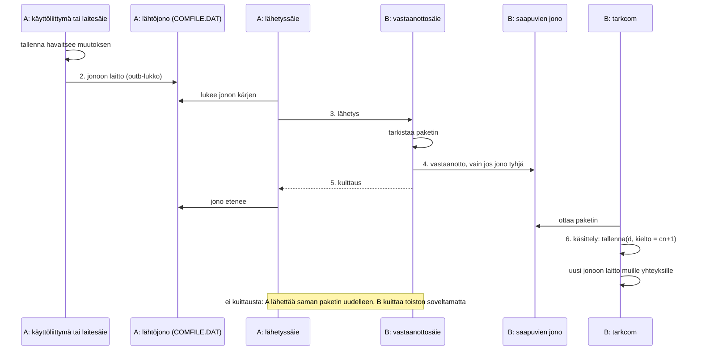

# 09 Työasemien tiedonsiirto: yhteydet, kuittaukset, jonot ja uudelleenyhteydet

<!-- malli: Käsikirjan lukupohja (K-3). Ohje: doc/tietopohja/laatu/k3-kirjoittajan-ohje.md.
Luvun 5 vikaluettelo generoidaan tiedostosta kasikirja/toiminnot.csv komennolla
python -I doc/arkkitehtuuri/tyokalut/tietopohja.py . kasikirja; sitä ei kirjoiteta käsin. -->

> **Tila:** alustava K-3-aineisto, ei riippumattomasti tarkastettu. Lähderevisio: tuotantokoodi
> `f7fe553` (ennallaan, `doc/arkkitehtuuri/CHECKPOINT.md`). Varmuusmerkinnät: [todennettu],
> [päätelty], [tuntematon]; "luettu käsikirjaa varten" = luettu koodista K-vaiheessa, ei tarkastettu.

Luku kertoo, miten kilpailun työasemat pitävät tietonsa yhtenevinä keskenään: millaisia yhteyksiä
ohjelmat käyttävät, mitä ja milloin lähetetään, mikä on jonoon laitto, lähetys, vastaanotto ja
kuittaus, ja mitä tapahtuu, kun yhteys katkeaa. Luku nojaa pääosin auditointiraporttiin
`doc/arkkitehtuuri/tiedonsiirto.md` (jäljempänä "tiedonsiirto.md"), levyjonon osalta
`tiedostomuodot.md`:iin ja emit-aineiston lukuun 8 (`aineisto/emit-luenta.md`). Polut ovat
suhteessa hakemistoon `TPsource/V52/`. Lyhenteet: HKM = HkMaali, HKW = HkKisaWin, VM = ViestiMaali,
VW = ViestiWin, VL = ViestiLuenta.

Luku ei kuvaa sanomien sisäistä rakennetta eikä sitä, miten verkkovikoja voisi hyödyntää; ne on
jätetty tarkoituksella pois. Lukijalaitteiden (Emit-lukija, kello) kuittaus on eri asia kuin
työasemien välinen kuittaus ja kuuluu lukuun 10; tässä luvussa "kuittaus" tarkoittaa työasemien välistä
kuittausta, ellei toisin sanota. Verkkoyhteyden käyttöönotto käytännössä (IP-numerot, palomuuri, portit)
on käyttöohjeessa `docs-site/docs/suunnistuskilpailu/verkon_maarittelyt.md`.

Tiedonsiirtoa ei ole ajettu kahden aseman kokeessa tämän aineiston laatimisessa. Auditoinnin väitteet
ovat staattista lähdetarkastusta; osa vioista on toistettu yksittäisessä testikehyksessä (ks. luku 5
generoidut kortit ja luku 6).

## 1. Mitä tapahtuu

### 1.1 Periaate: työasemat jäljentävät tilan, eivät operaatioita

Kun yhdellä työasemalla muuttuu kilpailijan tieto (esimerkiksi tulos tai tila), ohjelma lähettää
muille työasemille koko muuttuneen tietueen (tai vaiheen tai yksittäisen kentän) uutena kopiona.
Vastaanottaja korvaa oman tietonsa saapuneella kopiolla, ja **viimeksi saapunut voittaa**.
Sanomissa ei ole versiota, aikaleimaa eikä tietoa siitä, mikä asema ne lähetti. Ainoa
järjestysnumero on lyhyt, yhteyskohtainen kuittausnumero, joka nollautuu jokaisessa yhteyden
(uudelleen)avauksessa. Ohjelma ei korjaa työasemien eriytymistä jälkikäteen; ainoa korjauskeino on
kopioida `KILP.DAT` käsin [todennettu: tiedonsiirto.md "Johtopäätös"].

Yhden yhteyden sisällä toimitus on järjestyksessä ja luotettava: yksi kuittaamaton paketti kerrallaan
(pysähdy-ja-odota), jono on yhteyskohtaisesti FIFO, ja saman paketin toisto tunnistetaan. Ongelmat
syntyvät yhteyksien rajapinnoissa: samanaikaiset muutokset eri koneilla, yhteyskatkot,
uudelleenkäynnistykset, eri tietuenumerot ja asemien erilaiset asetukset [todennettu:
tiedonsiirto.md "Johtopäätös"].

Jokainen yhteys on kahden aseman välinen. Useamman aseman verkko muodostetaan monesta
kaksipisteyhteydestä (ketju tai tähti); tiedon välitystä asemalta toiselle käsitellään kohdassa 1.7
[todennettu: tiedonsiirto.md "Kuljetus ja yhteystyypit"]. Yhteyksiä on enintään `MAX_LAHPORTTI`
(64 kaikissa viidessä ohjelmassa, projektien määritykset tarkistettu 2026-11-27).

### 1.2 Yhteystyypit

Yhteys määritellään asetustiedostossa avaimella `YHTEYSy=` (tai `COMy=`), jossa `y` on yhteyden
numero. Avaimen arvo kertoo tyypin ja osoitteen [todennettu: käyttöohje `hkkisawin/hkliite1.md`;
`suunnistuskilpailu/konfiguraatiotiedostot1.md`; jäsennin `Hk/HkInit.cpp:388-474`, `:1106-1160`,
`Juk/VInit.cpp:1052-1110`]. Vertaisia ei etsitä verkosta: osoitteet ovat kiinteitä, paitsi UDP:n
`AUTO`-osoite, jonka ohjelma oppii saapuvista paketeista [todennettu: tiedonsiirto.md "Kuljetus"].

| Tyyppi | Asetus (esimerkki) | Mihin käytetään | Huomioita |
|---|---|---|---|
| Sarjaportti (RS-232) | `COMy=n`, `BAUDy=...` | aseman välinen yhteys nollamodeemilla; vanhin tyyppi | tiukka vuorottelu: seuraava paketti vasta vastapuolen kuittauksen (NAK-kyselyn) jälkeen; yksi säie hoitaa molemmat suunnat [todennettu: tiedonsiirto.md] |
| UDP | `YHTEYSy=UDP:oma_portti/osoite:kohdeportti`, suuntarajaus `UDPI`/`UDPO` | tavallinen yhteys työasemien välillä (käyttöohje: "normaalisti käytettävä yhteysprotokolla") | oletusportti `PORTBASE` (15900) + yhteyden numero; kaksi säiettä (vastaanotto, lähetys) yhteyttä kohti; `UDPI` vain vastaanotto, `UDPO` vain lähetys [todennettu: käyttöohje; `Hk/HkInit.cpp:388-415`] |
| UDP, kuittaamaton ("BRO") | `YHTEYSy=BRO...` | yksisuuntainen lähetys ilman odotusta | lähettäjä merkitsee paketin lähetetyksi odottamatta kuittausta; tarkoitettu, ei vika [luettu käsikirjaa varten, ei tarkastettu: `Hk/HkInit.cpp:1112-1115`, `Tp/TpComY.cpp:1531-1536`] |
| TCP-asiakas / -palvelin | `YHTEYSy=TCP:osoite:portti` (asiakas), palvelinmuoto `TCPS` | tavallinen aseman välinen yhteys TCP:llä sekä ulkoiset lukijat ja palvelut | jo muodostetulla asiakasyhteydellä on uudelleenyhteys, mutta epäonnistunut ensimmäinen avaus on pysyvä (H-027, kohta 1.8); toinen saapuva yhteys korvaa elävän (H-028) |
| TCP, XML (`TCPX`, `TCPSX`) | `YHTEYSy=TCPX:osoite:portti` | lähtevä XML-muotoinen tulosvirta ulkoiselle palvelulle (esim. verkkotulospalvelu) | vain lähtösuunta [todennettu: tiedonsiirto.md]; ks. kohta 1.8 ja luku 11 |
| TCP, loki (`TCPL`) | `YHTEYSy=TCPL:...` | lokirivien lähetys TCP:llä | ei aseman välinen tietojen jäljennös; H-093 koskee tätä yhteyttä (HK) |
| UDP-virta (laitteet, tulostaulut) | laiteavaimet (esim. `TAULU_COM=`) | laitteet ja tulostaulut | ei työasemien välinen [päätelty: tiedonsiirto.md]; ks. luku 10 |
| Tiedostonsiirto-TCP | `FILETCPy=...` | automaattisesti kirjoitetun tulostiedoston lähetys TCP-yhteydellä | luku 11 |

Kuollutta tai toimittamatonta: `comtpTCPIMPORT` ja koodi `SIIMPORT` (valitsinta ei määritellä missään
projektissa, ei linkittyisi; T-012) sekä `Tp/TpComY32.cpp` (vanha kopio ilman kättelyä ja tiedostonsiirtoa,
ei käännetä; T-011) [todennettu: tiedonsiirto.md; `rekisteri/valitsimet.csv`]. Näitä ei kuvata
toimitetun ohjelman ominaisuuksina.

**Yhteyden suunta ja rajaus.** Jokaisella yhteydellä on lähetyssuunta (`lahcom`) ja vastaanottosuunta
(`vastcom`); suunnan voi rajata yksisuuntaiseksi, esimerkiksi kuuluttajan koneelle (`udpo`) tai maalista
vastaanotettavaksi (`udpi`) [todennettu: käyttöohje `suunnistuskilpailu/konfiguraatiotiedostot1.md`;
`Hk/HkInit.cpp:388-474`]. Avain `VÄLITÄy=EI` kieltää saapuvien muutosten välittämisen eteenpäin tälle
yhteydelle (kohta 1.7). Avain `KONE=xx` antaa asemalle kaksikirjaimisen tunnuksen, joka näkyy
yhteyden vastapäässä [todennettu: käyttöohje `hkkisawin/hkliite1.md`].

### 1.3 Yhteyden avaus, kättely ja yhteyden tila

Jokainen yhteyden avaus tai uudelleenavaus alkaa alkusanomalla, joka kertoo vastapuolelle aseman
tunnuksen ja koneen tunnuksen, HK:ssa vaiheen numeron (viestissä 0), tietueiden lukumäärän ja
muutamia lippuja. Vastaanottaja nollaa tällöin yhteyden kuittausnumeron. Alkusanoman tarkistus tehdään
vastaanottosäikeessä [todennettu: tiedonsiirto.md "Kättely ja lopetus"]:

- **Eri vaihe, ei vaiheenvaihdon lippua:** lähetys yhteydelle estetään (`com_keskeytt`).
- **Eri tietueiden lukumäärä:** vain varoitus; poistuminen on kommentoitu pois. Eri koneilla olevat
  `KILP.DAT`-tiedostot eivät siis estä yhteyttä (ks. 1.10).
- **Vaiheenvaihdon lippu:** vastaanottaja pyytää vaihdon (`pyyda_vaihdavaihe`). Jos vaihto evätään,
  yhteys hyväksytään silti (H-023). Vaiheen vaihdon kulku on luvussa 08.
- **HK- ja viestiasema eivät voi olla yhteydessä keskenään:** viesti hylkää vaiheen, joka ei ole 0.
  Ohjelmaversio ei kulje paketeissa [todennettu: tiedonsiirto.md].

**Yhteyden tila näkyy käyttäjälle** UDP-yhteydellä seuraavasti [luettu käsikirjaa varten, ei
tarkastettu: `Tp/TpComY.cpp:975-985`, `:1805-1830`]: jokainen vastaanotettu paketti nostaa
yhteyskohtaisen elossaolo-laskurin arvoon 5 (`Tp/TpComY.cpp:976-990`). Laskuria vähentää kaksi
tahoa: lähettäjäsäie jokaisesta omasta tyhjäkäynnin kyselystään (NAK, jota käytetään myös
tyhjäkäynnin kyselynä; `:1861-1862`), ja vastaanottosäie, kun yli sekunti on kulunut ilman
saapunutta pakettia (`:982-983`). Koska myös vastapuolen NAK on saapunut paketti ja nostaa
laskurin arvoon 5, tila "On" voi tarkoittaa pelkkiä vastapuolen tyhjäkäyntikyselyjä
[todennettu: koodi]. Kun laskuri on ollut nollassa yli kymmenen
tyhjäkierroksen ajan, yhteyden tilaksi näytetään "Ei", muuten "On" tai, jos valitsin `KONETUNN` on käytössä
(kaikissa viidessä ohjelmassa), naapurin konetunnus. Konsoliohjelmissa tila on tilariveillä, GUI-ohjelmissa
yhteystilalomakkeessa (`cbTp/UnitYhteysStatus.cpp`, taulukko `YhteysGrid`). "On" tarkoittaa, että
paketteja on tullut vastapuolelta äskettäin; se ei takaa, että vastapuolen ohjelma on käsitellyt mitään.
Tämä laskuri on UDP:n elävyysvalvonta. TCP-yhteydellä on oma "Ei"-tila: kun `TCPyht_on` ei
pidä, säie kirjoittaa yhteyden tilaksi "Ei" ja yrittää uudelleenyhteyttä
(`Tp/TpComY.cpp:1285-1287`) [todennettu: koodi]; muiden yhteystyyppien (RS ym.) osalta ei ole
luettu, onko erillistä valvontaa [tuntematon]; ks. T-048 lukijayhteyksistä.

Valinnainen `MONITORI` (`MONITORVÄLI`, oletus 10 s) lähettää säännöllisesti tilasanomia, joita
erillinen `InstanssiMonitori`-ohjelma voi seurata. Käyttöohje antaa oletusportiksi 14900, koodi 14770
(T-014) [todennettu: käyttöohje `hkkisawin/hkliite1.md`; T-014 rekisterissä].

### 1.4 Mitä lähetetään ja milloin

Työasemien välillä kulkee useita sisällöltään erilaisia sanomalajeja (pakettiluokkia). Lähetys alkaa
aina siitä, että ohjelmassa tapahtuu muutos, ei ajastimesta. Taulukossa on sanomalajit, laukaisija ja
se, mitkä ohjelmat osallistuvat. Sanomien sisäistä rakennetta ei kuvata.

| Sanomalaji | Laukaisija lähettäjällä | Vastaanotossa | HK | Viesti |
|---|---|---|---|---|
| Kilpailijan perustiedot | `tallenna` havaitsee muutoksen (`kilpcmp`), kutsuu `laheta`a | korvaa kaikki perustiedot, paitsi kentät, joiden koko on asetettu nollaksi; vaiheita ei kosketa | `KILPT` | `KILPT` (tietue raakana) |
| Vaiheen tiedot (aktiivinen vaihe ilman väliaikoja, muut vaiheet väliaikoineen) | sama | korvaa vaiheen tiedot | `KILPPVT` | – |
| Osuuden tiedot (muutosmaskin kentät) | sama | soveltaa vain maskin kentät | – | `OSUUST` |
| Yksittäinen aika tai kenttä (yksi väliaika, keskeytys/hylkäys, sakkotieto, tasoitus) | sama | soveltaa yhden kentän | `VAIN_TULOST` | `VAIN_TULOST` |
| Tarkastusmerkintä ja sakot | sama | – | – | `TARKT` |
| Ajanottotieto | uusi tai muutettu aikarivi aikajonossa; vain jos yhteydelle on annettu ajanottojen siirto (`LÄHAIKAy`, `YHTEYSAJAT`) | tallennetaan vastaanottajan aikajonoon; käsitellään vain jos vastaanottajalla on ajanotto päällä | `AIKAT` (`laheta_aika`, vain `MAALI`) | `AIKAT`; ViestiLuenta ei käsittele |
| Emit-kortti | käsitelty tai luettu emit-kortti (luku 05) ja yhteydellä `LÄHEMITn`-asetus (`=I`, `=O`, `=V` rajaavat suunnan) | lisätään vastaanottajan emit-tiedoston loppuun | `EMITT` | `EMITT`, `VEMITT`; ViestiLuenta ei vastaanota |
| Emit-väliaikatieto | `LÄHEMVAn`-asetus ja emit-väliaikojen jakelu | tallennetaan | `EMITVA` | `EMITVA` |
| Yhteislähtöajat | sarjan yhteislähtö (viesti) | sovelletaan sarjalle | – | `YHTEISLAHTOT` |
| Seura | seuran lisäys tai muutos seuravalinnassa | lisätään seuraluetteloon | `SEURAT` (`SEURAVAL`, vain HK) | – |
| Muut komennot | erälähtö, ampumahiihdon sakkopaikan sanoma, testilähetyksen käynnistys, kauko-ohjattu sulkeminen, emit-tunnisteen (badge) aika | tulkitaan komentona (`tark_extra`) | `EXTRA` | `EXTRA` (sisältö luettu vain HK:n osalta) |
| Tiedosto | tiedoston lähetys yhteyden yli | tallennetaan levylle (`tark_tiedosto`); paketin pituutta ja kohdetiedostoa ei tarkisteta riittävästi (H-071) | `FILESEND` | `FILESEND` |
| Kellonaika | `LÄHKELLOy=xx` lähettää kellonajan xx sekunnin välein | laitteiden kellojen synkronointi | kyllä | – (avainta ei jäsennetä) |

[todennettu: tiedonsiirto.md "Sarjallistaminen", "HK ja viesti"; luettu käsikirjaa varten, ei
tarkastettu: sanomalajien nimet ja jakelu `Hk/HkCom32.cpp:40-60`, `:167-300`, `:356-380`, `:875-964`,
`Juk/VCom.cpp:62-77`, `:893-990`]. Vastaanotossa käsittelyehdot ovat käännösvalitsimia: HK käsittelee
`EMITT`-sanoman, kun `EMIT && (MAALI || TALLEMIT) && !EILEIMAT`, viesti kun
`EMITLEIMAT && MAALI && !LUENTA` (siksi ViestiLuenta ei vastaanota emit-kortteja ja ViestiMaali ja
ViestiWin vastaanottavat) [luettu käsikirjaa varten, ei tarkastettu; ViestiLuennan osalta
`aineisto/emit-luenta.md` luku 7].

**Lähetyksen rajaus.** `laheta` käy kaikki yhteydet läpi ja ohittaa yhteyden, joka on suljettu, jolle ei
lähetetä (`lahcom`), jolle lähettäminen on kielletty (`VÄLITÄy=EI` koskee välitystä), joka on
"vain kellolähetys", sekä sen yhteyden, josta muutos alun perin saapui [luettu käsikirjaa varten, ei
tarkastettu: `Hk/HkCom32.cpp:167-225`]. XML-TCP-yhteydelle ei lähetetä hyväksymismuutoksia
(`hyv_muutos`) [luettu käsikirjaa varten, ei tarkastettu: sama, `:184`].

**Mitä ei lähetetä.** Lähetys ei tapahdu, jos muutos jää ilman tallennusta tai `tallenna` ei havaitse
eroa vanhaan tietueeseen. `laheta` vaatii aina `kilpcmp`:n löytämän todellisen muutoksen, joten
pakotettu paketti ei kierrä HK-renkaassa loputtomasti [todennettu: tiedonsiirto.md "Kumottu"].

### 1.5 Jonoon laitto, lähetys, vastaanotto, kuittaus ja käsittely

Nämä ovat eri vaiheita, ja jokainen voi epäonnistua erikseen [todennettu: tiedonsiirto.md "Kehys ja
kuittaus", "Jonot ja levypuskuri"; emit-luenta luku 8.2].

| # | Vaihe | Missä | Mitä se tarkoittaa | Mitä se ei takaa |
|---|---|---|---|---|
| 1 | **Kutsu** | `tallenna` → `laheta` | ohjelma päättää lähettää muutoksen | ei vielä mitään jonossa |
| 2 | **Jonoon laitto** | `buflah` `outb`-lukon alla (`Tp/TpComY.cpp:476-530`) | paketin tavut kirjoitetaan yhteyden lähetysjonoon: levyjonossa `COMFILE.DAT`:iin, muistijonossa muistiin | ei lähetystä; levyjonossa kirjoitusvirhe ei estä jonon etenemistä (H-044); paketin sisältö on jonoon laittohetken tila |
| 3 | **Lähetys verkkoon** | lähetyssäie (`tiedonsiirtoUDP`, `tiedonsiirtoTCP`, RS: `tiedonsiirto`) lukee jonon kärjen (`lahetapaketti`) | paketti kirjoitetaan yhteyteen | ei vastaanottoa |
| 4 | **Vastaanotto** | vastaanottosäie (`luepakettiUDP`, `TCPrcvTh`) tarkistaa paketin eheyden ja järjestysnumeron ja lisää sen saapuvien jonoon (`addseur`) | paketti on vastaanottajan muistissa | ei käsittelyä eikä levytallennusta |
| 5 | **Kuittaus** | vastaanottosäie lähettää kuittauksen, kun paketti on hyväksytty saapuvien jonoon; lähettäjän `kirjaahyv` siirtää jonoa vasta kuittauksesta | lähettäjä tietää, että vastapää on ottanut paketin vastaan | ei sitä, että vastaanottaja on soveltanut sen |
| 6 | **Käsittely** | `tarkcom`-säie (omassa säikeessään, 50 ms tauolla HK:ssa, 15 ms viestissä) jakaa paketit luokan mukaan ja tallentaa tiedon (`tallenna`, `kielto = cn+1`) | tieto päätyy vastaanottajan tietueisiin ja `KILP.DAT`:iin | ei välitä lähettäjälle mitään; muille yhteyksille lähtee uusi paketti kohdan 1.7 mukaan |

Kuittaus (vaihe 5) tulee siis ennen käsittelyä (vaihe 6) [päätelty: tiedonsiirto.md sekvenssikaavio;
emit-luenta F5; luettu käsikirjaa varten, ei tarkastettu: `Tp/TpComY.cpp:1008-1050`, kuittaus
annetaan `addseur`in onnistuttua]. Jos vastaanottajan käsittely, esimerkiksi `KILP.DAT`-kirjoitus tai
emit-tiedoston `addem`, epäonnistuu kuittauksen jälkeen, lähettäjä ei saa siitä tietoa
[päätelty: emit-luenta luku 8.1 ja 8.6].

**Yksi käsittelemätön paketti kerrallaan.** Muut kuin RS-yhteydet lisäävät saapuvan paketin jonoon vain,
kun saapuvien jono on tyhjä [todennettu: tiedonsiirto.md; `Tp/TpComY.cpp:649-650`]: koko ohjelmassa on
enintään yksi käsittelemätön saapuva paketti. Jos jonossa on jo paketti, uusi paketti ei mene jonoon eikä saa
kuittausta, ja lähettäjän toisto yrittää myöhemmin uudelleen [päätelty koodista: `addseur` palauttaa
virheen, kuittauksen sijaan lähtee NAK; luettu käsikirjaa varten, ei tarkastettu:
`Tp/TpComY.cpp:1040-1062`]. Tämän vuoksi hidas käsittely (esimerkiksi vastaanotossa avattu dialogi
lukon ollessa varattuna) hidastaa koko yhteyttä.

### 1.6 Lähetysjono: levyjono ja muistijono

| Tila | Oletus | Kun jono täyttyy | Käynnistyksessä |
|---|---|---|---|
| **Levyjono** `COMFILE.DAT` | HK: oletus, `COMFILE` tai `COMFILE=S`; viesti: aina päällä (`COMFILE=EI` on koodissa kommentoitu pois, `Juk/VInit.cpp:1217-1219`) | kasvaa rajatta | kuittaamattomat paketit säilyvät |
| **Muistijono** | HK: `COMFILE=EI` (50 paikkaa yhteyttä kohden, `OUTBUFL`) | uusi paketti pudotetaan; varoitus jo kohdissa 25 ja 38 (H-021) | jono katoaa |

[todennettu: tiedonsiirto.md "Jonot ja levypuskuri"; `Hk/HkInit.cpp:1254-1260`, `Juk/VInit.cpp:1216-1220`
luettu käsikirjaa varten]. Levyjonoon tallennetaan paketin tavut jonoon laittohetkellä ja lähetetään
tallennettu kopio. Levyjonon rakenne ja tiedostoasetukset ovat luvussa 03 ja `tiedostomuodot.md`:ssä
(`COMFILE.DAT`); tässä riittää, että tiedostossa on yksi paikka kutakin yhteyttä ja pakettia kohti ja
että jono kuvaa kullekin yhteydelle kaksi osoitinta: mihin asti paketit on laitettu jonoon ja mihin asti ne
on kuitattu lähetetyiksi. Monivaiheisessa kilpailussa tiedostoja on yksi vaihetta kohden
(`COMFILE1.DAT`, `COMFILE2.DAT` jne.) [todennettu: käyttöohje `suunnistuskilpailu/tietojen_jakelu.md`].

Muistijonoa käytettäessä ei ole levyjonon suojaa ohjelman uudelleenkäynnistykseltä; ajetaanko
kilpailuja käytännössä ilman levypuskuria, on tuntematon (Q90).

### 1.7 Vastaanotto vertaisella ja tiedon välitys eteenpäin

`tarkcom` käy saapuvat paketit läpi ja tallentaa ne [todennettu: tiedonsiirto.md "Reititys ja välitys"]:

1. Kilpailijapaketit menevät `tark_kilp`-käsittelyyn: tietue luetaan, uusi tieto puretaan sen päälle ja
   tallennetaan `tallenna(d, kielto = cn+1)`. `KILP.DAT` kirjoitetaan vastaanottajalla (luku 03).
2. Koska `kielto = cn+1`, `tallenna` → `laheta` välittää muutoksen **kaikille muille yhteyksille paitsi
   lähteelle** ja yhteyksille, joille välitys on kielletty (`VÄLITÄy=EI`). Varsinaista reititystaulukkoa ei
   ole. Ketjut ja tähdet toimivat; silmukkatopologiassa (mesh) vanha tila voi saapua toista reittiä ja jäädä
   voimaan (H-039, HK, ei tarkastettu). Viestissä `tark_ylahto` voi lisäksi välittää myös muuttumattoman
   tiedon, kun `KATKKIERTO` ei ole päällä (Q22, avoin).
3. **HK ja viesti lukitsevat eri tavoin.** HK:n `tark_kilp` lukee tietueen ennen `tall_CS`-lukkoa, joten
   vastaanotto voi korvata paikallisen muutoksen, joka tehtiin samalla hetkellä (H-007). Viestissä lukko
   otetaan ennen lukua eikä H-007 koske sitä (Q16 ratkaistu) [todennettu: tiedonsiirto.md "HK ja
   viesti"].
4. Vastaanottaja ei tarkista kilpailijanumeroa kaikista paketeista: HK tarkistaa vain perustietopaketin
   (H-022), viesti myös osuus-, tarkastus- ja yksittäisen kentän paketit. Jos tietueet ovat eri koneilla
   epäyhtäpitävät, ohjelma ilmoittaa "Tiedostot eri koneilla eivät ole yhtäpitäviä" ja neuvoo kopioimaan
   `KILP.DAT`:n lähettävältä koneelta [todennettu: tiedonsiirto.md; viestin ilmoitus
   luku 07 kohta 1.12; luettu käsikirjaa varten, ei tarkastettu: `Hk/HkCom32.cpp:326-345`].
5. Emit-paketti (`EMITT`) lisätään vastaanottajan emit-tiedoston loppuun omalla järjestysnumerollaan, ja
   kilpailijan tulos tulee erillisenä kilpailijapakettina. Vastaanottaja ei laske tulosta uudelleen emit-kortin
   perusteella [todennettu: emit-luenta luku 2.9].

**Tuntematon sanomalaji.** HK ohittaa tuntemattoman luokan. Viesti ilmoittaa "Tuntematon sanomalaji,
ohjelmat eivät sovi yhteen", eikä käsittely etene: koko vastaanotto pysähtyy pysyvästi (H-026)
[todennettu: tiedonsiirto.md; luettu käsikirjaa varten, ei tarkastettu: `Juk/VCom.cpp:971-974`].

**Etäkomennot.** Sanomalaji `EXTRA` kuljettaa pieniä komentoja: erälähtöajan välityksen, ampumahiihdon
sakkosanoman, testilähetyksen käynnistyksen ja pyynnön sulkea toisen aseman ohjelma. Näiden tarkistamattomat
indeksit ovat tunnettu vika (H-072), ja testilähetyksen käynnistäminen etäpyynnöstä jakaa tilan työsäikeiden kesken
(H-101) [todennettu: rekisteririvit; luettu käsikirjaa varten, ei tarkastettu: `Hk/HkCom32.cpp:619-690`].
Käyttäjä lähettää sulkupyynnön GUI:n uusinta-lomakkeelta (`cbTp/UnitUusinta.cpp`); lomake kysyy salasanan,
jos asetus `sulkusalasana` on annettu [luettu käsikirjaa varten, ei tarkastettu].

### 1.8 Uudelleenyhteys ja uudelleenlähetys

Uudelleenlähetys tapahtuu neljällä eri tasolla:

1. **Saman paketin toisto yhteyden sisällä.** Jos kuittaus ei tule, lähettäjä lähettää saman paketin
   uudelleen samalla numerolla; vastaanottaja kuittaa toiston soveltamatta sitä. UDP:ssä
   vastaanottaja tunnistaa edellisen tai kahden edellisen numeron toistoksi, mutta kuittaa
   toistona vain välittömästi edellisen paketin; vanhemmat eivät saa toistokuittausta
   (`Tp/TpComY.cpp:1019-1030`, `hyvp` asetetaan vain, kun `id == inpakid`) [todennettu: koodi]. Lähettäjä pitää kutakin
   yhteyttä kohti yhden kuittaamattoman paketin [todennettu: tiedonsiirto.md "Kehys ja kuittaus"; luettu
   käsikirjaa varten, ei tarkastettu: `Tp/TpComY.cpp:1008-1030`]. UDP-lähettäjä odottaa kuittausta
   toistuvasti kasvavan viiveen ajan ennen kuin yrittää uudelleen [luettu käsikirjaa varten, ei
   tarkastettu: `Tp/TpComY.cpp:1531-1560`]. TCP-virtayhteyksillä saa kuittaamattomia paketteja useita
   kerrallaan vai ei, on avoin (Q20).
2. **Yhteyden uudelleenavaus.** Alkusanoma nollaa kuittausnumeron ja kättely käydään uudelleen (1.3). Katkon
   aikana matkalla ollut paketti voidaan soveltaa kahdesti (H-034, kohta 1.9). **TCP-asiakkaan
   uudelleenyhteys:** jo muodostetulla asiakasyhteydellä on uudelleenyhteyspolku: kun
   yhteys katkeaa, säie kutsuu `reconnectTCP`:tä (`Tp/TpComY.cpp:1285-1290`,
   `com/WinUDP.cpp:617-627`). Pysyvä on vain epäonnistunut ensimmäinen avaus: jos palvelin on
   alhaalla jo ensimmäisellä yrityksellä, yhteyssäie päättyy eikä yritä uudelleen
   (`Tp/TpComY.cpp:1273-1275`) ennen ohjelman uudelleenkäynnistystä. TCPXML-yhteyden
   uudelleenyhteys voi lisäksi kaataa ohjelman (H-027-kortti; seuranta.md KE-19). Uudelleenyhteyspolun
   toimivuutta ei ole kokeiltu [luettu koodista, ei ajettu]; TCP-palvelimessa uusi saapuva yhteys korvaa elävän yhteyden sulkematta sitä
   (H-028); UDP-yhteyden kohdeosoite ja -portti voivat vaihtua minkä tahansa vastaanotetun datagrammin
   perusteella, myös kiinteästi määritellyllä osoitteella (H-029) [todennettu: tiedonsiirto.md "Löydökset"].
   RS-yhteydellä avausvirhe tuottaa ilmoituksen eikä uudelleenyritystä [todennettu: luku 10 kohta 1.1].
3. **Ohjelman uudelleenkäynnistys.** Levyjonossa olevat kuittaamattomat paketit lähetetään uudelleen
   alkuperäisessä järjestyksessä; kuitattuja ei lähetetä uudelleen (tarkastaja kumosi tämän väitteen).
   Käynnistyksessä ohjelma kysyy, säilytetäänkö levyjono (kohta 1.11). Muistijonon paketit ovat tällöin
   kadonneet [todennettu: tiedonsiirto.md "Jonot ja levypuskuri", "Kättely ja lopetus"].
4. **Uusintalähetys käsin tai automaattisesti** (`merk_uusinta`). Käyttäjä voi merkitä jonoon jo kuitattuja
   paketteja uudelleen lähetettäviksi: GUI:ssa uusinta-lomake (yhteys, kaikki tai viimeiset N minuuttia,
   sarja- ja aikarajaus), konsoliohjelmissa `SERVER`-valitsimen valikko. XML-TCP-yhteydellä uusinta ajetaan
   automaattisesti yhteyden ensimmäisessä käytössä. Koska levyjono tallentaa paketin sisällön
   jonoon laittohetkellä, uusinta lähettää **vanhoja tilannekuvia**, jotka voivat kumota vastaanottajan
   uudemmat muutokset (H-030). Konsolin `SERVER`-valikon uusinta (`lahetanumerotTCP`) lukee jonoa väärällä
   askeleella (H-048) [todennettu: tiedonsiirto.md "Jonot ja levypuskuri", H-030, H-048; luettu
   käsikirjaa varten, ei tarkastettu: `Tp/TpComY.cpp:1111-1167`, `Hk/HkCom32.cpp:972-990`,
   `cbTp/UnitUusinta.cpp:47-90`]. Vanha jono ei siis ole luotettava keino palauttaa vastaanottajan tila.

**XML-TCP ei kuittaa samalla tavoin.** XML-TCP-yhteyden lähetys (`lahetaXML_TCP`) siirtää jonoa sen perusteella,
että kirjoitus yhteyteen onnistui (kirjoitettu tavumäärä vastaa pituutta; myös pituudeltaan 0 oleva paketti siirtää jonoa, `len == nsent_tot`), ja merkitsee lähetysajan jonoon
[luettu käsikirjaa varten, ei tarkastettu: `Hk/HkCom32.cpp:1058-1074`]. Vastaanottavan ulkoisen palvelun
kuittausta ei odoteta tällä polulla; kyse on kutsun onnistumisesta, ei vastapään kuittauksesta.

### 1.9 Kaksoiskappaleet

| Taso | Mekanismi | Raja | Lähde |
|---|---|---|---|
| Yhteyden sisällä | Edellisen numeron toisto kuitataan uudelleen soveltamatta | Yhteyskohtainen; nollautuu yhteyden uudelleenavauksessa ja ohjelman uudelleenkäynnistyksessä | [todennettu: tiedonsiirto.md] |
| Uudelleenyhteys tai uudelleenkäynnistys | Ei ole | Katkon aikana matkalla ollut paketti voidaan soveltaa kahdesti (H-034) | [todennettu, osittain tarkastettu: H-034] |
| Emit-kortti | `on_emit`-taulu (lukuaika ja koodi); laite- ja lukijatasolla oma tunnistus | Ei talletu levylle, nollautuu käynnistyksessä (H-034); laskuri ei nollaudu vaiheen vaihdossa (H-141); asetus `SALLIEMITTOISTO` kytkee pois | [todennettu: emit-luenta luku 8.5] |
| Ajanottotieto (`AIKAT`) | Ei tunnistusta paketin tasolla | Sovelletaanko kaksoiskappale kahdesti, on avoin (Q19) | [tuntematon: Q19] |
| Kilpailijan tilannekuva | Toisto ei useimmiten muuta lopputulosta, koska paketti korvaa koko tiedon | Vaikutus riippuu siitä, onko vastaanottajalla jo uudempi tieto | [päätelty: H-034 rekisteririvi] |

Uudelleenkäynnistyksen jälkeen sama emit-paketti voi siis päätyä vastaanottajan emit-tiedostoon kahdesti,
koska lähettäjän jonon kuittaamaton loppuosa lähetetään uudelleen ja vastaanottajan kaksoiskappaleiden esto on
tyhjä [päätelty H-034:stä; emit-luenta luku 8.5].

### 1.10 Eriytyminen työasemien välillä

Työasemien tiedot voivat erota toisistaan, eikä ohjelma kerro siitä käyttäjälle muuta kuin yllä mainitulla
"Tiedostot eri koneilla eivät ole yhtäpitäviä" -ilmoituksella, joka tulee vain kun vastaanotettu paketti ei
täsmää omaan tietueeseen. Tunnetut tavat [todennettu: tiedonsiirto.md; emit-luenta luku 8.6]:

- **Samanaikaiset muutokset tai katko.** Jos kaksi asemaa muuttaa samaa tietuetta yhteyskatkon aikana samassa
  sanomalajissa, yhteyden palautuessa kumpikin saa toisen muutoksen ja menettää oman (muutokset vaihtuvat
  ristiin; H-016). Vastaanoton lukuikkuna voi kumota paikallisen muutoksen (H-007).
- **Samanaikaiset lisäykset.** Kaksi asemaa, jotka lisäävät kilpailijan samaan aikaan, antavat tälle saman
  tietuenumeron; HK soveltaa vaihe- ja yksittäisen kentän paketin väärälle kilpailijalle, koska numeroa ei tarkisteta
  (H-022). Tietuenumero on paikallinen tiedostoindeksi (luku 03).
- **Vaiheiden erot.** Yksittäisen kentän paketti sovelletaan vastaanottajan omaan vaiheeseen, ja yhteys
  hyväksytään, vaikka vaiheen vaihto evätään (H-023).
- **Jonon menetys.** Täysi muistijono pudottaa paketin (H-021), levyjonon kirjoitusvirhe jättää paketin
  lähettämättä (H-044), käynnistyksessä vastattu "Ei" hävittää lähettämättömät (H-038), ja viestissä tuntematon
  sanomalaji pysäyttää vastaanoton (H-026).
- **Käyttäjän aiheuttama.** Uusinta lähettää vanhoja tilannekuvia (H-030); yhteydet ilman `LÄHEMITn`-asetusta
  kuljettavat kilpailijan tuloksen mutta eivät emit-tietuetta [todennettu: emit-luenta luku 8.6].
- **Konfiguraatioerot.** Vastaanottaja hyväksyy paketin vain, jos sen pituus vastaa odotettua luokan pituutta.
  Kaikilla asemilla on siksi oltava samat kenttäpituudet: HK:n pituudet tulevat ajonaikaisista
  kenttäpituusasetuksista, viestin käännösaikaisista vakioista (`MAXOSUUSLUKU`, `VAIKALUKU`; ViestiWinin
  konfiguraatiot eroavat konsoliohjelmien vastaavista). Eri tavalla käännetyt tai asetetut asemat hylkäävät
  toistensa paketit hiljaa [todennettu: tiedonsiirto.md "Käännös ja yhteensopivuus"].
- **Korjaus.** Jälkikäteen ei ole sovitusta. Emit-tiedostolle ei ole täsmäytystä asemien välillä
  [todennettu: tiedonsiirto.md "Johtopäätös"; emit-luenta luku 8.6]. Käyttöohje neuvoo poistamaan `COMFILE.DAT`:n
  silloin, kun `KILP.DAT` jaetaan eri koneille, koska tiedosto voi sisältää lähettämättömiä sanomia, jotka
  aiheuttavat virhetilanteita [todennettu: käyttöohje `suunnistuskilpailu/tietojen_jakelu.md`].

Kolmen tai viiden aseman renkaassa ristiriitaisten muutosten asettuminen on avoin (Q21).

### 1.11 Käynnistys ja lopetus: `COMFILE.DAT`-kysely

Käynnistyksessä (`initcom` → `opencomfile`, `Tp/TpComY.cpp:2258-2370`) ohjelma lukee levyjonon ja laskee kutakin
yhteyttä kohti, montako peräkkäistä kelvollista pakettia on laitettu jonoon ja montako niistä on lähetetty
[luettu käsikirjaa varten, ei tarkastettu]. Kysymys esitetään, kun tiedostossa on yksikin
paketti (lähetetty tai lähettämätön), levyjono on tilassa `COMFILE` (`levypusk == 1`) eikä kyse
ole vaiheen vaihdosta; vaiheen vaihdossa (`opencomfile(1)`) kysymystä ei esitetä
(`Tp/TpComY.cpp:2331`) [todennettu: koodi]. Kun kysymys esitetään, ohjelma kysyy: konsolissa
"Tiedostossa COMFILE N lähetettyä ja M lähetettävää tietoa. S)äilytä T)uhoa", GUI:ssa "...Säilytetäänkö?"
(Kyllä/Ei). **Vastaus "Ei" tai T hävittää lähettämättömät paketit pysyvästi** (H-038). Asetus `COMFILE=S` jättää
kysymyksen pois ja säilyttää jonon (ja HK:ssa `COMFILE=EI` kytkee levyjonon pois). Jos tiedoston
otsake ei vastaa käynnissä olevan ohjelman asetuksia (`MAXYHTEYS`, tietueen koko), ohjelma tarjoaa
tuhota aiemman tiedoston tai keskeyttää käynnistyksen. Otsakkeen ollessa rikki mutta kokonaiskoon täsmätessä
tiedosto katkaistaan kysymättä [todennettu: tiedostomuodot.md "COMFILE.DAT"; luettu käsikirjaa varten,
ei tarkastettu: kysymysten tekstit].

Lopetus (`closecom`, `Tp/TpComY.cpp:1902-1930`) perustuu kiinteisiin viiveisiin (1,5 s + 1 s + 1 s), ei säikeiden
odottamiseen, eikä hyvästelypakettia ole. Kuittaamattomat levyjonon paketit säilyvät; muistijonon katoavat
(H-038, ei tarkastettu).

### 1.12 Mitä käyttäjä näkee

- **Yhteyden tila** ("On", "Ei", naapurin tunnus) kohdan 1.3 mukaisesti; konsolissa lisäksi saapuvien jonon pituus
  tilarivillä (`vidint`, `Juk/VCom.cpp:980-982`) [luettu käsikirjaa varten, ei tarkastettu].
- **Ilmoitukset.** Virheet näkyvät modaalisina ilmoituksina, usein lukon ollessa varattuna (T-032): levyjonon virheet
  ("Virhe rutiinissa 'buflah'" tai "'lahetapaketti'") eivät kerro, että paketti jäi lähettämättä (H-044).
- **Loki.** Jos loki on päällä, yhteyden virhekoodit (esimerkiksi väärä paketin numero, virheellinen paketti) kirjataan
  lokiin [luettu käsikirjaa varten, ei tarkastettu: `Tp/TpComY.cpp:1050-1075`].
- **Ei ilmoitusta.** Vastaanottajan puolella ei näy mitään, jos paketti jäi lähettämättä tai toistui; käyttäjä
  huomaa sen vasta vertaamalla asemien tietoja (H-044 kortti).

## 2. Erot ohjelmien välillä

| Asia | HkMaali | HkKisaWin | ViestiMaali | ViestiWin | ViestiLuenta |
|---|---|---|---|---|---|
| Sanomalajit | perustiedot, vaihe, yksittäinen kenttä | sama | perustiedot, osuus, tarkastus, yksittäinen kenttä, yhteislähdöt | sama | sama |
| Vaiheet | kyllä (vaiheen numero kättelyssä) | kyllä | ei (vaihe 0) | ei | ei |
| HK- ja viestiasemat keskenään | eivät voi yhdistää | | | | |
| Levyjono | oletus; `COMFILE=EI` kytkee pois | sama | aina | aina | aina |
| Muistijono | valittavissa | valittavissa | ei | ei | ei |
| Vastaanoton lukitus | luku ennen lukkoa (H-007) | sama | lukko ennen lukua | sama | sama |
| Kilpailijanumeron tarkistus | vain perustietopaketti (H-022) | sama | osuus-, tarkastus-, yksittäinen kenttä | sama | sama |
| Tuntematon sanomalaji | ohitetaan | ohitetaan | vastaanotto pysähtyy (H-026) | sama | sama |
| Lukko jää päälle vastaanotossa | `tall_sak` (H-008) | `tall_sak` (H-008) | – | `tark_trk` kuuluttajatilassa (H-024) | – |
| Jonon koon laskenta | otsake mukana | otsake mukana | otsake puuttuu (H-025) | sama | sama |
| Silmukan katkaisu | ei tarvita | ei tarvita | `KATKKIERTO`; indeksi tarkistamatta (H-036) | sama | sama |
| `EMITT` vastaanotto | kyllä | kyllä | kyllä | kyllä | ei |
| `AIKAT` käsittely | kyllä | kyllä | kyllä | kyllä | ei (virheilmoitus "Vastaanotettu MAALI-ohjelman ajanottotieto") |
| Seurasanoma (`SEURAT`) | kyllä | kyllä | – | – | – |
| `SERVER`-valikko (uusinta, sulku, käsinlähetys konsolista) | kyllä | – (GUI:ssa uusinta-lomake) | kyllä | – | kyllä |
| Yhteystilanäyttö | konsolin tilarivi | `UnitYhteysStatus` | konsolin tilarivi | `UnitYhteysStatus` | konsolin tilarivi |
| Asetus `UDPVIIVEET=` | toimii | toimii | hukkaa ensimmäisen arvon (H-176) | sama | sama |

[todennettu: tiedonsiirto.md "HK ja viesti"; ominaisuusvalitsimet.md luku 4 (`SERVER`); luettu käsikirjaa
varten, ei tarkastettu: `Juk/VCom.cpp:62-77`, `:893-990`; ViestiLuennan osalta emit-luenta luku 7]. MSVC- ja bcc32-asemat
tuottavat todennäköisesti tavulleen samat paketit (sama pakkaus, samat kokonaislukutyypit, `char` etumerkitön
molemmissa); tarkistussumma riippuu kuitenkin `char`-tyypin etumerkistä parittomilla pituuksilla, ja toimiiko
bcc32:ssa `#pragma option -K` kesken käännösyksikön, on ratkaistu: bcc32 noudattaa sitä (Q17, `tiedostomuodot.md`). Yhteensopivuuden
rikkoo siis asetus, ei kääntäjä.

## 3. Asetukset ja käännösvalitsimet

### 3.1 Asetukset

Asetukset annetaan asetustiedostossa tai (konsoliohjelmissa) komentorivillä. HK ja viesti jäsentävät ne omissa
jäsentimissään (`Hk/HkInit.cpp`, `Juk/VInit.cpp`); alla ohjelmat ovat ne, joiden jäsennin tuntee avaimen
[todennettu: `rekisteri/asetusavaimet.csv`; käyttöohje `hkkisawin/hkliite1.md`, `viestiwin/hkliite1.md`].

| Avain | Ohjelmat | Vaikutus |
|---|---|---|
| `YHTEYSy=` / `COMy=` | kaikki | yhteyden tyyppi ja osoite (1.2) |
| `PORTBASE=` | kaikki | UDP-portin vakio-osa (oletus 15900), yhteyden numero lisätään |
| `MAXYHTEYS=` | kaikki | yhteyksien enimmäismäärä; vaikuttaa vain `COMFILE.DAT`:n rakenteeseen; jätetään ottamatta huomioon, jos tiedosto sisältää jo sanomia |
| `KONE=xx` | kaikki | kaksikirjaiminen asematunnus, näkyy vastapuolella |
| `VÄLITÄy=EI` | kaikki | ei välitetä saapuvia muutoksia eteenpäin tälle yhteydelle |
| `HYVKAIKKI<n>` | kaikki | vastaanottaja ohittaa yhteyden n paketeilta järjestysnumeron tarkistuksen ja kuittaa ne (`hyvp` asetetaan ennen `addseur`ia, joten myös jonoon mahtumaton paketti kuitataan: kuittaus ei tarkoita vastaanottoa); käyttöohje ei kuvaa asetusta, tarkoitus on päätelty koodista [todennettu: koodi `Hk/HkInit.cpp:1092-1096`, `Tp/TpComY.cpp:1008`, `:1038-1056`] |
| `COMFILE`, `COMFILE=S`, `COMFILE=EI` | kaikki; `=EI` vain HK (viestissä kommentoitu pois, mutta käyttöohje `viestiwin/hkliite1.md` listaa sen) | levyjono; `S` jättää säilytyskysymyksen pois; `EI` muistijono |
| `NAKVIIVE`, `UDPVIIVEET`, `TCPVIIVEET` | kaikki | tiedonsiirron viritysparametrit (käyttöohje: "ei yleensä tarpeen"); viestin `UDPVIIVEET=` hukkaa ensimmäisen arvon (H-176) |
| `LÄHEMITn[=I/O/V]`, `LÄHEMVAn` | kaikki paitsi ViestiLuenta (emit-lähetys) | emit-kortin ja emit-väliaikojen lähetys yhteydelle (luku 05) |
| `LÄHAIKAy`, `YHTEYSAJAT`, `LÄHECODEy` | kaikki | ajanottotietojen siirto yhteydellä ja saapuvien aikojen käsittely |
| `LÄHKELLOy=xx` | vain HK (viestin jäsennin ei tunne avainta) | kellonajan lähetys yhteydelle y xx sekunnin välein |
| `KATKKIERTO` | viesti | silmukan katkaisu; indeksi tarkistamatta (H-036) |
| `VARASERVER` | kaikki | asema käynnistyy tilaan, jossa se ei lähetä sanomia (käyttöohje) |
| `MONITORI`, `MONITORVÄLI` | kaikki | tilasanomien lähetys valvontaohjelmalle; portti 14900 (käyttöohje) vs. 14770 (koodi, T-014) |
| `FILETCPy`, `XMLSARJA=`, `TCPAUTOALKU` | kaikki (`TCPSIIRTO`) | tulostiedoston tai XML-virran lähetys TCP:llä; ks. luku 11 |
| `TCPTULOS=` | vain HK | kaksipäiväisessä kilpailussa yhteistuloksen lähetys TCP-yhteyteen (käyttöohje) |

### 3.2 Käännösvalitsimet

Valitsimien tila: `rekisteri/valitsimet.csv` ja projektien määritykset `VS/Hk/HkMaali/HkMaali.vcxproj`,
`VS/V/JukMaali520.vcxproj`, `VS/V/JukLuenta520.vcxproj`, `RADStudio10/HkKisaWin.cbproj`,
`RADStudio10/ViestiWin.cbproj` (tarkistettu 2026-11-27).

| Valitsin | HKM | VM | VL | HKW | VW | Merkitys |
|---|---|---|---|---|---|---|
| `TCPSIIRTO` | kyllä | kyllä | kyllä | kyllä | kyllä | TCP-tiedostonsiirto; johtaa HK:ssa `AUTOFILE`n (T-045) |
| `TCPLUKIJA` | kyllä | kyllä | kyllä | kyllä | kyllä | TCP-syöttöinen lukija |
| `KONETUNN` | kyllä | kyllä | kyllä | kyllä | kyllä | naapurin konetunnus yhteystilassa |
| `SERVER` | kyllä | kyllä | kyllä | ei | ei | konsolin TCP-palvelinapurit, uusinta ja sulkuvalikot |
| `SEURAVAL` | kyllä | ei | ei | kyllä | ei | seurasanoma ja seuravalinta |
| `UDPYHTEYS` | TU-paikallinen (`Tp/TpComY.cpp`), sama kaikissa tuotteissa | | | | | |
| `SIIMPORT` | ei missään (kuollut koodi) | | | | | |
| `MAALI`, `LUENTA`, `EMIT`, `EMITLEIMAT` | ks. kohta 1.4 | | | | | emit- ja ajanottosanomien käsittely |

[todennettu: `rekisteri/valitsimet.csv`; ominaisuusvalitsimet.md luku 4; Tp/TpComY32.cpp ei käännetä (T-011)].

## 4. Vaihtoehtoiset polut ja virhetilanteet

| Tilanne | Mitä tapahtuu | Lähde |
|---|---|---|
| Yhteys katkeaa, UDP | tila "Ei" ilmestyy yli kymmenen tyhjäkierroksen jälkeen; lähettäjä toistaa; palatessa kättely nollaa numeron; matkalla ollut paketti voidaan soveltaa kahdesti (H-034); katkon aikana tehdyt muutokset ristiin (H-016) | [todennettu: tiedonsiirto.md; luettu käsikirjaa varten, ei tarkastettu: `Tp/TpComY.cpp:1805-1860`] |
| Yhteys katkeaa, TCP-asiakas | muodostettu yhteys yritetään avata uudelleen (`Tp/TpComY.cpp:1285-1290`, `com/WinUDP.cpp:617-627`) [luettu koodista, ei ajettu]; pysyvä on vain epäonnistunut ensimmäinen avaus (`Tp/TpComY.cpp:1273-1275`); XML-TCP-uudelleenyhteys voi kaatua null-osoittimeen (H-027) | [todennettu: H-027-kortti, seuranta.md KE-19] |
| TCP-palvelin saa toisen yhteyden | uusi korvaa vanhan sulkematta; kaksi lukusäiettä samaan puskuriin (H-028) | [todennettu: H-028] |
| Vastapuoli alhaalla, levyjono | paketit kertyvät jonoon rajatta; käynnistyksessä kysytään säilytys (1.11) | [todennettu: tiedonsiirto.md] |
| Vastapuoli alhaalla, muistijono | täysi jono pudottaa paketin; varoitusdialogi kohdissa 25 ja 38 lukkojen ollessa varattuina, lukkiutumisehdokas (H-021) | [todennettu, osittain tarkastettu: H-021] |
| Levyn kirjoitus epäonnistuu (levyjono) | ilmoitus; jono etenee silti: paketti jää lähettämättä tai edellinen paketti lähtee uudelleen uudella numerolla; käynnistys pysähtyy aukkoon (H-044) | [todennettu, osittain: H-044] |
| Käynnistyksessä vastataan "Ei" | lähettämättömät paketit hävitetään pysyvästi (H-038) | [todennettu: tiedonsiirto.md; ei tarkastettu] |
| Vaiheen vaihto evätään | HKM: `vaiheenvaihto`-lippu jää päälle ja emit- ja taustakäsittely pysähtyy (H-031); yhteys hyväksytään silti (H-023) | [todennettu: H-031, H-023] |
| Tuntematon sanomalaji | HK ohittaa; viestissä vastaanotto pysähtyy (H-026) | [todennettu: H-026] |
| Saapuva paketti liian pitkä tai lyhyt | UDP ohittaa pituustarkistuksen luokille, joiden pituus on nolla (H-032) | [todennettu: H-032, osittain] |
| Lukko jää päälle vastaanotossa | `tall_sak` (HK, H-008), `tark_trk` (ViestiWin kuuluttajatilassa, H-024); GUI jumiutuu | [todennettu: H-008, H-024] |
| Virheilmoitus tai dialogi lukon ollessa varattuna (esim. levyjonon virhe, täysi muistijono, tallennusvirhe) | ilmoitus pitää lähtö- tai tallennuslukkoa; "Poistu ohjelmasta" -valinta voi jumittaa GUI:n (H-153); `SendMessage` lukon alla (H-009, T-032) | [todennettu: H-153, H-009; T-032] |
| Paketti saapuu paloina (RS-232, binääri-TCP) | pituusmuuttuja jää alustamatta ja luokkaindeksiä ei rajata (H-061) | [todennettu: H-061] |
| Pistokkeet | avausvirhepolut ja katkenneet yhteydet vuotavat pistokkeita (H-155); accept-säie ja sulkeminen kilpailevat (H-096); `tcpkaynnistys`-taulun indeksi väärin (H-037) | [todennettu: H-155, H-096, H-037] |
| Loki-TCP (`TCPL`) | HK: loki- ja pistokelukko ristikkäin ja rajaton rekursio, kun lokiyhteys on katki (H-093) | [todennettu: H-093] |
| Viestin muistijono ja `combufsize` | otsake puuttuu koosta; ylivuoto muistijonossa ja suurimman paketin loppu korruptoituu (H-025) | [todennettu: H-025] |
| Eri kilpailunumerot eri koneilla | HK soveltaa vaihetietoa väärälle kilpailijalle (H-022) | [todennettu: H-022] |
| Silmukka (mesh), HK | vanha tila voi saapua toista reittiä (H-039) | [todennettu, ei tarkastettu: H-039] |
| Ohjelma suljetaan | ei säikeiden odotusta; `KILP.DAT` suljetaan, vaikka `tarkcom` voi vielä kirjoittaa (H-038) | [todennettu, ei tarkastettu: H-038] |
| Käsittely vastaanottajalla epäonnistuu | ei tietoa lähettäjälle (kuittaus jo annettu) | [päätelty: kohta 1.5] |

**Kuittaus ja onnistunut tallennus vastaanottajalla.** Kuittaus kertoo vain, että paketti on
vastaanottajan muistissa. Jos vastaanottajan `KILP.DAT`-kirjoitus epäonnistuu, sen muisti on silti päivitetty,
ja tieto lähtee eteenpäin myös muille yhteyksille (H-015 koskee tallennuksen virheiden ohittamista). Vastaanottajan
`addem` voi menettää emit-tietueen, vaikka paketti on jo kuitattu [päätelty: emit-luenta luku 8.1].

## 5. Tunnetut viat tässä toiminnossa

<!-- generoitu:viat alku (tietopohja.py lohkot; älä muokkaa käsin) -->
| Toiminto | Havainto | Tila | Prioriteetti | Kuvaus |
|---|---|---|---|---|
| Yhteyden avaus ja kättely (alkusanoma, tark_alku, vaiheen ja tietuemäärän tarkistus) | [H-023](../vikakortit/H/H-023.md) | avoin | P2 | Monivaiheisessa kilpailussa tulos voi tallentua vastaanottajan omaan vaiheeseen, ja yhteys hyväksytään, vaikka vaiheen vaihto evätään (HK) |
| Yhteyden avaus ja kättely (alkusanoma, tark_alku, vaiheen ja tietuemäärän tarkistus) | [H-031](../vikakortit/H/H-031.md) | avoin | P2 | HkMaalissa evätty vaiheen vaihto jättää ohjelman tilaan, jossa myöhemmät vaihdot eivät tee mitään ja taustakäsittely voi pysähtyä |
| Yhteystyypit ja yhteyksien asetukset (YHTEYSy, PORTBASE, MAXYHTEYS, KONE, NAKVIIVE, UDPVIIVEET, COMFILE) | [H-176](../vikakortit/H/H-176.md) | avoin | P5 | Kymmenen pientä asetusten ja valitsinten vikaa: osa asetuksista jää huomiotta, tulkitaan väärin tai ei toimi (kokoomarivi) |
| UDP-yhteys: vastaanotto, järjestysnumero, tarkistukset ja kuittaus | [H-029](../vikakortit/H/H-029.md) | avoin | P2 | Mikä tahansa UDP-paketti voi ohjata aseman lähetykset toiseen osoitteeseen, myös silloin kun osoite on asetettu käsin |
| UDP-yhteys: vastaanotto, järjestysnumero, tarkistukset ja kuittaus | [H-032](../vikakortit/H/H-032.md) | avoin | P1 | UDP-yhteydellä saapuva liian pitkä paketti voi kirjoittaa vastaanottojonon muistialueen yli |
| TCP-yhteys: muodostus, palvelin ja uudelleenyhteys | [H-027](../vikakortit/H/H-027.md) | avoin | P2 | TCP-asiakasyhteys ei yritä uudelleen ensimmäisen epäonnistumisen jälkeen, ja TCPXML-uudelleenyhteys voi kaataa ohjelman |
| TCP-yhteys: muodostus, palvelin ja uudelleenyhteys | [H-028](../vikakortit/H/H-028.md) | avoin | P2 | TCP-palvelinporttiin tuleva toinen yhteys korvaa elävän yhteyden sulkematta sitä ja käynnistää toisen lukusäikeen samaan puskuriin |
| TCP-yhteys: muodostus, palvelin ja uudelleenyhteys | [H-037](../vikakortit/H/H-037.md) | avoin | P5 | TCP-yhteyden uudelleenkäynnistysmerkki kirjoitetaan yhden paikan väärään kohtaan, joten uudelleenyhteyden jälkeinen uudelleenlähetys ei käynnisty oikealle yhteydelle |
| TCP-yhteys: muodostus, palvelin ja uudelleenyhteys | [H-096](../vikakortit/H/H-096.md) | avoin | P4 | TCP-portin sulkemisen aikana kuuntelusäie pyörii ja käyttää yhteyden tietoja ilman lukkoa |
| TCP-yhteys: muodostus, palvelin ja uudelleenyhteys | [H-155](../vikakortit/H/H-155.md) | avoin | P4 | Tiedonsiirron pistokkeita (soketteja) jää sulkematta virhe- ja katkaisutilanteissa |
| TCP-yhteys: muodostus, palvelin ja uudelleenyhteys | [T-031](../vikakortit/T/T-031.md) | avoin | - | Kaikki verkkoyhteydet jakavat yhden lukon, jonka alla ohjelma odottaa hitaita verkkokutsuja |
| RS-232-yhteys ja pala-ajoin saapuvat paketit | [H-061](../vikakortit/H/H-061.md) | avoin | P1 | Sarja- tai TCP-yhteydellä osissa saapuva paketti voi käyttää alustamatonta pituutta, ja paketin lajia ei rajata |
| XML-TCP-yhteys (lähtevä XML ulkoiselle palvelulle) ja sen automaattinen uusinta | [H-027](../vikakortit/H/H-027.md) | avoin | P2 | TCP-asiakasyhteys ei yritä uudelleen ensimmäisen epäonnistumisen jälkeen, ja TCPXML-uudelleenyhteys voi kaataa ohjelman |
| XML-TCP-yhteys (lähtevä XML ulkoiselle palvelulle) ja sen automaattinen uusinta | [H-030](../vikakortit/H/H-030.md) | avoin | P3 | Tiedonsiirron uudelleenlähetys lähettää jonosta vanhoja, jo kuitattuja tilannekuvia ja voi kumota vastaanottajan uudemmat muutokset |
| Loki-TCP-yhteys (TCPL) | [H-093](../vikakortit/H/H-093.md) | avoin | P2 | Kun lokiyhteys katkeaa, HK-ohjelma voi kaatua tai jumiutua lokia kirjoittaessaan |
| Lähetyksen kutsu ja jonoon laitto (laheta, buflah, outb-lukko) | [H-025](../vikakortit/H/H-025.md) | avoin | P2 | Viestiohjelmien lähetysjonon paikka on 14 tavua liian lyhyt, joten suurimman sanomatyypin loppuosa ei tallennu jonoon ja voi lähteä väärällä sisällöllä |
| Lähetyksen kutsu ja jonoon laitto (laheta, buflah, outb-lukko) | [H-044](../vikakortit/H/H-044.md) | avoin | P3 | Jos lähetysjonon levytiedoston COMFILE.DAT kirjoitus tai luku epäonnistuu, jono etenee silti: paketti jää lähettämättä tai edellinen paketti lähtee uudelleen |
| Lähetyksen kutsu ja jonoon laitto (laheta, buflah, outb-lukko) | [H-153](../vikakortit/H/H-153.md) | avoin | P3 | Jos virheilmoituksen antanut työsäie pitää lukkoa, ilmoituksen valinta "Poistu ohjelmasta" jättää ohjelman jumiin eikä sulje sitä |
| Levyjono COMFILE.DAT: kirjoitus, lukeminen ja käynnistyksessä jatkaminen | [H-044](../vikakortit/H/H-044.md) | avoin | P3 | Jos lähetysjonon levytiedoston COMFILE.DAT kirjoitus tai luku epäonnistuu, jono etenee silti: paketti jää lähettämättä tai edellinen paketti lähtee uudelleen |
| Levyjono COMFILE.DAT: kirjoitus, lukeminen ja käynnistyksessä jatkaminen | [H-025](../vikakortit/H/H-025.md) | avoin | P2 | Viestiohjelmien lähetysjonon paikka on 14 tavua liian lyhyt, joten suurimman sanomatyypin loppuosa ei tallennu jonoon ja voi lähteä väärällä sisällöllä |
| Levyjono COMFILE.DAT: kirjoitus, lukeminen ja käynnistyksessä jatkaminen | [H-038](../vikakortit/H/H-038.md) | avoin | P3 | Ohjelman lopetus ei odota taustasäikeitä: KILP.DAT voidaan sulkea kirjoittajan alta, ja COMFILE-kysymykseen vastaus Ei hävittää lähettämättömät tiedot |
| Levyjono COMFILE.DAT: kirjoitus, lukeminen ja käynnistyksessä jatkaminen | [H-156](../vikakortit/H/H-156.md) | avoin | P5 | Pysyvän tiedon kirjoituksen pienet virhepolut: osa kirjoitusvirheistä jää huomaamatta tai ohjelma ilmoittaa onnistumisesta epäonnistuneen kirjoituksen jälkeen |
| Muistijono (COMFILE=EI, vain HK) | [H-021](../vikakortit/H/H-021.md) | avoin | P3 | Kun lähetysjono pidetään muistissa (COMFILE=EI), täysi jono pudottaa sanomia, ja jonon täyttymisestä varoittava ilmoitus voi jäädä odottamaan käyttäjää lukkojen ollessa varattuina |
| Vastaanotto ja kuittaus (addseur, saapuvien jono, tarkcom-jako) | [H-026](../vikakortit/H/H-026.md) | avoin | P2 | Viestiohjelma lakkaa käsittelemästä saapuvia tietoja, kun se saa paketin, jonka lajia se ei tunne |
| Vastaanotto ja kuittaus (addseur, saapuvien jono, tarkcom-jako) | [H-110](../vikakortit/H/H-110.md) | avoin | P2 | ViestiWin: Lähtöajat-painike jättää kilpailijatietojen lukon päälle, ja vastaanotto- ja lukijasäikeet pysähtyvät ohjelman loppuun asti |
| Vastaanotto ja kuittaus (addseur, saapuvien jono, tarkcom-jako) | [H-162](../vikakortit/H/H-162.md) | avoin | P3 | SQL-vienti voi virheeseen pysähtyessään jättää tallennuslukon päälle, jolloin tietoja vastaanottavat säikeet jäävät odottamaan |
| Kilpailijapakettien vastaanotto ja soveltaminen (HK: tark_kilp) | [H-007](../vikakortit/H/H-007.md) | avoin | P2 | Toiselta asemalta tullut päivitys voi kumota samaan aikaan paikallisesti tehdyn muutoksen ja levittää vanhan tiedon muille asemille (HK) |
| Kilpailijapakettien vastaanotto ja soveltaminen (HK: tark_kilp) | [H-022](../vikakortit/H/H-022.md) | avoin | P2 | Kahden aseman samanaikaiset lisäykset voivat saada saman tietuenumeron, ja vaihetieto tallentuu väärälle kilpailijalle ilman numeron tarkistusta (HK) |
| Kilpailijapakettien vastaanotto ja soveltaminen (HK: tark_kilp) | [H-023](../vikakortit/H/H-023.md) | avoin | P2 | Monivaiheisessa kilpailussa tulos voi tallentua vastaanottajan omaan vaiheeseen, ja yhteys hyväksytään, vaikka vaiheen vaihto evätään (HK) |
| Kilpailijapakettien vastaanotto ja soveltaminen (HK: tark_kilp) | [H-033](../vikakortit/H/H-033.md) | avoin | P1 | Toiselta työasemalta tullut virheellinen vaiheen numero voi kirjoittaa HK-ohjelman muistiin väärään paikkaan |
| Osuus-, tarkastus- ja kenttäpakettien vastaanotto (viesti: tark_osuus, tark_trk, tark_tls) | [H-024](../vikakortit/H/H-024.md) | avoin | P2 | Viestin kuuluttajatilassa verkosta tuleva tarkastustilan päivitys jättää kilpailijatietojen lukon päälle, ja ohjelma voi jumiutua |
| Etäkomennot ja ampumasakkosanoma (EXTRA: erälähtö, sakko, testilähetys, sulku) | [H-072](../vikakortit/H/H-072.md) | avoin | P1 | Verkosta tuleva ohjaussanoma voi kirjoittaa ohjelman muistiin taulukon ulkopuolelle ja välittää arvon muille asemille |
| Etäkomennot ja ampumasakkosanoma (EXTRA: erälähtö, sakko, testilähetys, sulku) | [H-101](../vikakortit/H/H-101.md) | avoin | P4 | Sanomien testilähetyksen voi käynnistää toistamiseen, myös toiselta työasemalta, eikä käynnistystä estetä |
| Etäkomennot ja ampumasakkosanoma (EXTRA: erälähtö, sakko, testilähetys, sulku) | [H-008](../vikakortit/H/H-008.md) | avoin | P2 | Virheellinen ampumasakkosanoma voi jättää tallennuksen lukon päälle, jolloin tallennukset eivät etene |
| Tiedoston siirto työasemien välillä (FILESEND) | [H-071](../vikakortit/H/H-071.md) | avoin | P1 | Verkosta tullut tiedostonsiirtosanoma voi kaataa ohjelman sekä luoda tai korvata tiedostoja ilman tarkistusta |
| Ajanottotietojen siirto työasemien välillä (AIKAT, LÄHAIKAy, YHTEYSAJAT) | [H-035](../vikakortit/H/H-035.md) | avoin | P5 | Ajanottosanomat, jotka saapuvat ennen ajastimen käynnistymistä, tallentuvat väliaikaispuskuriin väärään kohtaan (polku rekisterin mukaan käytännössä kuollut) |
| Ajanottotietojen siirto työasemien välillä (AIKAT, LÄHAIKAy, YHTEYSAJAT) | [H-095](../vikakortit/H/H-095.md) | avoin | P4 | Lopetuksessa ajanottojonot poistetaan, vaikka vastaanottosäie voi vielä käyttää niitä |
| Emit-kortin ja emit-väliaikojen lähetys ja vastaanotto verkon yli (EMITT, EMITVA, LÄHEMITn) | [H-034](../vikakortit/H/H-034.md) | avoin | P4 | Yhteyden palautuessa tai ohjelman käynnistyessä uudelleen sama sanoma tai emit-kortti voi tulla käsitellyksi kahdesti |
| Emit-kortin ja emit-väliaikojen lähetys ja vastaanotto verkon yli (EMITT, EMITVA, LÄHEMITn) | [H-137](../vikakortit/H/H-137.md) | avoin | P3 | Toiselta asemalta välitetty käsitelty kortti voi saada seuraavan paikallisen kortin jäämään pois automaattikäsittelystä |
| Tiedon välitys eteenpäin muille yhteyksille (kielto, VÄLITÄy=EI, silmukat) | [H-039](../vikakortit/H/H-039.md) | avoin | P3 | Jos asemat on kytketty silmukaksi, vanha tieto voi saapua toista reittiä ja korvata uudemman |
| Tiedon välitys eteenpäin muille yhteyksille (kielto, VÄLITÄy=EI, silmukat) | [H-016](../vikakortit/H/H-016.md) | avoin | P3 | Yhteyskatkon aikana kahdella asemalla tehdyt muutokset samaan tietoon voivat vaihtua ristiin, eikä ohjelma huomaa sitä |
| Silmukan katkaisu (viesti, KATKKIERTO) | [H-036](../vikakortit/H/H-036.md) | avoin | P4 | Viestin asetus KATKKIER kirjoittaa taulukon ulkopuolelle, jos avaimen viimeinen merkki ei ole numero 1–9, koska numeroa ei tarkisteta |
| Samanaikaiset muutokset, yhteyskatko ja työasemien eriytyminen (viimeksi saapunut voittaa) | [H-016](../vikakortit/H/H-016.md) | avoin | P3 | Yhteyskatkon aikana kahdella asemalla tehdyt muutokset samaan tietoon voivat vaihtua ristiin, eikä ohjelma huomaa sitä |
| Samanaikaiset muutokset, yhteyskatko ja työasemien eriytyminen (viimeksi saapunut voittaa) | [H-007](../vikakortit/H/H-007.md) | avoin | P2 | Toiselta asemalta tullut päivitys voi kumota samaan aikaan paikallisesti tehdyn muutoksen ja levittää vanhan tiedon muille asemille (HK) |
| Samanaikaiset muutokset, yhteyskatko ja työasemien eriytyminen (viimeksi saapunut voittaa) | [H-022](../vikakortit/H/H-022.md) | avoin | P2 | Kahden aseman samanaikaiset lisäykset voivat saada saman tietuenumeron, ja vaihetieto tallentuu väärälle kilpailijalle ilman numeron tarkistusta (HK) |
| Samanaikaiset muutokset, yhteyskatko ja työasemien eriytyminen (viimeksi saapunut voittaa) | [H-023](../vikakortit/H/H-023.md) | avoin | P2 | Monivaiheisessa kilpailussa tulos voi tallentua vastaanottajan omaan vaiheeseen, ja yhteys hyväksytään, vaikka vaiheen vaihto evätään (HK) |
| Samanaikaiset muutokset, yhteyskatko ja työasemien eriytyminen (viimeksi saapunut voittaa) | [H-039](../vikakortit/H/H-039.md) | avoin | P3 | Jos asemat on kytketty silmukaksi, vanha tieto voi saapua toista reittiä ja korvata uudemman |
| Kaksoiskappaleiden esto (paketti- ja emit-taso) | [H-034](../vikakortit/H/H-034.md) | avoin | P4 | Yhteyden palautuessa tai ohjelman käynnistyessä uudelleen sama sanoma tai emit-kortti voi tulla käsitellyksi kahdesti |
| Kaksoiskappaleiden esto (paketti- ja emit-taso) | [H-141](../vikakortit/H/H-141.md) | avoin | P4 | Vaiheen vaihto säilyttää edellisen vaiheen erälähdön ja kaksoiskorttien eston laskurin |
| Uusintalähetys (merk_uusinta, uusinta-lomake, konsolin SERVER-valikko) | [H-030](../vikakortit/H/H-030.md) | avoin | P3 | Tiedonsiirron uudelleenlähetys lähettää jonosta vanhoja, jo kuitattuja tilannekuvia ja voi kumota vastaanottajan uudemmat muutokset |
| Uusintalähetys (merk_uusinta, uusinta-lomake, konsolin SERVER-valikko) | [H-048](../vikakortit/H/H-048.md) | avoin | P4 | Konsolin uudelleenlähetysvalikon sanomanumerovalinta lukee lähetysjonosta väärän kohdan, joten aiottujen kilpailijoiden tietoja ei lähetetä uudelleen |
| COMFILE-katselin ja jonon kopiolähetys (GUI) | [H-050](../vikakortit/H/H-050.md) | avoin | P3 | Lähetysjonotiedoston katselin muuttaa käynnissä olevan tiedonsiirron jonon paikan pituutta ja voi sotkea jonon tai kaataa ohjelman |
| COMFILE-katselin ja jonon kopiolähetys (GUI) | [H-101](../vikakortit/H/H-101.md) | avoin | P4 | Sanomien testilähetyksen voi käynnistää toistamiseen, myös toiselta työasemalta, eikä käynnistystä estetä |
| Tiedonsiirron lopetus (closecom) ja COMFILE-säilytyskysely | [H-038](../vikakortit/H/H-038.md) | avoin | P3 | Ohjelman lopetus ei odota taustasäikeitä: KILP.DAT voidaan sulkea kirjoittajan alta, ja COMFILE-kysymykseen vastaus Ei hävittää lähettämättömät tiedot |
| Tiedonsiirron lopetus (closecom) ja COMFILE-säilytyskysely | [T-030](../vikakortit/T/T-030.md) | avoin | - | Säikeitä ei hallita: ei odotusta, ei kahvojen käyttöä ja lopetus lippujen ja kiinteiden odotusten varassa |
| Yhteyden tila ja valvonta (On/Ei, naapurin tunnus, MONITORI) | [T-014](../vikakortit/T/T-014.md) | avoin | - | Tilaseurannan oletusportti on koodissa 14770 ja käyttöohjeessa 14900 |

Generoitu tiedostosta `kasikirja/toiminnot.csv` ja rekistereistä (tila, prioriteetti); älä muokkaa käsin.
<!-- generoitu:viat loppu -->

## 6. Mihin tieto perustuu

Lähteet:

- **Auditointiraportit:** `doc/arkkitehtuuri/tiedonsiirto.md` (C-2: johtopäätös, kuljetus ja yhteystyypit,
  kehys ja kuittaus, kättely ja lopetus, reititys ja välitys, jonot ja levypuskuri, HK ja viesti, käännös ja
  yhteensopivuus, löydökset H-007, H-016, H-021–H-039, avoimet kysymykset Q16–Q25);
  `doc/arkkitehtuuri/tiedostomuodot.md` ("COMFILE.DAT", virhetilat); `doc/arkkitehtuuri/saikeet-ja-lukot.md`
  (säikeet luku 3); `doc/arkkitehtuuri/virheenkasittely.md` (luku 12.7, taulukko "COMFILE.DAT");
  `doc/arkkitehtuuri/todisteet/c9/osaB-pysyva-data.md` (H-044, N-D1).
- **Emit-aineisto:** `doc/tietopohja/kasikirja/aineisto/emit-luenta.md` luku 2.8–2.10, luku 7, luku 8 (jonoon
  laitto, lähetys, kuittaus, kaksoiskappaleet, eriytyminen).
- **Rekisteri:** `rekisteri/havainnot.md` (H-007–H-039, H-044, H-048, H-050, H-072, H-101, H-137, H-176, T-011–T-014,
  T-032, T-048), `rekisteri/valitsimet.csv`, `rekisteri/asetusavaimet.csv`; projektitiedostot kuten kohdassa 3.2.
- **Käyttöohje:** `docs-site/docs/suunnistuskilpailu/verkon_maarittelyt.md`, `suunnistuskilpailu/tietojen_jakelu.md`,
  `suunnistuskilpailu/konfiguraatiotiedostot1.md`, `hkkisawin/hkliite1.md`, `viestiwin/hkliite1.md` (vain
  asetusten nimet ja käyttäjälle näkyvä toiminta).
- **Luettu käsikirjaa varten, ei tarkastettu:** `Tp/TpComY.cpp:476-530` (`buflah`), `:629-668` (`addseur`),
  `:975-985`, `:1008-1075` (UDP-vastaanotto ja kuittaus), `:1111-1167` (`merk_uusinta`), `:1531-1560`
  (lähetyksen toisto), `:1805-1860` (lähetyssäie ja tila), `:2258-2370` (`opencomfile`); `Hk/HkCom32.cpp:40-60`,
  `:167-300`, `:356-380`, `:619-690`, `:821-870` (`tark_alku`), `:875-964` (`tarkcom`), `:972-1075`
  (`lahetaXML_TCP`); `Juk/VCom.cpp:62-77`, `:893-990`; `Hk/HkInit.cpp:388-474`, `:1074-1135`, `:1254-1260`,
  `:2712-2730`; `Juk/VInit.cpp:1216-1220`; `cbTp/UnitYhteysStatus.cpp`, `cbTp/UnitUusinta.cpp:47-90`.
- **Muut luvut:** luku 03 (`COMFILE.DAT`, `KILP.DAT`), luku 05 (Emit-kortit), luku 07 (viesti), luku 08 (vaiheen
  vaihto), luku 10 (laitteet), luku 13 (virhetilanteet).

## 7. Mitä ei ole selvitetty

**Avoimet kysymykset (tiedonsiirto.md ja seuranta.md):**

- Q17 ja Q18 on ratkaistu erässä C-3 (bcc32 noudattaa `-K`:ta kesken käännösyksikön; koot mitattu kaikista käännöksistä, `tiedostomuodot.md`).
- Q19: sovelletaanko kaksoiskappale-ajanottopaketti (`AIKAT`) kahdesti.
- Q20: sallivatko TCP-virtayhteydet useamman kuittaamattoman paketin samanaikaisesti.
- Q21: asettuvatko ristikkäiset samanaikaiset muutokset 3–5 aseman renkaassa.
- Q22: kiertääkö viestin `tark_ylahto` muuttumatonta tietoa renkaassa, kun `KATKKIERTO` ei ole päällä.
- Q23: odottaako `Kysy(..., wait=0)` käyttäjää vai sulkeutuuko itsestään (H-021:n varoitusdialogin pysyvyys).
- Q24 on ratkaistu erässä C-13 (kirjastot tuotteittain, `riippuvuudet.md` luku 9).
- Q90: ajetaanko kilpailuja käytännössä ilman levypuskuria (`COMFILE=EI`).
- Kahden aseman toimintaa kilpailukäytössä ei ole ajettu. Testikehyksessä on toistettu vain yksittäisiä vikoja
  (H-007, H-008); verkkoa ei ole ajettu (`seuranta.md`, H-007 rivi).
- HYVKAIKKI-asetuksen ja kuittaamattoman UDP:n ("BRO") käytännön käyttö on tuntematon; asetusten tarkoitus on
  päätelty koodista.
- Ristiriita käyttöohjeen ja koodin välillä: käyttöohje `viestiwin/hkliite1.md` listaa `COMFILE=EI`:n viestille, mutta
  viestin jäsennin ohittaa sen (`Juk/VInit.cpp:1218` kommentoitu) [luettu käsikirjaa varten, ei tarkastettu].

**Ehdokkaat (ei tarkastettu).** Seuraavia ei löydy `havainnot.md`:stä eikä `seuranta.md`:n KE-taulukosta, eli
ne ovat tämän aineiston lukemisen sivuhavaintoja, eivätkä havaintoja; ne eivät ole tarkastettuja eikä niille ole
annettu tunnusta:

- **Väärä paketin numero.** Kun UDP-vastaanottaja saa paketin, jonka numero ei ole odotettu eikä lähimmän
  toiston välillä, se asettaa merkin (`initid`), että seuraava saapuva paketti hyväksytään uutena
  lähtökohtana (`inpakid = id - 1`). Ohitettujen pakettien menetyksen mahdollisuus on päättelemättä
  (`Tp/TpComY.cpp:1008-1036`, `:1011-1013`) [luettu käsikirjaa varten, ei tarkastettu].
- **XML-TCP:n kuittaus.** XML-TCP-lähetys siirtää jonoa soketille kirjoituksen onnistuessa eikä odota vastapään
  kuittausta; jonosta voi siirtyä paketteja pois ilman, että
  vastapää on saanut ne (esimerkiksi katkon aikana; ks. H-027 ja kohta 1.8) [päätelty; `Hk/HkCom32.cpp:1058-1074`].

**Aiemmin kirjatut ehdokkaat, jotka sivuavat tätä lukua** (`seuranta.md` KE-taulukko): KE-2 (toisen työaseman
vaiheen vaihtopyyntö käynnistää vaihdon ilman paikallisen käyttäjän vahvistusta; luku 08 ja H-129), KE-10 ja KE-11
(emit-tietueen ja kilpailijapaketin jonotusjärjestys ja `emithead2`; luku 05), KE-12 (emit-lomake). Näitä ei toisteta
tässä.
