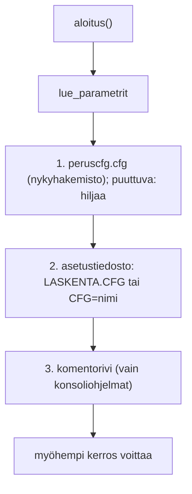

# 12 Asetukset: asetustiedosto, komentorivi ja erot ohjelmien välillä

<!-- malli: Käsikirjan lukupohja (K-3). Ohje: doc/tietopohja/laatu/k3-kirjoittajan-ohje.md.
Luvun 5 vikaluettelo generoidaan tiedostosta kasikirja/toiminnot.csv komennolla
python -I doc/arkkitehtuuri/tyokalut/tietopohja.py . kasikirja; sitä ei kirjoiteta käsin. -->

> **Tila:** alustava K-3-aineisto, ei riippumattomasti tarkastettu. Lähderevisio: tuotantokoodi
> `f7fe553` (ennallaan, `doc/arkkitehtuuri/CHECKPOINT.md`). Varmuusmerkinnät: [todennettu],
> [päätelty], [tuntematon]; "luettu käsikirjaa varten" = luettu koodista K-vaiheessa, ei tarkastettu.

Luku kertoo, miten ohjelmat saavat asetuksensa: mistä tiedostoista ja missä järjestyksessä asetukset
luetaan, mitä komentoriviltä voi antaa, mitä asetuseditori tekee, mitkä avaimet ovat eri ohjelmissa eri
tavoin ja mitkä asetukset ovat vain käännöksessä (valitsimet, luku 01). Yksittäisten asetusten vaikutus on
luvuissa, joissa toiminto kuvataan (tiedonsiirto luku 09, laitteet 10, julkaisu 11); tämä luku on avainten
ja erojen kokoomaluku. Käyttöohjeen täydellinen parametriluettelo on liitteessä 1
(`docs-site/docs/hkkisawin/hkliite1.md`, `viestiwin/hkliite1.md`); kaikki avaimet, niiden tulkintapaikat ja
voimassaolo ohjelmittain ovat rekisterissä `doc/arkkitehtuuri/rekisteri/asetusavaimet.csv`. Polut ovat
suhteessa hakemistoon `TPsource/V52/`, ellei polku ala `doc/` tai `docs-site/`. Lyhenteet: **HKM** = HkMaali,
**HKW** = HkKisaWin, **VM** = ViestiMaali, **VL** = ViestiLuenta, **VW** = ViestiWin.

## 1. Mitä tapahtuu

### 1.1 Asetusten lähteet

Ohjelman toimintaa ohjaavat kolme eri asiaa [todennettu: `ominaisuusvalitsimet.md` luvut 1, 6 ja 7]:

1. **Käännösvalitsimet** (luku 01 kohta 1.5): ratkeavat käännöksessä ja kuuluvat projektiin. Käyttäjä ei voi
   muuttaa niitä ajossa.
2. **Asetusavaimet** asetustiedostossa ja konsoliohjelmissa komentorivillä: luetaan käynnistyksessä.
3. **Muut kytkimet**: tiedoston olemassaolo (esimerkiksi `AUTOFILE.LST`), GUI:n tallentamat tilat
   (`ikkunat.xml`, `Init.cfg`) ja kilpailun parametrit (`KilpSrj.xml`: laji, alalaji, kortin laji).

Ympäristömuuttujia tuotekoodi ei lue; prosessin syötteet ovat komentorivi, nykyhakemisto ja exe-tiedoston
nimi (jota käytetään vain rekisteriavaimen nimenä IE-selainemulaatiossa) [todennettu: `todisteet/c12/raportit/
osaC-muut-kytkimet.md` luku 3, grep].

### 1.2 Kaksi lukijaa, kaksi editoria

Asetukset lukee ajossa **kaksi eri jäsennintä** [todennettu: `ominaisuusvalitsimet.md` 6.1; `asetusavaimet.csv`]:

| Jäsennin | Funktio | Ohjelmat | Avainrivejä rekisterissä |
|---|---|---|---|
| `Hk/HkInit.cpp` | `lue_parametrit` | HKM, HKW | 291 |
| `Juk/VInit.cpp` | `lue_parametrit` | VM, VL, VW | 206 |

Luku on rivimäärä rekisterissä (rivejä, ei yksilöllisiä avaimia). Jäsennin käännetään sekä konsoli- että
ikkunaohjelmaan, joten `#ifdef _CONSOLE` ja muut valitsimet erottavat ohjelmat samassa tiedostossa
(kohta 1.7).

Kaksi muuta tiedostoa, `cbHk/UnitCfg.cpp` (HKW) ja `ViestiWin/UnitCfg.cpp` (VW), **eivät ole ajonaikaisia
jäsentimiä** vaan asetuseditorin lomakkeen apukoodia: ne kuvaavat tunnetut asetusrivit lomakkeen kenttiin
(`TFormCfg::TulkitseTiedot`) ja kirjoittavat ne takaisin tiedostoon. Tuntemattomat rivit kulkevat läpi
sellaisenaan [todennettu: `todisteet/c12/raportit/osaB-asetukset-komentorivi.md` yhteenveto]. Näiden kahden
tiedoston tasona rekisterissä on 1 (inventoitu), vaikka C-12 jäsensi niiden avaimet skriptillä
(`auditoinnin-yhteenveto.md` luku 3).

### 1.3 Asetustiedoston lukujärjestys ja komentorivi

[todennettu: `osaB` luku 4; `Hk/HkInit.cpp:332-345`, `:567-583`; `Juk/VInit.cpp:436-446`, `:655-670`.]

**Kerrokset.** Ohjelma lukee ensin `peruscfg.cfg`:n, sitten kilpailun asetustiedoston (oletus `LASKENTA.CFG`
nykyhakemistossa) ja sitten komentorivin avaimet; **myöhempi kerros voittaa**. Käyttöohje mainitsee vain
oletuksen `LASKENTA.CFG` [KO: `hkliite1.md` A1.1]; `peruscfg.cfg`:tä ei ole käyttöohjeessa
[todennettu: grep `docs-site/docs`].

**Komentorivi.** Vain konsoliohjelmat (HKM, VM, VL) syöttävät komentorivin jäsentimelle (`HkConsole/HkMain.cpp:178`,
`JukConsole/laskenta.cpp:98`). Komentorivillä käytetään samoja avaimia kuin tiedostossa, ja komentorivi
voittaa. `CFG=nimi` toimii vain ensimmäisenä argumenttina (nimi katkaistaan 40 merkkiin ja muutetaan isoiksi);
myöhemmin annettu `CFG=` ohitetaan, paitsi että se merkitsee asetustiedoston nimetyksi (`cfgparam=1`)
[todennettu: `osaB` luku 4]. Käyttöohje sanoo samaa: `CFG=` annetaan yleensä komentorivillä tai
pikakuvakkeen määrityksissä [KO: `hkliite1.md` A1.1].

**Ikkunaohjelmat.** HKW ja VW eivät välitä komentoriviä jäsentimelle: ne kutsuvat `aloitus(0, 0, cfgflnm)`
(`cbHk/WinHk.cpp:279`, `ViestiWin/UnitMain.cpp:220`) ja asetustiedoston nimi tulee avausikkunasta tai
`Init.cfg`:n `CFG=`-riviltä. VW lukee komentoriviltä ainoastaan `INIT=tiedosto` (vaihtoehtoinen `Init.cfg`)
[todennettu: `osaB` luku 4, `ViestiWin/UnitMain.cpp:1527-1533`]. Käyttöohje kuvaa `init.cfg`-tiedoston
sellaisena, jonka ainoa tehtävä on kertoa, mikä kilpailu on käsiteltävänä ja missä toimintatilassa ohjelma
avautuu seuraavalla kerralla; valinta tehdään kohdasta *Tiedostot / Avausmääritykset*, ja jos käynnistys
epäonnistuu viallisten tietojen takia, tiedoston voi poistaa [KO: `hkkisawin/1.1_asentaminen.md`].

**`Init.cfg`:n avaimet.** HKW lukee avaimet `ILM`, `TULOSP`, `KUNT`, `LUETT`, `AVAA` ja `CFG=`; VW avaimet
`ILM`, `TULOSP`, `AVAA` ja `CFG=`. Avaimet tunnistetaan 3-6 merkin etuliitteellä
(`cbHk/WinHk.cpp:1641-1680`; `ViestiWin/UnitMain.cpp:1456-1490`) [luettu käsikirjaa varten, osaC, ei tarkastettu].
Avainten täsmällistä merkitystä käyttäjän näkökulmasta ei ole selvitetty muuten kuin käyttöohjeen
kuvauksena (kilpailu ja tila).

### 1.4 Asetustiedoston rivi ja avain

Seuraavat säännöt koskevat molempia jäsentimiä, ellei toisin sanota [todennettu: `osaB` luku 1 "Common rules"
ja luku 5; `Hk/HkInit.cpp:350`, `:374`, `:612-629`, `Juk/VInit.cpp:476`, `:673-691`]:

- **Rivin alku ja kommentti.** Käyttöohjeen mukaan kommenttirivi alkaa kauttaviivalla (yleensä `//`)
  [KO: `1.3_toimintatilojen_konfigurointi.md`].
- **Avain** on rivin ensimmäinen sana: rivi katkaistaan ensimmäiseen välilyöntiin ja muutetaan isoiksi
  kirjaimiksi (`fldn[90]`). Avaimet ovat siis **kirjainkoosta riippumattomia**. Vain muutamissa tekstiarvoissa
  (esimerkiksi otsikko) pienet kirjaimet säilyvät [KO: `hkliite1.md` alku]; kopioitavat avaimet on lueteltu
  koodissa (HK: `HTML`-alkuiset, `LISTA=`, `SQL`-alkuiset, `LOKI=`, `TARRA=`, `KOMENTO`, `TAULUOT`, `SIRITAR`, `SIRITDE`,
  `IKKUNAO`; viestissä vain `HTML`-alkuiset, `LISTA=`, `SQL`-alkuiset, `LOKI=`, `TARRA=`, `KOMENTO`).
- **Vertailu on etuliitevertailu** pituudella n: avain tunnistetaan sen alkuosasta, ja pidempi avain voi
  osua lyhyempään. Osa haaroista jää tämän takia saavuttamattomiksi (H-176, kohta 4).
- **Pituusrajat.** Yli 77 merkin rivi katkeaa ilman ilmoitusta; enintään 199 riviä luetaan, ja yli menevistä
  tulee ilmoitus "Liikaa parametreja".
- **Pakollisia avaimia ei ole.** Puuttuva `peruscfg.cfg` tai `LASKENTA.CFG` ohitetaan hiljaa, paitsi jos jokin
  avain alkaa merkeillä `CFG`: silloin ilmoitetaan "Konfiguraatiotiedostoa X ei löydy" ja käynnistys jatkuu.
- **Tuntematon avain** tuottaa ilmoituksen ("Tuntematon parametri"), ja luku jatkuu. GUI:ssa ilmoitus odottaa
  käyttäjän vastausta (`cbTp/cbTpApu.cpp:467-478`); konsolin odotusta ei ole jäljitetty [tuntematon].
- **Luvut** luetaan `_wtoi`:lla, joten virheellinen luku muuttuu nollaksi ilman virhettä. Eräät arvot rajataan
  (`MAXYHTEYS`, `VAKANTTIALKU`, `ZEBRAGPI`, `ZEBRADEPART`, `UDPVIIVEET` (hyväksytään vain yli 3 olevat arvot),
  `REGNLY`).
- **Käynnistys keskeytyy** vain, jos `VAKANTTILUKU` on liian suuri tai sarjojen luku epäonnistuu
  (`Hk/HkInit.cpp:3203-3205`, `:3254-3255`) [todennettu: `osaB` luku 5].
- **Vanhat avaimet.** Viestin avaimet `SAKOT`, `AMPUSAKOT`, `HIIHTO`, `PARTIO` ja `ROGAI` tulostavat ilmoituksen
  "poistettu käytöstä" eivätkä tee mitään (`Juk/VInit.cpp:748-778`).
- **Oletukset** ovat pääosin globaalien alkuarvoja (yleensä 0), joita ei ole käyty läpi yksitellen. Nimetyt
  oletukset: asetustiedosto `LASKENTA.CFG`, rivimäärä 50 (`setySize`), UDP-viiveet 10/20/20, monitorointiväli
  10 000 ms (`Tp/TpComY.cpp:83`; `MONITORVÄLI=n` luetaan sekunteina ja muunnetaan millisekunneiksi, `Hk/HkInit.cpp:1097-1100`), `AUTOFILE.LST`, Siritin portit 50008 ja 50007 ym. [todennettu: `osaB` "Defaults"].

### 1.5 Asetuseditori (HKW ja VW)

Käyttäjä voi muokata asetustiedostoa lomakkeella (*Tiedostot / Avausmääritykset*, painike
konfiguraatioeditoriin) tai tekstieditorilla. Käyttöohjeen mukaan [KO: `hkkisawin/1.3_toimintatilojen_konfigurointi.md`]:

- editori lisää tiedostoon kaksi riviä, jotka rajaavat sen käsittelemän alueen (koodissa `//CfgEditorAlku` ja
  `//CfgEditorLoppu`, `osaB` yhteenveto); muu osa tiedostosta jää ennalleen. Alueen sisään käsin tehdyt merkinnät
  editori poistaa.
- editori ei käsittele kaikkia parametreja täydellisesti, ja liitteen 1 luettelossa on tähdillä merkitty, mitkä
  parametrit voi määritellä editorilla. Jos tulkinta jättäisi pois osan rivistä, täydellisempi rivi on
  sijoitettava loppurivin alapuolelle.

Koodin mukaan editori kuvaa tunnetut rivit lomakkeen kenttiin (merkitsee tulkitut rivit) ja kirjoittaa ne
takaisin; rivit, joita se ei tunne, kulkevat läpi muuttumattomina. HKW:n editori ei tulkitse 157 ajonaikaisen
jäsentimen avainta (muun muassa `SQL*`, `SIRIT*`, `ZEBRA*`, `ET*`), ja VW:n editori ei kuvaa 113 viestin
avainta; ne ovat tarkoituksella läpikulkevia [todennettu: `osaB` luvut 1c, 1d, 2.1 ja 2.2].

**Editori ja jäsennin ovat ajautuneet erilleen (H-173).** Editorit kirjoittavat avaimia, joita ajonaikainen
jäsennin ei tunne:

| Avain | Editori | Jäsennin | Seuraus |
|---|---|---|---|
| `AIKACOM=` | HKW ja VW kirjoittavat | tuntee vain `AIKA_COM=` | editori lukee `AIKA_COM=`-rivin mutta kirjoittaa `AIKACOM=`; asetus katoaa tallennettaessa ja seuraavassa käynnistyksessä tulee ilmoitus "Tuntematon parametri" |
| `AUTOJAKELU=` | HKW ja VW | ei käsittelijää | sama ilmoitus |
| `AIKAERO1=`, `AIKAERO2=`, `EMITALKU=`, `EMITJONO=`, `EMITAJAT`, `SUORASYÖTTÖ` | VW | VW:n jäsennin ei tunne (VM, VL, VW) | ilmeisesti HK:sta kopioituja; ei vaikutusta ajossa, ilmoitus käynnistyksessä |
| `TAKAA-AJO`, `NOLLAKÄRKI` | HKW kirjoittaa valintaruuduista | HK hyväksyy (rekisterin alkuperäinen väite kumottu) | ei virhettä |

[todennettu: `osaB` luvut 2.1 ja 2.2; H-173 kortti; riippumaton tarkastus vahvisti osittain.] Käytännön seuraus
on, että editorilla tallennettu asetustiedosto ei välttämättä toimi samoin kuin ennen tallennusta. Muut seuraukset
(esimerkiksi aikalähteen asetuksen katoamisen vaikutus kilpailuun) eivät ole osoitettu: H-173:n
vaikutukset ovat kortilla.

### 1.6 Sama avain, eri ohjelma

Jäsentimet ovat kehittyneet erikseen, ja sama avain voi toimia HK:ssa ja viestissä eri tavoin
[todennettu: `osaB` luku 2.3]:

| Avain | HK (`HkInit`) | Viesti (`VInit`) | Huomio |
|---|---|---|---|
| `AIKAKORJAUSn` | arvo `* SEK / 100` | arvo `* SEK` | yksikkö eri; kumpi on tarkoitettu, ei tiedossa (Q112, OP-11) |
| `TARKNO` | sanat `EI`/`ON`/`KA` tai luvut 0/1/2 | luku lasketaan avaimen merkistä (`ON` = 31, `EI` = 21, `KA` = 27) | viestissä sanamuodot eivät toimi (H-176); käyttöohje esittelee vain numeromuodon |
| `JONOT` | indeksi sallittu | vain `JONOT=` (indeksi 0) | |
| `SIRITEVENTPORT`, `SIRITCMDPORT`, `SIRITPOLL` | indeksi | vain indeksi 0 | |
| `ILMTUNT` | tarkka (`n=8`) | etuliite (`n=6`) | |
| `UDPVIIVEET=` | arvo luetaan oikeasta kohdasta | arvon luku alkaa yhden merkin liian aikaisin; ensimmäinen arvo jää oletukseen 10 | H-176 |
| `ESTÄYLIM` | valinnainen `K` | ei `K`:ta | |
| `AIKAERO` | `AIKAERO=` ja `AIKAEROn=` | vain `AIKAERO=` | |
| `ALGE` (ilman `=`) | ei aseta mitään | asettaa `regnly[0]=3` (ALGE-ajanotto) | |
| `REGNLY`, `TESTAUS` | pituudet 5 ja 7 | pituudet 6 ja 5 | |
| `IKKUNAOTS` | säilyttää kirjainkoon | muuttaa isoiksi ja katkaisee ensimmäiseen välilyöntiin (`IKKUNAOTS=Viesti 2026` muuttuu `VIESTI`:ksi) | H-176; käyttöohje sanoo, että teksti kirjoitetaan sellaisenaan |

Avainten **saatavuus** vaihtelee: viestin `ET*`, `TAULU_*`, `SIRIT*` ja `AIKA_*` luetaan vain VM:ssä ja VW:ssä;
`IKKUNAT`, `KUULUTTAJA`, `VALONÄYTTÖ=`, `SQL*`, `EMITANALYYSI`, `RASTIVATULOSTE` ja `KARTTA=` toimivat viestissä vain
VW:ssä, ja VM ja VL ilmoittavat ne tuntemattomiksi, vaikka HKM hyväksyy `IKKUNAT`, `SQL*`, `KARTTA=` ja
`VALONÄYTTÖ=`. HK:ssa `NÄPPÄIN=` toimii vain konsolissa ja `DBGTOFILE` vain ikkunaohjelmassa; `EMITANAL` vaikuttaa
vain ikkunaohjelmassa (konsoli hyväksyy sen hiljaa) [todennettu: `osaB` luvut 1b, 2.1, 2.2].

### 1.7 Avain ja valitsin yhdessä

Avain vaikuttaa vain, jos sen toteuttava koodi on käännetty mukaan (luku 01 kohta 1.5). Eräät tärkeät yhdistelmät
[todennettu: `osaB` luvut 1a ja 1b; `valitsimet.csv`]:

| Avainryhmä | Vaaditaan käännöksessä | Mitä jos valitsin puuttuu |
|---|---|---|
| `SIRIT*`, `ZEBRA*`, `FEIG`, `IMPINJ` (RFID-lukijat) | `LAJUNEN` | **VL:ssä** `LAJUNEN` puuttuu, ja lukija-avain valitsee ALGE-ajanoton ja asettaa portin 1 ajanottoon (H-176, T-052) |
| `ET*` (emiTag HTTP) | `EMITHTTP` | VL: avaimia ei tunneta |
| `TAULU_COM=`, `TAULU_BAUD=` | `ALGETAULU` | vain VM ja VW |
| `GAZ=`, `GAZVAIHE=`, `GAZRIVI` | `GAZ` | HK:n jäsennin; viestissä ei vastaavaa avainta (viestin `GAZCOM` on yhtä pienempi kuin HK:n, H-176) |
| `VERTRAJAT=` | `AIKAVERT` | vain HKM |
| `ENNAKOI` | `ENNAKOI` | HKM, VM (GUI:ssa oma lomake) |
| `VARASERVER` | `SERVER` | konsoliohjelmat |
| `DBGTOFILE` | `DBGFILE` | HK:ssa vain HKW; viestissä VM ja VL, ei VW |
| `HTML=`, `MHTML=`, `XML=`, `HTMLTIT`, `HTMLOTS`, `KOMENTO` | `AUTOFILE` (HK:ssa seuraa `TCPSIIRTO`:sta) | käyttäytyminen luvussa 11 |
| `FILETCPn` | `TCPSIIRTO` | käyttäytyminen luvussa 11 |
| `TDC`, `S3`, `S4` | (ei vaikutusta) | haarat saavuttamattomia (H-176): TDC8001-tukea ei voi ottaa asetuksista käyttöön |
| `PISTEETn=` (indeksi) | - | indeksoitu muoto ei toimi, vain `PISTEET=` (H-176) |

### 1.8 Muut kytkimet: tiedostot, GUI:n tilat ja kilpailun parametrit

**Tiedoston olemassaolo.** Tiedostot luetaan nykyhakemistosta, eli kilpailu on kansio
[todennettu: `ominaisuusvalitsimet.md` luku 7]. Olemassaolo ratkaisee esimerkiksi:

| Tiedosto | Vaikutus | Ohjelmat |
|---|---|---|
| `AUTOFILE.LST` | sarjakohtaiset HTML-, MHTML- ja XML-tiedostot; ilman sitä yksi yhdistetty tuloste | kaikki (luku 11; H-149 viestissä) |
| `RADAT<n>.XML` (viestissä `radat.xml`) | puuttuessa käynnistys käyttää `RADAT<n>.LST`:tä ja `LEIMAT.LST`:tä; vaiheen vaihto ei (H-134) | kaikki |
| `KilpSrj.xml` | puuttuessa tai jäsennysvirheessä käytetään vanhaa `KILP.SRJ`:tä; virheestä ilmoitetaan, mutta paluu vanhoihin sarjatietoihin on hiljainen (H-174) | kaikki |
| `HTMLALK?.TXT`, `HTMLLOP?.TXT` | HTML-kehys; jos on alkutiedosto mutta ei lopputiedostoa, sulkevat tunnisteet jäävät kirjoittamatta (H-176) | kaikki |
| `HAJONNAT.LST` | viestin hajontatuloste; puuttuessa `fclose(NULL)` päättää ViestiMaalin (H-063) | viesti |
| `vaihevalinta.cfg`, `TLSKERR.LST` | vaiheen muistaminen; sarjakohtainen aikojen skaalaus | vain HK |
| `SARJAYHD.LST`, `XMLPISTE.LST`, `TVPISTE.LST`, `LAINAEMT.LST`, `AIKARAJAT.TXT`, `EMIT_IN.DAT`, `korostus*.lst`, `pistesrj.lst` | erilaiset valinnaiset ominaisuudet (avain tai lisäys ottaa käyttöön) | vaihtelee; `korostus*.lst` ja `pistesrj.lst` vain ikkunaohjelmassa |

Lukko- tai lipputiedostoja ja yhden instanssin tarkistusta ei ole.

**GUI:n pysyvät tilat** [todennettu: `ominaisuusvalitsimet.md` luku 7; osaC luku 2]:

- `ikkunat.xml` (tai `IKKUNAT=`-avaimella nimetty tiedosto): ikkunoiden asettelu ja ikkunakohtaiset valinnat; luetaan vain,
  kun `IKKUNAT`-avain on asetettu. Konsoli jäsentää avaimen mutta ei lataa tiedostoa. Emit-lomakkeen valikon
  rastit ja muuttujat voivat erota toisistaan (H-175). Käyttöohje: ikkunat tallennetaan pääkaavakkeen valinnalla
  *Tallenna ikkunat* ja luetaan tiedostosta parametrilla `ikkunat=xxxx` [KO: `hkkisawin/1.5_kaavakkeiden_asetusten_tallentaminen.md`].
- `Init.cfg`: käynnistystila (kohta 1.3); `KilpailuLuettelo.xml`: kilpailuvalitsin (HKW).
- `SQLjonoVarm.dat`: SQL-jonon varmistus, kun `CBVarmista` on valittu (luku 11).
- Rekisteriä käytetään yhteen asiaan: IE-selainemulaation arvo HKCU:ssa.

**Kilpailun parametrit** (`KilpSrj.xml`) ohjaavat toimintaa kuten asetukset: HK:ssa `Discipline` (laji) kytkee
viisiottelun pisteet ja ampumahiihdon sakot, `Subtype` (alalaji) parikilpailun ja ammunnan ja kortin laji kytkee
emit-luennan päälle ilman avainta; viestissä `Subtype` kytkee `partio`n ja `rogaining`in
(`Hk/HkInit.cpp:3286-3353`, `:3301-3307`; `Juk/VXml.cpp:563-574`) [AA: `ominaisuusvalitsimet.md` luku 7].

## 2. Erot ohjelmien välillä

| Kohta | HKM | HKW | VM | VL | VW |
|---|---|---|---|---|---|
| Ajonaikainen jäsennin | `HkInit` | `HkInit` | `VInit` | `VInit` | `VInit` |
| Komentorivin avaimet | kyllä | ei | kyllä | kyllä | vain `INIT=` |
| Asetustiedoston nimen lähde | `CFG=` argv[1], `LASKENTA.CFG` | avausikkuna, `Init.cfg` | kuten HKM | kuten HKM | avausikkuna, `Init.cfg` |
| Asetuseditori | ei | kyllä | ei | ei | kyllä |
| `IKKUNAT`-avain ja `ikkunat.xml` | jäsentää avaimen, ei lataa tiedostoa | lataa | ilmoittaa avaimen tuntemattomaksi | ilmoittaa avaimen tuntemattomaksi | lataa |
| `Init.cfg`-avaimet | - | `ILM`, `TULOSP`, `KUNT`, `LUETT`, `AVAA`, `CFG=` | - | - | `ILM`, `TULOSP`, `AVAA`, `CFG=` |
| Lukijakanavien enimmäismäärä `NREGNLY` | 32 | 32 | 8 | 8 | 32 |
| `SQL*`-avaimet | jäsentää, vaikutus [tuntematon] | käytössä | ilmoittaa tuntemattomaksi | ilmoittaa tuntemattomaksi | käytössä |
| Esimerkkejä vain tässä ohjelmassa | `NÄPPÄIN=`, `VERTRAJAT=`, `VARASERVER` | `DBGTOFILE` | `ESITA` | `TARKAVOIMET`, `SALLIEMITENSIN` | `KUULUTTAJA` |

[todennettu: `osaB` luvut 1-2 ja 4; `ominaisuusvalitsimet.md` luku 9; `asetusavaimet.csv` (voimassaolo tuotteittain).]

**Viesti: yksi jäsennin, kolme ohjelmaa.** VM, VL ja VW käyttävät samaa jäsenninkoodia, mutta VL:ssä
RFID-tuki puuttuu ja VW:ssä on GUI-avaimia, joita konsoliohjelmat eivät tunne (kohdat 1.6 ja 1.7). Sama asetustiedosto
voi siis toimia eri ohjelmissa eri tavoin.

## 3. Asetukset ja käännösvalitsimet

### 3.1 Avainryhmät

Taulukko antaa suuntaa avainten ryhmittelystä; täydellinen luettelo (avain, tulkintakohta, tuotekohtainen voimassaolo)
on `rekisteri/asetusavaimet.csv`:ssä ja merkitykset käyttöohjeen liitteessä 1. Avainten merkityksiä ei ole selvitetty kaikilta
osin: noin 80 vähäisen avaimen merkitys on rekisterissä "katso koodi" ja globaalien alkuarvoja ei ole käyty läpi
yksitellen [todennettu: `ominaisuusvalitsimet.md` luku 12].

| Ryhmä | Esimerkkiavaimia | Ohjelmat |
|---|---|---|
| Käynnistys ja ikkuna | `CFG=`, `VAIHE=`/`PÄIVÄ=` (V: vaihevalinta), `IKKUNAT`, `IKKUNAOTS=`, `BOOT`, `RIVIT=25`/`50`, `KIRKAS`, `VÄRIT=`, `SULKUSALASANA=`, `LISÄÄ=`, `KONE=` | HK ja viesti (osa vain konsoli) |
| Kilpailun käyttö | `KUNTOSUUNN`, `KUNTOMAALI`, `KUNTOLÄHTÖ`, `VAKANTTILUKU=`, `VAKANTTIALKU=`, `EMITALKU=`, `POISSAMUKAAN`, `TARKNO`, `VAADITARK`, `SÄILHYL` (viesti) | HK ja viesti |
| Tiedonsiirto | `COMn`, `YHTEYSn`, `UDP`, `BRO`, `TCP`, `SX`/`XS`, `PORTBASE=`, `MAXYHTEYS=`, `BAUDn=`, `COMFILE` (`EI` vain HK, `S` kumpikin; koko ohjelman asetus), `UDPVIIVEET=`, `TCPVIIVEETn=`, `NAKVIIVE=`, `UDPJARRU=`, `MONITORI`, `MONITORVÄLI=`, `LÄHTIEDOSTOT`, `KATKKIERn` (viesti) | HK ja viesti; luku 09 |
| Ajanotto | `AJAT`, `LAJAT`, `AIKA_COM=`, `AIKAERO`, `AIKAKORJAUSn`, `REGNLY`, `ALGE`, `COMET`, `TIMY`, `TDC`, `KELLOBAUD=`, `ESTÄNEG`, `ESTÄHAAMUT`, `ESTÄYLIM`, `JONOT`, `MAXJONO=`, `TUNNJONO`, `PISTEET=` | HK ja viesti; luku 04 |
| Emit ja leimat | `EMIT`, `LEIMAT=E`, `ESITARK`, `ESILUENTA`, `LAINAT`, `LAINALUETTELO`, `LUKIJAn`, `MTRn`, `EMITAGn`, `ETSQLn`, `ETGPRSn`, `LUKUTOISTO`, `SALLIEMITTOISTO`, `EMITANAL` | HK ja viesti; luvut 05, 10; `ESITARK` viestissä vain VM (`valitsimet.csv:152`, `Juk/VInit.cpp:2111`), ei VW:ssä eikä VL:ssä |
| RFID | `SIRIT`, `ZEBRA`, `FEIG`, `IMPINJ`, `SIRITARRIVE=`, `SIRITDEPART=`, `SIRITEVENTPORT=`, `SIRITCMDPORT=`, `SIRITPOLL=`, `ZEBRAGPI=` | ei VL |
| Tulostus ja julkaisu | `HTML=`, `MHTML=`, `XML=`, `HTMLTIT`, `HTMLOTS`, `KOMENTO`, `AUTORAP`, `COMAUTORAP`, `TCPTULOS=`, `FILETCPn`, `XMLSARJA=`, `MUOTOILU`, `LISTA`, `MERKIT=`, `DESEROTIN=` | HK ja viesti; luku 11 |
| Näytöt ja taulut | `TAULU_COM=`, `TAULU_BAUD=`, `GAZ=`, `CPOWER`, `RTNM`, `VALONÄYTTÖ=` | vaihtelee; luku 10 |
| SQL | `SQLDRIVER`, `SQLHOST`, `SQLDATABASE`, `SQLUSER`, `SQLPASSWORD`, `SQLSTART`, `SQLTALLENNUS` | vaikutus vain ikkunaohjelmissa |
| Viestin erityiset | `OSUUSOLETUS=`, `OSUUSRAJA=`, `SAMAPISTE`, `VUOROMAALI`, `VUOROKAUDET`, `KIERROKSET`, `JOUSTOVIESTI`, `LUENTATESTI`, `SISÄÄNLUENTA` | viesti; luku 07 |
| Kehittäjä ja testi | `TESTAUS`, `COMTESTI`, `DBGTOFILE`, `DEVELOPER`, `KUORMITUSTESTI` | vaihtelee |

### 3.2 Asetukset, joihin liittyy tunnettu vika tai ristiriita

| Avain tai asetus | Ohjelmat | Mitä | Lähde |
|---|---|---|---|
| `BAUDn=` | kaikki | arvo kopioidaan 20 merkin riville ilman pituuden tarkistusta; yli 19 merkin arvo kirjoittuu seuraavan portin riville (H-052) | H-052 |
| `PISTEET=` (sarjan nimi) | HK | nimi kopioidaan 12 merkin puskuriin ilman tarkistusta (H-052) | H-052 |
| puuttuvan asetustiedoston ilmoitus | kaikki | tiedoston nimi muotoillaan 80 merkin pinopuskuriin ilman rajaa; noin 45 merkkiä pidempi nimi ylittää sen (H-052); konsolin `CFG=` katkaistaan 40 merkkiin [päätelty] | H-052 |
| `KATKKIERn` | viesti | numero lasketaan avaimen viimeisestä merkistä eikä rajoja tarkisteta; `0` tai suurikoodinen merkki kirjoittaa taulukon viereiseen muistiin (H-036) | H-036 |
| asetustiedoston nimi avauksessa | VW | nimi kopioidaan 41 merkin alueeseen, mutta kopiointi pyytää 120 merkkiä: ylitys jokaisessa kilpailun avauksessa (H-171) | H-171 |
| `AIKACOM=`, `AUTOJAKELU=` ym. | HKW, VW (editori) | editori kirjoittaa avaimia, joita jäsennin ei tunne (H-173) | H-173 |
| `UDPVIIVEET=` | viesti | ensimmäinen arvo jää huomiotta | H-176 |
| `SIRIT`, `ZEBRA`, `FEIG`, `IMPINJ` | VL | valitsee RFID-lukijan sijasta ALGE-ajanoton | H-176, T-052 |
| `TDC`, `S3`, `S4`, `PISTEETn=` | HK | saavuttamattomat haarat | H-176 |
| `IKKUNAOTS=` ym. tekstiarvot | viesti (ja HK:ssa osa tekstiarvoista) | arvo muuttuu isoiksi kirjaimiksi ja katkeaa ensimmäiseen välilyöntiin | H-176 |
| `TARKNO=ON` | viesti | luku 31, ei 1 | H-176 |
| `HTMLALK?.TXT` ilman `HTMLLOP?.TXT`:tä | kaikki | sulkevat tunnisteet jäävät kirjoittamatta | H-176 |
| `AIKAKORJAUSn` | HK, viesti | yksikkö eri (`SEK / 100` vs. `SEK`) | T-051, Q112, OP-11 |
| `MONITORI` | kaikki | oletusportti koodissa 14770 (jokainen seuraava rivi +1), käyttöohjeessa 14900 | T-014, Q25, OP-11 |
| `LUKIJAn`, `MTRn`, `EMITAGn`, `ETGPRSn` | viesti | enimmäismäärä 8 (VM, VL) tai 32 (VW); suuri numero rajataan arvoon `NREGNLY`-1, eli konsolissa `LUKIJA9`-`LUKIJA32` kuvautuvat laitteeksi 8 | T-024 |
| `COMFILE=EI` | HK (viestissä jäsennin ohittaa) | käyttöohje listaa avaimen myös viestille, mutta viestin jäsennin ohittaa sen (rivi on kommentoitu) [todennettu: `Juk/VInit.cpp:1216-1220`; riippumaton tarkastus K-5 09-14] | luku 09 |

Luku 5 listaa nämä havainnot tilaan ja prioriteettiin sidottuina; tässä taulukossa on vain kuvaus.

## 4. Vaihtoehtoiset polut ja virhetilanteet

- **Asetustiedosto puuttuu.** `peruscfg.cfg` puuttuu: ei ilmoitusta. Nimetty asetustiedosto (`CFG=`) puuttuu:
  ilmoitus "Konfiguraatiotiedostoa X ei löydy", ja käynnistys jatkuu oletuksin. Oletus `LASKENTA.CFG`:n puuttuminen on
  hiljaista, ellei jokin avain ala `CFG`:llä [todennettu: `Hk/HkInit.cpp:340-345`, `Juk/VInit.cpp:441-446`].
  Käynnistys ilman asetustiedostoa tapahtuu siis oletuksilla [päätelty: jäsentimen luku ohitetaan]; mikä oletus
  tarkoittaa kutakin toimintoa, on luvuissa 04-11.
- **Tuntematon avain.** Ilmoitus ja jatko. Huomaa, että editorilla tallennettu tiedosto voi sisältää tuntemattomia
  avaimia (kohta 1.5).
- **Virheellinen arvo.** Luku muuttuu nollaksi (`_wtoi`) eikä ohjelma ilmoita; raja-arvoja rajataan hiljaa. Esimerkiksi
  `RIVIT=` hyväksyy vain arvot 25 ja 50.
- **Liian pitkä rivi tai liian monta riviä.** Yli 77 merkin rivi katkeaa hiljaa; yli 199 rivin luku ilmoittaa
  "Liikaa parametreja". Pitkä avainrivi ei ole siis turvallinen: pituudeton `BAUDn=`-arvon tarkistus on H-052:ssa.
- **Komentorivin ensimmäinen argumentti.** Jos komentorivin ensimmäinen argumentti on vähintään 44 merkkiä,
  avainpuskuri jää ilman päättävää nollaa ja sitä käsitellään päättymättömänä (H-176 kohta 7); kohta koskee vain
  konsoliohjelmia.
- **Käynnistys keskeytyy** liian suureen `VAKANTTILUKU`un tai sarjojen lukuvirheeseen; ohjelma päättyy.
- **Pakotetut kohdat.** Käännösvalitsimilla pois jätetty ominaisuus ei ole asetuksilla käyttöön otettavissa;
  kuollut valitsin (esimerkiksi HKM:n `SEURATUL`, H-177; viestin konsolin `XML`, H-172) ei ole toimitetun ohjelman ominaisuus.
- **Ristiriita käyttöohjeen ja koodin välillä.** Viestin `VUOROMAALI`: käyttöohje (viestiwin 5.4) sanoo parametrin
  kieltävän ajan antamisen vaihdolle tai maalille, koodi valitsee pisteeksi 0, kun väliajat ovat täynnä; kumpi on
  tarkoitettu, ei ole ratkaistu [tuntematon] (luku 07 kohta 7).
- **Kirjoitusvirheet avaimissa.** Viestin `HTMLTIT` vaatii täyden `HTMLTITLE=`-asun; pienillä kirjaimilla kirjoitetut
  `HTMLTIT`, `HTMLOTS` ja `SQL*` eivät toimi viestin jäsentimessä [todennettu: `osaB` N-9, ei rekisterissä].

## 5. Tunnetut viat tässä toiminnossa

<!-- generoitu:viat alku (tietopohja.py lohkot; älä muokkaa käsin) -->
| Toiminto | Havainto | Tila | Prioriteetti | Kuvaus |
|---|---|---|---|---|
| Asetusavainten luku ja avainpuskurit (lue_parametrit) | [H-036](../vikakortit/H/H-036.md) | avoin | P4 | Viestin asetus KATKKIER kirjoittaa taulukon ulkopuolelle, jos avaimen viimeinen merkki ei ole numero 1–9, koska numeroa ei tarkisteta |
| Asetusavainten luku ja avainpuskurit (lue_parametrit) | [H-052](../vikakortit/H/H-052.md) | avoin | P4 | Asetusten luku kirjoittaa liian pitkillä arvoilla kiinteisiin puskureihin, ja puuttuvan asetustiedoston ilmoitus ylittää pinopuskurin pitkällä tiedostonimellä |
| Asetusavainten luku ja avainpuskurit (lue_parametrit) | [H-176](../vikakortit/H/H-176.md) | avoin | P5 | Kymmenen pientä asetusten ja valitsinten vikaa: osa asetuksista jää huomiotta, tulkitaan väärin tai ei toimi (kokoomarivi) |
| Asetustiedoston nimen käsittely kilpailun avauksessa (ViestiWin) | [H-171](../vikakortit/H/H-171.md) | avoin | P2 | ViestiWin kirjoittaa joka kilpailun avauksessa 158 tavua asetustiedoston nimen puskurin ohi viereiseen muistiin |
| Asetuseditori (HkKisaWin, ViestiWin): avainten kirjoitus ja luku | [H-173](../vikakortit/H/H-173.md) | avoin | P3 | Asetuseditorit tallentavat avaimia, joita ohjelma ei tunne, ja aikalähteen asetus AIKA_COM katoaa tallennettaessa editorilla |
| ViestiLuennan RFID-avaimet (SIRIT, ZEBRA, FEIG, IMPINJ) | [H-176](../vikakortit/H/H-176.md) | avoin | P5 | Kymmenen pientä asetusten ja valitsinten vikaa: osa asetuksista jää huomiotta, tulkitaan väärin tai ei toimi (kokoomarivi) |
| ViestiLuennan RFID-avaimet (SIRIT, ZEBRA, FEIG, IMPINJ) | [T-052](../vikakortit/T/T-052.md) | avoin | - | ViestiLuenta on supistettu käännös ilman RFID-tukea ja muita ominaisuuksia, eikä rajausta ole dokumentoitu |
| Asetusavainten yksiköt ja oletusportit (AIKAKORJAUS, MONITORI) | [T-014](../vikakortit/T/T-014.md) | avoin | - | Tilaseurannan oletusportti on koodissa 14770 ja käyttöohjeessa 14900 |
| Asetusavainten yksiköt ja oletusportit (AIKAKORJAUS, MONITORI) | [T-051](../vikakortit/T/T-051.md) | avoin | - | Ohjelmien kokoonpanot ja asetusten lukijat ovat ajautuneet erilleen, eikä mikään valvo eroja |
| Lukijakanavien numerointi asetuksissa (LUKIJAn, MTRn, EMITAGn, ETGPRSn) | [T-024](../vikakortit/T/T-024.md) | avoin | - | Viestin lukijakanavien enimmäismäärä on konsoliohjelmissa 8 ja ViestiWinissä 32, joten sama asetustiedosto tulkitaan eri tavoin |
| Kilpailukansion tiedostot asetuksina (KilpSrj.xml, HTMLALK/HTMLLOP, HAJONNAT.LST) | [H-063](../vikakortit/H/H-063.md) | avoin | P4 | Kurssihajontatuloste päättää ViestiMaali-ohjelman, kun tiedostoa HAJONNAT.LST ei ole |
| Kilpailukansion tiedostot asetuksina (KilpSrj.xml, HTMLALK/HTMLLOP, HAJONNAT.LST) | [H-174](../vikakortit/H/H-174.md) | avoin | P3 | Virheellinen sarja-XML korvautuu hiljaa vanhalla sarjatiedostolla |
| Kilpailukansion tiedostot asetuksina (KilpSrj.xml, HTMLALK/HTMLLOP, HAJONNAT.LST) | [H-176](../vikakortit/H/H-176.md) | avoin | P5 | Kymmenen pientä asetusten ja valitsinten vikaa: osa asetuksista jää huomiotta, tulkitaan väärin tai ei toimi (kokoomarivi) |
| GUI:n pysyvät asetukset (ikkunat.xml, Init.cfg) | [H-175](../vikakortit/H/H-175.md) | avoin | P4 | Emit-lomakkeen valikon rastit eivät aina vastaa sitä, mitä ohjelma oikeasti tekee: "Vaadi kaksoisluenta" ja "Vahvista aina" voivat näyttää väärää tilaa |

Generoitu tiedostosta `kasikirja/toiminnot.csv` ja rekistereistä (tila, prioriteetti); älä muokkaa käsin.
<!-- generoitu:viat loppu -->

## 6. Mihin tieto perustuu

- Asiakirjat: `doc/arkkitehtuuri/ominaisuusvalitsimet.md` (luvut 1, 3.4, 6, 7, 9, 11-12), `todisteet/c12/raportit/osaB-asetukset-komentorivi.md`
  (luvut 1-6), `todisteet/c12/raportit/osaC-muut-kytkimet.md` (luvut 1-4), `omistajan-paatokset.md` (OP-11, OP-12),
  `yleiskuva.md` (käynnistys), `riippuvuudet.md`; luvut 01, 02, 03, 09, 11, 13 (käsikirja).
- Rekisteri: `rekisteri/asetusavaimet.csv` (750 riviä: jäsennin, avain, verrattu pituus, rivit, ehto, voimassaolo tuotteittain),
  `rekisteri/valitsimet.csv` (435 makroa), `havainnot.md` (H-036, H-052, H-063, H-134, H-171-H-177, T-014, T-024, T-050-T-052),
  `riskiarvio.csv` ja `tekninen-velka.csv` (`ohjelmat`-sarake).
- Vikakortit: `vikakortit/H/H-036.md`, `H-052.md`, `H-171.md`, `H-173.md`, `H-176.md`, `vikakortit/T/T-014.md`, `T-024.md`, `T-051.md` luettu tätä
  lukua varten; muut tunnukset rekisteritasolla.
- Käyttöohje (vain asetusten nimet ja näkyvät toiminnot): `docs-site/docs/hkkisawin/hkliite1.md`, `viestiwin/hkliite1.md`,
  `hkkisawin/1.3_toimintatilojen_konfigurointi.md`, `hkkisawin/1.1_asentaminen.md`, `hkkisawin/1.5_kaavakkeiden_asetusten_tallentaminen.md`,
  `suunnistuskilpailu/konfiguraatiotiedostot.md` (nimenä).
- Koodi uutena: ei luettu tätä lukua varten. Rivinumerot ovat peräisin C-12-raporteista (revisio `ab10f88`,
  `TPsource/` ennallaan revisiosta `f7fe553`).
- Käännösvalitsimet ja projektit: luku 01 (projektitiedostojen Release-kokoonpanot).
- Todentamisen taso: jäsentimet ja avaimet luettu staattisesti ja skriptillä (`tyokalut/asetusavaimet.py`); riippumaton
  tarkastus (osa D, Opus) vahvisti 12 väitettä 19:stä, 7 osittain ja kumosi 0; kaksi alkuperäistä väitettä (`TAKAA-AJO`, `NOLLAKÄRKI`) kumoutui.
  Mitään ei ajettu: H-171:n ja muiden asetusvikojen seuraukset ovat pääteltyjä (Q107).

## 7. Mitä ei ole selvitetty

- **Q107** mitä ViestiWinissä `cfgfilename`-puskurin ylitys käytännössä ylikirjoittaa ja nollautuvatko sarjaporttien oletusasetukset
  (ajonaikainen todennus); **KE-8** alustamaton `baud`-arvo sarjayhteyden avauksessa, kun `baudst` on nollattu, ja käyttävätkö
  laitepolut `baudst`-taulua [päätelty; `seuranta.md`].
- **KE-23** `LÄHTÖIKKUNA=x` (HK) luetaan millisekunteina (`Hk/HkInit.cpp:1924`, ei `*SEK`-kerrointa; oletus 3000 ms, `Hk/HkGlobals.cpp:96`), vaikka käyttöohje (`hkkisawin/hkliite1.md:127`) sanoo sekunteja: `LÄHTÖIKKUNA=3` tarkoittaisi 3 ms [luettu koodista, ei ajettu; `seuranta.md` KE-23, riippumaton tarkastus K-5 04-12]. Muissa asetuksissa yksikköä ei ole käyty läpi jäsentimestä: `MONITORVÄLI` sekuntia, `AIKAKORJAUSn` HK:ssa sadasosasekunteina ja viestissä sekunteina (kohta 1.6).
- **Q112 / OP-11** `AIKAKORJAUSn`-yksikkö; **Q25 / OP-11** MONITORI-portin oikea arvo; molemmat odottavat omistajan päätöstä
  (OP-11 on `omistajan-paatokset.md`:n mukaan avoin). **OP-12** tuetut tuotteet ja kokoonpanot (T-051, T-024, T-052);
  **Q111** onko RFID tarkoituksella pois ViestiLuennasta.
- Noin 80 vähäisen avaimen merkitys ("katso koodi") ja globaalien alkuarvot on käymättä läpi; HkInit-rivit 760-1000 ja 2100-2760
  luettiin suodatettuna (`osaB` luku 7).
- Viestin editorin laitelista (ARES, ASC, TDC, RADIOEMIT, SW2000, ALGET, S3, S4, ALGE4): ei tiedetä, voiko lomake kirjoittaa ne
  (`ViestiWin/UnitCfg.cpp:1515-1561`).
- Konsolin ilmoituksen odotus tuntemattomasta avaimesta ja asetustiedoston merkistön tunnistus konsolissa: ei jäljitetty
  (merkistöistä `doc/arkkitehtuuri/merkistot.md`).
- Se, mitkä asetukset todellisissa kilpailuissa ovat yleisimmin käytössä, ja onko editorilla tallennettujen tiedostojen
  tuntemattomien avainten ilmoitus käytännössä häiritsevä: ei aineistoa.
- Ikkunakohtaisista valinnoista on selvitetty vain Emit-lomake (H-175); muiden lomakkeiden `ikkunat.xml`-tilat ovat selvittämättä.
- **`UnitCfg.cpp`-editorit** ovat analyysitasolla 1; niiden kenttäkohtainen toiminta (esimerkiksi mitä lomake kirjoittaa
  kullekin ruudulle) on luettu vain avainvertailun osalta.
- Ehdokkaat (ei tarkastettu): haettu `havainnot.md`:stä ja `seuranta.md`:n KE-taulukosta; C-12:n osan B ehdokkaat
  **N-9** (pienet kirjaimet `HTMLTIT`, `HTMLOTS`, `SQL*` viestin jäsentimessä) ja **N-11** (VW:n editori ei tunnista `SÄILHYL=E`)
  eivät löydy rekisteristä (haettu hakusanoilla `HTMLTIT`, `SÄILHYL`) eikä KE-taulukosta. Ne ovat raportin ehdokkaita, eivät tämän
  luvun uusia havaintoja. KE-22 sisältää ehdokkaana, että VW:n `MTRn`/`EMITAGn`/`ETGPRSn` lukevat laitenumeron yhdestä merkistä
  (`Juk/VInit.cpp`); T-024 kattaa saman osin.
