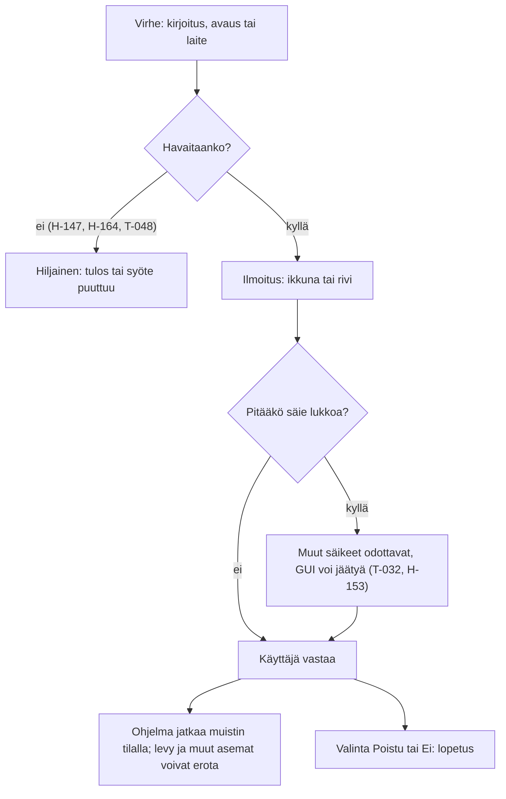

# 13 Virhetilanteet ja toipuminen

<!-- malli: Käsikirjan lukupohja (K-3). Ohje: doc/tietopohja/laatu/k3-kirjoittajan-ohje.md.
Luvun 5 vikaluettelo generoidaan tiedostosta kasikirja/toiminnot.csv komennolla
python -I doc/arkkitehtuuri/tyokalut/tietopohja.py . kasikirja; sitä ei kirjoiteta käsin. -->

> **Tila:** alustava K-3-aineisto, ei riippumattomasti tarkastettu. Lähderevisio: tuotantokoodi
> `f7fe553` (ennallaan, `doc/arkkitehtuuri/CHECKPOINT.md`). Varmuusmerkinnät: [todennettu],
> [päätelty], [tuntematon]; "luettu käsikirjaa varten" = luettu koodista K-vaiheessa, ei tarkastettu.

Luku kertoo, mitä ohjelmat tekevät, kun levy, verkko, laite, tulostin tai tietokanta pettää, miltä
virheikkunat näyttävät, miten ohjelma päättyy ja mikä toipuminen on mahdollista. Tiedostojen sisältö ja
uudelleenkäynnistys ovat luvussa 03, laitteiden normaali toiminta luvussa 10, tiedonsiirto luvuissa 03
ja 10. Tämä luku ei etsi uusia vikoja: kaikki mainitut viat ovat rekisterissä, ja tunnukset ovat
viittauksia. Polut ovat suhteessa hakemistoon `TPsource/V52/`. Lyhenteet: HKM = HkMaali, HKW = HkKisaWin,
VM = ViestiMaali, VW = ViestiWin, VL = ViestiLuenta.

## 1. Mitä tapahtuu

### 1.1 Perusperiaate

Auditoinnin kokonaiskuva on, että virheet **huomataan useimmiten, mutta niistä ei toivuta**:
`KILP.DAT`:n, emit-tiedoston ja ajanottotiedoston kirjoitusvirheistä tulee ilmoitus, mutta paluuarvoa
ei välitetä kutsujalle, mitään ei yritetä uudelleen, ja muisti jatkaa ajan tasalla levyn jäädessä
jälkeen [todennettu: `virheenkasittely.md` luku 1, T-040]. Muut peruspiirteet:

- Virhe ilmoitetaan **estävällä ikkunalla**, usein siltä säikeeltä, joka pitää lukkoa. Ilmoitus
  pysäyttää kutsuvan säikeen, kunnes käyttäjä vastaa (T-032). Valtaosa ilmoituskutsuista (arvio 85-90 %)
  on muuten harmittomia: ilmoitus ja paluu ilman puolikasta päivitystä [todennettu: `virheenkasittely.md`
  luku 1 kohta 7].
- **Kaikki viat eivät näy ilmoituksena.** Tulos- ja automaattitiedostojen kirjoitusvirheitä ei havaita
  lainkaan (H-147), ja monet laiteviat eivät tuota mitään ilmoitusta, vaan syöte vain hiljenee (H-164,
  T-048).
- Mikä tahansa tässä luvussa kuvattu tilanne voi olla eri tavalla näkyvä konsolissa ja GUI:ssa;
  vertailu kohdassa 1.2.
- Kilpailupäivän aikana tyhjenevää resurssivuotoa (kahvat, fontit, tulostimen DC) ei löytynyt
  tavallisista tapahtumista; vuodot ovat virhepoluilla tai erityisasetuksilla (H-150, H-155)
  [todennettu: `virheenkasittely.md` luku 5].

### 1.2 Virheikkunat

**HKW ja VW (GUI).** `writeerror_w` lähettää virheen `SendMessage`-kutsulla pääsäikeelle, ja kutsuva säie
odottaa `Sleep(200)`-silmukassa vastausta (`cbTp/cbTpApu.cpp:466-490`). Pääsäie näyttää ikkunan
(`errorMsgHandler`, `:445-463`), jonka otsikko on "Virhe" ja napit "OK" ja "Poistu ohjelmasta"
(joissakin kutsuissa vain "OK"); valinta "Poistu ohjelmasta" asettaa `suljesuoraan` ja sulkee
päälomakkeen [luettu käsikirjaa varten, ei tarkastettu; AA: `virheenkasittely.md` luku 6, H-153].
Ikkunan sulkeminen oikean yläkulman X:llä palauttaa saman luvun kuin toinen painike, siis tässä
"Poistu ohjelmasta", ja emit-lomakkeiden valintaikkunoissa tuhoavan valinnan (H-116)
[todennettu: vikakortti H-116]. Kaikki GUI-ohjelman virheilmoitukset käyttävät samaa jaettua
tekstialuetta (`perr_ptrs2`), joten kaksi yhtä aikaa annettua ilmoitusta voi sekoittua (H-019).

**Windows API -virheet (`perr`, `wperr`).** Levyvirheet `KILP.DAT`:ssa (`getrec`, `putrec`) näytetään
englanninkielisellä ikkunalla, jonka otsikko on "Console API Error"; teksti on muotoa "tiedosto: Error N
from putrec on line N: ..." ja loppuu kysymykseen "Continue execution?", napit Kyllä/Ei. "Ei" kutsuu
`lopetus()`ia (`tputilv2/perr.cpp:28-60`, `:70-100`) [luettu käsikirjaa varten, ei tarkastettu; AA:
`virheenkasittely.md` luku 4: "modaali Kyllä/Ei, Ei → lopetus"]. Ikkuna ei kerro käyttäjälle, että
muisti on jo päivitetty ja levy ei [päätelty: koodi ei tee mitään muuta].

**HKM, VM ja VL (konsoli).** `writeerror_w(teksti, kesto)` näyttää viestin ruudun alimmalla rivillä
(`tputilv2/Writeerr.cpp:66-94`): kesto > 0 odottaa annetun ajan, kesto 0 odottaa Enteriä
("Paina Enter"), kesto < 0 jättää viestin näkyviin. Muuttuja `errMsgBox` on konsolikäännöksissä oletuksena 0 (alarivi) ja GUI-käännöksissä 1
(`MessageBoxW`) (`Hk/HkGlobals.cpp:559-563`, `Juk/VGlobals.cpp:57-61`); asetusavainta en löytänyt
[luettu käsikirjaa varten, ei tarkastettu]. Enteriä odottava ilmoitus pysäyttää kutsuvan säikeen; sellaisia ovat yhteyssäikeet
(joka 10. virhe, `Tp/TpComY.cpp:853`, `:1074`), `tarkcom`, lukijasäikeet ja automaattitulostuksen
taustasäie [todennettu: `virheenkasittely.md` luku 6; H-144, H-009, H-019]. Q89 (kuluttaako konsolin
pääsilmukka näppäimen, joka on tarkoitettu työsäikeen ilmoitukselle) on avoin.

**Seuraus, joka on tärkeämpi kuin teksti:** ilmoitus on estävä. Jos sen antanut säie pitää lukkoa,
muut säikeet jäävät odottamaan lukkoa niin kauan kuin ikkuna on auki, ja pahimmillaan GUI jäätyy
(kohta 1.9) [todennettu: `saikeet-ja-lukot.md` 7.3, T-032].

### 1.3 Levy

Levyvirheiden (levy täynnä, kirjoitusvirhe, verkkolevyn katko) käytös tiedostoittain on luvussa 03
kohdassa 1.9. Tässä tiivistelmä käyttäjän näkökulmasta [todennettu: `virheenkasittely.md` 12.7 ja
luvut 4 ja 12.2-12.4; MSVC Release -testikehys]:

| Tiedosto | Mitä käyttäjä näkee | Mitä jää tekemättä | Havainto |
|---|---|---|---|
| `KILP.DAT` | ikkuna Kyllä/Ei ("Continue execution?") | tietue ei päivity levylle; muille asemille lähetys on silti tehty; tietueen uusi tallennus tai vienti muistista korjaa | H-015, H-148 |
| Emit-tiedosto | ikkuna lukijasäikeessä, väärä virhekoodi | kortti ei tallennu tiedostoon, hakemistoon eikä muille asemille; Emit-kello saa kuittauksen; saman kortin uusi luku saman istunnon aikana vain vahvistaa, ei tallenna | H-145, H-156 |
| Ajanottotiedosto | ikkuna `ajat`-lukon alla | rivi merkitään kirjoitetuksi, levylle jää tyhjä paikka | H-146 |
| `COMFILE.DAT` | ikkuna `outb`-lukon alla | jono etenee silti: paketti jää lähettämättä tai edellinen lähtee uudella tunnuksella | H-044 |
| Tulos- ja automaattitiedosto | ei mitään | tiedosto tyhjennetään avattaessa ja jää tyhjäksi tai osittaiseksi; vanha ehjä tiedosto menetetty; `autokomento` ajetaan silti | H-147 |
| `SQLjonoVarm.dat` | ei mitään; avausvirhe poistaa varmistuksen hiljaa | jono menetetään uudelleenkäynnistyksessä | H-014, H-043, H-156 |
| Lokit, `DATA_ERR.TXT`, `vaihevalinta.cfg` | ei mitään | rivit katoavat; väärä vaihe uudelleenkäynnistyksessä | H-156 |

Levyvirhe ei yleensä riko kilpailudataa muistissa: kilpailijoiden tulokset ovat muistissa ja
`KILP.DAT`:ssa ehjinä, ja julkaistun tulostiedoston virhe rajoittuu julkaistuun tulokseen
[todennettu: `virheenkasittely.md` 12.4]. Levy täynnä `addrec`issa voi sen sijaan estää seuraavan
käynnistyksen (H-015, laajennus; luku 03 kohta 4) ja viestissä jättää uuden joukkueen pois muistista
(H-148). Verkkolevyn kahvan käytös katkon jälkeen on [tuntematon] (Q87).

Lukuvirheet: emit-tiedoston lukuvirhe jää huomaamatta (H-053); `getrec`-virheessä `kilptietue::read` purkaa
alustamattoman pinopuskurin (H-015, laajennus) ja HK:n `deltall` jatkaa nollatulla tietueella (ehdokas
KE-5) [todennettu: `tiedostomuodot.md`; `seuranta.md` KE-5].

### 1.4 Verkko ja tiedonsiirto

Tiedonsiirto välittää tilan, ei operaatioita; yhden yhteyden sisällä toimitus on luotettava
(pysähdy-ja-odota, FIFO, kaksoiskappaleet tunnistetaan), mutta ongelmat syntyvät rajapinnoissa
[todennettu, tarkastettu: `tiedonsiirto.md` "Johtopäätös"]. Mitä tapahtuu, kun jokin pettää:

| Tilanne | Mitä tapahtuu | Havainto |
|---|---|---|
| Yhteys katkeaa, levyjono käytössä | lähtevät paketit jäävät `COMFILE.DAT`:iin ja lähtevät yhteyden palattua alkuperäisessä järjestyksessä; yhteys alkaa `ALKUT`-paketilla ja järjestysnumero nollautuu | [todennettu, tarkastettu: `tiedonsiirto.md`] |
| Yhteys katkeaa, muistijono (`COMFILE=EI`, HK) | täysi jono pudottaa paketin; varoitusdialogi jo 25 ja 38 jonossa olevan kohdalla, lukkojen ollessa varattuina | H-021 |
| TCP-asiakasyhteys ei avaudu | epäonnistunut ensimmäinen avaus on pysyvä: asiakas ei yritä uudelleen (operaattorien sidontajärjestys), joten replikointi loppuu käynnistykseen asti | H-027 |
| TCP-asiakasyhteys katkeaa jo muodostuneena | koodissa on uudelleenyhteyspolku (`Tp/TpComY.cpp:1285-1290`, `com/WinUDP.cpp:617-627`), joten katko ei ole pysyvä; polun toimivuutta ei ole ajettu; TCPXML-uudelleenyhteys voi silti kaataa ohjelman | H-027, KE-19 [luettu koodista, ei ajettu] |
| TCP-palvelinporttiin tulee toinen yhteys | korvaa elävän yhteyden sulkematta sitä; kaksi lukusäiettä samaan puskuriin | H-028 |
| UDP-paketti tulee väärästä osoitteesta | mikä tahansa datagrammi voi siirtää yhteyden kohdeosoitteen (myös käsin asetetun) | H-029 |
| Yhteyskatkon aikana muutetaan samaa tietoa kahdella asemalla | muutokset voivat vaihtua ristiin; ohjelma ei huomaa eikä korjaa | H-016 |
| Paketti oli matkalla katkon tai uudelleenkäynnistyksen aikana | voidaan soveltaa kahdesti; Emit-kaksoiskappaleiden esto nollautuu | H-034 |
| Viesti saa paketin, jonka lajia se ei tunne | koko vastaanotto pysähtyy pysyvästi (HK:n SEURAT UDP:llä riittää) | H-026 |
| Vaiheen vaihto evätään HKM:ssä | `vaiheenvaihto`-lippu jää päälle: myöhemmät vaihdot eivät tee mitään ja emit- ja taustakäsittely pysähtyy | H-031 |
| Vaihtopyyntö toiselta asemalta | HK hyväksyy yhteyden, vaikka vaiheen vaihto evätään; `VAIN_TULOST` sovelletaan vastaanottajan omaan vaiheeseen; pyyntö voi käynnistää vaihdon ilman vahvistusta (ehdokas KE-2, päätelty) | H-023 |
| Uudelleenlähetystyökalua käytetään | lähettää vanhoja, jo kuitattuja tilannekuvia, jotka voivat kumota uudemmat muutokset | H-030 |
| Silmukkatopologia | vanha tila voi tulla toista reittiä | H-039 |
| Puolittain avoin TCP-yhteys | ei havaita (laitteen tai vertaisen elävyyttä ei valvota) | T-048 |
| Pistokkeet virhepoluilla | vuotavat; noin 11 h jatkuvia hylättyjä yrityksiä ennen tilapäisten porttien loppumista [päätelty] | H-155 |
| Sulkeminen | ei odota säikeitä eikä lähetä hyvästelypakettia | H-038 |
| Lokiyhteys (TCP-loki, HK) on poikki | jokaisen lokirivin virhe yrittää kirjoittaa uuden rivin samaan yhteyteen; pino loppuu; kaksi säiettä voi jäädä odottamaan toisiaan | H-093 |

Lisäksi **replikointivirhe ei ole korjattavissa jälkikäteen**: sanomissa ei ole versiota,
aikaleimaa eikä lähettäjän tunnusta, eikä ohjelma korjaa eriytymistä; ainoa korjauskeino on käsin
kopioitava `KILP.DAT` [todennettu, tarkastettu: `tiedonsiirto.md` "Johtopäätös"]. Samanaikaiset
lisäykset kahdella asemalla voivat saada saman tietuenumeron, ja vaihetieto tallentuu väärälle
kilpailijalle (H-022) [todennettu: `tiedonsiirto.md` "Löydökset"].

**Käyttäjälle näkyvä kysymys uudelleenkäynnistyksessä.** Jos `COMFILE.DAT` sisältää lähettämättömiä
paketteja, ohjelma kysyy, säilytetäänkö ne; "Ei" tai "Tuhoa" hävittää ne pysyvästi (H-038, luku 03
kohta 1.10). Käyttöohje neuvoo poistamaan `COMFILE.DAT`:n, kun `KILP.DAT` jaetaan toisille
tietokoneille [KO: `suunnistuskilpailu/tietojen_jakelu.md`].

### 1.5 Laite

Ohjelma ei valvo laitteen elossaoloa kattavasti (T-048). Laitevirheiden tilanteet ja niiden näkyvyys
on koottu luvussa 10 kohdassa 1.9 (lähde `riippuvuudet.md` luku 13 ja laiteraportti `osaD`); tiivistettynä
[todennettu: sama]:

- **Sarjaportti katoaa** (esimerkiksi USB-sovitin irti): puskuri tyhjennetään, porttia ei avata uudelleen
  eikä siitä ilmoiteta; Emit-kortit voi lukea uudelleen ohjelman käynnistyksen jälkeen, muiden
  sarjalaitteiden ajat menetetään (H-164). Käyttöohjeen neuvo: vaihda portti ja käynnistä ohjelma
  uudelleen [KO: luvun 10 mukaan `liite_7`].
- **Sirit tai Zebra katkaisee yhteyden:** lukijasäie päättyy uudelleenyhteysyrityksen jälkeen, ja luenta
  pysähtyy käynnistykseen asti; neljässä tuotteessa (H-159, P2) [todennettu: `riskiarvio.csv`; ei
  ajonaikaisesti todennettu].
- **TCP-lukijan avaus epäonnistuu:** uusi yritys 5 s, 55 s ja 180 s kuluttua; laskuri on yhteinen kaikille
  lukijoille, joten yhden lukijan viat viivästävät muiden yhteydenavausta jopa neljällä minuutilla
  (H-138).
- **Viallinen kehys:** ARES- ja Sirit-lukijan silmukka voi jäädä pyörimään ja kuluttaa yhden
  suoritinytimen, jolloin laitteen syöte pysähtyy; emiTag-lukeminen loppuu pysyvästi, jos lopetusmerkki
  puuttuu yli 15 000 tavun matkalla (H-056). FEIG-lukijan ilmoittama pituus voi ylittää ohjelman
  puskurit (H-070).
- **Emit-kellon kuittaus:** `+\r`, kun `tall_emit` palauttaa 0, myös epäonnistuneelle tallennukselle
  (H-145) ja hylätylle kaksoiskappaleelle (H-168); `?\r` pyytää uudelleen enintään 200 ms välein (Q86)
  [todennettu: `riippuvuudet.md` luku 13]. Kuittaus seuraa kutsutun funktion paluuarvoa
  (`Tp/TpLaitteet.cpp:910-916`: arvo 0 antaa `+`, muu arvo `?`): `tall_regnly` (RTR ym.) palauttaa 1,
  kun ajanottojono on alustamatta tai täynnä, ja kun RTR:n kellon ja koneen kellon ero ylittää rajan
  ensimmäisen kerran; tällöin ei kuitata vaan pyydetään uusinta (`Hk/HkIV.cpp:2771-2784`), kun taas
  `KELLO_ESTO`-hylkäys palauttaa 0 ja kuitataan. Timy ja muut laitteet eivät käytä paluuarvoa
  (`Tp/TpLaitteet.cpp:716`, `:780`) [luettu käsikirjaa varten, ei tarkastettu; riippumaton tarkastus
  K-5 04-10].
- **Kellosanoma, joka ei ole tunnettu:** asetuksella `TUNNJONO` mikä tahansa muu koodi kuin A-F jättää
  `ajat_CS`-lukon pysyvästi varatuksi lukijasäikeelle (HK) ja pysäyttää käsin kirjattavat ajat ja
  vaiheen vaihdon (H-090). Virheellinen ampumasakkosanoma tai ampumapaikka voi jättää tallennuksen
  lukon päälle (H-008) tai kirjoittaa taulukon ulkopuolelle (H-060, H-055). H-008 ei vaadi erityistä
  asetusta: lukko jää päälle myös oletuksella `SAKKO_LAJI`=2, kun sanoma tulee ampumalaitteelta, ja sanoma
  välitetään muille asemille (KE-15; `Hk/HkSak.cpp:187-196`) [luettu koodista, ei ajettu].
- **Viestin kuuluttajatila:** tavallinen TARKT-paketti jättää `tall_CS`:n päälle ja jäädyttää aseman
  (H-024).
- **Vaiheen vaihdon aikana saapuva laitemerkki** jää käsittelemättä (H-094).
- **Laite ei vastaa, mutta yhteys on auki:** ei havaintoa ilman `/P` (LUKIJA) tai `SIRITPOLL` (T-048).

### 1.6 Tulostin ja tulostiedostot

- **Tulostimen avausvirhe:** hylkäysraportin tulostus jättää tulostuslukon päälle (H-088); viestin
  emit-tietojen HTML-tulostus tiedostoon jättää tulostuslukot päälle, ja ViestiWin jäätyy seuraavan
  emit-tiedon saapuessa (H-087, P2).
- **Yksi tulostinvirhe lopettaa myöhemmät tulostukset hiljaa:** tulostimen DC poistetaan virheen jälkeen
  eikä avata uudelleen (H-154). Tulostimen vaihto valikosta jättää automaattitulostuksen käyttämään
  suljettua kanavaa (H-152).
- **Tulostus tiedostoon, kun kirjoitinta ei saada auki:** listatiedostoon kirjoittuu tekstin sijaan
  alustamatonta muistia (H-062).
- **Automaattitulosteet:** VM- ja VL-konsoliohjelmat kaatuvat ensimmäiseen automaattiseen HTML-tulosteeseen
  tavallisessa kokoonpanossa, kun `AUTOFILE.LST` puuttuu (H-149, P2; todennettu koeohjelmalla ASanilla ja
  Release-ajolla MSVC:llä; GUI-käännöksen vaikutus mittaamatta, Q91). HK:ssa vastaava on `PRFILE`-rakenteen
  käyttö vapautuksen jälkeen TCP-tiedostonsiirron (H-151, P2) ja tulostimen vaihdon (H-152) jälkeen. HK:n
  XML-automaattivienti vuotaa tiedostovirran jokaisella kierroksella vaiheessa ≥ 2, kun `AUTOFILE.LST` on
  olemassa; bcc32-ajonaikaisessa kirjastossa virtoja on 50, joten raja voi tulla alle 45 minuutissa 60 s
  välillä (H-150, P2) [todennettu: `virheenkasittely.md` 12.1, 12.5].
- **Tulostiedoston kirjoitusvirhettä ei havaita** ja julkaistava tiedosto tyhjennetään ennen
  kirjoitusta; lukija näkee tyhjän, osittaisen tai vanhan tiedoston seuraavaan onnistuneeseen kierrokseen
  asti (H-147). MSVC-ohjelmissa lukija saa jakorikkomuksen generoinnin aikana; bcc32-avaustila on
  mittaamatta (Q92).
- **Konsolin kehote lukon alla:** sivutetun luettelon kehotteet ja muut konsolin ilmoitukset
  `autotul`- ja `print`-lukkojen alla jumittavat taustasäikeen, kunnes käyttäjä painaa näppäintä (T-032).
- **Ulkoinen komento** (`autokomento`) ajetaan, vaikka tiedoston kirjoitus epäonnistui [todennettu:
  `virheenkasittely.md` 12.7].
- **Tulostuskoodin sisäiset kaatumiset:** useat tulostusfunktiot ylittävät kiinteitä puskureja tai
  käyttävät alustamatonta osoitinta (esimerkiksi H-001, H-059, H-062, H-068, H-075, H-076, H-063, H-064,
  H-172); ne eivät ole virheenkäsittelyä vaan ohjelmointivirheitä, ja ne on kuvattu omissa korteissaan.

### 1.7 Tietokanta (MySQL-peili)

MySQL on vain GUI:ssa oleva valinnainen peili [todennettu: `riippuvuudet.md` luku 11]. Virheet:

- **SQL-kirjoitussäikeessä yksikin virhe** (palvelinkatkos, nimen heittomerkki, virheellinen lause)
  lopettaa koko ohjelman, koska kutsujen ympärillä ei ole poikkeuskäsittelyä (H-160, P2; [todennettu:
  riippumaton tarkastus, korjattu seuraus "ohjelma päättyy"; ei ajettu]). SQL-päivityslauseet ovat osin
  virheellisiä ja heittomerkki nimessä rikkoo lauseen (H-161).
- **Vaiheen vaihdon jälkeen** peili lakkaa päivittymästä ilman ilmoitusta; epäonnistuneet kirjoitukset
  pudotetaan; poistot eivät mene SQL:ään; täysi jono ylikirjoittaa vanhimman (H-014).
- **Vienti jättää lukon päälle:** SQL-vienti, joka pysähtyy poikkeukseen, jättää `tall_CriticalSection`in
  päälle, ja tietoa vastaanottavat säikeet jäävät odottamaan (H-162). Rekisterin kuvaus "emit-käsittely
  pysähtyy" on ristiriidassa koodin kanssa: pysähtyy vastaanotto (`tarkcom`), ei pääsäikeen käsittely
  (ehdokas KE-13 [päätelty]).
- **Käynnistyksessä** `SQLSTART`-virhe ohittaa loput alustuksesta (H-163), ja viestin `FormMySQL` voi olla
  NULL. Julkaisu-ZIP:stä puuttuvat MySQL-tiedostot ja ohjeet, joten virhe on helppo laukaista (H-165).
- **Varmistustiedosto** kasvaa ja sekoittuu (H-043).
- **SQL-tuonti** (`lue_SQL`) korvaa paikalliset tietueet tuhoavasti poistetuilla tai vajailla tiedoilla
  (H-169).
- **Yhteys:** parametrit rakennetaan koodissa; ei porttia, merkistöä, aikakatkaisua eikä TLS:ää; tunnukset
  selväkielisinä (T-043).

KILP.DAT ja muistitaulukko ovat ensisijaiset, joten SQL-vika ei tuhoa kilpailudataa itsessään, ellei
ohjelma pääty (H-160) tai ellei tuontia käytetä (H-169) [päätelty: `riippuvuudet.md` luku 11].

### 1.8 emiTag-HTTP

Ainoa HTTP-asiakas hakee emiTag-väliajat Emitin palvelimelta ilman TLS:ää, tunnistusta, aikakatkaisuja ja
tilan tarkistusta. Nouto voi liittää kaksi sanomaa yhdeksi riviksi, pysähtyä lyhyeen riviin tai
jäsentää virhesivun tiedon (H-166). Windows-ohjelman sulkeminen voi jäädä odottamaan noutoa, kun nouto
epäonnistuu sulkemishetkellä (H-167) [todennettu: `riippuvuudet.md` luvut 12, 16].

### 1.9 Jumiutuminen ja lukot

Yksi tämän ohjelmiston tunnetuimmista vikaluokista on lukon jääminen päälle tai lukitusjärjestyksen
ristiriita. Seuraus on, että yksi säie pysähtyy ja muut jäävät odottamaan, usein ilman mitään
ilmoitusta; GUI jäätyy, jos pääsäie jää odottamaan lukkoa [todennettu: `saikeet-ja-lukot.md` luku 1,
7]. Ryhmät [todennettu, vaihtelevasti tarkastettu; ajoa ei ole tehty kuin merkityillä]:

| Ryhmä | Esimerkkejä | Laukaisin |
|---|---|---|
| Lukko jää päälle virhepolun lopussa | H-008 (ampumasakko), H-012 (HKM, poissaolevaksi merkitty), H-024 (viestin kuuluttajatila), H-040 (viestin `addfrec`), H-087 (viestin emit-HTML), H-088 (tulostimen avausvirhe), H-089 (ESC sivutuksessa; lukko vapautetaan kerran liikaa), H-090 (`TUNNJONO`, toistettu), H-110 (VW:n Lähtöajat-painike), H-125 (nollalla jako), H-162 (SQL-vienti), H-115 (ruudukon rivi alueen ulkopuolella) | laite- tai verkkosanoma, operaattorin painike tai virhepolku |
| Vastakkaiset lukitusjärjestykset | H-009 (työsäie pitää lukkoa ja odottaa pääsäiettä), H-091 (jatkuva sivutuloste, toistettu), H-092, H-103 | ajoitus |
| Estävä ilmoitus lukon alla | T-032, H-153 | virhe lukon sisällä |
| Estävät verkko- ja nimipalvelukutsut globaalin lukon alla | T-031 | verkko hidas tai poikki |
| Muistijonon varoitusdialogi | H-021 | `COMFILE=EI` ja täysi jono |

Käytännön tunnistus: kun ohjelma lakkaa reagoimasta tai tulokset eivät päivity eikä ilmoitusikkunaa ole,
syy voi olla jäänyt lukko. Rekisteri ei anna ohjetta, miten tilanne puretaan muuten kuin uudelleenkäynnistyksellä
[päätelty: `riskiarvio.csv`, sarake `palautettavissa` = `uudelleenkaynnistys` kaikilla ryhmän
viaoilla].

### 1.10 Ohjelman päättyminen

**Miten ohjelma päättyy.** Lopetuspolkuja on useita [todennettu: `virheenkasittely.md` luku 6,
`saikeet-ja-lukot.md` 4.2]:

1. **Käyttäjän lopetus.** HKW:ssa päälomakkeen sulkeminen kysyy "Haluatko todella poistua ohjelmasta?";
   vahvistuksen jälkeen `talljarj` ja `lopetus1` (`cbHk/WinHk.cpp:793-805`). Konsolissa Esc.
2. **Virheikkunan valinta** ("Poistu ohjelmasta" GUI:ssa, "Ei" `perr`-ikkunassa, myös X-painike).
3. **Verkkokomento** `tark_extra` 9: asemaa voi pyytää lopettamaan verkosta; varoitus 3 s ennen
   (`Hk/HkCom32.cpp:652-662`) [todennettu: tarkoituksellinen].
4. **Ohjelman sisäinen virhe:** esimerkiksi indeksointivirhe `tall_CS`:n ollessa varattuna (`Hk/HkDat.cpp:1379`)
   ja `tarkcom` (`Hk/HkCom32.cpp:865`) kutsuvat `lopetus()`ia työsäikeestä.
5. **Kaatuminen** (käsittelemätön poikkeus, kekovaurio): ks. luku 03 kohta 1.11.

**Mitä lopetus tekee.** `lopetus1` asettaa liput (`inLopetus = 1`, `Sleep(200)`), pysäyttää lukijat ja
`taustaThr`-säikeen, sulkee ajanottojonot, sulkee yhteydet (`closecom`: noin 3,5 s `Sleep`ejä ja 1 s
TCP-porttia kohden), sulkee `KILP.DAT`:n, kirjoittaa lokit ja odottaa HTTP-noutoa (`inhttpHaku`) ennen
paluuta. HKM päättyy `_exit(0)`:aan, VM ja VL `exit(0)`:aan; GUI-ohjelmissa ikkuna sulkeutuu VCL:n kautta
[todennettu, tarkastettu: `saikeet-ja-lukot.md` 4.2, `virheenkasittely.md` luku 6]. Yhtään säiettä ei
odoteta eikä lopeteta väkisin: lopetus perustuu lippuihin ja kiinteisiin viiveisiin (T-030).

**Mitä voi mennä pieleen lopetuksessa:**

- `KILP.DAT` voidaan sulkea kirjoittajan alta, ja aikajonot poistetaan, vaikka `tarkcom` voi vielä
  käyttää niitä (H-038, H-095).
- **Esiasetettu `inLopetus`:** virhe- ja ESC-polut, joissa lippu on jo asetettu, tekevät `lopetus()`-kutsusta
  tyhjän; ohjelma ei lopu pyydettäessä (H-104).
- **"Poistu ohjelmasta" tai "Ei" virheikkunassa**, kun virheen antanut säie pitää lukkoa, jota lopetus
  tarvitsee: GUI jäätyy eikä sulkeudu (H-153; saavutettavuus nousi, koska X-painike tulkitaan painikkeeksi
  2, H-116).
- **HKM:n `_exit`** ei sulje `aftulparam.lstf`:ää eikä odota taustasäiettä (H-157).
- **Sulkeminen** voi jäädä odottamaan emiTag-noutoa (H-167).
- Viestin `closefile(&datf2)` ajetaan `tall_CS`:n sisällä (`Juk/vApu.cpp:991-993`); HK:ssa ilman lukkoa
  (`Hk/HkInit.cpp:3790`) [todennettu: `saikeet-ja-lukot.md` 4.2].
- Muistipuskuroidut lähettämättömät sanomat menetetään; levypuskuroidut säilyvät `COMFILE.DAT`:ssa
  [todennettu: `tiedonsiirto.md`].

### 1.11 Toipuminen

Ohjelma ei toivu virheistä itse: ei uudelleenyrityksiä, ei korjausajoa käynnistyksessä, ei tiedostojen
eheystarkistusta lukuun ottamatta `KILP.DAT`:n otsakkeen pituusvertailua [todennettu, tarkastettu:
`tiedostomuodot.md` "Johtopäätös", `virheenkasittely.md` T-040, T-041]. Mitä toipuminen käytännössä on,
rekisterin ja asiakirjojen mukaan [päätelty, ellei toisin merkitty]:

| Tilanne | Mikä palauttaa | Rajat |
|---|---|---|
| `KILP.DAT`-tietueen kirjoitus epäonnistui | sama tietue tallennetaan uudelleen (muisti on ajan tasalla), tai vienti "DAT" muistista [todennettu: `virheenkasittely.md` 12.7] | jos ohjelma kaatuu tai käynnistetään uudelleen ennen, levyn vanha tietue palaa (H-015) |
| Emit-kortti ei tallentunut (H-145) | käsin syöttö tai uudelleenkäynnistys ja kortin uusi luku [todennettu: `virheenkasittely.md` 12.2] | saman istunnon uusi luku ei tallenna; lukija on jo saanut kuittauksen |
| Ajanottotiedoston aukko (H-146) | aiemman rivin muutos tai vaiheen vaihto täyttää aukon; kilpailijalle jo kirjatut ajat ovat `KILP.DAT`:ssa | vaikutus tuloksiin on [päätelty]; Q94 avoin |
| Asemat eriytyivät (H-016, H-022, H-044) | vain käsin kopioitu `KILP.DAT` [todennettu, tarkastettu: `tiedonsiirto.md`] | `COMFILE.DAT` on poistettava, kun `KILP.DAT` jaetaan [KO] |
| Lähetysjono jäi aukkoon (H-044) | `COMFILE.DAT`-tiedoston tuhoaminen käynnistyksessä | lähettämättömät paketit menetetään |
| Julkaistu tulostiedosto tyhjä tai vanha | seuraava onnistunut kierros | ei `vainMuutt`-tilassa (H-147) |
| Lukija ei syötä (H-159, H-164) | ohjelman uudelleenkäynnistys; Emit-kortit voi lukea uudelleen | muiden sarjalaitteiden ajat menetetään (H-164) |
| Ohjelma on jäänyt jumiin (lukko jäi päälle) | uudelleenkäynnistys (`riskiarvio.csv`: `palautettavissa` = `uudelleenkaynnistys`) | levytiedostot ovat kirjoitettu, mutta muistissa ollut tila ja muistijonon paketit katoavat |
| SQL-peili ei päivity (H-014) | ohjelman uudelleenkäynnistys ja kertasiirto *Kirjoita siirtotiedostoon* [KO: `hkkisawin/1.4.1_valinta_tiedostot.md`] | peili voi sisältää väärää tietoa varmistustiedoston vuoksi (H-043) |
| Käynnistys estyy (`KILP.DAT`:n otsake ristiriidassa) | ei korjaustyökalua; varmuuskopio tai käsin korjaus | ohjelma ei tee varmuuskopiota (luku 03 kohta 1.12) |

Käyttöohjeen mukaisia ennakoivia toimia: `COMFILE.DAT`:n poisto tiedostojen jaon yhteydessä, vaihe-asetus
`vaihe=v` ja oikea `vaihevalinta.cfg`, sarjaporttimuuntimen käyttö ja asennus valmiiksi useampaan
USB-porttiin sekä käyttöohjeen "kopio tiedostosta KILP.DAT" siirtotiedostovalinnan kautta [KO]. Ohjelman
dokumentaatiossa ei ole koottua palautumisohjetta kilpailun aikaisille vikatilanteille [päätelty: haettu
`docs-site/docs/` hakusanoilla COMFILE, KILP.DAT; ei kattavaa lukua]. Kirjoittaja ei esitä tässä
palautusohjeita, joita lähteet eivät anna.

### 1.12 Mikä on kunnossa

Näkökulman tasapainoksi: tietue ei voi tallentua puoliksi ohjelman sisällä (`GETREC`/`PUTREC` kopioivat
koko tietueen lukon alla); `KILP.DAT` on läpikirjoittava ja kestää kaatumisen datan ja otsakkeen
kirjoituksen välissä; lähtöjono on kunnossa niin kauan kuin se ei vuoda yli ja levytiedoston kirjoitus
onnistuu (FIFO, kaksoiskappaleet tunnistetaan, kuittaamaton loppuosa säilyy); yksikään havainto ei ole
korkea tai kriittinen pelkän staattisen näytön perusteella virheenkäsittelyn osalta (H-149 nostettiin
korkeaksi vasta koeohjelmalla) [todennettu: `tallenna-samanaikaisuus.md`, `tiedonsiirto.md`,
`virheenkasittely.md` luku 1].

## 2. Erot ohjelmien välillä

| Kohta | HKM | HKW | VM, VL | VW |
|---|---|---|---|---|
| Virheikkuna | ruudun alarivi, Enter tai aika | modaali "Virhe"-ikkuna, napit "OK" / "Poistu ohjelmasta" | kuten HKM | kuten HKW |
| `KILP.DAT`-virhe | `perr`-ikkuna "Console API Error" (Kyllä/Ei) | sama | sama | sama |
| Lopetus | `_exit(0)` ilman CRT-huuhtelua | VCL sulkee ikkunan | `exit(0)` | VCL |
| SQL-peili | ei | kyllä | ei | kyllä |
| Automaattitulosteen kaatuminen (H-149) | ei (HK:n vastine H-151) | ei (HK:n vastine H-151/H-152) | kyllä, konsoliohjelmat kaatuvat | `LukumaaratTh`-säikeessä kaksoisvapautus, vaikutus mittaamatta (Q91) |
| Jumiutuvat lukot | HK-ryhmät (H-008, H-012, H-089, H-090) | H-008, H-091, H-009 | H-024, H-040 | H-087, H-110, H-040 |
| TCP-lukijan uudelleenyhteys | H-159 | H-159 | H-159 (VM) | H-159 |
| Laitteiden valvonta | T-048, H-164 | T-048, H-164 | T-048, H-164 | T-048, H-164 |
| Vaiheen vaihto | kyllä (H-031) | kyllä | ei vaiheen vaihtoa | ei |

[todennettu: `riskiarvio.csv` sarake `ohjelmat` ja `ohjelmat_peruste`; `virheenkasittely.md` luvut 6 ja 12;
GUI-käännösten (bcc32/VCL) ajonaikainen käytös on suurelta osin mittaamatta]

Konsoli ja GUI erottuvat siinä, että konsolin ilmoitus kuluttaa kutsuvan säikeen Enterillä, GUI:ssa
säie odottaa pääsäikeen ikkunaa; seuraukset lukon alla ovat samanlaiset.

## 3. Asetukset ja käännösvalitsimet

| Asetus tai valitsin | Ohjelmat | Vaikutus virhetilanteissa | Lähde |
|---|---|---|---|
| `errMsgBox` (muuttuja, ei asetusavain) | kaikki | konsolikäännöksissä oletus 0: ilmoitus ruudun alarivillä; GUI-käännöksissä 1 | `Hk/HkGlobals.cpp:559-563`; `Juk/VGlobals.cpp:57-61` (luettu käsikirjaa varten) |
| `COMFILE=EI` | HK (viestissä jäsennin ohittaa; koko ohjelman asetus) | muistijono: täysi jono pudottaa paketteja (H-021) | `tiedonsiirto.md`; [KO] |
| `COMFILE=S` | HK ja viesti (`Juk/VInit.cpp:1219`) | levyjono säilytetään käynnistyksessä kysymättä | [KO: `hkkisawin/hkliite1.md`] |
| `AJAT=nimi/S` | HK | ajanottotiedosto säilytetään kysymättä | [KO] |
| `BOOT` | HK | käynnistys ilman vahvistuksia | [KO] |
| `CBVarmista`, `SQLSTART`, `SQLTALLENNUS` | HKW, VW | SQL-peili ja varmistustiedosto | `riippuvuudet.md` luku 11 |
| `TUNNJONO` | HK | väärän laitekoodin lukkojäämä (H-090) | `riskiarvio.csv` H-090 |
| `SIRITPOLL`, `/P` (LUKIJA) | HK, viesti | elävyyden tarkistus | `riippuvuudet.md` luku 13; luku 10 |
| `sallisummavirhe` | GUI | poistaa lukijoiden tarkistussummat käytöstä | luku 10 kohta 1.9 |
| `AUTOFILE.LST`, `HTML=`, `XML=`, `FILETCP` | HK, viesti | määräävät, mihin automaattitulosteen virhepolkuun (H-149, H-150, H-151) päädytään | `virheenkasittely.md` 12.1, 12.5 |
| `SALLIEMITTOISTO`, `estaemittoisto` | HK | kaksoiskortin esto: kortti hylätään kaksoiskappaleena tallennusvirheen jälkeen (H-145) | `emit-luenta.md` 8.5; `virheenkasittely.md` 12.2 |
| `MAALI` | kaikki | pakotettu päälle kaikissa tuotteissa | `valitsimet.csv` |
| `AUTOFILE` | VM, VL, VW | käännetty (`RADStudio10/ViestiWin.cbproj:134`, `VS/V/JukMaali520.vcxproj:97`) | `virheenkasittely.md` luku 8 |
| `TALLEMIT`, `TV1`, `SIIMPORT` | – | kuolleita; `luepakettiTCPSI` käännetään mutta ei kutsujaa; `Hk/HkTV.cpp` ei ole missään projektissa | `valitsimet.csv`; `virheenkasittely.md` luku 8 |

## 4. Vaihtoehtoiset polut ja virhetilanteet

Luvun varsinainen sisältö on edellä. Tässä lisäyksiä ja rajauksia:

- **Moninkertainen virhe.** Koska ilmoituksia kuluttava säie on yhteinen, toinen virhe samalla säikeellä
  odottaa ensimmäisen kuittausta; konsolissa yhteyssäikeen ilmoitus tulee joka 10. virheestä.
- **Virheikkuna taustalla.** GUI-ilmoitus voi jäädä toisen ikkunan taakse; ilmoituksen antanut säie
  odottaa silti vastausta [päätelty: `Sleep(200)`-silmukka, ei aikakatkaisua; ei tarkastettu].
- **Verkkoyhteys ilman verkkoa.** Testikoe "ilman verkkoa" edustaa todellista yhteyttä (H-151:n vapautus
  tapahtuu lähetyksen tuloksesta riippumatta).
- **Aikakatkaisut.** `select` 10 s ja `Sleep(1000)` WinUDP:ssä globaalin lukon alla (T-031) viivästävät kaikkia
  verkko- ja lokikirjoituksia.
- **Laitteen väärä kuittaus tai vastaus.** Laitteen käytös ilman kuittausta tai kuittauksen myöhästyessä on
  [tuntematon] ilman laitedokumentaatiota (Q86).
- **Muistin loppuminen tai varausvirhe.** `new` heittää poikkeuksen, ja `TextFl`-avaukset käytiin läpi käsin;
  muiden kuin tiedostoavausten varausvirheistä ei ole erillistä selvitystä [todennettu: `virheenkasittely.md`
  luku 12.6 S9; [tuntematon] muilta osin].
- **Kaatuminen.** Ohjelmointivirheet (puskurin ylitykset, nollalla jako, käyttö vapautuksen jälkeen) ovat
  oma vikaluokkansa; tässä luvussa vain ne, joiden seurauksena on käyttäjälle näkyvä pysähtyminen. Esimerkkejä:
  H-041 (suuri kokoonpano ylittää tietueen pinopuskurin; HKM kaatui kilpailijaa lisättäessä, kun
  väliaikapisteitä oli 221), H-107 (HKW voi kaatua ensimmäisestä kortinluvusta, jos tarvittavaa lomaketta ei ole avattu),
  H-093.

## 5. Tunnetut viat tässä toiminnossa

<!-- generoitu:viat alku (tietopohja.py lohkot; älä muokkaa käsin) -->
| Toiminto | Havainto | Tila | Prioriteetti | Kuvaus |
|---|---|---|---|---|
| Virheikkunat ja ilmoituksen estävyys | [H-019](../vikakortit/H/H-019.md) | avoin | P5 | Kaikki Windows-ohjelmien virheilmoitukset käyttävät samaa jaettua tekstialuetta, joten kaksi yhtä aikaa annettua ilmoitusta voi sekoittua |
| Virheikkunat ja ilmoituksen estävyys | [H-116](../vikakortit/H/H-116.md) | avoin | P2 | Valinta- tai virheikkunan sulkeminen X-painikkeella tulkitaan painikkeeksi 2: emit-lomakkeissa tuhoava valinta, virheikkunassa ohjelman lopetus |
| Virheikkunat ja ilmoituksen estävyys | [H-153](../vikakortit/H/H-153.md) | avoin | P3 | Jos virheilmoituksen antanut työsäie pitää lukkoa, ilmoituksen valinta "Poistu ohjelmasta" jättää ohjelman jumiin eikä sulje sitä |
| Virheikkunat ja ilmoituksen estävyys | [T-032](../vikakortit/T/T-032.md) | avoin | - | Ohjelma odottaa käyttäjän vastausta, tietokantaa tai ulkoista komentoa lukko hallussaan |
| Tulos- ja automaattitiedoston kirjoitusvirhe | [H-147](../vikakortit/H/H-147.md) | avoin | P3 | Tulos- ja automaattitiedoston kirjoitusvirhettä ei huomata, ja julkaistava tiedosto tyhjennetään ennen kirjoitusta, joten se voi jäädä tyhjäksi tai vajaaksi ilman ilmoitusta |
| Automaattitulosteen kaatuminen ja resurssivuoto | [H-149](../vikakortit/H/H-149.md) | avoin | P2 | Viestiohjelman automaattinen HTML-tuloste kaataa konsoliohjelman jo ensimmäisellä kierroksella, kun automaattitulostus on päällä |
| Automaattitulosteen kaatuminen ja resurssivuoto | [H-150](../vikakortit/H/H-150.md) | avoin | P2 | HK:n automaattinen XML-vienti vuotaa tiedostovirran joka kierroksella, ja virtojen loppuessa C-kirjaston tiedostoavaukset epäonnistuvat |
| Automaattitulosteen kaatuminen ja resurssivuoto | [H-151](../vikakortit/H/H-151.md) | avoin | P2 | HK:n tiedostonsiirtosäie sulkee tulostekanavan jättäen osoitteen, ja seuraava automaattitulostus käyttää suljettua kanavaa |
| Automaattitulosteen kaatuminen ja resurssivuoto | [H-152](../vikakortit/H/H-152.md) | avoin | P3 | Tuloskirjoittimen vaihto valikosta jättää automaattitulostuksen käyttämään suljettua tulostekanavaa |
| Automaattitulosteen kaatuminen ja resurssivuoto | [H-158](../vikakortit/H/H-158.md) | avoin | P3 | Viestin automaattinen XML-julkaisu (asetus XML=) ei kirjoita tuloksia tiedostoon, ja tulostekanavan osoitin jää vapautettuun muistiin |
| Tulostimen virhe ja tulostus tiedostoon | [H-062](../vikakortit/H/H-062.md) | avoin | P3 | Tulostus tiedostoon, kun kirjoitinta ei saada auki, kirjoittaa listatiedostoon tekstin sijaan alustamatonta muistia |
| Tulostimen virhe ja tulostus tiedostoon | [H-154](../vikakortit/H/H-154.md) | avoin | P4 | Yksi tulostinvirhe lopettaa myöhemmät tulostukset hiljaa, eikä mikään avaa tulostinta uudelleen |
| TCP- ja UDP-yhteyden katkeaminen ja uudelleenyhteys | [H-027](../vikakortit/H/H-027.md) | avoin | P2 | TCP-asiakasyhteys ei yritä uudelleen ensimmäisen epäonnistumisen jälkeen, ja TCPXML-uudelleenyhteys voi kaataa ohjelman |
| TCP- ja UDP-yhteyden katkeaminen ja uudelleenyhteys | [H-028](../vikakortit/H/H-028.md) | avoin | P2 | TCP-palvelinporttiin tuleva toinen yhteys korvaa elävän yhteyden sulkematta sitä ja käynnistää toisen lukusäikeen samaan puskuriin |
| TCP- ja UDP-yhteyden katkeaminen ja uudelleenyhteys | [H-029](../vikakortit/H/H-029.md) | avoin | P2 | Mikä tahansa UDP-paketti voi ohjata aseman lähetykset toiseen osoitteeseen, myös silloin kun osoite on asetettu käsin |
| TCP- ja UDP-yhteyden katkeaminen ja uudelleenyhteys | [H-155](../vikakortit/H/H-155.md) | avoin | P4 | Tiedonsiirron pistokkeita (soketteja) jää sulkematta virhe- ja katkaisutilanteissa |
| TCP- ja UDP-yhteyden katkeaminen ja uudelleenyhteys | [T-048](../vikakortit/T/T-048.md) | avoin | - | Ohjelma ei valvo, onko lukija tai muu laite yhä elossa, joten katkennut yhteys voi näyttää toimivalta |
| Replikoinnin eriytyminen ja uudelleenlähetys | [H-016](../vikakortit/H/H-016.md) | avoin | P3 | Yhteyskatkon aikana kahdella asemalla tehdyt muutokset samaan tietoon voivat vaihtua ristiin, eikä ohjelma huomaa sitä |
| Replikoinnin eriytyminen ja uudelleenlähetys | [H-022](../vikakortit/H/H-022.md) | avoin | P2 | Kahden aseman samanaikaiset lisäykset voivat saada saman tietuenumeron, ja vaihetieto tallentuu väärälle kilpailijalle ilman numeron tarkistusta (HK) |
| Replikoinnin eriytyminen ja uudelleenlähetys | [H-023](../vikakortit/H/H-023.md) | avoin | P2 | Monivaiheisessa kilpailussa tulos voi tallentua vastaanottajan omaan vaiheeseen, ja yhteys hyväksytään, vaikka vaiheen vaihto evätään (HK) |
| Replikoinnin eriytyminen ja uudelleenlähetys | [H-030](../vikakortit/H/H-030.md) | avoin | P3 | Tiedonsiirron uudelleenlähetys lähettää jonosta vanhoja, jo kuitattuja tilannekuvia ja voi kumota vastaanottajan uudemmat muutokset |
| Replikoinnin eriytyminen ja uudelleenlähetys | [H-039](../vikakortit/H/H-039.md) | avoin | P3 | Jos asemat on kytketty silmukaksi, vanha tieto voi saapua toista reittiä ja korvata uudemman |
| Tuntematon paketti ja evätty vaiheen vaihto | [H-026](../vikakortit/H/H-026.md) | avoin | P2 | Viestiohjelma lakkaa käsittelemästä saapuvia tietoja, kun se saa paketin, jonka lajia se ei tunne |
| Tuntematon paketti ja evätty vaiheen vaihto | [H-031](../vikakortit/H/H-031.md) | avoin | P2 | HkMaalissa evätty vaiheen vaihto jättää ohjelman tilaan, jossa myöhemmät vaihdot eivät tee mitään ja taustakäsittely voi pysähtyä |
| Lokiyhteyden katko | [H-093](../vikakortit/H/H-093.md) | avoin | P2 | Kun lokiyhteys katkeaa, HK-ohjelma voi kaatua tai jumiutua lokia kirjoittaessaan |
| Sarjaportin ja lukijan katoaminen tai pysähtyminen | [H-055](../vikakortit/H/H-055.md) | avoin | P2 | emiTag-sanoman leimapaikan numero voi kirjoittaa ohjelman pinomuistin taulukon ulkopuolelle |
| Sarjaportin ja lukijan katoaminen tai pysähtyminen | [H-056](../vikakortit/H/H-056.md) | avoin | P2 | Viallinen sanoma ARES-, Sirit- tai emiTag-lukijalta voi jättää lukijasäikeen pyörimään ja pysäyttää kyseisen laitteen syötteen |
| Sarjaportin ja lukijan katoaminen tai pysähtyminen | [H-060](../vikakortit/H/H-060.md) | avoin | P2 | Ampumapaikan numero ampumasanomassa voi nollata ohjelman muistia taulukon ulkopuolelta |
| Sarjaportin ja lukijan katoaminen tai pysähtyminen | [H-070](../vikakortit/H/H-070.md) | avoin | P2 | FEIG-lukijan vastauksen ilmoittama pituus voi ylittää ohjelman puskurit ja kirjoittaa muistin yli |
| Sarjaportin ja lukijan katoaminen tai pysähtyminen | [H-138](../vikakortit/H/H-138.md) | avoin | P4 | Yhden TCP-lukijan epäonnistuneet yhteysyritykset pidentävät muiden TCP-lukijoiden yhteydenavauksen odotusta jopa neljällä minuutilla |
| Sarjaportin ja lukijan katoaminen tai pysähtyminen | [H-159](../vikakortit/H/H-159.md) | avoin | P2 | Sirit- tai Zebra-RFID-lukijan uudelleenyhteys lopettaa lukijan luennan, kunnes ohjelma käynnistetään uudelleen |
| Sarjaportin ja lukijan katoaminen tai pysähtyminen | [H-164](../vikakortit/H/H-164.md) | avoin | P2 | Sarjaporttiin kytketty lukija, joka katoaa kesken ajon, jää hiljaa lukematta, eikä ohjelma avaa porttia uudelleen eikä ilmoita siitä |
| Lukon jääminen päälle ja lukitusjärjestyksen ristiriita | [H-012](../vikakortit/H/H-012.md) | avoin | P3 | HkMaali: emit-tietojen siirto poissaolevaksi merkityltä kilpailijalta jättää kilpailijatietojen lukon päälle |
| Lukon jääminen päälle ja lukitusjärjestyksen ristiriita | [H-024](../vikakortit/H/H-024.md) | avoin | P2 | Viestin kuuluttajatilassa verkosta tuleva tarkastustilan päivitys jättää kilpailijatietojen lukon päälle, ja ohjelma voi jumiutua |
| Lukon jääminen päälle ja lukitusjärjestyksen ristiriita | [H-087](../vikakortit/H/H-087.md) | avoin | P2 | ViestiWin: emit-tietojen HTML-tulostus tiedostoon jättää tulostuslukot päälle, ja ohjelma jäätyy seuraavan emit-tiedon saapuessa |
| Lukon jääminen päälle ja lukitusjärjestyksen ristiriita | [H-088](../vikakortit/H/H-088.md) | avoin | P3 | Hylkäysraportin tulostus: tulostimen avausvirhe jättää tulostuslukon päälle (HkKisaWin ja ViestiWin) |
| Lukon jääminen päälle ja lukitusjärjestyksen ristiriita | [H-089](../vikakortit/H/H-089.md) | avoin | P3 | HkMaali: ESC sivutetun luettelon kehotteessa vapauttaa kilpailijatietojen lukon kerran liikaa, ja lukon suoja voi mennä hetkeksi rikki |
| Lukon jääminen päälle ja lukitusjärjestyksen ristiriita | [H-090](../vikakortit/H/H-090.md) | avoin | P2 | HK: kellosanoman käsittely jättää aikajonon lukon päälle asetuksella TUNNJONO, ja käsin kirjattavat ajat ja vaiheen vaihto estyvät |
| Lukon jääminen päälle ja lukitusjärjestyksen ristiriita | [H-091](../vikakortit/H/H-091.md) | avoin | P2 | Jos HkKisaWinissä on päällä jatkuva sivutuloste, tallennus ja tulostus voivat jäädä odottamaan toisiaan |
| Lukon jääminen päälle ja lukitusjärjestyksen ristiriita | [H-092](../vikakortit/H/H-092.md) | avoin | P3 | Emit-tiedon tallennus ja väliaikaraportin tulostus voivat jäädä odottamaan toisiaan, kun raportit tulostetaan automaattisesti |
| Lukon jääminen päälle ja lukitusjärjestyksen ristiriita | [H-103](../vikakortit/H/H-103.md) | avoin | P3 | ViestiWinin emit-tietojen uudelleenanalyysi ja saapuvan emit-kortin käsittely voivat jäädä odottamaan toisiaan |
| Lukon jääminen päälle ja lukitusjärjestyksen ristiriita | [H-110](../vikakortit/H/H-110.md) | avoin | P2 | ViestiWin: Lähtöajat-painike jättää kilpailijatietojen lukon päälle, ja vastaanotto- ja lukijasäikeet pysähtyvät ohjelman loppuun asti |
| Lukon jääminen päälle ja lukitusjärjestyksen ristiriita | [H-115](../vikakortit/H/H-115.md) | avoin | P3 | HkKisaWin: kilpailijalomakkeen selaus voi jättää kilpailijatietojen lukon päälle monipäiväisessä kilpailussa |
| Lukon jääminen päälle ja lukitusjärjestyksen ristiriita | [H-125](../vikakortit/H/H-125.md) | avoin | P4 | HkKisaWin: lähtöaikojen asetus jakaa nollalla, jos sarjan lähtöryhmän koko on nolla, ja jättää kilpailijatietojen lukon päälle |
| Lukon jääminen päälle ja lukitusjärjestyksen ristiriita | [T-031](../vikakortit/T/T-031.md) | avoin | - | Kaikki verkkoyhteydet jakavat yhden lukon, jonka alla ohjelma odottaa hitaita verkkokutsuja |
| MySQL-peilin virheet ja tuonti | [H-160](../vikakortit/H/H-160.md) | avoin | P2 | Yksikin tietokantavirhe SQL-peilin kirjoituksessa lopettaa koko ohjelman |
| MySQL-peilin virheet ja tuonti | [H-161](../vikakortit/H/H-161.md) | avoin | P3 | SQL-peilin päivityslauseet ovat osin virheellisiä, ja nimen heittomerkki rikkoo lauseen |
| MySQL-peilin virheet ja tuonti | [H-162](../vikakortit/H/H-162.md) | avoin | P3 | SQL-vienti voi virheeseen pysähtyessään jättää tallennuslukon päälle, jolloin tietoja vastaanottavat säikeet jäävät odottamaan |
| MySQL-peilin virheet ja tuonti | [H-163](../vikakortit/H/H-163.md) | avoin | P3 | Jos SQL-yhteys epäonnistuu käynnistyksessä, loput käynnistyksen vaiheet jäävät tekemättä |
| MySQL-peilin virheet ja tuonti | [H-165](../vikakortit/H/H-165.md) | avoin | P3 | Julkaisupaketista puuttuvat MySQL-ominaisuuden tiedostot ja ohjetiedostot, vaikka käyttöohje lupaa ne toimitukseen |
| MySQL-peilin virheet ja tuonti | [H-169](../vikakortit/H/H-169.md) | avoin | P3 | SQL-tuonti voi korvata ohjelman omia kilpailijatietoja poistetuilla tai vajailla tiedoilla |
| MySQL-peilin virheet ja tuonti | [T-043](../vikakortit/T/T-043.md) | avoin | - | Ohjelman verkko- ja tietokantayhteydet ovat suojaamattomia: ei todennusta, ei salausta, tunnukset selväkielisinä |
| emiTag-väliaikojen HTTP-nouto | [H-166](../vikakortit/H/H-166.md) | avoin | P3 | emiTag-väliaikojen nouto verkosta voi liittää kaksi sanomaa yhdeksi riviksi, pysähtyä lyhyeen riviin tai jäsentää virhesivun tietona |
| emiTag-väliaikojen HTTP-nouto | [H-167](../vikakortit/H/H-167.md) | avoin | P4 | Windows-ohjelman sulkeminen voi jäädä odottamaan emiTag-noutoa, kun nouto epäonnistuu sulkemishetkellä |
| Ohjelman päättyminen ja lopetuspolut | [H-038](../vikakortit/H/H-038.md) | avoin | P3 | Ohjelman lopetus ei odota taustasäikeitä: KILP.DAT voidaan sulkea kirjoittajan alta, ja COMFILE-kysymykseen vastaus Ei hävittää lähettämättömät tiedot |
| Ohjelman päättyminen ja lopetuspolut | [H-095](../vikakortit/H/H-095.md) | avoin | P4 | Lopetuksessa ajanottojonot poistetaan, vaikka vastaanottosäie voi vielä käyttää niitä |
| Ohjelman päättyminen ja lopetuspolut | [H-104](../vikakortit/H/H-104.md) | avoin | P3 | Virhetilanteessa tai ESC-painalluksella asetettu lopetusmerkki estää ohjelman varsinaisen lopetuksen |
| Ohjelman päättyminen ja lopetuspolut | [H-157](../vikakortit/H/H-157.md) | avoin | P5 | Pieniä vikoja virhepoluilla ja lopetuksessa (kokoomarivi): muistin ja kahvojen vuotoja, virheellisiä ilmoituksia ja yksi väärin toimiva toisto-tarkistus |
| Ohjelman päättyminen ja lopetuspolut | [T-030](../vikakortit/T/T-030.md) | avoin | - | Säikeitä ei hallita: ei odotusta, ei kahvojen käyttöä ja lopetus lippujen ja kiinteiden odotusten varassa |
| Kaatuminen kortinluvussa lomakkeen puuttuessa | [H-107](../vikakortit/H/H-107.md) | avoin | P2 | HkKisaWin voi kaatua ensimmäisestä kortinluvusta, jos tarvittavaa lomaketta ei ole avattu (asetus RASTIVATULOSTE tai valmistelutila) |

Generoitu tiedostosta `kasikirja/toiminnot.csv` ja rekistereistä (tila, prioriteetti); älä muokkaa käsin.
<!-- generoitu:viat loppu -->

## 6. Mihin tieto perustuu

- Asiakirjat: `doc/arkkitehtuuri/virheenkasittely.md` (luvut 1, 4, 5, 6, 7, 8, 12, 13); `saikeet-ja-lukot.md`
  (luvut 1, 4.1-4.2, 7.3); `tiedonsiirto.md` (Johtopäätös, Kättely ja lopetus, Jonot ja levypuskuri,
  Löydökset); `riippuvuudet.md` (luvut 11-13, 16); `tallenna-samanaikaisuus.md`; `tiedostomuodot.md`
  ("Eheys ja vikatilanteet"); `doc/tietopohja/kasikirja/aineisto/emit-luenta.md` (2.7-2.10, 8, 9); luvut 02, 03, 10 (käsikirja).
- Rekisteri: `rekisteri/havainnot.md`, `riskiarvio.csv` (tila `avoin` kaikilla mainituilla; H-099 kumottu, ei
  mainita), `tekninen-velka.csv` (T-030, T-031, T-032, T-040, T-041, T-043, T-048), `valitsimet.csv`.
- Vikakortit: `doc/tietopohja/vikakortit/H/` kortit H-116, H-132, H-173, H-056, H-062, H-093 luettu tätä
  lukua varten; muut tunnukset rekisteritasolla.
- Käyttöohje (vain asetusnimet ja näkyvät kysymykset): `docs-site/docs/hkkisawin/hkliite1.md`,
  `1.4.1_valinta_tiedostot.md`, `suunnistuskilpailu/tietojen_jakelu.md`.
- Koodi uutena (luettu käsikirjaa varten, ei tarkastettu): `cbTp/cbTpApu.cpp:445-495` (GUI-virheikkuna,
  `writeerror_w`); `tputilv2/Writeerr.cpp:66-94` (konsoli-ilmoitus); `tputilv2/perr.cpp:28-100` (`perr`, `wperr`);
  `dbboxm/dbbox1.cpp:60-100` (getrec, putrec); `cbHk/WinHk.cpp:793-805` (sulkemiskysely); `Tp/TpComY.cpp:2280-2365`
  (COMFILE-kysely).
- Käännösvalitsimet ja projektit: `MAALI` pakotettu päälle (`valitsimet.csv`); `TALLEMIT`, `SQLDATA`
  kuolleita; `AUTOFILE` määritelty viestin projekteissa. Muita `#if`-haaroja ei ole käyty läpi tämän luvun
  osalta.
- Todentamisen tasot: koeohjelmalla toistetut H-145, H-146, H-147, H-149, H-150, H-151 (MSVC Release,
  eristetty testikehys); H-090, H-091, H-093 toistettu rekisterin mukaan; kaikki muut staattisia. GUI-käännösten
  (bcc32, VCL) ajonaikaista käytöstä ei ole mitattu (Q91, Q92, Q95).

## 7. Mitä ei ole selvitetty

- **Q86** Laitteen tulkinta kuittauksesta; **Q87** verkkolevyn kahva katkon jälkeen; **Q89** konsolin näppäin
  työsäikeen ilmoitukselle; **Q90** muistipuskurin käyttö käytännössä; **Q91** ViestiWinin VCL-muistinhallinta ja
  H-149; **Q92** bcc32:n `_wfopen_s`-jakotila (H-147); **Q93** `sendtcpfile`-virran vaikutus vastapään
  paketinjäsennykseen; **Q94** ajanottotiedoston rivien käyttö tuloksissa; **Q95** HkKisaWinin virtamäärä
  vakiotilassa ja `femitfile`-NULLin vaikutus vaiheen vaihdossa (H-150); **Q85** bcc32-keon reaktio H-149:ään
  GUI:ssa; **Q73** `CTRL_CLOSE`.
- **H-152** on siirretty myöhempään testausvaiheeseen, ajoa ei ole tehty.
- Ei tarkastettu: H-155-H-157:n matalat osat yksitellen; GUI-valikoiden `new TForm` -käsittelijät; säikeiden
  `pros_bdg_t`, `gazTh` ja `vahaku` konsoli-ilmoitukset [todennettu: `virheenkasittely.md` luku 10].
- Laitteiden virheet: luku 10 on lähteenä; yksittäisten laitteiden vikapolkuja ei ole käyty laitedokumentaation
  puuttuessa.
- Koottua palautumisohjetta kilpailun aikaisille vikatilanteille ei ole löytynyt; tämän luvun palautumistaulukko
  on koottu rekisterin ja asiakirjojen tiedoista.
- Ehdokkaat (ei tarkastettu): ei uusia havaintoja. Haettu `havainnot.md`:stä ja `seuranta.md`:n KE-taulukosta:
  KE-5 (`deltall` nollatulla tietueella `GETREC`-virheen jälkeen), KE-6 (lokisäikeen pinokoko, H-093) ja KE-13
  (H-162:n rekisterikuvaus ristiriidassa koodin kanssa) liittyvät tähän lukuun ja on mainittu tekstissä.
