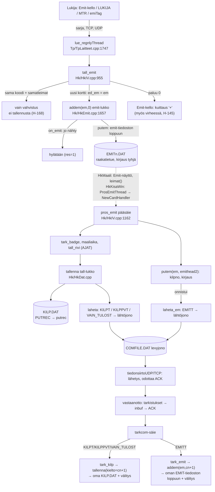

# Emit-kortin luenta: luennasta tallennukseen ja välitykseen

**Tila: ALUSTAVA K-3-AINEISTO – ei riippumattomasti tarkastettu.**

- Päiväys: 2026-11-27
- Lähderevisio: TPsource-tuotantokoodi revisio `f7fe553`. `doc/arkkitehtuuri/CHECKPOINT.md`:n
  rivin "Analysoitu revisio" mukaan tuotantokoodi ei ole muuttunut sen jälkeen.
- Polut ovat suhteessa hakemistoon `TPsource/V52/`, ellei polku ala `doc/`.
- Kysymys: *Mitä tapahtuu siitä hetkestä lähtien, kun Emit-kilpailukortti luetaan, siihen asti kun
  kilpailijan tulos on tallennettu ja välitetty muille työasemille?*
- Vaihe K on kehitystehtävä, ei auditointi. Tässä ei arvioida vikoja uudelleen eikä ehdoteta
  korjauksia. Prioriteetit, tilat ja korjauskokonaisuudet ovat `rekisteri/riskiarvio.csv`:n
  sarakkeista `prioriteetti`, `tila` ja `kk` (luettu 2026-11-27).

**Merkinnät**

| Merkintä | Merkitys |
|---|---|
| **[AA: asiakirja luku]** | Tieto on jo auditointiaineistossa (`doc/arkkitehtuuri/`). Asiakirjan oma varmuusmerkintä säilyy, jos se on kirjattu. |
| **[K-luettu]** | = *[luettu koodista K-vaiheessa, ei riippumattomasti tarkastettu]*. Kirjoittaja luki kohdan koodista tätä aineistoa varten. Siitä ei ole johdettu havaintoja. |
| **[päätelty]** | Kirjoittajan päätelmä. Peruste kerrotaan. |
| **[tuntematon]** | Asiaa ei voi ratkaista aineistosta eikä koodista ilman ajoa tai laitetta. |

Lyhenteet: **HKM** = HkMaali (konsoli, MSVC), **HKW** = HkKisaWin (GUI, bcc32), **VM** =
ViestiMaali, **VL** = ViestiLuenta, **VW** = ViestiWin. "Emit-tiedosto" = HK:ssa `EMIT<vaihe>.DAT`,
viestissä `EMIT.DAT` [AA: `tiedostomuodot.md` "Tiedostot"].

---

## 1. Selkokielinen kuvaus

Ketju koostuu kahdesta erillisestä vaiheesta. Ne tapahtuvat eri säikeissä ja eri aikaan.

**Vaihe A: kortin vastaanotto (lukijasäie).** Jokaisella lukijalla on oma taustasäie. Säie
tunnistaa lukijalta tulleen sanoman ja muodostaa siitä emit-tietueen: kortin koodin, lukuajan ja
leimat. Sen jälkeen säie lisää tietueen emit-tiedoston loppuun. Tässä vaiheessa kortti ei vielä
kuulu kenellekään kilpailijalle, eikä sitä lähetetä muille työasemille. Jos lukija on Emit-kello,
lukija saa kuittauksen heti tämän vaiheen jälkeen. Kuittaus lähtee myös silloin, kun tiedostoon
kirjoittaminen epäonnistui (H-145). Muilla lukijatyypeillä ei ole kuittausta, joka riippuisi
tallennuksesta.

**Vaihe B: kortin käsittely (käyttöliittymän säie).** Ohjelma ottaa emit-tiedostosta seuraavan
käsittelemättömän kortin. Se etsii kilpailijan kortin koodilla, tarkastaa leimat radan mukaan,
laskee maaliajan ja tallentaa kilpailijan tuloksen kilpailijatiedostoon `KILP.DAT`.
Kilpailijatiedot laitetaan heti jokaisen yhteyden lähtöjonoon. Vasta sen jälkeen emit-tietue
kirjoitetaan uudelleen, nyt kilpailijan numerolla merkittynä, ja tietue laitetaan lähtöjonoon.
Konsoliohjelmassa (HkMaali) käsittely etenee vain, kun käyttäjä on Emit-näytössä. GUI:ssa
(HkKisaWin) Emit-lomakkeen on oltava auki ja lukemisen valittuna.

**Välitys muille työasemille.** Lähtöjono on oletuksena levyllä (`COMFILE.DAT`). Erillinen
lähetyssäie lähettää paketit yksi kerrallaan ja odottaa vastaanottajan kuittausta. Vastaanottaja
kuittaa paketin heti, kun se on ottanut paketin muistiin, eli ennen kuin se on käsitellyt paketin.
Vastaanottava asema tallentaa kilpailijatiedot omaan `KILP.DAT`-tiedostoonsa ja lisää emit-tietueen
oman emit-tiedostonsa loppuun. Tietueiden järjestysnumerot voivat siksi olla eri asemilla eri.
Vastaanottaja välittää tiedot edelleen kaikille muille yhteyksilleen paitsi sille, josta tieto
tuli.

**Mitä "tallennettu" tarkoittaa.** Kirjoitusfunktion kutsu ei tarkoita, että tieto on tallessa:

- `KILP.DAT`: kirjoitusvirhe huomataan ja siitä tulee ilmoitus. Ohjelma jatkaa kuitenkin
  normaalisti, ja tieto lähetetään muille asemille silti (H-015).
- Emit-tiedosto: virheestä tulee ilmoitus. Ensimmäisessä vaiheessa kortti silti kuitataan
  lukijalle eikä sitä enää lueta uudelleen saman istunnon aikana (H-145).
- Lähtöjono: virhe voi siirtää jonoa eteenpäin niin, että paketti katoaa (H-044).

**Voivatko työasemat erota toisistaan?** Voivat. Järjestelmä välittää tilan eikä toimenpiteitä.
Viimeksi saapunut tieto voittaa, eikä eroja korjata jälkikäteen [AA: `tiedonsiirto.md`
"Johtopäätös"]. Emit-tietue ja kilpailijan tulos kulkevat erillisinä paketteina, joten ne voivat
päätyä eri asemilla eri tilaan (luku 8.6).

**ViestiLuenta ei kuulu tähän ketjuun.** Se on sisäänluentaohjelma. Kortin luku antaa vain kortin
koodin sisäänluentanäkymälle. Emit-tietuetta ei tallenneta, eikä EMITT-paketteja käsitellä
(luku 7).

---

## 2. Tekninen suoritusketju (HK; viestin erot luvussa 7)

Vaiheet koskevat toimitettujen HK-ohjelmien käännettyjä haaroja (luku 6). Säikeet ja lukot:
[AA: `saikeet-ja-lukot.md` luvut 3–4].

### 2.1 Laitesanoma lukijasäikeessä

| # | Mitä tapahtuu | Missä | Säie / lukko | Lähde |
|---|---|---|---|---|
| A1 | Jokaiselle lukijalle käynnistetään oma `lue_regnlyThread`. Silmukan jakso on 20 ms. | `Tp/TpLaitteet.cpp:1747-1875` | lukijasäie, ei lukkoa | [AA: `saikeet-ja-lukot.md` luku 3; `todisteet/c10/raportit/osaD-laitteet.md` luku 2] |
| A2 | Kehyksen tunnistus laitetyypin mukaan: Emit-kello ja RTR `lue_EmitKello` (`:856-939`), Emit-lukija `LUKIJA` (`:948-1122`, kaksi tarkistussummaa, XOR 0xDF), MTR (`:1126-1295`), emiTag (`:1299-1372`) | `Tp/TpLaitteet.cpp` | lukijasäie | [AA: osaD luvut 1–2; `riippuvuudet.md` luku 13] |
| A3 | Kaksoisluennan esto laitetasolla. LUKIJA: kortti hyväksytään vasta, kun puskurissa on `lukutoisto` (oletus 2) identtistä sanomaa. Sama koodi tunnistetaan `vahvistus`-arvosta ja 6 tikin portista. | `Tp/TpLaitteet.cpp:1054-1109` | lukijasäie | [AA: osaD luku 2 "LUKIJA"] |
| A4 | `tall_emit(vastaus, vahvistus, r_no)` | Emit-kello `:911`, LUKIJA `:1098`, MTR `:1248`, emiTag `:1365`. Rivin `:1475` (SportIdent) haara on kuollutta koodia. | lukijasäie | [AA: osaD luku 4]; SportIdent kuollut [AA: `rekisteri/valitsimet.csv` `SPORTIDENT` dead-never-defined] |

### 2.2 `tall_emit`: emit-tietueen muodostus (`Hk/HkIV.cpp:955-1153`)

| # | Mitä tapahtuu | Rivit | Lähde |
|---|---|---|---|
| B1 | `regnlyhetki` päivitetään. Lukijakohtainen välimuisti `ed_em[r_no]` varataan, jos sitä ei vielä ole (varausvirhe → paluuarvo 1). | `:967-973` | [K-luettu] |
| B2 | Kentät poimitaan laitetyypin mukaan: Emit-kello (`'K'`/`'L'`; K-kehyksessä maaliaika kellosta, `package` = 10 000 000 + koodi), LUKIJA (`em.time` = koodin havaintoaika taulusta `bdg_t`, `hae_bdg_t`), MTR, emiTag (tunnistekoodi 240–253 vaaditaan leimojen lopusta). | `:978-1089` | [AA: osaD luku 4 (paluuarvot)]; kenttien poiminta [K-luettu] |
| B3 | Tunnistustila `emitTunnistus`: vain `emitLuettu(badge)` ja paluu 0. Tallennusta ei tehdä. | `:1090-1093` | [AA: osaD luku 4 kohta 4]; GUI-koukku H-107 |
| B4 | Vain GUI: jos laitteen muistin luenta tiedostoon on valittu (`emittallfile`), tietue kirjoitetaan siihen tiedostoon ja funktio palaa. Emit-tiedostoa ei käytetä. | `:1138-1144`; valinta `cbTp/UnitEmiTag.cpp:228-234`, `cbTp/UnitMTR.cpp:223` | [K-luettu]; [AA: `todisteet/c9/osaB-pysyva-data.md` luku 5 kohta 8 mainitsee] |
| B5 | Toistetarkistus: sama koodi kuin lukijan edellisellä kortilla ja `samatleimat` tosi → vain `*vahvistus = badge`. Kortti ei mene emit-tiedostoon. `samatleimat` vertaa leimausaikaa itseensä, joten ajat eivät vaikuta (H-168). | `:939-953`, `:1145-1147` | [AA: H-168; osaD luku 4] |
| B6 | Muuten `*(ed_em[r_no]) = em` (välimuisti päivitetään ennen kirjoitusta) ja `addem(&em, 0)`. Paluuarvoa ei käytetä. | `:1148-1151` | [AA: H-145; `virheenkasittely.md` 12.2] |
| B7 | `tall_emit` palauttaa 0 kaikissa edellä kuvatuissa tapauksissa. Paluuarvo on 1 vain, kun Emit-kellolta tulee muu kuin K- tai L-kehys tai muistinvaraus epäonnistuu. | `:979-981`, `:969-971`, `:1152` | [AA: osaD luku 4] |

### 2.3 `addem`: tallennus emit-tiedostoon (`Hk/HkEmit.cpp:1657-1693`)

Käännetty versio on `#if defined(EMIT)` -alueella, joka alkaa riviltä `:1549`. Rivien `:1275-1377`
versio on `TALLEMIT`-ehdon alla, eikä mikään ohjelma käännä sitä (luku 6).

| # | Mitä tapahtuu | Rivit | Lähde |
|---|---|---|---|
| C1 | `EnterCriticalSection(&emit_CriticalSection)` | `:1665` | [AA: `saikeet-ja-lukot.md` luku 4 (`emit`-lukko)] |
| C2 | Jos `estaemittoisto` (oletus 1, `Hk/HkGlobals.cpp:523`), `on_emit` tarkistaa avaimen `4000*time + badge` ja lisää sen tauluun *ennen* kirjoitusta. Jos avain on jo taulussa, `res = 1` ja kortti hylätään. | `:1666-1667`; `on_emit` `:1627-1655` | [AA: H-145; `todisteet/c9/osaB-pysyva-data.md` 2.2 kohta 3]; oletusarvo [K-luettu] |
| C3 | `putem(em, emithead, 1)` kirjoittaa tietueen tiedoston loppuun: `_lseek` ja `_write`, `inCrSe=1` (lukko on jo hallussa). Virheestä tulee `iowerr` eli modaali-ikkuna lukijasäikeessä `emit`-lukon alla. | `:1669`; `putem` `:1600-1625` | [AA: `virheenkasittely.md` luku 4 ja 12.2; `osaB` 2.2] |
| C4 | Onnistuessa: `setEmitJarr` (vain jos `kilpno` ja `badge`), `emithead++`, `fflush(femitfile)`, kun `kirjheti & 4`. `femitfile` on puskuroimaton (`_IONBF`), eikä `_commit`ia ole, joten tieto on tämän jälkeen käyttöjärjestelmän välimuistissa (H-156). | `:1670-1677`; `:3057-3058` | [AA: `virheenkasittely.md` luku 4 "Kestävyys"; H-156]; `_IONBF` [K-luettu] |
| C5 | Vain jos `kirjaus` on asetettu (tietue on jo käsitelty): `emithead2` siirtyy, `laheta_em`, `emit_rap` (kun `kielto`) ja `addemitanal`. **Lukijalta tullut raaka kortti ei täytä ehtoa**, koska `tall_emit` asettaa `kirjaus = TMAALI0/KSEK` (`Hk/HkIV.cpp:977`). Raakakorttia ei siis lähetetä muille asemille. | `:1678-1688` | [K-luettu] |
| C6 | `LeaveCriticalSection`; `return(res)`. Kirjoitusvirhe palauttaa 0 (H-145). | `:1691-1692` | [AA: H-145] |

### 2.4 Lukijan kuittaus

| Lukija | Kuittaus | Lähde |
|---|---|---|
| Emit-kello, RTR, RTR2 (`EMITKELLO`, `REGNLY`) | `+\r`, kun `tall_emit` palauttaa 0, muuten `?\r` (uusintapyyntö enintään 200 ms välein). Kuittaus annetaan myös hylätylle kaksoiskappaleelle, epäonnistuneelle tallennukselle ja tunnistustilassa. | [AA: osaD luku 4; `riippuvuudet.md` luku 13 "Q86"; H-145, H-168] |
| Emit-lukija `LUKIJA` (sarja, TCP, UDP) | Kuittausta ei ole. Kaksoiskappaleet suodatetaan. TCP-yhteyden `/P` lähettää NAK-kyselyn. | [AA: osaD luku 2] |
| MTR | Vetoprotokolla `/GB`. `pkg_alku` etenee `tall_emit`-kutsun jälkeen paluuarvosta riippumatta. | [AA: osaD luku 4 ja N-6; `virheenkasittely.md` 12.2] |
| emiTag | Kuittausta ei ole. | [AA: `riippuvuudet.md` luku 13] |

Kuittaus tarkoittaa siis enintään, että vaihetta A on yritetty. Se ei tarkoita, että kilpailijan
tulos on tallennettu tai että kortti on yhdistetty kilpailijaan [päätelty: kuittaus annetaan
rivillä `Tp/TpLaitteet.cpp:911-917` ennen vaihetta B, joka tehdään eri säikeessä]. Laitteen
tulkinta kuittauksesta on avoin (Q86, Q100, OP-13).

### 2.5 Käsittelyn käynnistys

| Ohjelma | Ketju | Ehdot | Lähde |
|---|---|---|---|
| HkMaali | Päävalikko `E` → `leimat()` (`HkConsole/HkMain.cpp:152-158`) → silmukassa `pros_emit(0, 0)`, kun näppäintä ei paineta (`Hk/HkEmit.cpp:3863-3874`) | Käsittely etenee vain Emit-näytössä. Silmukka päättyy, kun `!taustaon || vaiheenvaihto`. H-031: evätyn vaiheen vaihdon jälkeen lippu jää päälle, ja käsittely pysähtyy. | [K-luettu]; H-031 [AA: `tiedonsiirto.md` "Löydökset"] |
| HkKisaWin | `ProsEmitThread` (`cbHk/WinHk.cpp:1611-1639`) → `FormEmit->HaeUusiTietue()` → `SendMessage(WM_MYMSGNEWCARD)` (`cbHk/UnitEmit.cpp:960-963`) → pääsäikeen `NewCardHandler` (`:880-957`) → `pros_emit(&EKilp, msgtxt)` (`:936`) | `FormEmit` on oltava luotu ja alustettu, valintojen `CBLue` tai `CBViim` päällä eikä vaiheen vaihtoa käynnissä (`WinHk.cpp:1616-1619`). Käsittely ei etene, jos lomakkeella on tallentamattomia muutoksia tai käyttäjä selaa vanhempaa tietuetta (`UnitEmit.cpp:895-932`). H-163: `SQLSTART`-virhe estää `ProsEmitThread`in käynnistyksen. | [AA: `saikeet-ja-lukot.md` luku 3 (säietaulukko)]; ehdot [K-luettu]; H-163 [AA: `havainnot.md`] |

Jos ehdot eivät täyty, kortit jäävät emit-tiedostoon käsittelemättöminä (`emithead2 < emithead`)
[K-luettu].

### 2.6 `pros_emit`: kilpailijan tuloksen muodostus (`Hk/HkIV.cpp:1162-1868`)

| # | Mitä tapahtuu | Rivit | Lukot | Lähde |
|---|---|---|---|---|
| D1 | Paluu heti, jos `in_pros_emit`, `emithead2 >= emithead` tai `!ProsEmitOn`. Muuten `lueem(&em, emithead2)`. | `:1184-1187` | `lueem` ottaa `emit`-lukon (`Hk/HkEmit.cpp:1572-1583`) | [AA: H-137, H-053]; [K-luettu] |
| D2 | Jo käsitelty tietue (`kirjaus` asetettu, esim. toiselta asemalta saapunut) ohitetaan: `emithead2++`. | `:1188-1192` | `emithead2` ilman lukkoa (H-137) | [AA: H-137] |
| D3 | `kirjaus` = nykyhetki. Jos `badge == 0`: `putem`, paluu. | `:1195-1203` | | [K-luettu] |
| D4 | Kilpailijan haku: `bdg2kno` → `getpos` → `kilp.GETREC`. Konsolin (`:1204-1518`) ja GUI:n (`:1519-1623`) haarat eroavat, ks. luku 4. | `:1276-1283`, `:1540-1549` | `GETREC` `kilpdat`-lukon alla | [K-luettu] |
| D5 | Leimantarkastus `tark_badge`. Jos rataa ei löydy tai kortin kello on nollautunut, tulee ilmoitus. | `:1632-1653` | | [K-luettu] |
| D6 | Automaattinen sarja- tai ratavalinta (`autosarja`, `autorata`). Maaliaika kortilta, kun `maalilaji == 4` (`e_maaliaika`); lähtöaika radan `ennakko`-asetuksen mukaan. `EBA`-haara (`:1701-1705`) on kuollutta koodia; käännetty on `#else`-haara `:1706-1745`. | `:1674-1746` | | [K-luettu]; `EBA` [AA: `valitsimet.csv`] |
| D7 | Maaliaika ajanottojonoon `tall_rivi` (Emit-kellon kortit ja `EMITAJAT`) → AJAT-tiedosto (H-146). | `:1747-1802` | `ajat`-lukko `tall_rivi`n sisällä | [AA: `virheenkasittely.md` 12.3]; polku [K-luettu] |
| D8 | **Kilpailijan tallennus:** `set_tulos` ja sen jälkeen `kilp.tallenna(d, TRUE, 0, 0, &entkilp)`. | `:1803-1823` | `tall`-lukko `:1820-1822` | [AA: `tallenna-samanaikaisuus.md`]; rivit [K-luettu] |
| D9 | **Emit-tietueen päivitys:** `j = putem(&em, emithead2, 0)` kirjoittaa samaan paikkaan uudelleen (`kilpno`, `kirjaus`). | `:1845` | `putem` ottaa `emit`-lukon itse (`inCrSe=0`) | [K-luettu] |
| D10 | Vain jos `j == 0` ja `kilpno`: `setEmitJarr`, **`laheta_em(&em, 1, 0)`** ja `addemitanal`. | `:1846-1852` | `laheta_em` ottaa `outb`-lukon | [K-luettu] |
| D11 | `naytatulos`. Väliaikalaskenta `laskeEm_VA(d, false)`, joka kutsuu `tallenna`a ilman lukkoa (H-010). Lainakortin varoitus, `emit_rap` ja "Kilpailijalla ei aikaa". | `:1853-1863` | | [AA: `tallenna-samanaikaisuus.md` "Kutsupaikat" (`Hk/HkEmit.cpp:6237`)] |
| D12 | `emithead2++`, `in_pros_emit = 0` | `:1864-1865` | ilman lukkoa | [AA: H-137] |

### 2.7 `kilptietue::tallenna` ja `KILP.DAT` (`Hk/HkDat.cpp`)

| # | Mitä tapahtuu | Rivit | Lähde |
|---|---|---|---|
| E1 | HK:n `tallenna` ei lukitse itse. Kutsuja pitää `tall`-lukkoa (D8 pitää). | `:941`, `:1383` (kommentoitu) | [AA: `tallenna-samanaikaisuus.md` "Johtopäätös"] |
| E2 | `kilpcmp` vertaa vanhaan tietueeseen. Jos muutoksia ei ole, mitään ei kirjoiteta eikä lähetetä. | `:979` | [AA: `tiedonsiirto.md` "Reititys" (kumottu kiertoväite)] |
| E3 | Jos emit-koodi muuttui: `rembadge` ja `addbadge`, `setEmitJarr`, sekä `putem(&em, ep, 1)` muihin emit-tietueisiin **ilman `emit`-lukkoa** (H-011). | `:1042-1189`; `:1114`, `:1146`, `:1169` | [AA: H-011, H-135] |
| E4 | `PUTREC(d, 1)` → `kilparr[d]` päivitetään muistiin ensin → `write(d, 0)` → `putrec` `kilpdat`-lukon alla. Kun `datatallfl[1]` on päällä (GUI), myös `kirjKilpSQL` (MySQL-jono). | `:1211`; `:581-595`, `:609-624` | [AA: `virheenkasittely.md` luku 4; `tallenna-samanaikaisuus.md` "Mitä tallenna muokkaa"] |
| E5 | `KILP.DAT` on avattu `FILE_FLAG_WRITE_THROUGH`-lipulla. Kirjoitusvirhe → modaali-ikkuna Kyllä/Ei `kilpdat`-lukon alla. Paluuarvo −1 ohitetaan, joten kutsuja ei tiedä virheestä. "Ei" lopettaa ohjelman (H-015, H-153). | `dbboxm/dbbox1.cpp:64-100`; `tputilv2/perr.cpp:28-60` | [AA: `virheenkasittely.md` 4 ja 12.7; `tiedostomuodot.md` "KILP.DAT"] |
| E6 | `laheta(...)`: perustiedot (KILPT), vaihe (KILPPVT) ja yksittäiset tuloskentät (VAIN_TULOST) jokaisen yhteyden lähtöjonoon. Lähetys tehdään myös, jos E5:n kirjoitus epäonnistui. | `:1257-1307` | [AA: `tiedonsiirto.md` "Sarjallistaminen"; `virheenkasittely.md` 12.7 ("lähetys muille tehty")] |
| E7 | `lisaToimet` (esimerkiksi jatkuva sivutuloste, H-091) | `:1373-1374` | [AA: H-091] |

### 2.8 Lähetys: jonoon, verkkoon ja vastaanottajan kuittaus

| # | Vaihe | Missä | Lähde |
|---|---|---|---|
| F1 | `laheta_em` (`Hk/HkCom32.cpp:766-788`) käy yhteydet läpi `outb`-lukon alla. Se ohittaa suljetun yhteyden, yhteydet, joille ei lähetetä, sekä `com_emit <= 0`, `rajaus && com_emit == 3`, lähteen (`kielto-1`) ja `estavalitys`. Lisäksi lähetetään EMITVA (`laheta_emva_yht`), kun se on asetettu. | | [K-luettu]; asetus `LÄHEMITn[=I/O/V]` luvussa 6 |
| F2 | `buflah` → **jonoon laitto**. Levyjonossa (`COMFILE.DAT`, oletus) paketin tavut tallennetaan jonoon laittohetkellä. Kirjoitusvirhe siirtää jonoa silti eteenpäin (H-044). Muistijono (`COMFILE=EI`, vain HK) pudottaa paketin, kun jono on täynnä (H-021). | `Tp/TpComY.cpp:497-530` | [AA: `tiedonsiirto.md` "Jonot ja levypuskuri"; H-044, H-021] |
| F3 | **Lähetys verkkoon:** `tiedonsiirtoUDP` tai `tiedonsiirtoTCP` lukee jonon kärjen ja lähettää kehyksen `SOH|id|255-id|pkgclass|len|chksum|data`. Kerrallaan on yksi kuittaamaton paketti yhteyttä kohden. | `Tp/TpComY.cpp:1465-1513` | [AA: `tiedonsiirto.md` "Kehys ja kuittaus"] |
| F4 | **Vastaanottajan kuittaus:** vastaanottosäie tarkistaa id:n, pituuden `class_len` ja tarkistussumman. Jos `inbuf` on tyhjä (muut kuin RS-yhteydet), paketti kopioidaan muistiin ja vastaanottaja lähettää ACK:n. Lähettäjän `kirjaahyv` siirtää jonoa vasta ACK:n jälkeen. Toistettu id kuitataan uudelleen soveltamatta. | `Tp/TpComY.cpp:646-660`, `:766-773`, `:1008-1039`, `:1575-1612` | [AA: `tiedonsiirto.md` "Kehys ja kuittaus" (todennettu, tarkastettu)] |
| F5 | ACK siis kertoo, että paketti on vastaanottajan muistissa, ei että se on käsitelty tai tallennettu levylle [päätelty F4:stä: käsittely tehdään myöhemmin `tarkcom`-säikeessä]. | | [päätelty] |

### 2.9 Vastaanottava työasema

| # | Mitä tapahtuu | Missä | Lähde |
|---|---|---|---|
| G1 | `tarkcom` (oma säie, `Sleep(50)`) jakaa paketit luokan mukaan. | `Hk/HkCom32.cpp:875-964` | [AA: `saikeet-ja-lukot.md` luku 3; `tiedonsiirto.md` "Reititys"] |
| G2 | KILPT, KILPPVT ja VAIN_TULOST → `tark_kilp`: tietue luetaan *ennen* `tall`-lukkoa (H-007), sitten `tallenna(d, kielto = cn+1)`. Tallennus kirjoittaa vastaanottajan `KILP.DAT`:iin (E4–E5) ja välittää tiedon kaikille muille yhteyksille paitsi lähteelle. HK ei tarkista kilpailijanumeroa KILPPVT- ja VAIN_TULOST-paketeista (H-022). Vaiheindeksi on tarkistamatta (H-033). | `Hk/HkCom32.cpp:260-332` | [AA: `tiedonsiirto.md` sekvenssikaavio, "Reititys"; H-007, H-022, H-033] |
| G3 | EMITT → `tark_emit` (kun `com_emit` on 1 tai −1) → `addem(&em, cn+1)`. Tietue **lisätään vastaanottajan emit-tiedoston loppuun**, omalla `emithead`illä. Koska `kirjaus` on asetettu: `setEmitJarr`, `emithead2` siirtyy vain, jos käsittely oli ajan tasalla, `laheta_em` välittää muille ja `emit_rap`, kun `comautorap`. Kaksoiskappale (`on_emit`) hylätään hiljaa. | `Hk/HkCom32.cpp:790-798`, `:812-816`; `Hk/HkEmit.cpp:1665-1691` | [AA: H-137, H-092, H-034]; tiedoston loppuun lisäys ja `com_emit`-ehto [K-luettu] |
| G4 | Vastaanottaja ei tee emit-tietueelle uutta leimantarkastusta tai tuloslaskentaa. Tulos tulee G2:n kilpailijapaketeissa [K-luettu: `addem` ei kutsu `tallenna`a; HK:n `tark_emit` ei tee muuta kuin `addem`]. | | [K-luettu] |
| G5 | Järjestys: lähettäjä laittaa kilpailijapaketit jonoon D8:ssa ennen EMITT-pakettia D10:ssä. Jono on yhteyskohtaisesti FIFO, joten vertainen saa kilpailijatiedot ensin [AA: `tallenna-samanaikaisuus.md` "Tallennus, SQL ja replikointi": FIFO; järjestys D8 → D10 [K-luettu]]. | | ks. sarakkeet |

### 2.10 Uudelleenkäynnistys

`lueemitfile` (`Hk/HkEmit.cpp:3029-3112`) lukee emit-tiedoston, rakentaa `emitjarr`-linkit
uudelleen ja vertaa tietueiden `kilpno`a `KILP.DAT`:n koodeihin. Eroista kirjoitetaan ilmoitus
`DATA_ERR.TXT`:hen. `emithead2` asetetaan heti *viimeisen* käsitellyn tietueen jälkeen
(`:3103-3104`). `on_emit`-taulua ei rakenneta uudelleen (H-034). [AA: `tiedostomuodot.md` "Emit-tiedosto"
(otsakkeettomuus, keskeneräinen tietue); H-034]; `emithead2`:n palautus ja vertailu [K-luettu].

---

## 3. Normaali ketju (toimitettu HK-ohjelma, LUKIJA tai Emit-kello)

Kaavio koskee HkMaalia ja HkKisaWinia. Viestin ViestiMaali ja ViestiWin noudattavat samaa
pääjärjestystä (luku 7). ViestiLuenta ei kuulu kaavioon.

---

## 4. Vaihtoehtoiset polut

| Tilanne | Mitä tapahtuu | Ohjelmat | Lähde |
|---|---|---|---|
| Saman kortin uusi luku samalla lukijalla ilman välissä luettua korttia | Hylätään `samatleimat`-vertailussa ja kuitataan (Emit-kello). Myös todellinen toinen luku hylätään, jos rastikoodit ovat samat (H-168). | kaikki emit-ohjelmat | [AA: H-168] |
| Sama kortti uudelleen toisen kortin jälkeen | `on_emit` (avain lukuaika + koodi) hylkää kortin, jos `estaemittoisto = 1` (oletus). Asetuksella `SALLIEMITTOISTO`/`ESTÄEMITTOISTO=EI` kortti tallennetaan. | HK, viesti | [AA: `virheenkasittely.md` 12.2]; avaimet `Hk/HkInit.cpp:2596-2602` [K-luettu] |
| Kortti on jo luettu kilpailijalle tai kilpailijalla on jo merkintä | Konsoli: kysytään `S)amalle, T)oiselle, O)hita` (`Hk/HkIV.cpp:1285-1338`). GUI: ilmoitus, ja kortti ohjataan toiselle eli vakanttipaikalle tai uudelle tietueelle (`luetoiselle = 1`, `:1550-1622`). | HKM / HKW | [K-luettu]; `vaihda_badge`n vaikutusta ei luettu |
| Tuntematon kortti | Konsoli: käyttäjä antaa numeron, hakee nimellä tai lisää kilpailijan (`:1340-1517`). GUI: kortti sijoitetaan seuraavalle vakanttipaikalle (`haeSeurVakantti`). Jos sellaista ei ole, lisätään uusi vakanttisarjan tietue (`addtall`). Ilmoitus "käsittele" (`:1577-1622`). Vakanttipaikan `tallenna` (`:1608`) on ilman lukkoa (H-010). Vakantti jää omistamaan kortin (H-120). | HKM / HKW | [K-luettu]; H-010, H-120 [AA] |
| Koodi 200 (koodinsa menettänyt kortti) | Konsoli: kysely. GUI: uusi vapaa koodi, tai esiluennassa käyttö estetään. | HKM / HKW | [K-luettu] (`:1205-1274`, `:1523-1539`) |
| Kuntosuunnistustila 1/2 | Vain GUI vaihtaa seuraavan vapaan koodin (`#if defined(_BORLAND_)`, `:1663-1673`). | HKW | [AA: H-081, `kaantajaerot.md`; Q60, OP-9] |
| Esitarkastus, esiluenta (`ESITARK`, `ESILUENTA` HK:n asetuksina) | Emit-tiedostona `ESITARK.DAT` (`Hk/HkEmit.cpp:3037-3038`). Tulosta ei lasketa: haara `:1825-1833` tallentaa vain merkinnän `-`. | HKM, HKW | [K-luettu]; vaiheen vaihdon kahva H-105 [AA] |
| Tunnistustila (`emitTunnistus`) | Kortti vain näytetään (`emitLuettu`). Ei tallennusta. Emit-kello saa kuittauksen. | HKW (koukku GUI:ssa) | [AA: osaD luku 4; H-107] |
| GUI: laitteen muistin luenta tiedostoon (`emittallfile`) | Tietueet menevät käyttäjän valitsemaan tiedostoon, eivät emit-tiedostoon. | HKW, VW | [K-luettu] |
| Testisyöte `EMITFILE` (portti > 900, `EMIT_IN.DAT`) | `file2emit` lukee tiedoston ja kutsuu `tall_emit`ia. Testityökalu, ei normaali käyttö. | HKM, HKW, VM | [AA: `ominaisuusvalitsimet.md` luku 3 ja T3]; `Hk/HkIV.cpp:877-937` [K-luettu] |
| emiTag HTTP/SQL (`ETGPRS`, `ETSQL`) | Väliaikojen nouto palvelimelta `vahaku`- tai `haeSQLTh`-säikeessä → `tulk_emiTag` / `tall_etulos`. Ei kortinluvun pääketju. | `EMITHTTP`: kaikki paitsi VL | [AA: `riippuvuudet.md` luvut 12–13; H-166, H-097] |
| Toiselta asemalta saapunut käsitelty kortti | `addem` lisää sen paikallisen tiedoston loppuun. `pros_emit` ohittaa sen (`kirjaus` asetettu). Kilpailun aikana tämä voi ohittaa paikallisen kortin automaattikäsittelystä (H-137). | kaikki emit-ohjelmat | [AA: H-137] |
| Käyttäjä ohittaa kortin GUI:ssa (`BtnOhitaClick`) | `Em.kilpno = 0`, `Em.badge = 0`, `Em.put`, sekä pitkään pidetyn kilpailijakopion `tallenna`. | HKW | [AA: H-017 (`cbHk/UnitEmit.cpp:3483`)] |
| "Lähetä näytetyt leimatiedot" (GUI-valikko) | `laheta_em(&Em, 0, 0)`. Ainoa polku, jolla tieto kulkee `LÄHEMITn=V`-yhteydelle. Vastaanottaja hylkää kortin, jos sen `on_emit` on jo nähnyt sen [päätelty: `addem` tarkistaa `on_emit`in, kun `estaemittoisto = 1`]. | HKW, VW | [K-luettu] `cbHk/UnitEmit.cpp:3533-3537`; käyttöohje `docs-site/docs/hkkisawin/hkliite1.md:177` |
| Vaiheen vaihto kesken luennan | Lukijasäikeitä ei pysäytetä. Emit-tiedosto suljetaan ja avataan uudelleen kolmen lukon alla. Esitarkastus- tai esiluentatilassa uudelleenavaus ohitetaan (H-105). Kun `RADAT<n>.XML` puuttuu, `emitfl = 0` (H-134). | HKM, HKW | [AA: `saikeet-ja-lukot.md` luku 5; H-105, H-134, H-094] |
| Konsoli vs GUI, yhteenveto | Konsolin `pros_emit` kysyy käyttäjältä ja odottaa vastausta. GUI:n haara päättää automaattisesti ja kirjoittaa viestin `msgtxt`iin. Konsolissa käsittely tehdään vain Emit-näytössä, GUI:ssa vain Emit-lomakkeen ollessa auki. | | [K-luettu] |

---

## 5. Tietorakenteet ja tiedostot

| Rakenne / tiedosto | Sisältö | Kirjoittajat ja lukko | Lähde |
|---|---|---|---|
| `emittp` (188 tavua) | `package` 0, `badge` 4, `year` 8, `week` 10, `maali` 12, `time` 16, `ctrlcode[50]` 20, `ctrltime[50]` 70, `sc`/`pc`/`lc`/`kilpno`/`osuus` 170–178, `badge0` 180, `kirjaus` 184 | | [AA: `tiedostomuodot.md` "Emit-tiedosto", kokotaulukko] |
| `EMIT<n>.DAT` (HK), `EMIT.DAT` (viesti), `ESITARK.DAT` (HK:n esitarkastus) | `emittp`-taulukko ilman otsaketta; tietuenumero = indeksi; `emithead = filelength / 188`. Kesken jäänyt viimeinen tietue kirjoitetaan seuraavalla lisäyksellä yli. | `emit`-lukko; poikkeukset H-011 ja H-045 | [AA: `tiedostomuodot.md`]; `ESITARK.DAT` [K-luettu] |
| `emithead`, `emithead2`, `emitptr` | Tiedoston pituus, automaattikäsittelyn kohdistin, selauskohdistin | `emithead` `emit`-lukon alla; `emithead2` myös ilman lukkoa (H-137) | [AA: `globaali-tila.md` luku 6] |
| `ed_em[NREGNLY]` | Lukijakohtainen edellinen kortti (toistetarkistus) | lukijasäie | [AA: H-145] |
| `on_emit::emitvaraus`, `nemitvar` | Kaksoiskappaletaulu, avain `4000*time + badge`. Ei talletu levylle, nollautuu käynnistyksessä. Vaiheen vaihto vapauttaa taulun, mutta laskuri jää ennalleen (H-141). | `emit`-lukko (`addem`) | [AA: H-034, H-141] |
| `emitjarr`, `bdg_kno` | Kilpailija → emit-tietue ja koodi → numero | ylläpidetään käsin, ilman lukkoa `tallenna`ssa | [AA: `globaali-tila.md` luku 5; H-135, H-140; T-039] |
| `bdg_t[8]` | Koodin havaintoaika (LUKIJA: `em.time`) | ilman lukkoa (H-136) | [AA: H-136] |
| `KILP.DAT` | dbboxm-tietuetiedosto; `FILE_FLAG_WRITE_THROUGH` | `kilpdat`-lukko jokaisessa `putrec`issa; HK:n `tallenna` vaatii lisäksi `tall`-lukon kutsujalta | [AA: `tiedostomuodot.md`; `tallenna-samanaikaisuus.md`] |
| `COMFILE.DAT` | Levyjono: otsake ja paikat. Kuittaamattomat paketit säilyvät uudelleenkäynnistyksen yli, ja käynnistyksessä kysytään, säilytetäänkö ne. | `outb`-lukko | [AA: `tiedostomuodot.md`; `tiedonsiirto.md` "Jonot"; H-038, H-044] |
| AJAT-jono (`AJATn.LST`) | Maaliaikarivit kortilta (D7) | `ajat`-lukko | [AA: `virheenkasittely.md` 12.3; H-146] |
| `combufrec` EMITT | `pkgclass = EMITT`, `len = class_len[EMITT]` = 188, `d.em` = koko `emittp` | | [AA: `testaus.md` (luokkapituudet)]; [K-luettu] `Hk/HkCom32.cpp:777-779` |

---

## 6. Asetukset ja käännösvalitsimet

Projektitiedostot (Release|Win32) [K-luettu]:

- `VS/Hk/HkMaali/HkMaali.vcxproj:154`: `_CONSOLE;EMIT;MAALI;EMITFILE;TCPLUKIJA;LAJUNEN;EMITHTTP;AUTOVA;SAKKOCOM;NREGNLY=32;…`
- `VS/V/JukMaali520.vcxproj:135`: `_CONSOLE;EMIT;MAALI;EMITFILE;ESITARK;EMITAG;EMITHTTP;LAJUNEN;TCPLUKIJA;NREGNLY=8;…`
- `VS/V/JukLuenta520.vcxproj:131`: `_CONSOLE;EMIT;MAALI;TCPLUKIJA;LUENTA;NREGNLY=8;…` (ei `VEmit.cpp`:tä käännösyksikkönä)
- `RADStudio10/HkKisaWin.cbproj:180-181`: `BCC_Defines` `EMIT;MAALI;TCPLUKIJA;LAJUNEN;AUTOVA;…`, `Defines` `_BORLAND_;EMITHTTP;EMITFILE;…`, `:149` `VALUKIJA`
- `RADStudio10/ViestiWin.cbproj:134`, `:195`: `EMIT;EMITHTTP;LAJUNEN;TCPLUKIJA;EMITAG;AUTOFILE;…`

| Valitsin / asetus | Ohjelmat | Vaikutus tähän ketjuun | Lähde |
|---|---|---|---|
| `EMIT` | kaikki viisi | Emit-koodi käännetään (`Hk/HkEmit.cpp:1549`). | [AA: `valitsimet.csv`]; projektit [K-luettu] |
| `MAALI` | kaikki viisi (pakotettu) | Yhdessä `EMIT`in kanssa: EMITT-vastaanotto (`Hk/HkCom32.cpp:813`), `LÄHEMIT`-jäsennys (`Hk/HkInit.cpp:2711`), `EMITLEIMAT` | [AA: `valitsimet.csv`] |
| `EMITLEIMAT` | kaikki viisi (johdettu) | Johdetaan valitsimista `(MAALI || AUTOVA) && EMIT && !EILEIMAT` (`Hk/HkDef.h:109-113`, `Juk/VDef.h:74-76`). Lukija-asetusten jäsennys ja `tall_emit` (`Hk/HkIV.cpp:730-1869`). | [AA: `valitsimet.csv`]; rivit [K-luettu] |
| `EILEIMAT` | ei missään | opt-out, ei koskaan määritelty | [AA: `valitsimet.csv` opt-out-never-defined] |
| `TALLEMIT` | ei missään | `Hk/HkEmit.cpp:1275-1377` (toinen `putem`/`on_emit`/`addem`/`lueemitfile`, jossa `res = putem`) on kuollutta koodia. **Käännetty `addem` on `:1657-1693`.** `TALLEMIT` esiintyy myös ehdoissa `MAALI || TALLEMIT`, jotka toteutuvat `MAALI`n kautta. | [AA: `valitsimet.csv` dead-never-defined; `virheenkasittely.md` luku 8] |
| `EBA` | ei missään | `eba_ajat` (`Hk/HkEmit.cpp:1732-1779`) ja `Hk/HkIV.cpp:1701-1705` ovat kuollutta koodia. Käännetty on `#else`-haara. | [AA: `valitsimet.csv`] |
| `TUNTURIxxx`, `SPORTIDENT`, `DBGEMIT`, `DBG`, `CONSOLE` (ilman alaviivaa) | ei missään | Kuolleita haaroja `addem`issa (`:1661`), `tall_emit`issa (SportIdent), lukijoissa (`Tp/TpLaitteet.cpp:1249`) ja `Hk/HkIV.cpp:1637` | [AA: `valitsimet.csv`] |
| `_CONSOLE` | HKM, VM, VL | `pros_emit`in konsoli- ja GUI-haarat (`Hk/HkIV.cpp:1204-1623`). `emittallfile` vain GUI:ssa. Viestin konsoli-`pros_emit` (`Juk/VIv.cpp:1117`), GUI:ssa `TFormEmit::ProsEmit` | [AA: `valitsimet.csv`]; haarat [K-luettu] |
| `_BORLAND_` | HKW | Kuntosuunnistuksen koodinvaihto `pros_emit`issa | [AA: H-081, `kaantajaerot.md`] |
| `LUENTA` | VL | `tall_emit` ei kutsu `addem`ia (`Juk/VIv.cpp:1107-1108`). EMITT- ja EMITVA-vastaanotto pois (`Juk/VCom.cpp:951`, `:956`). `laheta_em`issa ei EMITVA:ta (`:807`). | [AA: T-052, `ominaisuusvalitsimet.md` luku 3]; rivit [K-luettu] |
| `EMITFILE` | HKM, HKW, VM | Testisyöte `EMIT_IN.DAT` | [AA: `ominaisuusvalitsimet.md` luku 3] |
| `EMITAG` (makro) | VM, VW | Ei testata missään `#if`-ehdossa. emiTag-lukija jäsennetään makrosta riippumatta. | [AA: osaD "Summary", luku 3] |
| `ESITARK` (makro) | VM | Viestin konsolin esitarkastusruutu. HK:ssa `ESITARK` on ajonaikainen asetus. | [AA: `ominaisuusvalitsimet.md` luku 3; `asetusavaimet.csv`] |
| `TCPLUKIJA` | kaikki viisi | `LUKIJAn=TCP:`/`UDP` (SjBox) | [AA: osaD luku 1] |
| `LAJUNEN` | kaikki paitsi VL | Sirit-, Zebra- ja FEIG-RFID-ajanotto. Ei Emit-kortin luentaa. | [AA: osaD luvut 1, 3] |
| `EMITHTTP` | kaikki paitsi VL | emiTag-väliajat palvelimelta | [AA: `riippuvuudet.md` luku 12] |
| `NREGNLY` | HK 32, viestin konsoli 8, VW 32 | Lukijoiden enimmäismäärä | [AA: T-024] |
| `LUKIJAn`, `MTRn`, `EMITKELLO`, `REGNLYn`, `EMITAGn`, `ETGPRS`/`ETSQL` | HK ja viesti | Lukijan tyyppi ja yhteys | [AA: osaD luku 1; `asetusavaimet.csv`] |
| `LÄHEMITn[=I/O/V]` | HK ja viesti | Asettaa `emitfl = 1` ja `com_emit`: 1 = molemmat suunnat, `I` = −1 (vain vastaanotto), `O` = 2 (vain lähetys), `V` = 3 (vain erikseen pyydetty lähetys). Ilman tätä asetusta yhteys ei kuljeta EMITT-paketteja, mutta kilpailijapaketit kulkevat. | `Hk/HkInit.cpp:2711-2725`, `Juk/VInit.cpp:2003-2013` [K-luettu]; merkitys `docs-site/docs/hkkisawin/hkliite1.md:177` |
| `ESTÄEMITTOISTO` / `SALLIEMITTOISTO` | HK ja viesti | `estaemittoisto` (oletus 1) eli `on_emit`-hylkäys | `Hk/HkInit.cpp:2596-2602`, `Hk/HkGlobals.cpp:523`, `Juk/VInit.cpp:1995-2000` [K-luettu]; [AA: `asetusavaimet.csv`] |
| `LUKUTOISTO=0/1/E` | HK ja viesti | LUKIJAn vaatimat identtiset sanomat (oletus 2). GUI-valikon rasti ei vastaa muuttujaa (H-175). | [AA: osaD luku 2; H-175] |
| `KIRJHETI` | HK | `& 4`: `fflush(femitfile)` emit-lisäyksen jälkeen (vaikutukseton, koska tiedosto on puskuroimaton). `& 2` ei vaikuta levyjonoon (H-044). | [AA: H-044; `virheenkasittely.md` luku 4]; `& 4` [K-luettu] `Hk/HkEmit.cpp:1675` |
| `COMFILE=EI` | vain HK | Muistijono 50 pakettia (H-021). Viestissä levyjonoa ei voi kytkeä pois. | [AA: `tiedonsiirto.md` "Jonot"] |
| `ESITARK`, `ESILUENTA` (HK:n asetuksina) | HKM, HKW | `ESITARK.DAT`; tulosta ei lasketa | [AA: `asetusavaimet.csv`]; [K-luettu] |
| `SISÄÄNLUENTA[=M]`, `LUENTATESTI` | viesti | `sisaanluenta = 2` → `emitfl = 0` (`Juk/VInit.cpp:764-768`, `:2764-2765`). `tall_emit` ohjaa kortin sisäänluentaan (`Juk/VIv.cpp:1101-1104`). | [K-luettu] |
| `AUTORAP`, `EMITANAL`, `LÄHEMVA`, `EMVALOKI` | HK ja viesti | Automaattinen rastiväliraportti, emit-analyysi, EMITVA-väliaikapaketit ja niiden loki (H-073) | [AA: `asetusavaimet.csv`; H-073, H-092] |
| `UDPvarmistamaton` (yhteyskohtainen) | kaikki | Bitti 2 ohittaa UDP:n id-tarkistuksen ja kuittauksen (`Tp/TpComY.cpp:1008`, `:1038`) | [K-luettu]; asetusavainta ei jäljitetty |

---

## 7. Ohjelmakohtaiset erot

| Asia | HkMaali | HkKisaWin | ViestiMaali | ViestiWin | ViestiLuenta |
|---|---|---|---|---|---|
| Emit-tiedostoon tallennus luennassa | kyllä | kyllä | kyllä | kyllä | **ei** (`Juk/VIv.cpp:1107-1108`) [K-luettu] |
| Käsittelyn käynnistys | `leimat()`-näyttö | `ProsEmitThread` ja Emit-lomake | konsolin `pros_emit` (`Juk/VIv.cpp:1118`) | `ProsEmitThread` (`ViestiWin/UnitMain.cpp:1313`) → `TFormEmit::ProsEmit` (`ViestiWin/UnitEmit.cpp:893-944`) | sisäänluentanäkymä (`JukConsole/laskemtn.cpp`) |
| Tuntematon kortti | kysely | vakanttipaikka tai uusi tietue automaattisesti | kysely | `KysyKilpailija` | – |
| `tallenna` lukitsee itse | ei (kutsuja) | ei (kutsuja) | kyllä (`Juk/vdat.cpp:496`, `:850`) | kyllä | kyllä |
| Emit-kirjoitusvirheen ilmoitus | `iowerr` | `iowerr` | `writeerror_w` "putem, koodi 2" (`Juk/VEmit.cpp:1465`) | sama, `SendMessage` | – |
| `addem`in paluuarvo kirjoitusvirheessä | 0 | 0 | 1 (ohitetaan) | 1 (ohitetaan) | – |
| `fflush(femitfile)` | `kirjheti & 4` | `kirjheti & 4` | aina (`Juk/VEmit.cpp:1518`) | aina | – |
| EMITT-vastaanotto | kyllä | kyllä | kyllä | kyllä | **ei** (`Juk/VCom.cpp:951`) |
| Vastaanoton lukitus (kilpailijapaketit) | luku ennen lukkoa (H-007) | sama | lukko ennen lukua | sama | sama |
| Tuntematon pakettiluokka | ohitetaan | ohitetaan | vastaanotto pysähtyy (H-026) | sama | sama |
| `NREGNLY` | 32 | 32 | 8 | 32 | 8 |
| Emit-kello (`REGNLY`) | kyllä | kyllä | kyllä | kyllä | ei |

Lähteet: viestin `tallenna` ja vastaanoton lukitus [AA: `tallenna-samanaikaisuus.md` "Viesti";
`tiedonsiirto.md` "HK ja viesti"]; `addem`in paluuarvo [AA: `todisteet/c9/osaB-pysyva-data.md`
N-B1]; `NREGNLY` ja laitteet [AA: osaD luku 3]; muut [K-luettu].

Viestin ketjussa on sama pääjärjestys kuin HK:ssa: ensin `tallenna`, sitten `putem` ja `laheta_em`
vain onnistuneen `putem`in jälkeen. Konsolissa `Juk/VIv.cpp:1673-1679`, GUI:ssa
`ViestiWin/UnitEmit.cpp:926-931` [K-luettu]. ViestiWin GUI kasvattaa `emithead2`:ta ennen
käsittelyä (`:901`) [K-luettu]. Viestin `addem` (`Juk/VEmit.cpp:1505-1545`) lähettää vain
käsitellyn tietueen, kuten HK:n [K-luettu]. Viestissä `tark_partio` voi kaataa konsoliohjelman
kortin luennassa (H-064).

---

## 8. Tallennuksen ja lähetyksen onnistuminen

### 8.1 Kirjoitusfunktion kutsu vs onnistunut tallennus

| Kohde | Kutsu | Mitä onnistuminen tarkoittaa | Mitä virheessä tapahtuu | Lähde |
|---|---|---|---|---|
| Emit-tiedosto, luenta (C3) | `addem` → `putem` | `_write` palautti 188. Tieto on käyttöjärjestelmän välimuistissa, ei pakotettu levylle (ei `_commit`ia, H-156). | Ilmoitus. `emithead` ei kasva. Kortti on jo välimuistissa `ed_em` ja taulussa `on_emit`. Kuittaus Emit-kellolle. Ei lähetystä. Uusi luku ei tallenna korttia saman istunnon aikana (H-145). | [AA: `virheenkasittely.md` 12.2, 12.7] |
| Emit-tiedosto, käsittely (D9) | `putem(&em, emithead2, 0)` | sama | Kilpailijan tulos on jo tallennettu ja lähetetty (D8). Linkki `setEmitJarr` ja EMITT-lähetys jäävät tekemättä, ja `emithead2` etenee silti. Ks. luku 12, ehdokas KE-10. | [K-luettu] |
| Emit-tiedosto, `tallenna`n koodinvaihto (E3) | `putem(..., 1)` ilman lukkoa | sama | sama ilmoitus; mahdollinen lomittuminen (H-011) | [AA: H-011] |
| `KILP.DAT` (E4) | `PUTREC` → `putrec` | `WriteFile` onnistui; `FILE_FLAG_WRITE_THROUGH` | Ilmoitus Kyllä/Ei (lukon alla). Muisti on päivitetty, levy ei. Lähetys muille tehdään silti. Uudelleenkäynnistys lataa vanhan tietueen (H-015). | [AA: `virheenkasittely.md` 4, 12.7] |
| AJAT (D7) | `tall_rivi` → `writeajat` | | Rivi merkitään kirjoitetuksi; aukko (H-146) | [AA: H-146] |
| Lähtöjono (F2) | `buflah` | Tavut kirjoitettu `COMFILE.DAT`:iin | Jono etenee silti: edellinen paketti lähtee uudella id:llä tai nollapaikka merkitään lähetetyksi (H-044) | [AA: H-044] |

### 8.2 Jonoon laitto, lähetys verkkoon ja vastaanottajan kuittaus

1. **Jonoon laitto** (F2) tehdään tallennuksen yhteydessä samassa säikeessä `outb`-lukon alla.
   Paketin sisältö on se tila, joka oli jonoon laittohetkellä [AA: `tiedonsiirto.md` "Jonot"].
2. **Lähetys verkkoon** (F3) tehdään lähetyssäikeessä myöhemmin. Yhteyttä kohden on yksi
   kuittaamaton paketti [AA: `tiedonsiirto.md` "Kehys ja kuittaus"].
3. **Vastaanottajan kuittaus** (F4) annetaan, kun paketti on hyväksytty vastaanottajan
   muistipuskuriin. Käsittely `tarkcom`-säikeessä ja vastaanottajan oma levytallennus tapahtuvat
   kuittauksen jälkeen [AA: sama, sekvenssikaavio]; johtopäätös F5 [päätelty].
4. Kuittausnumero on 8-bittinen ja yhteyskohtainen, ja se nollautuu jokaisessa
   (uudelleen)yhteydessä [AA: `tiedonsiirto.md` "Johtopäätös"].

### 8.3 Lukijan kuittaus

Luku 2.4. Lukija ei saa tietoa vaiheista B–G: kuittaus koskee vain vaihetta A, ja vain Emit-kello
saa kuittauksen (Q86, Q100, OP-13 avoin).

### 8.4 Yhteyskatkot ja uudelleenlähetys

- Levyjono säilyttää kuittaamattomat paketit katkon ja uudelleenkäynnistyksen yli. Uudelleenkäynnistyksessä
  lähetetään vain kuittaamaton loppuosa alkuperäisessä järjestyksessä. Muistijonon paketit
  katoavat. Jos käyttäjä vastaa käynnistyksessä "Ei", jonossa olevat paketit katoavat pysyvästi
  (H-038) [AA: `tiedonsiirto.md` "Jonot", "Kättely"].
- Uudelleenyhteys alkaa `ALKUT`-paketilla, ja järjestysnumero nollautuu. Katkon aikana matkalla
  ollut paketti voidaan soveltaa kahdesti (H-034) [AA: `tiedonsiirto.md` "Kättely"; H-034].
- TCP-asiakas ei yritä yhteyttä uudelleen (H-027). Toinen TCP-yhteys korvaa elävän yhteyden
  (H-028). Mikä tahansa UDP-datagrammi voi ohjata yhteyden uuteen kohteeseen (H-029)
  [AA: `tiedonsiirto.md` "Löydökset"].
- Uudelleenlähetystyökalu lähettää vanhoja, jo kuitattuja tilannekuvia (H-030).
- Lukijayhteydet: kadonnutta sarjaporttia ei avata uudelleen (H-164). TCP-lukijoiden
  uudelleenyrityksen viive on yhteinen kaikille lukijoille (H-138). Puoliavointa TCP-yhteyttä ei
  havaita (T-048) [AA: `riippuvuudet.md` luku 13 ja 16; osaD N-2, N-3].

### 8.5 Kaksoiskappaleet

| Taso | Mekanismi | Raja | Lähde |
|---|---|---|---|
| Laite (LUKIJA) | `lukutoisto`, `vahvistus`, 6 tikin portti | – | [AA: osaD luku 2] |
| `tall_emit` | `ed_em` + `samatleimat` | Vertaa aikoja itseensä (H-168) | [AA: H-168] |
| `addem` | `on_emit` (lukuaika + koodi) | Ei talletu levylle. Nollautuu käynnistyksessä (H-034). Laskuri ei nollaudu vaiheen vaihdossa (H-141). Asetuksella `SALLIEMITTOISTO` pois päältä. | [AA: H-034, H-141] |
| Tiedonsiirto | Saman id:n toisto kuitataan uudelleen soveltamatta | Yhteyskohtainen; nollautuu uudelleenyhteydessä | [AA: `tiedonsiirto.md`] |
| Uudelleenkäynnistys | `on_emit` tyhjä. Lähettäjän jonon kuittaamaton loppuosa voi tuoda saman EMITT-paketin uudelleen, ja se lisätään emit-tiedostoon toiseen kertaan [päätelty H-034:stä ja C3:sta]. | | [AA: H-034] |

### 8.6 Voivatko emit-tietue ja kilpailijan tulos olla eri tilassa eri työasemilla?

Kyllä. Tunnetut tavat:

| # | Tilanne | Seuraus | Lähde |
|---|---|---|---|
| 1 | Emit-kirjoitusvirhe lukuvaiheessa | Kortti puuttuu paikalliselta asemalta ja kaikilta vertaisilta. Kilpailijalla ei ole tulosta kortilta. | [AA: H-145] |
| 2 | Kirjoitusvirhe käsittelyvaiheen `putem`issa (D9) | Vertaisilla on kilpailijan tulos mutta ei emit-tietuetta. Paikallisesti tulos on olemassa mutta linkki puuttuu. | [K-luettu]; ehdokas KE-10 |
| 3 | `KILP.DAT`-kirjoitusvirhe | Vertaisilla on uusi tila, paikallisella levyllä vanha. Uudelleenkäynnistys palauttaa vanhan tilan vain tälle asemalle. | [AA: H-015; `virheenkasittely.md` 12.7] |
| 4 | Yhteys ilman `LÄHEMIT`-asetusta tai yksisuuntainen `=I`/`=O` | Kilpailijan tulos kulkee, emit-tietue ei (tai vain toiseen suuntaan). Asetuksen mukainen, ei vika. | [K-luettu] |
| 5 | Emit-tietueen järjestysnumero | Vastaanottaja lisää tietueen oman tiedostonsa loppuun, joten indeksit eroavat asemittain. Linkki kulkee `kilpno`n kautta. | [K-luettu] (G3) |
| 6 | Samanaikaiset muutokset tai katko | Viimeksi saapunut voittaa. Muutokset voivat vaihtua ristiin (H-016). Vastaanoton menetetty päivitys (H-007). Vaihetieto väärälle kilpailijalle (H-022) tai väärään vaiheeseen (H-023). Silmukkatopologia (H-039). | [AA: `tiedonsiirto.md`] |
| 7 | Jonon menetys | H-044 (levyjonon kirjoitus- tai lukuvirhe), H-021 (täysi muistijono), H-038 ("Ei" käynnistyksessä), H-026 (viestin vastaanotto pysähtyy) | [AA] |
| 8 | Kaksoiskappale yhdellä asemalla | Uudelleenkäynnistyksen jälkeen tai `SALLIEMITTOISTO`-asetuksella emit-tietue voi olla tiedostossa kahdesti | [AA: H-034] |
| 9 | Paikallinen kortti jää automaattikäsittelyttä | Kortti on tiedostossa mutta ei kilpailijalla, kunnes se käsitellään käsin (H-137). Uudelleenkäynnistyksen jälkeen sama voi koskea myöhemmin käsiteltyä tietuetta edeltäviä kortteja (ehdokas KE-11). | [AA: H-137]; KE-11 [päätelty] |
| 10 | Koodinvaihto `tallenna`ssa | Jokainen asema päivittää emit-tietueiden `kilpno`n itse saapuneen KILPT-paketin perusteella (E3). Lomittuminen on mahdollista (H-011). Kahden koodin epäsymmetria (H-135). | [AA: H-011, H-135]; [päätelty: vastaanottaja ajaa saman `tallenna`n] |
| 11 | Korjattu emit-tietue lähetetään uudelleen | Vertainen, joka on jo nähnyt kortin, hylkää sen `on_emit`-tarkistuksessa | [päätelty]; Q-K3-3 |
| 12 | Ei korjausta jälkikäteen | Ainoa keino on käsin kopioitava `KILP.DAT`. Emit-tiedostolle ei ole täsmäytystä asemien välillä. Käynnistyksessä tehdään vain paikallinen vertailu `KILP.DAT`:iin (2.10). | [AA: `tiedonsiirto.md` "Johtopäätös"]; vertailu [K-luettu] |

---

## 9. Tunnetut virhetilanteet (käyttäjän näkökulmasta)

| Tilanne | Mitä käyttäjä näkee | Mitä jää tilaan | Palautus | Lähde |
|---|---|---|---|---|
| Levy täynnä tai verkkolevy katkeaa emit-kirjoituksessa | Modaali-ikkuna, jonka virhekoodi on väärä (H-156). Ilmoitus pysäyttää lukijasäikeen `emit`-lukon alla (T-032). | Kortti kuitattu, ei tiedostossa | Käsin syöttö tai uudelleenkäynnistys ja uusi luku | [AA: `virheenkasittely.md` 12.2] |
| `KILP.DAT`-kirjoitusvirhe | Kyllä/Ei-ikkuna; "Ei" lopettaa ohjelman (H-153: X:llä sulkeminen voi lukita GUI:n) | Muisti uusi, levy vanha | Saman tietueen uusi tallennus tai vienti "DAT" | [AA: `virheenkasittely.md` 12.7] |
| Lukija irrotetaan (USB-sarjasovitin) | Konsolissa ei ilmaisinta. GUI:ssa edistymispalkki pysähtyy. | Uusia kortteja ei tule | Uudelleenkäynnistys; Emit-kortit voi lukea uudelleen | [AA: H-164] |
| Todellinen toinen luku samoin rastikoodein | Ei mitään | Toista lukua ei tallenneta | Välissä toinen kortti tai käsin | [AA: H-168] |
| HkKisaWin: Emit-lomake ei ole auki | Ei mitään | Kortit odottavat emit-tiedostossa | Avaa lomake | [K-luettu] |
| HkMaali: evätty vaiheen vaihto | Ei mitään | Emit-käsittely pysähtynyt istunnon ajaksi | Uudelleenkäynnistys | [AA: H-031] |
| HkKisaWin: `RASTIVATULOSTE` tai tunnistustila, Emit-lomaketta ei avattu | Kaatuminen ensimmäisessä luennassa | – | – | [AA: H-107] |
| `SQLSTART`-virhe | Käynnistys keskeytyy osittain | `ProsEmitThread` ei käynnisty | – | [AA: H-163] |
| Valintaikkunan sulkeminen X:llä emit-lomakkeessa | Tuhoava valinta (painike 2) | esim. kortin uudelleenkäyttö, leimojen menetys | – | [AA: H-116; OP-9] |
| Viestin konsoli, partiokilpailu + `AUTORAP` ilman listakirjoitinta | Kaatuminen kortin luennassa | – | – | [AA: H-064] |

---

## 10. Auditointihavainnot ketjun vaiheisiin kytkettynä

Prioriteetti, tila ja kokonaisuus: `rekisteri/riskiarvio.csv` (`prioriteetti`, `tila`, `kk`).
Kaikkien tila on `avoin`. Ohjelmat: `riskiarvio.csv`:n sarake `ohjelmat` (yläraja, kun
`ohjelmat_peruste` = `tiedosto`).

### 10.1 Soveltuvat

| Vaihe | Havainto | Prior. / kk | Soveltuvuus ja ehto | Ohjelmat |
|---|---|---|---|---|
| A lukija | H-164 kadonnut sarjalukija | P2 / KK-C10-2 | Sarjaportin lukijat (LUKIJA, MTR, Emit-kello, emiTag) | kaikki viisi |
| A lukija | H-138 yhteinen uudelleenyrityslaskuri | P4 / KK-C10-2 | TCP-lukijat (`TCPLUKIJA`), vähintään kaksi lukijaa | kaikki viisi |
| A lukija | H-155 pistokevuodot | P4 / KK-C13-9 | TCP-lukijan avausvirhepolku | kaikki viisi |
| A lukija | H-055 emiTag `P`-indeksi | P2 / KK-C13-2 | emiTag-lukija, `TCPS`, HTTP | kaikki viisi |
| A lukija | H-056 etenemätön silmukka | P2 / KK-C13-2 | Koskee tätä ketjua vain osaltaan `lue_EMITAG`: lukija lakkaa lukemasta 15 000 tavun jälkeen ilman ETX:ää. ARES- ja Sirit-osat eivät koske Emit-korttia. | kaikki viisi |
| A lukija | H-170 kokoomarivi | P5 / KK-C10-2 | Kohdat emiTag `i_pv` (N-4) ja MTR-silmukka (N-5) | kaikki viisi |
| A lukija | H-098 MTR-luenta pysähtyy | P4 / KK-C13-8 | GUI:n MTR-lomakkeen toinen käyttö | HKW, VW (riskiarvio: kaikki viisi) |
| A lukija | H-136 `bdg_t` ilman lukkoa | P3 / KK-C13-6 | LUKIJAn `em.time`; vähintään kaksi lukijasäiettä | kaikki viisi |
| A lukija | H-094 merkki katoaa vaiheen vaihdossa | P3 / KK-C13-8 | `bdg_t`-syöte (LUKIJA), vaiheen vaihto | kaikki viisi |
| A/B `tall_emit` | H-168 `samatleimat` | P4 / KK-C10-2 | Aina | kaikki viisi |
| A/B kuittaus | H-145 kirjoitusvirhe kuitataan | P3 / KK-C9-2 | Emit-tiedoston kirjoitusvirhe; kuittaus vain Emit-kellolle | kaikki viisi (VL: ei emit-tiedostoa, ks. 10.2) |
| B tallennus | H-156 ei `_commit`ia, väärä virhekoodi | P5 / KK-C9-2 | Virtakatko; virheilmoitus | kaikki viisi |
| B tallennus | H-053 lukuvirheitä ei huomata | P4 / KK-C9-2 | I/O-virhe `lueem`issa (D1) | HKW, HKM, VW, VM |
| B tallennus | H-011 `tallenna` kirjoittaa emit-tiedostoon ilman lukkoa | P3 / KK-C13-6 | Koodinvaihto (E3) samaan aikaan lukijasäikeen `addem`in kanssa | HKW, HKM |
| B tallennus | H-045 uudelleenanalyysi ilman lukkoa | P3 / KK-C13-6 | Käyttäjän käynnistämä analyysi luennan aikana | HKW, HKM |
| B/D käsittely | H-137 `emithead2` | P3 / KK-C13-6 | Verkossa välitetty käsitelty kortti samaan aikaan paikallisen kanssa | kaikki viisi |
| D käynnistys | H-031 HkMaalin vaihelippu | P2 / KK-C13-8 | Evätty vaiheen vaihto | HKW, HKM (vaikutus HkMaalissa) |
| D käynnistys | H-163 `SQLSTART` | P3 / KK-C10-1 | MySQL-käynnistysvirhe | HKW, VW |
| D käynnistys | H-018 VCL työsäikeestä | P3 / KK-C13-7 | `ProsEmitThread` päivittää edistymispalkkia | HKW, VW |
| D käsittely | H-107 NULL-lomake | P2 / KK-C13-7 | `RASTIVATULOSTE` tai tunnistustila | HKW, HKM (riskiarvio) |
| D käsittely | H-012 `vaihdakilp` jättää lukon | P3 / KK-C13-4 | Konsolin emit-tietojen siirto poissa olevalle | HKW, HKM (vaikutus konsolissa) |
| D käsittely | H-010 lukitsemattomat `tallenna`-kutsut | P3 / KK-C13-6 | `Hk/HkIV.cpp:1608` (vakantti), `laskeEm_VA` | kaikki viisi |
| D käsittely | H-120 vakantti jää omistamaan kortin | P4 / KK-C13-15 | Tuntematon kortti, numero käsin | HKW, HKM |
| D käsittely | H-119 väärä numero kopioi paikanpitäjän | P4 / KK-C13-15 | Käsin korjaus Emit-lomakkeella | HKW |
| D käsittely | H-081 kuntosuunnistuksen koodinvaihto vain GUI:ssa | P5 / KK-C13-17 | `KUNTOSUUNN` | HKW, HKM |
| D käsittely | H-017 pitkään pidetty kopio | P3 / KK-C13-14 | Emit-lomakkeen Muutokset ja Ohita | HKW, VW |
| D käsittely | H-116 X = tuhoava valinta | P2 / KK-C13-14 | Emit-lomakkeen `select3` | HKW, VW |
| D käsittely | H-175 valikon rastit vs muuttujat | P4 / KK-C13-15 | `VaadiToisto` / `lukutoisto` | HKW, HKM, VW |
| D käsittely | H-126, H-127 kokoomarivit | P5 / KK-C13-15 | VW: `NewCardHandler`in alustamaton `msgtxt` (N-23, `ViestiWin/UnitEmit.cpp:1004`); HK: `BtnEiBadgeClick` (N-12) | VW; HKW, VW |
| D käsittely | H-134 puuttuva `RADAT<n>.XML` | P3 / KK-C13-3 | Vaiheen vaihto | HKW, HKM |
| D käsittely | H-105 vanha emit-kahva | P3 / KK-C13-3 | `ESITARK`/`ESILUENTA` + vaiheen vaihto | HKW, HKM |
| D käsittely | H-141 `nemitvar` | P4 / KK-C13-3 | Monivaiheinen kilpailu, noin kolmas vaihto | HKW, HKM |
| D käsittely | H-140 `emitjarr` jää poistossa | P3 / KK-C13-16 | Poisto ja uusi lisäys samaan paikkaan | kaikki viisi |
| D käsittely | H-135 `bdg_kno` epäsymmetria | P4 / KK-C13-16 | Kahden koodin kilpailijan numeronvaihto | HKW, HKM |
| D käsittely | H-146 AJAT-aukko | P3 / KK-C9-2 | Maaliaika kortilta aikajonoon (D7), kirjoitusvirhe | HKW, HKM, VW, VM |
| D raportit | H-092 emit ↔ print -lukitus | P3 / KK-C13-5 | `comautorap` + samanaikainen väliaikatuloste | kaikki viisi |
| D raportit | H-103 viestin rastiva ↔ emit | P3 / KK-C13-5 | Uudelleenanalyysi emit-liikenteen aikana | VW, VM, VL (riskiarvio) |
| D raportit | H-087 `EmitHtmlOsuus` vuotaa lukot | P2 / KK-C13-4 | Viestin HTML-emit-tuloste; jäätyminen, kun emit-tietue saapuu | VW, VM, VL |
| D raportit | H-064 `tark_partio` NULL | P3 / KK-C13-13 | Viestin konsoli, partio + `AUTORAP` | VW, VM, VL (GUI kumottu) |
| E `tallenna` | H-091 tall ↔ print | P2 / KK-C13-5 | Jatkuva sivutuloste | HKW, HKM |
| E `KILP.DAT` | H-015 kirjoitusvirhe ohitetaan | P3 / KK-C9-2 | Ympäristövirhe | kaikki viisi |
| E `KILP.DAT` | H-153 lopetusvalinta lukitsee | P3 / KK-C13-5 | Virheikkuna työsäikeessä | kaikki viisi |
| E/F virheikkuna lukon alla | H-009 | P3 / KK-C13-5 | Virhepolut | HKW, HKM, VW |
| E SQL-peili | H-014, H-160 | P3 / KK-C10-1; P2 / KK-C10-1 | Vain kun MySQL-peili on käytössä (`datatallfl[1]`) | HKW, HKM; HKW, VW |
| F jono | H-044 COMFILE-virhe | P3 / KK-C9-2 | Levyjonon kirjoitus- tai lukuvirhe | kaikki viisi |
| F jono | H-021 muistijono | P3 / KK-C13-24 | `COMFILE=EI` | kaikki viisi (vain HK sallii) |
| F jono | H-038 lopetus, "Ei" | P3 / KK-C13-8 | Istunnon loppu tai käynnistys | kaikki viisi |
| F jono | H-030 uudelleenlähetys | P3 / KK-C13-23 | Käyttäjän työkalu, XML-TCP automaattisesti | kaikki viisi |
| F verkko | H-027, H-028 TCP | P2 / KK-C13-9 | TCP-yhteydet | kaikki viisi |
| F verkko | H-029 UDP-kohde | P2 / KK-C10-4 | UDP | kaikki viisi |
| F verkko | H-032 UDP `class_len` 0 | P1 / KK-C13-1 | Väärennetty UDP-paketti; viestissä kasaylitys | kaikki viisi |
| F/G | H-034 kahdesti sovellettu, `on_emit` nollautuu | P4 / KK-C13-23 | Uudelleenyhteys tai -käynnistys | kaikki viisi |
| F/G | H-073 `EMVALOKI` | P2 / KK-C13-13 | EMITVA-paketti (`LÄHEMVA`), `EMVALOKI` | kaikki viisi |
| F/G | H-025 viestin `combufsize` | P2 / KK-C13-24 | Suurin luokka (EMITVA `LÄHEMVA`-asetuksella, tai YHTEISLAHTOT) | kaikki viisi (vika viestissä) |
| G vastaanotto | H-007 luku ennen lukkoa | P2 / KK-C13-10 | Kilpailijapaketti paikallisen muokkauksen aikana | kaikki viisi (vika HK:ssa) |
| G vastaanotto | H-022 väärä kilpailija | P2 / KK-C13-10 | Samanaikaiset lisäykset | HKW, HKM |
| G vastaanotto | H-023 väärä vaihe | P2 / KK-C13-10 | Monivaiheinen kilpailu | HKW, HKM |
| G vastaanotto | H-033 vaiheindeksi tarkistamatta | P1 / KK-C13-1 | Vastaanotettu KILPPVT | HKW, HKM |
| G vastaanotto | H-026 tuntematon luokka | P2 / KK-C13-1 | Viesti: yksi paketti pysäyttää vastaanoton | kaikki viisi (vika viestissä) |
| G ristiriidat | H-016, H-039 | P3 / KK-C13-23 | Katko, ristiin menevät muutokset; silmukkatopologia | HKW, HKM |

Teknisen velan rivit, jotka liittyvät ketjuun [AA: `havainnot.md` T-osa]: T-032 (estävät kutsut
lukon alla), T-039 (johdetut rakenteet käsin), T-040 ja T-041 (virheiden välitys, ei atomista eikä
kestävää kirjoitusta), T-048 (TCP-lukijoita ei valvota), T-052 (ViestiLuennan supistus), T-024
(`NREGNLY` 8 vs 32), T-034 (HK:n ja viestin lomakkeet erkaantuneita kopioita).

### 10.2 Tarkastetut, soveltumattomat tai vain reunaehdoin soveltuvat

| Havainto | Miksi ei sovellu tähän ketjuun |
|---|---|
| H-159 Sirit/Zebra-uudelleenyhteys (P2) | RFID-ajanotto (`LAJUNEN`), ei Emit-kortin luentaa. Sama lukijasäiemekanismi `lue_regnlyThread`, mutta eri laitteet [AA: osaD luku 1]. |
| H-108 Siritin säieargumentti, H-070 FEIG | RFID-laitteet, eivät Emit-kortti. |
| H-008 `tall_sak`, H-024 viestin `tark_trk` | Ampumasakko ja kuuluttajatila; eivät emit-pakettien polulla. Lukon jääminen pysäyttäisi kuitenkin myös `pros_emit`in ja vastaanoton [päätelty]. |
| H-149 viestin `autofile` | Automaattinen tulostiedosto, ei luennan tai tallennuksen ketju. Kaatuminen pysäyttää toki koko ohjelman. |
| H-147, H-150–H-152 | Tulos- ja automaattitiedostot |
| H-148 viestin `addfrec` | Joukkueen lisäys. Viestin emit-käsittely ei lisää joukkueita [K-luettu: ei `addtall`-kutsua viestin `pros_emit`issa]. HK:n tuntemattoman kortin `addtall` (`Hk/HkIV.cpp:1594`) kuuluu H-015:n piiriin. |
| H-102 `idindex` vaiheen vaihdossa | Koskee `comajanotto`a. `pros_emit` ei aja vaiheen vaihdon aikana. |
| H-131 aikajonon tiedostonimi | Aikajonot vaiheen vaihdon jälkeen. Emit-ketjua vain, jos kortin maaliaika kirjataan uuteen jonoon [päätelty]; ei kytketty aineistossa. |
| H-145 ViestiLuennassa | ViestiLuenta ei kirjoita emit-tiedostoa (luku 7). Riskiarvion `ohjelmat` on tiedostopohjainen yläraja. |
| H-097 `haeSQLTh` | Vain ETSQL-väliaikahaku (vaihtoehtoinen polku, luku 4); ei kortinluvun pääketju. |
| H-166 emiTag HTTP | Vaihtoehtoinen polku (luku 4), ei pääketju |
| T-023 rakenneasettelu (`TFormEmitMuutokset`) | Emit-lomakkeen korjausdialogi, ei luku- tai tallennusketju |
| H-099 ja muut kumotut | Ei hakuosumia ketjun symboleilla |

---

## 11. Lähteet

| Tieto | Lähde | Oliko jo aineistossa |
|---|---|---|
| Lukijasäikeet ja lukot | `saikeet-ja-lukot.md` luvut 3–4 (C-6) | kyllä |
| Laitekehykset, kuittaus, Q86 | `riippuvuudet.md` luku 13; `todisteet/c10/raportit/osaD-laitteet.md` luvut 1–4 (C-10) | kyllä |
| `tall_emit`in paluuarvot | osaD luku 4 | kyllä |
| H-145-mekanismi, välimuisti, `on_emit` | `virheenkasittely.md` 12.2 ja 12.7; `todisteet/c9/osaB-pysyva-data.md` 2.2 ja N-B1 (C-9) | kyllä |
| `TALLEMIT`-haara kuollut, käännetty `addem` | `virheenkasittely.md` luku 8; `valitsimet.csv` | kyllä |
| `addem` ei lähetä raakakorttia (`kirjaus`-ehto) | `Hk/HkEmit.cpp:1678-1688` | **ei, uusi koodista** |
| Käsittelyn käynnistysehdot GUI:ssa ja konsolissa | `cbHk/WinHk.cpp:1611-1639`; `cbHk/UnitEmit.cpp:880-957`; `HkConsole/HkMain.cpp:152-158` | osittain (säie tunnettu C-6:ssa; ehdot uusi) |
| `pros_emit`in järjestys `tallenna` → `putem` → `laheta_em` | `Hk/HkIV.cpp:1820-1852`; viesti `Juk/VIv.cpp:1673-1679`, `ViestiWin/UnitEmit.cpp:926-931` | **ei, uusi koodista** |
| `tallenna`n lukitus ja rakenteet | `tallenna-samanaikaisuus.md` (C-1) | kyllä |
| `KILP.DAT`-kirjoitusvirhe | `virheenkasittely.md` 4, 12.7; H-015 | kyllä |
| Jonot, kehys, kuittaus, uudelleenyhteys | `tiedonsiirto.md` (C-2) | kyllä |
| ACK ennen käsittelyä (F5) | `tiedonsiirto.md` sekvenssikaavio + päätelmä | osittain |
| EMITT-reititys (`com_emit`, `LÄHEMIT=I/O/V`) | `Hk/HkCom32.cpp:766-798`; `Hk/HkInit.cpp:2711-2725`; käyttöohje | **ei, uusi koodista** (avain `asetusavaimet.csv`:ssä) |
| Vastaanottaja lisää tiedoston loppuun, indeksit eroavat | `Hk/HkEmit.cpp:1669` + `Hk/HkCom32.cpp:796` | **ei, uusi koodista** |
| EMITT-pakettien järjestys kilpailijapakettien jälkeen | koodin järjestys + FIFO (`tallenna-samanaikaisuus.md`) | osittain |
| Uudelleenkäynnistyksen `emithead2` ja `KILP.DAT`-vertailu | `Hk/HkEmit.cpp:3060-3112` | osittain (`tiedostomuodot.md`: `emithead`; H-034: `on_emit`) |
| Emit-tiedoston rakenne | `tiedostomuodot.md` (C-3) | kyllä |
| Valitsimet ohjelmittain | `valitsimet.csv`, `ominaisuusvalitsimet.md` (C-12); projektitiedostot | kyllä; projektirivit tarkistettu uudelleen |
| ViestiLuenta ei tallenna emit-tietuetta eikä käsittele EMITT:iä | `Juk/VIv.cpp:1107-1108`; `Juk/VCom.cpp:951`; `JukLuenta520.vcxproj` | osittain (T-052 kuvaa supistuksen yleisesti) |
| Sisäänluenta (`SISÄÄNLUENTA`) | `Juk/VIv.cpp:1101-1104`, `Juk/VInit.cpp:764-768`, `:2764-2765` | **ei, uusi koodista** |
| Viestin erot (`tallenna` lukitsee, paluuarvo 1, `fflush` aina) | `tallenna-samanaikaisuus.md` "Viesti"; osaB N-B1; `Juk/VEmit.cpp:1505-1545` | osittain |
| H-056:n emiTag-osa | `muistiturvallisuus.md` luku 10 (C-4) | kyllä |
| H-081, T-024 | `kaantajaerot.md` (C-5) | kyllä |
| Q, KE, OP | `seuranta.md`; `omistajan-paatokset.md` OP-9, OP-13 | kyllä |
| Prioriteetit | `rekisteri/riskiarvio.csv` | kyllä |

---

## 12. Avoimet kysymykset

### 12.1 Aineistossa jo avoinna

| Tunnus | Kysymys | Tila |
|---|---|---|
| Q86 | Pitääkö lukija kuittausta lopullisena? Koodin puoli selvitetty, laitteen käytös avoinna. | kavennettu, avoin (`seuranta.md`) |
| Q100 | Emit-kellon käytös ilman kuittausta; kehyksen tarkistussumma | avoin |
| OP-13 | Laitteet testaukseen; kuittauksen merkitys (H-145, H-168) | avoin |
| OP-9 | Kuntosuunnistuksen koodinvaihto vain GUI:ssa (H-081, Q60); X-sulkemisen merkitys (H-116); ViestiLuennan supistus (T-052) | avoin |
| Q75 | `kuntosuunnmoodi`, `esiluenta`, `kuntoLahto` | avoin |
| Q81 | Useita lukijoita yhdellä HK-instanssilla (H-136, H-138) | avoin |
| Q87 | Verkkolevyn kahva katkon jälkeen | avoin |
| Q90 | Ajetaanko ilman levypuskuria? | avoin |
| Q94 | Käytetäänkö AJAT-rivejä tulosten uudelleenrakentamiseen? | avoin |
| Q19–Q22 | AIKAT-kaksoiskappaleet, TCP-virta, rengas, `tark_ylahto` | avoin |
| Q69 | Emit-muistin lukijat vaiheen vaihdossa | ratkaistu (C-6) |
| KE-3 | H-145:n saavutettavuusarvo `normaalikaytto` | K-vaiheen tarkistuskohde |

### 12.2 Uudet kysymykset (tämä aineisto)

| Tunnus | Kysymys |
|---|---|
| Q-K3-1 | Miten laitteet (Emit-kello, MTR) käyttäytyvät, kun kuittaus tulee ennen kuin kortti on yhdistetty kilpailijaan? Pitäisikö kuittauksen merkitä vain vaihetta A? (liittyy Q86:een) |
| Q-K3-2 | Toteutuuko F5 käytännössä: katoaako paketti, jos vastaanottaja kaatuu tai suljetaan ACK:n jälkeen mutta ennen `tarkcom`-käsittelyä? (`inbuf` on muistissa) [päätelty] |
| Q-K3-3 | Onko "Lähetä näytetyt leimatiedot" tarkoitettu vain yhteyksille, jotka eivät ole saaneet korttia? Vertainen hylkää sen `on_emit`-tarkistuksessa, jos sillä on sama lukuaika ja koodi [päätelty]. |
| Q-K3-4 | Mikä asetus asettaa `UDPvarmistamaton`in, ja ohitetaanko sillä kuittaus myös emit-paketeilta? |
| Q-K3-5 | Mitä `vaihda_badge` tekee GUI:n "luettu jo" -polulla (`Hk/HkIV.cpp:1578-1579`)? |
| Q-K3-6 | ViestiWin kasvattaa `emithead2`:ta ennen käsittelyä (`ViestiWin/UnitEmit.cpp:901`). Mitä tapahtuu, kun `HaeKilpailija` tai `KysyKilpailija` palaa ilman tallennusta (`:907-912`): jääkö tietue levyllä käsittelemättömäksi mutta ohitetuksi? |

### 12.3 Ehdokkaat (ei tarkastettu; kirjattu `seuranta.md`:n KE-taulukkoon tunnuksilla KE-10 ja KE-11)

Haettu ennen kirjausta: `havainnot.md` ("pros_emit", "HkIV.cpp:184", "lueemitfile", "emithead2",
"3103"), `riskiarvio.csv`, `seuranta.md`:n KE-taulukko ja `todisteet/c9/osaB-pysyva-data.md`.
Kumpaakaan ei löytynyt rekisteristä.

- **KE-10. Käsittelyvaiheen emit-kirjoitusvirhe jättää vertaiset ilman emit-tietuetta.**
  `pros_emit` tallentaa kilpailijan ja laittaa kilpailijapaketit jonoon (`Hk/HkIV.cpp:1820-1822`)
  ennen kuin se kirjoittaa emit-tietueen uudelleen (`:1845`). Jos `putem` epäonnistuu,
  `setEmitJarr` ja `laheta_em` jäävät tekemättä (`:1846-1852`), mutta `emithead2` etenee
  (`:1864`). Seuraus [päätelty]: vertaisilla on tulos ilman emit-tietuetta, ja paikallisella
  asemalla on tulos ilman linkkiä. Levyllä on käsittelemätön raakatietue. Sama järjestys on
  viestissä (`Juk/VIv.cpp:1673-1679`, `ViestiWin/UnitEmit.cpp:926-931`). Laukeaminen vaatii
  ympäristövirheen kuten H-145. Liittyy H-145:een ja KK-C9-2:een, mutta H-145 koskee `addem`in
  kirjoitusta lukuvaiheessa.
- **KE-11. Uudelleenkäynnistys ohittaa käsittelemättömät kortit, joita seuraa käsitelty tietue.**
  `lueemitfile` asettaa `emithead2`:n viimeisen käsitellyn tietueen jälkeen
  (`Hk/HkEmit.cpp:3103-3104`). Jos paikallinen raakakortti odottaa käsittelyä (esimerkiksi kun
  HkKisaWinin Emit-lomake ei ole auki) ja sen jälkeen saapuu vertaiselta käsitelty kortti, raakakortti
  ei käynnistyksen jälkeen enää kuulu automaattikäsittelyyn [päätelty]. Kilpailun aikana `addem`
  siirtää `emithead2`:ta vain, kun jonossa ei ole odottavia (`:1679-1680`), joten ilmiö on
  käynnistyskohtainen. Lähisukuinen H-137:lle, joka koskee kilpailutilannetta istunnon aikana.

---

## 13. Todentamisen rajat

- Mitään ei käännetty eikä ajettu tätä aineistoa varten. Kaikki [K-luettu]-kohdat ovat yhden
  lukijan staattista lukua ilman riippumatonta tarkastusta.
- Laitekäytöstä (kuittaus, uusintapyyntö, MTR:n muisti) ei voi ratkaista ilman laitteita tai
  tallennettua liikennettä (OP-13).
- Usean aseman ajoa ei ole tehty missään erässä [AA: `auditoinnin-yhteenveto.md` luku 6, kohta 4
  "Laite-, verkko-, SQL- tai usean aseman ajoa ei ole"].
- Olemassa oleva koe- ja testikehysaineisto:
  - C-9 vaihe 2: H-145 virheinjektiolla. `tall_emit` MTR-tietueella, emit-kuvaaja vain luku
    -tilassa, kaksoiskappale-esto päällä ja pois, sekä kontrolli
    (`doc/arkkitehtuuri/todisteet/c9/vaihe2/koeohjelmat/c9_hk_probes.cpp`; tulokset `.../tulokset/raw/Release_C9ProbeHk_C9_H-145_*.txt`).
  - C-11: TpCoreHk-testit H-007 (pakotettu järjestys vastaanotossa) ja H-031 (vaihelippu)
    [AA: `testaus.md`; `havainnot.md` H-007, H-031]. Leviämistä vertaisille ja emit-käsittelyn
    pysähtymistä ei ajettu.
  - `EMITFILE`-testisyöte (`EMIT_IN.DAT`) mahdollistaa emit-polun ilman laitetta HkMaalissa,
    HkKisaWinissä ja ViestiMaalissa [AA: `ominaisuusvalitsimet.md` T3].
  - Regressiosuunnitelma KK-C9-2:lle: kuittaus oikealla lukijalla (Q86, Q100), verkkolevy (Q87)
    [AA: `regressiotestaussuunnitelma.md`].
- Ei luettu: `tark_badge`, `e_maaliaika`, `laskeEm_VA`, `vaihda_badge`, `tark_kilp`in
  yksityiskohdat, viestin `tark_kilp`-vastaavat, `tall_rivi`n AIKAT-lähetys, `lue_EmitKello`n
  ulkopuoliset laitefunktiot rivi riviltä, HK:n konsolin `leimat()` kokonaan.
- Auditointi ei kata koko koodia. Havaintojen määrä on alaraja [AA: `auditoinnin-yhteenveto.md`
  luvut 3, 4, 10].
