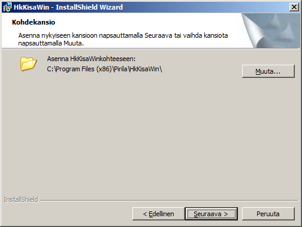
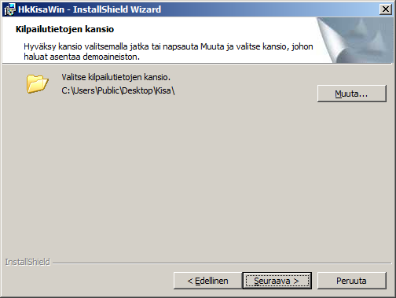
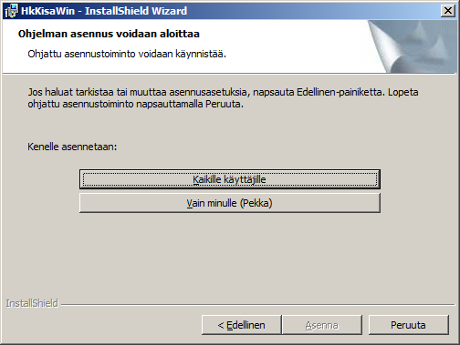

# Installation steps

When you use the software's installer, you can make
choices in the following three steps (the example shows installation on an English-language 64-bit Windows 7 with the user name
Pekka):

In the step shown above, the installer suggests the location
where the programs will be installed. However, a choice made later in the third step
may change the location to something other than what the installer shows here.
Normally it is best to install the programs where the installer wants to
put them.

In the step shown above, the installer suggests the
location for the competition data and all other files that are
installed in addition to the programs themselves. In this example the files are installed
on the shared desktop of an English-language Windows 7. The word *Public*
refers to the shared desktop. Your current access rights may
not allow this installation location, in which case you have to change it, either by browsing with the
*Change* button or by typing a location that you are
allowed to use. Your own desktop, which you get by replacing the word *Public* with your own user name, is one good alternative.

In this step, too, you have to take access rights
into account. The choice *For all users* requires
administrator rights, so *Only for me* is easier.
Choosing *Only for me* also often causes the
program location to change automatically to something other than the one shown in the
first picture above.

During installation the installer also creates shortcuts to the program
*HkKisaWin* in the menu and on the desktop, and a shortcut to the program
*HkMaali* in the *HkMaaliData* subfolder of the folder
*Kisa*. The start-in folder of the latter shortcut is the same as its
location. The start-in folder of the *HkKisaWin* shortcuts is the
folder selected in the second step above.
