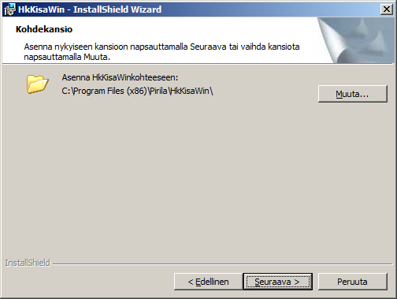
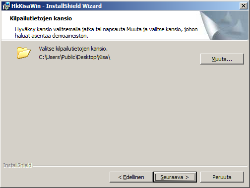
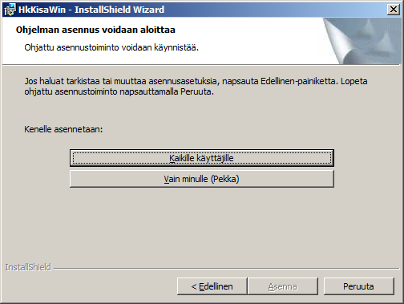

# Installationens steg

När du använder programvarans installationsprogram kan du göra
val i följande tre steg (exemplet visar installation på en engelskspråkig 64-bitars Windows 7 med
användarnamnet Pekka):

I steget ovan föreslår programmet den plats
där programmen ska installeras. Ett val som görs senare i det tredje steget
kan dock ändra platsen till en annan än den som programmet visar här.
Normalt är det bra att installera programmen där installationsprogrammet vill
placera dem.

I steget ovan föreslår programmet en
plats för tävlingsdata och alla andra filer som installeras
utöver själva programmen. I det här exemplet installeras filerna på
det gemensamma skrivbordet i en engelskspråkig Windows 7. Ordet *Public*
syftar på det gemensamma skrivbordet. Det är möjligt att de gällande behörigheterna
inte tillåter denna installationsplats. Då måste den ändras, antingen genom att bläddra
via knappen *Ändra* eller genom att skriva in en adress som du har rätt
att använda. Det egna skrivbordet, som du når genom att ersätta ordet *Public* med ditt eget användarnamn, är ett bra alternativ.

Även i detta steg måste du ta hänsyn till
behörigheterna. Valet *Alla användare* kräver
administratörsbehörighet, så *Bara för mig* går lättare.
Valet *Bara för mig* leder också ofta till att programmens
installationsplats automatiskt blir en annan än den som visas
i den första bilden ovan.

Vid installationen skapar programmet också genvägar
till programmet *HkKisaWin* både i menyn och på skrivbordet, samt en genväg till programmet
*HkMaali* i undermappen *HkMaaliData* i mappen *Kisa*.
Denna genvägs startmapp är densamma som dess
placering. Startmappen för genvägarna till programmet *HkKisaWin* är den
mapp som valdes i det andra steget ovan.
