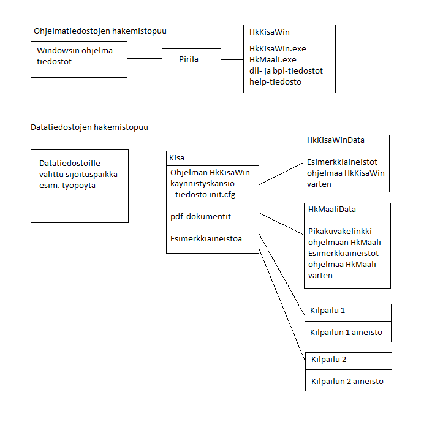

# Folder structure

It is a good idea to create a clear folder structure for the other files used
by the programs. As its basis, the installer suggests a folder *Kisa*
created on the desktop. You can also choose to place the folder
elsewhere, for example at the top level of drive C: as the folder
*C:\Kisa*
or in your
own user area. Your user rights may not allow
the folder *Kisa* to be created in the location suggested by the installer, in which case
you have to change the choice before the installation can succeed. For example, replacing the
shared desktop link with a user-specific one may help (in that case, *Public* or a corresponding
expression in the folder path must be replaced with your own
user name).

In any case, I recommend using the folder created this way
as the root for other folders containing competition data. The installer
creates two subfolders, *HkKisaWinData* and
*HkMaaliData*, in the folder *Kisa*. These two subfolders contain
sample data, and updating the programs may copy the sample data into these
folders again. Therefore you should not use these subfolders
for your own files; instead, create corresponding subfolders
for your own files. This can also be done from the program
*HkKisaWin*
when you create a new competition.

In the picture above, *Kilpailu 1* and
*Kilpailu 2* refer to folders that the installer does not create; they
contain the data of competitions you create later.
