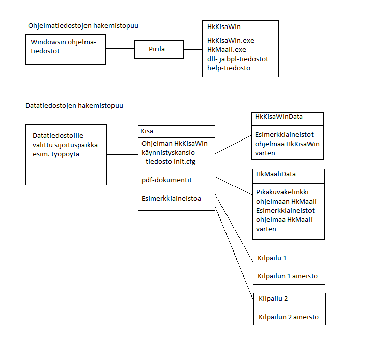

# Mappstruktur

Det lönar sig att skapa en tydlig mappstruktur för de övriga filer
som programmen använder. Installationsprogrammet föreslår som grund för detta en mapp
*Kisa* som skapas på skrivbordet. Mappen kan också placeras
någon annanstans, till exempel på den översta nivån på C:-disken som mappen
*C:\Kisa*
eller i användarens
eget filområde. Det är möjligt att användarens behörigheter inte tillåter att
mappen *Kisa* skapas på den plats som installationsprogrammet föreslår. Då
måste valet ändras innan installationen lyckas. Till exempel kan det hjälpa att byta
den gemensamma skrivbordslänken mot en användarspecifik (i mappens sökväg
ska *Public* eller motsvarande uttryck då ersättas med användarens eget
användarnamn).

Jag rekommenderar i alla fall att du använder den mapp som skapas på detta sätt
som stomme för övriga mappar med tävlingsdata. Installationsprogrammet
skapar två undermappar i mappen *Kisa*: *HkKisaWinData* och
*HkMaaliData*. Dessa två undermappar innehåller
exempelmaterial, och en uppdatering av programmen kan kopiera exempelmaterialet
till dessa mappar på nytt. Därför ska dessa undermappar inte
användas för användarens egna filer, utan för egna filer ska
motsvarande undermappar skapas. Det kan också göras från programmet
*HkKisaWin*
när en ny tävling skapas.

I bilden ovan avser *Kilpailu 1* och
*Kilpailu 2* mappar som installationsprogrammet inte skapar, utan som
innehåller material för tävlingar som användaren skapar senare.
