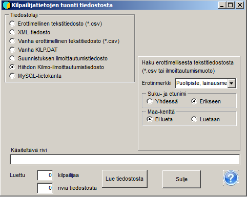

# Entries from the Kilmo system

Entries for a national ski competition are
normally obtained as a file from the Kilmo system, where you must select
csv file format 1, in which first names and
last names are separate. The data from Kilmo is transferred to the competition using the program's menu item
*Entries / Get from file.* There, select *Skiing
Kilmo entry file.* Then use the button *Read from file* to load
the data obtained from the Kilmo system. If everything is in order, which means
in particular that the class settings and the classes in the Kilmo data match, the program reports the number of competitors
read.

If reading stops at a point where part of the data has been transferred, you must prevent the same competitors from being included more than
once, either by deleting the file KILP.DAT and starting over, or by deleting
the already transferred data from the file obtained from Kilmo.

The menu item *Entries / Entries* opens a table
showing what data has been transferred. If you want to compare and see the data
in the same order as in the file that was read, select
*Entry* as the order. This lets you, among other things, find the point where
the data transfer was interrupted.

With the menu item *Entries / Clubs and entry counts* you can view
the numbers of competitors broken down both by class and by club.

This form can also read competitors from a
simple csv file, which can be prepared or finalised in
Excel. This does, however, require a correctly prepared header row.
The correct forms of the column headers can be found in the program's Help.
