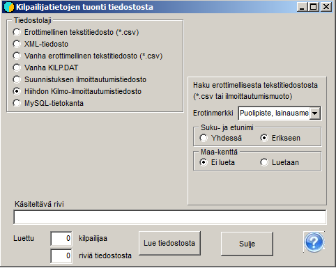

# Anmälningar från Kilmo-systemet

Anmälningarna till en nationell skidtävling fås
normalt i filformat från Kilmo-systemet, där du ska välja
csv-filformat 1, där för- och
efternamn är åtskilda. Uppgifterna från Kilmo förs över till tävlingen med programmets val
*Deltagare / Hämta från fil.* Där väljer du *Skidåkningens
Kilmo-anmälningsfil.* Sedan hämtar du via knappen *Läs från fil* de
uppgifter som hämtats från Kilmo-systemet. Om allt är i ordning, vilket
särskilt innebär att klassdefinitionerna och klasserna i Kilmos uppgifter stämmer överens, meddelar programmet antalet inlästa
tävlande.

Om inläsningen avbryts i ett skede där en del av uppgifterna redan har förts över, måste du förhindra att samma tävlande kommer med flera
gånger, antingen genom att radera filen KILP.DAT och börja om från början eller genom att ta bort
de redan överförda uppgifterna från filen från Kilmo.

Med programmets val *Deltagare / Deltagare* öppnas en tabell som
visar vilka uppgifter som har förts över. Om du vill se uppgifterna för jämförelse
i samma ordning som de har i den inlästa filen väljer du
*Registrering* som ordning. På så sätt kan du bl.a. fastställa var
överföringen av uppgifterna har avbrutits.

Med valet *Deltagare / Klubbar och deltagarantal* kan du granska
deltagarantalen fördelade både klassvis och klubbvis.

Med detta formulär kan deltagare också läsas från en
enkel csv-fil, som kan upprättas eller färdigställas i
Excel. Detta förutsätter dock en korrekt utformad rubrikrad.
De korrekta formerna för kolumnrubrikerna finns i programmets hjälpanvisningar.
