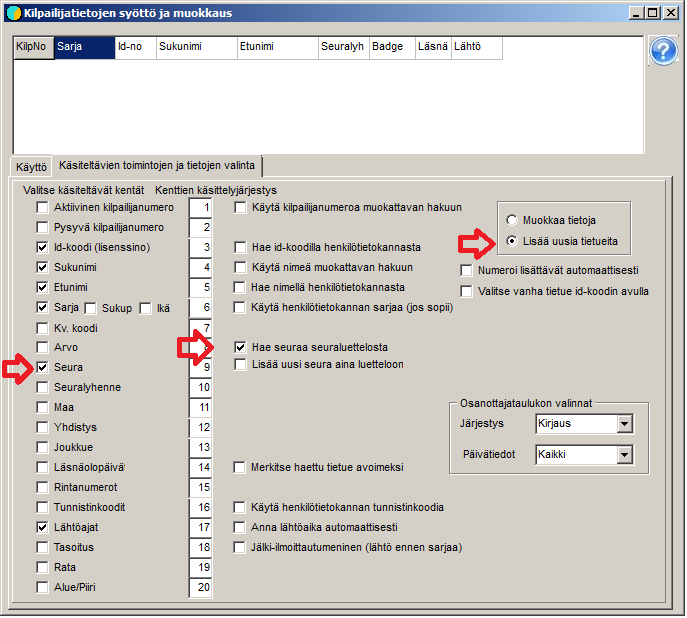

# Manuell inmatning av anmälningar

Vid små evenemang matas ofta alla deltagare in direkt i resultatprogrammet genom att uppgifterna knappas in
en deltagare i taget. Detta sker på formuläret *Inmatning och redigering av tävlandes
uppgifter,* som du når via valet *Deltagare /
Anmälningar.*

Formuläret kan öppnas så att texten
*Redigeringsläge* visas. Detta driftläge lämpar sig när
platser för vakanser har skapats i förväg bland de tävlandes uppgifter och dessa redigeras
till deltagare. Om du vill lägga till nya poster måste du ta i bruk
*Tilläggsläge.* Läget byts på undersidan *Val av funktioner och
uppgifter att behandla*, där du också kan välja vilka fält som går att
behandla samt om programmet vid inmatningen använder en förteckning över möjliga
deltagare eller en klubblista som hjälp. (Det finns också flera andra
valmöjligheter.)

När formuläret används för inmatning av anmälningar före en
senare lottning behöver du inte ange startnummer eller starttid. Om
deltagare läggs till under evenemanget är
åtminstone numret nödvändigt för att programmet ska kunna spara uppgifterna. Valet av
klass är alltid nödvändigt för programmets funktion, övriga uppgifter
matas in efter behov. Med klubblistan kan du välja
klubb utan besvär, och den hjälper till att få klubbnamnen felfria. När du kryssar i *Sök klubb
i klubblistan* öppnas
klubblisteformuläret, där du ska välja
den klubblista som ska öppnas och användas (t.ex. Seurat.csv).
När du sedan matar in klubbens namn och trycker Enter när valet
har träffat rätt ställe i klubblistan, förs klubbnamnet över enligt listan och samtidigt
också distriktskoden, även om den inte har valts att visas
på anmälningsformuläret.

Tabellen i formulärets övre del har i huvudsak till uppgift att visa
den senast sparade uppgiften, som kan hämtas tillbaka därifrån för korrigering när
*Redigera uppgifter* har valts som driftläge.
