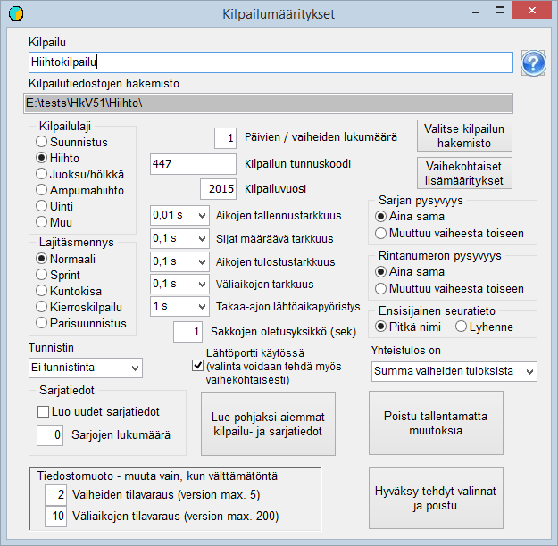

# Basic settings

When starting to set up a competition, you must decide in which
folder the competition data will be placed. My recommendation is that a new folder be
created for the competition as a subfolder of the folder Kisa created during installation. The folder
can be created with the program *HkKisaWin* at the same time as the other
basic settings are defined. Start by launching *HkKisaWin* and
clicking the button *Competition creation and basic properties*.
This opens the form *Competition settings.*

A ski competition often has only a few classes, in which case they
can be created as new ones by selecting the desired number to create. The classes themselves
are created when this form is closed with the selections accepted. If, however,
the competition has more classes and
a similar competition has been organised before, you save a considerable amount of effort
by using an earlier competition as a basis: click
*Use earlier competition and class data as base* and open the file
KilpSrj.xml of that earlier competition's
data, which must be in some folder
other than the one now being handled, or named
differently.

Next, click *Select competition folder* and go to the folder reserved for the competition, or create this
folder using the folder creation function of the dialog. When the selection is accepted,
the program creates an empty file ilmoitt.cfg and saves it in the selected folder.

Give the competition a suitable title and
an identification code, which can be, for example, the numeric code from the Finnish Ski Association's
competition calendar. When *Skiing* is selected as the sport and
*Normal* as the variant, the program sets the other
options to suit a single-stage ski competition: the timing precision
that determines placings and is used in the results list is 0.1 s,
and the long form of club names is used. Both the class and the bib number are
always the same, i.e. identical in the competitor's basic data and in the
only competition stage in use.

When you exit the form accepting the selections made,
the file KilpSrj.xml containing the settings is saved in the
competition folder. At the same time an empty file laskenta.cfg is created.

Once the basic properties have been selected this way, the competition
can be opened for preparation by clicking the button of that name and opening ilmoitt.cfg. The program then reports that the file KILP.DAT
does not
exist and creates
it.

**Pursuit competition**

A pursuit competition means a competition where the parts
are skied as separate stages. A continuous competition with a ski change (skiathlon)
is handled as a single-stage competition in which
the ski change has one
split time.

In a pursuit competition the number of stages is
normally 2 (sometimes
more).

In a pursuit competition you usually have to select that
the bib number changes from one stage
to the next.

In a pursuit competition it may be justified to use
a higher precision for determining placings in the latter stage.
The start gate is also not used in the pursuit stage. Settings that differ in these respects
can be made in the stage-specific
settings.

**Cross-country sprint**

In a cross-country sprint the number of stages can be 2, 3 or 4.
All times are typically handled with a precision of 0.01 s. The storage precision
and the precision determining placings in the heat rounds can, however, also be 0.001 s,
so that even competitors with the same time to the hundredth
can be given different
placings.

In a cross-country sprint you usually have to select that both the class and
the bib number change from one stage
to the next.

In a cross-country sprint the start time of the heats is usually not
precisely determined in advance. For this reason you must select
that the start gate is
used.
