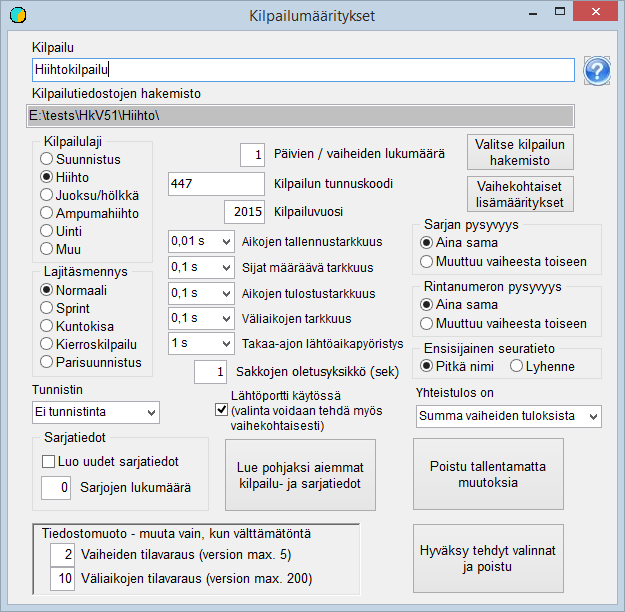

# Grundval

När du börjar skapa en tävling måste du bestämma i vilken
mapp tävlingens uppgifter ska placeras. Min rekommendation är att en ny mapp
skapas för tävlingen som undermapp till mappen Kisa som skapades vid installationen. Mappen
kan skapas med programmet *HkKisaWin* samtidigt som de övriga
grundvalen definieras. Du börjar med att starta programmet *HkKisaWin* och
klicka på knappen *Skapa tävling och grundegenskaper*.
Då öppnas formuläret *Tävlingsinställningar.*

I en skidtävling finns ofta bara några få klasser, och då kan de
skapas som nya genom att välja önskat antal att skapa. Själva skapandet av
klasserna sker när detta formulär stängs och valen godkänns. Om det
däremot gäller en tävling med fler klasser och
en liknande tävling har ordnats tidigare, sparar du avsevärt mycket besvär
genom att använda någon tidigare tävling som grund: klicka på
*Läs tidigare tävlings- och klassdata som grund* och öppna filen
KilpSrj.xml med uppgifterna för den tidigare tävlingen.
Filen måste ligga i någon
annan mapp än den som nu behandlas eller ha
något annat namn.

Klicka sedan på *Välj tävlingens katalog* och gå till den mapp som reserverats för tävlingen, eller skapa denna
mapp med dialogfönstrets funktion för att skapa mappar. När valet godkänns
skapar programmet en tom fil ilmoitt.cfg och sparar den i den valda mappen.

Tävlingen bör ges en lämplig rubrik och en
kod, som till exempel kan vara nummerkoden enligt Finlands Skidförbunds
tävlingskalender. När *Skidåkning* väljs som gren och
*Normal* som precisering ställer programmet in de övriga
valen så att de passar en skidtävling med en etapp: den tidtagningsnoggrannhet som avgör
placeringarna och används i resultatlistan är 0,1 s
och klubbnamnen används i lång form. Både klass och startnummer är
alltid desamma, dvs. samma i den tävlandes grunduppgifter och i den enda
tävlingsetappen.

När du lämnar formuläret och godkänner de gjorda valen
sparas filen KilpSrj.xml med inställningarna i
tävlingens mapp. Samtidigt skapas en ännu tom fil laskenta.cfg.

När grundegenskaperna har valts på detta sätt kan tävlingen
öppnas för förberedelse genom att klicka på knappen med detta namn och öppna ilmoitt.cfg. Då meddelar programmet att filen KILP.DAT
inte
finns och skapar
en sådan.

**Jaktstartstävling**

En jaktstartstävling är en tävling där delarna
åks som separata etapper. En sammanhängande tävling med skidbyte
behandlas som en tävling med en etapp, där
skidbytet har en
mellantid.

I en jaktstartstävling är antalet etapper
normalt 2 (ibland
fler).

I en jaktstartstävling måste du i allmänhet välja att
startnumret byts från en etapp
till en annan.

I en jaktstartstävling kan det vara motiverat att i den
senare etappen använda en högre noggrannhet för att avgöra placeringarna.
I jaktstartsetappen används inte heller någon startgrind. Val som avviker i dessa avseenden
kan
göras i de etappspecifika
inställningarna.

**Sprint i längdskidåkning**

I sprint kan antalet etapper vara 2, 3 eller 4.
Alla tider hanteras typiskt med 0,01 s noggrannhet. Lagringsnoggrannheten
och den noggrannhet som avgör placeringarna i heatomgångarna kan dock också vara 0,001 s,
så att även tävlande med samma tid på hundradelen
kan få olika
placeringar.

I sprint måste du i allmänhet välja att både klass och
startnummer byts från en etapp
till en annan.

I sprint är heatens starttid i allmänhet inte
exakt fastställd i förväg. Därför måste du välja
att startgrinden
används.
