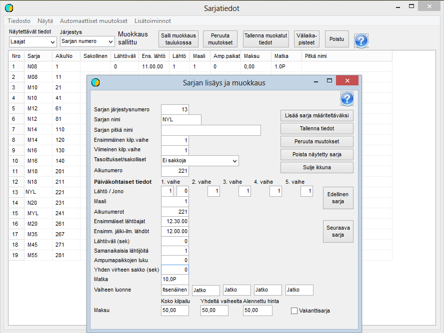

# Class data

The second phase of the basic preparation is editing the class data to meet the
requirements of the competition. You get to this phase by selecting
*Preparation / Class data* from the menu. Class data can be viewed and edited
both on this form and one class at a time on a form that opens
when you click a class in the table.

Right at the competition definition stage, all that matters is that all
classes that will receive entries are defined and
named exactly as in the entry data. Other data can be
refined when you move on to the draw.

Classes can only be added and deleted on the
single-class form. To add one, start by clicking *Add class
to define.* Then fill in
the necessary data and give the class an ordinal number such
that it is placed in the correct position in the class list
(0 puts it last). When the class is then saved, the ordinal numbers of
the subsequent classes are increased.

Much other data can be edited both one class at a time
and in the table, where you can make several changes before saving them. The table is
particularly useful when defining the classes' start times and the starting values of the numbering.
We return to this in connection with the draw.

In ski competitions, delivering the results to
the Finnish Ski Association requires that the class names indicate gender and age class as in the picture,
and that the distance is given with one decimal followed by
the letter indicating the skiing technique, P
or V (or their combination VP when the technique changes
during the race).

**In a pursuit competition** you must select
*Pursuit* as the type of the last stage
.

The class settings for **cross-country sprint**
are covered in more detail in their own
chapter.
