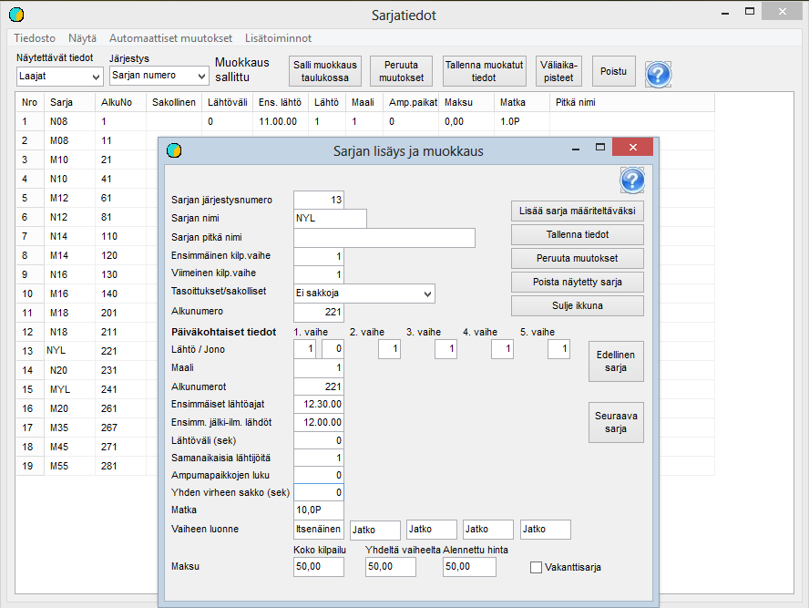

# Klassuppgifter

Det andra steget i grundförberedelsen är att anpassa klassuppgifterna till
tävlingens krav. Du kommer till detta steg genom att välja
*Förberedelse / Klassuppgifter* i menyn. Klassuppgifterna kan granskas och redigeras
både på detta formulär och klass för klass på det formulär som öppnas
när du klickar på en klass i tabellen.

Redan när tävlingen definieras är det väsentliga bara att alla
klasser som det kommer anmälningar till har definierats och
namngetts exakt på samma sätt som i anmälningsuppgifterna. Övriga uppgifter kan
preciseras när du går vidare till lottningen.

Klasser kan läggas till och tas bort endast på formuläret för en
enskild klass. Tillägget börjar med ett klick på *Lägg till klass
att definiera.* Därefter fyller du i
de nödvändiga uppgifterna och ger klassen ett ordningsnummer så
att den hamnar på rätt plats i klasslistan
(0 placerar den sist). När klassen sedan sparas ökas
ordningsnumren för de efterföljande klasserna.

Många andra uppgifter kan redigeras både klass för klass
och i tabellen, där du kan göra flera ändringar innan de sparas. Tabellen är
särskilt användbar när klassernas starttider och numreringens startvärden fastställs.
Vi återkommer till detta i samband med lottningen.

Vid skidtävlingar förutsätter leveransen av resultat
till Finlands Skidförbund att klassnamnen anger kön och åldersklass som i bilden
samt att distansen anges med en decimal och följs av
bokstaven P eller V för åkstilen
(eller en kombination av dessa, VP, när stilen byts
under tävlingen).

**I en jaktstartstävling** måste du välja
*Jaktstart* som den sista etappens karaktär
.

Klassdefinitionerna för **sprint i längdskidåkning**
behandlas närmare i ett eget
kapitel.
