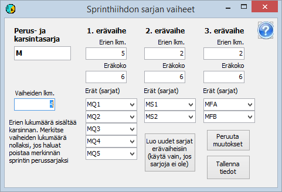

# Cross-country sprint class data

A cross-country sprint competition is handled as a competition
with 2-4 stages, the first of which is the qualification (the so-called time trial) and the last
the final. In between there can be one or two heat rounds (quarterfinals and
semifinals). The best-prepared solution is
one with 5 or 4 quarterfinals, correspondingly 6 or 4 competitors
in each semifinal, and A and B finals as the finals.

The competition must be set up to contain the required
number of stages, i.e. four stages in a full-scale
sprint. The competition must be defined to use
changing classes and also changing bib numbers, unless the bib numbers are kept unchanged.

Each heat of a heat round is handled in the program
as a class of its own. All the necessary classes can be formed easily by first defining
only the base class, which is used for recording entries
and as the qualification class, and then selecting
that it is a ski sprint base class. The form below then opens

When you enter the number of stages on this form,
the program suggests the number of heats and the heat size for each heat round. You can change
the values suggested by the program. If the heat-round classes have not yet been defined, the
program creates the classes with the button *Create new classes for heat rounds*.

In the class settings, the base class must be kept as containing all
stages, even though it is actually used only in the
qualification stage. Otherwise the program will not perform all cross-country sprint functions correctly.
Each heat-round class is defined as a class of that stage only.

In the class data you should define an approximate start time for all heats so that
the actual start does not at least take place before this start time, because
then the placings are correct immediately even if the start time of the heat
is for some reason not recorded.

All competitors are initially recorded in the
qualification class, which permanently remains both the base class and the class of the qualification
stage. The classes of the other stages will change for those who
take part in these stages.

In a sprint, bib numbers usually change
when moving from the qualification to the next stage. The same numbers cannot be used
in different classes in the same stage, but the same number can be
used by one competitor in the qualification and by another in the later stages.
Typically the first numbers are defined for the base class according to the numbering
used in the qualification, and for the first heat round so that the same number is given for all heats of the same
class. For later stages the first number is left as 0. If the same numbers are used
throughout the competition, the first number for the first heat round is also set to
0.
