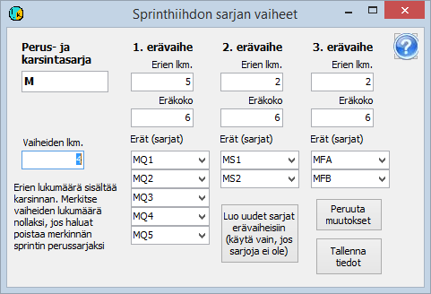

# Klassuppgifter för sprint i längdskidåkning

En sprinttävling i längdskidåkning hanteras som en tävling med 2–4
etapper, där den första etappen är kvalet (s.k. prolog) och den sista
finalen. Däremellan kan det finnas en eller två heatomgångar (kvartsfinal och
semifinal). Bäst förberett är upplägget
med 5 eller 4 kvartsfinaler, 6 respektive 4 tävlande i
var och en av de två semifinalerna samt A- och B-final som finaler.

Tävlingen ska skapas med det antal etapper
som behövs, alltså fyra etapper i en sprint i full
omfattning. Tävlingen ska definieras att använda
växlande klasser och även växlande startnummer, om inte startnumren hålls oförändrade.

Varje heat i en heatomgång hanteras i programmet
som en egen klass. Alla nödvändiga klasser kan enkelt bildas genom att först definiera
endast grundklassen, som används för registrering av
anmälningar och som kvalklass, och sedan välja
att det är en grundklass för sprint i längdskidåkning. Då öppnas formuläret nedan

När antalet etapper anges på detta formulär
föreslår programmet antalet heat och heatstorleken för varje heatomgång. De
värden som programmet föreslår kan ändras. Om klasserna för heatomgångarna inte redan har definierats skapar
programmet klasserna med knappen *Skapa nya klasser för heatomgångar (använd endast om klasser saknas)*
.

I klassdefinitionerna ska grundklassen behållas så att den omfattar alla
etapper, även om den egentligen bara används i
kvalet. Annars utför programmet inte alla åtgärder för sprint korrekt.
Varje klass för en heatomgång definieras som klass endast för den aktuella etappen.

I klassuppgifterna bör du ge alla heat en ungefärlig starttid så att
den faktiska starten åtminstone inte sker före denna starttid, eftersom
placeringarna då genast blir rätt, även om heatets starttid av
någon anledning inte skulle registreras.

Alla tävlande registreras ursprungligen i kvalets
klass, som permanent förblir både grundklass och kvaletappens
klass. Klasserna för övriga etapper kommer att ändras för dem som
deltar i dessa etapper.

Startnumren byts i sprint
i allmänhet när man går från kvalet till nästa etapp. I olika klasser
kan samma nummer inte användas i samma etapp, men samma nummer kan
tillhöra en tävlande i kvalet och en annan i senare etapper.
Typiskt definieras första nummer för grundklassen enligt den numrering
som används i kvalet, och för den första heatomgången så att samma nummer anges för alla heat i samma
klass. För senare etapper lämnas första numret som 0. Om samma nummer
används i hela tävlingen anges första numret även för den första heatomgången som
0.
