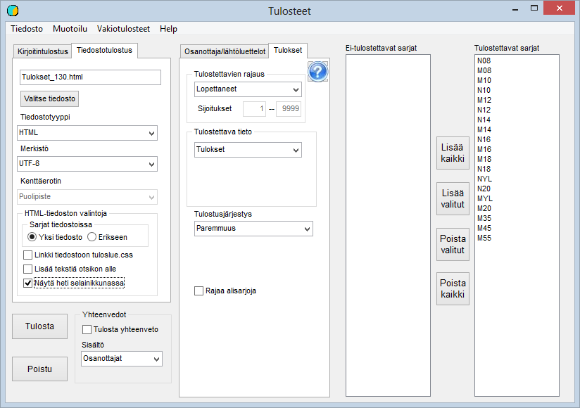

# Results lists

This form can be opened from the main menu item *Outputs* (the classes in the picture
correspond to an orienteering competition)

In the example, after the form was opened,
*Standard outputs / All finishers to html file* was selected. This selection has caused all classes to be selected
for output. The name of the output file has been determined from the code given to the
competition: *Tulokset\_130.html.*

In the example, the request to show the results list
immediately in a browser window has been ticked, which is an easy way to check that the file
has the desired contents.

Another option that is useful in many cases asks
for text to be placed below the heading. When this is selected, the program opens
a dialog for reading a possible earlier file to be added as text
or as a basis for it. Then an editing window opens, where you can edit the text or
write completely new comments. By writing suitable html code you can
also include images and links elsewhere, but this requires basic knowledge
of html.

The *Results* tab of the form has a field **Additional text**, where you can
type an additional line of up to 200 characters. The text is printed after the competition
heading on its own line in a smaller font than the heading. The field is
one-off: it is cleared when the form is closed and is not saved in the competition
data.

Many other selections can be made from the drop-down
lists, and instead of a file you can print to a printer, which can be
selected from among the printers recognised by Windows on that computer.
The list of printers may also include the option to make a pdf file of the results.

The Formatting option lets you change the formatting of the
results list to be produced if the defaults are not suitable.

When only one or a few classes are to be output,
they can be selected by double-clicking the class name or by selecting the name and
using the button.

For most text files, the program's default
is UTF-8 encoding, which is becoming ever more clearly dominant. For the time being, however,
it may cause problems, which are solved by changing the character set to ISO-8859-1.

**Results file for the Finnish Ski Association**

The results file required from ranking competitions
is written by selecting the file format
*SHL results delivery format.* Unlike earlier practice,
this file is nowadays produced in full, containing all those
entered in the competition. Classes are also not combined. Producing the file
goes best if the class names and distances have been defined in the class data
according to the Finnish Ski Association's latest instructions.

Thus the class names have three characters (gender and
age class, which can also be YL). For example MYL or N08.

Distances are given with one decimal, immediately
followed by the technique code P, V or their combination PV or VP. For example
10.0P or 15.0PV.

If the classes have definitely been defined according to the instructions,
you can save effort by ticking the field Skip distance/discipline confirmation. Otherwise
each distance and technique must be confirmed.

According to current practice, the option Combine classes into ranking classes should not
be used; instead, the classes must be left as in the competition. The Finnish Ski Association
performs the combinations needed for the ranking based on distance and age class.
