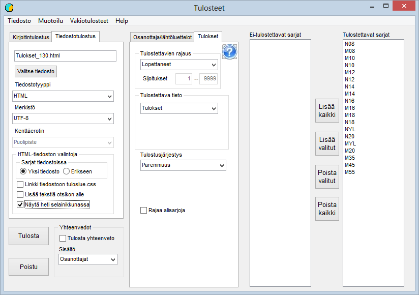

# Resultatlistor

Via valet *Utskrifter* i huvudmenyn kan detta formulär öppnas (klasserna i bilden
motsvarar en orienteringstävling)

I exemplet har man efter att formuläret öppnats
valt *Standardutskrifter / Alla målgångna till html-fil*. Valet har dessutom lett till att alla klasser har valts
för utskrift. Namnet på filen som skrivs ut har bestämts utifrån den kod
som getts tävlingen: *Tulokset\_130.html.*

I exemplet har begäran att visa resultatlistan
direkt i ett webbläsarfönster kryssats i, vilket är ett enkelt sätt att kontrollera att filens
innehåll är det önskade.

Ett annat val som är användbart i många fall ber programmet
att placera text under rubriken. När detta har valts öppnar programmet
en dialogruta för att läsa in en eventuell tidigare fil som text att lägga till
eller som grund för den. Sedan öppnas ett redigeringsfönster där du kan redigera texten eller
skriva helt nya kommentarer. Genom att skriva lämpliga html-koder kan du
också få med bilder och länkar till andra ställen, men detta förutsätter grundläggande
kunskaper i html.

På formulärets flik *Resultat* finns fältet **Extra text**, där du kan
skriva en extra rad på högst 200 tecken. Texten skrivs ut efter tävlingens
rubrik på en egen rad med mindre teckenstorlek än rubriken. Fältet gäller
bara för tillfället: det töms när formuläret stängs och sparas inte i tävlingens
uppgifter.

I rullgardinsmenyerna kan du göra många andra
val, och i stället för till en fil kan du skriva ut till en skrivare, som kan
väljas bland de skrivare som Windows känner igen på datorn.
I skrivarlistan kan det också finnas möjlighet att skapa en pdf-fil av resultaten.

Via valet Formatering kan du ändra formateringen av den
resultatlista som sammanställs, om standardinställningarna inte passar.

När endast en eller några klasser ska skrivas ut
kan de väljas genom att dubbelklicka på klassens namn eller genom att välja namnet och
använda knappen.

För de flesta textfiler är programmets standardinställning
UTF-8-kodning, som allt tydligare håller på att bli dominerande. Tills vidare kan
den dock orsaka problem, som löses genom att byta teckenuppsättning till ISO-8859-1.

**Resultatfil till Finlands Skidförbund**

Den resultatfil som krävs av rankingtävlingar
skrivs genom att välja filformatet
*SHL resultatleveransformat.*  Till skillnad från tidigare
praxis upprättas denna fil numera fullständig, så att den innehåller alla
som anmält sig till tävlingen. Klasserna slås inte heller ihop. Filen
upprättas smidigast om klassernas namn och distanser har definierats i klassuppgifterna
enligt Finlands Skidförbunds senaste anvisningar.

Klassnamnen består alltså av tre tecken (kön och
åldersklass, som också kan vara YL). Alltså till exempel MYL eller N08.

Distanserna anges med en decimal och direkt
följda av åkstilens kod P, V eller en kombination av dessa, PV eller VP. Alltså till exempel
10.0P eller 15.0PV.

Om klasserna med säkerhet har definierats enligt anvisningarna
kan du spara besvär genom att kryssa i fältet Hoppa över bekräftelse av distans/gren. I annat
fall måste varje distans och stil bekräftas.

Valet Slå ihop klasser till rankingklasser ska enligt nuvarande praxis
inte göras, utan klasserna ska lämnas som i tävlingen. Finlands Skidförbund
genomför de sammanslagningar som behövs för rankingen utifrån distans och åldersklass.
