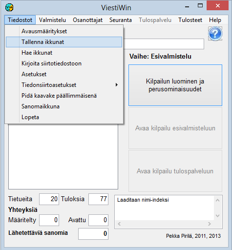

# 1.3.1 Menu: Files

The menu item *Files* opens the following
submenu.

The options lead to the following functions:

- **Startup settings**. Defines how the program
  starts the next time it is used. This lets the program
  open directly in the desired competition.

  - **Save windows.** Saves
    the windows in use at the time of saving, which makes it possible
    to open the program later in largely the same state.

    - **Load windows.** Restores the operating state saved
      with the option *Save windows*.

      - **Write to transfer file.**Writes the competition data
        to text files (csv or xml), to a MySQL database or to an up-to-date copy
        of the file KILP.DAT in use.

        - **Settings.** The most important function
          at present is the ability to read, during the competition, the file korostus1.lst that controls
          the colour highlighting of VIP entrants (korostus2.lst etc. in multi-day competitions, see chapter 8.3).

          - **Reference times.** Defines the parameters
            controlling the analysis of Emit split times.

            - **Data transfer settings.**

              - **Settings and
                restart.**Closing and reopening connections, resending
                previously sent messages.

                - **View data transfer file.**
                  Viewing the contents of the file COMFILE.DAT. This makes it possible to find out
                  what has happened in the results service at different stages.- **MySQL.** Defining the database
                connection and optionally opening it for continuous operation. A one-off transfer
                is started with the option *Write to transfer file.*

                - **Message window.** Opens a separate
                  window containing the same messages as the window in the lower right corner
                  of the main form.

                  - **Competition list.**
                    Defining a series of competitions or fitness events to make later
                    selection easier or automatic.

                    - **Exit.** Closes the program. (Same
                      effect as the close box in the upper right corner of
                      the form.)
