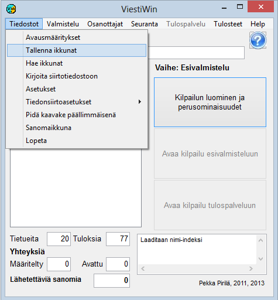

# 1.3.1 Menyval: Filer

Menyvalet *Filer* öppnar följande
undermeny.

Via alternativen når du följande funktioner:

- **Startinställningar**. Definition av
  hur programmet startar nästa gång det används. Därigenom kan programmet
  öppnas direkt i önskad tävling.

  - **Spara fönster.** Sparar
    de fönster som är i bruk när sparandet görs, vilket gör det möjligt
    att i fortsättningen öppna programmet i ett i många avseenden likadant läge.

    - **Hämta fönster.** Tar i bruk
      det läge som sparats med valet *Spara fönster*.

      - **Skriv till överföringsfil.**Skriver tävlingens uppgifter till
        textfiler (csv eller xml), en MySQL-databas eller en uppdaterad kopia
        av den använda filen KILP.DAT.

        - **Inställningar.** Den viktigaste funktionen är
          för närvarande möjligheten att under tävlingen läsa in filen korostus1.lst, som styr
          färgmarkeringen av VIP-deltagare (korostus2.lst osv. vid flerdagarstävlingar, se kapitel 8.3).

          - **Jämförelsetider.** Definition av parametrar som styr
            analysen av Emit-mellantider.

            - **Inställningar för dataöverföring.**

              - **Inställningar och
                omstart.**Stänga och öppna förbindelser på nytt samt skicka tidigare
                skickade meddelanden på nytt.

                - **Granska överföringsfil.**
                  Granskning av innehållet i filen COMFILE.DAT. På så sätt går det att reda ut
                  vad som har hänt i resultattjänsten i olika skeden.- **MySQL.** Definition av
                databasanslutningen och eventuellt öppnande av den för kontinuerlig drift. En engångsöverföring
                startas med valet *Skriv till överföringsfil.*

                - **Meddelandefönster.** Öppnar ett separat
                  fönster med samma meddelanden som fönstret i huvudformulärets nedre
                  högra hörn.

                  - **Tävlingslista.**
                    Definition av en tävlings- eller motionsevenemangsserie för att underlätta eller automatisera senare
                    val.

                    - **Avsluta.** Stänger programmet. (Samma
                      verkan som stängningsrutan i formulärets övre högra
                      hörn.)
