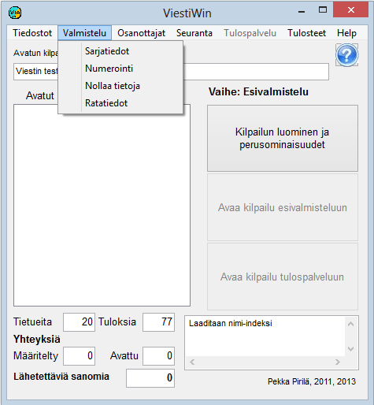

# 1.3.2 Menu: Preparation

The menu item *Preparation* leads to functions that are performed
before the actual results service phase, and when the next stage is created
on the basis of a finished stage, such as a final based on a qualification. Orienteering
course data can also be changed for the stage in progress.

Some of the options are disabled when the selected operating mode makes their use
impossible or undesirable.

- **Class data.** Opens a table
  for viewing and editing the class definitions. From this table
  you can further open the split point definitions and a form
  handling an individual class.

  - **Draw and numbering.** The
    competition draw, assigning bib numbers to entrants and splitting classes
    into subclasses.

    - **Form final from
      qualification.**
      Forms a final as the next stage on the basis of the results of the current
      (finished) stage. Particularly suitable for
      orienteering competitions where finals are formed and the start order
      is determined on the basis of a qualification.

      - **Create pursuit or
        reversed start order.**Forms a pursuit start as the next stage on the basis of the situation after the current
        (finished) stage. Suitable for many different
        sports.

        - **Sprint skiing heats and
          final.** The competitor
          transfers to the next stage needed in a cross-country sprint competition,
          based on the results of the current finished stage. The transfers follow
          the ski competition rules. The transfer procedures can be adapted to the
          needs of the competition.

          - **Moving times, numbers and stage.**
            Class-specific increasing or decreasing of the bib numbers
            of all competitors. Shifting all start times of a class, which
            can also be done for the stage in progress.

            - **Reset results.**
              Resets results and some other data. Possible only
              in preparation mode. This form is also used
              to make version conversion changes that require
              the times

- **Course data.** Defining and editing
  orienteering course data. Editing is also possible for the data of the
  stage in progress.

- **Check start times.** Checks
  the start times of the active competition day and looks for situations where two or
  more competitors start from the same start location at exactly the same time
  to the same first control — in which case one competitor could accidentally
  follow another. The check ignores competitors who have no
  start time or course, or who have already been marked as absent,
  did not finish or withdrawn. The result shown is either a message
  that no conflicts were found, or a list of the groups found,
  broken down by start location, start time and control, with each group's
  competitors listed with their bib numbers, names and classes.
