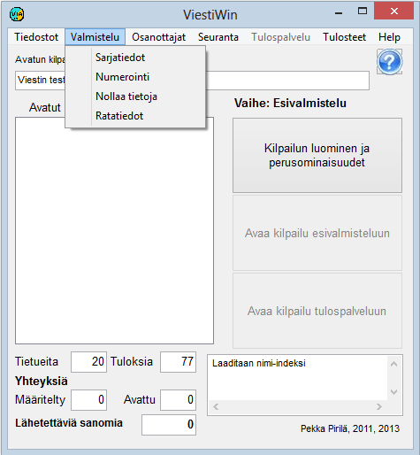

# 1.3.2 Menyval: Förberedelse

Via menyvalet *Förberedelse* når du funktioner som utförs
före själva resultattjänstfasen samt när nästa etapp skapas utifrån en avslutad
etapp, till exempel en final utifrån ett kval. Orienteringens
banuppgifter kan också ändras för en pågående etapp.

En del av valen är spärrade när det valda driftläget gör användningen
omöjlig eller oönskad.

- **Klassuppgifter.** Öppnar en tabell
  för granskning och redigering av klassdefinitionerna. Via tabellen
  kan du vidare öppna definitionen av mellantidspunkter samt ett formulär för
  en enskild klass.

  - **Lottning och numrering.** Tävlingens
    lottning, tilldelning av deltagarnas nummer och uppdelning av klasser i
    underklasser.

    - **Bilda final från
      kvalet.**
      Bildar en final som nästa etapp utifrån resultaten i den pågående
      (avslutade) etappen. Lämpar sig särskilt för
      orienteringstävlingar där finalerna bildas och startordningen
      bestäms utifrån kvalet.

      - **Skapa jaktstart eller
        omvänd startordning.**Bildar en jaktstart som nästa etapp utifrån läget efter den pågående
        (avslutade) etappen. Lämpar sig för många olika
        grenar.

        - **Bildande av heat och
          final i sprintskidning.** De
          förflyttningar av tävlande till nästa etapp som behövs i en sprinttävling i längdskidåkning,
          utifrån resultaten i den pågående, avslutade etappen. Förflyttningarna följer
          skidtävlingsreglerna. Förfarandena kan anpassas efter tävlingens
          behov.

          - **Flyttning av tider, nummer och etapp.**
            Klassvis ökning eller minskning av alla tävlandes
            nummer. Flyttning av alla starttider i en klass, vilket
            även kan göras för en pågående tävlingsetapp.

            - **Nollställ resultat.**
              Nollställning av resultat och vissa andra uppgifter. Möjligt endast
              i förberedelseläge. Med detta formulär
              görs också versionskonverteringsändringar som kräver
              tidernas

- **Banuppgifter.** Definition och redigering av
  orienteringens banuppgifter. Redigering är möjlig även för uppgifterna i en pågående
  etapp.

- **Kontrollera starttider.** Kontrollerar
  den aktiva tävlingsdagens starttider och letar efter situationer där två eller
  flera tävlande startar från samma startplats vid exakt samma tidpunkt
  mot samma första kontroll — så att en tävlande av misstag kunde
  följa en annan. Kontrollen tar inte hänsyn till tävlande som saknar
  starttid eller bana, eller som redan markerats som frånvarande,
  utgått eller återtagit anmälan. Som resultat visas antingen ett meddelande
  om att inga konflikter hittades, eller en förteckning över de funna grupperna
  uppdelade per startplats, starttid och kontroll, med gruppens
  tävlande listade med startnummer, namn och klass.
