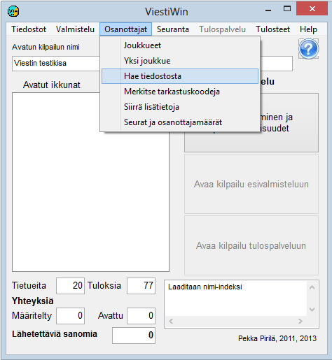

# 1.3.3 Menu: Entries

The main menu item *Entries* starts functions related to
entrants, most of which can be used both in preparation and in
results service mode.

- **Entries.** A table
  for viewing and editing entrant data. From the table you can
  click on to the data form of an individual
  entrant.

  - **Show competitors on course.** A table
    of competitors who have no finish time and have not been marked as
    absent, did not start, vacant, did not finish or
    disqualified. The columns are start location, start time and all
    split points in use. The list can be filtered by class.
    The button *Fetch* refreshes the view.

  - **One entry.** A direct link to the data form of
    one entrant. If the form *Competitor data*
    is closed in edit mode, the program asks *Save changes?*
    and returns to search and view mode, so that the next time it is opened it does not stay
    in edit mode.

    - **Entries.** Entering and editing
      entries from the keyboard. Used for entering competitor data
      when it is not read from a file. The option *One entry* is better
      suited for correcting data already entered.

      - **Get from file.** Reading entrant data
        from text files, such as data produced by the orienteering IRMA system and the skiing
        KILMO system, as well as transfer files made by the program
        itself. Data can also be fetched from a MySQL database and from certain
        file formats produced by earlier programs.

        - **Add vacants.** Adding vacant
          places, when the working method is based on first creating vacant places and
          then editing the data of the records created in this way, as is done for example in
          running events and fitness orienteering.

          - **Mark check codes.**
            Used, among other things, to mark competitors who did not show up as
            did not start.

            - **Enter Emit codes.** This option
              is the easiest way
              to change Emit codes or the corresponding codes of other
              chips.

              - **Transfer additional data.** Many different
                ways of moving competitors' data from one field to another, either without a controlling
                file or according to tabular data in a text file.
                Used, among other things, to transfer ranking points to competitors for the
                draw.

                - **Copying club names and classes.**Transfer operations related to club data and classes, such as fetching long
                  club names from the club list according to abbreviations, or moving competitors
                  from one class to another.

                  - **Clubs and entry counts.**
                    Tables showing the number of entrants per class and the number
                    of participants from each club. Also printing of the club list.
