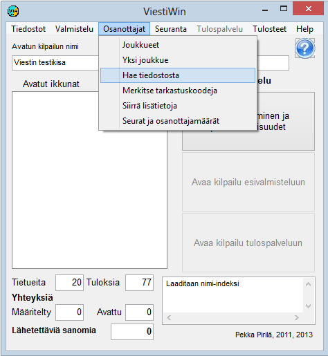

# 1.3.3 Menyval: Deltagare

Från huvudmenyns val *Deltagare* startas funktioner som gäller
deltagarna och som till största delen kan användas både i förberedelse- och
resultattjänstläge.

- **Deltagare.** Tabell för
  granskning och redigering av deltagaruppgifter. Från tabellen kommer du
  genom att klicka vidare till formuläret för en enskild deltagares
  uppgifter.

  - **Visa tävlande i terrängen.** Tabell över
    tävlande som saknar måltid och som inte har markerats som
    frånvarande, ej startade, vakanta, utgångna eller
    diskvalificerade. Kolumnerna är startplats, starttid och alla
    mellantidspunkter som används. Listan kan begränsas per klass.
    Knappen *Hämta* uppdaterar visningen.

  - **En deltagare.** Direktlänk till formuläret för en
    deltagares uppgifter. Om formuläret *Tävlandeuppgifter*
    stängs i redigeringsläge frågar programmet *Sparas ändringarna?*
    och återgår till sök- och visningsläge, så att nästa öppning inte
    blir kvar i redigeringsläge.

    - **Anmälningar.** Inmatning och
      redigering av anmälningar från tangentbordet. Används för att mata in tävlandeuppgifter
      när de inte läses från fil. Valet *En deltagare* lämpar sig
      bättre för att rätta redan inmatade uppgifter.

      - **Hämta från fil.** Inläsning av
        deltagaruppgifter från textfiler, till exempel data från orienteringens IRMA-system och skidåkningens
        KILMO-system samt överföringsfiler som programmet självt har skapat.
        Hämtning är även möjlig från en MySQL-databas samt från vissa
        filformat som tidigare program har skapat.

        - **Lägg till vakanta.** Tillägg av
          vakanta platser, när arbetssättet bygger på att vakanser först skapas och
          uppgifterna i de poster som då uppstått sedan redigeras, så som görs bland annat
          vid löpevenemang och motionsorienteringar.

          - **Markera kontrollkoder.**
            Används bland annat för att markera ej startade
            tävlande.

            - **Mata in Emit-koder.** Med detta val
              kan du enklast
              göra ändringar i Emit-koder eller motsvarande koder för andra
              brickor.

              - **Flytta tilläggsdata.** Många olika
                sätt att flytta tävlandes uppgifter från ett fält till ett annat, antingen utan styrande
                fil eller enligt tabellartade uppgifter i en textfil.
                Används bland annat för att föra över rankingpoäng till de tävlande inför
                lottningen.

                - **Kopiering av klubbnamn och klasser.**Överföringsåtgärder som gäller klubbuppgifter och klasser, till exempel hämtning av långa
                  klubbnamn från klubbförteckningen enligt förkortningar eller flyttning av tävlande
                  från en klass till en annan.

                  - **Klubbar och deltagarantal.**
                    Tabeller som visar klassernas deltagarantal och antalet deltagare från
                    varje klubb. Även utskrift av klubbförteckningen.
