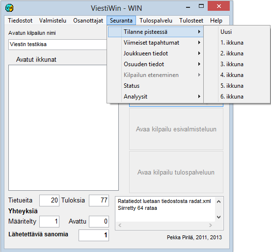

# 1.3.4 Menu: Monitoring

The menu item *Monitoring* opens many
different monitoring windows, suitable for example for use by the announcer. Many
window types can be opened in several copies, so that it is possible to follow
the situation of several classes or several competitors. From many windows you can
also proceed to forms giving more detail by clicking the related
buttons or table rows.

- **Standings.** Opens a tabular
  form showing the standings of a selected class at a selected
  point.

  - **Latest events.** Shows
    a table of the most recent new data, either overall or at a selected
    point.

    - **Competitor (online).** Shows
      data on a competitor at the finish and at online split points. Also makes it possible
      to follow the situation of a competitor still on the course relative to other
      competitors.

      - **Competitor (Emit).** Shows, among other things,
        the split times calculated from the competitor's Emit punches.

        - **Emit graphics.** Comparison of competitors'
          Emit split times.

          - **Emit summary.** Tabular data on
            Emit split times.

            - **Status.** Information on the numbers of
              results and disqualifications in the different classes, on the data transfer connections and on
              the status of automatic output.
