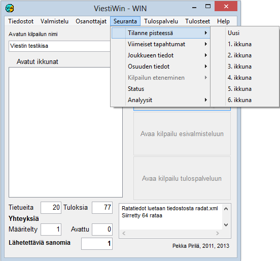

# 1.3.4 Menyval: Uppföljning

Via menyvalet *Uppföljning* kan du öppna många
olika uppföljningsfönster som bland annat lämpar sig för speakern. Av många
fönstertyper kan flera kopior öppnas, så att det är möjligt att följa
läget i flera klasser eller för flera tävlande. Från många fönster kan du
också gå vidare till formulär med fler detaljer genom att klicka på
tillhörande knappar eller på tabellrader.

- **Ställning.** Öppnar ett tabellartat
  formulär som visar ställningen i en vald klass vid en vald
  punkt.

  - **Senaste händelser.** Visar
    en tabell med de senaste nya uppgifterna antingen totalt eller vid en vald
    punkt.

    - **Tävlande (online).** Visar
      uppgifter om en tävlande i mål och vid online-mellantidspunkter. Gör det också
      möjligt att följa läget för en tävlande som ännu är ute på banan i förhållande till andra
      tävlande.

      - **Tävlande (Emit).** Visar bland annat
        mellantider som beräknats från den tävlandes Emit-stämplingar.

        - **Emit-grafik.** Jämförelse av
          tävlandes Emit-mellantider.

          - **Emitsammandrag.** Tabelluppgifter om
            Emit-mellantider.

            - **Status.** Uppgifter om antalet
              resultat och diskvalificerade i olika klasser, om dataöverföringsförbindelser samt
              om läget för den automatiska utskriften.
