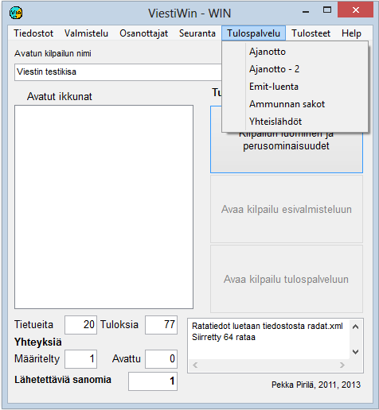

# 1.3.5 Menu: Results service

The menu item *Results service* leads to the timing
and punch checking functions. This menu also lets you calculate points
on the basis of the results in the final phase of the competition, and change
start times by class if the competition schedule has changed.

**

- **Timing, Timing - 2.** A form
  for monitoring timing. Makes it possible to follow two different
  timing tables.
- **Emit reading.** Emit punch checking,
  which can also include calculating the results.
- **Calculate competitor points.**
  A form for calculating points on the basis of times or placings, when
  the results are sufficiently complete.
- **Change class start times.**
  Shifting start times when the competition schedule has changed or a mass start
  took place at a time different from the one announced in advance.

Of the options listed above, Emit reading is
available only when the Emit functions have been started. When the sport is biathlon,
the following option is also available

- **Shooting penalties.** In this option you can enter the numbers of misses and follow the miss data received from the Kuronen
  equipment.
