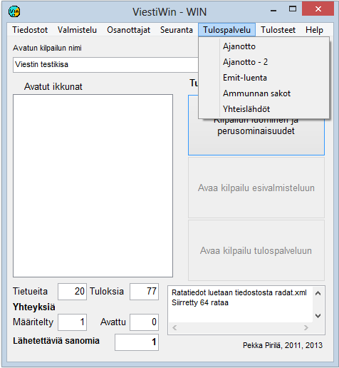

# 1.3.5 Menyval: Resultattjänst

Från menyvalet *Resultattjänst* når du funktionerna för tidtagning
och stämplingskontroll. Från detta val kan du också beräkna poäng
utifrån resultaten i tävlingens slutskede samt ändra
starttider klassvis om tävlingens tidsschema har ändrats.

**

- **Tidtagning, Tidtagning - 2.** Formulär
  för uppföljning av tidtagningen. Möjlighet att följa två olika
  tidtagningstabeller.
- **Emit-avläsning.** Emit-stämplingskontroll,
  som även kan omfatta resultatberäkningen.
- **Beräkna tävlandes poäng.**
  Formulär för att beräkna poäng utifrån tider eller placeringar, när
  resultaten är tillräckligt färdiga.
- **Ändra klassens starttider.**
  Flyttning av starttider när tävlingens tidsschema har ändrats eller en masstart
  har skett vid en annan tidpunkt än planerat.

Av ovan nämnda val är Emit-avläsning
tillgänglig endast när Emit-funktionerna har startats. När grenen är skidskytte
tillkommer dessutom alternativet

- **Skyttestraff.** Med detta val kan du mata in antalet bom samt följa uppgifter om bom
  som erhållits från Kuronens utrustning.
