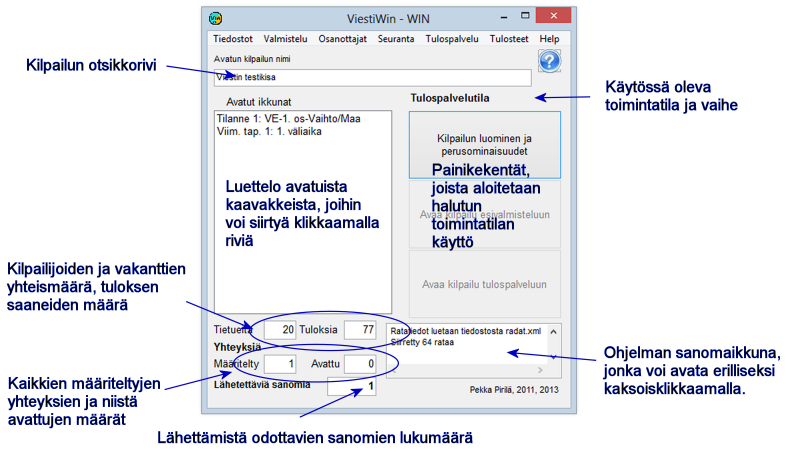

# 1.3 The main form of the program

The menus of the program's main form give direct access to most
functions. In addition, there are a few functions that are reached through forms
opened from here. The following pages briefly describe what the menu options
are used for.

The function *Competition creation and
basic properties* can be reached both directly after the program has started and
from either of the other operating modes. You cannot switch between preparation and results service mode,
or from one stage to another, without exiting the whole program in between.

The information at the bottom of the form on the number of connections and the number of messages
waiting to be sent tells the status of data transfer. A growing number of messages
to be sent indicates that one of the defined connections is not working.
