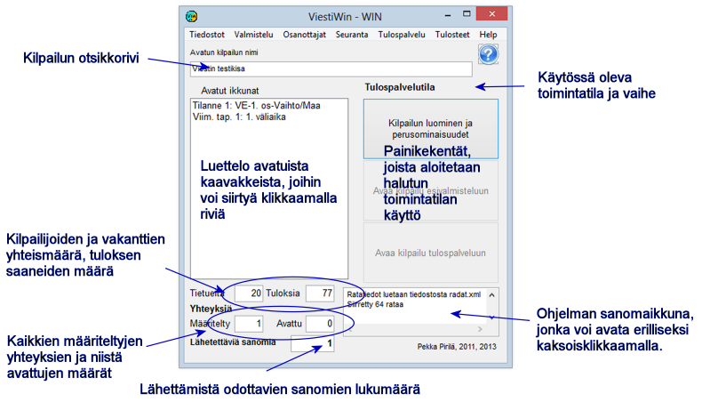

# 1.3 Programmets huvudformulär

Från menyerna i programmets huvudformulär når du direkt de flesta
funktionerna. Dessutom finns några funktioner som nås via formulär
som öppnas härifrån. På följande sidor presenteras kort vad menyalternativen
används till.

Funktionen *Skapa tävling och
grundegenskaper* kan nås både direkt efter att programmet startat och
från båda de andra driftlägena. Mellan förberedelseläget och resultattjänstläget
eller från en etapp till en annan kan du inte byta utan att däremellan lämna hela programmet.

Uppgifterna längst ned i formuläret om antalet förbindelser och antalet meddelanden
som väntar på att skickas visar dataöverföringens läge. Om antalet meddelanden
som ska skickas ökar betyder det att någon av de definierade förbindelserna inte fungerar.
