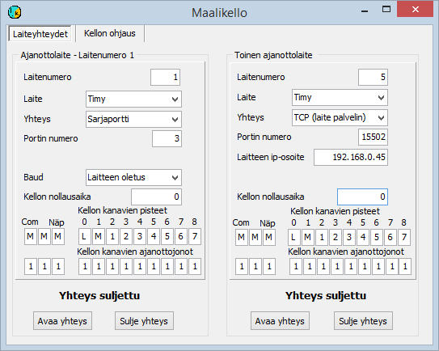

# 5.1  Using a finish clock

### 5.1  Using a finish clock

It is usually advisable to prepare the use of finish clocks
in advance and save the choices in the configuration file. Especially
during testing and when the situation changes during the competition, it may however be
more practical to change the choices through the menu. This is covered below in section 5.1.2.

#### 5.1.1 Finish clocks and enabling them with the configuration file

The programs support several clock models. These are

- Timy, S3, S4 and Comet made by Alge-Timing.

  - RTR1, RTR2, ECB1 and ETS1 by Emit (formerly Regnly).

In addition, support for some less common devices has been
implemented in the software, but it has not been continuously maintained.

Finish clocks are mostly used only for taking the time,
with the competitor's identity entered manually or in some cases obtained
from a chip reader, either via the finish clock or a separate device. Other sections
cover methods where identification is part of the same event as timing.

The program stores times in units of 1/10000 s, but
the last decimal does not usually contain real timing information. It can then
help by keeping times in a fixed order even when they are identical to the millisecond.

The finish clock is usually connected to the program through a serial
port, but a Timy can also be connected by combining USB and
TCP connections, as described in appendix 7. A computer's serial port is nowadays
often implemented with a USB/RS232 converter. Some devices may contain
such a converter, in which case the cable used is a USB cable, but from the
program's point of view the connection is still a serial port. The finish clock type and the serial port number
are given with a configuration parameter, which can be for example

```
TIMY=7
```

when the clock is a Timy and the serial port provided by the USB converter is COM7.

A time received from the finish clock can be directed to the start time,
the finish time or the time of a split point using the parameter PISTEET,
whose typical form is

```
PISTEET=MMMLM1
```

Here the first three letters M refer to times
taken other than with the finish clock (see the instructions for the program HkMaali),
the fourth letter L indicates that the start time information from the finish clock is recorded
as the start time, and correspondingly the following M and 1 refer to the finish clock's
finish time information and the first split time information. The details may
vary depending on the finish clock type. There is more information in the HkMaali instructions.

When you want to define as the target a split point whose
sequence number is greater than 9, a comma must be added between all
points so that the program does not interpret such a point as two different points
with single-digit sequence numbers (for example
PISTEET=M,M,M,L,4,12,14).

When the parameter PISTEET
is supplemented with /kaikki or
/class name and the program takes a time defined as a start time,
the program looks for a competitor whose start time window the time falls into. If such a competitor
is found, the time is attached to that competitor. The timing window is by default 3 s in both directions.
The size of the window can be changed with the parameter (x is the limit in seconds).

```
LÄHTÖIKKUNA=x
```

When using the program HkMaali, the timing function can be restricted to
one point only by giving the parameter in the form

```
PISTEET=x/vain
```

where x is the identifier of the point. The combination

```
PISTEET=MMMLM/kaikki
PISTEET=M/vain
```

indicates that both start and finish times are received from the finish clock
and that the display of finish times is assumed to concern only finish
times (not split times). Start times are recorded automatically for competitors when
they fall within the start window.

Times can be directed to several separate timing queues
using the parameter

JONOT=xxxxxxx

where each character x refers to the queue to which
the timing method is attached. The timing methods are in the same order as in
the parameter PISTEET. The number of available queues
may vary. Currently it is normally 4. The actual
number is shown in the menu option *Help/About*
.

#### 5.1.2 Finish clock settings on the definition forms



This section covers finish clocks whose operation is not based on
detecting a chip. Settings for all Emit devices, including ECB1 and ETS1, are made
on the Emit device definition forms.

The following description mostly applies both to the form opened through the timing form's
menu and to the corresponding settings in the [configuration editor](1.3_toimintatilojen_konfigurointi.md).

Finish clocks normally operate as device no 1, but a Timy can
also be defined to use some other device number. This makes it possible
to use either two Timys, or a Timy and some other finish clock, at the same time.
(More information below).

The definition of device no 1 starts by selecting the finish clock
type. For the second Timy the first choice is the device number, which cannot
be 1 nor the device number defined for the chip reader.

The normal way of connecting all clocks to the program is a
serial port, but a Timy
can also be connected
to the computer directly with a USB connection that is not based on
a serial port adapter. In that case the Timy communicates with a separate program,
which sends the data to the results software using the TCP protocol, acting as a
TCP server. For this use there is the option of selecting TCP as the connection
type.

A connection based on the TCP protocol and the Timy message format
can also be used with a separate finish clock emulator
program. This solution has been used both for testing purposes
and for transferring times from finish camera software that has no direct link
to the results software.

When a serial port is used, you also define
the serial port number. The transmission speed is usually the device default,
for the Timy 9600 baud, which must be selected through the Timy's menus if it
is not already selected. It is however also possible to make the program
use a different serial port speed, in which case the same setting applies to both
finish clocks.

When a TCP connection is used, the clock or the external
computer program normally acts as the server, in which case the HkKisaWin
settings must give the device's IP address and connection port.

The settings also include the possibility of defining a
clock time offset if the finish clock gives times that differ from local time.
The offset is expressed as the clock time at which the finish clock's time was or would have been
00:00:00.

On the form you can also define which point's times
the different channels of the finish clock and the other timing methods give, and to which
timing queue these times are directed.

#### 5.1.3  Using several finish clocks at the same time

The finish clock and most other timing devices connect
to my program as device 1, unless otherwise selected. Selecting the device number is
possible only for some devices; among finish clocks only for the Timy. For example the parameter

TIMY2=5

indicates that a Timy is connected as device 2 to serial port
COM5. The maximum number of devices is normally 32 (the limit of each program version
can be seen in the menu option *Help/About*). However, the form shown higher up on this page
handles only the first two finish clocks in device number order,
so the others are not supported by this form.

A device number can also be attached to the parameters PISTEET and JONOT,
and thus the times of different finish clocks can be directed to different
targets. For example

```
TIMY1=4  
TIMY2=5  
PISTEET1=MMMLMMMMMMMM  
PISTEET2=AAA12345678  
JONOT1=111211111111  
JONOT2=333333333333
```

directs the times of the Timy connected to serial port COM4 as start and finish times to queues 1 and 2, and the different
channels of the Timy connected to serial port 5 as the times of split points 1-8 to queue
3. A similar arrangement can be particularly useful in competition formats where
times are taken separately for different courses ([chapter 5.7](5.7_ajanotto_ratojen_perusteella.md)) and where
there are more timing points than one finish clock can
handle.
