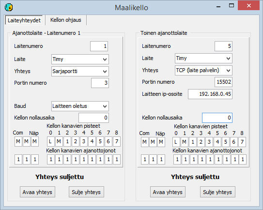

# 5.1  Användning av målklocka

### 5.1  Användning av målklocka

Användningen av målklockor bör i regel förberedas
i förväg och valen sparas i konfigurationsfilen. Särskilt
i testskedet och när situationen ändras under tävlingen kan det dock vara
smidigare att ändra valen via menyn. Detta behandlas nedan i avsnitt 5.1.2.

#### 5.1.1 Målklockor och hur de tas i bruk med konfigurationsfilen

Programmen stöder flera modeller av klockor. Dessa är

- Timy, S3, S4 och Comet tillverkade av Alge-Timing.

  - Emits (tidigare Regnly) RTR1, RTR2, ECB1 och ETS1.

Dessutom har programmet även stöd för mer sällsynta
enheter, men detta stöd har inte underhållits kontinuerligt.

Målklockor används till största delen endast för tidtagning
så att uppgiften om den tävlande matas in för hand eller i vissa fall erhålls
från en bricka, antingen via målklockan eller via en separat enhet. I andra underavsnitt
behandlas förfaranden där identifieringen ingår i samma händelse som tidtagningen.

Programmet sparar tiderna i enheten 1/10000 s, men
den sista decimalen innehåller i regel ingen verklig tidtagningsinformation. Den kan då
hjälpa till att hålla tiderna i en fast ordning även om de är lika på millisekunden.

Målklockan ansluts till programmet i regel via en serieport,
men Timy kan också anslutas genom att kombinera USB- och
TCP-anslutningar, så som beskrivs i bilaga 7. Datorns serieport är numera
ofta förverkligad med en USB/RS232-omvandlare. Vissa enheter kan innehålla
en sådan omvandlare, och då är kabeln en USB-kabel, men anslutningen
är ändå en serieport ur programmets synvinkel. Målklockans typ och serieportens nummer
anges med en konfigurationsparameter, som till exempel kan vara

```
TIMY=7
```

när klockan är en Timy och serieporten som USB-omvandlaren tillhandahåller är COM7.

Tiden från målklockan kan styras till starttid,
måltid eller tid vid någon mellantidspunkt med parametern PISTEET,
vars typiska form är

```
PISTEET=MMMLM1
```

Här avser de tre första bokstäverna M tider
som tagits på annat sätt än med målklockan (se anvisningarna för programmet HkMaali),
L på fjärde plats anger att målklockans starttidsuppgift registreras
som starttid, och på motsvarande sätt avser följande M och 1 målklockans
sluttidsuppgift och den första mellantidsuppgiften. Detaljerna kan
variera beroende på målklockans typ. Mer information finns i anvisningarna för programmet HkMaali.

Om du vill ange som mål en mellantidspunkt vars
ordningsnummer är större än 9 måste ett kommatecken läggas till mellan alla punkter,
så att programmet inte tolkar en sådan punkt som två olika punkter
med ensiffriga ordningsnummer (alltså till exempel
PISTEET=M,M,M,L,4,12,14).

När parametern PISTEET
kompletteras med /kaikki eller
/klassnamn och programmet tar emot en tid som är definierad som starttid,
söker programmet en tävlande vars starttidsfönster den tagna tiden träffar. Om en sådan tävlande
hittas, kopplas tiden till denna tävlande. Tidtagningsfönstret är som standard 3 s åt båda hållen.
Fönstrets storlek kan ändras med parametern (x är gränsen i sekunder).

```
LÄHTÖIKKUNA=x
```

När programmet HkMaali används kan tidtagningsfunktionen begränsas till att gälla
endast en punkt genom att ange parametern i formen

```
PISTEET=x/vain
```

där x är den beteckning som anger punkten. Kombinationen

```
PISTEET=MMMLM/kaikki
PISTEET=M/vain
```

anger att målklockan ger både start- och
måltider och att visningen av måltider antas gälla endast
måltider (inte mellantider). Starttiderna registreras automatiskt för de tävlande när
de träffar startfönstret.

Tiderna kan styras till flera separata tidtagningsköer
med parametern

JONOT=xxxxxxx

där vart och ett av tecknen x anger den kö som
tidtagningssättet kopplas till. Tidtagningssätten är i samma ordning som
i parametern PISTEET. Antalet tillgängliga köer
kan variera. För närvarande är det normalt 4. Det faktiska
antalet visas i menyvalet *Help/Uppgifter*
.

#### 5.1.2 Val för användning av målklocka på definitionsformulären



Här behandlas målklockor vars funktion inte bygger på att
en bricka registreras. Alla val som gäller Emit-enheter inkl. ECB1 och ETS1 görs
på definitionsformulären för Emit-enheter.

Följande beskrivning gäller till största delen både formuläret som öppnas via
tidtagningsformulärets meny och motsvarande val i [konfigurationseditorn](1.3_toimintatilojen_konfigurointi.md).

Målklockor fungerar i regel som enhet nr 1, men Timy kan
också definieras att använda något annat enhetsnummer. Därmed är det möjligt
att samtidigt använda antingen två Timy eller en Timy och någon annan målklocka.
(Mer information nedan).

Definitionen av enhet nr 1 börjar med att målklockans
typ väljs. För en andra Timy är det första valet enhetens nummer, som inte kan
vara 1 och inte heller det enhetsnummer som definierats för brickläsaren.

Det normala sättet att ansluta alla klockor till programmet är
via serieport, men Timy
kan också anslutas
till datorn direkt med en USB-anslutning som inte bygger på
en serieportsadapter. Då är Timy ansluten till ett separat program
som skickar uppgifterna till resultatprogrammet med TCP-protokollet och fungerar
som TCP-server. För detta användningssätt finns möjligheten att välja TCP som
anslutningsform.

En anslutning som bygger på TCP-protokollet och Timys meddelandeformat
lämpar sig också för användning med ett separat program som emulerar en målklocka.
Denna lösning har använts både för testning
och för att överföra tider från ett målkameraprogram som saknar direkt länk
till resultatprogrammet.

När serieport används anges dessutom
serieportens nummer. Överföringshastigheten är i regel enhetens standard,
för Timy 9600 baud, vilket måste väljas via Timys menyer om det
inte redan är valt. Det är dock också möjligt att välja att programmet
använder en avvikande serieportshastighet, och då gäller samma val båda
målklockorna.

När TCP-anslutning används fungerar klockan eller det externa
datorprogrammet normalt som server, och då måste man i programmet HkKisaWins
inställningar ange enhetens IP-adress och anslutningsport.

Definitionerna omfattar dessutom möjligheten att ange en
klockavvikelse, om målklockan ger tider som avviker från lokal tid.
Avvikelsen anges som det klockslag då målklockans tid var eller skulle ha varit
00:00:00.

På formuläret kan man också definiera för vilken punkt
målklockans olika kanaler och övriga tidtagningssätt ger tider och till vilken
tidtagningskö dessa tider styrs.

#### 5.1.3  Användning av flera målklockor samtidigt

Målklockan och de flesta andra tidtagningsenheter ansluts
till mitt program som enhet 1, om inget annat har valts. Det är
möjligt att välja enhetsnummer endast för en del av enheterna, bland målklockorna endast för Timy. Till exempel parametern

TIMY2=5

anger att en Timy har anslutits som enhet 2 till serieporten
COM5. Det högsta antalet enheter är normalt 32 (gränsen för respektive programversion
framgår av menyvalet *Help/Uppgifter*). Formuläret som visas högre upp på denna sida
hanterar dock endast de två första målklockorna i
enhetsnummerordning, så de övriga kan inte hanteras med detta formulär.

Även parametrarna PISTEET och JONOT
kan förses med ett enhetsnummer och därmed kan tider från olika målklockor styras till olika
mål. Till exempel

```
TIMY1=4  
TIMY2=5  
PISTEET1=MMMLMMMMMMMM  
PISTEET2=AAA12345678  
JONOT1=111211111111  
JONOT2=333333333333
```

styr tiderna från den Timy som är ansluten till serieporten COM4 som start- och måltider till köerna 1 och 2, och de olika kanalerna
i den Timy som är ansluten till serieport 5 som tider för mellantidspunkterna 1-8 till kö
3. Ett motsvarande förfarande kan vara särskilt användbart i tävlingsformer där
tider tas separat från olika banor ([kapitel 5.7](5.7_ajanotto_ratojen_perusteella.md)) och där
det finns fler tidtagningspunkter än en målklocka kan
hantera.
