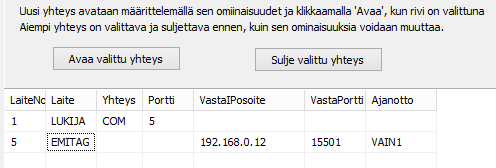

# 6.10 Connections to the Emit reader, controlling MTR and emiTag devices

### 6.10 Connections to the Emit reader, controlling MTR and emiTag devices

When an MTR device or an emiTag system device is in use, you can
select control of that device as a function from the menu of the punch check
form. On the form that opens you can request data to be sent from
the device's memory, set the device clock to the same time as the computer,
and give device-specific control commands. The meaning of the commands
is explained in the documentation of the device in question.

The use of emiTag devices is covered in more detail in [appendix 9](liite_9._emitag-laitteiden_kaytto.md)
.

MTR and emiTag devices store the data they read
in their memory. The program can fetch this data afterwards either directly
for processing or read it into a separate file. When the data is fetched
into a separate file, you can choose in the punch check form option *Read
data from file* which of the data is taken into actual
processing.

Connections to Emit devices are usually defined in advance
using the configuration file, but a connection to a device can also be opened
and closed through the HkKisaWin menu. This is suitable for unforeseen
special needs, testing and changing the connection used, for example
in a situation where a serial port converter stops working in the original
USB port but can be made to work through another USB
port.

The Emit device connection is defined very similarly both in the [configuration editor](1.3_toimintatilojen_konfigurointi.md) and,
during use, on the form opened through the punch check form menu.

In the connection table of the form, the first
column contains the device number, whose maximum value may vary and is currently 32.
The device number must not be the same as that of another device. A finish clock thus
cannot use the same number as
a reader unit.

The other data is partly selected by clicking the relevant
cell with the right mouse
button.

- In column 2 you can select a reader,
  an emiTag device or MTR (MTR5 works
  as an emiTag device).

  - In column 3 you select either a serial port or
    an IP connection, for which there are three
    alternatives.

    - In column 4 you write the computer's serial port
      for a serial port connection, and the IP port when the device's own IP port must
      be given

      - In column 5 you write the device's IP address if
        the program must connect to a device acting
        as a server

        - In column 6 you write the port associated with
          the IP address in column
          5.

          - In column 7 you select with the
            mouse any options for the timing
            function.

In the area above, the upper row defines
a typical connection to an Emit reader. The lower row indicates that the connection
to an emiTag device is made using the TCP protocol. The program requests a connection
from the address 192.168.0.12:15501. This connection is used for timing so that
the times go to the first split time. (These two rows do not work without problems
together.)
