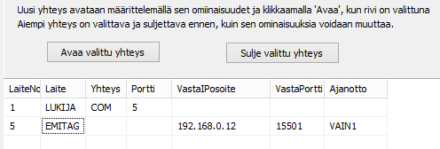

# 6.10 Anslutningar till Emit-läsare, styrning av MTR- och emiTag-enheter

### 6.10 Anslutningar till Emit-läsare, styrning av MTR- och emiTag-enheter

När en MTR-enhet eller en enhet i emiTag-systemet används kan du
i stämplingskontrollformulärets meny välja styrning av den aktuella enheten
som funktion. På formuläret som då öppnas kan du begära att uppgifter skickas
från enhetens minne, ställa enhetens klocka till samma tid som datorn
samt ge enhetsspecifika styrkommandon. Betydelsen av de kommandon som används
framgår av dokumentationen för respektive enhet.

Användningen av emiTag-enheter behandlas närmare i [bilaga 9](liite_9._emitag-laitteiden_kaytto.md)
.

MTR- och emiTag-enheter sparar lästa uppgifter
i sitt minne. Programmet kan i efterhand hämta dessa uppgifter antingen direkt
för behandling eller läsa dem till en separat fil. När uppgifterna hämtas
till en separat fil kan du med valet *Läs
uppgifter från fil* på stämplingskontrollformuläret välja vilka av uppgifterna som tas till egentlig
behandling.

Anslutningarna till Emit-enheter definieras i regel i förväg
med konfigurationsfilen, men det är också möjligt att öppna
och stänga anslutningen till en enhet via menyn i programmet HkKisaWin. Detta lämpar sig för oförutsedda
specialbehov, testning och för att byta den anslutning som används, till exempel
i en situation där serieportsomvandlaren slutar fungera i den ursprungliga
USB-porten men kan fås att fungera via en annan USB-port.

Anslutningen till en Emit-enhet definieras både i [konfigurationseditorn](1.3_toimintatilojen_konfigurointi.md) och
under användning på det formulär som öppnas via stämplingskontrollformulärets meny,
på mycket
likartat sätt.

I formulärets anslutningstabell anges i den första
kolumnen enhetens nummer, vars maximivärde kan variera och för närvarande är 32.
Enhetens nummer får inte vara detsamma som för en annan enhet. En målklocka kan alltså
inte använda samma nummer som
läsarenheten.

Övriga uppgifter väljs delvis genom att klicka på den aktuella
rutan med höger
musknapp.

- I kolumn 2 kan du välja läsare,
  emiTag-enhet eller MTR (MTR5 fungerar
  som emiTag-enhet).

  - I kolumn 3 väljs antingen serieport eller
    IP-anslutning, för vilken det finns tre
    alternativ.

    - I kolumn 4 skrivs datorns serieport
      vid serieportsanslutning och ip-porten när enhetens egen ip-port ska
      anges

      - I kolumn 5 skrivs enhetens ip-adress, om
        programmet ska ansluta till en enhet som fungerar
        som server

        - I kolumn 6 skrivs den port som hör till
          ip-adressen i kolumn
          5.

          - I kolumn 7 väljs med
            musen eventuella val för
            tidtagningsfunktionen.

I området ovan har på den övre raden valts
en typisk anslutning till en Emit-läsare. Den nedre raden anger att anslutningen
till emiTag-enheten görs med TCP-protokollet. Programmet begär anslutning
till adressen 192.168.0.12:15501. Denna anslutning används för tidtagning så att
tiderna blir den första mellantiden. (Dessa två rader fungerar inte problemfritt
tillsammans.)
