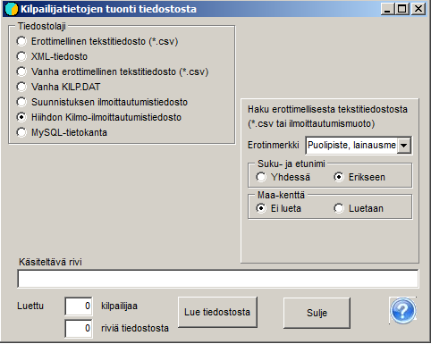

# Entries from the IRMA system

Entries for a national orienteering competition are normally obtained
as a file from the IRMA system.

Before transferring the entries, it is a good idea to copy the file seurat.csv to the competition folder. The file
can be found in the program's demo material. If the club data has changed, you should
obtain more recent data or update the file with a text editor or Excel
to match the new data. The program uses the file to add long club names and
region codes to the competitor data based on the club abbreviations
obtained from IRMA.

The data from IRMA is transferred to the competition using the program's menu item
*Entries / Get from file.* There, select *Orienteering
entry file* and tick *Get long club names
from file Seurat.csv*. Then use the button *Read from file*
to load the data obtained from the IRMA system. If everything is in order, which
means in particular that the class settings and the classes in the IRMA data
match, the program reports the number of competitors
read.

If reading
stops at a point where part of the data has been transferred, you must prevent the same competitors from being included more than
once, either by deleting the file KILP.DAT and starting over, or by deleting
the already transferred data from the file obtained from IRMA.

The menu item *Entries / Entries* opens a table
showing what data has been transferred. If you want to compare and see the data
in the same order as in the file that was read, select
*Entry* as the order. This lets you, among other things, find the point where
the data transfer was interrupted.

With the menu item *Entries / Clubs and entry counts* you can view
the numbers of competitors broken down both by class and by club.
