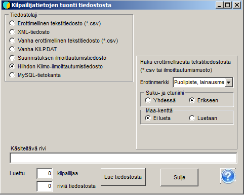

# Anmälningar från IRMA-systemet

Anmälningarna till en nationell orienteringstävling fås normalt
i filformat från IRMA-systemet.

Innan anmälningarna förs över är det bra att kopiera filen seurat.csv till tävlingens mapp. Filen
finns i programmets demomaterial. Om klubbuppgifterna har ändrats bör du
skaffa nyare uppgifter eller komplettera filen med en textredigerare eller Excel
enligt de nya uppgifterna. Programmet använder filen för att få långa klubbnamn och
distriktskoder till deltagaruppgifterna utifrån de klubbförkortningar som fås
från IRMA.

Uppgifterna från IRMA förs över till tävlingen med programmets val
*Deltagare / Hämta från fil.* Där väljer du *Anmälningsfil för
orientering* och kryssar i *Hämta långa klubbnamn
från filen Seurat.csv*. Sedan hämtar du via knappen *Läs från fil*
de uppgifter som hämtats från IRMA-systemet. Om allt är i ordning, vilket
särskilt innebär att klassdefinitionerna och klasserna i IRMA:s uppgifter
stämmer överens, meddelar programmet antalet inlästa
tävlande.

Om inläsningen
avbryts i ett skede där en del av uppgifterna redan har förts över, måste du förhindra att samma tävlande kommer med flera
gånger, antingen genom att radera filen KILP.DAT och börja om från början eller genom att ta bort
de redan överförda uppgifterna från filen från IRMA.

Med programmets val *Deltagare / Deltagare* öppnas en tabell som
visar vilka uppgifter som har förts över. Om du vill se uppgifterna för jämförelse
i samma ordning som de har i den inlästa filen väljer du
*Registrering* som ordning. På så sätt kan du bl.a. fastställa var
överföringen av uppgifterna har avbrutits.

Med valet *Deltagare / Klubbar och deltagarantal* kan du granska
deltagarantalen fördelade både klassvis och klubbvis.
