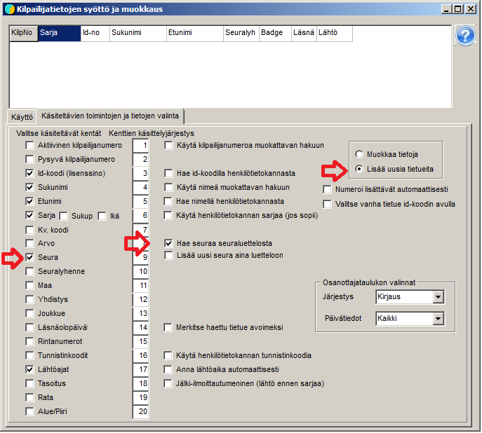

# Entering entries by hand

You often have to add individual entries by typing the data
one competitor at a time. This is done on the form *Entering and editing
competitor data,* which you open from the menu item *Entries /
Entries.*

The form may open showing the text
*Edit mode.* This mode is suitable when
vacancy places have been created in advance in the competitor data and are edited
into competitors. If you want to add new records, you have to switch to
*Add mode.* The mode is changed on the tab *Selection of functions
and data to process*, where you can also choose which fields are available
for editing and whether the program uses a list of possible
competitors or a club list as an aid when entering data. (There are a few other
options as well.)

When the form is used to enter entries before
the draw, there is no need to give a bib number or start time. Selecting the class
is necessary for the program to work; other data is entered as
needed. Using the club list helps to get club abbreviations without errors and
to include the long club names already at this stage. When you tick *Find club
in club list*, the club list form opens, where you must select
the club list to open, Seurat.csv. When you then type the club abbreviation and press Enter once the selection
has landed on the right entry in the club list, the long club name and
region code are also transferred, even if these have not been selected for display on
the entry form.

The table at the top of the form mainly serves to show
the most recently saved record, which can be brought back from it for correction when
*Edit data* has been selected as the operating mode.
